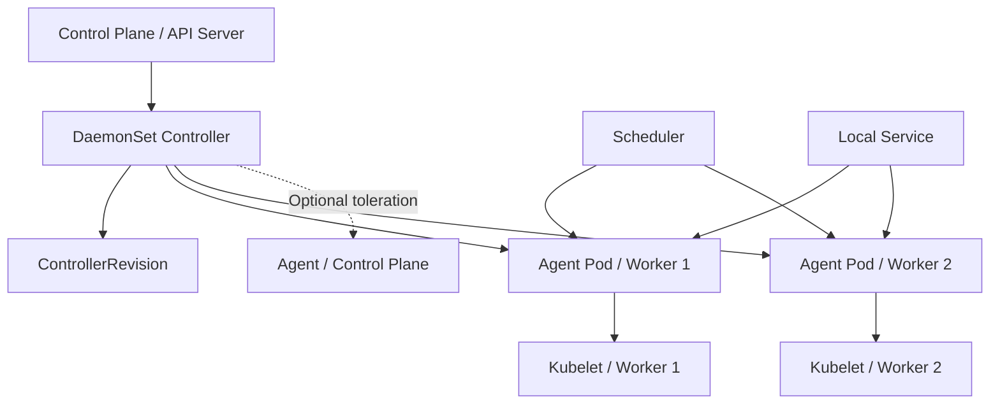

<div dir="rtl" align="right">

# ‏پروژه عملی ‎Kubernetes‎ | ‎DaemonSet‎ در محیط ‎Enterprise‎

**‏سطح:** ‎Beginner‎ → ‎Advanced‎  
**‏محیط:** ‎kubeadm‎ — یک ‎Control Plane‎ و دو ‎Worker‎  
**‏داستان:** تیم ‎Platform‎ فروشگاه آنلاین برای هر ‎Node‎ یک ‎Agent‎ مستقل می‌خواهد تا وضعیت محلی را گزارش دهد و در زمان ‎Update‎ یا خطا خودکار بازیابی شود. ‎Nginx‎ فقط شبیه‌ساز ‎HTTP Agent‎ است؛ سیستم واقعی ‎Monitoring‎ نصب نمی‌شود.

**‏پیش‌نیاز:** ‎Cluster‎ آزمایشی سالم، ‎Bash‎، ‎kubectl‎، ‎Python‎ 3 برای بازسازی ‎JSON‎ در مرحله آخر، دسترسی ‎Registry‎ و مجوز ‎Label‎ کردن ‎Node‎ها. مراحل اختیاری نیازمند مجوز مدیر هستند. به ‎Workload‎های موجود دست نزن.

‏[بخش اول — سناریو](#part-1) · [بخش دوم — پاسخ‌نامه](#part-2) · [اعتبارسنجی نهایی](#final-validation)

**‏هدف:** ‎Node-level Scheduling‎، ‎Lifecycle‎، ‎Update‎، ‎Health‎، ‎Networking‎ و ‎Troubleshooting.‎

</div>

<div dir="ltr" align="left">



</div>


<div dir="rtl" align="right">

### ‏فهرست مراحل

- [Phase 01 — آماده‌سازی Cluster و Namespace](#challenge-01)
- [Phase 02 — DaemonSet پایه و Node Identity](#challenge-02)
- [Phase 03 — Self-healing و Restart / Replacement](#challenge-03)
- [Phase 04 — Node Selector و تغییر پویا در Eligibility](#challenge-04)
- [Phase 05 — Node Affinity و Target Node](#challenge-05)
- [Phase 06 — Taints و Tolerations و Control Plane](#challenge-06)
- [Phase 07 — Cordon و رفتار Drain](#challenge-07)
- [Phase 08 — RollingUpdate و ControllerRevision](#challenge-08)
- [Phase 09 — MaxSurge و Availability](#challenge-09)
- [Phase 10 — OnDelete Strategy و انتشار دستی](#challenge-10)
- [Phase 11 — Probe Failure و تفاوت Ready / Available](#challenge-11)
- [Phase 12 — ImagePullBackOff و Startup Failure](#challenge-12)
- [Phase 13 — Node-local Networking و Service](#challenge-13)
- [Phase 14 — HostPath و Node-local Data](#challenge-14)
- [Phase 15 — Scheduling Failure و Status Fields](#challenge-15)
- [Phase 16 — Orphan Deletion و Adoption](#challenge-16)

</div>

<a name="part-1"></a>

<div dir="rtl" align="right">

## ‏بخش اول — سناریو و مراحل تمرین

> [!IMPORTANT]
> ‏مراحل را به ترتیب انجام بده. هیچ پاسخ آماده‌ای در این بخش نیست. مراحل اختیاری را در صورت نبود مجوز یا پیش‌نیاز اجرا نکن.

</div>

<a name="challenge-01"></a>

<div dir="rtl" align="right">

### ‏‎Phase‎ 01 — آماده‌سازی ‎Cluster‎ و ‎Namespace‎

**‏هدف:** ایزوله کردن محیط آزمایش و شناسایی ‎Node‎ها.

**‏وظایف و ‎Checklist‎**

- [ ] ‏سلامت یک ‎Control Plane‎ و دو ‎Worker‎ را بررسی کن؛ هر سه ‎Ready‎ باشند.
- [ ] ‏‎Namespace‎ با نام `ds-lab` و ‎Label‎ برابر `team=platform` بساز؛ اگر موجود است ادامه نده.
- [ ] ‏دو ‎Worker‎ را با ‎Label‎ اختصاصی `daemon-lab.example/eligible=true` مشخص کن؛ قبل از تغییر مطمئن شو کلید وجود ندارد.
- [ ] ‏نسخه ‎Kubernetes‎ و ظرفیت ‎Worker‎ها را ثبت کن.

**‏معیار پذیرش:** دو ‎Worker‎ دارای ‎Label‎ آزمایشی و ‎Namespace‎ فعال باشند.

</div>

---

<a name="challenge-02"></a>

<div dir="rtl" align="right">

### ‏‎Phase‎ 02 — ‎DaemonSet‎ پایه و ‎Node Identity‎

**‏هدف:** شناخت رابطه ‎Controller‎ و ‎Pod‎ و اجرای یک ‎Agent‎ روی هر ‎Worker.‎

**‏وظایف و ‎Checklist‎**

- [ ] ‏‎DaemonSet‎ با نام `node-agent` و ‎Container‎ با نام `agent` بساز.
- [ ] ‏‎Image‎ برابر `nginx:1.27.5-alpine`، ‎Port‎ نام‌گذاری‌شده `http=80` و ‎Selector‎ برابر `app=node-agent` باشد.
- [ ] ‏فقط ‎Node‎های دارای ‎Label‎ مرحله قبل مجاز باشند؛ ‎CPU Request=50m‎ و ‎Limit=200m‎، ‎Memory Request=32Mi‎ و ‎Limit=128Mi.‎
- [ ] ‏نام ‎Node‎ و ‎Pod‎ از ‎Downward API‎ دریافت و در صفحه اصلی ‎HTTP‎ نمایش داده شوند. برنامه بعد از ۸ ثانیه شروع شود و دو مسیر /ready و /live داشته باشد.
- [ ] ‏‎Startup Probe‎ روی /live با ‎period=3‎ و ‎failureThreshold=15‎؛ ‎Readiness‎ روی /ready با ‎period=3‎ و ‎failureThreshold=2‎؛ ‎Liveness‎ روی /live با ‎period=5‎ و ‎failureThreshold=3.‎
- [ ] ‏‎RollingUpdate‎ با ‎maxUnavailable=1‎، ‎maxSurge=0‎، ‎minReadySeconds=5‎ و ‎revisionHistoryLimit=5‎؛ ‎terminationGracePeriodSeconds=15‎ و توکن خودکار ‎ServiceAccount‎ غیرفعال باشد.

**‏معیار پذیرش:** دو ‎Pod‎ آماده روی دو ‎Worker‎ متفاوت؛ ‎Owner‎ هر ‎Pod‎ همان ‎DaemonSet‎ باشد.

</div>

---

<a name="challenge-03"></a>

<div dir="rtl" align="right">

### ‏‎Phase‎ 03 — ‎Self-healing‎ و ‎Restart‎ / ‎Replacement‎

**‏هدف:** تشخیص تفاوت بازیابی ‎Container‎ و ‎Pod.‎

**‏وظایف و ‎Checklist‎**

- [ ] ‏‎UID‎ و ‎Restart Count‎ یک ‎Pod‎ را ثبت کن.
- [ ] ‏‎Process‎ اصلی ‎Nginx‎ را متوقف کن و بازیابی ‎Container‎ را مشاهده کن.
- [ ] ‏همان ‎Pod‎ را حذف کن و نام، ‎UID‎ و ‎Node‎ جایگزین را مقایسه کن.

**‏معیار پذیرش:** در ‎Restart‎ شناسه ‎Pod‎ ثابت و در ‎Replacement‎ شناسه جدید باشد؛ روی هر ‎Worker‎ یک ‎Pod‎ باقی بماند.

</div>

---

<a name="challenge-04"></a>

<div dir="rtl" align="right">

### ‏‎Phase‎ 04 — ‎Node Selector‎ و تغییر پویا در ‎Eligibility‎

**‏هدف:** شبیه‌سازی ورود و خروج ‎Node‎ از دامنه ‎Agent‎ بدون افزودن ‎Node‎ واقعی.

**‏وظایف و ‎Checklist‎**

- [ ] ‏‎Label‎ اختصاصی ‎Worker‎ دوم را حذف کن؛ ‎Pod‎ آن باید حذف شود.
- [ ] ‏‎Label‎ را بازگردان؛ ‎Pod‎ جدید به‌صورت خودکار ایجاد شود.
- [ ] ‏تعداد ‎Desired‎ و ‎Current‎ را در هر وضعیت ثبت کن.

**‏معیار پذیرش:** تعداد به ترتیب ۲، ۱ و ۲ باشد.

</div>

---

<a name="challenge-05"></a>

<div dir="rtl" align="right">

### ‏‎Phase‎ 05 — ‎Node Affinity‎ و ‎Target Node‎

**‏هدف:** بررسی ‎Scheduling‎ و تفاوت ‎Affinity‎ قالب با ‎Pod‎ ایجادشده.

**‏وظایف و ‎Checklist‎**

- [ ] ‏به ‎Worker‎ اول ‎Label‎ `daemon-lab.example/pool=fast` و به ‎Worker‎ دوم مقدار `standard` بده.
- [ ] ‏در قالب ‎DaemonSet‎ علاوه بر ‎Selector‎ قبلی، ‎NodeAffinity‎ اجباری برای ‎pool=fast‎ ایجاد کن.
- [ ] ‏‎Affinity‎ واقعی ‎Pod‎ را بررسی کن و سپس شرط اضافی را حذف کن.

**‏معیار پذیرش:** ابتدا یک ‎Pod‎ روی ‎Worker‎ اول، سپس دو ‎Pod‎ روی دو ‎Worker.‎

</div>

---

<a name="challenge-06"></a>

<div dir="rtl" align="right">

### ‏‎Phase‎ 06 — ‎Taints‎ و ‎Tolerations‎ و ‎Control Plane‎

**‏هدف:** درک تفاوت ‎Toleration‎ خودکار و ‎Taint‎ اختصاصی ‎Control Plane.‎

**‏وظایف و ‎Checklist‎**

- [ ] ‏‎Toleration‎های واقعی ‎Pod‎ را بررسی کن و موارد خودکار را ثبت کن.
- [ ] ‏فقط در صورت وجود ‎Taint‎ استاندارد ‎NoSchedule‎ روی ‎Control Plane‎ و مجوز مدیر، ‎Label‎ آزمایشی را روی آن اضافه کن؛ ابتدا ‎Agent‎ نباید روی آن اجرا شود.
- [ ] ‏‎Toleration‎ دقیق ‎Taint‎ استاندارد را به قالب اضافه کن؛ اجرای ‎Agent‎ روی سه ‎Node‎ را بررسی کن.
- [ ] ‏‎Label‎ و ‎Toleration‎ آزمایشی ‎Control Plane‎ را حذف کن؛ ‎Taint‎ اصلی را تغییر نده.

**‏معیار پذیرش:** در حالت اختیاری تعداد از ۲ به ۳ و دوباره ۲ برسد؛ در غیر این صورت دلیل ‎Skip‎ ثبت شود.

</div>

---

<a name="challenge-07"></a>

<div dir="rtl" align="right">

### ‏‎Phase‎ 07 — ‎Cordon‎ و رفتار ‎Drain‎

**‏هدف:** شناخت رفتار ‎Agent‎ هنگام ‎Maintenance‎ بدون تخلیه ‎Workload‎های واقعی.

**‏وظایف و ‎Checklist‎**

- [ ] ‏فقط روی ‎Worker‎ آزمایشگاهی و با مجوز، ‎Worker‎ دوم را موقتاً ‎Unschedulable‎ کن؛ ابتدا مطمئن شو از قبل ‎Cordon‎ نیست.
- [ ] ‏‎Pod Agent‎ روی آن را حذف کن و ایجاد جایگزین را مشاهده کن.
- [ ] ‏‎Worker‎ را به وضعیت اولیه بازگردان.
- [ ] ‏رفتار ‎Drain‎ در حضور ‎DaemonSet‎ را توضیح بده؛ ‎Drain‎ واقعی اجرا نکن.

**‏معیار پذیرش:** ‎Pod‎ جایگزین روی ‎Worker Cordon‎ شده نیز ایجاد شود و ‎Node‎ در پایان ‎Schedulable‎ باشد.

</div>

---

<a name="challenge-08"></a>

<div dir="rtl" align="right">

### ‏‎Phase‎ 08 — ‎RollingUpdate‎ و ‎ControllerRevision‎

**‏هدف:** انتشار نسخه و بررسی ‎History.‎

**‏وظایف و ‎Checklist‎**

- [ ] ‏‎Image‎ را به `nginx:1.28.0-alpine` تغییر بده.
- [ ] ‏در طول ‎Rollout‎ وضعیت هر ‎Node‎، ‎Ready‎ و ‎Available‎ و ‎controller-revision-hash‎ را مشاهده کن.
- [ ] ‏‎Revision‎ها و ‎Owner‎ آنها را بررسی کن؛ ‎Rollback‎ انجام بده و دوباره نسخه جدید را منتشر کن.

**‏معیار پذیرش:** دو ‎Pod‎ نسخه 1.28.0، تاریخچه ‎Revision‎ قابل مشاهده و حداقل یک ‎Agent Available‎ در ‎Rollout‎ عادی.

</div>

---

<a name="challenge-09"></a>

<div dir="rtl" align="right">

### ‏‎Phase‎ 09 — ‎MaxSurge‎ و ‎Availability‎

**‏هدف:** بررسی هم‌پوشانی موقت دو ‎Agent‎ روی یک ‎Node.‎

**‏وظایف و ‎Checklist‎**

- [ ] ‏‎RollingUpdate‎ را به ‎maxSurge=1‎ و ‎maxUnavailable=0‎ تغییر بده.
- [ ] ‏‎Image‎ را به 1.27.5 برگردان و در حین ‎Update‎، ‎Pod‎های هر ‎Node‎ را مشاهده کن.
- [ ] ‏پس از تکمیل، تنظیمات اولیه ‎Update‎ را برگردان.

**‏معیار پذیرش:** در صورت ظرفیت کافی، ‎Pod‎ جدید قبل از حذف ‎Pod Available‎ قدیمی روی همان ‎Node‎ ایجاد شود؛ در پایان فقط دو ‎Pod‎ باقی بمانند.

</div>

---

<a name="challenge-10"></a>

<div dir="rtl" align="right">

### ‏‎Phase‎ 10 — ‎OnDelete Strategy‎ و انتشار دستی

**‏هدف:** مدیریت نسخه هر ‎Node‎ به صورت دستی.

**‏وظایف و ‎Checklist‎**

- [ ] ‏‎Strategy‎ را ‎OnDelete‎ کن و ‎Image‎ را به 1.28.0 تغییر بده.
- [ ] ‏بررسی کن ‎Pod‎های موجود خودکار جایگزین نشوند.
- [ ] ‏‎Pod Worker‎ اول و سپس ‎Worker‎ دوم را به ترتیب حذف کن و نسخه‌ها را بررسی کن.
- [ ] ‏‎RollingUpdate‎ اولیه را بازگردان.

**‏معیار پذیرش:** در میانه آزمایش دو نسخه متفاوت و در پایان دو ‎Pod‎ نسخه 1.28.0.

</div>

---

<a name="challenge-11"></a>

<div dir="rtl" align="right">

### ‏‎Phase‎ 11 — ‎Probe Failure‎ و تفاوت ‎Ready‎ / ‎Available‎

**‏هدف:** آزمایش سلامت ‎Agent‎ بدون تغییر کل قالب.

**‏وظایف و ‎Checklist‎**

- [ ] ‏مسیر /ready یکی از ‎Pod‎ها را حذف کن؛ ‎Ready‎ کاهش یابد ولی ‎Restart‎ افزایش نیابد.
- [ ] ‏مسیر را بازیابی کن و ‎Available‎ شدن پس از ‎minReadySeconds‎ را بررسی کن.
- [ ] ‏مسیر /live را حذف کن؛ ‎Restart‎ و بازیابی خودکار مسیرها را مشاهده کن.

**‏معیار پذیرش:** ‎UID Pod‎ ثابت و هر دو ‎Pod‎ در پایان ‎Available‎ باشند.

</div>

---

<a name="challenge-12"></a>

<div dir="rtl" align="right">

### ‏‎Phase‎ 12 — ‎ImagePullBackOff‎ و ‎Startup Failure‎

**‏هدف:** تشخیص ‎Rollout‎ متوقف‌شده و بازیابی نسخه سالم.

**‏وظایف و ‎Checklist‎**

- [ ] ‏‎Image‎ ناموجود `nginx:daemon-lab-invalid-99999` را منتشر کن؛ ‎Events‎ را بررسی و ‎Rollback‎ کن.
- [ ] ‏بودجه ‎Startup‎ را به یک تلاش کاهش بده؛ برنامه هنوز ۸ ثانیه تأخیر دارد. شکست ‎Probe‎ و ‎Restart‎ را بررسی کن و ‎Rollback‎ کن.

**‏معیار پذیرش:** هر دو خطا رفع شوند و دو ‎Agent‎ سالم در نسخه قبلی باقی بمانند.

</div>

---

<a name="challenge-13"></a>

<div dir="rtl" align="right">

### ‏‎Phase‎ 13 — ‎Node-local Networking‎ و ‎Service‎

**‏هدف:** دسترسی به ‎Agent‎ محلی بدون ‎Host Network‎ یا ‎Host Port.‎

**‏وظایف و ‎Checklist‎**

- [ ] ‏‎ClusterIP Service‎ با نام `node-agent-local`، ‎Port=80‎ و ‎targetPort=http‎ بساز؛ ‎internalTrafficPolicy‎ برابر ‎Local‎ باشد.
- [ ] ‏یک ‎Client‎ روی هر ‎Worker‎ با نام‌های `client-w1` و `client-w2` بساز و پاسخ ‎Agent‎ محلی را مقایسه کن.
- [ ] ‏‎Agent Worker‎ دوم را با تغییر ‎Eligibility‎ حذف کن؛ ‎Client‎ همان ‎Worker‎ نباید به ‎Agent Worker‎ دیگر هدایت شود. سپس ‎Label‎ را بازیابی کن.

**‏معیار پذیرش:** پاسخ هر ‎Client‎ نام ‎Node‎ خودش باشد؛ بدون ‎Endpoint‎ محلی درخواست ناموفق شود.

</div>

---

<a name="challenge-14"></a>

<div dir="rtl" align="right">

### ‏‎Phase‎ 14 — ‎HostPath‎ و ‎Node-local Data‎

**‏هدف:** مشاهده یک فایل بی‌خطر ‎Host‎ با دسترسی ‎ReadOnly.‎

**‏وظایف و ‎Checklist‎**

- [ ] ‏در صورت مجاز بودن ‎Pod Security‎، فایل /etc/hostname هر ‎Worker‎ را به ‎Container‎ در مسیر /node-‎hostname‎ به صورت ‎ReadOnly Mount‎ کن.
- [ ] ‏مقدار فایل و ‎NODE_NAME‎ را مقایسه کن؛ الزاماً یکسان نیستند.
- [ ] ‏‎Mount‎ را حذف کن و وضعیت نهایی را بازیابی کن.

**‏معیار پذیرش:** فایل قابل خواندن باشد و هیچ نوشتنی روی ‎Host‎ انجام نشود.

</div>

---

<a name="challenge-15"></a>

<div dir="rtl" align="right">

### ‏‎Phase‎ 15 — ‎Scheduling Failure‎ و ‎Status Fields‎

**‏هدف:** تحلیل ‎Pending‎ و تفاوت ‎Eligibility‎ با ظرفیت واقعی.

**‏وظایف و ‎Checklist‎**

- [ ] ‏فیلدهای ‎desiredNumberScheduled‎، ‎currentNumberScheduled‎، ‎numberReady‎، ‎numberAvailable‎، ‎numberUnavailable‎، ‎numberMisscheduled‎، ‎updatedNumberScheduled‎ و ‎observedGeneration‎ را ثبت کن.
- [ ] ‏‎CPU Request‎ و ‎Limit‎ را به مقداری بیشتر از ظرفیت هر ‎Worker‎ تغییر بده؛ هیچ بار ‎CPU‎ واقعی ایجاد نکن.
- [ ] ‏‎FailedScheduling‎ و عدم تکمیل ‎Rollout‎ را بررسی و ‎Rollback‎ کن.
- [ ] ‏با درخواست تغییر ‎Selector‎ به مقدار دیگر خطای ‎immutable‎ را مشاهده کن.

**‏معیار پذیرش:** دو ‎Agent‎ سالم و ‎Selector‎ اصلی بدون تغییر باقی بماند.

</div>

---

<a name="challenge-16"></a>

<div dir="rtl" align="right">

### ‏‎Phase‎ 16 — ‎Orphan Deletion‎ و ‎Adoption‎

**‏هدف:** بررسی مالکیت و بازسازی ‎Controller‎ در محیط ایزوله.

**‏وظایف و ‎Checklist‎**

- [ ] ‏قالب سالم جاری را برای بازسازی ذخیره کن، بدون فیلدهای ‎Runtime.‎
- [ ] ‏‎DaemonSet‎ را با ‎Orphan‎ حذف کن و بررسی کن ‎Pod‎ها باقی مانده‌اند و ‎Owner‎ حذف شده است.
- [ ] ‏‎Controller‎ را با همان نام و ‎Selector‎ و قالب بازسازی کن؛ ‎UID‎ و ‎Owner Pod‎ها را بررسی کن.
- [ ] ‏تفاوت ‎Cascade‎ و ‎Orphan‎ را توضیح بده.

**‏معیار پذیرش:** دو ‎Pod‎ تحت مالکیت ‎DaemonSet‎ جدید باشند؛ ‎UID‎های قبلی در صورت ‎Adoption‎ موفق حفظ شوند.

</div>

---

<div dir="rtl" align="right">

### Final Acceptance Criteria

- [ ] ‏دو ‎Worker‎ واجد شرایط، هرکدام یک ‎Agent‎ سالم داشته باشند.
- [ ] ‏‎Update Strategy‎ در پایان ‎RollingUpdate‎ باشد.
- [ ] ‏‎Rollback‎، ‎OnDelete‎، ‎Health Probe‎ و ‎Self-healing‎ بررسی شده باشند.
- [ ] ‏خطاهای آزمایشی رفع شده و ‎Label‎ها و ‎Cordon‎ اختیاری به وضعیت مورد انتظار بازگشته باشند.
- [ ] ‏تفاوت ‎DaemonSet‎ با ‎Deployment‎ و ‎StatefulSet‎ را بتوانم توضیح دهم.

**‏‎Skills Acquired:‎** ‎Node eligibility‎، ‎ControllerRevision‎، ‎Tolerations‎، ‎Scheduling‎، ‎Update Strategy‎، ‎Node-local networking‎، ‎Troubleshooting.‎

</div>

<a name="part-2"></a>

<div dir="rtl" align="right">

## ‏بخش دوم — پاسخ‌نامه و نکات فنی

‏پاسخ‌ها بسته هستند. ‎Command‎ها برای ‎Bash‎ نوشته شده‌اند؛ در ‎Watch‎ با ‎Ctrl‎+‎C‎ خارج شو. خروجی‌های ذکرشده معیار مورد انتظار هستند. اگر فرمان غیرمنتظره خطا داد، قبل از ادامه علت را بررسی کن.

</div>

<details>
<summary dir="rtl" align="right">Phase 01 — آماده‌سازی Cluster و Namespace</summary>

<div dir="rtl" align="right">

#### ‏راه‌حل کامل

‏ایزوله کردن محیط آزمایش و شناسایی ‎Node‎ها.

</div>

<div dir="ltr" align="left">

```bash
kubectl config current-context
kubectl version
kubectl get nodes -o wide --show-labels
kubectl get ns ds-lab --ignore-not-found
kubectl get nodes -l daemon-lab.example/eligible
kubectl get nodes -l daemon-lab.example/pool
# Stop if namespace or either label key already exists.
# Replace these values with the actual names from get nodes:
export W1=worker-1 W2=worker-2 CP=control-plane
kubectl describe node "$W1"
kubectl describe node "$W2"
kubectl label node "$W1" "$W2" daemon-lab.example/eligible=true
kubectl create namespace ds-lab
kubectl label namespace ds-lab team=platform
kubectl get nodes -l daemon-lab.example/eligible=true
kubectl get ns ds-lab --show-labels
```

</div>

<div dir="rtl" align="right">

#### Configuration Explanation / Technical Notes

‏نام ‎Node‎ها نمونه است؛ مقادیر واقعی را جایگزین و در همان ‎Bash‎ نگه دار. ‎Label‎ آزمایشی روی ‎Node‎ یک تغییر ‎Cluster-wide‎ است؛ فقط روی ‎Cluster‎ آزمایشگاهی با مجوز انجام بده. هیچ ‎Taint‎ موجود را حذف نکن.

**‏‎Expected Result‎ / ‎Validation:‎** دو ‎Worker‎ دارای ‎Label‎ آزمایشی و ‎Namespace‎ فعال باشند.

**‏‎Best Practice:‎** فقط ‎Resource‎های آزمایشگاهی را تغییر بده و پس از هر تغییر وضعیت و ‎Events‎ را بررسی کن.

**‏‎Interview Q‎&‎A:‎** آیا ‎Namespace‎ برای ‎Node‎ تعریف می‌شود؟ خیر؛ ‎Node‎ یک ‎Resource‎ در سطح ‎Cluster‎ است.

</div>

</details>

---

<details>
<summary dir="rtl" align="right">Phase 02 — DaemonSet پایه و Node Identity</summary>

<div dir="rtl" align="right">

#### ‏راه‌حل کامل

‏شناخت رابطه ‎Controller‎ و ‎Pod‎ و اجرای یک ‎Agent‎ روی هر ‎Worker.‎

</div>

<div dir="rtl" align="right">

‏‎Manifest‎ زیر را با نام `node-agent.yaml` ذخیره کن.

</div>

<div dir="ltr" align="left">

```yaml
apiVersion: apps/v1
kind: DaemonSet
metadata:
  name: node-agent
  namespace: ds-lab
spec:
  selector:
    matchLabels:
      app: node-agent
  minReadySeconds: 5
  revisionHistoryLimit: 5
  updateStrategy:
    type: RollingUpdate
    rollingUpdate:
      maxUnavailable: 1
      maxSurge: 0
  template:
    metadata:
      labels:
        app: node-agent
    spec:
      nodeSelector:
        daemon-lab.example/eligible: "true"
      automountServiceAccountToken: false
      terminationGracePeriodSeconds: 15
      containers:
        - name: agent
          image: nginx:1.27.5-alpine
          ports:
            - name: http
              containerPort: 80
          env:
            - name: NODE_NAME
              valueFrom:
                fieldRef:
                  fieldPath: spec.nodeName
            - name: POD_NAME
              valueFrom:
                fieldRef:
                  fieldPath: metadata.name
          command: ["/bin/sh", "-c"]
          args:
            - |
              sleep 8
              printf 'node=%s pod=%s\n' "$NODE_NAME" "$POD_NAME" > /usr/share/nginx/html/index.html
              echo ready > /usr/share/nginx/html/ready
              echo live > /usr/share/nginx/html/live
              exec nginx -g 'daemon off;'
          resources:
            requests:
              cpu: 50m
              memory: 32Mi
            limits:
              cpu: 200m
              memory: 128Mi
          startupProbe:
            httpGet:
              path: /live
              port: http
            periodSeconds: 3
            failureThreshold: 15
          readinessProbe:
            httpGet:
              path: /ready
              port: http
            periodSeconds: 3
            failureThreshold: 2
          livenessProbe:
            httpGet:
              path: /live
              port: http
            periodSeconds: 5
            failureThreshold: 3
```

</div>

<div dir="ltr" align="left">

```bash
kubectl apply --dry-run=server -f node-agent.yaml
kubectl apply -f node-agent.yaml
kubectl -n ds-lab rollout status daemonset/node-agent --timeout=180s
kubectl -n ds-lab get ds,pods -o wide
kubectl -n ds-lab get pods -l app=node-agent -o custom-columns=NAME:.metadata.name,NODE:.spec.nodeName,OWNER:.metadata.ownerReferences[0].kind
POD=$(kubectl -n ds-lab get pod -l app=node-agent -o jsonpath='{.items[0].metadata.name}')
kubectl -n ds-lab exec "$POD" -- wget -qO- http://127.0.0.1/
```

</div>

<div dir="rtl" align="right">

#### Configuration Explanation / Technical Notes

‏‎selector‎ با ‎Label‎ قالب یکسان و تغییرناپذیر است؛ برخلاف ‎Deployment‎ هیچ ‎replicas‎ یا ‎ReplicaSet‎ وجود ندارد. ‎Downward API‎ اطلاعات ‎Pod‎ را بدون دسترسی به ‎API Server‎ می‌دهد. ‎Startup‎ مانع اجرای دو ‎Probe‎ دیگر تا موفقیت خود می‌شود. ‎Requests‎ برای ‎Scheduling‎ و ‎Limits‎ برای محدودیت منابع هستند.

**‏‎Expected Result‎ / ‎Validation:‎** دو ‎Pod‎ آماده روی دو ‎Worker‎ متفاوت؛ ‎Owner‎ هر ‎Pod‎ همان ‎DaemonSet‎ باشد.

**‏‎Best Practice:‎** فقط ‎Resource‎های آزمایشگاهی را تغییر بده و پس از هر تغییر وضعیت و ‎Events‎ را بررسی کن.

**‏‎Interview Q‎&‎A:‎** چرا دو ‎Pod‎ ساخته شد؟ تعداد ‎Node‎های واجد شرایط دو است، نه به دلیل مقدار ‎replicas.‎

</div>

</details>

---

<details>
<summary dir="rtl" align="right">Phase 03 — Self-healing و Restart / Replacement</summary>

<div dir="rtl" align="right">

#### ‏راه‌حل کامل

‏تشخیص تفاوت بازیابی ‎Container‎ و ‎Pod.‎

</div>

<div dir="ltr" align="left">

```bash
POD=$(kubectl -n ds-lab get pod -l app=node-agent -o jsonpath='{.items[0].metadata.name}')
kubectl -n ds-lab get pod "$POD" -o custom-columns=UID:.metadata.uid,RESTARTS:.status.containerStatuses[0].restartCount,NODE:.spec.nodeName
kubectl -n ds-lab exec "$POD" -- nginx -s stop
kubectl -n ds-lab get pod "$POD" -w
# Ctrl+C after restart and Ready
kubectl -n ds-lab get pod "$POD" -o custom-columns=UID:.metadata.uid,RESTARTS:.status.containerStatuses[0].restartCount,NODE:.spec.nodeName
kubectl -n ds-lab delete pod "$POD"
kubectl -n ds-lab rollout status daemonset/node-agent --timeout=180s
kubectl -n ds-lab get ds,pods -o wide
```

</div>

<div dir="rtl" align="right">

#### Configuration Explanation / Technical Notes

‏‎Kubelet Container‎ را مجدداً اجرا می‌کند؛ ‎Controller‎ جای خالی ‎Pod‎ همان ‎Node‎ را پر می‌کند. ‎UID‎ معیار مطمئن هویت است.

**‏‎Expected Result‎ / ‎Validation:‎** در ‎Restart‎ شناسه ‎Pod‎ ثابت و در ‎Replacement‎ شناسه جدید باشد؛ روی هر ‎Worker‎ یک ‎Pod‎ باقی بماند.

**‏‎Best Practice:‎** فقط ‎Resource‎های آزمایشگاهی را تغییر بده و پس از هر تغییر وضعیت و ‎Events‎ را بررسی کن.

**‏‎Interview Q‎&‎A:‎** آیا حذف ‎Pod‎ باعث انتقال ‎Agent‎ به ‎Worker‎ دیگر می‌شود؟ خیر؛ جایگزین برای ‎Node‎ واجد شرایط همان ‎Pod‎ ایجاد می‌شود.

</div>

</details>

---

<details>
<summary dir="rtl" align="right">Phase 04 — Node Selector و تغییر پویا در Eligibility</summary>

<div dir="rtl" align="right">

#### ‏راه‌حل کامل

‏شبیه‌سازی ورود و خروج ‎Node‎ از دامنه ‎Agent‎ بدون افزودن ‎Node‎ واقعی.

</div>

<div dir="ltr" align="left">

```bash
kubectl label node "$W2" daemon-lab.example/eligible-
kubectl -n ds-lab rollout status daemonset/node-agent --timeout=180s
kubectl -n ds-lab get ds,pods -o wide
kubectl label node "$W2" daemon-lab.example/eligible=true
kubectl -n ds-lab rollout status daemonset/node-agent --timeout=180s
kubectl -n ds-lab get ds,pods -o wide
```

</div>

<div dir="rtl" align="right">

#### Configuration Explanation / Technical Notes

‏‎Controller‎ با تغییر ‎Label‎ دامنه ‎Node‎های واجد شرایط را بازبینی می‌کند. حتی اگر ‎NodeAffinity‎ از نوع ‎IgnoredDuringExecution‎ باشد، ‎DaemonSet‎ می‌تواند ‎Pod‎ خارج از دامنه خود را حذف کند.

**‏‎Expected Result‎ / ‎Validation:‎** تعداد به ترتیب ۲، ۱ و ۲ باشد.

**‏‎Best Practice:‎** فقط ‎Resource‎های آزمایشگاهی را تغییر بده و پس از هر تغییر وضعیت و ‎Events‎ را بررسی کن.

**‏‎Interview Q‎&‎A:‎** آیا ‎DaemonSet‎ را با ‎scale‎ مدیریت می‌کنیم؟ خیر؛ دامنه ‎Node‎ها تعداد مطلوب را تعیین می‌کند.

</div>

</details>

---

<details>
<summary dir="rtl" align="right">Phase 05 — Node Affinity و Target Node</summary>

<div dir="rtl" align="right">

#### ‏راه‌حل کامل

‏بررسی ‎Scheduling‎ و تفاوت ‎Affinity‎ قالب با ‎Pod‎ ایجادشده.

</div>

<div dir="ltr" align="left">

```bash
kubectl label node "$W1" daemon-lab.example/pool=fast
kubectl label node "$W2" daemon-lab.example/pool=standard
kubectl -n ds-lab patch daemonset/node-agent --type=merge -p '{"spec":{"template":{"spec":{"affinity":{"nodeAffinity":{"requiredDuringSchedulingIgnoredDuringExecution":{"nodeSelectorTerms":[{"matchExpressions":[{"key":"daemon-lab.example/pool","operator":"In","values":["fast"]}]}]}}}}}}}'
kubectl -n ds-lab rollout status daemonset/node-agent --timeout=180s
kubectl -n ds-lab get ds,pods -o wide
POD=$(kubectl -n ds-lab get pod -l app=node-agent -o jsonpath='{.items[0].metadata.name}')
kubectl -n ds-lab get pod "$POD" -o jsonpath='{.spec.affinity.nodeAffinity}'
kubectl -n ds-lab patch daemonset/node-agent --type=merge -p '{"spec":{"template":{"spec":{"affinity":null}}}}'
kubectl -n ds-lab rollout status daemonset/node-agent --timeout=180s
```

</div>

<div dir="rtl" align="right">

#### Configuration Explanation / Technical Notes

‏‎Controller‎ ابتدا ‎Affinity‎ قالب را برای ‎Eligibility‎ ارزیابی می‌کند، سپس برای ‎Pod‎ تولیدشده ‎Affinity‎ هدف ‎Node‎ را قرار می‌دهد. ‎scheduler‎ معمولاً ‎Binding‎ را انجام می‌دهد. ‎preferred affinity‎ راه تضمین حذف ‎Node‎ از دامنه نیست.

**‏‎Expected Result‎ / ‎Validation:‎** ابتدا یک ‎Pod‎ روی ‎Worker‎ اول، سپس دو ‎Pod‎ روی دو ‎Worker.‎

**‏‎Best Practice:‎** فقط ‎Resource‎های آزمایشگاهی را تغییر بده و پس از هر تغییر وضعیت و ‎Events‎ را بررسی کن.

**‏‎Interview Q‎&‎A:‎** آیا ‎nodeName‎ باید دستی تعیین شود؟ خیر؛ ‎Controller‎ و ‎Scheduler‎ مسیر معمول را مدیریت می‌کنند.

</div>

</details>

---

<details>
<summary dir="rtl" align="right">Phase 06 — Taints و Tolerations و Control Plane</summary>

<div dir="rtl" align="right">

#### ‏راه‌حل کامل

‏درک تفاوت ‎Toleration‎ خودکار و ‎Taint‎ اختصاصی ‎Control Plane.‎

</div>

<div dir="ltr" align="left">

```bash
POD=$(kubectl -n ds-lab get pod -l app=node-agent -o jsonpath='{.items[0].metadata.name}')
kubectl -n ds-lab get pod "$POD" -o jsonpath='{.spec.tolerations}'
kubectl describe node "$CP"
# Optional: only if the control-plane NoSchedule taint exists and capacity/permission allow.
kubectl label node "$CP" daemon-lab.example/eligible=true
kubectl -n ds-lab get ds,pods -o wide
kubectl -n ds-lab patch daemonset/node-agent --type=merge -p '{"spec":{"template":{"spec":{"tolerations":[{"key":"node-role.kubernetes.io/control-plane","operator":"Exists","effect":"NoSchedule"}]}}}}'
kubectl -n ds-lab rollout status daemonset/node-agent --timeout=180s
kubectl -n ds-lab get ds,pods -o wide
kubectl label node "$CP" daemon-lab.example/eligible-
kubectl -n ds-lab patch daemonset/node-agent --type=merge -p '{"spec":{"template":{"spec":{"tolerations":null}}}}'
kubectl -n ds-lab rollout status daemonset/node-agent --timeout=180s
```

</div>

<div dir="rtl" align="right">

#### Configuration Explanation / Technical Notes

‏اگر کلید قدیمی ‎master‎ است، همان کلید واقعی را در ‎Patch‎ جایگزین کن؛ اگر ‎Taint‎ دیگری مانع است آن را حذف نکن. ‎Toleration‎ اجازه است نه اجبار. موارد خودکار شامل ‎not-ready‎ و ‎unreachable‎ (‎NoExecute‎)، ‎disk-pressure‎، ‎memory-pressure‎، ‎pid-pressure‎ و ‎unschedulable‎ (‎NoSchedule‎) هستند؛ ‎network-unavailable‎ برای ‎hostNetwork‎ و ‎memory-pressure‎ طبق مستندات فعلی اضافه می‌شوند. ‎Toleration‎ ظرفیت ‎CPU‎ ایجاد نمی‌کند.

**‏‎Expected Result‎ / ‎Validation:‎** در حالت اختیاری تعداد از ۲ به ۳ و دوباره ۲ برسد؛ در غیر این صورت دلیل ‎Skip‎ ثبت شود.

**‏‎Best Practice:‎** فقط ‎Resource‎های آزمایشگاهی را تغییر بده و پس از هر تغییر وضعیت و ‎Events‎ را بررسی کن.

**‏‎Interview Q‎&‎A:‎** آیا ‎DaemonSet‎ همیشه روی ‎Control Plane‎ اجرا می‌شود؟ خیر؛ ‎Taint‎ و ‎Selector‎ و منابع باید اجازه دهند.

</div>

</details>

---

<details>
<summary dir="rtl" align="right">Phase 07 — Cordon و رفتار Drain</summary>

<div dir="rtl" align="right">

#### ‏راه‌حل کامل

‏شناخت رفتار ‎Agent‎ هنگام ‎Maintenance‎ بدون تخلیه ‎Workload‎های واقعی.

</div>

<div dir="ltr" align="left">

```bash
kubectl get node "$W2" -o jsonpath='{.spec.unschedulable}'
# Continue only if not already cordoned and approved.
kubectl cordon "$W2"
POD=$(kubectl -n ds-lab get pod -l app=node-agent --field-selector spec.nodeName="$W2" -o jsonpath='{.items[0].metadata.name}')
kubectl -n ds-lab delete pod "$POD"
kubectl -n ds-lab rollout status daemonset/node-agent --timeout=180s
kubectl -n ds-lab get ds,pods -o wide
kubectl uncordon "$W2"
kubectl get nodes
kubectl drain --help
```

</div>

<div dir="rtl" align="right">

#### Configuration Explanation / Technical Notes

‏‎DaemonSet‎ معمولاً ‎toleration‎ خودکار ‎unschedulable‎ دارد. ‎drain‎ بدون ‎ignore-daemonsets‎ در حضور این ‎Pod‎ها خطا می‌دهد؛ با آن گزینه ‎Pod‎های ‎DaemonSet‎ را حذف نمی‌کند. اجرای واقعی ‎drain‎ ممکن است سایر ‎Workload‎ها را ‎Evict‎ کند و در این ‎Lab‎ عمداً ممنوع است. اگر آزمایش قطع شد ‎Worker‎ را با مجوز ‎uncordon‎ کن.

**‏‎Expected Result‎ / ‎Validation:‎** ‎Pod‎ جایگزین روی ‎Worker Cordon‎ شده نیز ایجاد شود و ‎Node‎ در پایان ‎Schedulable‎ باشد.

**‏‎Best Practice:‎** فقط ‎Resource‎های آزمایشگاهی را تغییر بده و پس از هر تغییر وضعیت و ‎Events‎ را بررسی کن.

**‏‎Interview Q‎&‎A:‎** آیا ‎Cordon Pod‎های موجود را حذف می‌کند؟ خیر.

</div>

</details>

---

<details>
<summary dir="rtl" align="right">Phase 08 — RollingUpdate و ControllerRevision</summary>

<div dir="rtl" align="right">

#### ‏راه‌حل کامل

‏انتشار نسخه و بررسی ‎History.‎

</div>

<div dir="ltr" align="left">

```bash
kubectl -n ds-lab rollout history daemonset/node-agent
kubectl -n ds-lab set image daemonset/node-agent agent=nginx:1.28.0-alpine
kubectl -n ds-lab get pods -w
# Ctrl+C after rollout
kubectl -n ds-lab rollout status daemonset/node-agent --timeout=180s
kubectl -n ds-lab get pods -L controller-revision-hash
kubectl -n ds-lab get controllerrevisions
kubectl -n ds-lab rollout history daemonset/node-agent
kubectl -n ds-lab rollout undo daemonset/node-agent
kubectl -n ds-lab rollout status daemonset/node-agent --timeout=180s
kubectl -n ds-lab set image daemonset/node-agent agent=nginx:1.28.0-alpine
kubectl -n ds-lab rollout status daemonset/node-agent --timeout=180s
```

</div>

<div dir="rtl" align="right">

#### Configuration Explanation / Technical Notes

‏‎DaemonSet‎ از ‎ControllerRevision‎ استفاده می‌کند؛ تغییر ‎Pod Template‎ نسخه ایجاد می‌کند. ‎Rollback‎ قالب را بازمی‌گرداند نه همه ‎Spec. minReadySeconds‎ شرط ‎Available‎ شدن است. ‎maxUnavailable=1‎ در وضعیت سالم اجازه وقفه روی یک ‎Node‎ را می‌دهد.

**‏‎Expected Result‎ / ‎Validation:‎** دو ‎Pod‎ نسخه 1.28.0، تاریخچه ‎Revision‎ قابل مشاهده و حداقل یک ‎Agent Available‎ در ‎Rollout‎ عادی.

**‏‎Best Practice:‎** فقط ‎Resource‎های آزمایشگاهی را تغییر بده و پس از هر تغییر وضعیت و ‎Events‎ را بررسی کن.

**‏‎Interview Q‎&‎A:‎** آیا ‎DaemonSet‎ دارای ‎progressDeadlineSeconds‎ است؟ خیر؛ ‎timeout‎ دستور فقط زمان انتظار ‎Client‎ است.

</div>

</details>

---

<details>
<summary dir="rtl" align="right">Phase 09 — MaxSurge و Availability</summary>

<div dir="rtl" align="right">

#### ‏راه‌حل کامل

‏بررسی هم‌پوشانی موقت دو ‎Agent‎ روی یک ‎Node.‎

</div>

<div dir="ltr" align="left">

```bash
kubectl explain daemonset.spec.updateStrategy.rollingUpdate.maxSurge
kubectl -n ds-lab patch daemonset/node-agent --type=merge -p '{"spec":{"updateStrategy":{"rollingUpdate":{"maxSurge":1,"maxUnavailable":0}}}}' --dry-run=server
kubectl -n ds-lab patch daemonset/node-agent --type=merge -p '{"spec":{"updateStrategy":{"rollingUpdate":{"maxSurge":1,"maxUnavailable":0}}}}'
kubectl -n ds-lab set image daemonset/node-agent agent=nginx:1.27.5-alpine
kubectl -n ds-lab get pods -o wide -w
# Ctrl+C after completion
kubectl -n ds-lab rollout status daemonset/node-agent --timeout=180s
kubectl -n ds-lab patch daemonset/node-agent --type=merge -p '{"spec":{"updateStrategy":{"rollingUpdate":{"maxSurge":0,"maxUnavailable":1}}}}'
```

</div>

<div dir="rtl" align="right">

#### Configuration Explanation / Technical Notes

‏اگر ‎API‎ این فیلد را نمی‌پذیرد یا ظرفیت دو ‎Agent‎ روی یک ‎Node‎ کافی نیست، ‎Phase‎ را ‎Skip‎ کن و ‎Image‎ را با ‎Strategy‎ قبلی به 1.27.5 برگردان. در صورت گیر کردن ‎Rollout‎، تنظیمات قبلی را بازگردان. درصدها در ‎DaemonSet‎ رو به بالا گرد می‌شوند؛ هر دو مقدار نمی‌توانند صفر باشند. ‎Surge‎ با ‎hostPort‎ ثابت یا ‎Agent‎ دارای قفل انحصاری ممکن است ناسازگار باشد.

**‏‎Expected Result‎ / ‎Validation:‎** در صورت ظرفیت کافی، ‎Pod‎ جدید قبل از حذف ‎Pod Available‎ قدیمی روی همان ‎Node‎ ایجاد شود؛ در پایان فقط دو ‎Pod‎ باقی بمانند.

**‏‎Best Practice:‎** فقط ‎Resource‎های آزمایشگاهی را تغییر بده و پس از هر تغییر وضعیت و ‎Events‎ را بررسی کن.

**‏‎Interview Q‎&‎A:‎** آیا همیشه روی هر ‎Node‎ دقیقاً یک ‎Pod‎ وجود دارد؟ خیر؛ ‎Surge‎ و ‎Termination‎ می‌توانند هم‌پوشانی موقت بسازند.

</div>

</details>

---

<details>
<summary dir="rtl" align="right">Phase 10 — OnDelete Strategy و انتشار دستی</summary>

<div dir="rtl" align="right">

#### ‏راه‌حل کامل

‏مدیریت نسخه هر ‎Node‎ به صورت دستی.

</div>

<div dir="ltr" align="left">

```bash
kubectl -n ds-lab patch daemonset/node-agent --type=merge -p '{"spec":{"updateStrategy":{"type":"OnDelete","rollingUpdate":null}}}'
kubectl -n ds-lab set image daemonset/node-agent agent=nginx:1.28.0-alpine
kubectl -n ds-lab get pods -l app=node-agent -o custom-columns=NAME:.metadata.name,NODE:.spec.nodeName,IMAGE:.spec.containers[0].image
for N in "$W1" "$W2"; do
  POD=$(kubectl -n ds-lab get pod -l app=node-agent --field-selector spec.nodeName="$N" -o jsonpath='{.items[0].metadata.name}')
  kubectl -n ds-lab delete pod "$POD"
  kubectl -n ds-lab wait --for=condition=Ready pod -l app=node-agent --timeout=120s
  kubectl -n ds-lab get pods -o wide
 done
kubectl -n ds-lab patch daemonset/node-agent --type=merge -p '{"spec":{"updateStrategy":{"type":"RollingUpdate","rollingUpdate":{"maxSurge":0,"maxUnavailable":1}}}}'
kubectl -n ds-lab rollout status daemonset/node-agent --timeout=180s
```

</div>

<div dir="rtl" align="right">

#### Configuration Explanation / Technical Notes

‏در ‎OnDelete‎ از ‎rollout status‎ برای اثبات تکمیل استفاده نکن؛ نسخه واقعی هر ‎Pod‎ را ببین. ‎Pod‎ تازه ساخته‌شده از قالب جدید استفاده می‌کند. ‎DaemonSet‎ قابلیت ‎pause/resume‎ مخصوص ‎Deployment‎ ندارد؛ ‎OnDelete‎ انتشار دستی است نه ‎Pause‎ کامل.

**‏‎Expected Result‎ / ‎Validation:‎** در میانه آزمایش دو نسخه متفاوت و در پایان دو ‎Pod‎ نسخه 1.28.0.

**‏‎Best Practice:‎** فقط ‎Resource‎های آزمایشگاهی را تغییر بده و پس از هر تغییر وضعیت و ‎Events‎ را بررسی کن.

**‏‎Interview Q‎&‎A:‎** آیا ‎OnDelete‎ از ‎Self-healing‎ جلوگیری می‌کند؟ خیر.

</div>

</details>

---

<details>
<summary dir="rtl" align="right">Phase 11 — Probe Failure و تفاوت Ready / Available</summary>

<div dir="rtl" align="right">

#### ‏راه‌حل کامل

‏آزمایش سلامت ‎Agent‎ بدون تغییر کل قالب.

</div>

<div dir="ltr" align="left">

```bash
POD=$(kubectl -n ds-lab get pod -l app=node-agent -o jsonpath='{.items[0].metadata.name}')
kubectl -n ds-lab exec "$POD" -- rm /usr/share/nginx/html/ready
kubectl -n ds-lab wait --for=condition=Ready=false pod/"$POD" --timeout=60s
kubectl -n ds-lab get ds,pods
kubectl -n ds-lab describe pod "$POD"
kubectl -n ds-lab exec "$POD" -- sh -c 'echo ready > /usr/share/nginx/html/ready'
kubectl -n ds-lab rollout status daemonset/node-agent --timeout=180s
kubectl -n ds-lab exec "$POD" -- rm /usr/share/nginx/html/live
kubectl -n ds-lab get pod "$POD" -w
# Ctrl+C after restart and recovery
kubectl -n ds-lab logs "$POD" --previous
kubectl -n ds-lab describe pod "$POD"
kubectl -n ds-lab rollout status daemonset/node-agent --timeout=180s
```

</div>

<div dir="rtl" align="right">

#### Configuration Explanation / Technical Notes

‏‎Readiness‎ ناموفق باعث خروج از ‎Endpoint‎های آماده ‎Service‎ می‌شود، نه ‎Restart. Liveness‎ ناموفق پس از آستانه موجب ‎Restart‎ است. ‎Startup‎ مجدداً هنگام اجرای ‎Container‎ تازه بررسی می‌شود.

**‏‎Expected Result‎ / ‎Validation:‎** ‎UID Pod‎ ثابت و هر دو ‎Pod‎ در پایان ‎Available‎ باشند.

**‏‎Best Practice:‎** فقط ‎Resource‎های آزمایشگاهی را تغییر بده و پس از هر تغییر وضعیت و ‎Events‎ را بررسی کن.

**‏‎Interview Q‎&‎A:‎** آیا ‎Ready‎ و ‎Available‎ یکسان هستند؟ خیر؛ ‎Available‎ نیازمند گذشت ‎minReadySeconds‎ است.

</div>

</details>

---

<details>
<summary dir="rtl" align="right">Phase 12 — ImagePullBackOff و Startup Failure</summary>

<div dir="rtl" align="right">

#### ‏راه‌حل کامل

‏تشخیص ‎Rollout‎ متوقف‌شده و بازیابی نسخه سالم.

</div>

<div dir="ltr" align="left">

```bash
kubectl -n ds-lab set image daemonset/node-agent agent=nginx:daemon-lab-invalid-99999
kubectl -n ds-lab rollout status daemonset/node-agent --timeout=60s
# Expected nonzero exit; continue
kubectl -n ds-lab get pods
kubectl -n ds-lab get events --sort-by=.metadata.creationTimestamp
kubectl -n ds-lab rollout undo daemonset/node-agent
kubectl -n ds-lab rollout status daemonset/node-agent --timeout=180s
kubectl -n ds-lab patch daemonset/node-agent --type=strategic -p '{"spec":{"template":{"spec":{"containers":[{"name":"agent","startupProbe":{"failureThreshold":1}}]}}}}'
kubectl -n ds-lab rollout status daemonset/node-agent --timeout=60s
# Expected nonzero exit
kubectl -n ds-lab get pods
kubectl -n ds-lab get events --sort-by=.metadata.creationTimestamp
kubectl -n ds-lab rollout undo daemonset/node-agent
kubectl -n ds-lab rollout status daemonset/node-agent --timeout=180s
```

</div>

<div dir="rtl" align="right">

#### Configuration Explanation / Technical Notes

‏‎ImagePullBackOff‎ به ‎Registry/Tag/Authentication/Network‎ مربوط است؛ ‎Events‎ علت دقیق را نشان می‌دهند. ‎Startup‎ کوتاه‌تر از زمان شروع می‌تواند موجب ‎Restart‎ مکرر شود؛ زمان‌بندی دقیق ‎Probe‎ تضمین‌شده نیست. ‎DaemonSet‎ خودکار ‎Rollback‎ نمی‌کند.

**‏‎Expected Result‎ / ‎Validation:‎** هر دو خطا رفع شوند و دو ‎Agent‎ سالم در نسخه قبلی باقی بمانند.

**‏‎Best Practice:‎** فقط ‎Resource‎های آزمایشگاهی را تغییر بده و پس از هر تغییر وضعیت و ‎Events‎ را بررسی کن.

**‏‎Interview Q‎&‎A:‎** آیا ‎timeout‎ دستور ‎rollout status‎ مانع تلاش ‎Controller‎ می‌شود؟ خیر.

</div>

</details>

---

<details>
<summary dir="rtl" align="right">Phase 13 — Node-local Networking و Service</summary>

<div dir="rtl" align="right">

#### ‏راه‌حل کامل

‏دسترسی به ‎Agent‎ محلی بدون ‎Host Network‎ یا ‎Host Port.‎

</div>

<div dir="ltr" align="left">

```yaml
apiVersion: v1
kind: Service
metadata:
  name: node-agent-local
  namespace: ds-lab
spec:
  selector:
    app: node-agent
  internalTrafficPolicy: Local
  ports:
    - port: 80
      targetPort: http
```

</div>

<div dir="ltr" align="left">

```bash
# Save the manifest as node-agent-local.yaml
kubectl apply -f node-agent-local.yaml
for I in 1 2; do
  N="$W1"; [ "$I" = 2 ] && N="$W2"
  kubectl -n ds-lab run "client-w$I" --image=busybox:1.36.1 --restart=Never --overrides="{"spec":{"nodeSelector":{"kubernetes.io/hostname":"$(kubectl get node "$N" -o jsonpath='{.metadata.labels.kubernetes\.io/hostname}')"}}}" --command -- sleep 1800
 done
kubectl -n ds-lab wait --for=condition=Ready pod/client-w1 pod/client-w2 --timeout=120s
kubectl -n ds-lab exec client-w1 -- wget -T 5 -qO- http://node-agent-local
kubectl -n ds-lab exec client-w2 -- wget -T 5 -qO- http://node-agent-local
kubectl label node "$W2" daemon-lab.example/eligible-
kubectl -n ds-lab rollout status daemonset/node-agent --timeout=180s
kubectl -n ds-lab get endpointslices -l kubernetes.io/service-name=node-agent-local -o wide
kubectl -n ds-lab exec client-w2 -- wget -T 5 -qO- http://node-agent-local
# Expected failure after endpoint convergence
kubectl label node "$W2" daemon-lab.example/eligible=true
kubectl -n ds-lab rollout status daemonset/node-agent --timeout=180s
kubectl -n ds-lab exec client-w2 -- wget -T 5 -qO- http://node-agent-local
kubectl -n ds-lab delete pod client-w1 client-w2
```

</div>

<div dir="rtl" align="right">

#### Configuration Explanation / Technical Notes

‏‎Local‎ ترافیک داخلی را فقط به ‎Endpoint‎ آماده روی ‎Node‎ مبدأ می‌رساند. ‎Headless Service‎ یا دسترسی مستقیم ‎Pod IP‎ و ‎hostPort/hostNetwork‎ الگوهای دیگرند؛ ‎hostPort‎ ثابت باعث تعارض ‎Surge‎ می‌شود و ‎hostNetwork‎ نیازمند بررسی ‎DNS policy‎ و پورت ‎Host‎ است. در صورت نبود پشتیبانی ‎API‎ یا ‎CNI‎ از ‎Local‎، آزمایش را ‎Skip‎ کن.

**‏‎Expected Result‎ / ‎Validation:‎** پاسخ هر ‎Client‎ نام ‎Node‎ خودش باشد؛ بدون ‎Endpoint‎ محلی درخواست ناموفق شود.

**‏‎Best Practice:‎** فقط ‎Resource‎های آزمایشگاهی را تغییر بده و پس از هر تغییر وضعیت و ‎Events‎ را بررسی کن.

**‏‎Interview Q‎&‎A:‎** آیا ‎ClusterIP‎ عادی الزاماً ‎Agent‎ همان ‎Node‎ را انتخاب می‌کند؟ خیر.

</div>

</details>

---

<details>
<summary dir="rtl" align="right">Phase 14 — HostPath و Node-local Data</summary>

<div dir="rtl" align="right">

#### ‏راه‌حل کامل

‏مشاهده یک فایل بی‌خطر ‎Host‎ با دسترسی ‎ReadOnly.‎

</div>

<div dir="ltr" align="left">

```bash
# Optional: approved Linux lab only; verify /etc/hostname exists on both workers.
kubectl -n ds-lab patch daemonset/node-agent --type=strategic -p '{"spec":{"template":{"spec":{"volumes":[{"name":"node-hostname","hostPath":{"path":"/etc/hostname","type":"File"}}],"containers":[{"name":"agent","volumeMounts":[{"name":"node-hostname","mountPath":"/node-hostname","readOnly":true}]}]}}}}' --dry-run=server
kubectl -n ds-lab patch daemonset/node-agent --type=strategic -p '{"spec":{"template":{"spec":{"volumes":[{"name":"node-hostname","hostPath":{"path":"/etc/hostname","type":"File"}}],"containers":[{"name":"agent","volumeMounts":[{"name":"node-hostname","mountPath":"/node-hostname","readOnly":true}]}]}}}}'
kubectl -n ds-lab rollout status daemonset/node-agent --timeout=180s
POD=$(kubectl -n ds-lab get pod -l app=node-agent -o jsonpath='{.items[0].metadata.name}')
kubectl -n ds-lab exec "$POD" -- cat /node-hostname
kubectl -n ds-lab exec "$POD" -- printenv NODE_NAME
kubectl -n ds-lab rollout undo daemonset/node-agent
kubectl -n ds-lab rollout status daemonset/node-agent --timeout=180s
```

</div>

<div dir="rtl" align="right">

#### Configuration Explanation / Technical Notes

‏اگر ‎Admission‎ یا ‎Mount‎ خطا داد، سیاست امنیتی را ضعیف نکن؛ در صورت اعمال ‎Patch‎ ناموفق از نظر ‎Runtime‎، ‎undo‎ کن. ‎hostPath‎ داده مشترک بین ‎Node‎ها نیست؛ حتی ‎ReadOnly‎ می‌تواند اطلاعات حساس افشا کند. برای ‎Agent‎ واقعی از حداقل دسترسی، مسیر محدود و بدون ‎privileged‎ استفاده کن.

**‏‎Expected Result‎ / ‎Validation:‎** فایل قابل خواندن باشد و هیچ نوشتنی روی ‎Host‎ انجام نشود.

**‏‎Best Practice:‎** فقط ‎Resource‎های آزمایشگاهی را تغییر بده و پس از هر تغییر وضعیت و ‎Events‎ را بررسی کن.

**‏‎Interview Q‎&‎A:‎** آیا ‎hostPath‎ جایگزین ‎Storage‎ مشترک است؟ خیر.

</div>

</details>

---

<details>
<summary dir="rtl" align="right">Phase 15 — Scheduling Failure و Status Fields</summary>

<div dir="rtl" align="right">

#### ‏راه‌حل کامل

‏تحلیل ‎Pending‎ و تفاوت ‎Eligibility‎ با ظرفیت واقعی.

</div>

<div dir="ltr" align="left">

```bash
kubectl -n ds-lab get ds node-agent -o jsonpath='{.status}'
kubectl get nodes -o custom-columns=NAME:.metadata.name,CPU:.status.allocatable.cpu
# 1000 CPU is an example; verify it exceeds both workers; do not use if not.
kubectl -n ds-lab set resources daemonset/node-agent -c agent --requests=cpu=1000,memory=32Mi --limits=cpu=1000,memory=128Mi
kubectl -n ds-lab rollout status daemonset/node-agent --timeout=60s
kubectl -n ds-lab get pods -o wide
kubectl -n ds-lab get events --sort-by=.metadata.creationTimestamp
kubectl -n ds-lab rollout undo daemonset/node-agent
kubectl -n ds-lab rollout status daemonset/node-agent --timeout=180s
kubectl -n ds-lab patch daemonset/node-agent --type=merge -p '{"spec":{"selector":{"matchLabels":{"app":"changed"}},"template":{"metadata":{"labels":{"app":"changed"}}}}}'
# Expected rejection: immutable selector
kubectl -n ds-lab get ds node-agent -o jsonpath='{.spec.selector}'
```

</div>

<div dir="rtl" align="right">

#### Configuration Explanation / Technical Notes

‏ممکن است ‎ResourceQuota‎ یا ‎Admission‎ درخواست بسیار بزرگ را زودتر رد کند؛ در آن حالت خطا را ثبت کن و ‎Rollback‎ بی‌دلیل نکن. ‎current‎ تعداد ‎Node‎های دارای ‎Pod‎ و ‎updated‎ تعداد ‎Node‎های دارای نسخه جدید را نشان می‌دهد، نه لزوماً تعداد ‎Pod‎های ‎Ready. observedGeneration‎ باید با ‎generation‎ همگام شود. در حالت ‎Surge‎ شمار ‎Pod‎ها ممکن است از شمار ‎Node‎ها بیشتر باشد.

**‏‎Expected Result‎ / ‎Validation:‎** دو ‎Agent‎ سالم و ‎Selector‎ اصلی بدون تغییر باقی بماند.

**‏‎Best Practice:‎** فقط ‎Resource‎های آزمایشگاهی را تغییر بده و پس از هر تغییر وضعیت و ‎Events‎ را بررسی کن.

**‏‎Interview Q‎&‎A:‎** آیا ‎Desired=2‎ به معنی دو ‎Pod Running‎ است؟ خیر؛ ‎Eligibility‎ و ‎Scheduling‎ متفاوت‌اند.

</div>

</details>

---

<details>
<summary dir="rtl" align="right">Phase 16 — Orphan Deletion و Adoption</summary>

<div dir="rtl" align="right">

#### ‏راه‌حل کامل

‏بررسی مالکیت و بازسازی ‎Controller‎ در محیط ایزوله.

</div>

<div dir="ltr" align="left">

```bash
kubectl -n ds-lab rollout status daemonset/node-agent --timeout=180s
kubectl -n ds-lab get ds node-agent -o json > ds-live.json
python3 - <<'PYCODE'
import json
with open('ds-live.json') as f: d=json.load(f)
m=d['metadata']
d['metadata']={k:m[k] for k in ('name','namespace','labels') if k in m}
d.pop('status',None)
with open('ds-recreate.json','w') as f: json.dump(d,f,indent=2)
PYCODE
kubectl -n ds-lab get pods -l app=node-agent -o custom-columns=NAME:.metadata.name,UID:.metadata.uid,OWNER:.metadata.ownerReferences[0].uid
kubectl -n ds-lab delete ds node-agent --cascade=orphan
kubectl -n ds-lab get pods -l app=node-agent -o custom-columns=NAME:.metadata.name,UID:.metadata.uid,OWNER:.metadata.ownerReferences[0].uid
kubectl apply -f ds-recreate.json
kubectl -n ds-lab rollout status daemonset/node-agent --timeout=180s
kubectl -n ds-lab get pods -l app=node-agent -o custom-columns=NAME:.metadata.name,UID:.metadata.uid,OWNER:.metadata.ownerReferences[0].uid
kubectl -n ds-lab get ds node-agent -o jsonpath='{.metadata.uid}'
```

</div>

<div dir="rtl" align="right">

#### Configuration Explanation / Technical Notes

‏‎Controller‎ می‌تواند ‎Pod‎های بدون ‎Controller Owner‎ و مطابق ‎Selector‎ را ‎Adopt‎ کند؛ در صورت تفاوت ‎Revision‎ یا شرایط ‎Node‎، جایگزینی نیز ممکن است. ‎Owner UID‎ جدید است. ‎Orphan‎ می‌تواند ‎ControllerRevision‎های قبلی را هم باقی بگذارد. هرگز ‎Selector‎ مشترک بین دو ‎Controller‎ مستقل ایجاد نکن.

**‏‎Expected Result‎ / ‎Validation:‎** دو ‎Pod‎ تحت مالکیت ‎DaemonSet‎ جدید باشند؛ ‎UID‎های قبلی در صورت ‎Adoption‎ موفق حفظ شوند.

**‏‎Best Practice:‎** فقط ‎Resource‎های آزمایشگاهی را تغییر بده و پس از هر تغییر وضعیت و ‎Events‎ را بررسی کن.

**‏‎Interview Q‎&‎A:‎** آیا حذف معمول ‎DaemonSet‎ باعث حذف ‎Pod‎ها می‌شود؟ بله؛ در ‎Cascade‎ معمول ‎Garbage Collector‎ وابستگان را حذف می‌کند.

</div>

</details>

---

<a name="final-validation"></a>

<div dir="rtl" align="right">

## ‏اعتبارسنجی نهایی و ‎Cleanup‎

</div>

<details>
<summary>Final Validation & Cleanup</summary>

<div dir="ltr" align="left">

```bash
kubectl -n ds-lab rollout status daemonset/node-agent --timeout=180s
kubectl -n ds-lab get ds,pods -o wide
kubectl -n ds-lab get ds node-agent -o jsonpath='{.status}'
kubectl -n ds-lab get pods -l app=node-agent -o custom-columns=NODE:.spec.nodeName,IMAGE:.spec.containers[0].image,READY:.status.containerStatuses[0].ready
kubectl -n ds-lab get events --sort-by=.metadata.creationTimestamp
kubectl get nodes -o wide
# After collecting results, delete only the lab namespace:
kubectl delete namespace ds-lab
kubectl label node "$W1" "$W2" daemon-lab.example/eligible- daemon-lab.example/pool-
# Only if the optional CP label was added and remains:
# kubectl label node "$CP" daemon-lab.example/eligible-
# If this lab cordoned W2 and did not restore it, uncordon with approval.
kubectl get nodes -l daemon-lab.example/eligible
kubectl get ns ds-lab --ignore-not-found
```

</div>

<div dir="rtl" align="right">

‏‎Events‎ قدیمی ممکن است بعد از بازیابی باقی بمانند. فقط ‎Label‎هایی را پاک کن که خودت در این ‎Lab‎ ایجاد کردی؛ به ‎Taint‎ و ‎Agent‎های واقعی دست نزن.

</div>

</details>

<div dir="rtl" align="right">

### ‏مفاهیم تکمیلی و محدودیت‌ها

- ‏‎DaemonSet‎ فاقد ‎replicas‎، ‎HPA target‎ استاندارد، ‎scale subresource‎، ‎pause/resume‎، ‎progressDeadlineSeconds‎ و ‎Recreate Strategy‎ است. برای کنترل تعداد، ‎Eligibility‎ را تغییر بده.
- ‏‎PriorityClass‎ می‌تواند به ‎Scheduling Agent‎ حیاتی کمک کند ولی ‎Preemption‎ ممکن است ‎Workload‎ دیگر را حذف کند؛ در ‎Lab‎ واقعی عمداً آزمایش نمی‌شود. ‎schedulerName‎ برای ‎Scheduler‎ سفارشی است و نیاز به نصب ‎Scheduler‎ جداگانه دارد.
- ‏چند ‎DaemonSet‎ با ‎Selector‎ غیرهم‌پوشان می‌توانند تنظیمات متفاوت برای ‎Node‎های مختلف داشته باشند. ‎Host PID‎، ‎Host Network‎، ‎Host Port‎ و ‎privileged‎ برای ‎Agent‎ خاص کاربرد دارند اما در این پروژه فعال نمی‌شوند؛ ریسک ‎Host‎ و تداخل پورت دارند.
- ‏‎Status conditions‎ ممکن است خالی باشد؛ برای تشخیص خطا از وضعیت ‎Pod‎، ‎Events‎ و ‎Logs‎ استفاده کن. ‎DaemonSet‎ جایگزین ‎Node Autoscaler‎ نیست.

### ‏منابع رسمی

- [DaemonSet Concepts](https://kubernetes.io/docs/concepts/workloads/controllers/daemonset/)
- [DaemonSet API](https://kubernetes.io/docs/reference/kubernetes-api/apps/daemon-set-v1/)
- [Rolling Update](https://kubernetes.io/docs/tasks/manage-daemon/update-daemon-set/)
- [Rollback](https://kubernetes.io/docs/tasks/manage-daemon/rollback-daemon-set/)

**‏وضعیت بررسی:** ساختار ‎YAML‎ و ‎JSON‎های ‎Patch‎ بررسی شده‌اند؛ اجرای عملی روی ‎Cluster‎ کاربر و ‎Render‎ نهایی در ‎GitHub‎ انجام نشده‌اند. ‎Font‎ تابع ‎GitHub‎ است.

</div>

