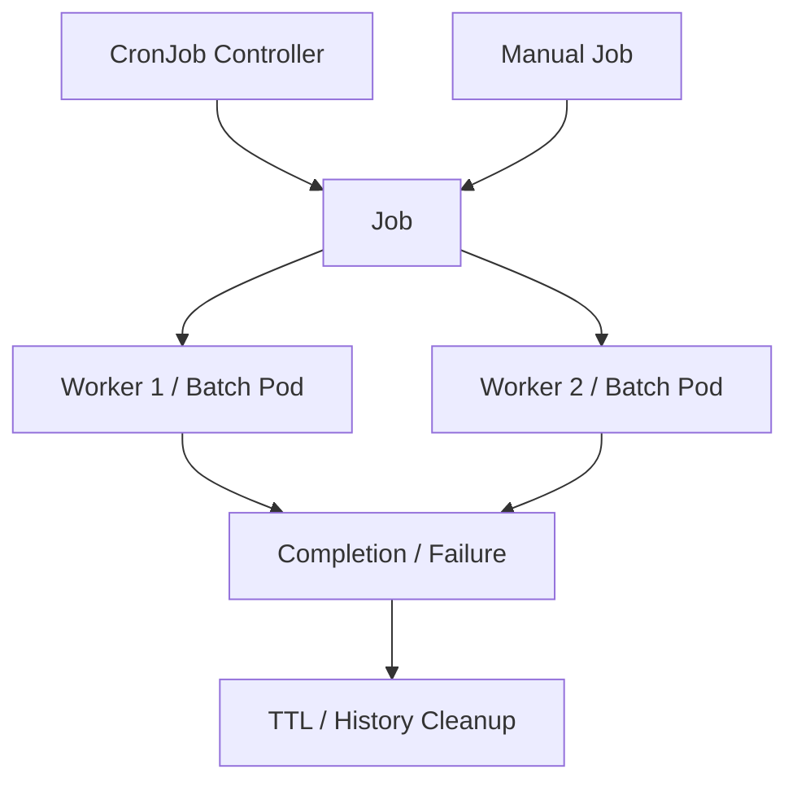

<h1 dir="rtl" align="right">‏پروژه عملی ⁦Kubernetes⁩ | ⁦Job & CronJob⁩‏</h1>

<p dir="rtl" align="right">‏محیط: ⁦kubeadm⁩ با یک ⁦Control Plane⁩ و دو ⁦Worker⁩. سطح: ⁦Beginner to Advanced⁩. سناریو: تیم ⁦Platform⁩ فروشگاه آنلاین باید گزارش‌های ⁦Batch⁩ و گزارش‌های دوره‌ای را با مدیریت خطا و زمان‌بندی قابل کنترل اجرا کند.‏</p>

<p dir="rtl" align="right">‏همه کارها مصنوعی و محدود به ⁦Namespace⁩ آزمایشی هستند؛ هیچ داده واقعی یا تنظیم ⁦Control Plane⁩ تغییر نمی‌کند. پیش‌نیاز: ⁦kubectl⁩، دسترسی ⁦Registry⁩ و ظرفیت کافی برای حداکثر چند ⁦Pod⁩ سبک. نسخه ⁦Kubernetes⁩ مشخص نیست؛ مراحل پیشرفته مشروط به پشتیبانی ⁦API⁩ هستند.‏</p>

[Part 1](#part-1) · [Part 2](#part-2) · [Final Validation](#final-validation)

<div dir="ltr" align="left">



</div>

<a name="part-1"></a>

<h2 dir="rtl" align="right">‏بخش اول — سناریو و چالش‌ها‏</h2>

<p dir="rtl" align="right">‏مراحل را به ترتیب انجام بده. هیچ دستور آماده در این بخش قرار ندارد. نام فایل هر ⁦Manifest⁩ در پاسخ‌نامه مشخص است.‏</p>

<a name="phase-01"></a>

<h3 dir="rtl" align="right">‏مرحله ⁦01⁩ — ⁦Namespace & Preparation⁩‏</h3>

<p dir="rtl" align="right">‏وظایف و تنظیمات موردنیاز‏</p>

<div dir="rtl" align="right">

- [ ] ‏سلامت سه ⁦Node⁩ و ⁦Context⁩ را بررسی کن.‏
- [ ] ‏یک ⁦Namespace⁩ اختصاصی با نام ⁦`batch-lab`⁩ بساز؛ اگر از قبل وجود دارد ادامه نده.‏

</div>

<p dir="rtl" align="right">‏معیار پذیرش: ⁦Namespace⁩ فعال و دو ⁦Worker⁩ قابل استفاده باشند.‏</p>

---

<a name="phase-02"></a>

<h3 dir="rtl" align="right">‏مرحله ⁦02⁩ — ⁦Single Job & Ownership⁩‏</h3>

<p dir="rtl" align="right">‏وظایف و تنظیمات موردنیاز‏</p>

<div dir="rtl" align="right">

- [ ] ‏یک ⁦Job⁩ به نام ⁦`report-once`⁩ با ⁦Image⁩ ⁦`busybox:1.36.1`⁩ بساز.‏
- [ ] ‏پس از ۵ ثانیه پیام ⁦`report-ready`⁩ چاپ کند و موفق خارج شود؛ یک ⁦Completion⁩ و یک ⁦Pod⁩ هم‌زمان داشته باشد.‏
- [ ] ‏رابطه ⁦Owner Reference⁩ و وضعیت ⁦Job⁩ و ⁦Pod⁩ را ثبت کن.‏

</div>

<p dir="rtl" align="right">‏معیار پذیرش: ⁦Job⁩ کامل و ⁦Pod⁩ در وضعیت ⁦Succeeded⁩ باشد.‏</p>

---

<a name="phase-03"></a>

<h3 dir="rtl" align="right">‏مرحله ⁦03⁩ — ⁦Retry & Never⁩‏</h3>

<p dir="rtl" align="right">‏وظایف و تنظیمات موردنیاز‏</p>

<div dir="rtl" align="right">

- [ ] ‏⁦Job⁩ به نام ⁦`retry-never`⁩ بساز که با ⁦Exit Code 7⁩ شکست بخورد.‏
- [ ] ‏⁦Restart Policy⁩ برابر ⁦Never⁩ و ⁦Backoff Limit⁩ برابر ⁦2⁩ باشد.‏
- [ ] ‏تعداد ⁦Pod⁩ها، ⁦Logs⁩ و ⁦Events⁩ را بررسی کن.‏

</div>

<p dir="rtl" align="right">‏معیار پذیرش: ⁦Job⁩ با ⁦Failed⁩ پایان یابد و تلاش‌ها در ⁦Pod⁩های جدا باشند.‏</p>

---

<a name="phase-04"></a>

<h3 dir="rtl" align="right">‏مرحله ⁦04⁩ — ⁦OnFailure & Container Restart⁩‏</h3>

<p dir="rtl" align="right">‏وظایف و تنظیمات موردنیاز‏</p>

<div dir="rtl" align="right">

- [ ] ‏⁦Job⁩ به نام ⁦`retry-inplace`⁩ با ⁦Restart Policy⁩ برابر ⁦OnFailure⁩ بساز.‏
- [ ] ‏برنامه همواره با ⁦Exit Code 8⁩ خارج شود و ⁦Backoff Limit⁩ برابر ⁦3⁩ باشد.‏
- [ ] ‏در زمان اجرا ⁦Restart Count⁩ و ⁦UID⁩ را بررسی کن.‏

</div>

<p dir="rtl" align="right">‏معیار پذیرش: ⁦Restart⁩ در همان ⁦Pod⁩ مشاهده شود و ⁦Job⁩ نهایتاً ⁦Failed⁩ شود.‏</p>

---

<a name="phase-05"></a>

<h3 dir="rtl" align="right">‏مرحله ⁦05⁩ — ⁦Fixed Completions & Parallelism⁩‏</h3>

<p dir="rtl" align="right">‏وظایف و تنظیمات موردنیاز‏</p>

<div dir="rtl" align="right">

- [ ] ‏⁦Job⁩ به نام ⁦`report-shards`⁩ با ۶ ⁦Completion⁩ و ⁦Parallelism⁩ برابر ۲ بساز.‏
- [ ] ‏هر ⁦Pod⁩ پس از ۱۵ ثانیه پیام موفقیت چاپ کند.‏
- [ ] ‏در طول اجرا ⁦Parallelism⁩ را به ۳ افزایش بده.‏

</div>

<p dir="rtl" align="right">‏معیار پذیرش: شش ⁦Completion⁩ موفق ثبت شود.‏</p>

---

<a name="phase-06"></a>

<h3 dir="rtl" align="right">‏مرحله ⁦06⁩ — ⁦Indexed Job & Stable Index⁩‏</h3>

<p dir="rtl" align="right">‏وظایف و تنظیمات موردنیاز‏</p>

<div dir="rtl" align="right">

- [ ] ‏⁦Job⁩ به نام ⁦`indexed-report`⁩ با ۵ ⁦Completion⁩ و ⁦Parallelism⁩ برابر ۲ ایجاد کن.‏
- [ ] ‏⁦Completion Mode⁩ برابر ⁦Indexed⁩ باشد؛ هر ⁦Pod⁩ شماره ⁦Index⁩ و ⁦Hostname⁩ خود را چاپ کند.‏

</div>

<p dir="rtl" align="right">‏معیار پذیرش: ⁦Index⁩های صفر تا چهار در ⁦completedIndexes⁩ ثبت شوند.‏</p>

---

<a name="phase-07"></a>

<h3 dir="rtl" align="right">‏مرحله ⁦07⁩ — ⁦Work Queue Pattern⁩‏</h3>

<p dir="rtl" align="right">‏وظایف و تنظیمات موردنیاز‏</p>

<div dir="rtl" align="right">

- [ ] ‏⁦Job⁩ به نام ⁦`queue-demo`⁩ با ⁦Parallelism⁩ برابر ۳ و بدون ⁦Completions⁩ مشخص بساز.‏
- [ ] ‏هر ⁦Worker⁩ کار شبیه‌سازی‌شده را پس از ۲۰ ثانیه پایان دهد.‏
- [ ] ‏بررسی کن بعد از نخستین موفقیت، ⁦Controller Pod⁩ جدیدی برای تکمیل تعداد ثابت ایجاد نکند.‏

</div>

<p dir="rtl" align="right">‏معیار پذیرش: ⁦Job⁩ پس از پایان ⁦Worker⁩های فعال و حداقل یک موفقیت ⁦Complete⁩ شود.‏</p>

---

<a name="phase-08"></a>

<h3 dir="rtl" align="right">‏مرحله ⁦08⁩ — ⁦Active Deadline & Timeout⁩‏</h3>

<p dir="rtl" align="right">‏وظایف و تنظیمات موردنیاز‏</p>

<div dir="rtl" align="right">

- [ ] ‏⁦Job⁩ به نام ⁦`deadline-demo`⁩ با کار ۱۲۰ ثانیه‌ای و ⁦Active Deadline⁩ برابر ۲۰ ثانیه بساز.‏
- [ ] ‏⁦Backoff Limit⁩ را ۶ قرار بده و علت پایان را ثبت کن.‏

</div>

<p dir="rtl" align="right">‏معیار پذیرش: ⁦Job⁩ به دلیل ⁦DeadlineExceeded⁩ شکست بخورد.‏</p>

---

<a name="phase-09"></a>

<h3 dir="rtl" align="right">‏مرحله ⁦09⁩ — ⁦Suspend & Resume Job⁩‏</h3>

<p dir="rtl" align="right">‏وظایف و تنظیمات موردنیاز‏</p>

<div dir="rtl" align="right">

- [ ] ‏⁦Job⁩ به نام ⁦`suspend-demo`⁩ با دو ⁦Completion⁩، ⁦Parallelism⁩ برابر ۲ و کار ۶۰ ثانیه‌ای ابتدا ⁦Suspended⁩ باشد.‏
- [ ] ‏آن را ⁦Resume⁩ کن؛ حین اجرا ⁦Suspend⁩ و سپس مجدداً ⁦Resume⁩ کن.‏
- [ ] ‏تفاوت ⁦UID⁩ و ⁦startTime⁩ را بررسی کن.‏

</div>

<p dir="rtl" align="right">‏معیار پذیرش: ابتدا ⁦Pod⁩ ندارد؛ در ⁦Suspend⁩ کارهای فعال متوقف و بعد از ⁦Resume⁩ کار تکمیل شود.‏</p>

---

<a name="phase-10"></a>

<h3 dir="rtl" align="right">‏مرحله ⁦10⁩ — ⁦Pod Failure Policy⁩‏</h3>

<p dir="rtl" align="right">‏وظایف و تنظیمات موردنیاز‏</p>

<div dir="rtl" align="right">

- [ ] ‏در صورت پشتیبانی ⁦API⁩، ⁦Job⁩ به نام ⁦`policy-demo`⁩ با ⁦Never⁩ و ⁦Backoff Limit⁩ برابر ۶ ایجاد کن.‏
- [ ] ‏⁦Exit Code 42⁩ باید موجب شکست فوری ⁦Job⁩ شود؛ سایر خطاها به شکل معمول شمارش شوند.‏

</div>

<p dir="rtl" align="right">‏معیار پذیرش: ⁦Job⁩ بدون ⁦Retry⁩ معمول با علت ⁦Policy⁩ شکست بخورد.‏</p>

---

<a name="phase-11"></a>

<h3 dir="rtl" align="right">‏مرحله ⁦11⁩ — ⁦Backoff per Index & Failed Indexes⁩‏</h3>

<p dir="rtl" align="right">‏وظایف و تنظیمات موردنیاز‏</p>

<div dir="rtl" align="right">

- [ ] ‏در صورت پشتیبانی ⁦API⁩، ⁦Job⁩ به نام ⁦`index-retry`⁩ با ۴ ⁦Index⁩ و ⁦Parallelism⁩ برابر ۲ بساز.‏
- [ ] ‏فقط ⁦Index⁩ شماره ۱ با ⁦Exit Code 9⁩ شکست بخورد؛ ⁦Backoff per Index⁩ برابر ۱ و ⁦Max Failed Indexes⁩ برابر ۲ باشد.‏

</div>

<p dir="rtl" align="right">‏معیار پذیرش: ⁦Index⁩های دیگر موفق شوند، ⁦failedIndexes⁩ شامل ۱ و ⁦Job⁩ نهایی ⁦Failed⁩ باشد.‏</p>

---

<a name="phase-12"></a>

<h3 dir="rtl" align="right">‏مرحله ⁦12⁩ — ⁦Success Policy⁩‏</h3>

<p dir="rtl" align="right">‏وظایف و تنظیمات موردنیاز‏</p>

<div dir="rtl" align="right">

- [ ] ‏در صورت پشتیبانی ⁦API⁩، ⁦Job⁩ به نام ⁦`early-success`⁩ با ۴ ⁦Index⁩ و ⁦Parallelism⁩ برابر ۴ بساز.‏
- [ ] ‏⁦Index⁩ صفر سریع موفق شود و سایر ⁦Index⁩ها ۹۰ ثانیه کار کنند.‏
- [ ] ‏موفقیت ⁦Index⁩ صفر برای موفقیت کل ⁦Job⁩ کافی باشد.‏

</div>

<p dir="rtl" align="right">‏معیار پذیرش: ⁦Job⁩ قبل از پایان طبیعی تمام ⁦Index⁩ها ⁦Complete⁩ شود.‏</p>

---

<a name="phase-13"></a>

<h3 dir="rtl" align="right">‏مرحله ⁦13⁩ — ⁦Pod Replacement Policy⁩‏</h3>

<p dir="rtl" align="right">‏وظایف و تنظیمات موردنیاز‏</p>

<div dir="rtl" align="right">

- [ ] ‏در صورت پشتیبانی ⁦API⁩، ⁦Job⁩ به نام ⁦`replacement-demo`⁩ با یک ⁦Completion⁩ و کار ۴۵ ثانیه‌ای بساز.‏
- [ ] ‏⁦Replacement Policy⁩ برابر ⁦Failed⁩ باشد.‏
- [ ] ‏⁦Pod⁩ فعال را حذف و زمان ایجاد جایگزین و ⁦UID⁩ آن را مشاهده کن.‏

</div>

<p dir="rtl" align="right">‏معیار پذیرش: ⁦Pod⁩ جدید پس از خاتمه ⁦Pod⁩ قبلی ایجاد و ⁦Job⁩ تکمیل شود.‏</p>

---

<a name="phase-14"></a>

<h3 dir="rtl" align="right">‏مرحله ⁦14⁩ — ⁦TTL & Cleanup⁩‏</h3>

<p dir="rtl" align="right">‏وظایف و تنظیمات موردنیاز‏</p>

<div dir="rtl" align="right">

- [ ] ‏⁦Job⁩ به نام ⁦`ttl-demo`⁩ با ⁦TTL⁩ برابر ۶۰ ثانیه بساز.‏
- [ ] ‏پس از موفقیت ⁦Logs⁩ و زمان ⁦Completion⁩ را ثبت کن و حذف خودکار ⁦Job⁩ و ⁦Pod⁩ را مشاهده کن.‏

</div>

<p dir="rtl" align="right">‏معیار پذیرش: ⁦Resource⁩ها پس از ⁦TTL⁩ به‌صورت خودکار حذف شوند.‏</p>

---

<a name="phase-15"></a>

<h3 dir="rtl" align="right">‏مرحله ⁦15⁩ — ⁦Immutable Template & Image Failure⁩‏</h3>

<p dir="rtl" align="right">‏وظایف و تنظیمات موردنیاز‏</p>

<div dir="rtl" align="right">

- [ ] ‏⁦Job⁩ به نام ⁦`image-demo`⁩ با ⁦Tag⁩ ناموجود و ⁦Deadline⁩ برابر ۴۵ ثانیه بساز.‏
- [ ] ‏علت ⁦ImagePullBackOff⁩ را بررسی کن؛ تلاش کن ⁦Image⁩ قالب ⁦Job⁩ را تغییر دهی.‏
- [ ] ‏پس از خطای ⁦Immutable⁩، ⁦Job⁩ را حذف و با ⁦Image⁩ سالم بازسازی کن.‏

</div>

<p dir="rtl" align="right">‏معیار پذیرش: خطا ثبت و ⁦Job⁩ بازسازی‌شده موفق شود.‏</p>

---

<a name="phase-16"></a>

<h3 dir="rtl" align="right">‏مرحله ⁦16⁩ — ⁦CronJob & Schedule⁩‏</h3>

<p dir="rtl" align="right">‏وظایف و تنظیمات موردنیاز‏</p>

<div dir="rtl" align="right">

- [ ] ‏⁦CronJob⁩ به نام ⁦`minute-report`⁩ با ⁦Schedule⁩ هر دقیقه بساز.‏
- [ ] ‏⁦Time Zone⁩ برابر ⁦Etc/UTC⁩ در صورت پشتیبانی، ⁦Forbid⁩ و دو ⁦Job⁩ موفق و یک ⁦Job⁩ ناموفق در تاریخچه نگه داشته شود.‏
- [ ] ‏دو اجرای زمان‌بندی‌شده و ⁦Owner Reference⁩ را مشاهده کن.‏

</div>

<p dir="rtl" align="right">‏معیار پذیرش: ⁦Job⁩های زمان‌بندی‌شده موفق و ⁦lastScheduleTime⁩ ثبت شود.‏</p>

---

<a name="phase-17"></a>

<h3 dir="rtl" align="right">‏مرحله ⁦17⁩ — ⁦Manual Run & Job Template Update⁩‏</h3>

<p dir="rtl" align="right">‏وظایف و تنظیمات موردنیاز‏</p>

<div dir="rtl" align="right">

- [ ] ‏از ⁦CronJob⁩ قبلی ⁦Job⁩ دستی با نام ⁦`manual-report`⁩ بساز.‏
- [ ] ‏پیام ⁦CronJob⁩ را به ⁦`report-v2`⁩ تغییر بده و یک ⁦Job⁩ دستی دیگر به نام ⁦`manual-report-v2`⁩ بساز.‏
- [ ] ‏⁦Logs⁩ دو ⁦Job⁩ را مقایسه کن.‏

</div>

<p dir="rtl" align="right">‏معیار پذیرش: ⁦Job⁩ قبلی بدون تغییر و ⁦Job⁩ جدید دارای پیام جدید باشد.‏</p>

---

<a name="phase-18"></a>

<h3 dir="rtl" align="right">‏مرحله ⁦18⁩ — ⁦Concurrency⁩ — ⁦Allow⁩‏</h3>

<p dir="rtl" align="right">‏وظایف و تنظیمات موردنیاز‏</p>

<div dir="rtl" align="right">

- [ ] ‏⁦CronJob⁩ به نام ⁦`concurrency-allow`⁩ با ⁦Schedule⁩ هر دقیقه و ⁦Concurrency Policy⁩ برابر ⁦Allow⁩ بساز.‏
- [ ] ‏هر کار ۹۰ ثانیه طول بکشد؛ حداقل دو نوبت زمان‌بندی را مشاهده کن.‏
- [ ] ‏پس از مشاهده رفتار، زمان‌بندی را ⁦Suspend⁩ کن.‏

</div>

<p dir="rtl" align="right">‏معیار پذیرش: دو ⁦Job⁩ فعال هم‌پوشان مشاهده شوند.‏</p>

---

<a name="phase-19"></a>

<h3 dir="rtl" align="right">‏مرحله ⁦19⁩ — ⁦Concurrency⁩ — ⁦Forbid⁩‏</h3>

<p dir="rtl" align="right">‏وظایف و تنظیمات موردنیاز‏</p>

<div dir="rtl" align="right">

- [ ] ‏⁦CronJob⁩ به نام ⁦`concurrency-forbid`⁩ با ⁦Schedule⁩ هر دقیقه و ⁦Concurrency Policy⁩ برابر ⁦Forbid⁩ بساز.‏
- [ ] ‏هر کار ۹۰ ثانیه طول بکشد؛ حداقل دو نوبت زمان‌بندی را مشاهده کن.‏
- [ ] ‏پس از مشاهده رفتار، زمان‌بندی را ⁦Suspend⁩ کن.‏

</div>

<p dir="rtl" align="right">‏معیار پذیرش: در زمان فعال بودن ⁦Job⁩ قبلی اجرای جدید ایجاد نشود.‏</p>

---

<a name="phase-20"></a>

<h3 dir="rtl" align="right">‏مرحله ⁦20⁩ — ⁦Concurrency⁩ — ⁦Replace⁩‏</h3>

<p dir="rtl" align="right">‏وظایف و تنظیمات موردنیاز‏</p>

<div dir="rtl" align="right">

- [ ] ‏⁦CronJob⁩ به نام ⁦`concurrency-replace`⁩ با ⁦Schedule⁩ هر دقیقه و ⁦Concurrency Policy⁩ برابر ⁦Replace⁩ بساز.‏
- [ ] ‏هر کار ۹۰ ثانیه طول بکشد؛ حداقل دو نوبت زمان‌بندی را مشاهده کن.‏
- [ ] ‏پس از مشاهده رفتار، زمان‌بندی را ⁦Suspend⁩ کن.‏

</div>

<p dir="rtl" align="right">‏معیار پذیرش: ⁦Job⁩ قبلی در اجرای بعدی حذف و ⁦Job⁩ جدید ایجاد شود.‏</p>

---

<a name="phase-21"></a>

<h3 dir="rtl" align="right">‏مرحله ⁦21⁩ — ⁦Missed Schedule & Starting Deadline⁩‏</h3>

<p dir="rtl" align="right">‏وظایف و تنظیمات موردنیاز‏</p>

<div dir="rtl" align="right">

- [ ] ‏⁦CronJob⁩ به نام ⁦`missed-demo`⁩ با ⁦Schedule⁩ هر دقیقه و ⁦Starting Deadline⁩ برابر ۲۵ ثانیه ابتدا ⁦Suspended⁩ باشد.‏
- [ ] ‏بیش از دو دقیقه منتظر بمان؛ سپس آن را ⁦Resume⁩ کن و زمان اجرای جدید را ثبت کن.‏
- [ ] ‏تفاوت با حالت بدون ⁦Deadline⁩ و محدودیت تعداد ⁦Missed Schedule⁩ را توضیح بده.‏

</div>

<p dir="rtl" align="right">‏معیار پذیرش: تنها نوبت واجد ⁦Deadline⁩ یا نوبت بعدی اجرا شود؛ اجرای تمام نوبت‌های قدیمی انتظار نمی‌رود.‏</p>

---

<a name="phase-22"></a>

<h3 dir="rtl" align="right">‏مرحله ⁦22⁩ — ⁦History Limits & Failed Runs⁩‏</h3>

<p dir="rtl" align="right">‏وظایف و تنظیمات موردنیاز‏</p>

<div dir="rtl" align="right">

- [ ] ‏⁦CronJob⁩ به نام ⁦`history-demo`⁩ با ⁦Schedule⁩ هر دقیقه بساز.‏
- [ ] ‏کار با ⁦Exit Code 5⁩ شکست بخورد؛ یک ⁦Job⁩ ناموفق در تاریخچه بماند.‏
- [ ] ‏پس از مشاهده حداقل دو نوبت، تعداد ⁦Job⁩های باقی‌مانده و ⁦Events⁩ را بررسی و سپس ⁦Suspend⁩ کن.‏

</div>

<p dir="rtl" align="right">‏معیار پذیرش: پس از ⁦Reconciliation⁩ حداکثر یک ⁦Job⁩ ناموفق متعلق به این ⁦CronJob⁩ باقی بماند.‏</p>

---

<h3 dir="rtl" align="right">‏معیار نهایی‏</h3>

<div dir="rtl" align="right">

- [ ] ‏رفتار ⁦Job⁩ موفق و ناموفق، ⁦Retry⁩ و ⁦Parallelism⁩ را مشاهده کرده‌ام.‏
- [ ] ‏قابلیت‌های ⁦Indexed⁩ و ⁦Policy⁩های سازگار با نسخه را بررسی کرده‌ام.‏
- [ ] ‏هر سه ⁦Concurrency Policy⁩ و ⁦Suspend⁩ و ⁦Deadline⁩ را آزموده‌ام.‏
- [ ] ‏تمام ⁦CronJob⁩های آزمایش پس از مشاهده متوقف شده‌اند.‏

</div>

<a name="part-2"></a>

<h2 dir="rtl" align="right">‏بخش دوم — پاسخ‌نامه و نکات فنی‏</h2>

<p dir="rtl" align="right">‏هر ⁦Manifest⁩ را با نام مشخص شده ذخیره کن. ⁦Command⁩ها در ⁦Bash⁩ اجرا می‌شوند. ⁦Watch⁩ را با ⁦Ctrl+C⁩ متوقف کن. برای مراحل ۱۰ تا ۱۳ ابتدا ⁦dry-run⁩ سمت ⁦Server⁩ را اجرا کن؛ اگر فیلد پشتیبانی نمی‌شود مرحله را رد کن و ⁦Feature Gate⁩ را تغییر نده. خروجی‌ها مورد انتظار هستند، نه ثبت اجرای واقعی.‏</p>

<details>
<summary dir="rtl" align="right">‏مرحله ⁦01⁩ — ⁦Namespace & Preparation⁩‏</summary>

<h4 dir="rtl" align="right">‏راه‌حل کامل‏</h4>

<p dir="rtl" align="right">‏فایل ⁦<code>phase-01.yaml</code>⁩ را با محتوای زیر ذخیره کن.‏</p>

<div dir="ltr" align="left">

```yaml
apiVersion: v1
kind: Namespace
metadata:
  name: batch-lab
```

</div>

<div dir="ltr" align="left">

```bash
kubectl config current-context
kubectl version
kubectl get nodes -o wide
kubectl get ns batch-lab --ignore-not-found
# Stop if namespace already exists.
kubectl apply --dry-run=server -f phase-01.yaml
kubectl apply -f phase-01.yaml
kubectl get ns batch-lab
```

</div>

<p dir="rtl" align="right">‏خروجی مورد انتظار: ⁦Namespace⁩ فعال و دو ⁦Worker⁩ قابل استفاده باشند.‏</p>

<h4 dir="rtl" align="right">‏توضیحات فنی و ⁦Troubleshooting⁩‏</h4>

<p dir="rtl" align="right">‏⁦Node⁩ آماده الزاماً تضمین دسترسی به ⁦Registry⁩ نیست. هیچ تنظیم ⁦Cluster-wide⁩ لازم نیست.‏</p>

<p dir="rtl" align="right">‏اگر نتیجه مورد انتظار مشاهده نشد، وضعیت ⁦Job⁩، ⁦Pod⁩ و ⁦Events⁩ را بررسی کن. در خطاهای ⁦Image⁩ یا ⁦Scheduling⁩ ابتدا علت را برطرف کن؛ افزایش ⁦Retry⁩ به تنهایی راه‌حل نیست.‏</p>

<h4 dir="rtl" align="right">‏سؤال مصاحبه‏</h4>

<p dir="rtl" align="right">‏چرا ⁦Namespace⁩؟ برای جداسازی ⁦Resource⁩ها و ⁦Cleanup⁩ محدود.‏</p>

</details>

---

<details>
<summary dir="rtl" align="right">‏مرحله ⁦02⁩ — ⁦Single Job & Ownership⁩‏</summary>

<h4 dir="rtl" align="right">‏راه‌حل کامل‏</h4>

<p dir="rtl" align="right">‏فایل ⁦<code>phase-02.yaml</code>⁩ را با محتوای زیر ذخیره کن.‏</p>

<div dir="ltr" align="left">

```yaml
apiVersion: batch/v1
kind: Job
metadata:
  name: report-once
  namespace: batch-lab
spec:
  completions: 1
  parallelism: 1
  backoffLimit: 2
  template:
    spec:
      restartPolicy: Never
      containers:
      - name: worker
        image: busybox:1.36.1
        command:
        - sh
        - -c
        - sleep 5; echo report-ready
        resources:
          requests:
            cpu: 25m
            memory: 16Mi
          limits:
            cpu: 200m
            memory: 64Mi
```

</div>

<div dir="ltr" align="left">

```bash
kubectl apply --dry-run=server -f phase-02.yaml
kubectl apply -f phase-02.yaml
kubectl -n batch-lab wait --for=condition=complete job/report-once --timeout=180s
kubectl -n batch-lab get job report-once -o yaml
kubectl -n batch-lab get pods -l batch.kubernetes.io/job-name=report-once
kubectl -n batch-lab logs job/report-once
kubectl -n batch-lab get pods -l batch.kubernetes.io/job-name=report-once -o jsonpath='{.items[0].metadata.ownerReferences}'
```

</div>

<p dir="rtl" align="right">‏خروجی مورد انتظار: ⁦Job⁩ کامل و ⁦Pod⁩ در وضعیت ⁦Succeeded⁩ باشد.‏</p>

<h4 dir="rtl" align="right">‏توضیحات فنی و ⁦Troubleshooting⁩‏</h4>

<p dir="rtl" align="right">‏⁦Job⁩ برای پایان موفق ⁦Process⁩ است؛ ⁦Deployment⁩ برای اجرای مداوم. خروجی صفر موفق است. ⁦Selector⁩ خودکار با ⁦UID⁩ مالک پیوند دارد.‏</p>

<p dir="rtl" align="right">‏اگر نتیجه مورد انتظار مشاهده نشد، وضعیت ⁦Job⁩، ⁦Pod⁩ و ⁦Events⁩ را بررسی کن. در خطاهای ⁦Image⁩ یا ⁦Scheduling⁩ ابتدا علت را برطرف کن؛ افزایش ⁦Retry⁩ به تنهایی راه‌حل نیست.‏</p>

<h4 dir="rtl" align="right">‏سؤال مصاحبه‏</h4>

<p dir="rtl" align="right">‏آیا ⁦Pod⁩ کامل دوباره اجرا می‌شود؟ خیر، در حالت عادی ⁦Job⁩ پایان یافته است.‏</p>

</details>

---

<details>
<summary dir="rtl" align="right">‏مرحله ⁦03⁩ — ⁦Retry & Never⁩‏</summary>

<h4 dir="rtl" align="right">‏راه‌حل کامل‏</h4>

<p dir="rtl" align="right">‏فایل ⁦<code>phase-03.yaml</code>⁩ را با محتوای زیر ذخیره کن.‏</p>

<div dir="ltr" align="left">

```yaml
apiVersion: batch/v1
kind: Job
metadata:
  name: retry-never
  namespace: batch-lab
spec:
  backoffLimit: 2
  template:
    spec:
      restartPolicy: Never
      containers:
      - name: worker
        image: busybox:1.36.1
        command:
        - sh
        - -c
        - echo failed; exit 7
        resources:
          requests:
            cpu: 25m
            memory: 16Mi
          limits:
            cpu: 200m
            memory: 64Mi
```

</div>

<div dir="ltr" align="left">

```bash
kubectl apply --dry-run=server -f phase-03.yaml
kubectl apply -f phase-03.yaml
kubectl -n batch-lab wait --for=condition=failed job/retry-never --timeout=180s
kubectl -n batch-lab get job retry-never -o yaml
kubectl -n batch-lab get pods -l batch.kubernetes.io/job-name=retry-never
kubectl -n batch-lab describe job retry-never
kubectl -n batch-lab logs -l batch.kubernetes.io/job-name=retry-never --all-containers=true --prefix=true
```

</div>

<p dir="rtl" align="right">‏خروجی مورد انتظار: ⁦Job⁩ با ⁦Failed⁩ پایان یابد و تلاش‌ها در ⁦Pod⁩های جدا باشند.‏</p>

<h4 dir="rtl" align="right">‏توضیحات فنی و ⁦Troubleshooting⁩‏</h4>

<p dir="rtl" align="right">‏⁦Backoff⁩ بین تلاش‌ها افزایش می‌یابد. تعداد ⁦Pod⁩ها را دقیقاً معادل ⁦Limit⁩ فرض نکن؛ تلاش اولیه و زمان‌بندی ⁦Controller⁩ اثر دارند.‏</p>

<p dir="rtl" align="right">‏اگر نتیجه مورد انتظار مشاهده نشد، وضعیت ⁦Job⁩، ⁦Pod⁩ و ⁦Events⁩ را بررسی کن. در خطاهای ⁦Image⁩ یا ⁦Scheduling⁩ ابتدا علت را برطرف کن؛ افزایش ⁦Retry⁩ به تنهایی راه‌حل نیست.‏</p>

<h4 dir="rtl" align="right">‏سؤال مصاحبه‏</h4>

<p dir="rtl" align="right">‏⁦Never⁩ به معنی عدم ⁦Retry Job⁩ است؟ خیر، فقط ⁦Container⁩ همان ⁦Pod⁩ مجدداً اجرا نمی‌شود.‏</p>

</details>

---

<details>
<summary dir="rtl" align="right">‏مرحله ⁦04⁩ — ⁦OnFailure & Container Restart⁩‏</summary>

<h4 dir="rtl" align="right">‏راه‌حل کامل‏</h4>

<p dir="rtl" align="right">‏فایل ⁦<code>phase-04.yaml</code>⁩ را با محتوای زیر ذخیره کن.‏</p>

<div dir="ltr" align="left">

```yaml
apiVersion: batch/v1
kind: Job
metadata:
  name: retry-inplace
  namespace: batch-lab
spec:
  backoffLimit: 3
  template:
    spec:
      restartPolicy: OnFailure
      containers:
      - name: worker
        image: busybox:1.36.1
        command:
        - sh
        - -c
        - echo retry; sleep 3; exit 8
        resources:
          requests:
            cpu: 25m
            memory: 16Mi
          limits:
            cpu: 200m
            memory: 64Mi
```

</div>

<div dir="ltr" align="left">

```bash
kubectl apply --dry-run=server -f phase-04.yaml
kubectl apply -f phase-04.yaml
kubectl -n batch-lab get pods -l batch.kubernetes.io/job-name=retry-inplace -w
# Ctrl+C after observing restarts
kubectl -n batch-lab wait --for=condition=failed job/retry-inplace --timeout=180s
kubectl -n batch-lab get job retry-inplace -o yaml
kubectl -n batch-lab get pods -l batch.kubernetes.io/job-name=retry-inplace
```

</div>

<p dir="rtl" align="right">‏خروجی مورد انتظار: ⁦Restart⁩ در همان ⁦Pod⁩ مشاهده شود و ⁦Job⁩ نهایتاً ⁦Failed⁩ شود.‏</p>

<h4 dir="rtl" align="right">‏توضیحات فنی و ⁦Troubleshooting⁩‏</h4>

<p dir="rtl" align="right">‏در ⁦OnFailure⁩ شمارش ⁦Restart⁩ نیز در ⁦Backoff⁩ دخیل است. پیش از حذف ⁦Pod⁩، ⁦Logs⁩ قبلی را با --⁦previous⁩ بررسی کن. برای ⁦Debug⁩، ⁦Never⁩ معمولاً ساده‌تر است.‏</p>

<p dir="rtl" align="right">‏اگر نتیجه مورد انتظار مشاهده نشد، وضعیت ⁦Job⁩، ⁦Pod⁩ و ⁦Events⁩ را بررسی کن. در خطاهای ⁦Image⁩ یا ⁦Scheduling⁩ ابتدا علت را برطرف کن؛ افزایش ⁦Retry⁩ به تنهایی راه‌حل نیست.‏</p>

<h4 dir="rtl" align="right">‏سؤال مصاحبه‏</h4>

<p dir="rtl" align="right">‏تفاوت ⁦Replacement⁩ و ⁦Restart⁩؟ اولی ⁦Pod⁩ جدید و دومی ⁦Container⁩ جدید در همان ⁦Pod⁩ است.‏</p>

</details>

---

<details>
<summary dir="rtl" align="right">‏مرحله ⁦05⁩ — ⁦Fixed Completions & Parallelism⁩‏</summary>

<h4 dir="rtl" align="right">‏راه‌حل کامل‏</h4>

<p dir="rtl" align="right">‏فایل ⁦<code>phase-05.yaml</code>⁩ را با محتوای زیر ذخیره کن.‏</p>

<div dir="ltr" align="left">

```yaml
apiVersion: batch/v1
kind: Job
metadata:
  name: report-shards
  namespace: batch-lab
spec:
  completions: 6
  parallelism: 2
  backoffLimit: 2
  template:
    spec:
      restartPolicy: Never
      containers:
      - name: worker
        image: busybox:1.36.1
        command:
        - sh
        - -c
        - sleep 15; echo done
        resources:
          requests:
            cpu: 25m
            memory: 16Mi
          limits:
            cpu: 200m
            memory: 64Mi
```

</div>

<div dir="ltr" align="left">

```bash
kubectl apply --dry-run=server -f phase-05.yaml
kubectl apply -f phase-05.yaml
kubectl -n batch-lab get pods -l batch.kubernetes.io/job-name=report-shards
kubectl -n batch-lab patch job report-shards --type=merge -p '{"spec":{"parallelism":3}}'
kubectl -n batch-lab wait --for=condition=complete job/report-shards --timeout=180s
kubectl -n batch-lab get job report-shards -o yaml
kubectl -n batch-lab get pods -l batch.kubernetes.io/job-name=report-shards
```

</div>

<p dir="rtl" align="right">‏خروجی مورد انتظار: شش ⁦Completion⁩ موفق ثبت شود.‏</p>

<h4 dir="rtl" align="right">‏توضیحات فنی و ⁦Troubleshooting⁩‏</h4>

<p dir="rtl" align="right">‏⁦Parallelism⁩ سقف مطلوب هم‌زمانی است نه تضمین تعداد لحظه‌ای؛ ظرفیت و ⁦Pod⁩های ⁦Terminating⁩ اثر دارند. ⁦Completion⁩ تعداد موفقیت‌های لازم است.‏</p>

<p dir="rtl" align="right">‏اگر نتیجه مورد انتظار مشاهده نشد، وضعیت ⁦Job⁩، ⁦Pod⁩ و ⁦Events⁩ را بررسی کن. در خطاهای ⁦Image⁩ یا ⁦Scheduling⁩ ابتدا علت را برطرف کن؛ افزایش ⁦Retry⁩ به تنهایی راه‌حل نیست.‏</p>

<h4 dir="rtl" align="right">‏سؤال مصاحبه‏</h4>

<p dir="rtl" align="right">‏آیا ⁦NonIndexed⁩ به هر ⁦Pod⁩ شماره کار یکتا می‌دهد؟ خیر.‏</p>

</details>

---

<details>
<summary dir="rtl" align="right">‏مرحله ⁦06⁩ — ⁦Indexed Job & Stable Index⁩‏</summary>

<h4 dir="rtl" align="right">‏راه‌حل کامل‏</h4>

<p dir="rtl" align="right">‏فایل ⁦<code>phase-06.yaml</code>⁩ را با محتوای زیر ذخیره کن.‏</p>

<div dir="ltr" align="left">

```yaml
apiVersion: batch/v1
kind: Job
metadata:
  name: indexed-report
  namespace: batch-lab
spec:
  completions: 5
  parallelism: 2
  completionMode: Indexed
  backoffLimit: 2
  template:
    spec:
      restartPolicy: Never
      containers:
      - name: worker
        image: busybox:1.36.1
        command:
        - sh
        - -c
        - echo "index=$JOB_COMPLETION_INDEX host=$(hostname)"; sleep 5
        resources:
          requests:
            cpu: 25m
            memory: 16Mi
          limits:
            cpu: 200m
            memory: 64Mi
```

</div>

<div dir="ltr" align="left">

```bash
kubectl apply --dry-run=server -f phase-06.yaml
kubectl apply -f phase-06.yaml
kubectl -n batch-lab wait --for=condition=complete job/indexed-report --timeout=180s
kubectl -n batch-lab get job indexed-report -o yaml
kubectl -n batch-lab get pods -l batch.kubernetes.io/job-name=indexed-report
kubectl -n batch-lab logs -l batch.kubernetes.io/job-name=indexed-report --prefix=true --max-log-requests=10
```

</div>

<p dir="rtl" align="right">‏خروجی مورد انتظار: ⁦Index⁩های صفر تا چهار در ⁦completedIndexes⁩ ثبت شوند.‏</p>

<h4 dir="rtl" align="right">‏توضیحات فنی و ⁦Troubleshooting⁩‏</h4>

<p dir="rtl" align="right">‏⁦JOB_COMPLETION_INDEX⁩ به صورت خودکار در ⁦Container⁩ قرار می‌گیرد. ⁦Index⁩ هویت منطقی کار است، نه ⁦UID⁩؛ اجرای تکراری یک ⁦Index⁩ ممکن است.‏</p>

<p dir="rtl" align="right">‏اگر نتیجه مورد انتظار مشاهده نشد، وضعیت ⁦Job⁩، ⁦Pod⁩ و ⁦Events⁩ را بررسی کن. در خطاهای ⁦Image⁩ یا ⁦Scheduling⁩ ابتدا علت را برطرف کن؛ افزایش ⁦Retry⁩ به تنهایی راه‌حل نیست.‏</p>

<h4 dir="rtl" align="right">‏سؤال مصاحبه‏</h4>

<p dir="rtl" align="right">‏آیا ⁦Indexed Job⁩ تضمین ⁦exactly-once⁩ دارد؟ خیر، پردازش باید ⁦Idempotent⁩ باشد.‏</p>

</details>

---

<details>
<summary dir="rtl" align="right">‏مرحله ⁦07⁩ — ⁦Work Queue Pattern⁩‏</summary>

<h4 dir="rtl" align="right">‏راه‌حل کامل‏</h4>

<p dir="rtl" align="right">‏فایل ⁦<code>phase-07.yaml</code>⁩ را با محتوای زیر ذخیره کن.‏</p>

<div dir="ltr" align="left">

```yaml
apiVersion: batch/v1
kind: Job
metadata:
  name: queue-demo
  namespace: batch-lab
spec:
  parallelism: 3
  backoffLimit: 2
  template:
    spec:
      restartPolicy: Never
      containers:
      - name: worker
        image: busybox:1.36.1
        command:
        - sh
        - -c
        - sleep 20; echo simulated-queue-empty
        resources:
          requests:
            cpu: 25m
            memory: 16Mi
          limits:
            cpu: 200m
            memory: 64Mi
```

</div>

<div dir="ltr" align="left">

```bash
kubectl apply --dry-run=server -f phase-07.yaml
kubectl apply -f phase-07.yaml
kubectl -n batch-lab wait --for=condition=complete job/queue-demo --timeout=180s
kubectl -n batch-lab get job queue-demo -o yaml
kubectl -n batch-lab get pods -l batch.kubernetes.io/job-name=queue-demo
```

</div>

<p dir="rtl" align="right">‏خروجی مورد انتظار: ⁦Job⁩ پس از پایان ⁦Worker⁩های فعال و حداقل یک موفقیت ⁦Complete⁩ شود.‏</p>

<h4 dir="rtl" align="right">‏توضیحات فنی و ⁦Troubleshooting⁩‏</h4>

<p dir="rtl" align="right">‏این فقط شبیه‌سازی الگوی ⁦Work Queue⁩ است؛ ⁦Queue⁩ واقعی به هماهنگی خارجی و تشخیص خالی بودن صف نیاز دارد. هیچ ⁦Worker⁩ نباید زودتر از اتمام کار صف موفق خارج شود.‏</p>

<p dir="rtl" align="right">‏اگر نتیجه مورد انتظار مشاهده نشد، وضعیت ⁦Job⁩، ⁦Pod⁩ و ⁦Events⁩ را بررسی کن. در خطاهای ⁦Image⁩ یا ⁦Scheduling⁩ ابتدا علت را برطرف کن؛ افزایش ⁦Retry⁩ به تنهایی راه‌حل نیست.‏</p>

<h4 dir="rtl" align="right">‏سؤال مصاحبه‏</h4>

<p dir="rtl" align="right">‏تفاوت با ⁦fixed completions⁩؟ شمار موفقیت ثابت از پیش تعیین نشده است.‏</p>

</details>

---

<details>
<summary dir="rtl" align="right">‏مرحله ⁦08⁩ — ⁦Active Deadline & Timeout⁩‏</summary>

<h4 dir="rtl" align="right">‏راه‌حل کامل‏</h4>

<p dir="rtl" align="right">‏فایل ⁦<code>phase-08.yaml</code>⁩ را با محتوای زیر ذخیره کن.‏</p>

<div dir="ltr" align="left">

```yaml
apiVersion: batch/v1
kind: Job
metadata:
  name: deadline-demo
  namespace: batch-lab
spec:
  activeDeadlineSeconds: 20
  backoffLimit: 6
  template:
    spec:
      restartPolicy: Never
      containers:
      - name: worker
        image: busybox:1.36.1
        command:
        - sh
        - -c
        - sleep 120; echo done
        resources:
          requests:
            cpu: 25m
            memory: 16Mi
          limits:
            cpu: 200m
            memory: 64Mi
```

</div>

<div dir="ltr" align="left">

```bash
kubectl apply --dry-run=server -f phase-08.yaml
kubectl apply -f phase-08.yaml
kubectl -n batch-lab wait --for=condition=failed job/deadline-demo --timeout=180s
kubectl -n batch-lab get job deadline-demo -o yaml
kubectl -n batch-lab get pods -l batch.kubernetes.io/job-name=deadline-demo
kubectl -n batch-lab describe job deadline-demo
```

</div>

<p dir="rtl" align="right">‏خروجی مورد انتظار: ⁦Job⁩ به دلیل ⁦DeadlineExceeded⁩ شکست بخورد.‏</p>

<h4 dir="rtl" align="right">‏توضیحات فنی و ⁦Troubleshooting⁩‏</h4>

<p dir="rtl" align="right">‏⁦Active Deadline⁩ مدت فعال بودن ⁦Job⁩ را محدود می‌کند و بر ⁦Retry⁩ مقدم است. با ⁦timeout⁩ دستور ⁦kubectl⁩ متفاوت است.‏</p>

<p dir="rtl" align="right">‏اگر نتیجه مورد انتظار مشاهده نشد، وضعیت ⁦Job⁩، ⁦Pod⁩ و ⁦Events⁩ را بررسی کن. در خطاهای ⁦Image⁩ یا ⁦Scheduling⁩ ابتدا علت را برطرف کن؛ افزایش ⁦Retry⁩ به تنهایی راه‌حل نیست.‏</p>

<h4 dir="rtl" align="right">‏سؤال مصاحبه‏</h4>

<p dir="rtl" align="right">‏آیا ⁦deadline⁩ به هر ⁦Pod⁩ جداگانه اعمال می‌شود؟ این فیلد در ⁦spec⁩ خود ⁦Job⁩ برای کل ⁦Job⁩ است.‏</p>

</details>

---

<details>
<summary dir="rtl" align="right">‏مرحله ⁦09⁩ — ⁦Suspend & Resume Job⁩‏</summary>

<h4 dir="rtl" align="right">‏راه‌حل کامل‏</h4>

<p dir="rtl" align="right">‏فایل ⁦<code>phase-09.yaml</code>⁩ را با محتوای زیر ذخیره کن.‏</p>

<div dir="ltr" align="left">

```yaml
apiVersion: batch/v1
kind: Job
metadata:
  name: suspend-demo
  namespace: batch-lab
spec:
  suspend: true
  completions: 2
  parallelism: 2
  activeDeadlineSeconds: 120
  template:
    spec:
      restartPolicy: Never
      containers:
      - name: worker
        image: busybox:1.36.1
        command:
        - sh
        - -c
        - sleep 60; echo done
        resources:
          requests:
            cpu: 25m
            memory: 16Mi
          limits:
            cpu: 200m
            memory: 64Mi
```

</div>

<div dir="ltr" align="left">

```bash
kubectl apply --dry-run=server -f phase-09.yaml
kubectl apply -f phase-09.yaml
kubectl -n batch-lab get job suspend-demo
kubectl -n batch-lab patch job suspend-demo --type=merge -p '{"spec":{"suspend":false}}'
kubectl -n batch-lab get pods -l batch.kubernetes.io/job-name=suspend-demo -w
# Ctrl+C promptly after Running
kubectl -n batch-lab patch job suspend-demo --type=merge -p '{"spec":{"suspend":true}}'
kubectl -n batch-lab get job suspend-demo -o yaml
kubectl -n batch-lab get pods -l batch.kubernetes.io/job-name=suspend-demo
kubectl -n batch-lab patch job suspend-demo --type=merge -p '{"spec":{"suspend":false}}'
kubectl -n batch-lab wait --for=condition=complete job/suspend-demo --timeout=180s
```

</div>

<p dir="rtl" align="right">‏خروجی مورد انتظار: ابتدا ⁦Pod⁩ ندارد؛ در ⁦Suspend⁩ کارهای فعال متوقف و بعد از ⁦Resume⁩ کار تکمیل شود.‏</p>

<h4 dir="rtl" align="right">‏توضیحات فنی و ⁦Troubleshooting⁩‏</h4>

<p dir="rtl" align="right">‏⁦Suspend⁩ پردازش در حال اجرا را در حافظه ⁦Freeze⁩ نمی‌کند؛ ⁦Pod⁩ فعال خاتمه می‌یابد. ⁦Resume⁩ زمان شروع ⁦Job⁩ را بازتنظیم می‌کند.‏</p>

<p dir="rtl" align="right">‏اگر نتیجه مورد انتظار مشاهده نشد، وضعیت ⁦Job⁩، ⁦Pod⁩ و ⁦Events⁩ را بررسی کن. در خطاهای ⁦Image⁩ یا ⁦Scheduling⁩ ابتدا علت را برطرف کن؛ افزایش ⁦Retry⁩ به تنهایی راه‌حل نیست.‏</p>

<h4 dir="rtl" align="right">‏سؤال مصاحبه‏</h4>

<p dir="rtl" align="right">‏آیا ⁦Suspend⁩ مشابه ⁦Pause Deployment⁩ است؟ خیر، ⁦Job Pod⁩های فعال را خاتمه می‌دهد.‏</p>

</details>

---

<details>
<summary dir="rtl" align="right">‏مرحله ⁦10⁩ — ⁦Pod Failure Policy⁩‏</summary>

<h4 dir="rtl" align="right">‏راه‌حل کامل‏</h4>

<p dir="rtl" align="right">‏فایل ⁦<code>phase-10.yaml</code>⁩ را با محتوای زیر ذخیره کن.‏</p>

<div dir="ltr" align="left">

```yaml
apiVersion: batch/v1
kind: Job
metadata:
  name: policy-demo
  namespace: batch-lab
spec:
  backoffLimit: 6
  podFailurePolicy:
    rules:
    - action: FailJob
      onExitCodes:
        containerName: worker
        operator: In
        values:
        - 42
  template:
    spec:
      restartPolicy: Never
      containers:
      - name: worker
        image: busybox:1.36.1
        command:
        - sh
        - -c
        - exit 42
        resources:
          requests:
            cpu: 25m
            memory: 16Mi
          limits:
            cpu: 200m
            memory: 64Mi
```

</div>

<div dir="ltr" align="left">

```bash
kubectl apply --dry-run=server -f phase-10.yaml
kubectl apply -f phase-10.yaml
kubectl -n batch-lab wait --for=condition=failed job/policy-demo --timeout=180s
kubectl -n batch-lab get job policy-demo -o yaml
kubectl -n batch-lab get pods -l batch.kubernetes.io/job-name=policy-demo
kubectl -n batch-lab describe job policy-demo
```

</div>

<p dir="rtl" align="right">‏خروجی مورد انتظار: ⁦Job⁩ بدون ⁦Retry⁩ معمول با علت ⁦Policy⁩ شکست بخورد.‏</p>

<h4 dir="rtl" align="right">‏توضیحات فنی و ⁦Troubleshooting⁩‏</h4>

<p dir="rtl" align="right">‏⁦PodFailurePolicy⁩ از ⁦v1.31⁩ پایدار است؛ ترتیب ⁦Rules⁩ اهمیت دارد. ⁦Count⁩ پیش‌فرض است؛ ⁦Ignore⁩ می‌تواند برای ⁦DisruptionTarget⁩ استفاده شود. ⁦FailIndex⁩ نیازمند ⁦Backoff per Index⁩ است.‏</p>

<p dir="rtl" align="right">‏اگر نتیجه مورد انتظار مشاهده نشد، وضعیت ⁦Job⁩، ⁦Pod⁩ و ⁦Events⁩ را بررسی کن. در خطاهای ⁦Image⁩ یا ⁦Scheduling⁩ ابتدا علت را برطرف کن؛ افزایش ⁦Retry⁩ به تنهایی راه‌حل نیست.‏</p>

<h4 dir="rtl" align="right">‏سؤال مصاحبه‏</h4>

<p dir="rtl" align="right">‏چرا ⁦Never⁩ لازم است؟ برای ارزیابی خطای ⁦Pod⁩ خاتمه‌یافته توسط ⁦Controller⁩.‏</p>

</details>

---

<details>
<summary dir="rtl" align="right">‏مرحله ⁦11⁩ — ⁦Backoff per Index & Failed Indexes⁩‏</summary>

<h4 dir="rtl" align="right">‏راه‌حل کامل‏</h4>

<p dir="rtl" align="right">‏فایل ⁦<code>phase-11.yaml</code>⁩ را با محتوای زیر ذخیره کن.‏</p>

<div dir="ltr" align="left">

```yaml
apiVersion: batch/v1
kind: Job
metadata:
  name: index-retry
  namespace: batch-lab
spec:
  completionMode: Indexed
  completions: 4
  parallelism: 2
  backoffLimitPerIndex: 1
  maxFailedIndexes: 2
  template:
    spec:
      restartPolicy: Never
      containers:
      - name: worker
        image: busybox:1.36.1
        command:
        - sh
        - -c
        - if [ "$JOB_COMPLETION_INDEX" = 1 ]; then exit 9; fi; echo "$JOB_COMPLETION_INDEX done"
        resources:
          requests:
            cpu: 25m
            memory: 16Mi
          limits:
            cpu: 200m
            memory: 64Mi
```

</div>

<div dir="ltr" align="left">

```bash
kubectl apply --dry-run=server -f phase-11.yaml
kubectl apply -f phase-11.yaml
kubectl -n batch-lab wait --for=condition=failed job/index-retry --timeout=180s
kubectl -n batch-lab get job index-retry -o yaml
kubectl -n batch-lab get pods -l batch.kubernetes.io/job-name=index-retry
```

</div>

<p dir="rtl" align="right">‏خروجی مورد انتظار: ⁦Index⁩های دیگر موفق شوند، ⁦failedIndexes⁩ شامل ۱ و ⁦Job⁩ نهایی ⁦Failed⁩ باشد.‏</p>

<h4 dir="rtl" align="right">‏توضیحات فنی و ⁦Troubleshooting⁩‏</h4>

<p dir="rtl" align="right">‏قابلیت از ⁦v1.33⁩ پایدار است. شکست یک ⁦Index⁩ الزاماً سایر ⁦Index⁩ها را متوقف نمی‌کند. عبور از ⁦maxFailedIndexes⁩ موجب خاتمه سایر کارها می‌شود.‏</p>

<p dir="rtl" align="right">‏اگر نتیجه مورد انتظار مشاهده نشد، وضعیت ⁦Job⁩، ⁦Pod⁩ و ⁦Events⁩ را بررسی کن. در خطاهای ⁦Image⁩ یا ⁦Scheduling⁩ ابتدا علت را برطرف کن؛ افزایش ⁦Retry⁩ به تنهایی راه‌حل نیست.‏</p>

<h4 dir="rtl" align="right">‏سؤال مصاحبه‏</h4>

<p dir="rtl" align="right">‏اگر یک ⁦Index Failed⁩ باشد ولی سه ⁦Index⁩ دیگر موفق باشند؟ بدون ⁦Success Policy⁩، ⁦Job⁩ نهایی ⁦Failed⁩ است.‏</p>

</details>

---

<details>
<summary dir="rtl" align="right">‏مرحله ⁦12⁩ — ⁦Success Policy⁩‏</summary>

<h4 dir="rtl" align="right">‏راه‌حل کامل‏</h4>

<p dir="rtl" align="right">‏فایل ⁦<code>phase-12.yaml</code>⁩ را با محتوای زیر ذخیره کن.‏</p>

<div dir="ltr" align="left">

```yaml
apiVersion: batch/v1
kind: Job
metadata:
  name: early-success
  namespace: batch-lab
spec:
  completionMode: Indexed
  completions: 4
  parallelism: 4
  successPolicy:
    rules:
    - succeededIndexes: '0'
      succeededCount: 1
  template:
    spec:
      restartPolicy: Never
      containers:
      - name: worker
        image: busybox:1.36.1
        command:
        - sh
        - -c
        - if [ "$JOB_COMPLETION_INDEX" = 0 ]; then sleep 3; else sleep 90; fi; echo done
        resources:
          requests:
            cpu: 25m
            memory: 16Mi
          limits:
            cpu: 200m
            memory: 64Mi
```

</div>

<div dir="ltr" align="left">

```bash
kubectl apply --dry-run=server -f phase-12.yaml
kubectl apply -f phase-12.yaml
kubectl -n batch-lab wait --for=condition=complete job/early-success --timeout=180s
kubectl -n batch-lab get job early-success -o yaml
kubectl -n batch-lab get pods -l batch.kubernetes.io/job-name=early-success
```

</div>

<p dir="rtl" align="right">‏خروجی مورد انتظار: ⁦Job⁩ قبل از پایان طبیعی تمام ⁦Index⁩ها ⁦Complete⁩ شود.‏</p>

<h4 dir="rtl" align="right">‏توضیحات فنی و ⁦Troubleshooting⁩‏</h4>

<p dir="rtl" align="right">‏از ⁦v1.33⁩ پایدار؛ فقط ⁦Indexed⁩. پس از برآورده شدن ⁦Policy⁩، ⁦Pod⁩های باقی‌مانده خاتمه می‌یابند. ⁦Policy⁩ شکست مقدم است اگر هم‌زمان شرایط خاتمه شکست برقرار شود.‏</p>

<p dir="rtl" align="right">‏اگر نتیجه مورد انتظار مشاهده نشد، وضعیت ⁦Job⁩، ⁦Pod⁩ و ⁦Events⁩ را بررسی کن. در خطاهای ⁦Image⁩ یا ⁦Scheduling⁩ ابتدا علت را برطرف کن؛ افزایش ⁦Retry⁩ به تنهایی راه‌حل نیست.‏</p>

<h4 dir="rtl" align="right">‏سؤال مصاحبه‏</h4>

<p dir="rtl" align="right">‏آیا ⁦Success Policy⁩ همان ⁦completions⁩ است؟ خیر، معیار موفقیت زودهنگام تعریف می‌کند.‏</p>

</details>

---

<details>
<summary dir="rtl" align="right">‏مرحله ⁦13⁩ — ⁦Pod Replacement Policy⁩‏</summary>

<h4 dir="rtl" align="right">‏راه‌حل کامل‏</h4>

<p dir="rtl" align="right">‏فایل ⁦<code>phase-13.yaml</code>⁩ را با محتوای زیر ذخیره کن.‏</p>

<div dir="ltr" align="left">

```yaml
apiVersion: batch/v1
kind: Job
metadata:
  name: replacement-demo
  namespace: batch-lab
spec:
  podReplacementPolicy: Failed
  backoffLimit: 3
  template:
    spec:
      restartPolicy: Never
      containers:
      - name: worker
        image: busybox:1.36.1
        command:
        - sh
        - -c
        - sleep 45; echo done
        resources:
          requests:
            cpu: 25m
            memory: 16Mi
          limits:
            cpu: 200m
            memory: 64Mi
```

</div>

<div dir="ltr" align="left">

```bash
kubectl apply --dry-run=server -f phase-13.yaml
kubectl apply -f phase-13.yaml
kubectl -n batch-lab get pods -l batch.kubernetes.io/job-name=replacement-demo -w
# Ctrl+C while Running
POD=$(kubectl -n batch-lab get pod -l batch.kubernetes.io/job-name=replacement-demo -o jsonpath='{.items[0].metadata.name}')
kubectl -n batch-lab delete pod "$POD" --wait=false
kubectl -n batch-lab get pods -l batch.kubernetes.io/job-name=replacement-demo -w
# Ctrl+C after replacement
kubectl -n batch-lab wait --for=condition=complete job/replacement-demo --timeout=180s
```

</div>

<p dir="rtl" align="right">‏خروجی مورد انتظار: ⁦Pod⁩ جدید پس از خاتمه ⁦Pod⁩ قبلی ایجاد و ⁦Job⁩ تکمیل شود.‏</p>

<h4 dir="rtl" align="right">‏توضیحات فنی و ⁦Troubleshooting⁩‏</h4>

<p dir="rtl" align="right">‏از ⁦v1.34⁩ پایدار؛ ⁦TerminatingOrFailed⁩ می‌تواند زودتر جایگزین بسازد. با ⁦podFailurePolicy⁩ فقط ⁦Failed⁩ مجاز است. حذف عمدی ممکن است به ⁦Backoff⁩ شمارش شود.‏</p>

<p dir="rtl" align="right">‏اگر نتیجه مورد انتظار مشاهده نشد، وضعیت ⁦Job⁩، ⁦Pod⁩ و ⁦Events⁩ را بررسی کن. در خطاهای ⁦Image⁩ یا ⁦Scheduling⁩ ابتدا علت را برطرف کن؛ افزایش ⁦Retry⁩ به تنهایی راه‌حل نیست.‏</p>

<h4 dir="rtl" align="right">‏سؤال مصاحبه‏</h4>

<p dir="rtl" align="right">‏آیا ⁦Policy⁩ تضمین ⁦exactly-once⁩ می‌دهد؟ خیر.‏</p>

</details>

---

<details>
<summary dir="rtl" align="right">‏مرحله ⁦14⁩ — ⁦TTL & Cleanup⁩‏</summary>

<h4 dir="rtl" align="right">‏راه‌حل کامل‏</h4>

<p dir="rtl" align="right">‏فایل ⁦<code>phase-14.yaml</code>⁩ را با محتوای زیر ذخیره کن.‏</p>

<div dir="ltr" align="left">

```yaml
apiVersion: batch/v1
kind: Job
metadata:
  name: ttl-demo
  namespace: batch-lab
spec:
  ttlSecondsAfterFinished: 60
  template:
    spec:
      restartPolicy: Never
      containers:
      - name: worker
        image: busybox:1.36.1
        command:
        - sh
        - -c
        - echo archived
        resources:
          requests:
            cpu: 25m
            memory: 16Mi
          limits:
            cpu: 200m
            memory: 64Mi
```

</div>

<div dir="ltr" align="left">

```bash
kubectl apply --dry-run=server -f phase-14.yaml
kubectl apply -f phase-14.yaml
kubectl -n batch-lab wait --for=condition=complete job/ttl-demo --timeout=180s
kubectl -n batch-lab logs job/ttl-demo
kubectl -n batch-lab get job ttl-demo -w
# Ctrl+C after deletion
kubectl -n batch-lab get pods -l batch.kubernetes.io/job-name=ttl-demo
```

</div>

<p dir="rtl" align="right">‏خروجی مورد انتظار: ⁦Resource⁩ها پس از ⁦TTL⁩ به‌صورت خودکار حذف شوند.‏</p>

<h4 dir="rtl" align="right">‏توضیحات فنی و ⁦Troubleshooting⁩‏</h4>

<p dir="rtl" align="right">‏⁦TTL⁩ پس از پایان موفق یا ناموفق آغاز می‌شود و حذف وابسته انجام می‌دهد. ⁦Logs⁩ را پیش از حذف ذخیره کن؛ ⁦TTL⁩ زمان دقیق تضمین‌شده نیست.‏</p>

<p dir="rtl" align="right">‏اگر نتیجه مورد انتظار مشاهده نشد، وضعیت ⁦Job⁩، ⁦Pod⁩ و ⁦Events⁩ را بررسی کن. در خطاهای ⁦Image⁩ یا ⁦Scheduling⁩ ابتدا علت را برطرف کن؛ افزایش ⁦Retry⁩ به تنهایی راه‌حل نیست.‏</p>

<h4 dir="rtl" align="right">‏سؤال مصاحبه‏</h4>

<p dir="rtl" align="right">‏⁦TTL⁩ با ⁦history limit⁩ چه فرقی دارد؟ ⁦TTL⁩ زمان‌محور و ⁦history limit⁩ تعدادمحور است.‏</p>

</details>

---

<details>
<summary dir="rtl" align="right">‏مرحله ⁦15⁩ — ⁦Immutable Template & Image Failure⁩‏</summary>

<h4 dir="rtl" align="right">‏راه‌حل کامل‏</h4>

<p dir="rtl" align="right">‏فایل ⁦<code>phase-15.yaml</code>⁩ را با محتوای زیر ذخیره کن.‏</p>

<div dir="ltr" align="left">

```yaml
apiVersion: batch/v1
kind: Job
metadata:
  name: image-demo
  namespace: batch-lab
spec:
  activeDeadlineSeconds: 45
  backoffLimit: 1
  template:
    spec:
      restartPolicy: Never
      containers:
      - name: worker
        image: busybox:lab-invalid-tag-999999
        command:
        - sh
        - -c
        - echo fixed
        resources:
          requests:
            cpu: 25m
            memory: 16Mi
          limits:
            cpu: 200m
            memory: 64Mi
```

</div>

<div dir="ltr" align="left">

```bash
kubectl apply --dry-run=server -f phase-15.yaml
kubectl apply -f phase-15.yaml
kubectl -n batch-lab get pods -l batch.kubernetes.io/job-name=image-demo
kubectl -n batch-lab get events --sort-by=.metadata.creationTimestamp
kubectl -n batch-lab set image job/image-demo worker=busybox:1.36.1
# Expected immutable error
kubectl -n batch-lab delete job image-demo
# Change image in phase-15.yaml to busybox:1.36.1 then apply
kubectl -n batch-lab apply -f phase-15.yaml
kubectl -n batch-lab wait --for=condition=complete job/image-demo --timeout=180s
```

</div>

<p dir="rtl" align="right">‏خروجی مورد انتظار: خطا ثبت و ⁦Job⁩ بازسازی‌شده موفق شود.‏</p>

<h4 dir="rtl" align="right">‏توضیحات فنی و ⁦Troubleshooting⁩‏</h4>

<p dir="rtl" align="right">‏⁦ImagePullBackOff⁩ الزاماً ⁦Pod Failed⁩ ایجاد نمی‌کند؛ ⁦Deadline⁩ از انتظار نامحدود جلوگیری می‌کند. ⁦Job⁩ دارای ⁦Rollout Undo⁩ نیست. تغییر محدود ⁦Scheduling Directive⁩ در برخی ⁦Job⁩های ⁦Suspended⁩ مجاز است.‏</p>

<p dir="rtl" align="right">‏اگر نتیجه مورد انتظار مشاهده نشد، وضعیت ⁦Job⁩، ⁦Pod⁩ و ⁦Events⁩ را بررسی کن. در خطاهای ⁦Image⁩ یا ⁦Scheduling⁩ ابتدا علت را برطرف کن؛ افزایش ⁦Retry⁩ به تنهایی راه‌حل نیست.‏</p>

<h4 dir="rtl" align="right">‏سؤال مصاحبه‏</h4>

<p dir="rtl" align="right">‏آیا ⁦kubectl rollout restart⁩ برای ⁦Job⁩ است؟ خیر.‏</p>

</details>

---

<details>
<summary dir="rtl" align="right">‏مرحله ⁦16⁩ — ⁦CronJob & Schedule⁩‏</summary>

<h4 dir="rtl" align="right">‏راه‌حل کامل‏</h4>

<p dir="rtl" align="right">‏فایل ⁦<code>phase-16.yaml</code>⁩ را با محتوای زیر ذخیره کن.‏</p>

<div dir="ltr" align="left">

```yaml
apiVersion: batch/v1
kind: CronJob
metadata:
  name: minute-report
  namespace: batch-lab
spec:
  schedule: '* * * * *'
  concurrencyPolicy: Forbid
  successfulJobsHistoryLimit: 2
  failedJobsHistoryLimit: 1
  timeZone: Etc/UTC
  jobTemplate:
    spec:
      backoffLimit: 0
      activeDeadlineSeconds: 180
      template:
        spec:
          restartPolicy: Never
          containers:
          - name: worker
            image: busybox:1.36.1
            command:
            - sh
            - -c
            - date -u; echo scheduled-report
            resources:
              requests:
                cpu: 25m
                memory: 16Mi
              limits:
                cpu: 200m
                memory: 64Mi
```

</div>

<div dir="ltr" align="left">

```bash
kubectl apply --dry-run=server -f phase-16.yaml
kubectl apply -f phase-16.yaml
kubectl -n batch-lab get cronjob minute-report
kubectl -n batch-lab get jobs -w
# Ctrl+C after two scheduled successes
kubectl -n batch-lab get cronjob minute-report -o yaml
```

</div>

<p dir="rtl" align="right">‏خروجی مورد انتظار: ⁦Job⁩های زمان‌بندی‌شده موفق و ⁦lastScheduleTime⁩ ثبت شود.‏</p>

<h4 dir="rtl" align="right">‏توضیحات فنی و ⁦Troubleshooting⁩‏</h4>

<p dir="rtl" align="right">‏⁦Schedule⁩ پنج فیلد دقیقه، ساعت، روز ماه، ماه و روز هفته دارد؛ ثانیه ندارد. ⁦timeZone⁩ از ⁦v1.27⁩ پایدار است؛ در نسخه قدیمی آن را حذف کن. نام ⁦CronJob⁩ حداکثر ۵۲ کاراکتر باشد.‏</p>

<p dir="rtl" align="right">‏اگر نتیجه مورد انتظار مشاهده نشد، وضعیت ⁦Job⁩، ⁦Pod⁩ و ⁦Events⁩ را بررسی کن. در خطاهای ⁦Image⁩ یا ⁦Scheduling⁩ ابتدا علت را برطرف کن؛ افزایش ⁦Retry⁩ به تنهایی راه‌حل نیست.‏</p>

<h4 dir="rtl" align="right">‏سؤال مصاحبه‏</h4>

<p dir="rtl" align="right">‏آیا ⁦CronJob⁩ اجرای دقیق در ثانیه صفر تضمین می‌کند؟ خیر.‏</p>

</details>

---

<details>
<summary dir="rtl" align="right">‏مرحله ⁦17⁩ — ⁦Manual Run & Job Template Update⁩‏</summary>

<h4 dir="rtl" align="right">‏راه‌حل کامل‏</h4>

<div dir="ltr" align="left">

```bash
kubectl -n batch-lab create job manual-report --from=cronjob/minute-report
kubectl -n batch-lab wait --for=condition=complete job/manual-report --timeout=180s
kubectl -n batch-lab patch cronjob minute-report --type=merge -p '{"spec": {"jobTemplate": {"spec": {"template": {"spec": {"containers": [{"name": "worker", "image": "busybox:1.36.1", "command": ["sh", "-c", "date -u; echo report-v2"], "resources": {"requests": {"cpu": "25m", "memory": "16Mi"}, "limits": {"cpu": "200m", "memory": "64Mi"}}}]}}}}}}'
kubectl -n batch-lab create job manual-report-v2 --from=cronjob/minute-report
kubectl -n batch-lab wait --for=condition=complete job/manual-report-v2 --timeout=180s
kubectl -n batch-lab logs job/manual-report
kubectl -n batch-lab logs job/manual-report-v2
kubectl -n batch-lab patch cronjob minute-report --type=merge -p '{"spec":{"suspend":true}}'
```

</div>

<p dir="rtl" align="right">‏خروجی مورد انتظار: ⁦Job⁩ قبلی بدون تغییر و ⁦Job⁩ جدید دارای پیام جدید باشد.‏</p>

<h4 dir="rtl" align="right">‏توضیحات فنی و ⁦Troubleshooting⁩‏</h4>

<p dir="rtl" align="right">‏تغییر ⁦jobTemplate⁩ فقط ⁦Job⁩های آینده را تغییر می‌دهد؛ ⁦Job⁩ دستی تحت کنترل ⁦Concurrency⁩ همان ⁦CronJob⁩ فرض نشود.‏</p>

<p dir="rtl" align="right">‏اگر نتیجه مورد انتظار مشاهده نشد، وضعیت ⁦Job⁩، ⁦Pod⁩ و ⁦Events⁩ را بررسی کن. در خطاهای ⁦Image⁩ یا ⁦Scheduling⁩ ابتدا علت را برطرف کن؛ افزایش ⁦Retry⁩ به تنهایی راه‌حل نیست.‏</p>

<h4 dir="rtl" align="right">‏سؤال مصاحبه‏</h4>

<p dir="rtl" align="right">‏آیا تغییر ⁦CronJob⁩، ⁦Pod⁩ فعال را ⁦Restart⁩ می‌کند؟ خیر.‏</p>

</details>

---

<details>
<summary dir="rtl" align="right">‏مرحله ⁦18⁩ — ⁦Concurrency⁩ — ⁦Allow⁩‏</summary>

<h4 dir="rtl" align="right">‏راه‌حل کامل‏</h4>

<p dir="rtl" align="right">‏فایل ⁦<code>phase-18.yaml</code>⁩ را با محتوای زیر ذخیره کن.‏</p>

<div dir="ltr" align="left">

```yaml
apiVersion: batch/v1
kind: CronJob
metadata:
  name: concurrency-allow
  namespace: batch-lab
spec:
  schedule: '* * * * *'
  concurrencyPolicy: Allow
  successfulJobsHistoryLimit: 2
  failedJobsHistoryLimit: 1
  jobTemplate:
    spec:
      backoffLimit: 0
      activeDeadlineSeconds: 180
      template:
        spec:
          restartPolicy: Never
          containers:
          - name: worker
            image: busybox:1.36.1
            command:
            - sh
            - -c
            - echo start; sleep 90; echo end
            resources:
              requests:
                cpu: 25m
                memory: 16Mi
              limits:
                cpu: 200m
                memory: 64Mi
```

</div>

<div dir="ltr" align="left">

```bash
kubectl apply --dry-run=server -f phase-18.yaml
kubectl apply -f phase-18.yaml
kubectl -n batch-lab get cronjob concurrency-allow -o yaml
kubectl -n batch-lab get jobs -w
# Ctrl+C after observing two schedule boundaries
kubectl -n batch-lab patch cronjob concurrency-allow --type=merge -p '{"spec":{"suspend":true}}'
```

</div>

<p dir="rtl" align="right">‏خروجی مورد انتظار: دو ⁦Job⁩ فعال هم‌پوشان مشاهده شوند.‏</p>

<h4 dir="rtl" align="right">‏توضیحات فنی و ⁦Troubleshooting⁩‏</h4>

<p dir="rtl" align="right">‏⁦Concurrency⁩ فقط ⁦Job⁩های متعلق به همان ⁦CronJob⁩ را پوشش می‌دهد. ⁦Suspend⁩ اجرای قبلاً شروع‌شده را متوقف نمی‌کند. ⁦Replace⁩ ممکن است کار نیمه‌تمام بگذارد؛ ⁦Idempotency⁩ ضروری است.‏</p>

<p dir="rtl" align="right">‏اگر نتیجه مورد انتظار مشاهده نشد، وضعیت ⁦Job⁩، ⁦Pod⁩ و ⁦Events⁩ را بررسی کن. در خطاهای ⁦Image⁩ یا ⁦Scheduling⁩ ابتدا علت را برطرف کن؛ افزایش ⁦Retry⁩ به تنهایی راه‌حل نیست.‏</p>

<h4 dir="rtl" align="right">‏سؤال مصاحبه‏</h4>

<p dir="rtl" align="right">‏آیا ⁦Concurrency⁩ بین دو ⁦CronJob⁩ مستقل مشترک است؟ خیر.‏</p>

</details>

---

<details>
<summary dir="rtl" align="right">‏مرحله ⁦19⁩ — ⁦Concurrency⁩ — ⁦Forbid⁩‏</summary>

<h4 dir="rtl" align="right">‏راه‌حل کامل‏</h4>

<p dir="rtl" align="right">‏فایل ⁦<code>phase-19.yaml</code>⁩ را با محتوای زیر ذخیره کن.‏</p>

<div dir="ltr" align="left">

```yaml
apiVersion: batch/v1
kind: CronJob
metadata:
  name: concurrency-forbid
  namespace: batch-lab
spec:
  schedule: '* * * * *'
  concurrencyPolicy: Forbid
  successfulJobsHistoryLimit: 2
  failedJobsHistoryLimit: 1
  jobTemplate:
    spec:
      backoffLimit: 0
      activeDeadlineSeconds: 180
      template:
        spec:
          restartPolicy: Never
          containers:
          - name: worker
            image: busybox:1.36.1
            command:
            - sh
            - -c
            - echo start; sleep 90; echo end
            resources:
              requests:
                cpu: 25m
                memory: 16Mi
              limits:
                cpu: 200m
                memory: 64Mi
```

</div>

<div dir="ltr" align="left">

```bash
kubectl apply --dry-run=server -f phase-19.yaml
kubectl apply -f phase-19.yaml
kubectl -n batch-lab get cronjob concurrency-forbid -o yaml
kubectl -n batch-lab get jobs -w
# Ctrl+C after observing two schedule boundaries
kubectl -n batch-lab patch cronjob concurrency-forbid --type=merge -p '{"spec":{"suspend":true}}'
```

</div>

<p dir="rtl" align="right">‏خروجی مورد انتظار: در زمان فعال بودن ⁦Job⁩ قبلی اجرای جدید ایجاد نشود.‏</p>

<h4 dir="rtl" align="right">‏توضیحات فنی و ⁦Troubleshooting⁩‏</h4>

<p dir="rtl" align="right">‏⁦Concurrency⁩ فقط ⁦Job⁩های متعلق به همان ⁦CronJob⁩ را پوشش می‌دهد. ⁦Suspend⁩ اجرای قبلاً شروع‌شده را متوقف نمی‌کند. ⁦Replace⁩ ممکن است کار نیمه‌تمام بگذارد؛ ⁦Idempotency⁩ ضروری است.‏</p>

<p dir="rtl" align="right">‏اگر نتیجه مورد انتظار مشاهده نشد، وضعیت ⁦Job⁩، ⁦Pod⁩ و ⁦Events⁩ را بررسی کن. در خطاهای ⁦Image⁩ یا ⁦Scheduling⁩ ابتدا علت را برطرف کن؛ افزایش ⁦Retry⁩ به تنهایی راه‌حل نیست.‏</p>

<h4 dir="rtl" align="right">‏سؤال مصاحبه‏</h4>

<p dir="rtl" align="right">‏آیا ⁦Concurrency⁩ بین دو ⁦CronJob⁩ مستقل مشترک است؟ خیر.‏</p>

</details>

---

<details>
<summary dir="rtl" align="right">‏مرحله ⁦20⁩ — ⁦Concurrency⁩ — ⁦Replace⁩‏</summary>

<h4 dir="rtl" align="right">‏راه‌حل کامل‏</h4>

<p dir="rtl" align="right">‏فایل ⁦<code>phase-20.yaml</code>⁩ را با محتوای زیر ذخیره کن.‏</p>

<div dir="ltr" align="left">

```yaml
apiVersion: batch/v1
kind: CronJob
metadata:
  name: concurrency-replace
  namespace: batch-lab
spec:
  schedule: '* * * * *'
  concurrencyPolicy: Replace
  successfulJobsHistoryLimit: 2
  failedJobsHistoryLimit: 1
  jobTemplate:
    spec:
      backoffLimit: 0
      activeDeadlineSeconds: 180
      template:
        spec:
          restartPolicy: Never
          containers:
          - name: worker
            image: busybox:1.36.1
            command:
            - sh
            - -c
            - echo start; sleep 90; echo end
            resources:
              requests:
                cpu: 25m
                memory: 16Mi
              limits:
                cpu: 200m
                memory: 64Mi
```

</div>

<div dir="ltr" align="left">

```bash
kubectl apply --dry-run=server -f phase-20.yaml
kubectl apply -f phase-20.yaml
kubectl -n batch-lab get cronjob concurrency-replace -o yaml
kubectl -n batch-lab get jobs -w
# Ctrl+C after observing two schedule boundaries
kubectl -n batch-lab patch cronjob concurrency-replace --type=merge -p '{"spec":{"suspend":true}}'
```

</div>

<p dir="rtl" align="right">‏خروجی مورد انتظار: ⁦Job⁩ قبلی در اجرای بعدی حذف و ⁦Job⁩ جدید ایجاد شود.‏</p>

<h4 dir="rtl" align="right">‏توضیحات فنی و ⁦Troubleshooting⁩‏</h4>

<p dir="rtl" align="right">‏⁦Concurrency⁩ فقط ⁦Job⁩های متعلق به همان ⁦CronJob⁩ را پوشش می‌دهد. ⁦Suspend⁩ اجرای قبلاً شروع‌شده را متوقف نمی‌کند. ⁦Replace⁩ ممکن است کار نیمه‌تمام بگذارد؛ ⁦Idempotency⁩ ضروری است.‏</p>

<p dir="rtl" align="right">‏اگر نتیجه مورد انتظار مشاهده نشد، وضعیت ⁦Job⁩، ⁦Pod⁩ و ⁦Events⁩ را بررسی کن. در خطاهای ⁦Image⁩ یا ⁦Scheduling⁩ ابتدا علت را برطرف کن؛ افزایش ⁦Retry⁩ به تنهایی راه‌حل نیست.‏</p>

<h4 dir="rtl" align="right">‏سؤال مصاحبه‏</h4>

<p dir="rtl" align="right">‏آیا ⁦Concurrency⁩ بین دو ⁦CronJob⁩ مستقل مشترک است؟ خیر.‏</p>

</details>

---

<details>
<summary dir="rtl" align="right">‏مرحله ⁦21⁩ — ⁦Missed Schedule & Starting Deadline⁩‏</summary>

<h4 dir="rtl" align="right">‏راه‌حل کامل‏</h4>

<p dir="rtl" align="right">‏فایل ⁦<code>phase-21.yaml</code>⁩ را با محتوای زیر ذخیره کن.‏</p>

<div dir="ltr" align="left">

```yaml
apiVersion: batch/v1
kind: CronJob
metadata:
  name: missed-demo
  namespace: batch-lab
spec:
  schedule: '* * * * *'
  concurrencyPolicy: Forbid
  successfulJobsHistoryLimit: 2
  failedJobsHistoryLimit: 1
  suspend: true
  startingDeadlineSeconds: 25
  jobTemplate:
    spec:
      backoffLimit: 0
      activeDeadlineSeconds: 180
      template:
        spec:
          restartPolicy: Never
          containers:
          - name: worker
            image: busybox:1.36.1
            command:
            - sh
            - -c
            - date -u; echo recovered
            resources:
              requests:
                cpu: 25m
                memory: 16Mi
              limits:
                cpu: 200m
                memory: 64Mi
```

</div>

<div dir="ltr" align="left">

```bash
kubectl apply --dry-run=server -f phase-21.yaml
kubectl apply -f phase-21.yaml
sleep 135
kubectl -n batch-lab patch cronjob missed-demo --type=merge -p '{"spec":{"suspend":false}}'
kubectl -n batch-lab get jobs -w
# Ctrl+C after observing a new job
kubectl -n batch-lab get cronjob missed-demo -o yaml
kubectl -n batch-lab patch cronjob missed-demo --type=merge -p '{"spec":{"suspend":true}}'
```

</div>

<p dir="rtl" align="right">‏خروجی مورد انتظار: تنها نوبت واجد ⁦Deadline⁩ یا نوبت بعدی اجرا شود؛ اجرای تمام نوبت‌های قدیمی انتظار نمی‌رود.‏</p>

<h4 dir="rtl" align="right">‏توضیحات فنی و ⁦Troubleshooting⁩‏</h4>

<p dir="rtl" align="right">‏⁦Deadline⁩ فرصت شروع دیرهنگام است، نه مدت اجرای ⁦Job⁩. کمتر از ۱۰ ثانیه ممکن است نوبت را از دست بدهد. بیش از ۱۰۰ نوبت از دست‌رفته در پنجره بررسی می‌تواند مانع ایجاد ⁦Job⁩ شود.‏</p>

<p dir="rtl" align="right">‏اگر نتیجه مورد انتظار مشاهده نشد، وضعیت ⁦Job⁩، ⁦Pod⁩ و ⁦Events⁩ را بررسی کن. در خطاهای ⁦Image⁩ یا ⁦Scheduling⁩ ابتدا علت را برطرف کن؛ افزایش ⁦Retry⁩ به تنهایی راه‌حل نیست.‏</p>

<h4 dir="rtl" align="right">‏سؤال مصاحبه‏</h4>

<p dir="rtl" align="right">‏تفاوت ⁦Suspend Job⁩ و ⁦CronJob⁩؟ دومی فقط ایجاد ⁦Job⁩ آینده را متوقف می‌کند.‏</p>

</details>

---

<details>
<summary dir="rtl" align="right">‏مرحله ⁦22⁩ — ⁦History Limits & Failed Runs⁩‏</summary>

<h4 dir="rtl" align="right">‏راه‌حل کامل‏</h4>

<p dir="rtl" align="right">‏فایل ⁦<code>phase-22.yaml</code>⁩ را با محتوای زیر ذخیره کن.‏</p>

<div dir="ltr" align="left">

```yaml
apiVersion: batch/v1
kind: CronJob
metadata:
  name: history-demo
  namespace: batch-lab
spec:
  schedule: '* * * * *'
  concurrencyPolicy: Forbid
  successfulJobsHistoryLimit: 2
  failedJobsHistoryLimit: 1
  jobTemplate:
    spec:
      backoffLimit: 0
      activeDeadlineSeconds: 180
      template:
        spec:
          restartPolicy: Never
          containers:
          - name: worker
            image: busybox:1.36.1
            command:
            - sh
            - -c
            - echo error; exit 5
            resources:
              requests:
                cpu: 25m
                memory: 16Mi
              limits:
                cpu: 200m
                memory: 64Mi
```

</div>

<div dir="ltr" align="left">

```bash
kubectl apply --dry-run=server -f phase-22.yaml
kubectl apply -f phase-22.yaml
kubectl -n batch-lab get jobs -w
# Ctrl+C after at least two failures
kubectl -n batch-lab get cronjob history-demo -o yaml
kubectl -n batch-lab get jobs -o custom-columns=NAME:.metadata.name,OWNER:.metadata.ownerReferences[0].name,FAILED:.status.failed
kubectl -n batch-lab patch cronjob history-demo --type=merge -p '{"spec":{"suspend":true}}'
```

</div>

<p dir="rtl" align="right">‏خروجی مورد انتظار: پس از ⁦Reconciliation⁩ حداکثر یک ⁦Job⁩ ناموفق متعلق به این ⁦CronJob⁩ باقی بماند.‏</p>

<h4 dir="rtl" align="right">‏توضیحات فنی و ⁦Troubleshooting⁩‏</h4>

<p dir="rtl" align="right">‏⁦History Limit⁩ فقط ⁦Job⁩های پایان‌یافته را پاک می‌کند. مقدار صفر یعنی هیچ تاریخچه‌ای نگه ندار. ⁦TTL⁩ می‌تواند زودتر حذف کند.‏</p>

<p dir="rtl" align="right">‏اگر نتیجه مورد انتظار مشاهده نشد، وضعیت ⁦Job⁩، ⁦Pod⁩ و ⁦Events⁩ را بررسی کن. در خطاهای ⁦Image⁩ یا ⁦Scheduling⁩ ابتدا علت را برطرف کن؛ افزایش ⁦Retry⁩ به تنهایی راه‌حل نیست.‏</p>

<h4 dir="rtl" align="right">‏سؤال مصاحبه‏</h4>

<p dir="rtl" align="right">‏آیا ⁦history limit⁩ مانع ایجاد ⁦Job⁩ جدید است؟ خیر.‏</p>

</details>

---

<a name="final-validation"></a>

<h2 dir="rtl" align="right">‏اعتبارسنجی نهایی و ⁦Cleanup⁩‏</h2>

<details>
<summary>Final Validation & Cleanup</summary>

<p dir="rtl" align="right">‏ابتدا تمام زمان‌بندی‌ها را متوقف و وضعیت کارها را ثبت کن؛ سپس فقط ⁦Namespace⁩ اختصاصی تمرین را حذف کن.‏</p>

<div dir="ltr" align="left">

```bash
kubectl -n batch-lab get cronjobs
for c in $(kubectl -n batch-lab get cronjob -o name); do
  kubectl -n batch-lab patch "$c" --type=merge -p '{"spec":{"suspend":true}}'
done
kubectl -n batch-lab get jobs,pods -o wide
kubectl -n batch-lab get events --sort-by=.metadata.creationTimestamp
# Only after collecting results:
kubectl delete namespace batch-lab
kubectl get ns batch-lab --ignore-not-found
```

</div>

</details>

<h3 dir="rtl" align="right">‏مفاهیم تکمیلی و محدودیت‌ها‏</h3>

<p dir="rtl" align="right">‏⁦manualSelector⁩ و ⁦selector⁩ دستی برای انتقال کنترل ⁦Pod⁩ها کاربرد خاص دارند؛ ⁦Selector⁩ هم‌پوشان خطرناک است. ⁦managedBy⁩ برای ⁦Controller⁩ خارجی است و بدون نصب ⁦Controller⁩ مناسب نباید تغییر کند. ⁦Elastic Indexed Job⁩ امکان تغییر هم‌زمان ⁦completions⁩ و ⁦parallelism⁩ برابر را دارد. ⁦Job tracking finalizer⁩ برای حسابداری ⁦Pod⁩هاست و نباید دستی حذف شود. قابلیت‌های آزمایشی ⁦Gang Scheduling⁩ وابسته به نسخه و ⁦Feature Gate⁩ هستند و در این ⁦Cluster⁩ دستکاری نمی‌شوند.‏</p>

<p dir="rtl" align="right">‏⁦Skills Acquired: Batch execution⁩، ⁦Retry⁩، ⁦Indexed processing⁩، ⁦Cron scheduling⁩، ⁦concurrency⁩، ⁦lifecycle⁩ و ⁦troubleshooting⁩.‏</p>

<h3 dir="rtl" align="right">‏منابع رسمی‏</h3>

- [Jobs](https://kubernetes.io/docs/concepts/workloads/controllers/job/)
- [CronJob](https://kubernetes.io/docs/concepts/workloads/controllers/cron-jobs/)
- [Job API](https://kubernetes.io/docs/reference/kubernetes-api/batch/job-v1/)
- [CronJob API](https://kubernetes.io/docs/reference/kubernetes-api/batch/cron-job-v1/)

<p dir="rtl" align="right">‏بررسی: ⁦YAML⁩ها از نظر ⁦Parse⁩ و ⁦Bash⁩ از نظر ⁦Syntax⁩ بررسی شده‌اند. اجرای واقعی روی ⁦Cluster⁩ و نمایش نهایی ⁦GitHub⁩ انجام نشده است. فونت تابع ⁦GitHub⁩ است.‏</p>

