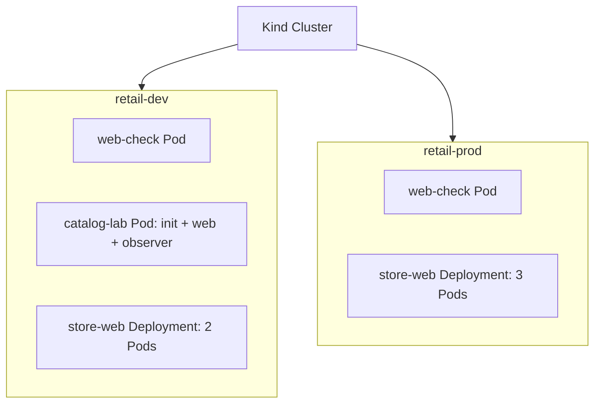

<div dir="rtl" align="right">

# پروژه عملی Kubernetes | فروشگاه سازمانی

**سطح:** Beginner → Advanced · **محیط:** Kind

تیم Platform یک فروشگاه آنلاین باید محیط توسعه و تولید را جدا کرده و چرخه عمر برنامه وب را مدیریت کند. این پروژه فقط از Pod، Namespace و Deployment به‌عنوان Resourceهای مستقیم استفاده می‌کند. Volume و Probe و Resource requirements تنظیمات داخلی Pod هستند. هیچ Service یا Ingress ایجاد نمی‌شود.

**پیش‌نیاز:** یک Cluster فعال Kind، ابزار kubectl و دسترسی به Registry برای دریافت Imageها. روی Cluster آزمایشی و Namespaceهای غیرموجود اجرا کن.

[بخش اول: سناریو](#part-1) · [بخش دوم: پاسخ‌نامه](#part-2)

</div>



<a name="part-1"></a>

<div dir="rtl" align="right">

## بخش اول — سناریو و مراحل تمرین

> [!IMPORTANT]
> ابتدا مراحل را بدون باز کردن پاسخ‌نامه انجام بده. مقادیر مشخص‌شده الزام پروژه هستند، نه راه‌حل. مراحل به ترتیب اجرا می‌شوند.

</div>

<div dir="rtl" align="right">

### Phase 01 — ساخت محیط‌های سازمانی

**وظایف**

- [ ] دو Namespace با نام‌های `retail-dev` و `retail-prod` ایجاد کن.
- [ ] برای هر Namespace برچسب `team=platform` و برچسب `environment` با مقدار `dev` یا `prod` تعیین کن.
- [ ] وضعیت هر دو Namespace باید `Active` باشد.

**معیار پذیرش:** دو محیط منطقی مستقل با برچسب‌های مشخص وجود دارند.

</div>

---

<div dir="rtl" align="right">

### Phase 02 — ساخت اولین Pod

**وظایف**

- [ ] در هر دو Namespace یک Pod با نام یکسان `web-check` بساز.
- [ ] نام Container را `nginx` و Image را `nginx:1.27.5-alpine` قرار بده.
- [ ] پورت Container برابر `80` و Label برابر `app=web-check` باشد.
- [ ] پاسخ HTTP محلی هر دو Pod را بررسی کن.

**معیار پذیرش:** هر دو Pod در وضعیت Running و Ready هستند و HTTP 200 برمی‌گردانند.

</div>

---

<div dir="rtl" align="right">

### Phase 03 — Pod چند Container و Init Container

**وظایف**

- [ ] در `retail-dev` یک Pod با نام `catalog-lab` ایجاد کن.
- [ ] یک Init Container با نام `prepare` و Image برابر `busybox:1.36.1` داشته باشد که فایل `index.html` را با متن `catalog-ready` آماده کند.
- [ ] دو Container با نام‌های `web` و `observer` به ترتیب از Imageهای `nginx:1.27.5-alpine` و `busybox:1.36.1` استفاده کنند.
- [ ] هر دو Container باید به داده مشترک موقت داخل Pod دسترسی داشته باشند؛ observer هر ۱۰ ثانیه محتوا را در Logs چاپ کند.

**معیار پذیرش:** Init Container موفق تمام می‌شود، هر دو Container آماده هستند و صفحه وب و Logs متن مورد انتظار را نشان می‌دهند.

</div>

---

<div dir="rtl" align="right">

### Phase 04 — راه‌اندازی Deployment در محیط توسعه

**وظایف**

- [ ] در `retail-dev` یک Deployment با نام `store-web` ایجاد کن.
- [ ] تعداد Replica برابر ۲، نام Container برابر `web`، Image برابر `nginx:1.27.5-alpine` و پورت ۸۰ باشد.
- [ ] Label مشترک Podها و معیار انتخاب Deployment برابر `app=store-web` باشد.
- [ ] برای هر Container درخواست CPU برابر `50m` و Memory برابر `32Mi` و محدودیت CPU برابر `200m` و Memory برابر `128Mi` باشد.
- [ ] یک Readiness Probe و یک Liveness Probe از نوع HTTP روی مسیر `/` و پورت ۸۰ تعریف کن.

**معیار پذیرش:** دو Replica آماده با Probeهای موفق و Resource requirements مشخص وجود دارند.

</div>

---

<div dir="rtl" align="right">

### Phase 05 — انتقال به Production و Rolling Update

**وظایف**

- [ ] Deployment دیگری با نام `store-web` در `retail-prod` با همان تنظیمات توسعه و ۳ Replica ایجاد کن.
- [ ] استراتژی `RollingUpdate` با `maxUnavailable=0` و `maxSurge=1` و `minReadySeconds=5` تنظیم کن.
- [ ] پس از آماده شدن نسخه اولیه، Image محیط تولید را به `nginx:1.28.0-alpine` تغییر بده.
- [ ] تاریخچه Rollout را بررسی کن و به نسخه اولیه Rollback انجام بده.
- [ ] مطمئن شو محیط توسعه تغییر نکرده است.

**معیار پذیرش:** Production پس از Update و Rollback سه Replica آماده دارد و هر دو محیط از نسخه اولیه استفاده می‌کنند.

</div>

---

<div dir="rtl" align="right">

### Phase 06 — Scaling و Self-healing

**وظایف**

- [ ] تعداد Replicaهای Production را از ۳ به ۵ افزایش بده.
- [ ] یکی از Podهای متعلق به Deployment تولید را حذف کن و بازگشت تعداد Replicaها به ۵ را مشاهده کن.
- [ ] Pod مستقل `web-check` در `retail-dev` را حذف کن و تفاوت رفتار را بررسی کن.
- [ ] Pod مستقل را دوباره ایجاد کن و Production را به ۳ Replica برگردان.

**معیار پذیرش:** Deployment یک Pod جایگزین می‌سازد؛ Pod مستقل حذف‌شده خودکار بازسازی نمی‌شود؛ وضعیت نهایی ۳ Replica است.

</div>

---

<div dir="rtl" align="right">

### Phase 07 — Troubleshooting — Image نامعتبر

**وظایف**

- [ ] فقط در Deployment توسعه، Image را به `nginx:training-invalid-tag-987654` تغییر بده.
- [ ] وضعیت Podهای جدید، Events و وضعیت Rollout را بررسی کن.
- [ ] Root Cause را ثبت کن و نسخه سالم را بازگردان.
- [ ] تأیید کن که Production دست‌نخورده باقی مانده است.

**معیار پذیرش:** خطای ErrImagePull یا ImagePullBackOff مشاهده و رفع می‌شود؛ توسعه به دو Replica آماده برمی‌گردد.

</div>

---

<div dir="rtl" align="right">

### Phase 08 — Troubleshooting — Readiness Probe و Rollout متوقف

**وظایف**

- [ ] در Deployment توسعه فقط مسیر Readiness Probe را به `/not-found-training` تغییر بده.
- [ ] وضعیت Running و Ready Pod جدید را مقایسه کن و علت تکمیل نشدن Rollout را پیدا کن.
- [ ] Logs و Events مرتبط را بررسی کن.
- [ ] مسیر درست را بازگردان و صحت عملکرد را بررسی کن.

**معیار پذیرش:** Pod جدید ممکن است Running ولی NotReady باشد؛ بعد از رفع خطا هر دو Replica آماده‌اند.

</div>

---

<div dir="rtl" align="right">

### بررسی نهایی پروژه

- [ ] هر دو Namespace فعال باشند.
- [ ] هر دو Pod مستقل آماده باشند.
- [ ] Pod چند Container آماده و محتوای آن قابل مشاهده باشد.
- [ ] توسعه دو Replica و تولید سه Replica آماده داشته باشند.
- [ ] هر دو Deployment از Image اولیه استفاده کنند.
- [ ] خطاهای عمدی رفع شده باشند.
- [ ] پس از ثبت نتایج، فقط Resourceهای آزمایش پاک شوند.

</div>

<a name="part-2"></a>

<div dir="rtl" align="right">

## بخش دوم — پاسخ‌نامه و توضیحات فنی

هر پاسخ را پس از تلاش مستقل باز کن. دستورات در Shell تعاملی اجرا شوند. خروجی‌ها نمونه مورد انتظار هستند و در Cluster واقعی آزمایش نشده‌اند.

</div>

<details>
<summary>Phase 01 — ساخت محیط‌های سازمانی</summary>

<div dir="rtl" align="right">

#### راه‌حل کامل

دستورات زیر را در همان مسیر کاری مراحل قبلی اجرا کن.

</div>

<div dir="rtl" align="right">

فایل `01-namespaces.yaml` را با محتوای زیر ذخیره کن.

</div>

```yaml
apiVersion: v1
kind: Namespace
metadata:
  name: retail-dev
  labels:
    team: platform
    environment: dev
---
apiVersion: v1
kind: Namespace
metadata:
  name: retail-prod
  labels:
    team: platform
    environment: prod
```

```bash
kubectl apply -f 01-namespaces.yaml
```

<div dir="rtl" align="right">

#### توضیحات فنی

فیلد `metadata.labels` برای دسته‌بندی است. Namespace محدوده نام‌گذاری ایجاد می‌کند، اما به‌تنهایی مانع ارتباط شبکه‌ای نیست.

#### اعتبارسنجی و نتیجه مورد انتظار

دو محیط منطقی مستقل با برچسب‌های مشخص وجود دارند.

</div>

```bash
kubectl get namespaces -L team,environment
```

</details>

---

<details>
<summary>Phase 02 — ساخت اولین Pod</summary>

<div dir="rtl" align="right">

#### راه‌حل کامل

دستورات زیر را در همان مسیر کاری مراحل قبلی اجرا کن.

</div>

<div dir="rtl" align="right">

فایل `02-pods.yaml` را با محتوای زیر ذخیره کن.

</div>

```yaml
apiVersion: v1
kind: Pod
metadata:
  name: web-check
  namespace: retail-dev
  labels:
    app: web-check
spec:
  containers:
    - name: nginx
      image: nginx:1.27.5-alpine
      ports:
        - containerPort: 80
---
apiVersion: v1
kind: Pod
metadata:
  name: web-check
  namespace: retail-prod
  labels:
    app: web-check
spec:
  containers:
    - name: nginx
      image: nginx:1.27.5-alpine
      ports:
        - containerPort: 80
```

```bash
kubectl apply -f 02-pods.yaml
```

<div dir="rtl" align="right">

#### توضیحات فنی

`containerPort` مستندسازی پورت است و آن را خارج از Pod منتشر نمی‌کند. نام Pod در هر Namespace مستقل است. برای دسترسی آزمایشی می‌توان از port-forward نیز استفاده کرد.

#### اعتبارسنجی و نتیجه مورد انتظار

هر دو Pod در وضعیت Running و Ready هستند و HTTP 200 برمی‌گردانند.

</div>

```bash
kubectl get pods -A -l app=web-check
kubectl wait -n retail-dev --for=condition=Ready pod/web-check --timeout=120s
kubectl wait -n retail-prod --for=condition=Ready pod/web-check --timeout=120s
kubectl exec -n retail-dev web-check -- wget -S -O /dev/null http://127.0.0.1
kubectl exec -n retail-prod web-check -- wget -S -O /dev/null http://127.0.0.1
```

</details>

---

<details>
<summary>Phase 03 — Pod چند Container و Init Container</summary>

<div dir="rtl" align="right">

#### راه‌حل کامل

دستورات زیر را در همان مسیر کاری مراحل قبلی اجرا کن.

</div>

<div dir="rtl" align="right">

فایل `03-catalog.yaml` را با محتوای زیر ذخیره کن.

</div>

```yaml
apiVersion: v1
kind: Pod
metadata:
  name: catalog-lab
  namespace: retail-dev
spec:
  volumes:
    - name: content
      emptyDir: {}
  initContainers:
    - name: prepare
      image: busybox:1.36.1
      command: ["sh", "-c", "echo catalog-ready > /data/index.html"]
      volumeMounts:
        - name: content
          mountPath: /data
  containers:
    - name: web
      image: nginx:1.27.5-alpine
      ports:
        - containerPort: 80
      volumeMounts:
        - name: content
          mountPath: /usr/share/nginx/html
    - name: observer
      image: busybox:1.36.1
      command: ["sh", "-c", "while true; do cat /data/index.html; sleep 10; done"]
      volumeMounts:
        - name: content
          mountPath: /data
          readOnly: true
```

```bash
kubectl apply -f 03-catalog.yaml
```

<div dir="rtl" align="right">

#### توضیحات فنی

`emptyDir` بخشی از Pod است، نه Resource مستقل. با حذف Pod داده از بین می‌رود. Init Container باید قبل از Containerهای اصلی موفق شود. Containerها فضای شبکه مشترک دارند ولی فایل‌سیستم آن‌ها ذاتاً مشترک نیست.

#### اعتبارسنجی و نتیجه مورد انتظار

Init Container موفق تمام می‌شود، هر دو Container آماده هستند و صفحه وب و Logs متن مورد انتظار را نشان می‌دهند.

</div>

```bash
kubectl wait -n retail-dev --for=condition=Ready pod/catalog-lab --timeout=120s
kubectl describe pod -n retail-dev catalog-lab
kubectl logs -n retail-dev catalog-lab -c observer --tail=3
kubectl exec -n retail-dev catalog-lab -c web -- wget -qO- http://127.0.0.1
```

</details>

---

<details>
<summary>Phase 04 — راه‌اندازی Deployment در محیط توسعه</summary>

<div dir="rtl" align="right">

#### راه‌حل کامل

دستورات زیر را در همان مسیر کاری مراحل قبلی اجرا کن.

</div>

<div dir="rtl" align="right">

فایل `04-dev.yaml` را با محتوای زیر ذخیره کن.

</div>

```yaml
apiVersion: apps/v1
kind: Deployment
metadata:
  name: store-web
  namespace: retail-dev
spec:
  replicas: 2
  selector:
    matchLabels:
      app: store-web
  template:
    metadata:
      labels:
        app: store-web
    spec:
      containers:
        - name: web
          image: nginx:1.27.5-alpine
          ports:
            - containerPort: 80
          resources:
            requests:
              cpu: 50m
              memory: 32Mi
            limits:
              cpu: 200m
              memory: 128Mi
          readinessProbe:
            httpGet:
              path: /
              port: 80
            periodSeconds: 5
          livenessProbe:
            httpGet:
              path: /
              port: 80
            initialDelaySeconds: 5
            periodSeconds: 10
```

```bash
kubectl apply -f 04-dev.yaml
```

<div dir="rtl" align="right">

#### توضیحات فنی

`selector` باید با Labelهای `template` مطابق باشد و پس از ایجاد Deployment قابل تغییر نیست. requests برای Scheduling و limits برای محدودسازی مصرف هستند. Readiness وضعیت آماده‌بودن و Liveness نیاز به Restart شدن Container را تعیین می‌کند.

#### اعتبارسنجی و نتیجه مورد انتظار

دو Replica آماده با Probeهای موفق و Resource requirements مشخص وجود دارند.

</div>

```bash
kubectl rollout status deployment/store-web -n retail-dev --timeout=180s
kubectl get deployment store-web -n retail-dev
kubectl get pods -n retail-dev -l app=store-web
kubectl get deployment store-web -n retail-dev -o yaml
```

</details>

---

<details>
<summary>Phase 05 — انتقال به Production و Rolling Update</summary>

<div dir="rtl" align="right">

#### راه‌حل کامل

دستورات زیر را در همان مسیر کاری مراحل قبلی اجرا کن.

</div>

<div dir="rtl" align="right">

فایل `05-prod.yaml` را با محتوای زیر ذخیره کن.

</div>

```yaml
apiVersion: apps/v1
kind: Deployment
metadata:
  name: store-web
  namespace: retail-prod
spec:
  replicas: 3
  minReadySeconds: 5
  strategy:
    type: RollingUpdate
    rollingUpdate:
      maxUnavailable: 0
      maxSurge: 1
  selector:
    matchLabels:
      app: store-web
  template:
    metadata:
      labels:
        app: store-web
    spec:
      containers:
        - name: web
          image: nginx:1.27.5-alpine
          ports:
            - containerPort: 80
          resources:
            requests:
              cpu: 50m
              memory: 32Mi
            limits:
              cpu: 200m
              memory: 128Mi
          readinessProbe:
            httpGet:
              path: /
              port: 80
            periodSeconds: 5
          livenessProbe:
            httpGet:
              path: /
              port: 80
            initialDelaySeconds: 5
            periodSeconds: 10
```

```bash
kubectl apply -f 05-prod.yaml
kubectl rollout status deployment/store-web -n retail-prod --timeout=180s
kubectl set image deployment/store-web web=nginx:1.28.0-alpine -n retail-prod
kubectl rollout status deployment/store-web -n retail-prod --timeout=180s
kubectl rollout history deployment/store-web -n retail-prod
kubectl rollout undo deployment/store-web -n retail-prod
kubectl rollout status deployment/store-web -n retail-prod --timeout=180s
```

<div dir="rtl" align="right">

#### توضیحات فنی

`maxSurge` اجازه یک Replica اضافه می‌دهد؛ `maxUnavailable: 0` هدف حفظ تعداد Replicaهای Available در Rollout عادی است و تضمین مطلق عدم قطعی نیست. Rollback فقط Pod template را برمی‌گرداند، نه تعداد Replicaها.

#### اعتبارسنجی و نتیجه مورد انتظار

Production پس از Update و Rollback سه Replica آماده دارد و هر دو محیط از نسخه اولیه استفاده می‌کنند.

</div>

```bash
kubectl get deployment store-web -n retail-prod
kubectl get deployment store-web -n retail-dev
kubectl get deployment store-web -n retail-prod -o jsonpath='{.spec.template.spec.containers[0].image}'
echo
```

</details>

---

<details>
<summary>Phase 06 — Scaling و Self-healing</summary>

<div dir="rtl" align="right">

#### راه‌حل کامل

دستورات زیر را در همان مسیر کاری مراحل قبلی اجرا کن.

</div>

```bash
kubectl scale deployment/store-web -n retail-prod --replicas=5
kubectl rollout status deployment/store-web -n retail-prod --timeout=180s
POD=$(kubectl get pods -n retail-prod -l app=store-web -o jsonpath='{.items[0].metadata.name}')
kubectl delete pod "$POD" -n retail-prod
kubectl get pods -n retail-prod -l app=store-web
kubectl rollout status deployment/store-web -n retail-prod --timeout=180s
kubectl delete pod web-check -n retail-dev
kubectl get pod web-check -n retail-dev --ignore-not-found
kubectl apply -f 02-pods.yaml
kubectl scale deployment/store-web -n retail-prod --replicas=3
kubectl rollout status deployment/store-web -n retail-prod --timeout=180s
```

<div dir="rtl" align="right">

#### توضیحات فنی

Deployment از طریق ReplicaSet داخلی تعداد Podها را حفظ می‌کند؛ ReplicaSet در این تمرین مستقیماً ایجاد یا مدیریت نمی‌شود. Restart policy جایگزین‌کردن Pod حذف‌شده نیست. تغییر Scale با apply مجدد فایل دارای replicas ممکن است بازنویسی شود.

#### اعتبارسنجی و نتیجه مورد انتظار

Deployment یک Pod جایگزین می‌سازد؛ Pod مستقل حذف‌شده خودکار بازسازی نمی‌شود؛ وضعیت نهایی ۳ Replica است.

</div>

```bash
kubectl get deployment store-web -n retail-prod
kubectl wait -n retail-dev --for=condition=Ready pod/web-check --timeout=120s
```

</details>

---

<details>
<summary>Phase 07 — Troubleshooting — Image نامعتبر</summary>

<div dir="rtl" align="right">

#### راه‌حل کامل

دستورات زیر را در همان مسیر کاری مراحل قبلی اجرا کن.

</div>

```bash
kubectl set image deployment/store-web web=nginx:training-invalid-tag-987654 -n retail-dev
kubectl rollout status deployment/store-web -n retail-dev --timeout=60s
kubectl get pods -n retail-dev -l app=store-web
kubectl describe pods -n retail-dev -l app=store-web
kubectl get events -n retail-dev --sort-by=.lastTimestamp
kubectl rollout undo deployment/store-web -n retail-dev
kubectl rollout status deployment/store-web -n retail-dev --timeout=180s
```

<div dir="rtl" align="right">

#### توضیحات فنی

Timeout در دستور بررسی Rollout عمدی است؛ دستورات را تعاملی اجرا کن. خطا از Tag ناموجود یا عدم دسترسی به Registry ناشی می‌شود؛ Events علت دقیق را نشان می‌دهند. برای Container شروع‌نشده معمولاً Logs کاربردی وجود ندارد.

#### اعتبارسنجی و نتیجه مورد انتظار

خطای ErrImagePull یا ImagePullBackOff مشاهده و رفع می‌شود؛ توسعه به دو Replica آماده برمی‌گردد.

</div>

```bash
kubectl get deployment store-web -n retail-dev
kubectl get deployment store-web -n retail-prod
```

</details>

---

<details>
<summary>Phase 08 — Troubleshooting — Readiness Probe و Rollout متوقف</summary>

<div dir="rtl" align="right">

#### راه‌حل کامل

دستورات زیر را در همان مسیر کاری مراحل قبلی اجرا کن.

</div>

```bash
kubectl patch deployment store-web -n retail-dev --type=json -p='[{"op":"replace","path":"/spec/template/spec/containers/0/readinessProbe/httpGet/path","value":"/not-found-training"}]'
kubectl rollout status deployment/store-web -n retail-dev --timeout=60s
kubectl get pods -n retail-dev -l app=store-web
kubectl describe pods -n retail-dev -l app=store-web
kubectl logs -n retail-dev -l app=store-web -c web --tail=10 --prefix=true
kubectl patch deployment store-web -n retail-dev --type=json -p='[{"op":"replace","path":"/spec/template/spec/containers/0/readinessProbe/httpGet/path","value":"/"}]'
kubectl rollout status deployment/store-web -n retail-dev --timeout=180s
```

<div dir="rtl" align="right">

#### توضیحات فنی

Readiness ناموفق به‌تنهایی Container را Restart نمی‌کند. مسیر ناموجود پاسخ 404 می‌دهد. Liveness همچنان سالم است. برای جلوگیری از تکرار، مسیر Probe را با رفتار واقعی برنامه هماهنگ کن.

#### اعتبارسنجی و نتیجه مورد انتظار

Pod جدید ممکن است Running ولی NotReady باشد؛ بعد از رفع خطا هر دو Replica آماده‌اند.

</div>

```bash
kubectl get deployment store-web -n retail-dev
kubectl get pods -n retail-dev -l app=store-web
```

</details>

---

<div dir="rtl" align="right">

### اعتبارسنجی نهایی و Cleanup

ابتدا وضعیت نهایی را ثبت کن. سپس فقط در صورتی که Namespaceها مخصوص این تمرین هستند، آن‌ها را حذف کن.

</div>

```bash
kubectl get namespaces retail-dev retail-prod
kubectl get pods,deployments -n retail-dev
kubectl get pods,deployments -n retail-prod
kubectl get deployments -A -o custom-columns=NS:.metadata.namespace,NAME:.metadata.name,READY:.status.readyReplicas,IMAGE:.spec.template.spec.containers[0].image
# Cleanup (destructive within the two lab namespaces)
kubectl delete namespace retail-dev retail-prod
kubectl get namespaces
```

<div dir="rtl" align="right">

**مهارت‌های کسب‌شده:** Namespace isolation، Pod lifecycle، Init Container، multi-container Pod، Probe، requests/limits، Scaling، Rolling Update، Rollback و Troubleshooting.

**یادداشت نمایش:** جهت و ترازبندی متن با HTML سازگار با GitHub تنظیم شده است. انتخاب Font و اندازه دقیق آن در README تحت کنترل GitHub است؛ اندازه عنوان‌ها با Headingهای استاندارد تنظیم شده است.

</div>

