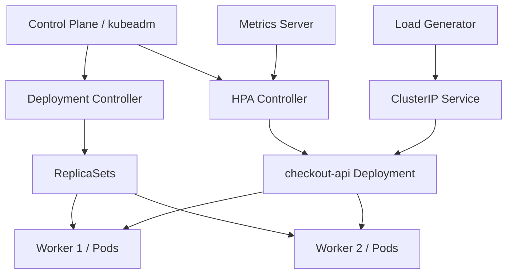

<div dir="rtl" align="right">

# ‏پروژه عملی ‎Kubernetes‎ | ‎Deployment‎ در محیط ‎Enterprise‎

**‏سطح:** ‎Beginner‎ → ‎Advanced‎  
**‏محیط:** ‎kubeadm‎ — یک ‎Control Plane‎ و دو ‎Worker‎  
**‏سناریو:** تیم ‎Platform‎ یک فروشگاه آنلاین باید انتشار نسخه، سلامت Containerها، ظرفیت خودکار و بازیابی خطا را مدیریت کند.

‏[بخش اول — سناریو](#part-1) · [بخش دوم — پاسخ‌نامه](#part-2) · [اعتبارسنجی نهایی](#final-validation)

**‏پیش‌نیاز:** ‎Cluster‎ آزمایشی سالم، دسترسی kubectl، اینترنت Registry، ظرفیت مناسب Workerها و دسترسی مدیریتی برای نصب اختیاری ‎Metrics Server.‎ هیچ تغییری در ‎Taint‎ یا تنظیمات ‎Control Plane‎ لازم نیست.

**‏محدوده:** ‎Deployment‎ و ‎Pod‎ Template، ‎ReplicaSet‎ به‌عنوان ‎Resource‎ خودکار، ‎Namespace‎ ایزوله، ‎HPA‎ و ابزارهای ضروری آزمایش ‎Load.‎ مباحث ‎Service‎ و ‎Metrics Server‎ فقط در حد پیش‌نیاز ‎HPA‎ هستند.

</div>

<div dir="ltr" align="left">



</div>

<a name="part-1"></a>

<div dir="rtl" align="right">

## ‏بخش اول — سناریو و مراحل تمرین

> [!IMPORTANT]
> ‏مراحل را به ترتیب انجام بده. پاسخ‌ها را فقط در صورت نیاز باز کن. تمامی خطاهای عمدی صرفاً در ‎Namespace‎ آزمایشی ایجاد می‌شوند.

</div>

<div dir="rtl" align="right">

### ‏‎Phase 01‎ — آماده‌سازی ‎Cluster‎ و ‎Namespace‎

**‏وظایف**

- [ ] ‏سلامت یک ‎Control Plane‎ و دو ‎Worker‎ را بررسی کن؛ هر سه ‎Node‎ باید ‎Ready‎ باشند.
- [ ] ‏یک ‎Namespace‎ با نام `deploy-lab` و ‎Label‎ برابر `team=platform` ایجاد کن.
- [ ] ‏دسترسی به ‎Registry‎ و ظرفیت ‎CPU‎ و ‎Memory‎ روی Workerها را بررسی کن.

**‏معیار پذیرش:** ‎Namespace‎ فعال است و Workerها قابلیت اجرای ‎Pod‎ دارند.

</div>

---

<div dir="rtl" align="right">

### ‏‎Phase 02‎ — ‎Deployment‎ پایه و مالکیت Resourceها

**‏وظایف**

- [ ] ‏‎Deployment‎ با نام `store-web`، سه ‎Replica‎ و ‎Container‎ با نام `web` بساز.
- [ ] ‏‎Image‎ برابر `nginx:1.27.5-alpine` و پورت نام‌گذاری‌شده `http` برابر ‎80‎ باشد.
- [ ] ‏‎Selector‎ و ‎Label‎ مربوط به ‎Pod‎ برابر `app=store-web` باشد.
- [ ] ‏‎CPU Request‎ برابر 50m، ‎Limit‎ برابر 250m؛ ‎Memory Request‎ برابر ‎32Mi‎ و ‎Limit‎ برابر ‎128Mi‎ باشد.
- [ ] ‏‎RollingUpdate‎ با ‎maxSurge=1‎ و ‎maxUnavailable‎=0، ‎minReadySeconds‎=5، ‎progressDeadlineSeconds=120‎ و ‎revisionHistoryLimit=5‎ تنظیم شود.
- [ ] ‏رابطه مالکیت Deployment، ‎ReplicaSet‎ و ‎Pod‎ را بررسی کن.

**‏معیار پذیرش:** سه ‎Pod‎ آماده، یک ‎ReplicaSet‎ فعال و سه ‎Available Replica.‎

</div>

---

<div dir="rtl" align="right">

### ‏‎Phase 03‎ — ‎Scaling‎ و ‎Self-healing‎

**‏وظایف**

- [ ] ‏‎Replica‎ را از ‎3‎ به ‎5‎ و سپس به ‎2‎ تغییر بده.
- [ ] ‏یکی از Podها را حذف کن و جایگزینی آن را بررسی کن.
- [ ] ‏‎Deployment‎ را به صفر ‎Replica‎ برسان و سپس به ‎3‎ برگردان.
- [ ] ‏بررسی کن تغییر ‎Replica‎ به تنهایی ‎Revision‎ جدید ایجاد نمی‌کند.

**‏معیار پذیرش:** در پایان سه ‎Pod‎ آماده و ‎Revision‎ اولیه برقرار است.

</div>

---

<div dir="rtl" align="right">

### ‏‎Phase 04‎ — ‎Rolling Update‎ و ‎Rollback‎

**‏وظایف**

- [ ] ‏نسخه ‎Image‎ را به `nginx:1.28.0-alpine` تغییر بده.
- [ ] ‏در طول ‎Rollout‎ وضعیت ‎ReplicaSet‎ قدیمی و جدید و ‎Available Replica‎ را مشاهده کن.
- [ ] ‏به ‎Revision‎ قبلی بازگرد و دوباره نسخه جدید را منتشر کن.
- [ ] ‏یک ‎Rollout Restart‎ اجرا کن بدون تغییر نسخه ‎Image.‎

**‏معیار پذیرش:** در پایان نسخه ‎1.28.0‎ فعال است و تاریخچه ‎Revision‎ قابل بررسی است.

</div>

---

<div dir="rtl" align="right">

### ‏‎Phase 05‎ — ‎Pause‎ و ‎Resume‎

**‏وظایف**

- [ ] ‏‎Rollout‎ را قبل از تغییرات متوقف کن.
- [ ] ‏‎Image‎ را به ‎1.27.5‎ برگردان و ‎CPU Request‎ را به ‎75m‎ تغییر بده؛ تا زمان ‎Resume‎ هیچ ‎ReplicaSet‎ جدیدی ناشی از این تغییرات ساخته نشود.
- [ ] ‏در حالت ‎Pause‎ تعداد ‎Replica‎ را به ‎4‎ تغییر بده.
- [ ] ‏‎Rollout‎ را ‎Resume‎ کن و بررسی کن تغییرات قالب در یک ‎Rollout‎ اعمال شده‌اند؛ سپس به ‎3 Replica‎ برگرد.

**‏معیار پذیرش:** سه ‎Pod‎ با ‎Image 1.27.5‎ و ‎CPU Request‎ برابر ‎75m.‎

</div>

---

<div dir="rtl" align="right">

### Phase 06 — Recreate Strategy

**‏وظایف**

- [ ] ‏استراتژی را به ‎Recreate‎ تغییر بده.
- [ ] ‏‎Image‎ را به ‎1.28.0‎ تغییر بده و ترتیب حذف Podهای قدیمی و ایجاد Podهای جدید را مشاهده کن.
- [ ] ‏پس از تکمیل، ‎RollingUpdate‎ با تنظیمات اولیه را بازگردان.

**‏معیار پذیرش:** نسخه جدید فعال است و ‎Strategy‎ دوباره ‎RollingUpdate‎ است.

</div>

---

<div dir="rtl" align="right">

### ‏‎Phase 07‎ — Startup، ‎Readiness‎ و ‎Liveness Probe‎

**‏وظایف**

- [ ] ‏‎Manifest‎ کامل ‎store-web‎ را بازنویسی کن: سه Replica، ‎Image 1.27‎.5، ‎CPU Request 50m‎ و سایر تنظیمات ‎Phase 02.‎
- [ ] ‏برنامه با تأخیر عمدی ‎25‎ ثانیه شروع شود؛ پس از آن مسیرهای /‎ready‎ و /‎live‎ پاسخ ‎HTTP 200‎ بدهند.
- [ ] ‏‎Startup Probe‎ روی /‎live‎ با ‎period=5‎ و ‎failureThreshold‎=12؛ ‎Readiness‎ روی /‎ready‎ با ‎period=3‎ و ‎failureThreshold‎=2؛ ‎Liveness‎ روی /‎live‎ با ‎period=5‎ و ‎failureThreshold=3.‎
- [ ] ‏‎timeoutSeconds‎ برای هر سه برابر ‎2‎ و ‎terminationGracePeriodSeconds‎ برابر ‎30‎ باشد.
- [ ] ‏در زمان شروع بررسی کن ‎Container‎ به دلیل تأخیر ‎Restart‎ نشود و ‎Pod‎ پس از ‎Ready‎ شدن حداقل ‎5‎ ثانیه برای ‎Available‎ شدن منتظر بماند.

**‏معیار پذیرش:** سه ‎Pod Ready‎ و ‎Available‎ بدون ‎Restart‎ ناشی از شروع کند.

</div>

---

<div dir="rtl" align="right">

### Phase 08 — Readiness Failure

**‏وظایف**

- [ ] ‏در یکی از Podها فقط مسیر /‎ready‎ را از دسترس خارج کن.
- [ ] ‏وضعیت ‎Ready‎ و ‎Available‎ را مشاهده کن؛ تعداد ‎Restart‎ نباید افزایش یابد.
- [ ] ‏مسیر را برگردان و سلامت را تأیید کن.

**‏معیار پذیرش:** ‎Pod‎ بدون ‎Restart‎ به ‎Ready‎ بازمی‌گردد و سه ‎Replica Available‎ می‌شوند.

</div>

---

<div dir="rtl" align="right">

### Phase 09 — Liveness Failure

**‏وظایف**

- [ ] ‏در یک ‎Pod‎ فقط مسیر /‎live‎ را حذف کن.
- [ ] ‏‎UID‎ و ‎Restart Count‎ را قبل و بعد مقایسه کن.
- [ ] ‏پس از Restart، ‎Startup Probe‎ دوباره اجرا شود و برنامه خودکار بازیابی شود.

**‏معیار پذیرش:** ‎UID‎ همان ‎Pod‎ ثابت می‌ماند و ‎Restart Count‎ افزایش پیدا می‌کند.

</div>

---

<div dir="rtl" align="right">

### ‏‎Phase 10‎ — ‎Startup Failure‎ و ‎Progress Deadline‎

**‏وظایف**

- [ ] ‏بودجه ‎Startup‎ را عمداً به ‎10‎ ثانیه کاهش بده در حالی که برنامه هنوز ‎25‎ ثانیه برای شروع نیاز دارد.
- [ ] ‏شکست ‎Startup‎ و ‎Restart‎ نسل جدید را مشاهده کن.
- [ ] ‏پس از ‎deadline‎ وضعیت ‎Progressing‎ را بررسی کن؛ نسل قدیمی باید در ‎Rollout‎ عادی باقی بماند.
- [ ] ‏نسخه سالم را بازیابی کن.

**‏معیار پذیرش:** ‎ProgressDeadlineExceeded‎ مشاهده و سپس سه ‎Replica‎ سالم بازیابی شوند.

</div>

---

<div dir="rtl" align="right">

### ‏‎Phase 11‎ — ‎ImagePullBackOff‎ و ‎Selector Troubleshooting‎

**‏وظایف**

- [ ] ‏نسخه ‎Image‎ ناموجود `nginx:deployment-lab-invalid-tag-99999` را منتشر کن.
- [ ] ‏‎Events‎ و وضعیت انتظار ‎Container‎ را بررسی کن و ‎Rollback‎ انجام بده.
- [ ] ‏یک تغییر عمدی ‎Selector‎ برای ‎Deployment‎ موجود درخواست کن و خطای ‎API‎ را ثبت کن؛ ‎Resource‎ را حذف نکن.

**‏معیار پذیرش:** ‎Rollout‎ خراب بازیابی و ‎Selector‎ اصلی بدون تغییر باقی مانده است.

</div>

---

<div dir="rtl" align="right">

### ‏‎Phase 12‎ — ‎Scheduling‎ روی دو ‎Worker‎ و ‎Status Conditions‎

**‏وظایف**

- [ ] ‏برای ‎store-web‎ توزیع نرم Podها روی Nodeهای مختلف با ‎topologyKey‎ برابر ‎kubernetes.io/hostname‎ و ‎maxSkew=1‎ تنظیم کن.
- [ ] ‏وضعیت observedGeneration، updatedReplicas، ‎readyReplicas‎ و ‎availableReplicas‎ را بررسی کن.
- [ ] ‏یک ‎Rollout‎ با ‎nodeSelector‎ ناموجود ایجاد کن تا ‎Pod‎ جدید ‎Pending‎ شود؛ سپس تغییر خراب را ‎Rollback‎ کن.

**‏معیار پذیرش:** سه ‎Replica‎ سالم، توزیع مطلوب در صورت ظرفیت کافی و نسل مشاهده‌شده مطابق نسل فعلی.

</div>

---

<div dir="rtl" align="right">

### ‏‎Phase 13‎ — ‎Metrics Server‎ در ‎kubeadm‎

**‏وظایف**

- [ ] ‏بررسی کن ‎Metrics API‎ فعال باشد و مصرف ‎CPU‎ و ‎Memory‎ هر سه ‎Node‎ و Podها قابل مشاهده باشد.
- [ ] ‏اگر ‎Metrics Server‎ نصب نیست، نسخه سازگار با ‎Kubernetes‎ خود را نصب کن.
- [ ] ‏در صورت خطای ‎TLS‎ یا دسترسی به kubelet، علت را مشخص کن؛ اعتبارسنجی ‎TLS‎ را در محیط واقعی غیرفعال نکن.

**‏معیار پذیرش:** ‎Metrics API‎ در وضعیت ‎Available‎ و داده مصرف قابل دریافت است.

</div>

---

<div dir="rtl" align="right">

### ‏‎Phase 14‎ — ‎HPA‎ بر اساس ‎CPU‎ و تولید ‎Load‎

**‏وظایف**

- [ ] ‏‎Deployment‎ جداگانه `checkout-api` با دو Replica، ‎Image‎ رسمی `registry.k8s.io/hpa-example`، ‎CPU Request=100m‎ و ‎Limit=500m‎ و ‎Memory Request=32Mi‎ و ‎Limit=128Mi‎ بساز.
- [ ] ‏یک ‎ClusterIP Service‎ همنام روی پورت ‎80‎ برای توزیع ‎Load‎ ایجاد کن.
- [ ] ‏‎HPA‎ همنام با ‎API‎ نسخه ‎autoscaling‎/v2، حداقل ‎2‎ و حداکثر ‎6‎ Replica، ‎CPU Target=50%‎ بساز.
- [ ] ‏‎Scale-up‎ حداکثر دو ‎Pod‎ در ‎30‎ ثانیه و ‎Scale-down‎ حداکثر یک ‎Pod‎ در ‎30‎ ثانیه با ‎Stabilization‎ برابر ‎60‎ ثانیه باشد.
- [ ] ‏از داخل یک ‎Pod‎ آزمایشی با نام ‎load-generator‎ بار محدود ایجاد کن؛ افزایش ‎Replica‎ و سپس کاهش پس از قطع بار را مشاهده کن.

**‏معیار پذیرش:** ‎HPA‎ دارای ‎Metrics‎ معتبر است؛ در صورت بار کافی و ظرفیت Workerها ‎Replica‎ بیشتر از ‎2‎ شده و پس از قطع بار به ‎2‎ بازمی‌گردد.

</div>

---

<div dir="rtl" align="right">

### ‏‎Phase 15‎ — ‎HPA Troubleshooting‎ و مدیریت ‎Replica‎

**‏وظایف**

- [ ] ‏با قطع ‎Load‎ و در حالت پایدار، ‎CPU Request‎ را از ‎Container‎ مربوط به ‎checkout-api‎ حذف کن؛ ‎Limit CPU‎ را نیز حذف کن تا ‎Request‎ از روی ‎Limit‎ پیش‌فرض نشود.
- [ ] ‏وضعیت ‎Metrics‎ و ‎ScalingActive‎ را بررسی کن.
- [ ] ‏‎CPU Request‎ و ‎Limit‎ قبلی را برگردان و سلامت ‎HPA‎ را تأیید کن.
- [ ] ‏در صورت وجود ظرفیت کافی، تفاوت ‎CPU‎ و ‎Memory Utilization‎ را بررسی کن و ‎HPA‎ را در پایان روی ‎CPU Target‎ قبلی نگه دار.

**‏معیار پذیرش:** ‎HPA‎ پس از بازیابی Request، ‎Metrics‎ معتبر و حداقل دو ‎Replica‎ دارد.

</div>

---

<div dir="rtl" align="right">

### Final Acceptance Criteria

- [ ] ‏‎Deployment‎ اصلی دارای سه ‎Available‎ Replica، هر سه ‎Probe‎ و ‎RollingUpdate‎ سالم است.
- [ ] ‏Rollback، ‎Pause‎/Resume، ‎Recreate‎ و ‎Self-healing‎ بررسی شده‌اند.
- [ ] ‏خطاهای عمدی برطرف شده‌اند و هیچ ‎Pod‎ معیوب باقی نمانده است.
- [ ] ‏‎HPA‎ دارای ‎Metrics‎ معتبر است و ‎Scale-up‎ و ‎Scale-down‎ در صورت ظرفیت کافی مشاهده شده‌اند.
- [ ] ‏‎Pod‎ تولید ‎Load‎ حذف شده و هیچ ‎Resource‎ خارج از محیط آزمایش تغییر نکرده است (به‌جز نصب مجاز ‎Add-on‎).

**‏‎Skills Acquired:‎** ‎Deployment‎ lifecycle، ‎Rollout‎ strategies، ‎Health‎ checks، Autoscaling، ‎Scheduling‎ و ‎Troubleshooting.‎

</div>

<a name="part-2"></a>

<div dir="rtl" align="right">

## ‏بخش دوم — پاسخ‌نامه و نکات فنی

‏پاسخ هر مرحله به‌صورت پیش‌فرض بسته است. Commandها برای ‎Shell‎ سازگار با ‎Bash‎ نوشته شده‌اند. هنگام مشاهده ‎Watch‎ با ‎Ctrl+C‎ خارج شو. خروجی‌ها معیار مورد انتظار هستند و مقادیر واقعی متفاوت خواهند بود.

</div>

<details>
<summary dir="rtl" align="right">‏‎Phase 01‎ — آماده‌سازی ‎Cluster‎ و ‎Namespace‎</summary>

<div dir="rtl" align="right">

#### ‏راه‌حل کامل

‏‎Manifest‎ زیر را با نام تعیین‌شده ذخیره کن و سپس Commandها را اجرا کن.

</div>

**`namespace.yaml`**

<div dir="ltr" align="left">

```yaml
apiVersion: v1
kind: Namespace
metadata:
  name: deploy-lab
  labels:
    team: platform
```

</div>

<div dir="ltr" align="left">

```bash
kubectl config current-context
kubectl version
kubectl get nodes -o wide
kubectl describe nodes
kubectl get namespace deploy-lab --ignore-not-found
# Only if the namespace does not already exist:
kubectl apply -f namespace.yaml
kubectl get ns deploy-lab --show-labels
```

</div>

<div dir="rtl" align="right">

#### ‏توضیحات فنی، ‎Best Practices‎ و ‎Troubleshooting‎

‏اگر ‎Namespace‎ از قبل وجود دارد، از ادامه روی آن خودداری کن. ‎Taint‎ معمول ‎Control Plane‎ را حذف نکن. وضعیت ‎Ready‎ به تنهایی تضمین سلامت ‎CNI‎ یا ‎DNS‎ نیست.

**‏خروجی مورد انتظار:** ‎Namespace‎ فعال است و Workerها قابلیت اجرای ‎Pod‎ دارند.

#### Interview Q&A

‏آیا ‎Deployment‎ روی ‎Control Plane‎ اجرا می‌شود؟ فقط در صورت مجاز بودن Scheduling؛ در حالت معمول ‎kubeadm‎ دارای ‎Taint‎ است.

</div>

</details>

---

<details>
<summary dir="rtl" align="right">‏‎Phase 02‎ — ‎Deployment‎ پایه و مالکیت Resourceها</summary>

<div dir="rtl" align="right">

#### ‏راه‌حل کامل

‏‎Manifest‎ زیر را با نام تعیین‌شده ذخیره کن و سپس Commandها را اجرا کن.

</div>

**`store-web.yaml`**

<div dir="ltr" align="left">

```yaml
apiVersion: apps/v1
kind: Deployment
metadata:
  name: store-web
  namespace: deploy-lab
  labels:
    app: store-web
spec:
  replicas: 3
  selector:
    matchLabels:
      app: store-web
  minReadySeconds: 5
  progressDeadlineSeconds: 120
  revisionHistoryLimit: 5
  strategy:
    type: RollingUpdate
    rollingUpdate:
      maxSurge: 1
      maxUnavailable: 0
  template:
    metadata:
      labels:
        app: store-web
    spec:
      containers:
        - name: web
          image: nginx:1.27.5-alpine
          ports:
            - name: http
              containerPort: 80
          resources:
            requests:
              cpu: 50m
              memory: 32Mi
            limits:
              cpu: 250m
              memory: 128Mi
```

</div>

<div dir="ltr" align="left">

```bash
kubectl apply --dry-run=server -f store-web.yaml
kubectl apply -f store-web.yaml
kubectl -n deploy-lab rollout status deployment/store-web --timeout=180s
kubectl -n deploy-lab get deploy,rs,pods -o wide
kubectl -n deploy-lab get rs -l app=store-web -o custom-columns=NAME:.metadata.name,OWNER:.metadata.ownerReferences[0].name
kubectl -n deploy-lab get pods -l app=store-web -o custom-columns=NAME:.metadata.name,OWNER:.metadata.ownerReferences[0].name
```

</div>

<div dir="rtl" align="right">

#### ‏توضیحات فنی، ‎Best Practices‎ و ‎Troubleshooting‎

‏‎Selector‎ باید با ‎Label‎ قالب ‎Pod‎ سازگار باشد و در ‎apps/v1‎ تغییر آن مجاز نیست. ‎Pod Template‎ تعیین‌کننده ‎Revision‎ است. ‎Port‎ اعلامی به‌تنهایی ‎Service‎ نمی‌سازد. ‎Requests‎ برای ‎Scheduling‎ و ‎Limits‎ برای محدودیت مصرف هستند. ‎minReadySeconds‎ مدت ‎Ready‎ ماندن بدون وقفه برای ‎Available‎ شدن است؛ ‎deadline‎ باید بزرگ‌تر باشد.

**‏خروجی مورد انتظار:** سه ‎Pod‎ آماده، یک ‎ReplicaSet‎ فعال و سه ‎Available Replica.‎

#### Interview Q&A

‏آیا ‎Deployment‎ مستقیماً ‎Pod‎ می‌سازد؟ خیر، ‎ReplicaSet‎ واسطه است.

</div>

</details>

---

<details>
<summary dir="rtl" align="right">‏‎Phase 03‎ — ‎Scaling‎ و ‎Self-healing‎</summary>

<div dir="rtl" align="right">

#### ‏راه‌حل کامل

‏Commandها را به ترتیب اجرا کن و وضعیت Resourceها را پس از هر تغییر بررسی کن.

</div>

<div dir="ltr" align="left">

```bash
kubectl -n deploy-lab scale deployment/store-web --replicas=5
kubectl -n deploy-lab rollout status deployment/store-web --timeout=180s
kubectl -n deploy-lab scale deployment/store-web --replicas=2
kubectl -n deploy-lab rollout status deployment/store-web --timeout=180s
POD=$(kubectl -n deploy-lab get pod -l app=store-web -o jsonpath='{.items[0].metadata.name}')
kubectl -n deploy-lab delete pod "$POD"
kubectl -n deploy-lab rollout status deployment/store-web --timeout=180s
kubectl -n deploy-lab scale deployment/store-web --replicas=0
kubectl -n deploy-lab rollout status deployment/store-web --timeout=180s
kubectl -n deploy-lab scale deployment/store-web --replicas=3
kubectl -n deploy-lab rollout status deployment/store-web --timeout=180s
kubectl -n deploy-lab rollout history deployment/store-web
```

</div>

<div dir="rtl" align="right">

#### ‏توضیحات فنی، ‎Best Practices‎ و ‎Troubleshooting‎

‏‎Scaling‎ تغییر ‎spec.replicas‎ است؛ حذف ‎Pod‎ سبب ایجاد ‎Pod‎ با ‎UID‎ جدید می‌شود. توزیع متوازن روی دو ‎Worker‎ به‌صورت پیش‌فرض تضمین سخت ندارد. روش ‎Declarative‎ نیز ویرایش ‎replicas‎ و ‎apply‎ است؛ پس از ‎Scaling‎ دستی، ‎Manifest‎ قدیمی ممکن است تعداد را تغییر دهد.

**‏خروجی مورد انتظار:** در پایان سه ‎Pod‎ آماده و ‎Revision‎ اولیه برقرار است.

#### Interview Q&A

‏تفاوت ‎Restart‎ و ‎Replacement‎ چیست؟ ‎Restart‎ داخل همان ‎Pod‎ است؛ ‎Replacement‎ یک ‎Pod‎ جدید می‌سازد.

</div>

</details>

---

<details>
<summary dir="rtl" align="right">‏‎Phase 04‎ — ‎Rolling Update‎ و ‎Rollback‎</summary>

<div dir="rtl" align="right">

#### ‏راه‌حل کامل

‏Commandها را به ترتیب اجرا کن و وضعیت Resourceها را پس از هر تغییر بررسی کن.

</div>

<div dir="ltr" align="left">

```bash
kubectl -n deploy-lab set image deployment/store-web web=nginx:1.28.0-alpine
kubectl -n deploy-lab get rs,pods -w
# Stop watch with Ctrl+C when rollout completes
kubectl -n deploy-lab rollout status deployment/store-web --timeout=180s
kubectl -n deploy-lab rollout history deployment/store-web
kubectl -n deploy-lab rollout undo deployment/store-web
kubectl -n deploy-lab rollout status deployment/store-web --timeout=180s
kubectl -n deploy-lab set image deployment/store-web web=nginx:1.28.0-alpine
kubectl -n deploy-lab rollout status deployment/store-web --timeout=180s
kubectl -n deploy-lab rollout restart deployment/store-web
kubectl -n deploy-lab rollout status deployment/store-web --timeout=180s
```

</div>

<div dir="rtl" align="right">

#### ‏توضیحات فنی، ‎Best Practices‎ و ‎Troubleshooting‎

‏با ‎surge‎ یک، هدف حداکثر چهار ‎Pod‎ غیر ‎Terminating‎ است؛ Podهای ‎Terminating‎ می‌توانند مصرف موقت را بالاتر ببرند. ‎maxUnavailable=0‎ به معنی حفظ ‎Available‎ در ‎Rollout‎ عادی است، نه تضمین مطلق عدم قطعی. درصد ‎surge‎ رو به بالا و درصد ‎unavailable‎ رو به پایین گرد می‌شود. ‎rollback‎ قالب ‎Pod‎ را بازمی‌گرداند نه همه تنظیمات ‎Deployment.‎

**‏خروجی مورد انتظار:** در پایان نسخه ‎1.28.0‎ فعال است و تاریخچه ‎Revision‎ قابل بررسی است.

#### Interview Q&A

‏چه چیزی ‎Revision‎ می‌سازد؟ تغییر ‎Pod‎ Template؛ ‎restart‎ نیز ‎Annotation‎ قالب را تغییر می‌دهد.

</div>

</details>

---

<details>
<summary dir="rtl" align="right">‏‎Phase 05‎ — ‎Pause‎ و ‎Resume‎</summary>

<div dir="rtl" align="right">

#### ‏راه‌حل کامل

‏Commandها را به ترتیب اجرا کن و وضعیت Resourceها را پس از هر تغییر بررسی کن.

</div>

<div dir="ltr" align="left">

```bash
kubectl -n deploy-lab get rs
kubectl -n deploy-lab rollout pause deployment/store-web
kubectl -n deploy-lab set image deployment/store-web web=nginx:1.27.5-alpine
kubectl -n deploy-lab set resources deployment/store-web -c web --requests=cpu=75m,memory=32Mi --limits=cpu=250m,memory=128Mi
kubectl -n deploy-lab scale deployment/store-web --replicas=4
kubectl -n deploy-lab get rs
kubectl -n deploy-lab get deploy store-web -o jsonpath='{.spec.paused}'
kubectl -n deploy-lab rollout resume deployment/store-web
kubectl -n deploy-lab rollout status deployment/store-web --timeout=180s
kubectl -n deploy-lab scale deployment/store-web --replicas=3
kubectl -n deploy-lab rollout status deployment/store-web --timeout=180s
```

</div>

<div dir="rtl" align="right">

#### ‏توضیحات فنی، ‎Best Practices‎ و ‎Troubleshooting‎

‏‎Pause‎ اجرای Containerها را متوقف نمی‌کند؛ ‎Scaling‎ و ‎Self-healing‎ همچنان ممکن هستند. در ‎Pause‎ زمان ‎progress deadline‎ بررسی نمی‌شود. قبل از ‎undo‎ باید ‎Resume‎ انجام شود.

**‏خروجی مورد انتظار:** سه ‎Pod‎ با ‎Image 1.27.5‎ و ‎CPU Request‎ برابر ‎75m.‎

#### Interview Q&A

‏دستور ‎unpause‎ چیست؟ ‎kubectl rollout‎ resume؛ معادل ‎Declarative‎ آن ‎paused: false‎ است.

</div>

</details>

---

<details>
<summary>Phase 06 — Recreate Strategy</summary>

<div dir="rtl" align="right">

#### ‏راه‌حل کامل

‏Commandها را به ترتیب اجرا کن و وضعیت Resourceها را پس از هر تغییر بررسی کن.

</div>

<div dir="ltr" align="left">

```bash
kubectl -n deploy-lab patch deployment store-web --type=merge -p '{"spec":{"strategy":{"type":"Recreate","rollingUpdate":null}}}'
kubectl -n deploy-lab set image deployment/store-web web=nginx:1.28.0-alpine
kubectl -n deploy-lab get pods -w
# Ctrl+C after completion
kubectl -n deploy-lab rollout status deployment/store-web --timeout=180s
kubectl -n deploy-lab patch deployment store-web --type=merge -p '{"spec":{"strategy":{"type":"RollingUpdate","rollingUpdate":{"maxSurge":1,"maxUnavailable":0}}}}'
kubectl -n deploy-lab get deploy store-web -o jsonpath='{.spec.strategy}'
```

</div>

<div dir="rtl" align="right">

#### ‏توضیحات فنی، ‎Best Practices‎ و ‎Troubleshooting‎

‏‎Recreate‎ هنگام تغییر قالب، Podهای قدیمی را پیش از ایجاد نسل جدید متوقف می‌کند و وقفه ممکن است. ‎rollingUpdate‎ برای نوع ‎Recreate‎ باید حذف شود. این رفتار تضمین عدم هم‌پوشانی در حذف دستی ‎Pod‎ نیست.

**‏خروجی مورد انتظار:** نسخه جدید فعال است و ‎Strategy‎ دوباره ‎RollingUpdate‎ است.

#### Interview Q&A

‏چه زمانی Recreate؟ وقتی هم‌زیستی دو نسخه مجاز نیست و وقفه پذیرفتنی است.

</div>

</details>

---

<details>
<summary dir="rtl" align="right">‏‎Phase 07‎ — Startup، ‎Readiness‎ و ‎Liveness Probe‎</summary>

<div dir="rtl" align="right">

#### ‏راه‌حل کامل

‏‎Manifest‎ زیر را با نام تعیین‌شده ذخیره کن و سپس Commandها را اجرا کن.

</div>

**`store-web-probes.yaml`**

<div dir="ltr" align="left">

```yaml
apiVersion: apps/v1
kind: Deployment
metadata:
  name: store-web
  namespace: deploy-lab
  labels:
    app: store-web
spec:
  replicas: 3
  selector:
    matchLabels:
      app: store-web
  minReadySeconds: 5
  progressDeadlineSeconds: 120
  revisionHistoryLimit: 5
  strategy:
    type: RollingUpdate
    rollingUpdate:
      maxSurge: 1
      maxUnavailable: 0
  template:
    metadata:
      labels:
        app: store-web
    spec:
      containers:
      - name: web
        image: nginx:1.27.5-alpine
        ports:
        - name: http
          containerPort: 80
        resources:
          requests:
            cpu: 50m
            memory: 32Mi
          limits:
            cpu: 250m
            memory: 128Mi
        command:
        - /bin/sh
        - -c
        args:
        - sleep 25; echo ready > /usr/share/nginx/html/ready; echo live > /usr/share/nginx/html/live;
          exec nginx -g "daemon off;"
        startupProbe:
          httpGet:
            path: /live
            port: http
          periodSeconds: 5
          timeoutSeconds: 2
          failureThreshold: 12
        readinessProbe:
          httpGet:
            path: /ready
            port: http
          periodSeconds: 3
          timeoutSeconds: 2
          failureThreshold: 2
          successThreshold: 1
        livenessProbe:
          httpGet:
            path: /live
            port: http
          periodSeconds: 5
          timeoutSeconds: 2
          failureThreshold: 3
      terminationGracePeriodSeconds: 30
```

</div>

<div dir="ltr" align="left">

```bash
kubectl apply --dry-run=server -f store-web-probes.yaml
kubectl apply -f store-web-probes.yaml
kubectl -n deploy-lab get pods -w
# Ctrl+C after completion
kubectl -n deploy-lab rollout status deployment/store-web --timeout=240s
kubectl -n deploy-lab get deploy,pods
kubectl -n deploy-lab describe deployment store-web
```

</div>

<div dir="rtl" align="right">

#### ‏توضیحات فنی، ‎Best Practices‎ و ‎Troubleshooting‎

‏‎Startup‎ تا اولین موفقیت مانع اجرای دو ‎Probe‎ دیگر است. بودجه تقریبی شروع ‎60‎ ثانیه است، زمان دقیق تضمین نیست. ‎HTTP 200‎ تا ‎399‎ موفق محسوب می‌شود. ‎readiness‎ شکست‌خورده ‎Container‎ را ‎Restart‎ نمی‌کند؛ ‎liveness‎ و ‎startup‎ پس از شکست متوالی ‎Restart‎ می‌کنند. exec، ‎tcpSocket‎ و ‎gRPC‎ نیز روش‌های معتبرند؛ ‎gRPC‎ نیازمند ‎Health Checking Protocol‎ و پورت عددی است. ‎successThreshold‎ برای ‎startup‎ و ‎liveness‎ باید ‎1‎ باشد.

**‏خروجی مورد انتظار:** سه ‎Pod Ready‎ و ‎Available‎ بدون ‎Restart‎ ناشی از شروع کند.

#### Interview Q&A

‏فرق ‎Ready‎ و Available؟ ‎Ready‎ وضعیت فعلی ‎Pod‎ است؛ ‎Available‎ پس از گذشت ‎minReadySeconds‎ برقرار می‌شود.

</div>

</details>

---

<details>
<summary>Phase 08 — Readiness Failure</summary>

<div dir="rtl" align="right">

#### ‏راه‌حل کامل

‏Commandها را به ترتیب اجرا کن و وضعیت Resourceها را پس از هر تغییر بررسی کن.

</div>

<div dir="ltr" align="left">

```bash
POD=$(kubectl -n deploy-lab get pod -l app=store-web -o jsonpath='{.items[0].metadata.name}')
kubectl -n deploy-lab exec "$POD" -c web -- rm /usr/share/nginx/html/ready
kubectl -n deploy-lab wait --for=condition=Ready=false pod/"$POD" --timeout=60s
kubectl -n deploy-lab get deploy,pod
kubectl -n deploy-lab describe pod "$POD"
kubectl -n deploy-lab exec "$POD" -c web -- sh -c 'echo ready > /usr/share/nginx/html/ready'
kubectl -n deploy-lab wait --for=condition=Ready pod/"$POD" --timeout=60s
kubectl -n deploy-lab rollout status deployment/store-web --timeout=120s
```

</div>

<div dir="rtl" align="right">

#### ‏توضیحات فنی، ‎Best Practices‎ و ‎Troubleshooting‎

‏‎Root Cause:‎ پاسخ ‎HTTP 404‎ مسیر ‎readiness.‎ در صورت وجود Service، ‎EndpointSlice‎ معمولاً آن ‎Pod‎ را ‎NotReady‎ نشان می‌دهد و ترافیک عادی به آن نمی‌رسد. در این مرحله ‎Service‎ نداریم و صرفاً وضعیت را بررسی می‌کنیم.

**‏خروجی مورد انتظار:** ‎Pod‎ بدون ‎Restart‎ به ‎Ready‎ بازمی‌گردد و سه ‎Replica Available‎ می‌شوند.

#### Interview Q&A

‏آیا ‎readiness‎ باید وابستگی ضروری را بررسی کند؟ بله، اگر عدم دسترسی واقعاً مانع سرویس‌دهی است؛ از بررسی‌های گران پرهیز کن.

</div>

</details>

---

<details>
<summary>Phase 09 — Liveness Failure</summary>

<div dir="rtl" align="right">

#### ‏راه‌حل کامل

‏Commandها را به ترتیب اجرا کن و وضعیت Resourceها را پس از هر تغییر بررسی کن.

</div>

<div dir="ltr" align="left">

```bash
POD=$(kubectl -n deploy-lab get pod -l app=store-web -o jsonpath='{.items[0].metadata.name}')
kubectl -n deploy-lab get pod "$POD" -o custom-columns=UID:.metadata.uid,RESTARTS:.status.containerStatuses[0].restartCount
kubectl -n deploy-lab exec "$POD" -c web -- rm /usr/share/nginx/html/live
kubectl -n deploy-lab get pod "$POD" -w
# Ctrl+C after restart and readiness recovery
kubectl -n deploy-lab describe pod "$POD"
kubectl -n deploy-lab logs "$POD" -c web --previous
kubectl -n deploy-lab get pod "$POD" -o custom-columns=UID:.metadata.uid,RESTARTS:.status.containerStatuses[0].restartCount
kubectl -n deploy-lab rollout status deployment/store-web --timeout=180s
```

</div>

<div dir="rtl" align="right">

#### ‏توضیحات فنی، ‎Best Practices‎ و ‎Troubleshooting‎

‏‎Root Cause:‎ شکست ‎HTTP‎ در liveness؛ ‎kubelet Container‎ را ‎Restart‎ می‌کند و اسکریپت شروع دوباره فایل‌ها را می‌سازد. ‎liveness‎ نباید به وابستگی خارجی گذرا متصل باشد؛ خطر ‎Restart Storm‎ دارد.

**‏خروجی مورد انتظار:** ‎UID‎ همان ‎Pod‎ ثابت می‌ماند و ‎Restart Count‎ افزایش پیدا می‌کند.

#### Interview Q&A

‏آیا ‎liveness‎ شکست‌خورده ‎Pod‎ جدید ایجاد می‌کند؟ معمولاً خیر؛ ‎Container‎ همان ‎Pod Restart‎ می‌شود.

</div>

</details>

---

<details>
<summary dir="rtl" align="right">‏‎Phase 10‎ — ‎Startup Failure‎ و ‎Progress Deadline‎</summary>

<div dir="rtl" align="right">

#### ‏راه‌حل کامل

‏Commandها را به ترتیب اجرا کن و وضعیت Resourceها را پس از هر تغییر بررسی کن.

</div>

<div dir="ltr" align="left">

```bash
kubectl -n deploy-lab patch deployment store-web --type=strategic -p '{"spec":{"template":{"spec":{"containers":[{"name":"web","startupProbe":{"failureThreshold":2}}]}}}}'
kubectl -n deploy-lab get pods,rs
kubectl -n deploy-lab rollout status deployment/store-web --timeout=180s
# Expected failure; continue diagnosis
kubectl -n deploy-lab get deploy store-web -o jsonpath='{.status.conditions}'
kubectl -n deploy-lab get events --sort-by=.metadata.creationTimestamp
kubectl -n deploy-lab get pods -l app=store-web
# Replace with the failing pod name:
# kubectl -n deploy-lab describe pod <failing-pod>
# kubectl -n deploy-lab logs <failing-pod> -c web --previous
kubectl -n deploy-lab rollout undo deployment/store-web
kubectl -n deploy-lab rollout status deployment/store-web --timeout=240s
```

</div>

<div dir="rtl" align="right">

#### ‏توضیحات فنی، ‎Best Practices‎ و ‎Troubleshooting‎

‏‎Root Cause:‎ بودجه ‎Startup‎ کمتر از زمان راه‌اندازی است. ‎Deployment‎ صرفاً شکست پیشرفت را گزارش می‌کند و خودکار ‎Rollback‎ نمی‌کند. ‎deadline‎ از آخرین پیشرفت محاسبه می‌شود، نه الزاماً از شروع فرمان.

**‏خروجی مورد انتظار:** ‎ProgressDeadlineExceeded‎ مشاهده و سپس سه ‎Replica‎ سالم بازیابی شوند.

#### Interview Q&A

‏آیا افزایش ‎progressDeadlineSeconds‎ مشکل ‎Probe‎ را رفع می‌کند؟ خیر؛ فقط زمان گزارش شکست تغییر می‌کند.

</div>

</details>

---

<details>
<summary dir="rtl" align="right">‏‎Phase 11‎ — ‎ImagePullBackOff‎ و ‎Selector Troubleshooting‎</summary>

<div dir="rtl" align="right">

#### ‏راه‌حل کامل

‏Commandها را به ترتیب اجرا کن و وضعیت Resourceها را پس از هر تغییر بررسی کن.

</div>

<div dir="ltr" align="left">

```bash
kubectl -n deploy-lab set image deployment/store-web web=nginx:deployment-lab-invalid-tag-99999
kubectl -n deploy-lab get pods -w
# Ctrl+C once ErrImagePull or ImagePullBackOff is seen
kubectl -n deploy-lab get events --sort-by=.metadata.creationTimestamp
kubectl -n deploy-lab rollout undo deployment/store-web
kubectl -n deploy-lab rollout status deployment/store-web --timeout=240s
kubectl -n deploy-lab patch deployment store-web --type=merge -p '{"spec":{"selector":{"matchLabels":{"app":"changed"}},"template":{"metadata":{"labels":{"app":"changed"}}}}}'
# Expected API rejection: field is immutable
kubectl -n deploy-lab get deploy store-web -o jsonpath='{.spec.selector}'
```

</div>

<div dir="rtl" align="right">

#### ‏توضیحات فنی، ‎Best Practices‎ و ‎Troubleshooting‎

‏‎ImagePullBackOff‎ یعنی ‎kubelet‎ تلاش دریافت ‎Image‎ را با فاصله افزایشی تکرار می‌کند؛ Registry، Tag، ‎DNS‎ و ‎Credentials‎ را بررسی کن. تغییر ‎Selector‎ در ‎Deployment‎ موجود مجاز نیست؛ مهاجرت نیازمند ‎Deployment‎ جدید با ‎Selector‎ غیرهم‌پوشان است.

**‏خروجی مورد انتظار:** ‎Rollout‎ خراب بازیابی و ‎Selector‎ اصلی بدون تغییر باقی مانده است.

#### Interview Q&A

‏چرا Selectorهای هم‌پوشان خطرناک‌اند؟ Controllerها ممکن است بر سر مالکیت و مدیریت Podها تداخل کنند.

</div>

</details>

---

<details>
<summary dir="rtl" align="right">‏‎Phase 12‎ — ‎Scheduling‎ روی دو ‎Worker‎ و ‎Status Conditions‎</summary>

<div dir="rtl" align="right">

#### ‏راه‌حل کامل

‏Commandها را به ترتیب اجرا کن و وضعیت Resourceها را پس از هر تغییر بررسی کن.

</div>

<div dir="ltr" align="left">

```bash
kubectl -n deploy-lab patch deployment store-web --type=merge -p '{"spec":{"template":{"spec":{"topologySpreadConstraints":[{"maxSkew":1,"topologyKey":"kubernetes.io/hostname","whenUnsatisfiable":"ScheduleAnyway","labelSelector":{"matchLabels":{"app":"store-web"}}}]}}}}'
kubectl -n deploy-lab rollout status deployment/store-web --timeout=240s
kubectl -n deploy-lab get pods -o wide
kubectl -n deploy-lab get deploy store-web -o yaml
kubectl -n deploy-lab patch deployment store-web --type=merge -p '{"spec":{"template":{"spec":{"nodeSelector":{"deployment-lab.example/never":"true"}}}}}'
kubectl -n deploy-lab get pods
kubectl -n deploy-lab get events --sort-by=.metadata.creationTimestamp
kubectl -n deploy-lab rollout undo deployment/store-web
kubectl -n deploy-lab rollout status deployment/store-web --timeout=240s
```

</div>

<div dir="rtl" align="right">

#### ‏توضیحات فنی، ‎Best Practices‎ و ‎Troubleshooting‎

‏‎ScheduleAnyway‎ ترجیح است نه تضمین؛ ‎DoNotSchedule‎ محدودیت سخت است و ممکن است ‎Rollout‎ را متوقف کند. ‎Pending‎ ناشی از ‎FailedScheduling‎ با ‎ImagePullBackOff‎ متفاوت است. ‎observedGeneration‎ نشان می‌دهد ‎Controller‎ نسل فعلی را مشاهده کرده؛ به تنهایی موفقیت ‎Rollout‎ نیست.

**‏خروجی مورد انتظار:** سه ‎Replica‎ سالم، توزیع مطلوب در صورت ظرفیت کافی و نسل مشاهده‌شده مطابق نسل فعلی.

#### Interview Q&A

‏آیا دو ‎Worker‎ الزاماً هر دو ‎Pod‎ می‌گیرند؟ خیر، ظرفیت و قواعد ‎Scheduling‎ تعیین‌کننده‌اند.

</div>

</details>

---

<details>
<summary dir="rtl" align="right">‏‎Phase 13‎ — ‎Metrics Server‎ در ‎kubeadm‎</summary>

<div dir="rtl" align="right">

#### ‏راه‌حل کامل

‏Commandها را به ترتیب اجرا کن و وضعیت Resourceها را پس از هر تغییر بررسی کن.

</div>

<div dir="ltr" align="left">

```bash
kubectl version
kubectl get apiservice v1beta1.metrics.k8s.io
kubectl -n kube-system get deployment metrics-server
# If absent, select a compatible release using the official compatibility matrix.
# Example ONLY for Kubernetes 1.31+ (Metrics Server 0.8.x):
kubectl apply -f https://github.com/kubernetes-sigs/metrics-server/releases/download/v0.8.0/components.yaml
kubectl -n kube-system rollout status deployment/metrics-server --timeout=180s
kubectl get apiservice v1beta1.metrics.k8s.io
kubectl top nodes
kubectl -n deploy-lab top pods
# Diagnosis when metrics are unavailable:
kubectl describe apiservice v1beta1.metrics.k8s.io
kubectl -n kube-system logs deployment/metrics-server --tail=100
kubectl -n kube-system get pods -l k8s-app=metrics-server -o wide
kubectl get csr
```

</div>

<div dir="rtl" align="right">

#### ‏توضیحات فنی، ‎Best Practices‎ و ‎Troubleshooting‎

‏نصب ‎Add-on‎ تغییر سطح ‎Cluster‎ است؛ فقط با مجوز مدیر و در محیط آزمایشی انجام بده. برای ‎Kubernetes 1.27‎ تا ‎1.30‎ شاخه ‎0.7.x‎ و برای نسخه‌های قدیمی‌تر ماتریس سازگاری رسمی را بررسی کن. ‎Metrics Server‎ به ‎aggregation‎ layer، دسترسی شبکه به ‎kubelet‎ (معمولاً ‎10250‎)، احراز هویت و گواهی معتبر با ‎SAN‎ مناسب نیاز دارد. خطای ‎x509‎ در ‎kubeadm‎ را با مدیریت صحیح ‎kubelet serving certificates‎ و ‎CA‎ برطرف کن؛ ‎CSR‎ ناشناس را تأیید نکن. اگر دسترسی به تنظیمات ‎Cluster‎ نداری این ‎Phase‎ را متوقف کن و ‎HPA‎ را پس از اصلاح ادامه بده.

**‏خروجی مورد انتظار:** ‎Metrics API‎ در وضعیت ‎Available‎ و داده مصرف قابل دریافت است.

#### Interview Q&A

‏آیا ‎Metrics Server‎ ابزار ذخیره تاریخی است؟ خیر؛ داده جاری برای ‎Autoscaling‎ و ‎kubectl top‎ ارائه می‌کند.

</div>

</details>

---

<details>
<summary dir="rtl" align="right">‏‎Phase 14‎ — ‎HPA‎ بر اساس ‎CPU‎ و تولید ‎Load‎</summary>

<div dir="rtl" align="right">

#### ‏راه‌حل کامل

‏‎Manifest‎ زیر را با نام تعیین‌شده ذخیره کن و سپس Commandها را اجرا کن.

</div>

**`checkout-api.yaml`**

<div dir="ltr" align="left">

```yaml
apiVersion: apps/v1
kind: Deployment
metadata:
  name: checkout-api
  namespace: deploy-lab
spec:
  replicas: 2
  selector:
    matchLabels:
      app: checkout-api
  template:
    metadata:
      labels:
        app: checkout-api
    spec:
      containers:
        - name: php
          image: registry.k8s.io/hpa-example
          ports:
            - containerPort: 80
          resources:
            requests:
              cpu: 100m
              memory: 32Mi
            limits:
              cpu: 500m
              memory: 128Mi
          readinessProbe:
            tcpSocket:
              port: 80
            periodSeconds: 5
---
apiVersion: v1
kind: Service
metadata:
  name: checkout-api
  namespace: deploy-lab
spec:
  selector:
    app: checkout-api
  ports:
    - port: 80
      targetPort: 80
```

</div>

**`checkout-hpa.yaml`**

<div dir="ltr" align="left">

```yaml
apiVersion: autoscaling/v2
kind: HorizontalPodAutoscaler
metadata:
  name: checkout-api
  namespace: deploy-lab
spec:
  scaleTargetRef:
    apiVersion: apps/v1
    kind: Deployment
    name: checkout-api
  minReplicas: 2
  maxReplicas: 6
  metrics:
    - type: Resource
      resource:
        name: cpu
        target:
          type: Utilization
          averageUtilization: 50
  behavior:
    scaleUp:
      stabilizationWindowSeconds: 0
      policies:
        - type: Pods
          value: 2
          periodSeconds: 30
    scaleDown:
      stabilizationWindowSeconds: 60
      policies:
        - type: Pods
          value: 1
          periodSeconds: 30
```

</div>

**`load-generator.yaml`**

<div dir="ltr" align="left">

```yaml
apiVersion: v1
kind: Pod
metadata:
  name: load-generator
  namespace: deploy-lab
spec:
  restartPolicy: Never
  activeDeadlineSeconds: 360
  containers:
    - name: load
      image: busybox:1.36.1
      command: ["sh", "-c"]
      args: ['for i in 1 2 3 4; do (while true; do wget -q -O /dev/null http://checkout-api; done) & done; sleep 300']
      resources:
        requests:
          cpu: 50m
          memory: 8Mi
        limits:
          cpu: 200m
          memory: 32Mi
```

</div>

<div dir="ltr" align="left">

```bash
kubectl apply -f checkout-api.yaml
kubectl -n deploy-lab rollout status deployment/checkout-api --timeout=180s
kubectl apply -f checkout-hpa.yaml
kubectl -n deploy-lab get hpa
kubectl apply -f load-generator.yaml
# In a second terminal:
kubectl -n deploy-lab get hpa,deploy,pods -w
# Ctrl+C to stop watching; stop the load after observing scale-up:
kubectl -n deploy-lab delete pod load-generator --ignore-not-found
kubectl -n deploy-lab get hpa -w
# Ctrl+C after scale-down
kubectl -n deploy-lab describe hpa checkout-api
kubectl -n deploy-lab top pods
```

</div>

<div dir="rtl" align="right">

#### ‏توضیحات فنی، ‎Best Practices‎ و ‎Troubleshooting‎

‏‎CPU Utilization‎ نسبت مصرف به ‎Request‎ است، نه ‎Limit‎ یا ظرفیت ‎Node. HPA‎ تعداد مطلوب را تقریباً با ‎ceil‎(‎currentReplicas‎ × ‎currentMetric‎ / ‎targetMetric‎) محاسبه می‌کند؛ tolerance، ‎metrics‎ missing، ‎readiness‎ و ‎policy‎ نتیجه را تعدیل می‌کنند. افزایش ‎Replica‎ قطعی نیست اگر بار ناکافی یا ظرفیت کم باشد. ‎Service‎ برای توزیع درخواست و ‎Pod‎ بارساز فقط ابزار کمکی هستند. پس از واگذاری کنترل به HPA، ‎replicas‎ را از ‎Manifest‎ مورد استفاده برای applyهای بعدی حذف کن تا دو مدیر تعداد ‎Replica‎ با هم رقابت نکنند؛ اولین حذف ممکن است موقتاً مقدار پیش‌فرض را اعمال کند. روش ‎declarative‎ مدیریت فیلد را با دقت انتخاب کن.

**‏خروجی مورد انتظار:** ‎HPA‎ دارای ‎Metrics‎ معتبر است؛ در صورت بار کافی و ظرفیت Workerها ‎Replica‎ بیشتر از ‎2‎ شده و پس از قطع بار به ‎2‎ بازمی‌گردد.

#### Interview Q&A

‏آیا ‎HPA‎ تعداد Nodeها را زیاد می‌کند؟ خیر؛ فقط ‎Scale‎ هدف را تغییر می‌دهد. آیا ‎CPU Limit‎ برای محاسبه لازم است؟ خیر، ‎CPU Request‎ لازم است.

</div>

</details>

---

<details>
<summary dir="rtl" align="right">‏‎Phase 15‎ — ‎HPA Troubleshooting‎ و مدیریت ‎Replica‎</summary>

<div dir="rtl" align="right">

#### ‏راه‌حل کامل

‏Commandها را به ترتیب اجرا کن و وضعیت Resourceها را پس از هر تغییر بررسی کن.

</div>

<div dir="ltr" align="left">

```bash
kubectl -n deploy-lab patch deployment checkout-api --type=strategic -p '{"spec":{"template":{"spec":{"containers":[{"name":"php","resources":{"requests":{"cpu":null},"limits":{"cpu":null}}}]}}}}'
kubectl -n deploy-lab rollout status deployment/checkout-api --timeout=180s
kubectl -n deploy-lab describe hpa checkout-api
kubectl -n deploy-lab get pods -l app=checkout-api -o yaml
kubectl -n deploy-lab set resources deployment/checkout-api -c php --requests=cpu=100m,memory=32Mi --limits=cpu=500m,memory=128Mi
kubectl -n deploy-lab rollout status deployment/checkout-api --timeout=180s
kubectl -n deploy-lab describe hpa checkout-api
# Optional memory metric experiment, only after CPU metrics recover:
kubectl -n deploy-lab patch hpa checkout-api --type=merge -p '{"spec":{"metrics":[{"type":"Resource","resource":{"name":"memory","target":{"type":"Utilization","averageUtilization":70}}}]}}'
kubectl -n deploy-lab describe hpa checkout-api
kubectl apply -f checkout-hpa.yaml
kubectl -n deploy-lab get hpa
```

</div>

<div dir="rtl" align="right">

#### ‏توضیحات فنی، ‎Best Practices‎ و ‎Troubleshooting‎

‏‎Root Cause:‎ بدون Request، ‎Utilization‎ مربوط به ‎CPU‎ برای ‎Pod‎ قابل محاسبه نیست. اگر ‎Admission‎ یا ‎LimitRange‎ مقدار ‎Request‎ تزریق کند، خطای عمدی رخ نمی‌دهد؛ ‎Pod‎ واقعی را بررسی کن و سیاست ‎Cluster‎ را تغییر نده. ‎Metrics‎ ناموجود همچنین می‌تواند ناشی از تأخیر جمع‌آوری یا ‎TLS‎ باشد. ‎HPA‎ با چند ‎Metric‎ معمولاً بیشترین ‎Replica‎ پیشنهادی را انتخاب می‌کند؛ ‎Memory Utilization‎ نسبت به ‎Request‎ حافظه است.

**‏خروجی مورد انتظار:** ‎HPA‎ پس از بازیابی Request، ‎Metrics‎ معتبر و حداقل دو ‎Replica‎ دارد.

#### Interview Q&A

‏چرا ‎TARGETS‎ ممکن است ‎unknown‎ باشد؟ نبود ‎Metrics‎ API، داده هنوز آماده نیست یا ‎Request‎ تعریف نشده است.

</div>

</details>

---

<a name="final-validation"></a>

<div dir="rtl" align="right">

## ‏اعتبارسنجی نهایی و ‎Cleanup‎

</div>

<details>
<summary>Final Validation & Cleanup Commands</summary>

<div dir="ltr" align="left">

```bash
kubectl -n deploy-lab get deployments,rs,pods,hpa,svc -o wide
kubectl -n deploy-lab rollout status deployment/store-web --timeout=240s
kubectl -n deploy-lab rollout status deployment/checkout-api --timeout=180s
kubectl -n deploy-lab describe hpa checkout-api
kubectl -n deploy-lab get events --sort-by=.metadata.creationTimestamp
kubectl -n deploy-lab delete pod load-generator --ignore-not-found
# Delete ONLY the dedicated lab namespace after collecting results:
kubectl delete namespace deploy-lab
kubectl get namespace deploy-lab --ignore-not-found
```

</div>

<div dir="rtl" align="right">

‏‎Metrics Server‎ را به‌صورت پیش‌فرض حذف نکن؛ ممکن است سایر Workloadها از آن استفاده کنند. اگر نصب آن صرفاً برای آزمایش و با مجوز انجام شده است، مدیر ‎Cluster‎ درباره حذف آن تصمیم بگیرد. ‎Events‎ قدیمی خطا می‌توانند پس از بازیابی همچنان نمایش داده شوند.

</div>

</details>

<div dir="rtl" align="right">

### ‏منابع رسمی

- [Deployment](https://kubernetes.io/docs/concepts/workloads/controllers/deployment/)
- [Deployment API](https://kubernetes.io/docs/reference/kubernetes-api/apps/deployment-v1/)
- [Probes](https://kubernetes.io/docs/concepts/workloads/pods/probes/)
- [HPA](https://kubernetes.io/docs/concepts/workloads/autoscaling/horizontal-pod-autoscale/)
- [HPA Walkthrough](https://kubernetes.io/docs/tasks/run-application/horizontal-pod-autoscale-walkthrough/)
- ‏[Metrics Server و Compatibility Matrix](https://github.com/kubernetes-sigs/metrics-server)

**‏وضعیت بررسی:** Manifestها از نظر ساختار ‎YAML‎ بررسی شده‌اند؛ اجرای عملی روی ‎Cluster‎ کاربر انجام نشده است. نمایش ‎Font‎ تابع ‎GitHub‎ است؛ جهت متن فارسی با ‎HTML‎ و کدها با ‎Markdown‎ جدا شده‌اند.

</div>
