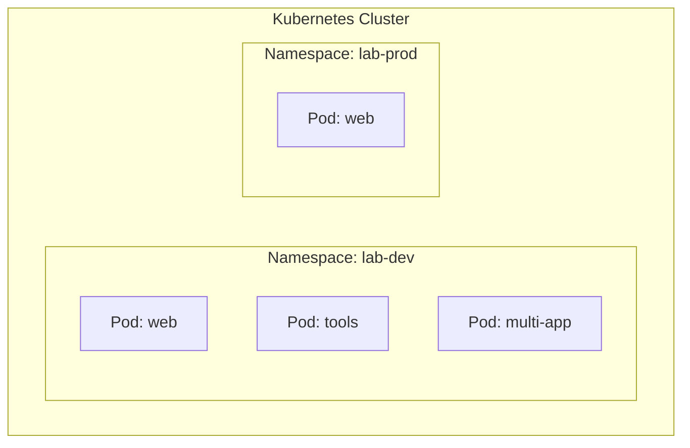

<div dir="rtl" align="right">

# پروژه عملی Kubernetes | Pod & Namespace

> **بخش اول — سناریو و چالش‌ها (بدون پاسخ)**

[بخش دوم: پاسخ‌نامه](#solutions)

**سطح:** مقدماتی تا متوسط | **زمان پیشنهادی:** ۲ تا ۳ ساعت

## ۱. داستان پروژه

شما مسئول آماده‌سازی محیط Kubernetes یک شرکت هستید. شرکت دو محیط Development و Production دارد. باید برنامه‌های آزمایشی و عملیاتی را در Namespaceهای جداگانه اجرا کنید، وضعیت Podها را بررسی کنید و چند خرابی عمدی را برطرف کنید.

در این پروژه فقط از Pod و Namespace استفاده کنید. استفاده از Deployment، ReplicaSet، Service و سایر Resourceهای مستقل خارج از محدوده تمرین است. استفاده از Container، Label، Annotation، Probe و تنظیمات داخلی Pod مجاز است.

## ۲. معماری نهایی پروژه

</div>



<div dir="rtl" align="right">

## ۳. پیش‌نیازها و قوانین

- یک Cluster فعال، مانند kind، و دسترسی kubectl داشته باشید.
- تمام Manifestهای پروژه را در GitHub نگهداری کنید.
- به جز مراحل عیب‌یابی و عملیات موقت، Resourceها را به روش Declarative ایجاد کنید.
- بخش دوم همین فایل را تا پایان تلاش مستقل باز نکنید.
- برای هر فاز، خروجی بررسی‌های خود را ذخیره کنید.

---

## فاز ۱ — آماده‌سازی Namespaceها

- [ ] وضعیت Cluster و Namespaceهای موجود را بررسی کنید.
- [ ] دو Namespace با نام‌های `lab-dev` و `lab-prod` با Manifest ایجاد کنید.
- [ ] به هر کدام Label با کلید `environment` و مقدار متناسب با محیط اختصاص دهید.
- [ ] فقط Namespaceهای دارای این Label را نمایش دهید.

**معیار پذیرش:** هر دو Namespace در وضعیت Active باشند.

## فاز ۲ — ایجاد اولین Pod

- [ ] در `lab-dev` یک Pod با نام `web` ایجاد کنید.
- [ ] نام Container را `nginx` و Image را `nginx:alpine` قرار دهید.
- [ ] پورت ۸۰ را در مشخصات Container تعریف کنید.
- [ ] Labelهای `app=web` و `environment=dev` را اضافه کنید.
- [ ] یک Annotation با کلید `description` برای توضیح کاربرد Pod اضافه کنید.
- [ ] وضعیت Pod، IP، Node میزبان و Events آن را بررسی کنید.

**معیار پذیرش:** Pod در وضعیت Running و READY برابر 1/1 باشد.

## فاز ۳ — جداسازی محیط‌ها

- [ ] در `lab-prod` نیز یک Pod با نام `web` و Image مشابه بسازید.
- [ ] Label محیط آن را `environment=prod` قرار دهید.
- [ ] هر دو Pod هم‌نام را در یک خروجی مشاهده کنید.
- [ ] Namespace پیش‌فرض Context جاری را موقتاً به `lab-dev` تغییر دهید.
- [ ] بدون مشخص کردن Namespace، Podهای محیط Development را مشاهده کنید.
- [ ] تنظیم Context را به حالت قبلی برگردانید.

**معیار پذیرش:** دو Pod هم‌نام در Namespaceهای متفاوت بدون تداخل وجود داشته باشند.

## فاز ۴ — ارتباط با Pod و بررسی HTTP

- [ ] در `lab-dev` یک Pod به نام `tools` با Image `busybox:1.36` بسازید که حداقل یک ساعت فعال بماند.
- [ ] وارد Container آن شوید.
- [ ] از داخل `tools` به IP هر دو Pod با نام `web` درخواست HTTP بفرستید.
- [ ] پاسخ HTTP را بررسی کنید.
- [ ] Logهای Podهای `web` را مشاهده کنید.
- [ ] از سیستم خود با Port Forwarding به Pod محیط Development روی پورت محلی 8080 متصل شوید.
- [ ] نتیجه بگیرید که آیا Namespace به‌تنهایی مانع ارتباط شبکه‌ای است یا خیر.

**معیار پذیرش:** در Cluster معمولی بدون محدودیت شبکه، هر دو درخواست HTTP موفق باشند و صفحه NGINX از پورت محلی نیز قابل مشاهده باشد.

## فاز ۵ — Multi-Container Pod

- [ ] در `lab-dev` یک Pod به نام `multi-app` ایجاد کنید.
- [ ] Container اول با نام `web` و Image `nginx:alpine` باشد.
- [ ] Container دوم با نام `client` و Image `busybox:1.36` باشد و هر ۱۵ ثانیه به وب‌سرور همان Pod درخواست HTTP بفرستد.
- [ ] Log هر Container را جداگانه بررسی کنید.
- [ ] از Container دوم به وب‌سرور Container اول با آدرس محلی دسترسی پیدا کنید.

**معیار پذیرش:** READY برابر 2/2 باشد و درخواست‌های دوره‌ای موفق باشند.

## فاز ۶ — Init Container

- [ ] یک Pod موقت با نام `init-demo` در `lab-dev` ایجاد کنید.
- [ ] Main Container از Image `nginx:alpine` استفاده کند.
- [ ] یک Init Container با Image `busybox:1.36` تعریف کنید که پیام آماده‌سازی چاپ کند، ۱۰ ثانیه منتظر بماند و با موفقیت پایان یابد.
- [ ] مراحل تغییر وضعیت Pod را مشاهده کنید.
- [ ] Log مربوط به Init Container را پس از اجرای Main Container بررسی کنید.

**معیار پذیرش:** Init Container موفق پایان یافته باشد و Main Container در وضعیت Running قرار گیرد.

## فاز ۷ — مدیریت منابع و Probe

- [ ] Manifest Pod محیط Development با نام `web` را تکمیل کنید.
- [ ] CPU Request برابر 50m و Limit برابر 200m باشد.
- [ ] Memory Request برابر 32Mi و Limit برابر 128Mi باشد.
- [ ] Readiness Probe و Liveness Probe از HTTP روی مسیر `/` و پورت ۸۰ استفاده کنند.
- [ ] تغییرات را اعمال کنید و وضعیت Pod را بررسی کنید.
- [ ] تفاوت Running و Ready و تفاوت Request و Limit را توضیح دهید.

**معیار پذیرش:** Pod با تنظیمات جدید Running و Ready باشد.

## فاز ۸ — Troubleshooting

سه Pod موقت در `lab-dev` بسازید و مشکلات زیر را عمداً ایجاد کنید:

- [ ] `broken-image`: از Image `nginx:this-tag-does-not-exist` استفاده کند. علت خطا را پیدا و Image را اصلاح کنید.
- [ ] `broken-command`: از `busybox:1.36` استفاده کند و با Exit Code برابر 1 خاتمه یابد. علت Restart را پیدا و فرمان آن را اصلاح کنید.
- [ ] `broken-ready`: از `nginx:alpine` استفاده کند، اما Readiness Probe پورت ۸۱ را بررسی کند. تفاوت Running و Ready را مشاهده و مشکل را برطرف کنید.
- [ ] برای هر خرابی، وضعیت، Events، علت و اقدام اصلاحی را ثبت کنید.

**معیار پذیرش:** هر سه Pod پس از اصلاح Running و Ready باشند.

## فاز ۹ — چرخه عمر و پاک‌سازی

- [ ] UID مربوط به Pod `web` در Development را ثبت کنید.
- [ ] آن Pod را حذف کنید و بررسی کنید آیا خودکار ایجاد می‌شود یا خیر.
- [ ] آن را مجدداً با Manifest نهایی بسازید و UID جدید را مقایسه کنید.
- [ ] تمام Podهای موقت فازهای ۶ و ۸ را حذف کنید.
- [ ] معماری نهایی را با نمودار ابتدای تمرین مقایسه کنید.
- [ ] Namespace `lab-dev` را حذف کنید و وضعیت Podهای آن را بررسی کنید.
- [ ] اطمینان حاصل کنید Pod محیط Production همچنان فعال است.
- [ ] در پایان، Namespace `lab-prod` را نیز حذف کنید.

**معیار پذیرش:** هر دو Namespace آزمایشگاهی و Podهای آن‌ها حذف شده باشند.

---

## چک‌لیست تحویل پروژه

- [ ] Manifestهای Namespace و Podها
- [ ] خروجی بررسی وضعیت Podها و Events
- [ ] مستندات سه خطای عمدی و روش رفع آن‌ها
- [ ] توضیح رفتار Namespace و چرخه عمر Pod
- [ ] پاک‌سازی کامل محیط آزمایشگاهی

</div>

---

<a name="solutions"></a>

## بخش دوم — Solutions & Technical Notes

پاسخ هر فاز به‌صورت پیش‌فرض بسته است. برای مشاهده، روی عنوان آن کلیک کنید. دستورات در Cluster واقعی آزمایش نشده‌اند.

<details>
<summary><b>فاز ۱ — Namespace</b></summary>

```bash
kubectl cluster-info
kubectl get nodes
kubectl get namespaces
```

**namespaces.yaml**

```yaml
apiVersion: v1
kind: Namespace
metadata:
  name: lab-dev
  labels:
    environment: dev
---
apiVersion: v1
kind: Namespace
metadata:
  name: lab-prod
  labels:
    environment: prod
```

```bash
kubectl apply -f namespaces.yaml
kubectl get namespaces -l environment --show-labels
```

<div dir="rtl" align="right">

**نکته:** Namespace یک محدوده منطقی برای Resourceها ایجاد می‌کند. خود Namespace یک Resource از نوع Cluster-scoped است. Pod از نوع Namespaced است. Label برای دسته‌بندی و انتخاب Resourceها کاربرد دارد.

</div>


</details>

<details>
<summary><b>فاز ۲ — اولین Pod</b></summary>

**web-dev.yaml**

```yaml
apiVersion: v1
kind: Pod
metadata:
  name: web
  namespace: lab-dev
  labels:
    app: web
    environment: dev
  annotations:
    description: Development web server
spec:
  containers:
    - name: nginx
      image: nginx:alpine
      ports:
        - containerPort: 80
```

```bash
kubectl apply -f web-dev.yaml
kubectl get pod web -n lab-dev -o wide
kubectl describe pod web -n lab-dev
kubectl get events -n lab-dev --sort-by=.metadata.creationTimestamp
kubectl wait --for=condition=Ready pod/web -n lab-dev --timeout=120s
```

<div dir="rtl" align="right">

**نکات:** Pod کوچک‌ترین واحد قابل Schedule شدن است. Containerها داخل Pod اجرا می‌شوند. تعریف containerPort به‌تنهایی پورت را منتشر نمی‌کند و باعث Listen کردن برنامه هم نمی‌شود. Annotation برای Metadata غیرانتخابی است؛ Label قابلیت استفاده در Selector را دارد.

</div>


</details>

<details>
<summary><b>فاز ۳ — جداسازی محیط‌ها</b></summary>

**web-prod.yaml**

```yaml
apiVersion: v1
kind: Pod
metadata:
  name: web
  namespace: lab-prod
  labels:
    app: web
    environment: prod
spec:
  containers:
    - name: nginx
      image: nginx:alpine
      ports:
        - containerPort: 80
```

```bash
kubectl apply -f web-prod.yaml
kubectl get pods -A -l app=web -o wide

OLD_NS=$(kubectl config view --minify -o jsonpath='{.contexts[0].context.namespace}')
kubectl config set-context --current --namespace=lab-dev
kubectl get pods
kubectl config set-context --current --namespace="${OLD_NS:-default}"
```

<div dir="rtl" align="right">

**نکته:** نام Pod در یک Namespace باید یکتا باشد، ولی در Namespaceهای مختلف می‌تواند تکرار شود. تغییر Namespace در Context فقط تنظیم Client است و Resourceها را جابه‌جا نمی‌کند.

</div>


</details>

<details>
<summary><b>فاز ۴ — ارتباط و HTTP</b></summary>

**tools.yaml**

```yaml
apiVersion: v1
kind: Pod
metadata:
  name: tools
  namespace: lab-dev
spec:
  containers:
    - name: tools
      image: busybox:1.36
      command: ["sh", "-c", "sleep 86400"]
```

```bash
kubectl apply -f tools.yaml
kubectl wait --for=condition=Ready pod/tools -n lab-dev --timeout=120s
DEV_IP=$(kubectl get pod web -n lab-dev -o jsonpath='{.status.podIP}')
PROD_IP=$(kubectl get pod web -n lab-prod -o jsonpath='{.status.podIP}')
kubectl exec -n lab-dev tools -- wget -qO- "http://$DEV_IP"
kubectl exec -n lab-dev tools -- wget -qO- "http://$PROD_IP"
kubectl exec -it -n lab-dev tools -- sh
```

<div dir="rtl" align="right">

برای خروج از Shell از دستور exit استفاده کنید. سپس Logها را بررسی کنید.

</div>

```bash
kubectl logs -n lab-dev web
kubectl logs -n lab-prod web
kubectl port-forward -n lab-dev pod/web 8080:80
```

<div dir="rtl" align="right">

در Terminal دیگری درخواست زیر را ارسال کنید. برای پایان Port Forwarding از Ctrl+C استفاده کنید.

</div>

```bash
curl http://127.0.0.1:8080/
```

<div dir="rtl" align="right">

**نکات:** Namespace به‌تنهایی Network Isolation ایجاد نمی‌کند. در شبکه معمول Kubernetes، Podها می‌توانند در Namespaceهای مختلف مستقیماً با Pod IP ارتباط برقرار کنند، مگر محدودیت شبکه وجود داشته باشد. Pod IP پایدار نیست. Port Forwarding موقت است و به صورت پیش‌فرض روی Loopback گوش می‌دهد.

</div>


</details>

<details>
<summary><b>فاز ۵ — Multi-Container Pod</b></summary>

**multi-app.yaml**

```yaml
apiVersion: v1
kind: Pod
metadata:
  name: multi-app
  namespace: lab-dev
spec:
  containers:
    - name: web
      image: nginx:alpine
      ports:
        - containerPort: 80
    - name: client
      image: busybox:1.36
      command:
        - sh
        - -c
        - |
          while true; do
            date
            wget -qO- http://127.0.0.1:80/ || echo 'HTTP failed'
            sleep 15
          done
```

```bash
kubectl apply -f multi-app.yaml
kubectl get pod multi-app -n lab-dev
kubectl logs -n lab-dev multi-app -c web
kubectl logs -n lab-dev multi-app -c client
kubectl exec -n lab-dev multi-app -c client -- wget -qO- http://127.0.0.1:80/
```

<div dir="rtl" align="right">

**نکات:** Containerهای یک Pod دارای Network Namespace مشترک و Pod IP مشترک هستند. به همین دلیل localhost بین آن‌ها قابل استفاده است. دو Container نمی‌توانند هم‌زمان روی یک IP و پورت یکسان Listen کنند. File System آن‌ها به صورت پیش‌فرض مشترک نیست. گزینه `-c` برای انتخاب Container است.

</div>


</details>

<details>
<summary><b>فاز ۶ — Init Container</b></summary>

**init-demo.yaml**

```yaml
apiVersion: v1
kind: Pod
metadata:
  name: init-demo
  namespace: lab-dev
spec:
  initContainers:
    - name: prepare
      image: busybox:1.36
      command: ["sh", "-c", "echo Preparing; sleep 10; echo Done"]
  containers:
    - name: nginx
      image: nginx:alpine
```

```bash
kubectl apply -f init-demo.yaml
kubectl get pod init-demo -n lab-dev -w
# Stop watching with Ctrl+C
kubectl logs -n lab-dev init-demo -c prepare
kubectl describe pod init-demo -n lab-dev
```

<div dir="rtl" align="right">

**نکات:** Init Container معمولی باید با موفقیت تمام شود تا Main Container شروع شود. اگر چند Init Container معمولی تعریف شوند، به ترتیب اجرا می‌شوند. اگر Init Container شکست بخورد، رفتار Retry به restartPolicy وابسته است. Init Container موفق ممکن است در وضعیت Terminated با دلیل Completed نمایش داده شود؛ این خطا نیست.

</div>


</details>

<details>
<summary><b>فاز ۷ — Resource Management و Probe</b></summary>

**web-dev.yaml (نسخه نهایی)**

```yaml
apiVersion: v1
kind: Pod
metadata:
  name: web
  namespace: lab-dev
  labels:
    app: web
    environment: dev
  annotations:
    description: Development web server
spec:
  containers:
    - name: nginx
      image: nginx:alpine
      ports:
        - containerPort: 80
      resources:
        requests:
          cpu: 50m
          memory: 32Mi
        limits:
          cpu: 200m
          memory: 128Mi
      readinessProbe:
        httpGet:
          path: /
          port: 80
        initialDelaySeconds: 2
        periodSeconds: 5
      livenessProbe:
        httpGet:
          path: /
          port: 80
        initialDelaySeconds: 5
        periodSeconds: 10
```

```bash
kubectl delete pod web -n lab-dev
kubectl apply -f web-dev.yaml
kubectl wait --for=condition=Ready pod/web -n lab-dev --timeout=120s
kubectl describe pod web -n lab-dev
```

<div dir="rtl" align="right">

**نکات مهم:** بسیاری از فیلدهای Pod پس از ایجاد قابل تغییر نیستند؛ برای افزودن Probe در این تمرین Pod را حذف و مجدداً ایجاد می‌کنیم. این کار باعث قطعی موقت است. قابلیت تغییر برخی Resourceها به نسخه و امکانات Cluster وابسته است.

- Request: مقداری که Scheduler برای تخصیص منابع در نظر می‌گیرد.
- CPU Limit: سقف مصرف CPU که ممکن است باعث Throttling شود.
- Memory Limit: عبور از سقف حافظه می‌تواند باعث OOM Kill شود.
- Readiness Probe: مشخص می‌کند Container آماده دریافت ترافیک است یا خیر؛ شکست آن به‌تنهایی باعث Restart نمی‌شود.
- Liveness Probe: شکست مکرر آن می‌تواند باعث Restart شدن Container شود.
- Running یک Pod Phase است؛ Ready یک Condition است. این دو الزاماً یکسان نیستند.

</div>


</details>

<details>
<summary><b>فاز ۸ — Troubleshooting</b></summary>

### چالش اول: ImagePullBackOff

</div>

**broken-image.yaml**

```yaml
apiVersion: v1
kind: Pod
metadata:
  name: broken-image
  namespace: lab-dev
spec:
  containers:
    - name: nginx
      image: nginx:this-tag-does-not-exist
```

```bash
kubectl apply -f broken-image.yaml
kubectl get pod broken-image -n lab-dev
kubectl describe pod broken-image -n lab-dev
kubectl set image pod/broken-image nginx=nginx:alpine -n lab-dev
kubectl wait --for=condition=Ready pod/broken-image -n lab-dev --timeout=120s
```

<div dir="rtl" align="right">

Image نامعتبر می‌تواند باعث ErrImagePull و سپس ImagePullBackOff شود. Events را برای تشخیص Tag نامعتبر، مشکل Registry، Authentication یا Network بررسی کنید. تغییر Image از تغییرات مجاز Pod است. فایل Manifest را نیز با Image صحیح به‌روز کنید.

### چالش دوم: CrashLoopBackOff

</div>

**broken-command.yaml**

```yaml
apiVersion: v1
kind: Pod
metadata:
  name: broken-command
  namespace: lab-dev
spec:
  restartPolicy: Always
  containers:
    - name: app
      image: busybox:1.36
      command: ["sh", "-c", "echo Intentional failure; exit 1"]
```

```bash
kubectl apply -f broken-command.yaml
kubectl get pod broken-command -n lab-dev -w
# Stop watching with Ctrl+C after observing restarts
kubectl describe pod broken-command -n lab-dev
kubectl logs -n lab-dev broken-command --previous
```

<div dir="rtl" align="right">

فرمان نادرست باعث خروج Container می‌شود و Kubelet آن را مطابق restartPolicy مجدداً اجرا می‌کند. با تکرار شکست، Backoff ایجاد می‌شود. گزینه previous برای Log اجرای قبلی Container کاربرد دارد. در Manifest فرمان را با مقدار زیر جایگزین کنید:

</div>

```yaml
command: ["sh", "-c", "echo Healthy; sleep 86400"]
```

```bash
kubectl delete pod broken-command -n lab-dev
kubectl apply -f broken-command.yaml
kubectl wait --for=condition=Ready pod/broken-command -n lab-dev --timeout=120s
```

<div dir="rtl" align="right">

### چالش سوم: Readiness Probe ناموفق

</div>

**broken-ready.yaml**

```yaml
apiVersion: v1
kind: Pod
metadata:
  name: broken-ready
  namespace: lab-dev
spec:
  containers:
    - name: nginx
      image: nginx:alpine
      readinessProbe:
        httpGet:
          path: /
          port: 81
        periodSeconds: 5
```

```bash
kubectl apply -f broken-ready.yaml
kubectl get pod broken-ready -n lab-dev
kubectl describe pod broken-ready -n lab-dev
```

<div dir="rtl" align="right">

پس از شروع Container، انتظار داریم Pod در وضعیت Running باشد اما READY برابر 0/1 بماند. در Events خطای Probe مشاهده می‌شود. پورت Probe را در Manifest به 80 تغییر دهید و Pod را مجدداً بسازید.

</div>

```bash
kubectl delete pod broken-ready -n lab-dev
kubectl apply -f broken-ready.yaml
kubectl wait --for=condition=Ready pod/broken-ready -n lab-dev --timeout=120s
kubectl get pods -n lab-dev
```

<div dir="rtl" align="right">

**نکته مصاحبه:** ImagePullBackOff و CrashLoopBackOff از وضعیت‌های نمایشی kubectl هستند و لزوماً Pod Phase نیستند. Pod Phase را از مسیر status.phase در خروجی JSON بررسی کنید.

</details>

<details>
<summary><b>فاز ۹ — Lifecycle و پاک‌سازی</b></summary>

```bash
kubectl get pod web -n lab-dev -o jsonpath='{.metadata.uid}{"\n"}'
kubectl delete pod web -n lab-dev
kubectl get pods -n lab-dev
kubectl apply -f web-dev.yaml
kubectl get pod web -n lab-dev -o jsonpath='{.metadata.uid}{"\n"}'
kubectl delete pod init-demo broken-image broken-command broken-ready -n lab-dev
kubectl get pods -A -o wide
```

<div dir="rtl" align="right">

یک Pod مستقل پس از حذف به صورت خودکار ایجاد نمی‌شود. Restart شدن Container در همان Pod با ایجاد مجدد خود Pod متفاوت است. Pod جدید UID متفاوت دارد و ممکن است IP آن نیز تغییر کند.

**هشدار:** حذف Namespace تمام Resourceهای Namespaced داخل آن را حذف می‌کند. فقط Namespaceهای آزمایشگاهی این پروژه را حذف کنید.

</div>

```bash
kubectl delete namespace lab-dev
kubectl get namespaces
kubectl get pods -n lab-prod
kubectl delete namespace lab-prod
kubectl get namespaces
```

<div dir="rtl" align="right">

---

</div>


</details>

<details>
<summary><b>مرجع مرور دستورات</b></summary>

```bash
kubectl get pods -A
kubectl get pods -n lab-dev -o wide
kubectl get pods -n lab-dev --show-labels
kubectl get pods -n lab-dev -l app=web
kubectl get pod web -n lab-dev -o yaml
kubectl describe pod web -n lab-dev
kubectl logs -n lab-dev web
kubectl logs -n lab-dev web -f
kubectl exec -it -n lab-dev web -- sh
kubectl get events -n lab-dev
kubectl explain pod.spec
kubectl explain pod.spec.containers
```

</details>

<details>
<summary><b>منابع رسمی برای مطالعه بیشتر</b></summary>

<div dir="rtl" align="right">

- [Pods](https://kubernetes.io/docs/concepts/workloads/pods/)
- [Namespaces](https://kubernetes.io/docs/concepts/overview/working-with-objects/namespaces/)
- [Pod Lifecycle](https://kubernetes.io/docs/concepts/workloads/pods/pod-lifecycle/)
- [Init Containers](https://kubernetes.io/docs/concepts/workloads/pods/init-containers/)
- [Probes](https://kubernetes.io/docs/concepts/configuration/liveness-readiness-startup-probes/)
- [Resource Management](https://kubernetes.io/docs/concepts/configuration/manage-resources-containers/)

</div>

</details>
