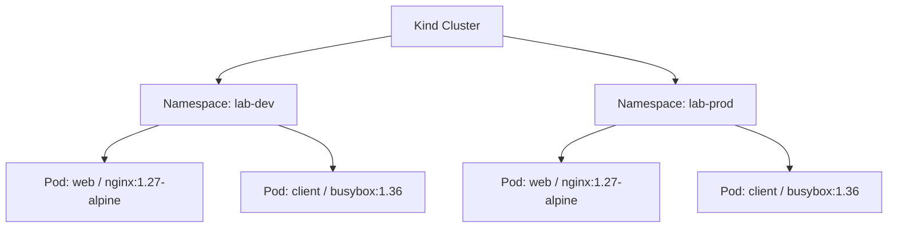

# Kubernetes Lab — 01 | Pod & Namespace

> **Level:** Beginner → Intermediate · **Environment:** Kind · **Scope:** Pod + Namespace ONLY

<div dir="rtl" align="right">

## بخش اول — سناریو و چالش‌ها

شما مسئول آماده‌سازی محیط آزمایشی یک شرکت هستید. تیم توسعه و تیم عملیات هرکدام باید Web Server مستقل داشته باشند. در این پروژه فقط دو نوع Resource مجاز است: Pod و Namespace. هیچ Service، Deployment، ConfigMap، Secret، Volume، Init Container، Sidecar، Probe یا NetworkPolicy ایجاد یا پیکربندی نکنید. هر Pod دقیقاً یک Container دارد.

پیش‌نیاز: یک Cluster فعال Kind، ابزار kubectl، دسترسی به Image Registry یا Imageهای موجود در Nodeها. پروژه را روی Cluster آزمایشی انجام دهید.

</div>



## Table of Contents

- [Part 1 — Challenges](#part-1--challenges)
- [Part 2 — Solutions](#part-2--solutions)

## Part 1 — Challenges

### Phase 01 — Namespace Creation

<div dir="rtl" align="right">

دو Namespace با نام‌های زیر ایجاد کنید. برای هر کدام Manifest مستقل بنویسید و Label مربوط به محیط را تنظیم کنید.

</div>

| Namespace | Label |
| --- | --- |
| `lab-dev` | `environment=development` |
| `lab-prod` | `environment=production` |

- [ ] هر دو Namespace در وضعیت `Active` باشند.
- [ ] Labelها قابل مشاهده باشند.
- [ ] هیچ Pod آزمایشی هنوز ایجاد نشده باشد.

### Phase 02 — First Pod

<div dir="rtl" align="right">

در محیط توسعه یک Pod با Manifest ایجاد کنید. Web Server باید روی پورت ۸۰ درون Container اجرا شود. نام و مشخصات دقیق را رعایت کنید.

</div>

| Parameter | Value |
| --- | --- |
| Namespace | `lab-dev` |
| Pod | `web` |
| Container | `nginx` |
| Image | `nginx:1.27-alpine` |
| Label | `app=web` |
| Container port | `80` |

- [ ] Pod در وضعیت `Running` و `1/1` باشد.
- [ ] Pod IP و Node میزبان را پیدا کنید.
- [ ] Manifest را ذخیره کنید.

### Phase 03 — Namespace Scope

<div dir="rtl" align="right">

یک Pod با مشخصات کاملاً مشابه فاز دوم در محیط Production بسازید. سپس تلاش کنید یک Pod دیگر با همان نام در محیط Development ایجاد کنید، بدون تغییر Pod موجود. دلیل نتیجه را ثبت کنید. فهرست Podها را یک بار برای هر محیط و یک بار برای کل Cluster مشاهده کنید.

</div>

- [ ] دو Pod با نام `web` در دو Namespace مختلف وجود داشته باشند.
- [ ] ایجاد نام تکراری در همان Namespace با خطا مواجه شود.
- [ ] بتوانید خروجی هر محیط را جداگانه مشاهده کنید.

### Phase 04 — Pod Labels & Inspection

<div dir="rtl" align="right">

به Pod توسعه Label جدید `tier=frontend` و Annotation با کلید `lab.example.com/owner` و مقدار `dev-team` اضافه کنید. Podهای دارای Label مشترک `app=web` را در کل Cluster پیدا کنید. اطلاعات Image، Container ID، Pod IP، Node و Events را بررسی کنید. در پایان Annotation را حذف کنید، اما Labelها را حفظ کنید.

</div>

- [ ] هر دو Web Pod با فیلتر `app=web` پیدا شوند.
- [ ] Label جدید فقط روی Pod توسعه باشد.
- [ ] Annotation در پایان حذف شده باشد.

### Phase 05 — Pod Execution & Logs

<div dir="rtl" align="right">

به Container مربوط به Web Pod توسعه متصل شوید. محتوای صفحه پیش‌فرض Nginx را بررسی کنید. یک درخواست HTTP از داخل همان Container به Web Server ارسال کنید و سپس Log مربوط به درخواست را از خارج Container مشاهده کنید. همین بررسی را برای محیط Production انجام دهید.

</div>

- [ ] هر دو Web Server پاسخ HTTP موفق داشته باشند.
- [ ] درخواست در Logs هر Pod قابل مشاهده باشد.
- [ ] هیچ Resource جدیدی ایجاد نشود.

### Phase 06 — Pod-to-Pod Communication

<div dir="rtl" align="right">

در هر Namespace یک Pod با نام `client`، Container با نام `client` و Image زیر بسازید. Container باید برای ۳۶۰۰ ثانیه فعال بماند. از داخل Client توسعه با Pod IP به Web Pod توسعه و سپس Web Pod تولید درخواست HTTP ارسال کنید. همین آزمایش را از Client تولید تکرار کنید. از هیچ Resource دیگری استفاده نکنید.

</div>

`busybox:1.36`

- [ ] چهار Pod در مجموع در دو Namespace آزمایشی وجود داشته باشند.
- [ ] در Cluster معمولی Kind هر چهار مسیر HTTP موفق باشند.
- [ ] نتیجه را درباره تفاوت Namespace Scope و Network Isolation ثبت کنید.

### Phase 07 — Image Troubleshooting

<div dir="rtl" align="right">

در محیط توسعه یک Pod به نام `broken-image` با Container به نام `nginx` و Image زیر بسازید. وضعیت Pod، Events و دلیل آماده نشدن آن را بررسی کنید. سپس Image را به نسخه معتبر تغییر دهید و Pod را بدون ایجاد Resource دیگری به وضعیت سالم برسانید.

</div>

`nginx:lab-nonexistent-tag-987654`

- [ ] خطای Image را مشاهده و علت را ثبت کنید.
- [ ] Pod در پایان `Running` و `1/1` باشد.
- [ ] Podهای سالم قبلی دست‌نخورده باقی بمانند.

### Phase 08 — Pod Lifecycle

<div dir="rtl" align="right">

در Namespace توسعه یک Pod به نام `one-shot` با Image `busybox:1.36` بسازید که فقط عبارت `lab-complete` را چاپ کند و با Exit Code صفر خاتمه یابد. تنظیمات Pod باید مانع اجرای مجدد Container پس از پایان موفق شود. سپس Pod مربوط به `broken-image` را حذف کنید و بررسی کنید که خودکار ایجاد نمی‌شود.

</div>

- [ ] Pod تک‌مرحله‌ای در وضعیت `Succeeded` (در خروجی عادی `Completed`) باشد.
- [ ] عبارت موردنظر در Logs وجود داشته باشد.
- [ ] Pod حذف‌شده خودکار بازنگردد.

### Phase 09 — Final Validation & Cleanup

<div dir="rtl" align="right">

ابتدا موجودی هر محیط را بررسی کنید. در توسعه سه Pod (دو Running و یک Completed) و در تولید دو Pod Running وجود داشته باشد. سپس Namespace توسعه را حذف کنید و مطمئن شوید Podهای تولید همچنان فعال هستند. در نهایت Namespace تولید را نیز حذف کنید. فقط Resourceهای آزمایشی همین پروژه را حذف کنید.

</div>

- [ ] موجودی پیش از Cleanup مطابق سناریو باشد.
- [ ] حذف Namespace توسعه، Podهای آن را حذف کند.
- [ ] Podهای تولید پس از حذف توسعه سالم باشند.
- [ ] هر دو Namespace آزمایشی در پایان حذف شده باشند.

---

## Part 2 — Solutions

> [!NOTE]
> پاسخ هر فاز مخفی است. ابتدا خودتان تمرین را انجام دهید.

<details>
<summary><b>Phase 01 — Solution</b></summary>

`dev.yaml`

```yaml
apiVersion: v1
kind: Namespace
metadata:
  name: lab-dev
  labels:
    environment: development
```

`prod.yaml`

```yaml
apiVersion: v1
kind: Namespace
metadata:
  name: lab-prod
  labels:
    environment: production
```

```bash
kubectl apply -f dev.yaml -f prod.yaml
kubectl get ns lab-dev lab-prod --show-labels
kubectl get pods -n lab-dev
kubectl get pods -n lab-prod
```

<div dir="rtl" align="right">

Namespace یک Resource در سطح Cluster است؛ بنابراین خودش در Namespace دیگری قرار ندارد. انتظار می‌رود هر دو Active باشند و هیچ Pod آزمایشی در آنها وجود نداشته باشد. اگر Namespace از قبل وجود دارد، قبل از ادامه مطمئن شوید متعلق به همین Lab است.

</div>

</details>

<details>
<summary><b>Phase 02 — Solution</b></summary>

`web-dev.yaml`

```yaml
apiVersion: v1
kind: Pod
metadata:
  name: web
  namespace: lab-dev
  labels:
    app: web
spec:
  containers:
    - name: nginx
      image: nginx:1.27-alpine
      ports:
        - containerPort: 80
```

```bash
kubectl apply -f web-dev.yaml
kubectl wait --for=condition=Ready pod/web -n lab-dev --timeout=180s
kubectl get pod web -n lab-dev -o wide
kubectl describe pod web -n lab-dev
```

<div dir="rtl" align="right">

فیلد containerPort صرفاً پورت مورد استفاده برنامه را مستند می‌کند و خودش پورت را باز یا منتشر نمی‌کند. Nginx در این Image به صورت پیش‌فرض روی پورت ۸۰ گوش می‌دهد. در صورت ImagePullBackOff، Events و دسترسی Registry را بررسی کنید.

</div>

</details>

<details>
<summary><b>Phase 03 — Solution</b></summary>

`web-prod.yaml`

```yaml
apiVersion: v1
kind: Pod
metadata:
  name: web
  namespace: lab-prod
  labels:
    app: web
spec:
  containers:
    - name: nginx
      image: nginx:1.27-alpine
      ports:
        - containerPort: 80
```

```bash
kubectl apply -f web-prod.yaml
kubectl wait --for=condition=Ready pod/web -n lab-prod --timeout=180s
kubectl create -f web-dev.yaml
kubectl get pods -n lab-dev
kubectl get pods -n lab-prod
kubectl get pods -A
```

<div dir="rtl" align="right">

دستور create برای Pod تکراری باید خطای AlreadyExists بدهد. نام Pod در محدوده Namespace یکتا است. استفاده از apply به جای create در آزمایش تکراری ممکن است همان Resource را به‌روزرسانی کند و خطای مورد انتظار را نشان ندهد.

</div>

</details>

<details>
<summary><b>Phase 04 — Solution</b></summary>

```bash
kubectl label pod web -n lab-dev tier=frontend
kubectl annotate pod web -n lab-dev lab.example.com/owner=dev-team
kubectl get pods -A -l app=web --show-labels
kubectl get pod web -n lab-dev -o yaml
kubectl describe pod web -n lab-dev
kubectl annotate pod web -n lab-dev lab.example.com/owner-
```

<div dir="rtl" align="right">

Label برای انتخاب و گروه‌بندی Resourceها کاربرد دارد؛ Annotation برای Metadata غیرانتخابی مناسب است. با حذف Annotation، Label تغییر نمی‌کند. برای مشاهده Container ID و Events از خروجی describe استفاده کنید.

</div>

</details>

<details>
<summary><b>Phase 05 — Solution</b></summary>

```bash
kubectl exec -it -n lab-dev web -c nginx -- sh
```

داخل Container:

```sh
cat /usr/share/nginx/html/index.html
wget -O - http://127.0.0.1:80/
exit
```

```bash
kubectl logs -n lab-dev web -c nginx
kubectl exec -n lab-prod web -c nginx -- wget -O - http://127.0.0.1:80/
kubectl logs -n lab-prod web -c nginx
```

<div dir="rtl" align="right">

Image مورد استفاده Alpine است و wget از BusyBox معمولاً در آن موجود است. خروجی مورد انتظار HTML صفحه پیش‌فرض Nginx و ثبت درخواست GET در Access Log است. آدرس Loopback به Network Namespace خود Pod اشاره دارد، نه Node میزبان.

</div>

</details>

<details>
<summary><b>Phase 06 — Solution</b></summary>

`clients.yaml`

```yaml
apiVersion: v1
kind: Pod
metadata:
  name: client
  namespace: lab-dev
spec:
  containers:
    - name: client
      image: busybox:1.36
      command: ["sleep", "3600"]
---
apiVersion: v1
kind: Pod
metadata:
  name: client
  namespace: lab-prod
spec:
  containers:
    - name: client
      image: busybox:1.36
      command: ["sleep", "3600"]
```

```bash
kubectl apply -f clients.yaml
kubectl wait --for=condition=Ready pod/client -n lab-dev --timeout=180s
kubectl wait --for=condition=Ready pod/client -n lab-prod --timeout=180s
DEV_IP=$(kubectl get pod web -n lab-dev -o jsonpath='{.status.podIP}')
PROD_IP=$(kubectl get pod web -n lab-prod -o jsonpath='{.status.podIP}')
kubectl exec -n lab-dev client -- wget -O - "http://$DEV_IP:80/"
kubectl exec -n lab-dev client -- wget -O - "http://$PROD_IP:80/"
kubectl exec -n lab-prod client -- wget -O - "http://$DEV_IP:80/"
kubectl exec -n lab-prod client -- wget -O - "http://$PROD_IP:80/"
```

<div dir="rtl" align="right">

این مثال برای Kind با IPv4 معمولی نوشته شده است. Namespace به تنهایی Network Isolation ایجاد نمی‌کند. در Cluster معمولی بدون سیاست محدودکننده شبکه، Podها می‌توانند با IP مستقیم یکدیگر ارتباط برقرار کنند. Pod IP پایدار نیست و ممکن است پس از ایجاد مجدد عوض شود. اگر ارتباط برقرار نشد، ابتدا Ready بودن مقصد، IP صحیح و شبکه Cluster را بررسی کنید.

</div>

</details>

<details>
<summary><b>Phase 07 — Solution</b></summary>

`broken.yaml`

```yaml
apiVersion: v1
kind: Pod
metadata:
  name: broken-image
  namespace: lab-dev
spec:
  containers:
    - name: nginx
      image: nginx:lab-nonexistent-tag-987654
```

```bash
kubectl apply -f broken.yaml
kubectl get pod broken-image -n lab-dev -w
```

پس از مشاهده خطا با Ctrl+C از Watch خارج شوید.

```bash
kubectl describe pod broken-image -n lab-dev
kubectl set image pod/broken-image nginx=nginx:1.27-alpine -n lab-dev
kubectl wait --for=condition=Ready pod/broken-image -n lab-dev --timeout=180s
kubectl get pod broken-image -n lab-dev
```

<div dir="rtl" align="right">

انتظار می‌رود ErrImagePull و سپس ImagePullBackOff مشاهده شود؛ متن دقیق Event به Registry و Runtime بستگی دارد. Image یکی از فیلدهای قابل تغییر Pod است. Manifest محلی را نیز به Image معتبر به‌روزرسانی کنید تا در اجرای بعدی خطا تکرار نشود. اگر دسترسی اینترنت مشکل دارد، حتی Image معتبر هم ممکن است Pull نشود.

</div>

</details>

<details>
<summary><b>Phase 08 — Solution</b></summary>

`one-shot.yaml`

```yaml
apiVersion: v1
kind: Pod
metadata:
  name: one-shot
  namespace: lab-dev
spec:
  restartPolicy: Never
  containers:
    - name: task
      image: busybox:1.36
      command: ["sh", "-c", "echo lab-complete"]
```

```bash
kubectl apply -f one-shot.yaml
kubectl wait -n lab-dev --for=jsonpath='{.status.phase}'=Succeeded pod/one-shot --timeout=180s
kubectl get pod one-shot -n lab-dev
kubectl logs one-shot -n lab-dev
kubectl delete pod broken-image -n lab-dev
kubectl get pods -n lab-dev
```

<div dir="rtl" align="right">

restartPolicy سه مقدار Always، OnFailure و Never دارد. مقدار پیش‌فرض Always است. اینجا Never مانع Restart پس از پایان Container می‌شود. یک Pod مستقل پس از حذف توسط کاربر خودکار بازسازی نمی‌شود؛ Restart شدن Container با بازسازی Pod یکسان نیست.

</div>

</details>

<details>
<summary><b>Phase 09 — Solution</b></summary>

```bash
kubectl get pods -n lab-dev -o wide
kubectl get pods -n lab-prod -o wide
kubectl delete namespace lab-dev --wait=true
kubectl get pods -n lab-prod
kubectl delete namespace lab-prod --wait=true
kubectl get namespaces
```

<div dir="rtl" align="right">

حذف Namespace باعث حذف Resourceهای Namespaced داخل آن می‌شود. قبل از حذف، حتماً نام و محتوای Namespace را بررسی کنید. هیچ Namespace سیستمی را حذف نکنید. اگر Namespace مدتی در وضعیت Terminating قرار داشت، ابتدا وضعیت آن را بررسی کنید و به‌صورت کورکورانه Finalizerها را حذف نکنید.

</div>

</details>

---

## Interview Review

<details>
<summary>سوالات مصاحبه و پاسخ‌ها</summary>

- **Can two Pods have the same name?** بله، در Namespaceهای متفاوت.
- **Does a Namespace isolate network traffic?** خیر، به تنهایی چنین کاری نمی‌کند.
- **Does containerPort publish a port?** خیر، صرفاً پورت Container را توصیف می‌کند.
- **Does a deleted standalone Pod recreate itself?** خیر.
- **Is Pod IP permanent?** خیر، با ایجاد مجدد Pod ممکن است تغییر کند.
- **What is the difference between Label and Annotation?** Label برای انتخاب و گروه‌بندی؛ Annotation برای Metadata غیرانتخابی.
- **What does ImagePullBackOff mean?** تلاش ناموفق برای دریافت Image و انتظار افزایشی برای تلاش مجدد.

</details>

## Completion Checklist

- [ ] Namespace lifecycle
- [ ] Pod manifest and lifecycle
- [ ] Namespace-scoped names
- [ ] Labels and annotations
- [ ] Pod inspection, exec and logs
- [ ] Direct Pod IP connectivity
- [ ] Image troubleshooting
- [ ] Safe cleanup

> **Validation note:** این دستورات و Manifestها برای محیط معمولی Kind طراحی شده‌اند، اما در Cluster واقعی اجرا نشده‌اند. Resourceهای سیستمی که Kubernetes به‌طور خودکار مدیریت می‌کند بخشی از تمرین نیستند؛ کاربر فقط Pod و Namespace ایجاد می‌کند. راست‌چین شدن متن به پشتیبانی Renderer از HTML بستگی دارد.
