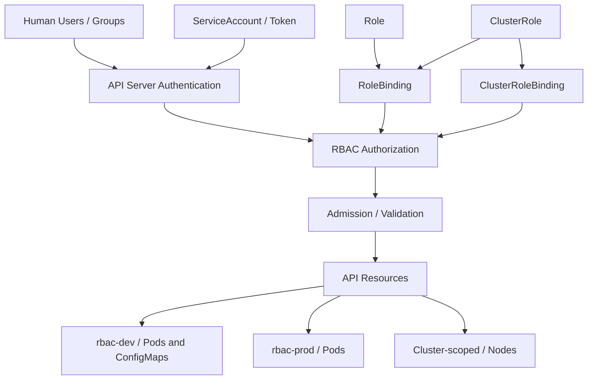

<div dir="rtl" align="right">

# ‏پروژه عملی ⁦Kubernetes⁩ | ⁦RBAC⁩ در محیط ⁦Enterprise⁩

‏**سطح:** ⁦Beginner⁩ → ⁦Advanced⁩

‏**محیط:** ⁦kubeadm⁩ با یک ⁦Control Plane⁩ و دو ⁦Worker⁩؛ ⁦Kubernetes⁩ نسخه 1.27 یا جدیدتر پیشنهاد می‌شود.

‏**داستان پروژه:** تیم ⁦Platform⁩ یک فروشگاه آنلاین باید دسترسی توسعه‌دهندگان، تیم عملیات و ⁦Automation⁩ را از هم جدا کند. وظیفه تو طراحی ⁦Least Privilege⁩، احراز هویت واقعی و اثبات دسترسی‌ها با تست مثبت و منفی است.

‏**پیش‌نیازها:** ⁦Cluster⁩ سالم، ⁦kubectl⁩ سازگار، دسترسی مدیریتی مجاز در ⁦Cluster⁩ آزمایشی، ⁦Bash⁩، ⁦OpenSSL⁩ برای مرحله اختیاری ⁦CSR⁩ و دسترسی ⁦Registry⁩ برای دو ⁦Image⁩ آموزشی. فرض می‌شود ⁦RBAC⁩ فعال و هیچ ⁦Binding⁩ گسترده اضافی برای هویت‌های آزمایشی وجود ندارد. مراحل روی سیستم مدیریتی اجرا می‌شوند؛ نیازی به ورود به ⁦Worker⁩ها یا تغییر ⁦kubeadm⁩ نیست.

> [!WARNING]
> ‏این پروژه مجوزهای سطح ⁦Cluster⁩ نیز ایجاد می‌کند. فقط در ⁦Cluster⁩ آزمایشی و با ⁦Context⁩ درست اجرا کن. به هیچ هویت آزمایشی ⁦cluster-admin⁩، ⁦system:masters⁩ یا مجوز ⁦wildcard⁩ نده. ⁦Token⁩، ⁦Private Key⁩ و ⁦Kubeconfig⁩ را ⁦Commit⁩ نکن. فرمان‌های مورد انتظار برای خطا را جداگانه اجرا کن؛ این پاسخ‌نامه یک ⁦Script⁩ واحد نیست.

‏**اهداف:** چهار ⁦Resource⁩ اصلی ⁦RBAC⁩، ⁦Scope⁩، ⁦Subject⁩، ⁦API Group⁩، ⁦Verb⁩، ⁦ResourceName⁩، ⁦Subresource⁩، ⁦ServiceAccount⁩، ⁦Token⁩، ⁦Impersonation⁩، ⁦Aggregation⁩، حفاظت از ⁦Privilege Escalation⁩ و ⁦Troubleshooting.⁩

</div>

<div dir="rtl" align="right">

## ‏فهرست مطالب

- ‏[بخش اول — سناریو و چالش‌ها](#part-1)
- ‏[بخش دوم — پاسخ‌نامه](#part-2)
- ‏[اعتبارسنجی نهایی و Cleanup](#final-validation)
- ‏[منابع رسمی](#references)

</div>

<div dir="rtl" align="right">

## ‏معماری پروژه

</div>



<div dir="rtl" align="right">

‏**معماری:** هویت‌ها در ⁦API Server⁩ احراز هویت می‌شوند. ⁦RBAC⁩ مشخص می‌کند چه درخواست‌هایی مجازند. ⁦RoleBinding⁩ دسترسی را به ⁦Namespace⁩ خودش محدود می‌کند؛ ⁦ClusterRoleBinding⁩ می‌تواند دسترسی سراسری بدهد. ⁦Admission⁩ بعد از ⁦Authorization⁩ نیز می‌تواند درخواست را رد کند.

‏**هویت‌ها:** ⁦reader⁩ برای خواندن ⁦Pod⁩ و ⁦Log⁩، ⁦observer⁩ برای ⁦ConfigMap⁩ دو محیط، ⁦automation⁩ برای ⁦Scale⁩، ⁦auditor⁩ برای ⁦Node⁩ و ⁦delegate⁩ برای آزمایش موقت واگذاری مجوز. ⁦User⁩های آزمایشی ⁦Alice⁩ و ⁦Bob⁩ فقط در محدوده تعریف‌شده ارزیابی می‌شوند.

</div>

<a name="part-1"></a>

<div dir="rtl" align="right">

## ‏بخش اول — سناریو و چالش‌ها

‏مراحل را به ترتیب انجام بده. تمام نام‌ها و تنظیمات لازم در هر ⁦Phase⁩ مشخص شده‌اند. پاسخ‌ها را تنها در صورت نیاز باز کن.

</div>

<a name="phase-01"></a>

<div dir="rtl" align="right">

### ‏مرحله 01 — آماده‌سازی محیط و هویت‌ها

‏**هدف:** ساخت محیط ایزوله برای تیم توسعه و عملیات.

‏**وظایف و ⁦Checklist⁩**

- [ ] ‏وضعیت یک ⁦Control Plane⁩ و دو ⁦Worker⁩ و ⁦Context⁩ مدیریتی را بررسی کن. هیچ تغییر در ⁦API Server⁩ یا نقش‌های پیش‌فرض انجام نده.
- [ ] ‏دو ⁦Namespace⁩ با نام‌های ⁦`rbac-dev`⁩ و ⁦`rbac-prod`⁩ ایجاد کن؛ اگر از قبل وجود دارند ادامه نده.
- [ ] ‏در محیط توسعه ⁦Pod⁩ با نام ⁦`demo-web`⁩ و ⁦Image⁩ برابر ⁦`nginx:1.27.5-alpine`⁩ و دو ⁦ConfigMap⁩ با نام‌های ⁦`app-config`⁩ و ⁦`internal-config`⁩ ایجاد کن. در محیط دوم نیز ⁦Pod⁩ با همین نام ایجاد کن.
- [ ] ‏هویت‌های آزمایشی ⁦`reader`⁩، ⁦`observer`⁩، ⁦`automation`⁩، ⁦`delegate`⁩ و ⁦`auditor`⁩ را از نوع ⁦ServiceAccount⁩ در محیط توسعه ایجاد کن. ⁦Token Mount⁩ پیش‌فرض غیرفعال باشد.

‏**معیار پذیرش:** هر دو ⁦Namespace⁩ فعال و ⁦Pod⁩ها ⁦Ready⁩ هستند؛ هیچ مجوز اختصاصی هنوز داده نشده است.

</div>

---

<a name="phase-02"></a>

<div dir="rtl" align="right">

### ‏مرحله 02 — ⁦Role⁩ و ⁦RoleBinding⁩

‏**هدف:** دادن دسترسی فقط خواندنی به ⁦Pod⁩های محیط توسعه.

‏**وظایف و ⁦Checklist⁩**

- [ ] ‏⁦Role⁩ با نام ⁦`pod-reader`⁩ در محیط توسعه بساز؛ فقط ⁦`get`⁩، ⁦`list`⁩ و ⁦`watch`⁩ روی ⁦Pod⁩ها مجاز باشد.
- [ ] ‏⁦RoleBinding⁩ با نام ⁦`reader-pods`⁩ برای ⁦ServiceAccount⁩ با نام ⁦`reader`⁩ ایجاد کن.
- [ ] ‏دسترسی خواندن ⁦Pod⁩ را در هر دو ⁦Namespace⁩ و دسترسی حذف ⁦Pod⁩ و خواندن ⁦Secret⁩ را در محیط توسعه مقایسه کن.

‏**معیار پذیرش:** خواندن ⁦Pod⁩ در توسعه مجاز، حذف و خواندن ⁦Secret⁩ و ⁦Pod⁩های محیط دوم غیرمجاز باشد.

</div>

---

<a name="phase-03"></a>

<div dir="rtl" align="right">

### ‏مرحله 03 — ⁦ClusterRole⁩ با ⁦RoleBinding⁩ و دسترسی ⁦Cross-namespace⁩

‏**هدف:** استفاده مجدد از یک نقش بدون اعطای دسترسی سراسری.

‏**وظایف و ⁦Checklist⁩**

- [ ] ‏⁦ClusterRole⁩ به نام ⁦`rbac-lab-config-reader`⁩ بساز؛ فقط ⁦get⁩ و ⁦list⁩ روی ⁦ConfigMap.⁩
- [ ] ‏در محیط توسعه و سپس محیط دوم ⁦RoleBinding⁩ به نام ⁦`config-observer`⁩ بساز که به همان ⁦ClusterRole⁩ و ⁦ServiceAccount⁩ با نام ⁦`observer`⁩ در محیط توسعه اشاره کند.
- [ ] ‏قبل و بعد از ⁦Binding⁩ دوم دسترسی را بسنج؛ ⁦Node⁩ و ⁦Secret⁩ و محیط ⁦kube-system⁩ نباید مجاز شوند.

‏**معیار پذیرش:** خواندن ⁦ConfigMap⁩ تنها در دو ⁦Namespace⁩ آزمایشی مجاز است.

</div>

---

<a name="phase-04"></a>

<div dir="rtl" align="right">

### ‏مرحله 04 — ⁦ClusterRoleBinding⁩ و ⁦Resource⁩های ⁦Cluster-scoped⁩

‏**هدف:** اعطای مشاهده محدود ⁦Node⁩ به هویت عملیات.

‏**وظایف و ⁦Checklist⁩**

- [ ] ‏⁦ClusterRole⁩ به نام ⁦`rbac-lab-node-reader`⁩ با ⁦get⁩ و ⁦list⁩ روی ⁦Node⁩ بساز.
- [ ] ‏⁦ClusterRoleBinding⁩ به نام ⁦`rbac-lab-node-auditor`⁩ برای ⁦`auditor`⁩ بساز.
- [ ] ‏بررسی کن امکان خواندن ⁦Node⁩ هست ولی حذف ⁦Node⁩، خواندن ⁦Secret⁩ و خواندن ⁦Pod⁩ها داده نشده باشد.

‏**معیار پذیرش:** خواندن ⁦Node⁩ مجاز است؛ سایر عملیات مشخص‌شده رد می‌شوند.

</div>

---

<a name="phase-05"></a>

<div dir="rtl" align="right">

### ‏مرحله 05 — ⁦User⁩ و ⁦Group⁩ با ⁦Impersonation⁩

‏**هدف:** شبیه‌سازی دسترسی کاربران انسانی و تیم‌ها.

‏**وظایف و ⁦Checklist⁩**

- [ ] ‏برای ⁦User⁩ با نام ⁦`rbac-lab-alice`⁩ و ⁦Group⁩ با نام ⁦`rbac-lab-developers`⁩، دو ⁦RoleBinding⁩ مستقل به ⁦`pod-reader`⁩ در توسعه بساز.
- [ ] ‏هویت ⁦Alice⁩، هویت ⁦Bob⁩ با نام ⁦`rbac-lab-bob`⁩ بدون ⁦Group⁩ و ⁦Bob⁩ با ⁦Group⁩ توسعه را مقایسه کن.
- [ ] ‏دسترسی ⁦Group⁩ را در محیط دوم و امکان حذف ⁦Pod⁩ بررسی کن.

‏**معیار پذیرش:** ⁦Alice⁩ و ⁦Bob⁩ عضو ⁦Group⁩ می‌توانند ⁦Pod⁩ بخوانند؛ ⁦Bob⁩ بدون ⁦Group⁩ نمی‌تواند.

</div>

---

<a name="phase-06"></a>

<div dir="rtl" align="right">

### ‏مرحله 06 — ⁦ResourceNames⁩ و ⁦Field Selector⁩

‏**هدف:** محدود کردن دسترسی به یک ⁦Resource⁩ مشخص.

‏**وظایف و ⁦Checklist⁩**

- [ ] ‏⁦Role⁩ با نام ⁦`named-config-reader`⁩ و ⁦Binding⁩ با نام ⁦`reader-named-config`⁩ بساز. ⁦`reader`⁩ فقط حق ⁦get⁩ و ⁦list⁩ برای ⁦ConfigMap⁩ با نام ⁦`app-config`⁩ داشته باشد.
- [ ] ‏خواندن ⁦`app-config`⁩ و ⁦`internal-config`⁩ را مقایسه کن؛ ⁦list⁩ بدون فیلتر و ⁦list⁩ با فیلتر دقیق نام را هم آزمایش کن.
- [ ] ‏بررسی کن ⁦create⁩ و ⁦deletecollection⁩ مجاز نیستند.

‏**معیار پذیرش:** ⁦get⁩ و ⁦list⁩ فیلترشده برای ⁦app-config⁩ مجاز و سایر موارد رد شوند.

</div>

---

<a name="phase-07"></a>

<div dir="rtl" align="right">

### ‏مرحله 07 — ⁦Subresource⁩ و ⁦Verbs⁩

‏**هدف:** تفکیک خواندن ⁦Pod⁩ از ⁦Log⁩ و ⁦Exec.⁩

‏**وظایف و ⁦Checklist⁩**

- [ ] ‏⁦Role⁩ با نام ⁦`pod-log-reader`⁩ و ⁦Binding⁩ با نام ⁦`reader-logs`⁩ ایجاد کن؛ فقط ⁦get⁩ روی ⁦`pods/log`⁩ به ⁦reader⁩ بده.
- [ ] ‏ابتدا ⁦Log⁩ و ⁦Exec⁩ را قبل از ⁦Binding⁩ مقایسه کن، سپس بعد از ⁦Binding⁩ همان آزمایش را تکرار کن.
- [ ] ‏برای ⁦automation⁩ نقش ⁦`deployment-operator`⁩ و ⁦Binding⁩ همنام بساز؛ ⁦get⁩ و ⁦patch⁩ روی ⁦Deployment⁩ و ⁦get⁩ و ⁦update⁩ و ⁦patch⁩ روی ⁦`deployments/scale`⁩ بده. ⁦Deployment⁩ آزمایشی ⁦`scale-demo`⁩ با یک ⁦Replica⁩ ایجاد کن و ⁦Scale⁩ را به دو تغییر بده.

‏**معیار پذیرش:** ⁦reader⁩ فقط ⁦Log⁩ می‌خواند و ⁦Exec⁩ مجاز نیست؛ ⁦automation⁩ می‌تواند ⁦Scale⁩ کند اما ⁦Pod⁩ حذف نمی‌کند.

</div>

---

<a name="phase-08"></a>

<div dir="rtl" align="right">

### ‏مرحله 08 — ⁦ServiceAccount Token⁩ و ⁦Kubeconfig⁩ ایزوله

‏**هدف:** احراز هویت واقعی خارج از ⁦Pod⁩ بدون استفاده از ⁦Credential⁩ مدیر.

‏**وظایف و ⁦Checklist⁩**

- [ ] ‏برای ⁦reader⁩ یک ⁦Token⁩ کوتاه‌مدت با مدت درخواستی ۱۰ دقیقه دریافت کن؛ آن را نمایش یا در ⁦GitHub⁩ ذخیره نکن.
- [ ] ‏یک ⁦Kubeconfig⁩ مستقل با ⁦Server⁩ و ⁦CA⁩ مربوط به ⁦Cluster⁩ بساز؛ هیچ ⁦Client Certificate⁩ یا ⁦Token⁩ مدیر در آن نباشد.
- [ ] ‏با همین ⁦Token⁩ بدون ⁦Impersonation⁩، هویت واقعی را بررسی کن و خواندن ⁦Pod⁩ در توسعه و عدم دسترسی محیط دوم را آزمایش کن.

‏**معیار پذیرش:** ⁦Credential⁩ واقعی ⁦reader⁩ برای دسترسی مجاز موفق و برای محیط دوم ⁦Forbidden⁩ باشد؛ فایل موقت پاک شود.

</div>

---

<a name="phase-09"></a>

<div dir="rtl" align="right">

### ‏مرحله 09 — ⁦Token Projection⁩ و دسترسی واقعی از داخل ⁦Pod⁩

‏**هدف:** اجرای ⁦API Request⁩ از داخل ⁦Workload⁩ با حداقل مجوز.

‏**وظایف و ⁦Checklist⁩**

- [ ] ‏⁦Pod⁩ با نام ⁦`api-client`⁩ در توسعه و ⁦Image⁩ برابر ⁦`curlimages/curl:8.12.1`⁩ ایجاد کن. از ⁦reader⁩ استفاده کن و ⁦Token⁩ پیش‌فرض غیرفعال باشد.
- [ ] ‏⁦Projected Volume⁩ با نام ⁦`api-identity`⁩ شامل ⁦Token⁩ با ⁦expirationSeconds⁩ برابر 600، ⁦CA⁩ و ⁦Namespace⁩ بساز. ⁦Token⁩ فقط ⁦read-only⁩ در مسیر ⁦`/var/run/lab-api`⁩ ⁦Mount⁩ شود.
- [ ] ‏با ⁦TLS⁩ معتبر درخواست ⁦API⁩ برای ⁦Pod⁩های توسعه، محیط دوم و ⁦Secret⁩های توسعه بفرست؛ فقط ⁦Status Code⁩ را ثبت کن.

‏**معیار پذیرش:** به ترتیب 200، 403 و 403؛ ⁦Token⁩ و ⁦CA⁩ بدون نمایش ⁦Credential⁩ استفاده شوند.

</div>

---

<a name="phase-10"></a>

<div dir="rtl" align="right">

### ‏مرحله 10 — مجوزهای جمع‌شونده و ⁦Revocation⁩

‏**هدف:** درک نبود ⁦Deny⁩ صریح و اثر حذف ⁦Binding.⁩

‏**وظایف و ⁦Checklist⁩**

- [ ] ‏دسترسی‌های ⁦reader⁩ را با چند ⁦Binding⁩ موجود بررسی کن؛ ⁦Role⁩ و ⁦Binding⁩ مستقل ⁦`reader-extra-config`⁩ بساز که ⁦get⁩ روی تمام ⁦ConfigMap⁩ها بدهد.
- [ ] ‏خواندن ⁦internal-config⁩ را پس از اضافه شدن مجوز بررسی کن. سپس فقط ⁦Binding⁩ اضافی را حذف کن و ⁦Role⁩ را نگه دار.
- [ ] ‏دوباره دسترسی ⁦internal-config⁩ و ⁦app-config⁩ و ⁦Pod⁩ را مقایسه کن.

‏**معیار پذیرش:** مجوز اضافی حذف شود و مجوزهای مستقل اولیه باقی بمانند.

</div>

---

<a name="phase-11"></a>

<div dir="rtl" align="right">

### ‏مرحله 11 — ⁦ClusterRole Aggregation⁩ و ⁦Built-in Roles⁩

‏**هدف:** ساخت نقش ترکیبی بدون تغییر ⁦Role⁩های پیش‌فرض.

‏**وظایف و ⁦Checklist⁩**

- [ ] ‏⁦ClusterRole⁩ با نام ⁦`rbac-lab-aggregate`⁩ و ⁦selector⁩ اختصاصی ⁦`rbac-lab.example/aggregate=true`⁩ ایجاد کن.
- [ ] ‏دو ⁦ClusterRole⁩ منبع با نام‌های ⁦`rbac-lab-agg-pods`⁩ و ⁦`rbac-lab-agg-events`⁩ با همان ⁦Label⁩ بساز؛ ⁦get/list⁩ روی ⁦Pod⁩ و ⁦Event⁩ به‌ترتیب.
- [ ] ‏⁦RoleBinding⁩ در محیط توسعه با نام ⁦`aggregate-reader`⁩ برای ⁦auditor⁩ بساز. بعد از مشاهده دسترسی هر دو، ⁦Label⁩ نقش ⁦Event⁩ را بردار و کاهش مجوز را مشاهده کن.

‏**معیار پذیرش:** قواعد ⁦Aggregate⁩ به صورت خودکار به‌روز شوند؛ دسترسی ⁦Event⁩ پس از برداشتن ⁦Label⁩ از بین برود.

</div>

---

<a name="phase-12"></a>

<div dir="rtl" align="right">

### ‏مرحله 12 — ⁦RoleRef Immutable⁩ و ⁦RBAC Reconcile⁩

‏**هدف:** اصلاح ⁦Binding⁩ و مدیریت ⁦Declarative.⁩

‏**وظایف و ⁦Checklist⁩**

- [ ] ‏⁦RoleBinding⁩ موقت ⁦`reader-switch`⁩ را به ⁦`pod-reader`⁩ برای ⁦delegate⁩ وصل کن. سپس تلاش کن ⁦roleRef⁩ آن را به ⁦`named-config-reader`⁩ تغییر دهی.
- [ ] ‏خطای ⁦Immutable⁩ را ثبت کن؛ ⁦Binding⁩ موقت را با نقش جدید جایگزین کن. از روش ⁦Declarative⁩ مخصوص ⁦RBAC⁩ نیز استفاده کن.
- [ ] ‏در پایان ⁦Binding⁩ موقت را حذف کن تا ⁦delegate⁩ در مرحله بعد مجوز ناخواسته نداشته باشد.

‏**معیار پذیرش:** تغییر مستقیم رد شود؛ ⁦Binding⁩ جایگزین درست کار کند و در پایان حذف شود.

</div>

---

<a name="phase-13"></a>

<div dir="rtl" align="right">

### ‏مرحله 13 — ⁦Privilege Escalation Protection⁩

‏**هدف:** بررسی محدودیت ساخت ⁦Role⁩ و ⁦Binding⁩ بدون دادن دسترسی خطرناک.

‏**وظایف و ⁦Checklist⁩**

- [ ] ‏به ⁦delegate⁩ اجازه ⁦create⁩ روی ⁦Role⁩ و ⁦RoleBinding⁩ در محیط توسعه بده؛ این مجوز در یک ⁦Role⁩ و ⁦Binding⁩ به نام ⁦`delegation-test`⁩ باشد.
- [ ] ‏با هویت ⁦delegate⁩ تلاش کن ⁦Role⁩ با دسترسی ⁦get⁩ روی ⁦Secret⁩ ایجاد کنی و تلاش کن ⁦Binding⁩ به ⁦pod-reader⁩ بسازی. هر دو فقط ⁦Dry Run⁩ باشند و نباید ذخیره شوند.
- [ ] ‏به ⁦delegate⁩ فقط ⁦get⁩ روی ⁦Pod⁩ بده و تلاش ساخت ⁦Role⁩ معادل همین حق را دوباره به‌صورت ⁦Dry Run⁩ انجام بده. در پایان ⁦Binding⁩های آزمایش را حذف کن.

‏**معیار پذیرش:** دو درخواست اول ⁦Forbidden⁩، درخواست سوم پس از داشتن مجوز متناظر موفق؛ هیچ دسترسی ⁦escalate⁩ یا ⁦bind⁩ داده نشده است.

</div>

---

<a name="phase-14"></a>

<div dir="rtl" align="right">

### ‏مرحله 14 — ⁦Non-resource URLs⁩ و ⁦API Discovery⁩

‏**هدف:** شناخت درخواست‌های غیر ⁦Resource⁩ و اثر دسترسی‌های عمومی.

‏**وظایف و ⁦Checklist⁩**

- [ ] ‏با ⁦auditor⁩ دسترسی ⁦GET⁩ مسیر ⁦`/healthz`⁩ و ⁦`/metrics`⁩ را بررسی کن. اگر ⁦metrics⁩ از قبل مجاز است این مرحله را به‌صورت مشاهده‌ای انجام بده.
- [ ] ‏⁦ClusterRole⁩ به نام ⁦`rbac-lab-metrics-path`⁩ با ⁦GET⁩ فقط روی ⁦`/metrics`⁩ و ⁦ClusterRoleBinding⁩ همنام برای ⁦auditor⁩ ایجاد کن؛ هیچ ⁦wildcard⁩ استفاده نکن.
- [ ] ‏فقط تصمیم ⁦Authorization⁩ را آزمایش کن، محتوای ⁦Metrics⁩ را جمع‌آوری نکن. سپس ⁦Binding⁩ و ⁦ClusterRole⁩ را حذف کن.

‏**معیار پذیرش:** در صورت نبود دسترسی قبلی، /⁦metrics⁩ در ابتدا ⁦no⁩، پس از ⁦Binding yes⁩ و پس از حذف دوباره ⁦no⁩ است.

</div>

---

<a name="phase-15"></a>

<div dir="rtl" align="right">

### ‏مرحله 15 — احراز هویت ⁦User⁩ واقعی با ⁦CSR⁩ — اختیاری

‏**هدف:** صدور ⁦Client Certificate⁩ کوتاه‌مدت برای ⁦User⁩ محدود، بدون دسترسی به ⁦CA Private Key.⁩

‏**وظایف و ⁦Checklist⁩**

- [ ] ‏در صورت مجاز بودن صدور ⁦Credential⁩ در ⁦Cluster⁩ آزمایشی، برای ⁦User⁩ با نام ⁦`rbac-lab-alice`⁩ و بدون ⁦Group⁩ ویژه یک ⁦Key⁩ و ⁦CSR⁩ بساز. نام ⁦Resource⁩ برابر ⁦`rbac-lab-alice-csr`⁩ و ⁦signer⁩ برابر ⁦`kubernetes.io/kube-apiserver-client`⁩ باشد.
- [ ] ‏مدت درخواستی یک ساعت باشد؛ قبل از ⁦Approval⁩، ⁦Subject⁩ و ⁦signer⁩ و ⁦usage⁩ را بررسی کن. فقط ⁦CSR⁩ خود آزمایش را تأیید کن.
- [ ] ‏⁦Kubeconfig⁩ مستقل با ⁦Certificate⁩ صادرشده بساز و خواندن ⁦Pod⁩ در توسعه و رد شدن دسترسی محیط دوم را بدون ⁦Impersonation⁩ بررسی کن. سپس ⁦Binding Alice⁩ و فایل‌های محلی و ⁦CSR⁩ را حذف کن. اگر امکان صدور نیست، فقط ⁦Phase⁩ 05 را معیار قرار بده.

‏**معیار پذیرش:** ⁦Client Certificate⁩ واقعی دارای دسترسی محدود است؛ پس از حذف ⁦Binding⁩ دسترسی لغو شود، هرچند ⁦Certificate⁩ تا انقضا معتبر باقی می‌ماند.

</div>

---

<a name="phase-16"></a>

<div dir="rtl" align="right">

### ‏مرحله 16 — ⁦Troubleshooting⁩ و ⁦Access Review⁩

‏**هدف:** تشخیص علت خطا با مقایسه هویت، ⁦Scope⁩، ⁦Resource⁩ و ⁦Verb.⁩

‏**وظایف و ⁦Checklist⁩**

- [ ] ‏یک ⁦Binding⁩ با نام ⁦`broken-observer`⁩ در محیط توسعه برای ⁦ServiceAccount⁩ با نام ⁦observer⁩ و نقش ⁦pod-reader⁩ ایجاد کن ولی ⁦namespace⁩ هویت را اشتباهاً ⁦rbac-prod⁩ قرار بده.
- [ ] ‏با ⁦observer⁩ واقعی در محیط توسعه خواندن ⁦Pod⁩ را بررسی کن؛ ⁦Root Cause⁩ را ثبت کن و ⁦namespace⁩ هویت را اصلاح کن. سپس ⁦Binding⁩ آزمایشی را حذف کن.
- [ ] ‏تفاوت ⁦Unauthorized⁩ و ⁦Forbidden⁩، و تفاوت ⁦can-i⁩ با اجرای واقعی ⁦API⁩ را بررسی کن. از ⁦SelfSubjectAccessReview⁩ برای بررسی یک دسترسی استفاده کن.
- [ ] ‏جدول دسترسی نهایی هویت‌ها را با نتایج واقعی مقایسه کن. هیچ مجوز ⁦wildcard⁩ یا ⁦cluster-admin⁩ برای رفع مشکل اضافه نکن.

‏**معیار پذیرش:** خطای ⁦Subject⁩ اصلاح شود؛ پس از حذف ⁦Binding⁩ موقت، ⁦observer⁩ فقط ⁦ConfigMap⁩های دو ⁦Namespace⁩ را می‌خواند.

</div>

---

<div dir="rtl" align="right">

### ‏معیار پذیرش نهایی

- [ ] ‏چهار ⁦Resource⁩ اصلی ⁦RBAC⁩ و تفاوت ⁦Scope⁩ آن‌ها را به‌صورت عملی بررسی کرده‌ام.
- [ ] ‏دسترسی ⁦User⁩، ⁦Group⁩ و ⁦ServiceAccount⁩ را مقایسه کرده‌ام.
- [ ] ‏تست‌های مثبت و منفی برای ⁦Namespace⁩، ⁦Node⁩، ⁦Log⁩، ⁦Exec⁩ و ⁦ConfigMap⁩ انجام شده‌اند.
- [ ] ‏⁦Token⁩ کوتاه‌مدت و ⁦Projected Token⁩ را بدون افشای ⁦Credential⁩ آزمایش کرده‌ام.
- [ ] ‏⁦Aggregation⁩ و حذف ⁦Binding⁩ و خطای ⁦Immutable⁩ و ⁦Escalation⁩ را بررسی کرده‌ام.
- [ ] ‏همه مجوزهای موقت سطح ⁦Cluster⁩ حذف شده‌اند و ⁦Cleanup⁩ نهایی انجام شده است.

</div>

<a name="part-2"></a>

<div dir="rtl" align="right">

## ‏بخش دوم — پاسخ‌نامه و نکات فنی

‏هر پاسخ به‌صورت پیش‌فرض بسته است. ⁦Manifest⁩ها را با نام ذکرشده ذخیره کن و ⁦Command⁩ها را به ترتیب اجرا کن. متغیرهای ⁦Shell⁩ در همان ⁦Phase⁩ تعریف شده‌اند؛ بلوک‌های هر ⁦Phase⁩ را در همان ⁦Terminal⁩ اجرا کن. خطاهای عمدی با توضیح مشخص شده‌اند و نباید اجرای مراحل را متوقف کنند. نتایج منفی در ⁦Cluster⁩ دارای مجوزهای اضافه یا ⁦Authorizer⁩ دیگر ممکن است متفاوت باشند.

</div>

<details>
<summary dir="rtl" align="right">‏مرحله 01 — آماده‌سازی محیط و هویت‌ها</summary>

<div dir="rtl" align="right">

#### ‏راه‌حل کامل

‏مراحل زیر را به ترتیب اجرا کن. نام فایل‌ها مشخص شده‌اند؛ بلوک‌ها مستقل از متن راست‌به‌چپ هستند.

</div>

```bash
kubectl config current-context
kubectl get nodes -o wide
kubectl auth can-i create namespaces
kubectl get ns rbac-dev rbac-prod --ignore-not-found
kubectl get clusterrole rbac-lab-config-reader rbac-lab-node-reader rbac-lab-aggregate rbac-lab-agg-pods rbac-lab-agg-events rbac-lab-metrics-path --ignore-not-found
kubectl get clusterrolebinding rbac-lab-node-auditor rbac-lab-metrics-path --ignore-not-found
kubectl get csr rbac-lab-alice-csr --ignore-not-found
# Stop if ANY listed lab object already exists; do not overwrite it.
```

**`01-namespaces.yaml`**

```yaml
apiVersion: v1
kind: Namespace
metadata:
  name: rbac-dev
---
apiVersion: v1
kind: Namespace
metadata:
  name: rbac-prod
```

```bash
kubectl apply --dry-run=server -f 01-namespaces.yaml
kubectl apply -f 01-namespaces.yaml
```

**`01-base.yaml`**

```yaml
apiVersion: v1
kind: ServiceAccount
metadata:
  name: reader
  namespace: rbac-dev
automountServiceAccountToken: false
---
apiVersion: v1
kind: ServiceAccount
metadata:
  name: observer
  namespace: rbac-dev
automountServiceAccountToken: false
---
apiVersion: v1
kind: ServiceAccount
metadata:
  name: automation
  namespace: rbac-dev
automountServiceAccountToken: false
---
apiVersion: v1
kind: ServiceAccount
metadata:
  name: delegate
  namespace: rbac-dev
automountServiceAccountToken: false
---
apiVersion: v1
kind: ServiceAccount
metadata:
  name: auditor
  namespace: rbac-dev
automountServiceAccountToken: false
---
apiVersion: v1
kind: Pod
metadata:
  name: demo-web
  namespace: rbac-dev
spec:
  automountServiceAccountToken: false
  containers:
  - name: web
    image: nginx:1.27.5-alpine
    ports:
    - containerPort: 80
---
apiVersion: v1
kind: Pod
metadata:
  name: demo-web
  namespace: rbac-prod
spec:
  automountServiceAccountToken: false
  containers:
  - name: web
    image: nginx:1.27.5-alpine
    ports:
    - containerPort: 80
---
apiVersion: v1
kind: ConfigMap
metadata:
  name: app-config
  namespace: rbac-dev
data:
  message: public-lab
---
apiVersion: v1
kind: ConfigMap
metadata:
  name: internal-config
  namespace: rbac-dev
data:
  message: restricted-lab
```

```bash
kubectl apply --dry-run=server -f 01-base.yaml
kubectl apply -f 01-base.yaml
```

```bash
kubectl -n rbac-dev wait --for=condition=Ready pod/demo-web --timeout=180s
kubectl -n rbac-prod wait --for=condition=Ready pod/demo-web --timeout=180s
kubectl -n rbac-dev get sa,pods,cm
```

<div dir="rtl" align="right">

#### ‏توضیح تنظیمات، ⁦Best Practices⁩ و ⁦Troubleshooting⁩

‏⁦Namespace⁩ مرز ⁦Scope⁩ برای ⁦Resource⁩های ⁦namespaced⁩ است؛ به‌تنهایی مرز شبکه یا امنیت کامل نیست. ⁦User⁩ و ⁦Group⁩ معمولاً از سامانه ⁦Authentication⁩ می‌آیند و مانند ⁦ServiceAccount⁩ یک ⁦Resource⁩ قابل ایجاد نیستند. در این پروژه تمام تغییرات با ⁦Context⁩ مدیریتی آزمایشی انجام می‌شود. اگر هر یک از نام‌های ⁦Namespace⁩ یا ⁦Resource⁩ سطح ⁦Cluster⁩ از قبل وجود دارند، توقف کن. ⁦Namespace⁩ها را ابتدا واقعاً ایجاد کن تا ⁦Server-side Dry Run⁩ برای ⁦Resource⁩های داخل آن‌ها موفق شود.

‏**نتیجه مورد انتظار و ⁦Validation:⁩** هر دو ⁦Namespace⁩ فعال و ⁦Pod⁩ها ⁦Ready⁩ هستند؛ هیچ مجوز اختصاصی هنوز داده نشده است.

#### ‏⁦Interview Q⁩&⁦A⁩

‏آیا ⁦ServiceAccount⁩ به‌خودی‌خود دسترسی کامل دارد؟ خیر؛ هویت است و مجوزهای آن از ⁦Authorization⁩ می‌آیند؛ ممکن است مجوزهای عمومی ⁦Discovery⁩ از قبل موجود باشند.

</div>

</details>

---

<details>
<summary dir="rtl" align="right">‏مرحله 02 — ⁦Role⁩ و ⁦RoleBinding⁩</summary>

<div dir="rtl" align="right">

#### ‏راه‌حل کامل

‏مراحل زیر را به ترتیب اجرا کن. نام فایل‌ها مشخص شده‌اند؛ بلوک‌ها مستقل از متن راست‌به‌چپ هستند.

</div>

**`02-reader.yaml`**

```yaml
apiVersion: rbac.authorization.k8s.io/v1
kind: Role
metadata:
  name: pod-reader
  namespace: rbac-dev
rules:
- apiGroups:
  - ''
  resources:
  - pods
  verbs:
  - get
  - list
  - watch
---
apiVersion: rbac.authorization.k8s.io/v1
kind: RoleBinding
metadata:
  name: reader-pods
  namespace: rbac-dev
subjects:
- kind: ServiceAccount
  name: reader
  namespace: rbac-dev
roleRef:
  apiGroup: rbac.authorization.k8s.io
  kind: Role
  name: pod-reader
```

```bash
kubectl apply --dry-run=server -f 02-reader.yaml
kubectl apply -f 02-reader.yaml
```

```bash
U=system:serviceaccount:rbac-dev:reader
kubectl auth can-i get pods -n rbac-dev --as="$U"
kubectl auth can-i list pods -n rbac-dev --as="$U"
kubectl auth can-i watch pods -n rbac-dev --as="$U"
kubectl auth can-i delete pods -n rbac-dev --as="$U"
kubectl auth can-i get secrets -n rbac-dev --as="$U"
kubectl auth can-i list pods -n rbac-prod --as="$U"
kubectl --as="$U" -n rbac-dev get pods
kubectl --as="$U" -n rbac-prod get pods
```

<div dir="rtl" align="right">

#### ‏توضیح تنظیمات، ⁦Best Practices⁩ و ⁦Troubleshooting⁩

‏در ⁦Rule⁩ مقدار ⁦apiGroups⁩ برابر رشته خالی یعنی ⁦Core API⁩؛ ⁦resources⁩ جمع و کوچک نوشته می‌شوند. ⁦Role⁩ مجوزها را تعریف می‌کند؛ ⁦Binding⁩ هویت را به مجوزها متصل می‌کند. خطای ⁦Forbidden⁩ یعنی درخواست به ⁦Authorization⁩ رسیده ولی مجوز کافی نیست. در ⁦Cluster⁩ با مجوزهای قبلی گسترده ممکن است نتیجه منفی متفاوت باشد؛ ابتدا ⁦Binding⁩های مؤثر را بررسی کن.

‏**نتیجه مورد انتظار و ⁦Validation:⁩** خواندن ⁦Pod⁩ در توسعه مجاز، حذف و خواندن ⁦Secret⁩ و ⁦Pod⁩های محیط دوم غیرمجاز باشد.

#### ‏⁦Interview Q⁩&⁦A⁩

‏آیا ⁦Role⁩ بدون ⁦Binding⁩ دسترسی می‌دهد؟ خیر.

</div>

</details>

---

<details>
<summary dir="rtl" align="right">‏مرحله 03 — ⁦ClusterRole⁩ با ⁦RoleBinding⁩ و دسترسی ⁦Cross-namespace⁩</summary>

<div dir="rtl" align="right">

#### ‏راه‌حل کامل

‏مراحل زیر را به ترتیب اجرا کن. نام فایل‌ها مشخص شده‌اند؛ بلوک‌ها مستقل از متن راست‌به‌چپ هستند.

</div>

**`03-role.yaml`**

```yaml
apiVersion: rbac.authorization.k8s.io/v1
kind: ClusterRole
metadata:
  name: rbac-lab-config-reader
rules:
- apiGroups:
  - ''
  resources:
  - configmaps
  verbs:
  - get
  - list
---
apiVersion: rbac.authorization.k8s.io/v1
kind: RoleBinding
metadata:
  name: config-observer
  namespace: rbac-dev
subjects:
- kind: ServiceAccount
  name: observer
  namespace: rbac-dev
roleRef:
  apiGroup: rbac.authorization.k8s.io
  kind: ClusterRole
  name: rbac-lab-config-reader
```

```bash
kubectl apply --dry-run=server -f 03-role.yaml
kubectl apply -f 03-role.yaml
```

```bash
U=system:serviceaccount:rbac-dev:observer
kubectl auth can-i list configmaps -n rbac-dev --as="$U"
kubectl auth can-i list configmaps -n rbac-prod --as="$U"
```

**`03-prod-binding.yaml`**

```yaml
apiVersion: rbac.authorization.k8s.io/v1
kind: RoleBinding
metadata:
  name: config-observer
  namespace: rbac-prod
subjects:
- kind: ServiceAccount
  name: observer
  namespace: rbac-dev
roleRef:
  apiGroup: rbac.authorization.k8s.io
  kind: ClusterRole
  name: rbac-lab-config-reader
```

```bash
kubectl apply --dry-run=server -f 03-prod-binding.yaml
kubectl apply -f 03-prod-binding.yaml
```

```bash
kubectl auth can-i list configmaps -n rbac-prod --as="$U"
kubectl auth can-i list configmaps -n kube-system --as="$U"
kubectl auth can-i list nodes --as="$U"
```

<div dir="rtl" align="right">

#### ‏توضیح تنظیمات، ⁦Best Practices⁩ و ⁦Troubleshooting⁩

‏⁦Scope⁩ از ⁦Binding⁩ تعیین می‌شود، نه فقط نوع نقش. ⁦RoleBinding⁩ به ⁦ClusterRole⁩ در ⁦Namespace⁩ خودش اثر می‌گذارد. برای ⁦ServiceAccount⁩، ⁦namespace⁩ در ⁦subjects⁩ هویت اصلی را تعیین می‌کند و با ⁦Namespace⁩ خود ⁦Binding⁩ لزوماً یکسان نیست.

‏**نتیجه مورد انتظار و ⁦Validation:⁩** خواندن ⁦ConfigMap⁩ تنها در دو ⁦Namespace⁩ آزمایشی مجاز است.

#### ‏⁦Interview Q⁩&⁦A⁩

‏آیا ⁦ClusterRole⁩ همیشه ⁦Cluster-wide⁩ است؟ خیر؛ ⁦RoleBinding⁩ آن را برای ⁦Resource⁩های ⁦namespaced⁩ به یک ⁦Namespace⁩ محدود می‌کند.

</div>

</details>

---

<details>
<summary dir="rtl" align="right">‏مرحله 04 — ⁦ClusterRoleBinding⁩ و ⁦Resource⁩های ⁦Cluster-scoped⁩</summary>

<div dir="rtl" align="right">

#### ‏راه‌حل کامل

‏مراحل زیر را به ترتیب اجرا کن. نام فایل‌ها مشخص شده‌اند؛ بلوک‌ها مستقل از متن راست‌به‌چپ هستند.

</div>

**`04-node-audit.yaml`**

```yaml
apiVersion: rbac.authorization.k8s.io/v1
kind: ClusterRole
metadata:
  name: rbac-lab-node-reader
rules:
- apiGroups:
  - ''
  resources:
  - nodes
  verbs:
  - get
  - list
---
apiVersion: rbac.authorization.k8s.io/v1
kind: ClusterRoleBinding
metadata:
  name: rbac-lab-node-auditor
subjects:
- kind: ServiceAccount
  name: auditor
  namespace: rbac-dev
roleRef:
  apiGroup: rbac.authorization.k8s.io
  kind: ClusterRole
  name: rbac-lab-node-reader
```

```bash
kubectl apply --dry-run=server -f 04-node-audit.yaml
kubectl apply -f 04-node-audit.yaml
```

```bash
U=system:serviceaccount:rbac-dev:auditor
kubectl auth can-i list nodes --as="$U"
kubectl --as="$U" get nodes
kubectl auth can-i delete nodes --as="$U"
kubectl auth can-i list pods -n rbac-dev --as="$U"
kubectl auth can-i list secrets -n kube-system --as="$U"
```

<div dir="rtl" align="right">

#### ‏توضیح تنظیمات، ⁦Best Practices⁩ و ⁦Troubleshooting⁩

‏⁦Node⁩ و ⁦Namespace⁩ نمونه ⁦Cluster-scoped⁩ هستند. ⁦RoleBinding⁩ نمی‌تواند دسترسی ⁦Node⁩ بدهد. ⁦ClusterRoleBinding⁩ بر تمام ⁦Scope⁩های مرتبط با ⁦Rule⁩ اثر می‌گذارد؛ نام آن را اختصاصی انتخاب کن و در ⁦Cleanup⁩ حذف کن.

‏**نتیجه مورد انتظار و ⁦Validation:⁩** خواندن ⁦Node⁩ مجاز است؛ سایر عملیات مشخص‌شده رد می‌شوند.

#### ‏⁦Interview Q⁩&⁦A⁩

‏چرا ⁦RoleBinding⁩ برای ⁦get nodes⁩ کافی نیست؟ ⁦Node⁩ متعلق به ⁦Namespace⁩ نیست.

</div>

</details>

---

<details>
<summary dir="rtl" align="right">‏مرحله 05 — ⁦User⁩ و ⁦Group⁩ با ⁦Impersonation⁩</summary>

<div dir="rtl" align="right">

#### ‏راه‌حل کامل

‏مراحل زیر را به ترتیب اجرا کن. نام فایل‌ها مشخص شده‌اند؛ بلوک‌ها مستقل از متن راست‌به‌چپ هستند.

</div>

**`05-humans.yaml`**

```yaml
apiVersion: rbac.authorization.k8s.io/v1
kind: RoleBinding
metadata:
  name: alice-reader
  namespace: rbac-dev
subjects:
- kind: User
  name: rbac-lab-alice
  apiGroup: rbac.authorization.k8s.io
roleRef:
  apiGroup: rbac.authorization.k8s.io
  kind: Role
  name: pod-reader
---
apiVersion: rbac.authorization.k8s.io/v1
kind: RoleBinding
metadata:
  name: developers-reader
  namespace: rbac-dev
subjects:
- kind: Group
  name: rbac-lab-developers
  apiGroup: rbac.authorization.k8s.io
roleRef:
  apiGroup: rbac.authorization.k8s.io
  kind: Role
  name: pod-reader
```

```bash
kubectl apply --dry-run=server -f 05-humans.yaml
kubectl apply -f 05-humans.yaml
```

```bash
kubectl auth can-i list pods -n rbac-dev --as=rbac-lab-alice
kubectl auth can-i list pods -n rbac-dev --as=rbac-lab-bob
kubectl auth can-i list pods -n rbac-dev --as=rbac-lab-bob --as-group=rbac-lab-developers --as-group=system:authenticated
kubectl auth can-i list pods -n rbac-prod --as=rbac-lab-bob --as-group=rbac-lab-developers --as-group=system:authenticated
kubectl auth can-i delete pods -n rbac-dev --as=rbac-lab-alice
```

<div dir="rtl" align="right">

#### ‏توضیح تنظیمات، ⁦Best Practices⁩ و ⁦Troubleshooting⁩

‏⁦Impersonation⁩ فقط درخواست را با هویت هدف ارزیابی می‌کند؛ ⁦User⁩ واقعی یا ⁦Credential⁩ نمی‌سازد. گروه‌ها را برای تست دقیق صریح مشخص کن. اجرای --⁦as⁩ نیازمند مجوز ⁦impersonate⁩ در هویت اصلی است؛ به هویت‌های آزمایشی این مجوز را نده.

‏**نتیجه مورد انتظار و ⁦Validation:⁩** ⁦Alice⁩ و ⁦Bob⁩ عضو ⁦Group⁩ می‌توانند ⁦Pod⁩ بخوانند؛ ⁦Bob⁩ بدون ⁦Group⁩ نمی‌تواند.

#### ‏⁦Interview Q⁩&⁦A⁩

‏آیا ⁦RoleBinding⁩ با ⁦Subject⁩ از نوع ⁦User⁩ باعث ایجاد ⁦User⁩ می‌شود؟ خیر.

</div>

</details>

---

<details>
<summary dir="rtl" align="right">‏مرحله 06 — ⁦ResourceNames⁩ و ⁦Field Selector⁩</summary>

<div dir="rtl" align="right">

#### ‏راه‌حل کامل

‏مراحل زیر را به ترتیب اجرا کن. نام فایل‌ها مشخص شده‌اند؛ بلوک‌ها مستقل از متن راست‌به‌چپ هستند.

</div>

**`06-resource-names.yaml`**

```yaml
apiVersion: rbac.authorization.k8s.io/v1
kind: Role
metadata:
  name: named-config-reader
  namespace: rbac-dev
rules:
- apiGroups:
  - ''
  resources:
  - configmaps
  verbs:
  - get
  - list
  resourceNames:
  - app-config
---
apiVersion: rbac.authorization.k8s.io/v1
kind: RoleBinding
metadata:
  name: reader-named-config
  namespace: rbac-dev
subjects:
- kind: ServiceAccount
  name: reader
  namespace: rbac-dev
roleRef:
  apiGroup: rbac.authorization.k8s.io
  kind: Role
  name: named-config-reader
```

```bash
kubectl apply --dry-run=server -f 06-resource-names.yaml
kubectl apply -f 06-resource-names.yaml
```

```bash
U=system:serviceaccount:rbac-dev:reader
kubectl --as="$U" -n rbac-dev get cm app-config
kubectl --as="$U" -n rbac-dev get cm internal-config
kubectl --as="$U" -n rbac-dev get cm
kubectl --as="$U" -n rbac-dev get cm --field-selector=metadata.name=app-config
kubectl auth can-i create configmaps -n rbac-dev --as="$U"
kubectl auth can-i deletecollection configmaps -n rbac-dev --as="$U"
```

<div dir="rtl" align="right">

#### ‏توضیح تنظیمات، ⁦Best Practices⁩ و ⁦Troubleshooting⁩

‏⁦resourceNames⁩ روی نام دقیق ⁦Resource⁩ عمل می‌کند؛ ⁦list⁩ و ⁦watch⁩ به ⁦Field Selector⁩ منطبق نیاز دارند. برای ⁦create⁩ و ⁦deletecollection⁩ محدودیت نام قابل اعمال نیست. ⁦RBAC⁩ از ⁦Label Selector⁩ به‌عنوان مرز مجوز استفاده نمی‌کند. ⁦Binding⁩های دیگر ممکن است مجوز وسیع‌تر اضافه کنند.

‏**نتیجه مورد انتظار و ⁦Validation:⁩** ⁦get⁩ و ⁦list⁩ فیلترشده برای ⁦app-config⁩ مجاز و سایر موارد رد شوند.

#### ‏⁦Interview Q⁩&⁦A⁩

‏آیا ⁦resourceNames⁩ یک ⁦Deny Rule⁩ است؟ خیر؛ فقط دامنه همین ⁦Allow Rule⁩ را محدود می‌کند.

</div>

</details>

---

<details>
<summary dir="rtl" align="right">‏مرحله 07 — ⁦Subresource⁩ و ⁦Verbs⁩</summary>

<div dir="rtl" align="right">

#### ‏راه‌حل کامل

‏مراحل زیر را به ترتیب اجرا کن. نام فایل‌ها مشخص شده‌اند؛ بلوک‌ها مستقل از متن راست‌به‌چپ هستند.

</div>

```bash
U=system:serviceaccount:rbac-dev:reader
kubectl auth can-i get pods --subresource=log -n rbac-dev --as="$U"
kubectl auth can-i create pods --subresource=exec -n rbac-dev --as="$U"
```

**`07-subresources.yaml`**

```yaml
apiVersion: rbac.authorization.k8s.io/v1
kind: Role
metadata:
  name: pod-log-reader
  namespace: rbac-dev
rules:
- apiGroups:
  - ''
  resources:
  - pods/log
  verbs:
  - get
---
apiVersion: rbac.authorization.k8s.io/v1
kind: RoleBinding
metadata:
  name: reader-logs
  namespace: rbac-dev
subjects:
- kind: ServiceAccount
  name: reader
  namespace: rbac-dev
roleRef:
  apiGroup: rbac.authorization.k8s.io
  kind: Role
  name: pod-log-reader
---
apiVersion: rbac.authorization.k8s.io/v1
kind: Role
metadata:
  name: deployment-operator
  namespace: rbac-dev
rules:
- apiGroups:
  - apps
  resources:
  - deployments
  verbs:
  - get
  - patch
- apiGroups:
  - apps
  resources:
  - deployments/scale
  verbs:
  - get
  - update
  - patch
---
apiVersion: rbac.authorization.k8s.io/v1
kind: RoleBinding
metadata:
  name: deployment-operator
  namespace: rbac-dev
subjects:
- kind: ServiceAccount
  name: automation
  namespace: rbac-dev
roleRef:
  apiGroup: rbac.authorization.k8s.io
  kind: Role
  name: deployment-operator
```

```bash
kubectl apply --dry-run=server -f 07-subresources.yaml
kubectl apply -f 07-subresources.yaml
```

```bash
kubectl -n rbac-dev create deployment scale-demo --image=nginx:1.27.5-alpine --replicas=1
kubectl --as="$U" -n rbac-dev logs demo-web
kubectl auth can-i create pods --subresource=exec -n rbac-dev --as="$U"
kubectl auth can-i get pods --subresource=exec -n rbac-dev --as="$U"
A=system:serviceaccount:rbac-dev:automation
kubectl auth can-i patch deployments --subresource=scale -n rbac-dev --as="$A"
kubectl --as="$A" -n rbac-dev scale deployment/scale-demo --replicas=2
kubectl -n rbac-dev rollout status deployment/scale-demo --timeout=180s
kubectl auth can-i delete pods -n rbac-dev --as="$A"
```

<div dir="rtl" align="right">

#### ‏توضیح تنظیمات، ⁦Best Practices⁩ و ⁦Troubleshooting⁩

‏⁦Log⁩ و ⁦Exec⁩ و ⁦Scale⁩ زیرمسیرهای ⁦API⁩ مستقل هستند. ⁦Exec⁩ بسته به ⁦Client⁩ و روش اتصال ممکن است ⁦get⁩ یا ⁦create⁩ بخواهد؛ هیچ‌کدام را به ⁦reader⁩ نمی‌دهیم. ⁦update⁩ جایگزینی ⁦Object⁩ و ⁦patch⁩ تغییر بخشی از آن است. مجوز ⁦patch⁩ روی ⁦Deployment⁩ امکان تغییر ⁦Pod Template⁩ را نیز دارد؛ در ⁦Production⁩ اگر فقط ⁦Scaling⁩ لازم است آن را حذف کن و فقط ⁦subresource⁩ را بده. ایجاد یا تغییر ⁦Workload⁩ می‌تواند به دسترسی غیرمستقیم به ⁦Secret⁩ و ⁦ServiceAccount⁩های همان ⁦Namespace⁩ منجر شود.

‏**نتیجه مورد انتظار و ⁦Validation:⁩** ⁦reader⁩ فقط ⁦Log⁩ می‌خواند و ⁦Exec⁩ مجاز نیست؛ ⁦automation⁩ می‌تواند ⁦Scale⁩ کند اما ⁦Pod⁩ حذف نمی‌کند.

#### ‏⁦Interview Q⁩&⁦A⁩

‏آیا ⁦get pods⁩ به معنی اجازه خواندن ⁦Log⁩ است؟ خیر؛ ⁦pods/log⁩ مستقل است.

</div>

</details>

---

<details>
<summary dir="rtl" align="right">‏مرحله 08 — ⁦ServiceAccount Token⁩ و ⁦Kubeconfig⁩ ایزوله</summary>

<div dir="rtl" align="right">

#### ‏راه‌حل کامل

‏مراحل زیر را به ترتیب اجرا کن. نام فایل‌ها مشخص شده‌اند؛ بلوک‌ها مستقل از متن راست‌به‌چپ هستند.

</div>

```bash
umask 077
WORK=$(mktemp -d)
KCFG="$WORK/reader.kubeconfig"
SERVER=$(kubectl config view --minify -o jsonpath='{.clusters[0].cluster.server}')
kubectl config view --raw --flatten --minify -o jsonpath='{.clusters[0].cluster.certificate-authority-data}' | base64 -d > "$WORK/ca.crt"
test -s "$WORK/ca.crt" || { echo 'Missing CA; stop'; exit 1; }
kubectl --kubeconfig="$KCFG" config set-cluster lab --server="$SERVER" --certificate-authority="$WORK/ca.crt" --embed-certs=true
TOKEN=$(kubectl -n rbac-dev create token reader --duration=10m)
kubectl --kubeconfig="$KCFG" config set-credentials reader --token="$TOKEN"
unset TOKEN
kubectl --kubeconfig="$KCFG" config set-context reader --cluster=lab --user=reader --namespace=rbac-dev
kubectl --kubeconfig="$KCFG" config use-context reader
kubectl --kubeconfig="$KCFG" auth whoami
kubectl --kubeconfig="$KCFG" get pods
kubectl --kubeconfig="$KCFG" -n rbac-prod get pods
rm -rf -- "$WORK"
```

<div dir="rtl" align="right">

#### ‏توضیح تنظیمات، ⁦Best Practices⁩ و ⁦Troubleshooting⁩

‏این روش ⁦TokenRequest⁩ را به کار می‌گیرد؛ زمان واقعی می‌تواند با مقدار درخواستی متفاوت باشد. ⁦Kubeconfig⁩ جداگانه از اشتباه استفاده از ⁦Client Certificate⁩ مدیر جلوگیری می‌کند. روی سیستم آزمایش خصوصی اجرا کن؛ ⁦Token⁩ در آرگومان فرایند محلی ممکن است دیده شود، پس برای ⁦Production⁩ از ⁦Credential plugin⁩ یا فایل امن و ابزار مناسب استفاده کن. از ⁦Token⁩ طولانی‌مدت ⁦Secret⁩ استفاده نکن. در نسخه قدیمی که ⁦auth whoami⁩ موجود نیست، تست ⁦API⁩ همچنان معتبر است.

‏**نتیجه مورد انتظار و ⁦Validation:⁩** ⁦Credential⁩ واقعی ⁦reader⁩ برای دسترسی مجاز موفق و برای محیط دوم ⁦Forbidden⁩ باشد؛ فایل موقت پاک شود.

#### ‏⁦Interview Q⁩&⁦A⁩

‏تفاوت ⁦Authentication⁩ و ⁦Authorization⁩؟ اولی هویت را مشخص می‌کند؛ دومی اجازه عملیات را.

</div>

</details>

---

<details>
<summary dir="rtl" align="right">‏مرحله 09 — ⁦Token Projection⁩ و دسترسی واقعی از داخل ⁦Pod⁩</summary>

<div dir="rtl" align="right">

#### ‏راه‌حل کامل

‏مراحل زیر را به ترتیب اجرا کن. نام فایل‌ها مشخص شده‌اند؛ بلوک‌ها مستقل از متن راست‌به‌چپ هستند.

</div>

**`09-api-client.yaml`**

```yaml
apiVersion: v1
kind: Pod
metadata:
  name: api-client
  namespace: rbac-dev
spec:
  serviceAccountName: reader
  automountServiceAccountToken: false
  containers:
  - name: curl
    image: curlimages/curl:8.12.1
    command:
    - sleep
    - '3600'
    volumeMounts:
    - name: api-identity
      mountPath: /var/run/lab-api
      readOnly: true
  volumes:
  - name: api-identity
    projected:
      sources:
      - serviceAccountToken:
          path: token
          expirationSeconds: 600
      - configMap:
          name: kube-root-ca.crt
          items:
          - key: ca.crt
            path: ca.crt
      - downwardAPI:
          items:
          - path: namespace
            fieldRef:
              fieldPath: metadata.namespace
```

```bash
kubectl apply --dry-run=server -f 09-api-client.yaml
kubectl apply -f 09-api-client.yaml
```

```bash
kubectl -n rbac-dev wait --for=condition=Ready pod/api-client --timeout=180s
kubectl -n rbac-dev exec api-client -- sh -c '
  for path in namespaces/rbac-dev/pods namespaces/rbac-prod/pods namespaces/rbac-dev/secrets; do
    printf "%s " "$path"
    curl -sS --cacert /var/run/lab-api/ca.crt       -H "Authorization: Bearer $(cat /var/run/lab-api/token)"       -o /dev/null -w "%{http_code}\n"       "https://kubernetes.default.svc/api/v1/$path"
  done
'
```

<div dir="rtl" align="right">

#### ‏توضیح تنظیمات، ⁦Best Practices⁩ و ⁦Troubleshooting⁩

‏⁦Kubelet⁩ توکن ⁦projected⁩ را پیش از انقضا ⁦Refresh⁩ می‌کند؛ برنامه باید فایل ⁦Token⁩ را دوباره بخواند، نه اینکه برای همیشه ⁦Cache⁩ کند. ⁦audience⁩ عمداً مشخص نشده تا ⁦audience⁩ پیش‌فرض ⁦API Server⁩ استفاده شود. ⁦automountServiceAccountToken⁩=⁦false⁩ فقط ⁦Mount⁩ خودکار را غیرفعال می‌کند، نه ⁦Token Projection⁩ صریح. خطای ⁦TLS⁩ را با ⁦CA⁩ و ⁦DNS⁩ بررسی کن؛ از ⁦curl⁩ -⁦k⁩ استفاده نکن.

‏**نتیجه مورد انتظار و ⁦Validation:⁩** به ترتیب 200، 403 و 403؛ ⁦Token⁩ و ⁦CA⁩ بدون نمایش ⁦Credential⁩ استفاده شوند.

#### ‏⁦Interview Q⁩&⁦A⁩

‏آیا ⁦Role⁩ به ⁦Pod⁩ اختصاص داده می‌شود؟ غیرمستقیم؛ از طریق ⁦ServiceAccount⁩ و ⁦Binding.⁩

</div>

</details>

---

<details>
<summary dir="rtl" align="right">‏مرحله 10 — مجوزهای جمع‌شونده و ⁦Revocation⁩</summary>

<div dir="rtl" align="right">

#### ‏راه‌حل کامل

‏مراحل زیر را به ترتیب اجرا کن. نام فایل‌ها مشخص شده‌اند؛ بلوک‌ها مستقل از متن راست‌به‌چپ هستند.

</div>

**`10-additive.yaml`**

```yaml
apiVersion: rbac.authorization.k8s.io/v1
kind: Role
metadata:
  name: reader-extra-config
  namespace: rbac-dev
rules:
- apiGroups:
  - ''
  resources:
  - configmaps
  verbs:
  - get
---
apiVersion: rbac.authorization.k8s.io/v1
kind: RoleBinding
metadata:
  name: reader-extra-config
  namespace: rbac-dev
subjects:
- kind: ServiceAccount
  name: reader
  namespace: rbac-dev
roleRef:
  apiGroup: rbac.authorization.k8s.io
  kind: Role
  name: reader-extra-config
```

```bash
kubectl apply --dry-run=server -f 10-additive.yaml
kubectl apply -f 10-additive.yaml
```

```bash
U=system:serviceaccount:rbac-dev:reader
kubectl auth can-i --list -n rbac-dev --as="$U"
kubectl --as="$U" -n rbac-dev get cm internal-config
kubectl -n rbac-dev delete rolebinding reader-extra-config
kubectl --as="$U" -n rbac-dev get cm internal-config
kubectl --as="$U" -n rbac-dev get cm app-config
kubectl --as="$U" -n rbac-dev get pods
```

<div dir="rtl" align="right">

#### ‏توضیح تنظیمات، ⁦Best Practices⁩ و ⁦Troubleshooting⁩

‏⁦RBAC⁩ مجوزها را به صورت اجتماع ⁦Allow⁩ها اعمال می‌کند؛ نقش محدود نمی‌تواند نقش گسترده دیگر را خنثی کند. حذف ⁦Binding⁩ توکن را لزوماً باطل نمی‌کند اما درخواست‌های بعدی بدون مجوز رد می‌شوند. پس از تغییر کوتاه‌مدت برای همگام شدن ⁦Cache⁩ها فرصت بده.

‏**نتیجه مورد انتظار و ⁦Validation:⁩** مجوز اضافی حذف شود و مجوزهای مستقل اولیه باقی بمانند.

#### ‏⁦Interview Q⁩&⁦A⁩

‏اگر دو ⁦Role⁩ یکی محدود و دیگری گسترده باشد چه می‌شود؟ اجتماع هر دو مجوز اعمال می‌شود.

</div>

</details>

---

<details>
<summary dir="rtl" align="right">‏مرحله 11 — ⁦ClusterRole Aggregation⁩ و ⁦Built-in Roles⁩</summary>

<div dir="rtl" align="right">

#### ‏راه‌حل کامل

‏مراحل زیر را به ترتیب اجرا کن. نام فایل‌ها مشخص شده‌اند؛ بلوک‌ها مستقل از متن راست‌به‌چپ هستند.

</div>

**`11-aggregation.yaml`**

```yaml
apiVersion: rbac.authorization.k8s.io/v1
kind: ClusterRole
metadata:
  name: rbac-lab-aggregate
aggregationRule:
  clusterRoleSelectors:
  - matchLabels:
      rbac-lab.example/aggregate: 'true'
rules: []
---
apiVersion: rbac.authorization.k8s.io/v1
kind: ClusterRole
metadata:
  name: rbac-lab-agg-pods
  labels:
    rbac-lab.example/aggregate: 'true'
rules:
- apiGroups:
  - ''
  resources:
  - pods
  verbs:
  - get
  - list
---
apiVersion: rbac.authorization.k8s.io/v1
kind: ClusterRole
metadata:
  name: rbac-lab-agg-events
  labels:
    rbac-lab.example/aggregate: 'true'
rules:
- apiGroups:
  - ''
  resources:
  - events
  verbs:
  - get
  - list
---
apiVersion: rbac.authorization.k8s.io/v1
kind: RoleBinding
metadata:
  name: aggregate-reader
  namespace: rbac-dev
subjects:
- kind: ServiceAccount
  name: auditor
  namespace: rbac-dev
roleRef:
  apiGroup: rbac.authorization.k8s.io
  kind: ClusterRole
  name: rbac-lab-aggregate
```

```bash
kubectl apply --dry-run=server -f 11-aggregation.yaml
kubectl apply -f 11-aggregation.yaml
```

```bash
kubectl get clusterrole rbac-lab-aggregate -o yaml
# Repeat until the aggregation controller has reconciled rules.
U=system:serviceaccount:rbac-dev:auditor
kubectl auth can-i list pods -n rbac-dev --as="$U"
kubectl auth can-i list events -n rbac-dev --as="$U"
kubectl label clusterrole rbac-lab-agg-events rbac-lab.example/aggregate-
kubectl get clusterrole rbac-lab-aggregate -o yaml
# Repeat after reconciliation; expected: no.
kubectl auth can-i list events -n rbac-dev --as="$U"
kubectl auth can-i list pods -n rbac-dev --as="$U"
kubectl get clusterroles view edit admin cluster-admin
```

<div dir="rtl" align="right">

#### ‏توضیح تنظیمات، ⁦Best Practices⁩ و ⁦Troubleshooting⁩

‏⁦Aggregation Controller⁩ بخش ⁦rules⁩ را مدیریت می‌کند؛ دستی آن را تغییر نده. نقش‌های ⁦view⁩، ⁦edit⁩، ⁦admin⁩ و ⁦cluster-admin⁩ سطح دسترسی متفاوت دارند؛ ⁦view⁩ عموماً ⁦Secret⁩ را نمی‌خواند؛ ⁦edit⁩ می‌تواند ⁦Workload⁩ و ⁦Secret⁩ را مدیریت کند و خطر استفاده از ⁦ServiceAccount⁩ دارد. هیچ نقش پیش‌فرض یا ⁦Label⁩ تجمیع استاندارد را تغییر نده.

‏**نتیجه مورد انتظار و ⁦Validation:⁩** قواعد ⁦Aggregate⁩ به صورت خودکار به‌روز شوند؛ دسترسی ⁦Event⁩ پس از برداشتن ⁦Label⁩ از بین برود.

#### ‏⁦Interview Q⁩&⁦A⁩

‏آیا ⁦Aggregation⁩ فوراً انجام می‌شود؟ خیر؛ کنترلر با ⁦Reconciliation⁩ آن را به‌روزرسانی می‌کند.

</div>

</details>

---

<details>
<summary dir="rtl" align="right">‏مرحله 12 — ⁦RoleRef Immutable⁩ و ⁦RBAC Reconcile⁩</summary>

<div dir="rtl" align="right">

#### ‏راه‌حل کامل

‏مراحل زیر را به ترتیب اجرا کن. نام فایل‌ها مشخص شده‌اند؛ بلوک‌ها مستقل از متن راست‌به‌چپ هستند.

</div>

**`12-switch.yaml`**

```yaml
apiVersion: rbac.authorization.k8s.io/v1
kind: RoleBinding
metadata:
  name: reader-switch
  namespace: rbac-dev
subjects:
- kind: ServiceAccount
  name: delegate
  namespace: rbac-dev
roleRef:
  apiGroup: rbac.authorization.k8s.io
  kind: Role
  name: pod-reader
```

```bash
kubectl apply --dry-run=server -f 12-switch.yaml
kubectl apply -f 12-switch.yaml
```

```bash
kubectl -n rbac-dev patch rolebinding reader-switch --type=merge -p '{"roleRef":{"name":"named-config-reader"}}' --dry-run=server
# Expected: cannot change roleRef
```

**`12-switch-new.yaml`**

```yaml
apiVersion: rbac.authorization.k8s.io/v1
kind: RoleBinding
metadata:
  name: reader-switch
  namespace: rbac-dev
subjects:
- kind: ServiceAccount
  name: delegate
  namespace: rbac-dev
roleRef:
  apiGroup: rbac.authorization.k8s.io
  kind: Role
  name: named-config-reader
```

```bash
kubectl auth reconcile -f 12-switch-new.yaml --dry-run=client
kubectl auth reconcile -f 12-switch-new.yaml
kubectl -n rbac-dev get rolebinding reader-switch -o yaml
U=system:serviceaccount:rbac-dev:delegate
kubectl auth can-i get configmaps/app-config -n rbac-dev --as="$U"
kubectl auth can-i list pods -n rbac-dev --as="$U"
kubectl -n rbac-dev delete rolebinding reader-switch
```

<div dir="rtl" align="right">

#### ‏توضیح تنظیمات، ⁦Best Practices⁩ و ⁦Troubleshooting⁩

‏⁦roleRef⁩ تغییرناپذیر است تا تغییر ⁦Subject⁩ با تغییر سطح نقش اشتباه نشود. ⁦auth reconcile⁩ در صورت نیاز ⁦Binding⁩ را جایگزین می‌کند؛ جایگزینی ممکن است وقفه کوتاه دسترسی ایجاد کند. روش دیگر حذف و ایجاد مجدد است. گزینه‌های ⁦remove-extra-permissions⁩ و ⁦remove-extra-subjects⁩ فقط با بررسی کامل استفاده شوند؛ در این آزمایش نیاز نیست.

‏**نتیجه مورد انتظار و ⁦Validation:⁩** تغییر مستقیم رد شود؛ ⁦Binding⁩ جایگزین درست کار کند و در پایان حذف شود.

#### ‏⁦Interview Q⁩&⁦A⁩

‏چرا ⁦roleRef immutable⁩ است؟ برای تفکیک تغییر اعضای ⁦Binding⁩ از تغییر نقش مرجع.

</div>

</details>

---

<details>
<summary dir="rtl" align="right">‏مرحله 13 — ⁦Privilege Escalation Protection⁩</summary>

<div dir="rtl" align="right">

#### ‏راه‌حل کامل

‏مراحل زیر را به ترتیب اجرا کن. نام فایل‌ها مشخص شده‌اند؛ بلوک‌ها مستقل از متن راست‌به‌چپ هستند.

</div>

**`13-delegation.yaml`**

```yaml
apiVersion: rbac.authorization.k8s.io/v1
kind: Role
metadata:
  name: delegation-test
  namespace: rbac-dev
rules:
- apiGroups:
  - rbac.authorization.k8s.io
  resources:
  - roles
  - rolebindings
  verbs:
  - create
---
apiVersion: rbac.authorization.k8s.io/v1
kind: RoleBinding
metadata:
  name: delegation-test
  namespace: rbac-dev
subjects:
- kind: ServiceAccount
  name: delegate
  namespace: rbac-dev
roleRef:
  apiGroup: rbac.authorization.k8s.io
  kind: Role
  name: delegation-test
```

```bash
kubectl apply --dry-run=server -f 13-delegation.yaml
kubectl apply -f 13-delegation.yaml
```

```bash
U=system:serviceaccount:rbac-dev:delegate
kubectl auth can-i create roles -n rbac-dev --as="$U"
kubectl auth can-i escalate roles -n rbac-dev --as="$U"
kubectl auth can-i bind roles -n rbac-dev --as="$U"
kubectl --as="$U" -n rbac-dev create role forbidden-secret --verb=get --resource=secrets --dry-run=server
kubectl --as="$U" -n rbac-dev create rolebinding forbidden-bind --role=pod-reader --serviceaccount=rbac-dev:delegate --dry-run=server
```

**`13-limited.yaml`**

```yaml
apiVersion: rbac.authorization.k8s.io/v1
kind: Role
metadata:
  name: delegation-get-pod
  namespace: rbac-dev
rules:
- apiGroups:
  - ''
  resources:
  - pods
  verbs:
  - get
---
apiVersion: rbac.authorization.k8s.io/v1
kind: RoleBinding
metadata:
  name: delegation-get-pod
  namespace: rbac-dev
subjects:
- kind: ServiceAccount
  name: delegate
  namespace: rbac-dev
roleRef:
  apiGroup: rbac.authorization.k8s.io
  kind: Role
  name: delegation-get-pod
```

```bash
kubectl apply --dry-run=server -f 13-limited.yaml
kubectl apply -f 13-limited.yaml
```

```bash
kubectl --as="$U" -n rbac-dev create role allowed-pod-get --verb=get --resource=pods --dry-run=server
kubectl -n rbac-dev get roles forbidden-secret allowed-pod-get --ignore-not-found
kubectl -n rbac-dev delete rolebinding delegation-test delegation-get-pod
```

<div dir="rtl" align="right">

#### ‏توضیح تنظیمات، ⁦Best Practices⁩ و ⁦Troubleshooting⁩

‏مجوز ⁦create⁩ روی ⁦roles⁩ به معنی امکان تعریف هر مجوز نیست. حفاظت ⁦Escalation⁩ نیازمند داشتن حقوقی است که در ⁦Role⁩ نوشته می‌شوند یا مجوز صریح ⁦escalate⁩؛ برای ⁦Binding⁩ مشابه آن ⁦bind⁩ است. این دو ⁦Verb⁩ و ⁦impersonate⁩ حساس هستند و نباید برای رفع خطا به‌صورت گسترده اعطا شوند. این تمرین تنها از ⁦Server-side Dry Run⁩ استفاده می‌کند؛ هیچ نقش مخرب ذخیره نمی‌شود. نتیجه ⁦can-i⁩ برای ⁦create⁩ به تنهایی موفقیت درخواست با محتوای مشخص را تضمین نمی‌کند.

‏**نتیجه مورد انتظار و ⁦Validation:⁩** دو درخواست اول ⁦Forbidden⁩، درخواست سوم پس از داشتن مجوز متناظر موفق؛ هیچ دسترسی ⁦escalate⁩ یا ⁦bind⁩ داده نشده است.

#### ‏⁦Interview Q⁩&⁦A⁩

‏چرا ⁦can-i create roles⁩ پاسخ ⁦yes⁩ می‌دهد ولی ⁦create role⁩ رد می‌شود؟ حفاظت اضافی در ⁦API⁩ هنگام بررسی ⁦Rule⁩های درون ⁦Role⁩ اعمال می‌شود.

</div>

</details>

---

<details>
<summary dir="rtl" align="right">‏مرحله 14 — ⁦Non-resource URLs⁩ و ⁦API Discovery⁩</summary>

<div dir="rtl" align="right">

#### ‏راه‌حل کامل

‏مراحل زیر را به ترتیب اجرا کن. نام فایل‌ها مشخص شده‌اند؛ بلوک‌ها مستقل از متن راست‌به‌چپ هستند.

</div>

```bash
U=system:serviceaccount:rbac-dev:auditor
kubectl auth can-i get /healthz --as="$U"
kubectl auth can-i get /metrics --as="$U"
```

**`14-nonresource.yaml`**

```yaml
apiVersion: rbac.authorization.k8s.io/v1
kind: ClusterRole
metadata:
  name: rbac-lab-metrics-path
rules:
- nonResourceURLs:
  - /metrics
  verbs:
  - get
---
apiVersion: rbac.authorization.k8s.io/v1
kind: ClusterRoleBinding
metadata:
  name: rbac-lab-metrics-path
subjects:
- kind: ServiceAccount
  name: auditor
  namespace: rbac-dev
roleRef:
  apiGroup: rbac.authorization.k8s.io
  kind: ClusterRole
  name: rbac-lab-metrics-path
```

```bash
kubectl apply --dry-run=server -f 14-nonresource.yaml
kubectl apply -f 14-nonresource.yaml
```

```bash
kubectl auth can-i get /metrics --as="$U"
kubectl auth can-i post /metrics --as="$U"
kubectl delete clusterrolebinding rbac-lab-metrics-path
kubectl delete clusterrole rbac-lab-metrics-path
kubectl auth can-i get /metrics --as="$U"
```

<div dir="rtl" align="right">

#### ‏توضیح تنظیمات، ⁦Best Practices⁩ و ⁦Troubleshooting⁩

‏⁦nonResourceURLs⁩ باید در ⁦ClusterRole⁩ تعریف و با ⁦ClusterRoleBinding⁩ اعطا شوند. این ⁦Rule⁩ برای مسیر ⁦API⁩ غیر ⁦Resource⁩ است و با ⁦resources⁩ ترکیب نمی‌شود. بعضی مسیرها از طریق ⁦system:discovery⁩ یا ⁦system:public-info-viewer⁩ از قبل قابل دسترسی هستند؛ نقش‌های سیستمی را تغییر نده. /⁦metrics⁩ می‌تواند اطلاعات عملیاتی حساس داشته باشد؛ این آزمایش اختیاری و موقتی است.

‏**نتیجه مورد انتظار و ⁦Validation:⁩** در صورت نبود دسترسی قبلی، /⁦metrics⁩ در ابتدا ⁦no⁩، پس از ⁦Binding yes⁩ و پس از حذف دوباره ⁦no⁩ است.

#### ‏⁦Interview Q⁩&⁦A⁩

‏آیا ⁦GET⁩ /⁦metrics⁩ و ⁦list pods⁩ یک نوع ⁦Rule⁩ هستند؟ خیر؛ اولی ⁦URL⁩ و دومی ⁦Resource⁩ است.

</div>

</details>

---

<details>
<summary dir="rtl" align="right">‏مرحله 15 — احراز هویت ⁦User⁩ واقعی با ⁦CSR⁩ — اختیاری</summary>

<div dir="rtl" align="right">

#### ‏راه‌حل کامل

‏مراحل زیر را به ترتیب اجرا کن. نام فایل‌ها مشخص شده‌اند؛ بلوک‌ها مستقل از متن راست‌به‌چپ هستند.

</div>

```bash
# Optional: run on a trusted admin workstation in a dedicated lab.
# Stop if this CSR name already exists.
kubectl get csr rbac-lab-alice-csr --ignore-not-found
umask 077
CERTDIR=$(mktemp -d)
openssl genrsa -out "$CERTDIR/alice.key" 2048
openssl req -new -key "$CERTDIR/alice.key" -out "$CERTDIR/alice.csr" -subj '/CN=rbac-lab-alice'
openssl req -in "$CERTDIR/alice.csr" -noout -subject -verify
REQ=$(base64 < "$CERTDIR/alice.csr" | tr -d '\n')
cat > "$CERTDIR/alice-request.yaml" <<EOF
apiVersion: certificates.k8s.io/v1
kind: CertificateSigningRequest
metadata:
  name: rbac-lab-alice-csr
spec:
  request: $REQ
  signerName: kubernetes.io/kube-apiserver-client
  expirationSeconds: 3600
  usages:
  - client auth
EOF
kubectl create -f "$CERTDIR/alice-request.yaml"
kubectl describe csr rbac-lab-alice-csr
kubectl get csr rbac-lab-alice-csr -o jsonpath='{.spec.request}' | base64 -d | openssl req -noout -subject -verify
# Only after manually verifying subject, signer and usages:
kubectl certificate approve rbac-lab-alice-csr
kubectl get csr rbac-lab-alice-csr
# Repeat the next read until a certificate is issued; stop if empty.
kubectl get csr rbac-lab-alice-csr -o jsonpath='{.status.certificate}' | base64 -d > "$CERTDIR/alice.crt"
test -s "$CERTDIR/alice.crt" || { echo 'Certificate not issued; stop'; exit 1; }
openssl x509 -in "$CERTDIR/alice.crt" -noout -subject -dates
SERVER=$(kubectl config view --minify -o jsonpath='{.clusters[0].cluster.server}')
kubectl config view --raw --flatten --minify -o jsonpath='{.clusters[0].cluster.certificate-authority-data}' | base64 -d > "$CERTDIR/ca.crt"
test -s "$CERTDIR/ca.crt" || { echo 'Missing CA; stop'; exit 1; }
KCFG="$CERTDIR/alice.kubeconfig"
kubectl --kubeconfig="$KCFG" config set-cluster lab --server="$SERVER" --certificate-authority="$CERTDIR/ca.crt" --embed-certs=true
kubectl --kubeconfig="$KCFG" config set-credentials alice --client-certificate="$CERTDIR/alice.crt" --client-key="$CERTDIR/alice.key" --embed-certs=true
kubectl --kubeconfig="$KCFG" config set-context alice --cluster=lab --user=alice --namespace=rbac-dev
kubectl --kubeconfig="$KCFG" config use-context alice
kubectl --kubeconfig="$KCFG" get pods
kubectl --kubeconfig="$KCFG" -n rbac-prod get pods
kubectl -n rbac-dev delete rolebinding alice-reader
kubectl --kubeconfig="$KCFG" get pods
kubectl delete csr rbac-lab-alice-csr
rm -rf -- "$CERTDIR"
```

<div dir="rtl" align="right">

#### ‏توضیح تنظیمات، ⁦Best Practices⁩ و ⁦Troubleshooting⁩

‏این مرحله ⁦Authentication⁩ کمکی برای ⁦RBAC⁩ است. ⁦CN⁩ در ⁦Client Certificate⁩ نام ⁦User⁩ و ⁦Organization⁩ نام ⁦Group⁩ است؛ از ⁦system:masters⁩ استفاده نکن. مدت صدور به ⁦Signer⁩ و تنظیمات آن وابسته است. ⁦Approval⁩ با ⁦Signing⁩ فرق دارد؛ اگر ⁦Certificate⁩ صادر نشد، وضعیت ⁦CSR⁩ و تنظیمات ⁦Signer⁩ را به مدیر گزارش کن، ⁦CA⁩ را تغییر نده. حذف ⁦CSR⁩ یا فایل محلی ⁦Certificate⁩ کپی‌شده را باطل نمی‌کند؛ حذف ⁦Binding⁩ دسترسی‌های اختصاصی را حذف می‌کند. برای مدیریت انسانی در ⁦Production⁩ از ⁦Identity Provider⁩ و ⁦Credential⁩ کوتاه‌مدت استفاده کن.

‏**نتیجه مورد انتظار و ⁦Validation:⁩** ⁦Client Certificate⁩ واقعی دارای دسترسی محدود است؛ پس از حذف ⁦Binding⁩ دسترسی لغو شود، هرچند ⁦Certificate⁩ تا انقضا معتبر باقی می‌ماند.

#### ‏⁦Interview Q⁩&⁦A⁩

‏آیا حذف ⁦CSR⁩ باعث ابطال ⁦Client Certificate⁩ صادرشده می‌شود؟ خیر.

</div>

</details>

---

<details>
<summary dir="rtl" align="right">‏مرحله 16 — ⁦Troubleshooting⁩ و ⁦Access Review⁩</summary>

<div dir="rtl" align="right">

#### ‏راه‌حل کامل

‏مراحل زیر را به ترتیب اجرا کن. نام فایل‌ها مشخص شده‌اند؛ بلوک‌ها مستقل از متن راست‌به‌چپ هستند.

</div>

**`16-broken.yaml`**

```yaml
apiVersion: rbac.authorization.k8s.io/v1
kind: RoleBinding
metadata:
  name: broken-observer
  namespace: rbac-dev
subjects:
- kind: ServiceAccount
  name: observer
  namespace: rbac-prod
roleRef:
  apiGroup: rbac.authorization.k8s.io
  kind: Role
  name: pod-reader
```

```bash
kubectl apply --dry-run=server -f 16-broken.yaml
kubectl apply -f 16-broken.yaml
```

```bash
U=system:serviceaccount:rbac-dev:observer
kubectl auth can-i list pods -n rbac-dev --as="$U"
kubectl -n rbac-dev describe rolebinding broken-observer
kubectl -n rbac-dev get sa observer
kubectl -n rbac-dev get role pod-reader -o yaml
kubectl -n rbac-dev patch rolebinding broken-observer --type=json -p='[{"op":"replace","path":"/subjects/0/namespace","value":"rbac-dev"}]'
kubectl --as="$U" -n rbac-dev get pods
kubectl -n rbac-dev delete rolebinding broken-observer
kubectl auth can-i list pods -n rbac-dev --as="$U"
kubectl auth can-i --list -n rbac-dev --as="$U"
```

**`16-access-review.yaml`**

```yaml
apiVersion: authorization.k8s.io/v1
kind: SelfSubjectAccessReview
spec:
  resourceAttributes:
    namespace: rbac-dev
    verb: list
    group: ''
    resource: configmaps
```

```bash
kubectl --as="$U" create -f 16-access-review.yaml -o yaml
# Expected: status.allowed: true
```

<div dir="rtl" align="right">

#### ‏توضیح تنظیمات، ⁦Best Practices⁩ و ⁦Troubleshooting⁩

‏⁦SelfSubjectAccessReview⁩ برای هویت درخواست‌کننده است و ⁦Object⁩ پایدار در ⁦etcd⁩ نمی‌سازد. ⁦SubjectAccessReview⁩ برای بررسی هویت دیگر به مجوز مربوط نیاز دارد؛ ⁦LocalSubjectAccessReview⁩ محدود به ⁦Namespace⁩ است. ⁦SelfSubjectRulesReview⁩ مبنای نمایش تقریبی مجوزهای ⁦can-i⁩ --⁦list⁩ است و در بعضی ⁦Authorizer⁩ها کامل نیست. 401 یعنی ⁦Credential⁩ نامعتبر یا نپذیرفته؛ 403 یعنی درخواست با هویتی که شناسایی شده (گاهی ⁦anonymous⁩) مجاز نیست. خطای ⁦Admission⁩ ممکن است با وجود مجوز ⁦RBAC⁩ رخ دهد. برای عیب‌یابی ابتدا ⁦Context⁩ و ⁦Namespace⁩، سپس هویت، ⁦API Group⁩، ⁦Verb⁩ و ⁦Resource⁩ یا ⁦Subresource⁩ را بررسی کن. ⁦Audit Logs⁩ فقط اگر از قبل فعال و مجاز هستند بررسی شوند؛ تنظیمات ⁦API Server⁩ را تغییر نده.

‏**نتیجه مورد انتظار و ⁦Validation:⁩** خطای ⁦Subject⁩ اصلاح شود؛ پس از حذف ⁦Binding⁩ موقت، ⁦observer⁩ فقط ⁦ConfigMap⁩های دو ⁦Namespace⁩ را می‌خواند.

#### ‏⁦Interview Q⁩&⁦A⁩

‏آیا ⁦can-i yes⁩ تضمین می‌کند که ⁦Resource⁩ ساخته می‌شود؟ خیر؛ ⁦Admission⁩، اعتبارسنجی، ⁦Quota⁩ و سایر محدودیت‌ها همچنان اعمال می‌شوند.

</div>

</details>

---

<a name="final-validation"></a>

<div dir="rtl" align="right">

## ‏اعتبارسنجی نهایی و ⁦Cleanup⁩

‏پیش از حذف ⁦Resource⁩ها، نتیجه‌ها را با معیارهای زیر مقایسه کن. همه فرمان‌ها در بخش بازشونده قرار دارند.

‏**⁦Access Matrix⁩ مورد انتظار:**

</div>

| Identity | Action | Scope | Expected |
|---|---|---|---|
| reader | list pods | rbac-dev | yes |
| reader | list pods | rbac-prod | no |
| reader | get pods/log | rbac-dev | yes |
| reader | create pods/exec | rbac-dev | no |
| reader | get configmaps/app-config | rbac-dev | yes |
| reader | get configmaps/internal-config | rbac-dev | no |
| observer | list configmaps | rbac-dev / rbac-prod | yes |
| observer | list pods | rbac-dev | no |
| auditor | list nodes | cluster | yes |
| auditor | list pods | rbac-dev | yes |
| auditor | list events | rbac-dev | no |
| automation | patch deployments/scale | rbac-dev | yes |
| delegate | create roles | rbac-dev | no |

<details>
<summary dir="rtl" align="right">‏دستورات اعتبارسنجی نهایی و پاک‌سازی</summary>

```bash
R=system:serviceaccount:rbac-dev:reader
O=system:serviceaccount:rbac-dev:observer
A=system:serviceaccount:rbac-dev:auditor
BOT=system:serviceaccount:rbac-dev:automation
D=system:serviceaccount:rbac-dev:delegate
kubectl auth can-i list pods -n rbac-dev --as="$R"
kubectl auth can-i list pods -n rbac-prod --as="$R"
kubectl auth can-i get pods --subresource=log -n rbac-dev --as="$R"
kubectl auth can-i create pods --subresource=exec -n rbac-dev --as="$R"
kubectl auth can-i get configmaps/app-config -n rbac-dev --as="$R"
kubectl auth can-i get configmaps/internal-config -n rbac-dev --as="$R"
kubectl auth can-i list configmaps -n rbac-dev --as="$O"
kubectl auth can-i list configmaps -n rbac-prod --as="$O"
kubectl auth can-i list pods -n rbac-dev --as="$O"
kubectl auth can-i list nodes --as="$A"
kubectl auth can-i list pods -n rbac-dev --as="$A"
kubectl auth can-i list events -n rbac-dev --as="$A"
kubectl auth can-i patch deployments --subresource=scale -n rbac-dev --as="$BOT"
kubectl auth can-i create roles -n rbac-dev --as="$D"
kubectl -n rbac-dev get roles,rolebindings,sa
kubectl -n rbac-prod get rolebindings
kubectl config current-context
# Cleanup ONLY resources created for this lab.
kubectl delete clusterrolebinding rbac-lab-node-auditor rbac-lab-metrics-path --ignore-not-found
kubectl delete clusterrole rbac-lab-config-reader rbac-lab-node-reader rbac-lab-aggregate rbac-lab-agg-pods rbac-lab-agg-events rbac-lab-metrics-path --ignore-not-found
kubectl delete csr rbac-lab-alice-csr --ignore-not-found
kubectl delete namespace rbac-dev rbac-prod
kubectl get ns rbac-dev rbac-prod --ignore-not-found
kubectl get clusterrole rbac-lab-config-reader rbac-lab-node-reader rbac-lab-aggregate rbac-lab-agg-pods rbac-lab-agg-events rbac-lab-metrics-path --ignore-not-found
kubectl get clusterrolebinding rbac-lab-node-auditor rbac-lab-metrics-path --ignore-not-found
```

<div dir="rtl" align="right">

‏**نکته:** حذف ⁦Namespace⁩ نقش‌ها و ⁦Binding⁩های ⁦namespaced⁩ را پاک می‌کند، اما ⁦ClusterRole⁩ و ⁦ClusterRoleBinding⁩ را حذف نمی‌کند. هیچ نقش سیستمی را پاک نکن. اگر مرحله اختیاری ⁦CSR⁩ اجرا نشده و نام آن متعلق به شخص دیگری است، فرمان حذف ⁦CSR⁩ را اجرا نکن. فایل‌های ⁦Credential⁩ موقت را حذف کن؛ هیچ ⁦Credential⁩ واقعی در ⁦Repository⁩ قرار نده.

‏**مهارت‌های کسب‌شده:** ⁦Least Privilege⁩، ⁦Authorization⁩، ⁦Identity⁩، طراحی ⁦Scope⁩، مدیریت مجوز ⁦Workload⁩، ⁦Access Review⁩، ⁦Revocation⁩ و ⁦Troubleshooting.⁩

</div>

</details>

<a name="references"></a>

<div dir="rtl" align="right">

## ‏منابع رسمی

- ‏[Kubernetes RBAC](https://kubernetes.io/docs/reference/access-authn-authz/rbac/)
- ‏[RBAC Good Practices](https://kubernetes.io/docs/concepts/security/rbac-good-practices/)
- ‏[Service Accounts](https://kubernetes.io/docs/concepts/security/service-accounts/)
- ‏[Configure Service Accounts for Pods](https://kubernetes.io/docs/tasks/configure-pod-container/configure-service-account/)
- ‏[Authentication](https://kubernetes.io/docs/reference/access-authn-authz/authentication/)
- ‏[Authorization](https://kubernetes.io/docs/reference/access-authn-authz/authorization/)
- ‏[Client CSR](https://kubernetes.io/docs/tasks/tls/certificate-issue-client-csr/)

‏**وضعیت بررسی:** ساختار ⁦Markdown⁩، ⁦YAML⁩ و ⁦Syntax Bash⁩ به‌صورت محلی بررسی شده‌اند. اجرای عملی روی ⁦Cluster⁩ و نمایش در خود ⁦GitHub⁩ انجام نشده است. ⁦Font⁩ و برخی جزئیات نمایش به ⁦Renderer⁩ وابسته‌اند.

</div>

