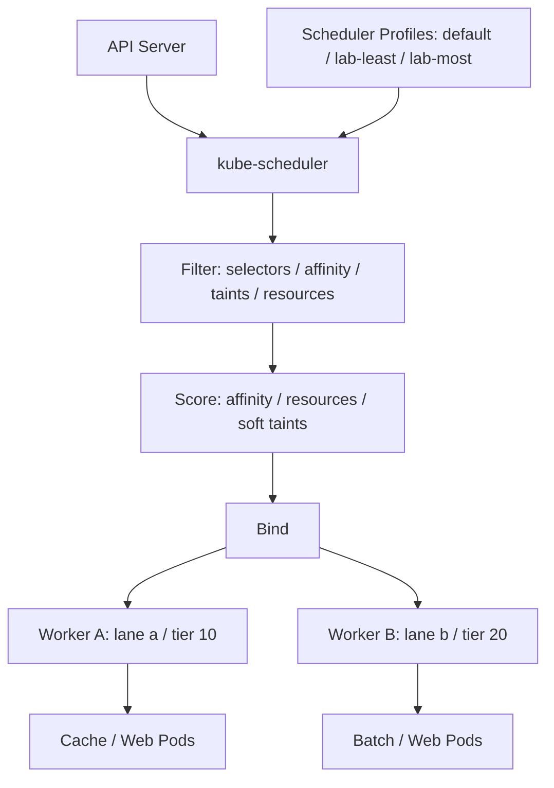

<div dir="rtl" align="right">

# ‏پروژه نهایی ⁦Kubernetes⁩ | ⁦Scheduling⁩, ⁦Affinity⁩ & ⁦Tolerations⁩

‏**سطح:** ⁦Beginner⁩ تا ⁦Intermediate⁩؛ دو مرحله تنظیم ⁦Scheduler⁩ به‌صورت پیشرفته و اختیاری.

‏**محیط:** ⁦kubeadm⁩ با یک ⁦Control Plane⁩ و دو ⁦Worker⁩؛ ⁦Shell⁩ سازگار با ⁦Bash⁩ و دسترسی ⁦kubectl.⁩ برای ⁦Scheduler Configuration⁩ نسخه ⁦Kubernetes 1.25⁩ یا جدیدتر و ⁦SSH⁩ به ⁦Control Plane⁩ لازم است.

‏**سناریو:** تیم ⁦Platform⁩ یک فروشگاه آنلاین باید ⁦Workload⁩های ⁦Web⁩، ⁦Cache⁩ و ⁦Batch⁩ را روی ⁦Worker⁩های مناسب اجرا کند؛ سرویس‌ها را کنار هم یا جدا قرار دهد، ⁦Node⁩ اختصاصی رزرو کند و رفتار امتیازدهی ⁦Scheduler⁩ را مقایسه کند.

‏**پیش‌نیاز:** ⁦Cluster⁩ آزمایشی سالم، دسترسی مجاز به ⁦Node⁩ها و ⁦Registry⁩، ظرفیت کافی و عدم وجود ⁦Namespace⁩ و ⁦Label⁩های اختصاصی این پروژه. اگر ⁦Image⁩ در ⁦Registry⁩ موجود یا قابل دریافت نیست از یک ⁦Image⁩ سالم و همسان روی همه ⁦Pod⁩ها استفاده کن.

‏**هدف:** تسلط عملی بر انتخاب ⁦Node⁩، ⁦Affinity⁩ و ⁦Anti-affinity⁩، ⁦Taint⁩ و ⁦Toleration⁩، سه ⁦Effect⁩ و ⁦Scheduler Profiles.⁩ این پروژه به ⁦CNI⁩ جدید، ⁦Storage⁩ یا ابزار جانبی نیاز ندارد.

> [!WARNING]
> ‏‏⁦Taint⁩ روی کل ⁦Node⁩ اثر دارد، نه فقط ⁦Namespace.⁩ مراحل ⁦Taint⁩ فقط روی ⁦Worker⁩ اختصاصی آزمایشی انجام شوند. ⁦NoExecute⁩ می‌تواند ⁦Pod⁩های دیگر را حذف کند. هرگز ⁦Taint⁩های ⁦Control Plane⁩ یا ⁦Taint⁩های سیستمی را تغییر نده. تغییر ⁦Scheduler⁩ اصلی نیز فقط در محیط کاملاً آزمایشی، با ⁦Backup⁩ و امکان ⁦Rollback⁩ مجاز است.

</div>

<div dir="rtl" align="right">

## ‏فهرست مطالب

- ‏[بخش اول — سناریو و چالش‌ها](#part-1)
- ‏[بخش دوم — پاسخ‌نامه](#part-2)
- ‏[اعتبارسنجی نهایی و Cleanup](#final)
- ‏[منابع رسمی](#references)

</div>

<div dir="rtl" align="right">

## ‏معماری پروژه

‏⁦Worker A⁩ برای ⁦Web⁩ و ⁦Cache⁩، و ⁦Worker B⁩ برای ⁦Batch⁩ در نظر گرفته شده است. این نام‌ها منطقی هستند و نام واقعی ⁦Node⁩ها در مرحله اول تعیین می‌شود. ارتباط خطوط در ⁦Diagram⁩ نشان‌دهنده تصمیم ⁦Scheduling⁩ است، نه مسیر ترافیک شبکه.

</div>



<a name="part-1"></a>

<div dir="rtl" align="right">

## ‏بخش اول — سناریو و چالش‌ها

‏مراحل را به ترتیب انجام بده. هیچ ⁦Command⁩ یا ⁦Manifest⁩ در این بخش وجود ندارد. همه ⁦Pod⁩های تمرین ساده و کم‌مصرف هستند مگر نمونه خطای عمدی. بعد از هر مرحله منابع تعیین‌شده را حذف کن. مرحله‌های اختیاری در صورت نبود شرایط ایمنی، فقط مفهومی بررسی شوند.

</div>

<a name="phase-01"></a>

<div dir="rtl" align="right">

### ‏مرحله ⁦01⁩ — آماده‌سازی ⁦Cluster⁩ و ⁦Node Labels⁩

‏**هدف:** شناسایی محیط و ایجاد محدوده اختصاصی تمرین.

‏**وظایف و ⁦Checklist⁩**

- [ ] ‏وضعیت یک ⁦Control Plane⁩ و دو ⁦Worker⁩ را ثبت کن؛ هر دو ⁦Worker⁩ باید ⁦Ready⁩ و قابل ⁦Scheduling⁩ باشند.
- [ ] ‏⁦Namespace⁩ با نام ⁦`sched-lab`⁩ بساز؛ اگر از قبل وجود دارد ادامه نده.
- [ ] ‏دو ⁦Worker⁩ را با ⁦`lab.example.com/pool=workers`⁩ مشخص کن؛ برای ⁦Worker⁩ اول ⁦`lab.example.com/lane=a`⁩ و ⁦`lab.example.com/tier=10`⁩ و برای ⁦Worker⁩ دوم ⁦`lab.example.com/lane=b`⁩ و ⁦`lab.example.com/tier=20`⁩ تعیین کن. از ⁦Label⁩ موجود استفاده مجدد نکن.
- [ ] ‏⁦Taint⁩های فعلی، ظرفیت ⁦Allocatable⁩ و ⁦Pod⁩های موجود را ثبت کن؛ هیچ ⁦Label⁩ یا ⁦Taint⁩ اصلی ⁦Cluster⁩ را تغییر نده.

‏**معیار پذیرش:** دو ⁦Worker⁩ با ⁦Label⁩های اختصاصی و ⁦Namespace⁩ فعال؛ ⁦Control Plane⁩ بدون تغییر.

‏[باز کردن پاسخ این مرحله](#solution-01)

</div>

---

<a name="phase-02"></a>

<div dir="rtl" align="right">

### ‏مرحله ⁦02⁩ — ⁦Default Scheduling⁩ و ⁦nodeName⁩

‏**هدف:** مشاهده تفاوت انتخاب ⁦Node⁩ توسط ⁦Scheduler⁩ و ⁦Binding⁩ مستقیم.

‏**وظایف و ⁦Checklist⁩**

- [ ] ‏دو ⁦Pod⁩ به نام ⁦`auto-a`⁩ و ⁦`auto-b`⁩ با ⁦Image⁩ ⁦`nginx:1.27.5-alpine`⁩ ایجاد کن؛ هر دو فقط روی ⁦Worker⁩های آزمایشی مجاز باشند و ترجیح اضافی نداشته باشند.
- [ ] ‏یک ⁦Pod⁩ به نام ⁦`direct-a`⁩ مستقیماً به ⁦Worker⁩ اول اختصاص بده؛ بدون استفاده از ⁦Scheduler⁩ برای انتخاب ⁦Node.⁩
- [ ] ‏نام ⁦Node⁩، ⁦Event⁩ مربوط به ⁦Scheduled⁩ و فیلد ⁦schedulerName⁩ را مقایسه کن؛ سپس سه ⁦Pod⁩ را حذف کن.

‏**معیار پذیرش:** دو ⁦Pod⁩ توسط ⁦Scheduler⁩ جای‌گذاری شوند؛ ⁦direct-a⁩ مستقیماً به ⁦Worker⁩ اول متصل شود.

‏[باز کردن پاسخ این مرحله](#solution-02)

</div>

---

<a name="phase-03"></a>

<div dir="rtl" align="right">

### ‏مرحله ⁦03⁩ — ⁦nodeSelector⁩ و ⁦FailedScheduling⁩

‏**هدف:** انتخاب ⁦Worker⁩ مشخص و بازیابی خطای ⁦Label.⁩

‏**وظایف و ⁦Checklist⁩**

- [ ] ‏⁦Pod⁩ با نام ⁦`selector-a`⁩ بساز که فقط ⁦Worker⁩ اول را بپذیرد و ⁦Pod⁩ ⁦`selector-b`⁩ فقط ⁦Worker⁩ دوم را بپذیرد.
- [ ] ‏⁦Pod⁩ ⁦`selector-fail`⁩ ایجاد کن که به ⁦Label⁩ ناموجود ⁦`lab.example.com/nonexistent=yes`⁩ نیاز داشته باشد.
- [ ] ‏⁦Pending⁩ و ⁦Events⁩ را بررسی کن؛ ⁦Pod⁩ خراب را بدون دست‌کاری ⁦Node⁩های دیگر با تنظیم صحیح بازسازی کن؛ در پایان هر سه را حذف کن.

‏**معیار پذیرش:** دو ⁦Pod⁩ سالم روی ⁦Worker⁩ مشخص و نمونه نامعتبر ابتدا ⁦Pending⁩ و پس از بازسازی ⁦Ready⁩ شود.

‏[باز کردن پاسخ این مرحله](#solution-03)

</div>

---

<a name="phase-04"></a>

<div dir="rtl" align="right">

### ‏مرحله ⁦04⁩ — ⁦Required Node Affinity⁩ و ⁦Node Anti-affinity⁩

‏**هدف:** استفاده از عملگرهای منطقی برای انتخاب و رد ⁦Node.⁩

‏**وظایف و ⁦Checklist⁩**

- [ ] ‏⁦Pod⁩ ⁦`required-a`⁩ را فقط روی ⁦Worker⁩ دارای ⁦lane=a⁩ اجرا کن.
- [ ] ‏⁦Pod⁩ ⁦`exclude-a`⁩ را با شرط وجود ⁦lane⁩ و عدم عضویت مقدار ⁦a⁩ فقط روی ⁦Worker⁩ دوم اجرا کن.
- [ ] ‏⁦Pod⁩ ⁦`tier-high`⁩ را برای ⁦tier⁩ عددی بزرگ‌تر از ⁦15⁩ اجرا کن؛ ⁦Pod⁩ ⁦`tier-low`⁩ فقط ⁦tier⁩ کوچک‌تر از ⁦15⁩ را بپذیرد.
- [ ] ‏⁦Pod⁩ ⁦`without-label`⁩ فقط ⁦Worker⁩ فاقد ⁦Label⁩ ناموجود را بپذیرد. ⁦Pod⁩ها و محل اجرا را بررسی و حذف کن.

‏**معیار پذیرش:** ⁦required-a⁩ و ⁦tier-low⁩ روی ⁦Worker⁩ اول؛ ⁦exclude-a⁩ و ⁦tier-high⁩ روی ⁦Worker⁩ دوم؛ ⁦without-label⁩ روی یکی از ⁦Worker⁩ها.

‏[باز کردن پاسخ این مرحله](#solution-04)

</div>

---

<a name="phase-05"></a>

<div dir="rtl" align="right">

### ‏مرحله ⁦05⁩ — ⁦Preferred Node Affinity⁩ و ⁦Weight⁩

‏**هدف:** درک ترجیح نرم و عدم جابه‌جایی ⁦Pod⁩ پس از تغییر ⁦Label.⁩

‏**وظایف و ⁦Checklist⁩**

- [ ] ‏⁦Pod⁩ ⁦`preferred-a`⁩ بساز که هر دو ⁦Worker⁩ مجاز باشند اما ⁦lane=a⁩ وزن ⁦100⁩ و ⁦lane=b⁩ وزن ⁦10⁩ داشته باشد.
- [ ] ‏⁦Pod⁩ ⁦`soft-fallback`⁩ بساز که فقط ⁦Worker⁩ دوم مجاز باشد ولی ⁦Worker⁩ اول را با وزن ⁦100⁩ ترجیح دهد.
- [ ] ‏⁦Pod⁩ ⁦`label-change`⁩ را با شرط سخت ⁦lane=a⁩ اجرا کن؛ سپس ⁦Label⁩ آزمایشی ⁦lane Worker⁩ اول را موقتاً به ⁦temp⁩ تغییر بده و ⁦UID⁩ و محل ⁦Pod⁩ را مقایسه کن. ⁦Label⁩ اصلی را بازگردان و ⁦Pod⁩ها را حذف کن.

‏**معیار پذیرش:** ⁦soft-fallback⁩ روی ⁦Worker⁩ دوم؛ ⁦label-change⁩ پس از تغییر ⁦Label⁩ به همان ⁦Node⁩ و ⁦UID⁩ متصل بماند؛ ⁦preferred-a⁩ ترجیح دارد نه تضمین.

‏[باز کردن پاسخ این مرحله](#solution-05)

</div>

---

<a name="phase-06"></a>

<div dir="rtl" align="right">

### ‏مرحله ⁦06⁩ — ترکیب ⁦Node Selector⁩ و ⁦Affinity⁩؛ منطق ⁦AND/OR⁩

‏**هدف:** تمرین چند ⁦Term⁩ و تشخیص قواعد متناقض.

‏**وظایف و ⁦Checklist⁩**

- [ ] ‏⁦Pod⁩ ⁦`logic-ok`⁩ بساز که شرط (⁦lane=a⁩ و ⁦tier=10⁩) یا (⁦lane=b⁩ و ⁦tier=99⁩) را بپذیرد.
- [ ] ‏⁦Pod⁩ ⁦`logic-fail`⁩ با ⁦nodeSelector⁩ برابر ⁦lane=a⁩ و ⁦NodeAffinity⁩ اجباری ⁦lane=b⁩ ایجاد کن؛ علت ⁦Pending⁩ را پیدا کن.
- [ ] ‏⁦Pod⁩ خراب را بازسازی کن تا هر دو شرط ⁦lane=b⁩ باشند؛ در انتها ⁦Pod⁩ها را حذف کن.

‏**معیار پذیرش:** ⁦logic-ok⁩ روی ⁦Worker⁩ اول و ⁦logic-fail⁩ ابتدا ⁦Pending⁩ و بعد روی ⁦Worker⁩ دوم.

‏[باز کردن پاسخ این مرحله](#solution-06)

</div>

---

<a name="phase-07"></a>

<div dir="rtl" align="right">

### ‏مرحله ⁦07⁩ — ⁦Pod Affinity⁩ — ⁦Required⁩ و ⁦Preferred⁩

‏**هدف:** هم‌مکانی سرویس‌ها با استفاده از ⁦Label⁩های ⁦Pod.⁩

‏**وظایف و ⁦Checklist⁩**

- [ ] ‏⁦Pod⁩ ⁦`cache`⁩ را با ⁦Label⁩ ⁦`app=cache`⁩ روی ⁦Worker⁩ اول اجرا کن و تا ⁦Ready⁩ شدن آن صبر کن.
- [ ] ‏⁦Pod⁩ ⁦`api-near`⁩ را ملزم کن در همان ⁦Node⁩ دارای ⁦cache⁩ قرار بگیرد؛ ⁦topologyKey⁩ برابر ⁦`kubernetes.io/hostname`⁩ باشد.
- [ ] ‏⁦Pod⁩ ⁦`api-prefer`⁩ همان محل را فقط با وزن ⁦100⁩ ترجیح دهد. یک ⁦Pod⁩ ⁦`api-missing`⁩ به ⁦app=not-found⁩ وابسته باشد؛ ⁦Pending⁩ آن را بررسی کن و هر سه ⁦API Pod⁩ را حذف کن. ⁦cache⁩ برای مرحله بعد باقی بماند.

‏**معیار پذیرش:** ⁦api-near⁩ روی ⁦Worker⁩ اول؛ ⁦api-missing⁩ بدون ⁦Pod⁩ هدف ⁦Pending⁩؛ ⁦api-prefer⁩ ترجیح نرم دارد.

‏[باز کردن پاسخ این مرحله](#solution-07)

</div>

---

<a name="phase-08"></a>

<div dir="rtl" align="right">

### ‏مرحله ⁦08⁩ — ⁦Pod Anti-affinity⁩ — ⁦Required⁩ و ⁦Preferred⁩

‏**هدف:** جلوگیری از هم‌مکانی ⁦Replica⁩ها و مشاهده محدودیت ظرفیت.

‏**وظایف و ⁦Checklist⁩**

- [ ] ‏با ⁦cache⁩ موجود، ⁦Pod⁩ ⁦`api-away`⁩ ایجاد کن که نباید روی همان ⁦Node⁩ اجرا شود؛ سپس ⁦`api-away-soft`⁩ با ترجیح نرم دوری از ⁦cache⁩ بساز.
- [ ] ‏⁦Deployment⁩ با نام ⁦`spread-web`⁩ و سه ⁦Replica⁩ بساز؛ هر ⁦Replica⁩ دارای ⁦Label⁩ ⁦`app=spread-web`⁩ باشد و هیچ دو ⁦Replica⁩ روی یک ⁦hostname⁩ قرار نگیرند.
- [ ] ‏وضعیت دو ⁦Worker⁩ و ⁦Replica⁩ سوم را مشاهده کن؛ تعداد ⁦Replica⁩ را به ⁦2⁩ کاهش بده و سلامت را بررسی کن. در انتها ⁦Deployment⁩ و هر سه ⁦Pod⁩ مربوط به ⁦cache⁩ و ⁦API⁩ را حذف کن.

‏**معیار پذیرش:** ⁦api-away⁩ روی ⁦Worker⁩ دوم؛ حداکثر دو ⁦Replica⁩ با شرط سخت روی دو ⁦Worker⁩ و ⁦Replica⁩ سوم ⁦Pending.⁩

‏[باز کردن پاسخ این مرحله](#solution-08)

</div>

---

<a name="phase-09"></a>

<div dir="rtl" align="right">

### ‏مرحله ⁦09⁩ — ⁦Cross-namespace Pod Affinity⁩

‏**هدف:** تمرین ⁦Namespace Selector⁩ و تفاوت دامنه پیش‌فرض.

‏**وظایف و ⁦Checklist⁩**

- [ ] ‏⁦Namespace⁩ جداگانه ⁦`sched-peer-lab`⁩ با ⁦Label⁩ ⁦`lab.example.com/team=peer`⁩ ایجاد کن؛ اگر موجود است ادامه نده.
- [ ] ‏⁦Pod⁩ ⁦`peer-cache`⁩ با ⁦Label⁩ ⁦`app=peer-cache`⁩ روی ⁦Worker⁩ دوم در ⁦Namespace⁩ جدید اجرا کن.
- [ ] ‏در ⁦sched-lab⁩ یک ⁦Pod⁩ ⁦`peer-default`⁩ با ⁦Affinity⁩ معمول و یک ⁦Pod⁩ ⁦`peer-explicit`⁩ با ⁦Namespace Selector⁩ مناسب ایجاد کن؛ تفاوت ⁦Pending⁩ و ⁦Ready⁩ را مشاهده و سپس ⁦Namespace⁩ کمکی و دو ⁦Pod⁩ را حذف کن.

‏**معیار پذیرش:** ⁦peer-default⁩ در نبود هدف در ⁦Namespace⁩ خودش ⁦Pending⁩ و ⁦peer-explicit⁩ روی ⁦Worker⁩ دوم ⁦Ready.⁩

‏[باز کردن پاسخ این مرحله](#solution-09)

</div>

---

<a name="phase-10"></a>

<div dir="rtl" align="right">

### ‏مرحله ⁦10⁩ — ⁦Taint⁩ و ⁦Toleration⁩ — ⁦NoSchedule⁩

‏**هدف:** رزرو ⁦Worker⁩ برای ⁦Workload⁩ مشخص بدون ⁦Eviction Pod⁩ موجود.

‏**وظایف و ⁦Checklist⁩**

- [ ] ‏در محیط اختصاصی آزمایش، ⁦Pod⁩ ⁦`before-taint`⁩ را روی ⁦Worker⁩ دوم اجرا کن.
- [ ] ‏روی ⁦Worker⁩ دوم ⁦Taint⁩ با کلید ⁦`lab.example.com/dedicated`⁩، مقدار ⁦batch⁩ و ⁦Effect⁩ برابر ⁦NoSchedule⁩ اعمال کن.
- [ ] ‏⁦Pod⁩ ⁦`blocked`⁩ فقط ⁦Worker⁩ دوم را بپذیرد ولی ⁦Toleration⁩ نداشته باشد؛ ⁦Pod⁩ ⁦`allowed-equal`⁩ با تطبیق دقیق ⁦key/value/effect⁩ و ⁦Pod⁩ ⁦`allowed-exists`⁩ با تطبیق کلید ایجاد کن.
- [ ] ‏بقای ⁦Pod⁩ اولیه، ⁦Pending⁩ نمونه ⁦blocked⁩ و ⁦Ready⁩ شدن نمونه‌های مجاز را بررسی کن. ⁦Taint⁩ اختصاصی را حذف کن، ⁦Ready⁩ شدن ⁦blocked⁩ را تأیید و ⁦Pod⁩ها را حذف کن.

‏**معیار پذیرش:** ⁦NoSchedule⁩ هیچ ⁦Pod⁩ موجودی را ⁦Evict⁩ نکند؛ تنها ⁦Pod⁩ جدید بدون ⁦Toleration⁩ مسدود شود.

‏[باز کردن پاسخ این مرحله](#solution-10)

</div>

---

<a name="phase-11"></a>

<div dir="rtl" align="right">

### ‏مرحله ⁦11⁩ — ⁦PreferNoSchedule⁩ — ⁦Soft Taint⁩

‏**هدف:** مقایسه ترجیح نرم با محدودیت سخت.

‏**وظایف و ⁦Checklist⁩**

- [ ] ‏روی ⁦Worker⁩ دوم ⁦Taint⁩ اختصاصی با کلید ⁦`lab.example.com/soft`⁩، مقدار ⁦avoid⁩ و ⁦Effect⁩ برابر ⁦PreferNoSchedule⁩ ایجاد کن.
- [ ] ‏⁦Pod⁩ ⁦`soft-any`⁩ با هر دو ⁦Worker⁩ مجاز و بدون ⁦Toleration⁩ بساز. ⁦Pod⁩ ⁦`soft-only-b`⁩ فقط ⁦Worker⁩ دوم را بپذیرد و ⁦Toleration⁩ نداشته باشد.
- [ ] ‏⁦Pod⁩ ⁦`soft-tolerated`⁩ با ⁦Toleration⁩ مناسب ایجاد کن. نتیجه هر سه را ثبت کن؛ ⁦Taint⁩ و ⁦Pod⁩ها را حذف کن.

‏**معیار پذیرش:** ⁦soft-only-b⁩ با وجود ⁦Taint⁩ نرم روی ⁦Worker⁩ دوم اجرا شود؛ ⁦soft-any⁩ ممکن است ⁦Worker⁩ اول را ترجیح دهد.

‏[باز کردن پاسخ این مرحله](#solution-11)

</div>

---

<a name="phase-12"></a>

<div dir="rtl" align="right">

### ‏مرحله ⁦12⁩ — ⁦NoExecute⁩ و ⁦tolerationSeconds⁩ — آزمایش کنترل‌شده

‏**هدف:** درک ⁦Eviction⁩ و تفاوت تحمل دائمی و موقت.

‏**وظایف و ⁦Checklist⁩**

- [ ] ‏این مرحله فقط در ⁦Cluster⁩ اختصاصی آزمایشی و در صورتی انجام شود که تمام ⁦Pod⁩های غیرآزمایشی روی ⁦Worker⁩ دوم، تحمل دائمی ⁦Taint⁩ موردنظر را داشته باشند؛ در غیر این صورت مرحله را مفهومی انجام بده.
- [ ] ‏روی ⁦Worker⁩ دوم سه ⁦Pod⁩ با نام ⁦`evict-now`⁩، ⁦`evict-later`⁩ و ⁦`evict-never`⁩ اجرا کن؛ اولی بدون ⁦Toleration⁩، دومی با ⁦tolerationSeconds=30⁩ و سومی بدون محدودیت زمانی برای ⁦Taint⁩ ⁦`lab.example.com/evict=test:NoExecute`⁩ باشد.
- [ ] ‏پس از بررسی نهایی ایمنی، ⁦Taint⁩ را اعمال و تغییرات ⁦Pod⁩ها را مشاهده کن. پس از مشاهده نتیجه، ⁦Taint⁩ را حذف کن و ⁦Pod⁩ باقی‌مانده را پاک کن.

‏**معیار پذیرش:** اولی سریع ⁦Evict⁩، دومی تقریباً پس از ⁦30⁩ ثانیه ⁦Evict⁩ و سومی باقی بماند؛ اگر شرایط ایمنی برقرار نیست نتیجه مورد انتظار را توضیح بده.

‏[باز کردن پاسخ این مرحله](#solution-12)

</div>

---

<a name="phase-13"></a>

<div dir="rtl" align="right">

### ‏مرحله ⁦13⁩ — ترکیب ⁦Taints⁩ و ⁦Node Affinity⁩

‏**هدف:** ساخت ⁦Worker⁩ اختصاصی ⁦Batch⁩ با شرط جذب و دفع.

‏**وظایف و ⁦Checklist⁩**

- [ ] ‏روی ⁦Worker⁩ دوم دو ⁦Taint⁩ آزمایشی ⁦NoSchedule⁩ با کلیدهای ⁦dedicated⁩ و ⁦maintenance⁩ و مقدار ⁦batch⁩ و ⁦yes⁩ ایجاد کن.
- [ ] ‏⁦Pod⁩ ⁦`batch-incomplete`⁩ را فقط برای ⁦Worker⁩ دوم با تحمل ⁦dedicated⁩ ایجاد کن؛ ⁦Pod⁩ ⁦`batch-complete`⁩ هر دو ⁦Taint⁩ را تحمل کند و شرط سخت ⁦lane=b⁩ داشته باشد.
- [ ] ‏⁦Pod⁩ ⁦`batch-unpinned`⁩ هر دو ⁦Taint⁩ را تحمل کند ولی فقط ⁦pool=workers⁩ را الزام کند؛ محل اجرای آن را ثبت کن. در پایان هر دو ⁦Taint⁩ و هر سه ⁦Pod⁩ را حذف کن.

‏**معیار پذیرش:** ⁦batch-incomplete Pending⁩؛ ⁦batch-complete⁩ روی ⁦Worker⁩ دوم؛ ⁦batch-unpinned⁩ مجاز به اجرای روی هر دو ⁦Worker.⁩

‏[باز کردن پاسخ این مرحله](#solution-13)

</div>

---

<a name="phase-14"></a>

<div dir="rtl" align="right">

### ‏مرحله ⁦14⁩ — ⁦Scheduler Profiles⁩ و تغییر ⁦Scoring Strategy⁩ — اختیاری

‏**هدف:** مقایسه ⁦LeastAllocated⁩ و ⁦MostAllocated⁩ بدون تغییر رفتار ⁦Profile⁩ پیش‌فرض.

‏**وظایف و ⁦Checklist⁩**

- [ ] ‏فقط در ⁦Cluster⁩ آزمایشی، نسخه ⁦kube-scheduler⁩، ⁦Static Pod Manifest⁩ و مسیر ⁦Kubeconfig⁩ را بررسی کن. پیش از هر تغییر ⁦Backup⁩ خارج از مسیر ⁦Static Pod⁩ها تهیه کن.
- [ ] ‏در همان ⁦Process⁩ مربوط به ⁦kube-scheduler⁩ دو ⁦Profile⁩ با نام ⁦`lab-least`⁩ و ⁦`lab-most`⁩ ایجاد کن. ⁦Profile⁩ ⁦`default-scheduler`⁩ باید رفتار پیش‌فرض خود را حفظ کند.
- [ ] ‏برای دو ⁦Profile⁩ آزمایش، تنها امتیازدهی ⁦NodeResourcesFit⁩ با وزن ⁦CPU⁩ و ⁦Memory⁩ مشخص فعال باشد؛ ⁦Filter⁩های پیش‌فرض حفظ شوند. یکی ⁦LeastAllocated⁩ و دیگری ⁦MostAllocated⁩ داشته باشد.
- [ ] ‏دو ⁦Pod⁩ با نام ⁦`score-least`⁩ و ⁦`score-most`⁩ و ⁦Requests⁩ یکسان بساز؛ هر کدام ⁦Scheduler Name⁩ مربوط به خودش را استفاده کند. توزیع را با ⁦Allocated Requests⁩ روی ⁦Worker⁩ها مقایسه کن. ⁦Pod⁩ها را حذف کن و ⁦Scheduler⁩ اصلی را بازیابی کن.

‏**معیار پذیرش:** ⁦Scheduler⁩ پس از ⁦Restart⁩ سالم است؛ هر دو نام اختصاصی ⁦Pod⁩ها را ⁦Schedule⁩ می‌کنند. تفاوت ترجیح در صورت تفاوت معنادار ظرفیت و ⁦Requests⁩ مشاهده می‌شود؛ در صورت تساوی نتیجه ممکن است یکسان باشد. در پایان تنظیم اولیه برقرار است.

‏[باز کردن پاسخ این مرحله](#solution-14)

</div>

---

<a name="phase-15"></a>

<div dir="rtl" align="right">

### ‏مرحله ⁦15⁩ — تغییر واقعی ⁦default-scheduler⁩ و بازیابی — اختیاری

‏**هدف:** درک تفاوت ⁦Profile⁩ آزمایش با تغییر سیاست پیش‌فرض کل ⁦Cluster.⁩

‏**وظایف و ⁦Checklist⁩**

- [ ] ‏فقط پس از موفقیت مرحله قبل و در بازه نگهداری ⁦Cluster⁩ کاملاً آزمایشی، تنظیم ⁦default-scheduler⁩ را موقتاً از ⁦LeastAllocated⁩ به ⁦MostAllocated⁩ تغییر بده؛ سایر ⁦Filter⁩ها و ⁦Score⁩های پیش‌فرض باید حفظ شوند.
- [ ] ‏یک ⁦Pod⁩ معمولی با نام ⁦`default-most`⁩ بدون ⁦Scheduler Name⁩ اختصاصی ایجاد کن؛ وضعیت ⁦Scheduled⁩ و ⁦Requests⁩ را ثبت کن.
- [ ] ‏تنظیم اصلی را کامل بازگردان و اجرای یک ⁦Pod⁩ معمولی جدید را تأیید کن. اگر مجوز یا محیط ایمن نداری این مرحله را مفهومی انجام بده.

‏**معیار پذیرش:** ⁦Profile⁩ پیش‌فرض موقتاً ⁦MostAllocated⁩ است؛ ⁦Pod⁩ عادی ⁦Schedule⁩ می‌شود و سپس ⁦Manifest⁩ اولیه عیناً بازگردانده می‌شود.

‏[باز کردن پاسخ این مرحله](#solution-15)

</div>

---

<a name="phase-16"></a>

<div dir="rtl" align="right">

### ‏مرحله ⁦16⁩ — ⁦Final Scheduling Troubleshooting⁩

‏**هدف:** تشخیص ⁦Pending⁩ از خطای ⁦Runtime⁩ و بررسی وضعیت ⁦Scheduler.⁩

‏**وظایف و ⁦Checklist⁩**

- [ ] ‏⁦Pod⁩ ⁦`unknown-scheduler`⁩ با نام ⁦Scheduler⁩ ناموجود ⁦`lab-not-running`⁩ ایجاد کن؛ وضعیت و ⁦Events⁩ را بررسی کن.
- [ ] ‏⁦Pod⁩ ⁦`resource-fail`⁩ با ⁦CPU Request⁩ بیشتر از ظرفیت هر یک از ⁦Worker⁩ها ایجاد کن؛ علت ⁦Pending⁩ را از ⁦Events⁩ استخراج کن.
- [ ] ‏هر دو ⁦Pod⁩ را با تنظیم عادی بازسازی کن و ⁦Ready⁩ شدن را بررسی کن. در پایان تمام منابع آزمایشی این مرحله را حذف کن.

‏**معیار پذیرش:** نمونه اول ⁦Pending⁩ بدون ⁦Binding⁩ و احتمالاً بدون ⁦Event⁩ معمول ⁦FailedScheduling⁩؛ نمونه دوم ⁦FailedScheduling⁩ به علت ⁦Insufficient cpu⁩؛ پس از اصلاح هر دو ⁦Ready.⁩

‏[باز کردن پاسخ این مرحله](#solution-16)

</div>

---

<div dir="rtl" align="right">

### ‏معیار پذیرش نهایی و مهارت‌ها

- [ ] ‏محل اجرای ⁦Pod⁩ با ⁦Label⁩، ⁦nodeSelector⁩ و ⁦Affinity⁩ قابل پیش‌بینی باشد.
- [ ] ‏تفاوت ⁦Required⁩ و ⁦Preferred⁩ و منطق ⁦AND/OR⁩ مشخص باشد.
- [ ] ‏⁦Pod Affinity⁩ و ⁦Anti-affinity⁩ در دو ⁦Worker⁩ و دو ⁦Namespace⁩ بررسی شده باشد.
- [ ] ‏سه ⁦Effect⁩ مربوط به ⁦Taint⁩ و ⁦Toleration⁩ و تفاوت ⁦Eviction⁩ با ⁦Pending⁩ شناخته شده باشد.
- [ ] ‏اگر محیط مجاز است، ⁦Scheduler Profiles⁩ و ⁦MostAllocated⁩ بررسی و تنظیم اصلی بازگردانده شده باشد؛ در غیر این صورت تفاوت الگوریتم‌ها به‌صورت مفهومی توضیح داده شود.
- [ ] ‏هیچ ⁦Taint⁩، ⁦Label⁩، ⁦Namespace⁩ یا ⁦Pod⁩ آزمایشی باقی نمانده باشد.

‏**⁦Skills Acquired:⁩** ⁦Scheduling Framework⁩، ⁦Filter/Score/Bind⁩، ⁦Node Selection⁩، ⁦Workload Placement⁩، ⁦Isolation⁩، ⁦Eviction⁩، ⁦Scheduler Configuration⁩ و ⁦Troubleshooting.⁩

</div>

<a name="part-2"></a>

<div dir="rtl" align="right">

## ‏بخش دوم — پاسخ‌نامه و نکات فنی

‏پاسخ هر مرحله به‌صورت پیش‌فرض بسته است. فایل‌های ⁦YAML⁩ را با نام مشخص ذخیره کن. ⁦Command⁩ها در ⁦Shell⁩ سازگار با ⁦Bash⁩ نوشته شده‌اند؛ برای ادامه ⁦Watch⁩ از ⁦Ctrl+C⁩ استفاده کن. خروجی‌ها نمونه یا معیار مورد انتظارند؛ نام ⁦Node⁩، زمان و تعداد ⁦Events⁩ ممکن است متفاوت باشند.

> [!IMPORTANT]
> ‏‏در مرحله اول متغیرهای ⁦W1⁩ و ⁦W2⁩ را با نام واقعی ⁦Worker⁩ها تنظیم کن. پیش از اجرای هر عملیات سطح ⁦Node⁩ یا ⁦Control Plane⁩، ⁦Context⁩ و شرایط ایمنی را دوباره بررسی کن.

</div>

<a name="solution-01"></a>

<details>
<summary dir="rtl" align="right">‏پاسخ مرحله ⁦01⁩ — آماده‌سازی ⁦Cluster⁩ و ⁦Node Labels⁩</summary>

<div dir="rtl" align="right">

#### ‏راه‌حل کامل و دستورات اجرایی

</div>

```bash
kubectl config current-context
kubectl version
kubectl get nodes -o wide
kubectl get namespace sched-lab --ignore-not-found
kubectl get nodes --show-labels
kubectl get pods -A -o wide
# Choose actual worker names, not the control plane:
read -r -p 'Worker A name: ' W1
read -r -p 'Worker B name: ' W2
export W1 W2
printf 'A=%s B=%s\n' "$W1" "$W2"
kubectl describe node "$W1"
kubectl describe node "$W2"
```

<div dir="rtl" align="right">

‏فقط پس از بررسی نام‌های متفاوت، سلامت ⁦Worker⁩ها، نبود ⁦Namespace⁩ و نبود کلیدهای اختصاصی این آزمایش روی هر ⁦Node⁩ ادامه بده. متغیرهای ⁦Shell⁩ را تا آخر پروژه نگه دار؛ اگر ⁦Terminal⁩ جدید باز کردی دوباره مقدار بده.

</div>

```bash
kubectl create namespace sched-lab
kubectl label node "$W1" lab.example.com/pool=workers lab.example.com/lane=a lab.example.com/tier=10
kubectl label node "$W2" lab.example.com/pool=workers lab.example.com/lane=b lab.example.com/tier=20
kubectl get nodes -L lab.example.com/pool,lab.example.com/lane,lab.example.com/tier
kubectl get ns sched-lab
```

<div dir="rtl" align="right">

#### ‏توضیحات فنی، ⁦Best Practices⁩ و ⁦Troubleshooting⁩

‏⁦Label⁩ فقط اطلاعات و دسته‌بندی است؛ به‌تنهایی ⁦Node⁩ را رزرو نمی‌کند. اگر ⁦Node⁩ از قبل ⁦Taint⁩ دارد یا ⁦cordon⁩ شده است، به‌جای حذف تنظیمات موجود علت را بررسی کن و در محیط سالم ادامه بده.

‏**خروجی مورد انتظار:** دو ⁦Worker⁩ با ⁦Label⁩های اختصاصی و ⁦Namespace⁩ فعال؛ ⁦Control Plane⁩ بدون تغییر.

#### Interview Q&A

‏آیا ⁦Label⁩ به‌تنهایی محل اجرای ⁦Pod⁩ را تغییر می‌دهد؟ خیر؛ باید در قواعد ⁦Scheduling⁩ استفاده شود.

‏[بازگشت به صورت تمرین](#phase-01)

</div>

</details>

---

<a name="solution-02"></a>

<details>
<summary dir="rtl" align="right">‏پاسخ مرحله ⁦02⁩ — ⁦Default Scheduling⁩ و ⁦nodeName⁩</summary>

<div dir="rtl" align="right">

#### ‏راه‌حل کامل و دستورات اجرایی

</div>

<div dir="rtl" align="right">

‏فایل ⁦`02-auto.yaml`⁩ را با محتوای زیر بساز.

</div>

```yaml
apiVersion: v1
kind: Pod
metadata:
  name: auto-a
  namespace: sched-lab
  labels:
    lab: scheduling
spec:
  restartPolicy: Never
  containers:
  - name: web
    image: nginx:1.27.5-alpine
    resources:
      requests:
        cpu: 25m
        memory: 32Mi
      limits:
        cpu: 100m
        memory: 128Mi
  nodeSelector:
    lab.example.com/pool: workers
---
apiVersion: v1
kind: Pod
metadata:
  name: auto-b
  namespace: sched-lab
  labels:
    lab: scheduling
spec:
  restartPolicy: Never
  containers:
  - name: web
    image: nginx:1.27.5-alpine
    resources:
      requests:
        cpu: 25m
        memory: 32Mi
      limits:
        cpu: 100m
        memory: 128Mi
  nodeSelector:
    lab.example.com/pool: workers
```

```bash
kubectl apply --dry-run=server -f 02-auto.yaml
kubectl apply -f 02-auto.yaml
```

```bash
kubectl -n sched-lab wait --for=condition=Ready pod/auto-a pod/auto-b --timeout=120s
kubectl -n sched-lab get pods -o wide
kubectl -n sched-lab describe pod auto-a
kubectl -n sched-lab run direct-a --image=nginx:1.27.5-alpine --restart=Never --overrides="{\"spec\":{\"nodeName\":\"$W1\"}}"
kubectl -n sched-lab wait --for=condition=Ready pod/direct-a --timeout=120s
kubectl -n sched-lab describe pod direct-a
kubectl -n sched-lab get pods -o wide
kubectl -n sched-lab delete pod auto-a auto-b direct-a
```

<div dir="rtl" align="right">

#### ‏توضیحات فنی، ⁦Best Practices⁩ و ⁦Troubleshooting⁩

‏⁦Scheduler⁩ ابتدا ⁦Node⁩های نامعتبر را ⁦Filter⁩ و سپس ⁦Node⁩های معتبر را ⁦Score⁩ می‌کند. ⁦nodeName⁩ از ⁦Scheduler⁩ عبور نمی‌کند؛ محدودیت‌های ⁦Scheduling⁩ مانند ⁦NoSchedule⁩ ممکن است نادیده گرفته شوند، ولی ⁦Kubelet⁩ و محدودیت‌های اجرا همچنان اثر دارند. هیچ تضمینی نیست که دو ⁦Pod⁩ اول روی دو ⁦Node⁩ متفاوت قرار گیرند.

‏**خروجی مورد انتظار:** دو ⁦Pod⁩ توسط ⁦Scheduler⁩ جای‌گذاری شوند؛ ⁦direct-a⁩ مستقیماً به ⁦Worker⁩ اول متصل شود.

#### Interview Q&A

‏آیا ⁦schedulerName⁩ در ⁦Pod⁩ دارای ⁦nodeName⁩ به معنی اجرای ⁦Scheduler⁩ است؟ خیر؛ وجود ⁦NodeName⁩ موجب می‌شود ⁦Scheduler⁩ آن ⁦Pod⁩ را برای ⁦Binding⁩ انتخاب نکند.

‏[بازگشت به صورت تمرین](#phase-02)

</div>

</details>

---

<a name="solution-03"></a>

<details>
<summary dir="rtl" align="right">‏پاسخ مرحله ⁦03⁩ — ⁦nodeSelector⁩ و ⁦FailedScheduling⁩</summary>

<div dir="rtl" align="right">

#### ‏راه‌حل کامل و دستورات اجرایی

</div>

<div dir="rtl" align="right">

‏فایل ⁦`03-selector.yaml`⁩ را با محتوای زیر بساز.

</div>

```yaml
apiVersion: v1
kind: Pod
metadata:
  name: selector-a
  namespace: sched-lab
  labels:
    lab: scheduling
spec:
  restartPolicy: Never
  containers:
  - name: web
    image: nginx:1.27.5-alpine
    resources:
      requests:
        cpu: 25m
        memory: 32Mi
      limits:
        cpu: 100m
        memory: 128Mi
  nodeSelector:
    lab.example.com/pool: workers
    lab.example.com/lane: a
---
apiVersion: v1
kind: Pod
metadata:
  name: selector-b
  namespace: sched-lab
  labels:
    lab: scheduling
spec:
  restartPolicy: Never
  containers:
  - name: web
    image: nginx:1.27.5-alpine
    resources:
      requests:
        cpu: 25m
        memory: 32Mi
      limits:
        cpu: 100m
        memory: 128Mi
  nodeSelector:
    lab.example.com/pool: workers
    lab.example.com/lane: b
---
apiVersion: v1
kind: Pod
metadata:
  name: selector-fail
  namespace: sched-lab
  labels:
    lab: scheduling
spec:
  restartPolicy: Never
  containers:
  - name: web
    image: nginx:1.27.5-alpine
    resources:
      requests:
        cpu: 25m
        memory: 32Mi
      limits:
        cpu: 100m
        memory: 128Mi
  nodeSelector:
    lab.example.com/pool: workers
    lab.example.com/nonexistent: 'yes'
```

```bash
kubectl apply --dry-run=server -f 03-selector.yaml
kubectl apply -f 03-selector.yaml
```

```bash
kubectl -n sched-lab get pods -o wide
kubectl -n sched-lab describe pod selector-fail
kubectl -n sched-lab get events --sort-by=.metadata.creationTimestamp
kubectl -n sched-lab delete pod selector-fail
```

<div dir="rtl" align="right">

‏فایل ⁦`03-selector-fixed.yaml`⁩ را با محتوای زیر بساز.

</div>

```yaml
apiVersion: v1
kind: Pod
metadata:
  name: selector-fail
  namespace: sched-lab
  labels:
    lab: scheduling
spec:
  restartPolicy: Never
  containers:
  - name: web
    image: nginx:1.27.5-alpine
    resources:
      requests:
        cpu: 25m
        memory: 32Mi
      limits:
        cpu: 100m
        memory: 128Mi
  nodeSelector:
    lab.example.com/pool: workers
    lab.example.com/lane: b
```

```bash
kubectl apply --dry-run=server -f 03-selector-fixed.yaml
kubectl apply -f 03-selector-fixed.yaml
```

```bash
kubectl -n sched-lab wait --for=condition=Ready pod/selector-fail --timeout=120s
kubectl -n sched-lab get pods -o wide
kubectl -n sched-lab delete pod selector-a selector-b selector-fail
```

<div dir="rtl" align="right">

#### ‏توضیحات فنی، ⁦Best Practices⁩ و ⁦Troubleshooting⁩

‏تمام جفت‌های ⁦nodeSelector⁩ باید هم‌زمان برقرار باشند؛ فیلد روی ⁦Pod⁩ موجود معمولاً قابل تغییر نیست. برای تغییر محل اجرا از بازسازی ⁦Pod⁩ یا تغییر ⁦Pod Template⁩ کنترلر استفاده کن.

‏**خروجی مورد انتظار:** دو ⁦Pod⁩ سالم روی ⁦Worker⁩ مشخص و نمونه نامعتبر ابتدا ⁦Pending⁩ و پس از بازسازی ⁦Ready⁩ شود.

#### Interview Q&A

‏اگر یک ⁦Label⁩ با مقدار اشتباه نوشته شود چه می‌شود؟ ⁦Pod⁩ ممکن است ⁦Pending⁩ بماند و ⁦FailedScheduling⁩ گزارش شود.

‏[بازگشت به صورت تمرین](#phase-03)

</div>

</details>

---

<a name="solution-04"></a>

<details>
<summary dir="rtl" align="right">‏پاسخ مرحله ⁦04⁩ — ⁦Required Node Affinity⁩ و ⁦Node Anti-affinity⁩</summary>

<div dir="rtl" align="right">

#### ‏راه‌حل کامل و دستورات اجرایی

</div>

<div dir="rtl" align="right">

‏فایل ⁦`04-required.yaml`⁩ را با محتوای زیر بساز.

</div>

```yaml
apiVersion: v1
kind: Pod
metadata:
  name: required-a
  namespace: sched-lab
  labels:
    lab: scheduling
spec:
  restartPolicy: Never
  containers:
  - name: web
    image: nginx:1.27.5-alpine
    resources:
      requests:
        cpu: 25m
        memory: 32Mi
      limits:
        cpu: 100m
        memory: 128Mi
  nodeSelector:
    lab.example.com/pool: workers
  affinity:
    nodeAffinity:
      requiredDuringSchedulingIgnoredDuringExecution:
        nodeSelectorTerms:
        - matchExpressions:
          - key: lab.example.com/lane
            operator: In
            values:
            - a
---
apiVersion: v1
kind: Pod
metadata:
  name: exclude-a
  namespace: sched-lab
  labels:
    lab: scheduling
spec:
  restartPolicy: Never
  containers:
  - name: web
    image: nginx:1.27.5-alpine
    resources:
      requests:
        cpu: 25m
        memory: 32Mi
      limits:
        cpu: 100m
        memory: 128Mi
  nodeSelector:
    lab.example.com/pool: workers
  affinity:
    nodeAffinity:
      requiredDuringSchedulingIgnoredDuringExecution:
        nodeSelectorTerms:
        - matchExpressions:
          - key: lab.example.com/lane
            operator: Exists
          - key: lab.example.com/lane
            operator: NotIn
            values:
            - a
---
apiVersion: v1
kind: Pod
metadata:
  name: tier-high
  namespace: sched-lab
  labels:
    lab: scheduling
spec:
  restartPolicy: Never
  containers:
  - name: web
    image: nginx:1.27.5-alpine
    resources:
      requests:
        cpu: 25m
        memory: 32Mi
      limits:
        cpu: 100m
        memory: 128Mi
  nodeSelector:
    lab.example.com/pool: workers
  affinity:
    nodeAffinity:
      requiredDuringSchedulingIgnoredDuringExecution:
        nodeSelectorTerms:
        - matchExpressions:
          - key: lab.example.com/tier
            operator: Gt
            values:
            - '15'
---
apiVersion: v1
kind: Pod
metadata:
  name: tier-low
  namespace: sched-lab
  labels:
    lab: scheduling
spec:
  restartPolicy: Never
  containers:
  - name: web
    image: nginx:1.27.5-alpine
    resources:
      requests:
        cpu: 25m
        memory: 32Mi
      limits:
        cpu: 100m
        memory: 128Mi
  nodeSelector:
    lab.example.com/pool: workers
  affinity:
    nodeAffinity:
      requiredDuringSchedulingIgnoredDuringExecution:
        nodeSelectorTerms:
        - matchExpressions:
          - key: lab.example.com/tier
            operator: Lt
            values:
            - '15'
---
apiVersion: v1
kind: Pod
metadata:
  name: without-label
  namespace: sched-lab
  labels:
    lab: scheduling
spec:
  restartPolicy: Never
  containers:
  - name: web
    image: nginx:1.27.5-alpine
    resources:
      requests:
        cpu: 25m
        memory: 32Mi
      limits:
        cpu: 100m
        memory: 128Mi
  nodeSelector:
    lab.example.com/pool: workers
  affinity:
    nodeAffinity:
      requiredDuringSchedulingIgnoredDuringExecution:
        nodeSelectorTerms:
        - matchExpressions:
          - key: lab.example.com/nonexistent
            operator: DoesNotExist
```

```bash
kubectl apply --dry-run=server -f 04-required.yaml
kubectl apply -f 04-required.yaml
```

```bash
kubectl -n sched-lab get pods -o wide
kubectl -n sched-lab wait --for=condition=Ready -l lab=scheduling pod --timeout=120s
kubectl -n sched-lab delete pod required-a exclude-a tier-high tier-low without-label
```

<div dir="rtl" align="right">

#### ‏توضیحات فنی، ⁦Best Practices⁩ و ⁦Troubleshooting⁩

‏⁦Node Anti-affinity⁩ فیلد جداگانه ندارد؛ با ⁦NodeAffinity⁩ و ⁦NotIn⁩ یا ⁦DoesNotExist⁩ ساخته می‌شود. ⁦NotIn⁩ ممکن است ⁦Node⁩ فاقد آن ⁦Label⁩ را هم بپذیرد؛ ⁦Exists⁩ را برای الزام وجود کلید اضافه کن. ⁦Gt⁩ و ⁦Lt⁩ یک مقدار عدد صحیح می‌خواهند. ⁦required⁩ شرط سخت است.

‏**خروجی مورد انتظار:** ⁦required-a⁩ و ⁦tier-low⁩ روی ⁦Worker⁩ اول؛ ⁦exclude-a⁩ و ⁦tier-high⁩ روی ⁦Worker⁩ دوم؛ ⁦without-label⁩ روی یکی از ⁦Worker⁩ها.

#### Interview Q&A

‏آیا ⁦Node Anti-affinity⁩ همان ⁦podAntiAffinity⁩ است؟ خیر؛ اولی ⁦Label⁩های ⁦Node⁩ و دومی ⁦Label⁩های ⁦Pod⁩های موجود را ارزیابی می‌کند.

‏[بازگشت به صورت تمرین](#phase-04)

</div>

</details>

---

<a name="solution-05"></a>

<details>
<summary dir="rtl" align="right">‏پاسخ مرحله ⁦05⁩ — ⁦Preferred Node Affinity⁩ و ⁦Weight⁩</summary>

<div dir="rtl" align="right">

#### ‏راه‌حل کامل و دستورات اجرایی

</div>

<div dir="rtl" align="right">

‏فایل ⁦`05-preferred.yaml`⁩ را با محتوای زیر بساز.

</div>

```yaml
apiVersion: v1
kind: Pod
metadata:
  name: preferred-a
  namespace: sched-lab
  labels:
    lab: scheduling
spec:
  restartPolicy: Never
  containers:
  - name: web
    image: nginx:1.27.5-alpine
    resources:
      requests:
        cpu: 25m
        memory: 32Mi
      limits:
        cpu: 100m
        memory: 128Mi
  nodeSelector:
    lab.example.com/pool: workers
  affinity:
    nodeAffinity:
      preferredDuringSchedulingIgnoredDuringExecution:
      - weight: 100
        preference:
          matchExpressions:
          - key: lab.example.com/lane
            operator: In
            values:
            - a
      - weight: 10
        preference:
          matchExpressions:
          - key: lab.example.com/lane
            operator: In
            values:
            - b
---
apiVersion: v1
kind: Pod
metadata:
  name: soft-fallback
  namespace: sched-lab
  labels:
    lab: scheduling
spec:
  restartPolicy: Never
  containers:
  - name: web
    image: nginx:1.27.5-alpine
    resources:
      requests:
        cpu: 25m
        memory: 32Mi
      limits:
        cpu: 100m
        memory: 128Mi
  nodeSelector:
    lab.example.com/pool: workers
    lab.example.com/lane: b
  affinity:
    nodeAffinity:
      preferredDuringSchedulingIgnoredDuringExecution:
      - weight: 100
        preference:
          matchExpressions:
          - key: lab.example.com/lane
            operator: In
            values:
            - a
---
apiVersion: v1
kind: Pod
metadata:
  name: label-change
  namespace: sched-lab
  labels:
    lab: scheduling
spec:
  restartPolicy: Never
  containers:
  - name: web
    image: nginx:1.27.5-alpine
    resources:
      requests:
        cpu: 25m
        memory: 32Mi
      limits:
        cpu: 100m
        memory: 128Mi
  nodeSelector:
    lab.example.com/pool: workers
  affinity:
    nodeAffinity:
      requiredDuringSchedulingIgnoredDuringExecution:
        nodeSelectorTerms:
        - matchExpressions:
          - key: lab.example.com/lane
            operator: In
            values:
            - a
```

```bash
kubectl apply --dry-run=server -f 05-preferred.yaml
kubectl apply -f 05-preferred.yaml
```

```bash
kubectl -n sched-lab wait --for=condition=Ready pod/preferred-a pod/soft-fallback pod/label-change --timeout=120s
kubectl -n sched-lab get pods -o wide
kubectl -n sched-lab get pod label-change -o custom-columns=UID:.metadata.uid,NODE:.spec.nodeName
kubectl label node "$W1" lab.example.com/lane=temp --overwrite
kubectl -n sched-lab get pod label-change -o custom-columns=UID:.metadata.uid,NODE:.spec.nodeName
kubectl label node "$W1" lab.example.com/lane=a --overwrite
kubectl -n sched-lab delete pod preferred-a soft-fallback label-change
```

<div dir="rtl" align="right">

#### ‏توضیحات فنی، ⁦Best Practices⁩ و ⁦Troubleshooting⁩

‏⁦Weight⁩ بین ⁦1⁩ تا ⁦100⁩ است و امتیاز ترجیح با سایر ⁦Plugin⁩ها ترکیب می‌شود. ⁦IgnoredDuringExecution⁩ یعنی تغییر ⁦Label⁩ پس از ⁦Binding⁩ به‌خودی‌خود ⁦Pod⁩ را ⁦Evict⁩ نمی‌کند. برای آزمون ⁦fallback⁩ از محدودیت سخت استفاده کرده‌ایم تا نتیجه قطعی باشد.

‏**خروجی مورد انتظار:** ⁦soft-fallback⁩ روی ⁦Worker⁩ دوم؛ ⁦label-change⁩ پس از تغییر ⁦Label⁩ به همان ⁦Node⁩ و ⁦UID⁩ متصل بماند؛ ⁦preferred-a⁩ ترجیح دارد نه تضمین.

#### Interview Q&A

‏آیا ⁦weight=100⁩ اجرای ⁦Pod⁩ روی ⁦Node⁩ موردنظر را تضمین می‌کند؟ خیر.

‏[بازگشت به صورت تمرین](#phase-05)

</div>

</details>

---

<a name="solution-06"></a>

<details>
<summary dir="rtl" align="right">‏پاسخ مرحله ⁦06⁩ — ترکیب ⁦Node Selector⁩ و ⁦Affinity⁩؛ منطق ⁦AND/OR⁩</summary>

<div dir="rtl" align="right">

#### ‏راه‌حل کامل و دستورات اجرایی

</div>

<div dir="rtl" align="right">

‏فایل ⁦`06-logic.yaml`⁩ را با محتوای زیر بساز.

</div>

```yaml
apiVersion: v1
kind: Pod
metadata:
  name: logic-ok
  namespace: sched-lab
  labels:
    lab: scheduling
spec:
  restartPolicy: Never
  containers:
  - name: web
    image: nginx:1.27.5-alpine
    resources:
      requests:
        cpu: 25m
        memory: 32Mi
      limits:
        cpu: 100m
        memory: 128Mi
  nodeSelector:
    lab.example.com/pool: workers
  affinity:
    nodeAffinity:
      requiredDuringSchedulingIgnoredDuringExecution:
        nodeSelectorTerms:
        - matchExpressions:
          - key: lab.example.com/lane
            operator: In
            values:
            - a
          - key: lab.example.com/tier
            operator: In
            values:
            - '10'
        - matchExpressions:
          - key: lab.example.com/lane
            operator: In
            values:
            - b
          - key: lab.example.com/tier
            operator: In
            values:
            - '99'
---
apiVersion: v1
kind: Pod
metadata:
  name: logic-fail
  namespace: sched-lab
  labels:
    lab: scheduling
spec:
  restartPolicy: Never
  containers:
  - name: web
    image: nginx:1.27.5-alpine
    resources:
      requests:
        cpu: 25m
        memory: 32Mi
      limits:
        cpu: 100m
        memory: 128Mi
  nodeSelector:
    lab.example.com/pool: workers
    lab.example.com/lane: a
  affinity:
    nodeAffinity:
      requiredDuringSchedulingIgnoredDuringExecution:
        nodeSelectorTerms:
        - matchExpressions:
          - key: lab.example.com/lane
            operator: In
            values:
            - b
```

```bash
kubectl apply --dry-run=server -f 06-logic.yaml
kubectl apply -f 06-logic.yaml
```

```bash
kubectl -n sched-lab get pods -o wide
kubectl -n sched-lab describe pod logic-fail
kubectl -n sched-lab delete pod logic-fail
```

<div dir="rtl" align="right">

‏فایل ⁦`06-fixed.yaml`⁩ را با محتوای زیر بساز.

</div>

```yaml
apiVersion: v1
kind: Pod
metadata:
  name: logic-fail
  namespace: sched-lab
  labels:
    lab: scheduling
spec:
  restartPolicy: Never
  containers:
  - name: web
    image: nginx:1.27.5-alpine
    resources:
      requests:
        cpu: 25m
        memory: 32Mi
      limits:
        cpu: 100m
        memory: 128Mi
  nodeSelector:
    lab.example.com/pool: workers
    lab.example.com/lane: b
  affinity:
    nodeAffinity:
      requiredDuringSchedulingIgnoredDuringExecution:
        nodeSelectorTerms:
        - matchExpressions:
          - key: lab.example.com/lane
            operator: In
            values:
            - b
```

```bash
kubectl apply --dry-run=server -f 06-fixed.yaml
kubectl apply -f 06-fixed.yaml
```

```bash
kubectl -n sched-lab wait --for=condition=Ready pod/logic-fail --timeout=120s
kubectl -n sched-lab get pods -o wide
kubectl -n sched-lab delete pod logic-ok logic-fail
```

<div dir="rtl" align="right">

#### ‏توضیحات فنی، ⁦Best Practices⁩ و ⁦Troubleshooting⁩

‏بین ⁦nodeSelector⁩ و ⁦NodeAffinity⁩ اجباری ⁦AND⁩ برقرار است؛ بین ⁦nodeSelectorTerms⁩ رابطه ⁦OR⁩ و بین ⁦matchExpressions⁩ یک ⁦Term⁩ رابطه ⁦AND⁩ است. ⁦matchFields⁩ نیز می‌تواند ⁦metadata.name⁩ را هدف بگیرد ولی برای تمرین ⁦Label⁩ ترجیح داده شده است.

‏**خروجی مورد انتظار:** ⁦logic-ok⁩ روی ⁦Worker⁩ اول و ⁦logic-fail⁩ ابتدا ⁦Pending⁩ و بعد روی ⁦Worker⁩ دوم.

#### Interview Q&A

‏اگر دو ⁦Term⁩ داشته باشیم که یکی برقرار باشد کافی است؟ بله، در ⁦NodeAffinity⁩ اجباری ⁦Term⁩ها ⁦OR⁩ هستند.

‏[بازگشت به صورت تمرین](#phase-06)

</div>

</details>

---

<a name="solution-07"></a>

<details>
<summary dir="rtl" align="right">‏پاسخ مرحله ⁦07⁩ — ⁦Pod Affinity⁩ — ⁦Required⁩ و ⁦Preferred⁩</summary>

<div dir="rtl" align="right">

#### ‏راه‌حل کامل و دستورات اجرایی

</div>

<div dir="rtl" align="right">

‏فایل ⁦`07-cache.yaml`⁩ را با محتوای زیر بساز.

</div>

```yaml
apiVersion: v1
kind: Pod
metadata:
  name: cache
  namespace: sched-lab
  labels:
    lab: scheduling
    app: cache
spec:
  restartPolicy: Never
  containers:
  - name: web
    image: nginx:1.27.5-alpine
    resources:
      requests:
        cpu: 25m
        memory: 32Mi
      limits:
        cpu: 100m
        memory: 128Mi
  nodeSelector:
    lab.example.com/pool: workers
    lab.example.com/lane: a
```

```bash
kubectl apply --dry-run=server -f 07-cache.yaml
kubectl apply -f 07-cache.yaml
```

```bash
kubectl -n sched-lab wait --for=condition=Ready pod/cache --timeout=120s
```

<div dir="rtl" align="right">

‏فایل ⁦`07-affinity.yaml`⁩ را با محتوای زیر بساز.

</div>

```yaml
apiVersion: v1
kind: Pod
metadata:
  name: api-near
  namespace: sched-lab
  labels:
    lab: scheduling
spec:
  restartPolicy: Never
  containers:
  - name: web
    image: nginx:1.27.5-alpine
    resources:
      requests:
        cpu: 25m
        memory: 32Mi
      limits:
        cpu: 100m
        memory: 128Mi
  nodeSelector:
    lab.example.com/pool: workers
  affinity:
    podAffinity:
      requiredDuringSchedulingIgnoredDuringExecution:
      - labelSelector:
          matchLabels:
            app: cache
        topologyKey: kubernetes.io/hostname
---
apiVersion: v1
kind: Pod
metadata:
  name: api-prefer
  namespace: sched-lab
  labels:
    lab: scheduling
spec:
  restartPolicy: Never
  containers:
  - name: web
    image: nginx:1.27.5-alpine
    resources:
      requests:
        cpu: 25m
        memory: 32Mi
      limits:
        cpu: 100m
        memory: 128Mi
  nodeSelector:
    lab.example.com/pool: workers
  affinity:
    podAffinity:
      preferredDuringSchedulingIgnoredDuringExecution:
      - weight: 100
        podAffinityTerm:
          labelSelector:
            matchLabels:
              app: cache
          topologyKey: kubernetes.io/hostname
---
apiVersion: v1
kind: Pod
metadata:
  name: api-missing
  namespace: sched-lab
  labels:
    lab: scheduling
spec:
  restartPolicy: Never
  containers:
  - name: web
    image: nginx:1.27.5-alpine
    resources:
      requests:
        cpu: 25m
        memory: 32Mi
      limits:
        cpu: 100m
        memory: 128Mi
  nodeSelector:
    lab.example.com/pool: workers
  affinity:
    podAffinity:
      requiredDuringSchedulingIgnoredDuringExecution:
      - labelSelector:
          matchLabels:
            app: not-found
        topologyKey: kubernetes.io/hostname
```

```bash
kubectl apply --dry-run=server -f 07-affinity.yaml
kubectl apply -f 07-affinity.yaml
```

```bash
kubectl -n sched-lab get pods -o wide
kubectl -n sched-lab describe pod api-missing
kubectl -n sched-lab delete pod api-near api-prefer api-missing
```

<div dir="rtl" align="right">

#### ‏توضیحات فنی، ⁦Best Practices⁩ و ⁦Troubleshooting⁩

‏⁦PodAffinity⁩ محل ⁦Pod⁩های موجود را از طریق ⁦topologyKey⁩ می‌سنجد. ⁦hostname⁩ یعنی همان ⁦Node⁩؛ ⁦zone⁩ یعنی همان ⁦Zone.⁩ حالت پیش‌فرض بدون ⁦namespaces⁩ و ⁦namespaceSelector⁩، ⁦Namespace⁩ خود ⁦Pod⁩ است. اولین ⁦Pod⁩ در گروه ⁦self-affinity⁩ شرایط ویژه‌ای دارد؛ ⁦api-missing⁩ خودش ⁦Label⁩ موردنیاز را ندارد، پس نمونه ⁦self-affinity⁩ نیست.

‏**خروجی مورد انتظار:** ⁦api-near⁩ روی ⁦Worker⁩ اول؛ ⁦api-missing⁩ بدون ⁦Pod⁩ هدف ⁦Pending⁩؛ ⁦api-prefer⁩ ترجیح نرم دارد.

#### Interview Q&A

‏آیا ⁦PodAffinity⁩ به ⁦IP⁩ سرویس وابسته است؟ خیر؛ ⁦Label⁩ و ⁦Topology Domain⁩ را بررسی می‌کند.

‏[بازگشت به صورت تمرین](#phase-07)

</div>

</details>

---

<a name="solution-08"></a>

<details>
<summary dir="rtl" align="right">‏پاسخ مرحله ⁦08⁩ — ⁦Pod Anti-affinity⁩ — ⁦Required⁩ و ⁦Preferred⁩</summary>

<div dir="rtl" align="right">

#### ‏راه‌حل کامل و دستورات اجرایی

</div>

<div dir="rtl" align="right">

‏فایل ⁦`08-away.yaml`⁩ را با محتوای زیر بساز.

</div>

```yaml
apiVersion: v1
kind: Pod
metadata:
  name: api-away
  namespace: sched-lab
  labels:
    lab: scheduling
spec:
  restartPolicy: Never
  containers:
  - name: web
    image: nginx:1.27.5-alpine
    resources:
      requests:
        cpu: 25m
        memory: 32Mi
      limits:
        cpu: 100m
        memory: 128Mi
  nodeSelector:
    lab.example.com/pool: workers
  affinity:
    podAntiAffinity:
      requiredDuringSchedulingIgnoredDuringExecution:
      - labelSelector:
          matchLabels:
            app: cache
        topologyKey: kubernetes.io/hostname
---
apiVersion: v1
kind: Pod
metadata:
  name: api-away-soft
  namespace: sched-lab
  labels:
    lab: scheduling
spec:
  restartPolicy: Never
  containers:
  - name: web
    image: nginx:1.27.5-alpine
    resources:
      requests:
        cpu: 25m
        memory: 32Mi
      limits:
        cpu: 100m
        memory: 128Mi
  nodeSelector:
    lab.example.com/pool: workers
  affinity:
    podAntiAffinity:
      preferredDuringSchedulingIgnoredDuringExecution:
      - weight: 100
        podAffinityTerm:
          labelSelector:
            matchLabels:
              app: cache
          topologyKey: kubernetes.io/hostname
```

```bash
kubectl apply --dry-run=server -f 08-away.yaml
kubectl apply -f 08-away.yaml
```

<div dir="rtl" align="right">

‏فایل ⁦`08-spread.yaml`⁩ را بساز.

</div>

```yaml
apiVersion: apps/v1
kind: Deployment
metadata:
  name: spread-web
  namespace: sched-lab
spec:
  replicas: 3
  selector:
    matchLabels:
      app: spread-web
  template:
    metadata:
      labels:
        app: spread-web
    spec:
      containers:
      - name: web
        image: nginx:1.27.5-alpine
        resources:
          requests:
            cpu: 25m
            memory: 32Mi
          limits:
            cpu: 100m
            memory: 128Mi
      nodeSelector:
        lab.example.com/pool: workers
      affinity:
        podAntiAffinity:
          requiredDuringSchedulingIgnoredDuringExecution:
          - labelSelector:
              matchLabels:
                app: spread-web
            topologyKey: kubernetes.io/hostname
```

```bash
kubectl apply -f 08-spread.yaml
kubectl -n sched-lab get deploy,pods -o wide
kubectl -n sched-lab get events --sort-by=.metadata.creationTimestamp
kubectl -n sched-lab scale deployment spread-web --replicas=2
kubectl -n sched-lab rollout status deployment/spread-web --timeout=180s
kubectl -n sched-lab delete deployment spread-web
kubectl -n sched-lab delete pod api-away api-away-soft cache
```

<div dir="rtl" align="right">

#### ‏توضیحات فنی، ⁦Best Practices⁩ و ⁦Troubleshooting⁩

‏⁦Required Anti-affinity⁩ برای جداسازی سخت مناسب است؛ ⁦Preferred⁩ اگر ظرفیت کافی نباشد اجازه هم‌مکانی می‌دهد. با دو ⁦Worker⁩، سه ⁦Replica⁩ دارای شرط سخت ⁦hostname⁩ هم‌زمان ⁦Scheduled⁩ نمی‌شوند. در برخی ⁦Cluster⁩ها ⁦Admission⁩ محدودیت ⁦topologyKey⁩ برای ⁦Anti-affinity⁩ سخت اعمال می‌کند؛ ⁦hostname⁩ گزینه متداول است.

‏**خروجی مورد انتظار:** ⁦api-away⁩ روی ⁦Worker⁩ دوم؛ حداکثر دو ⁦Replica⁩ با شرط سخت روی دو ⁦Worker⁩ و ⁦Replica⁩ سوم ⁦Pending.⁩

#### Interview Q&A

‏آیا ⁦Anti-affinity⁩ تضمین می‌کند ترافیک بین ⁦Pod⁩ها قطع شود؟ خیر؛ این قاعده ⁦Scheduling⁩ است نه ⁦NetworkPolicy.⁩

‏[بازگشت به صورت تمرین](#phase-08)

</div>

</details>

---

<a name="solution-09"></a>

<details>
<summary dir="rtl" align="right">‏پاسخ مرحله ⁦09⁩ — ⁦Cross-namespace Pod Affinity⁩</summary>

<div dir="rtl" align="right">

#### ‏راه‌حل کامل و دستورات اجرایی

</div>

```bash
kubectl get namespace sched-peer-lab --ignore-not-found
# Continue only if absent:
kubectl create namespace sched-peer-lab
kubectl label namespace sched-peer-lab lab.example.com/team=peer
```

<div dir="rtl" align="right">

‏فایل ⁦`09-peer.yaml`⁩ را با محتوای زیر بساز.

</div>

```yaml
apiVersion: v1
kind: Pod
metadata:
  name: peer-cache
  namespace: sched-peer-lab
  labels:
    app: peer-cache
spec:
  restartPolicy: Never
  containers:
  - name: web
    image: nginx:1.27.5-alpine
    resources:
      requests:
        cpu: 25m
        memory: 32Mi
      limits:
        cpu: 100m
        memory: 128Mi
  nodeSelector:
    lab.example.com/pool: workers
    lab.example.com/lane: b
```

```bash
kubectl apply --dry-run=server -f 09-peer.yaml
kubectl apply -f 09-peer.yaml
```

```bash
kubectl -n sched-peer-lab wait --for=condition=Ready pod/peer-cache --timeout=120s
```

<div dir="rtl" align="right">

‏فایل ⁦`09-client.yaml`⁩ را با محتوای زیر بساز.

</div>

```yaml
apiVersion: v1
kind: Pod
metadata:
  name: peer-default
  namespace: sched-lab
  labels:
    lab: scheduling
spec:
  restartPolicy: Never
  containers:
  - name: web
    image: nginx:1.27.5-alpine
    resources:
      requests:
        cpu: 25m
        memory: 32Mi
      limits:
        cpu: 100m
        memory: 128Mi
  nodeSelector:
    lab.example.com/pool: workers
  affinity:
    podAffinity:
      requiredDuringSchedulingIgnoredDuringExecution:
      - labelSelector:
          matchLabels:
            app: peer-cache
        topologyKey: kubernetes.io/hostname
---
apiVersion: v1
kind: Pod
metadata:
  name: peer-explicit
  namespace: sched-lab
  labels:
    lab: scheduling
spec:
  restartPolicy: Never
  containers:
  - name: web
    image: nginx:1.27.5-alpine
    resources:
      requests:
        cpu: 25m
        memory: 32Mi
      limits:
        cpu: 100m
        memory: 128Mi
  nodeSelector:
    lab.example.com/pool: workers
  affinity:
    podAffinity:
      requiredDuringSchedulingIgnoredDuringExecution:
      - labelSelector:
          matchLabels:
            app: peer-cache
        topologyKey: kubernetes.io/hostname
        namespaceSelector:
          matchLabels:
            lab.example.com/team: peer
```

```bash
kubectl apply --dry-run=server -f 09-client.yaml
kubectl apply -f 09-client.yaml
```

```bash
kubectl -n sched-lab get pods -o wide
kubectl -n sched-lab describe pod peer-default
kubectl -n sched-lab wait --for=condition=Ready pod/peer-explicit --timeout=120s
kubectl -n sched-lab delete pod peer-default peer-explicit
kubectl delete namespace sched-peer-lab
```

<div dir="rtl" align="right">

#### ‏توضیحات فنی، ⁦Best Practices⁩ و ⁦Troubleshooting⁩

‏⁦namespaces⁩ برای نام صریح ⁦Namespace⁩ها و ⁦namespaceSelector⁩ برای ⁦Label⁩ آنهاست. اگر هر دو تعیین شوند، مجموعه حاصل اجتماع آنهاست؛ ⁦namespaceSelector⁩ خالی {} همه ⁦Namespace⁩ها را می‌پذیرد. اگر هر دو خالی باشند، دامنه پیش‌فرض ⁦Namespace⁩ خود ⁦Pod⁩ است.

‏**خروجی مورد انتظار:** ⁦peer-default⁩ در نبود هدف در ⁦Namespace⁩ خودش ⁦Pending⁩ و ⁦peer-explicit⁩ روی ⁦Worker⁩ دوم ⁦Ready.⁩

#### Interview Q&A

‏چرا ⁦topologyKey⁩ هنوز لازم است؟ چون مشخص می‌کند نزدیکی ⁦Pod⁩ها در چه دامنه‌ای سنجیده شود.

‏[بازگشت به صورت تمرین](#phase-09)

</div>

</details>

---

<a name="solution-10"></a>

<details>
<summary dir="rtl" align="right">‏پاسخ مرحله ⁦10⁩ — ⁦Taint⁩ و ⁦Toleration⁩ — ⁦NoSchedule⁩</summary>

<div dir="rtl" align="right">

#### ‏راه‌حل کامل و دستورات اجرایی

</div>

<div dir="rtl" align="right">

‏فایل ⁦`10-before.yaml`⁩ را با محتوای زیر بساز.

</div>

```yaml
apiVersion: v1
kind: Pod
metadata:
  name: before-taint
  namespace: sched-lab
  labels:
    lab: scheduling
spec:
  restartPolicy: Never
  containers:
  - name: web
    image: nginx:1.27.5-alpine
    resources:
      requests:
        cpu: 25m
        memory: 32Mi
      limits:
        cpu: 100m
        memory: 128Mi
  nodeSelector:
    lab.example.com/pool: workers
    lab.example.com/lane: b
```

```bash
kubectl apply --dry-run=server -f 10-before.yaml
kubectl apply -f 10-before.yaml
```

```bash
kubectl -n sched-lab wait --for=condition=Ready pod/before-taint --timeout=120s
kubectl get pods -A --field-selector spec.nodeName="$W2" -o wide
kubectl describe node "$W2"
# Only on a dedicated lab worker and if the exact taint key is absent:
kubectl taint nodes "$W2" lab.example.com/dedicated=batch:NoSchedule
```

<div dir="rtl" align="right">

‏فایل ⁦`10-noschedule.yaml`⁩ را با محتوای زیر بساز.

</div>

```yaml
apiVersion: v1
kind: Pod
metadata:
  name: blocked
  namespace: sched-lab
  labels:
    lab: scheduling
spec:
  restartPolicy: Never
  containers:
  - name: web
    image: nginx:1.27.5-alpine
    resources:
      requests:
        cpu: 25m
        memory: 32Mi
      limits:
        cpu: 100m
        memory: 128Mi
  nodeSelector:
    lab.example.com/pool: workers
    lab.example.com/lane: b
---
apiVersion: v1
kind: Pod
metadata:
  name: allowed-equal
  namespace: sched-lab
  labels:
    lab: scheduling
spec:
  restartPolicy: Never
  containers:
  - name: web
    image: nginx:1.27.5-alpine
    resources:
      requests:
        cpu: 25m
        memory: 32Mi
      limits:
        cpu: 100m
        memory: 128Mi
  nodeSelector:
    lab.example.com/pool: workers
    lab.example.com/lane: b
  tolerations:
  - key: lab.example.com/dedicated
    operator: Equal
    effect: NoSchedule
    value: batch
---
apiVersion: v1
kind: Pod
metadata:
  name: allowed-exists
  namespace: sched-lab
  labels:
    lab: scheduling
spec:
  restartPolicy: Never
  containers:
  - name: web
    image: nginx:1.27.5-alpine
    resources:
      requests:
        cpu: 25m
        memory: 32Mi
      limits:
        cpu: 100m
        memory: 128Mi
  nodeSelector:
    lab.example.com/pool: workers
    lab.example.com/lane: b
  tolerations:
  - key: lab.example.com/dedicated
    operator: Exists
    effect: NoSchedule
```

```bash
kubectl apply --dry-run=server -f 10-noschedule.yaml
kubectl apply -f 10-noschedule.yaml
```

```bash
kubectl -n sched-lab get pods -o wide
kubectl -n sched-lab describe pod blocked
kubectl -n sched-lab wait --for=condition=Ready pod/allowed-equal pod/allowed-exists --timeout=120s
kubectl taint nodes "$W2" lab.example.com/dedicated:NoSchedule-
kubectl -n sched-lab wait --for=condition=Ready pod/blocked --timeout=120s
kubectl -n sched-lab delete pod before-taint blocked allowed-equal allowed-exists
```

<div dir="rtl" align="right">

#### ‏توضیحات فنی، ⁦Best Practices⁩ و ⁦Troubleshooting⁩

‏⁦Equal⁩ مقدار را هم بررسی می‌کند؛ ⁦Exists⁩ فقط وجود کلید را برای ⁦Effect⁩ مشخص بررسی می‌کند و ⁦value⁩ نباید تعیین شود. ⁦Toleration⁩ مجوز ⁦Scheduling⁩ است نه الزام به آن ⁦Node.⁩ چند ⁦Taint⁩ به‌صورت مستقل بررسی می‌شوند. ⁦NoSchedule⁩ روی جایگزینی سایر ⁦Workload⁩ها اثر می‌گذارد، پس روی ⁦Worker⁩ مشترک اجرا نکن.

‏**خروجی مورد انتظار:** ⁦NoSchedule⁩ هیچ ⁦Pod⁩ موجودی را ⁦Evict⁩ نکند؛ تنها ⁦Pod⁩ جدید بدون ⁦Toleration⁩ مسدود شود.

#### Interview Q&A

‏آیا ⁦NoSchedule Pod⁩های قبلی را حذف می‌کند؟ خیر.

‏[بازگشت به صورت تمرین](#phase-10)

</div>

</details>

---

<a name="solution-11"></a>

<details>
<summary dir="rtl" align="right">‏پاسخ مرحله ⁦11⁩ — ⁦PreferNoSchedule⁩ — ⁦Soft Taint⁩</summary>

<div dir="rtl" align="right">

#### ‏راه‌حل کامل و دستورات اجرایی

</div>

```bash
kubectl describe node "$W2"
# Only on a dedicated lab worker; verify key is absent:
kubectl taint nodes "$W2" lab.example.com/soft=avoid:PreferNoSchedule
```

<div dir="rtl" align="right">

‏فایل ⁦`11-soft.yaml`⁩ را با محتوای زیر بساز.

</div>

```yaml
apiVersion: v1
kind: Pod
metadata:
  name: soft-any
  namespace: sched-lab
  labels:
    lab: scheduling
spec:
  restartPolicy: Never
  containers:
  - name: web
    image: nginx:1.27.5-alpine
    resources:
      requests:
        cpu: 25m
        memory: 32Mi
      limits:
        cpu: 100m
        memory: 128Mi
  nodeSelector:
    lab.example.com/pool: workers
---
apiVersion: v1
kind: Pod
metadata:
  name: soft-only-b
  namespace: sched-lab
  labels:
    lab: scheduling
spec:
  restartPolicy: Never
  containers:
  - name: web
    image: nginx:1.27.5-alpine
    resources:
      requests:
        cpu: 25m
        memory: 32Mi
      limits:
        cpu: 100m
        memory: 128Mi
  nodeSelector:
    lab.example.com/pool: workers
    lab.example.com/lane: b
---
apiVersion: v1
kind: Pod
metadata:
  name: soft-tolerated
  namespace: sched-lab
  labels:
    lab: scheduling
spec:
  restartPolicy: Never
  containers:
  - name: web
    image: nginx:1.27.5-alpine
    resources:
      requests:
        cpu: 25m
        memory: 32Mi
      limits:
        cpu: 100m
        memory: 128Mi
  nodeSelector:
    lab.example.com/pool: workers
    lab.example.com/lane: b
  tolerations:
  - key: lab.example.com/soft
    operator: Equal
    effect: PreferNoSchedule
    value: avoid
```

```bash
kubectl apply --dry-run=server -f 11-soft.yaml
kubectl apply -f 11-soft.yaml
```

```bash
kubectl -n sched-lab wait --for=condition=Ready pod/soft-any pod/soft-only-b pod/soft-tolerated --timeout=120s
kubectl -n sched-lab get pods -o wide
kubectl taint nodes "$W2" lab.example.com/soft:PreferNoSchedule-
kubectl -n sched-lab delete pod soft-any soft-only-b soft-tolerated
```

<div dir="rtl" align="right">

#### ‏توضیحات فنی، ⁦Best Practices⁩ و ⁦Troubleshooting⁩

‏⁦PreferNoSchedule⁩ صرفاً بر ⁦Score⁩ اثر می‌گذارد و می‌تواند در برابر امتیاز سایر ⁦Plugin⁩ها مغلوب شود. اگر تنها ⁦Node⁩ معتبر ⁦Taint⁩ نرم دارد، ⁦Pod⁩ بدون ⁦Toleration⁩ هم ممکن است روی آن قرار بگیرد.

‏**خروجی مورد انتظار:** ⁦soft-only-b⁩ با وجود ⁦Taint⁩ نرم روی ⁦Worker⁩ دوم اجرا شود؛ ⁦soft-any⁩ ممکن است ⁦Worker⁩ اول را ترجیح دهد.

#### Interview Q&A

‏آیا ⁦PreferNoSchedule⁩ مانند ⁦NoSchedule⁩ باعث ⁦Pending⁩ قطعی می‌شود؟ خیر.

‏[بازگشت به صورت تمرین](#phase-11)

</div>

</details>

---

<a name="solution-12"></a>

<details>
<summary dir="rtl" align="right">‏پاسخ مرحله ⁦12⁩ — ⁦NoExecute⁩ و ⁦tolerationSeconds⁩ — آزمایش کنترل‌شده</summary>

<div dir="rtl" align="right">

#### ‏راه‌حل کامل و دستورات اجرایی

</div>

<div dir="rtl" align="right">

‏فایل ⁦`12-noexecute.yaml`⁩ را با محتوای زیر بساز.

</div>

```yaml
apiVersion: v1
kind: Pod
metadata:
  name: evict-now
  namespace: sched-lab
  labels:
    lab: scheduling
spec:
  restartPolicy: Never
  containers:
  - name: web
    image: nginx:1.27.5-alpine
    resources:
      requests:
        cpu: 25m
        memory: 32Mi
      limits:
        cpu: 100m
        memory: 128Mi
  nodeSelector:
    lab.example.com/pool: workers
    lab.example.com/lane: b
---
apiVersion: v1
kind: Pod
metadata:
  name: evict-later
  namespace: sched-lab
  labels:
    lab: scheduling
spec:
  restartPolicy: Never
  containers:
  - name: web
    image: nginx:1.27.5-alpine
    resources:
      requests:
        cpu: 25m
        memory: 32Mi
      limits:
        cpu: 100m
        memory: 128Mi
  nodeSelector:
    lab.example.com/pool: workers
    lab.example.com/lane: b
  tolerations:
  - key: lab.example.com/evict
    operator: Equal
    effect: NoExecute
    value: test
    tolerationSeconds: 30
---
apiVersion: v1
kind: Pod
metadata:
  name: evict-never
  namespace: sched-lab
  labels:
    lab: scheduling
spec:
  restartPolicy: Never
  containers:
  - name: web
    image: nginx:1.27.5-alpine
    resources:
      requests:
        cpu: 25m
        memory: 32Mi
      limits:
        cpu: 100m
        memory: 128Mi
  nodeSelector:
    lab.example.com/pool: workers
    lab.example.com/lane: b
  tolerations:
  - key: lab.example.com/evict
    operator: Equal
    effect: NoExecute
    value: test
```

```bash
kubectl apply --dry-run=server -f 12-noexecute.yaml
kubectl apply -f 12-noexecute.yaml
```

```bash
kubectl -n sched-lab wait --for=condition=Ready pod/evict-now pod/evict-later pod/evict-never --timeout=120s
kubectl get pods -A --field-selector spec.nodeName="$W2" -o wide
kubectl get pods -A --field-selector spec.nodeName="$W2" -o yaml
kubectl describe node "$W2"
```

<div dir="rtl" align="right">

‏در خروجی ⁦YAML⁩ تک‌تک ⁦Pod⁩های خارج از ⁦sched-lab⁩ را بررسی کن. فقط اگر همگی ⁦Toleration⁩ دائمی منطبق دارند و هیچ ⁦Workload⁩ جدیدی در زمان آزمایش وارد ⁦Worker⁩ نمی‌شود و ⁦Cluster⁩ کاملاً آزمایشی است، ادامه بده. ⁦Toleration⁩ با ⁦Exists⁩ و ⁦effect⁩ خالی یا ⁦NoExecute⁩ می‌تواند منطبق باشد؛ نبود ⁦tolerationSeconds⁩ برای تحمل دائمی لازم است. اگر شک داری فرمان اعمال ⁦Taint⁩ را اجرا نکن؛ سه ⁦Pod⁩ آزمایش را حذف کن و به مرحله بعد برو.

</div>

```bash
# Only after all safety conditions above are met:
kubectl taint nodes "$W2" lab.example.com/evict=test:NoExecute
kubectl -n sched-lab get pods -w
# Ctrl+C after observing eviction (allow controller delays)
kubectl -n sched-lab get events --sort-by=.metadata.creationTimestamp
kubectl taint nodes "$W2" lab.example.com/evict:NoExecute-
kubectl -n sched-lab delete pod evict-now evict-later evict-never --ignore-not-found
```

<div dir="rtl" align="right">

#### ‏توضیحات فنی، ⁦Best Practices⁩ و ⁦Troubleshooting⁩

‏⁦NoExecute⁩ هم بر ⁦Pod⁩ جدید و هم بر ⁦Pod⁩ در حال اجرا اثر دارد. زمان تخلیه دقیق تضمین نیست. ⁦Pod⁩ ساده حذف‌شده خودکار بازنمی‌گردد؛ ⁦Deployment⁩ ممکن است ⁦Pod⁩ جایگزین ایجاد کند. ⁦NoExecute⁩ پیش‌فرض ⁦Node⁩های ⁦NotReady⁩ و ⁦Unreachable⁩ را دست‌کاری نکن. اگر کنترلر ⁦Eviction⁩ غیرفعال باشد نتیجه متفاوت است.

‏**خروجی مورد انتظار:** اولی سریع ⁦Evict⁩، دومی تقریباً پس از ⁦30⁩ ثانیه ⁦Evict⁩ و سومی باقی بماند؛ اگر شرایط ایمنی برقرار نیست نتیجه مورد انتظار را توضیح بده.

#### Interview Q&A

‏اگر ⁦Taint⁩ قبل از پایان ⁦tolerationSeconds⁩ حذف شود چه می‌شود؟ ⁦Pod⁩ دارای تحمل موقت معمولاً باقی می‌ماند و ⁦Eviction⁩ ناشی از آن ⁦Taint⁩ لغو می‌شود، مگر اینکه حذف از قبل آغاز شده باشد.

‏[بازگشت به صورت تمرین](#phase-12)

</div>

</details>

---

<a name="solution-13"></a>

<details>
<summary dir="rtl" align="right">‏پاسخ مرحله ⁦13⁩ — ترکیب ⁦Taints⁩ و ⁦Node Affinity⁩</summary>

<div dir="rtl" align="right">

#### ‏راه‌حل کامل و دستورات اجرایی

</div>

```bash
kubectl describe node "$W2"
# Only if dedicated lab worker and both keys are absent:
kubectl taint nodes "$W2" lab.example.com/dedicated=batch:NoSchedule
kubectl taint nodes "$W2" lab.example.com/maintenance=yes:NoSchedule
```

<div dir="rtl" align="right">

‏فایل ⁦`13-batch.yaml`⁩ را با محتوای زیر بساز.

</div>

```yaml
apiVersion: v1
kind: Pod
metadata:
  name: batch-incomplete
  namespace: sched-lab
  labels:
    lab: scheduling
spec:
  restartPolicy: Never
  containers:
  - name: web
    image: nginx:1.27.5-alpine
    resources:
      requests:
        cpu: 25m
        memory: 32Mi
      limits:
        cpu: 100m
        memory: 128Mi
  nodeSelector:
    lab.example.com/pool: workers
    lab.example.com/lane: b
  tolerations:
  - key: lab.example.com/dedicated
    operator: Equal
    effect: NoSchedule
    value: batch
---
apiVersion: v1
kind: Pod
metadata:
  name: batch-complete
  namespace: sched-lab
  labels:
    lab: scheduling
spec:
  restartPolicy: Never
  containers:
  - name: web
    image: nginx:1.27.5-alpine
    resources:
      requests:
        cpu: 25m
        memory: 32Mi
      limits:
        cpu: 100m
        memory: 128Mi
  nodeSelector:
    lab.example.com/pool: workers
  affinity:
    nodeAffinity:
      requiredDuringSchedulingIgnoredDuringExecution:
        nodeSelectorTerms:
        - matchExpressions:
          - key: lab.example.com/lane
            operator: In
            values:
            - b
  tolerations:
  - key: lab.example.com/dedicated
    operator: Equal
    effect: NoSchedule
    value: batch
  - key: lab.example.com/maintenance
    operator: Equal
    effect: NoSchedule
    value: 'yes'
---
apiVersion: v1
kind: Pod
metadata:
  name: batch-unpinned
  namespace: sched-lab
  labels:
    lab: scheduling
spec:
  restartPolicy: Never
  containers:
  - name: web
    image: nginx:1.27.5-alpine
    resources:
      requests:
        cpu: 25m
        memory: 32Mi
      limits:
        cpu: 100m
        memory: 128Mi
  nodeSelector:
    lab.example.com/pool: workers
  tolerations:
  - key: lab.example.com/dedicated
    operator: Equal
    effect: NoSchedule
    value: batch
  - key: lab.example.com/maintenance
    operator: Equal
    effect: NoSchedule
    value: 'yes'
```

```bash
kubectl apply --dry-run=server -f 13-batch.yaml
kubectl apply -f 13-batch.yaml
```

```bash
kubectl -n sched-lab get pods -o wide
kubectl -n sched-lab describe pod batch-incomplete
kubectl -n sched-lab wait --for=condition=Ready pod/batch-complete pod/batch-unpinned --timeout=120s
kubectl taint nodes "$W2" lab.example.com/maintenance:NoSchedule-
kubectl taint nodes "$W2" lab.example.com/dedicated:NoSchedule-
kubectl -n sched-lab delete pod batch-incomplete batch-complete batch-unpinned
```

<div dir="rtl" align="right">

#### ‏توضیحات فنی، ⁦Best Practices⁩ و ⁦Troubleshooting⁩

‏⁦Taint⁩ برای دفع ⁦Workload⁩های نامجاز و ⁦Affinity⁩ برای جذب ⁦Workload⁩ مجاز به ⁦Node⁩ اختصاصی است. ⁦Toleration⁩ بدون ⁦Affinity⁩ ممکن است روی ⁦Node⁩ دیگری قرار گیرد. ⁦wildcard⁩ بدون محدودیت برای ⁦Workload⁩ معمولی توصیه نمی‌شود.

‏**خروجی مورد انتظار:** ⁦batch-incomplete Pending⁩؛ ⁦batch-complete⁩ روی ⁦Worker⁩ دوم؛ ⁦batch-unpinned⁩ مجاز به اجرای روی هر دو ⁦Worker.⁩

#### Interview Q&A

‏چرا برای ⁦Dedicated Node⁩ فقط ⁦Toleration⁩ کافی نیست؟ چون ⁦Node⁩های بدون ⁦Taint⁩ نیز مجاز می‌مانند.

‏[بازگشت به صورت تمرین](#phase-13)

</div>

</details>

---

<a name="solution-14"></a>

<details>
<summary dir="rtl" align="right">‏پاسخ مرحله ⁦14⁩ — ⁦Scheduler Profiles⁩ و تغییر ⁦Scoring Strategy⁩ — اختیاری</summary>

<div dir="rtl" align="right">

#### ‏راه‌حل کامل و دستورات اجرایی

</div>

<div dir="rtl" align="right">

‏این مرحله برای ⁦kubeadm⁩ استاندارد با ⁦Kubernetes 1.25⁩ یا جدیدتر است. روی ⁦Control Plane⁩ با ⁦SSH⁩ و دسترسی ⁦sudo⁩ وارد شو. اگر ⁦Scheduler⁩ از قبل فایل ⁦config⁩ سفارشی، ⁦Flag⁩های تغییر رفتار، مسیر ⁦Kubeconfig⁩ متفاوت یا تنظیم غیرمعمول دارد، دستورهای این بخش را عیناً اجرا نکن؛ فقط ⁦Config⁩ نمونه را مطالعه کن و برای تغییر واقعی با مدیر ⁦Cluster⁩ هماهنگ کن. با یک ⁦Control Plane⁩ هنگام ⁦Restart⁩ کوتاه ⁦Scheduler⁩، ⁦Pod⁩ جدید ممکن است ⁦Pending⁩ بماند؛ ⁦Pod⁩های در حال اجرا معمولاً ادامه می‌دهند. از ⁦Terminal⁩ دوم برای ⁦Rollback⁩ آماده باش.

</div>

```bash
kubectl -n kube-system get pods -l component=kube-scheduler -o wide
kubectl version
sudo cat /etc/kubernetes/manifests/kube-scheduler.yaml
sudo ls -l /etc/kubernetes/scheduler.conf
# Stop if existing --config, custom scheduling settings, or nonstandard paths.
# Confirm both paths below do not already exist:
sudo ls -ld /etc/kubernetes/sched-lab-backup /etc/kubernetes/sched-lab-config.yaml 2>/dev/null || true
# Only after confirming they do not exist:
sudo mkdir -m 700 /etc/kubernetes/sched-lab-backup
sudo cp -a /etc/kubernetes/manifests/kube-scheduler.yaml /etc/kubernetes/sched-lab-backup/original.yaml
sudo cp -a /etc/kubernetes/manifests/kube-scheduler.yaml /etc/kubernetes/sched-lab-backup/candidate.yaml
```

<div dir="rtl" align="right">

‏قبل از ادامه، ⁦Config⁩ اصلی ⁦kubeadm⁩ و فایل‌های ⁦Control Plane⁩ را مطابق رویه ⁦Backup⁩ سازمان در مکانی امن ذخیره کن. فایل‌های ⁦Kubeconfig⁩ دارای اطلاعات حساس هستند و نباید وارد ⁦GitHub⁩ شوند. نمونه زیر برای مسیر استاندارد ⁦scheduler.conf⁩ است؛ آن را با ⁦sudoedit⁩ در فایل ⁦`/etc/kubernetes/sched-lab-config.yaml`⁩ ذخیره کن.

</div>

```yaml
apiVersion: kubescheduler.config.k8s.io/v1
kind: KubeSchedulerConfiguration
clientConnection:
  kubeconfig: /etc/kubernetes/scheduler.conf
leaderElection:
  leaderElect: true
profiles:
  - schedulerName: default-scheduler
  - schedulerName: lab-least
    plugins:
      score:
        disabled:
          - name: '*'
        enabled:
          - name: NodeResourcesFit
            weight: 1
    pluginConfig:
      - name: NodeResourcesFit
        args:
          scoringStrategy:
            type: LeastAllocated
            resources:
              - name: cpu
                weight: 1
              - name: memory
                weight: 1
  - schedulerName: lab-most
    plugins:
      score:
        disabled:
          - name: '*'
        enabled:
          - name: NodeResourcesFit
            weight: 1
    pluginConfig:
      - name: NodeResourcesFit
        args:
          scoringStrategy:
            type: MostAllocated
            resources:
              - name: cpu
                weight: 1
              - name: memory
                weight: 1
```

<div dir="rtl" align="right">

‏فایل ⁦candidate.yaml⁩ را با ⁦sudoedit⁩ ویرایش کن. سه قطعه زیر را در محل مشخص‌شده به ⁦Manifest⁩ موجود اضافه کن؛ اینها قطعه ⁦YAML⁩ هستند، نه ⁦Manifest⁩ جایگزین کامل. سایر تنظیمات، ⁦Image⁩، ⁦Probe⁩، ⁦Kubeconfig⁩، ⁦hostNetwork⁩ و ⁦Flag⁩های احراز هویت اصلی را حفظ کن. اگر ⁦Flag⁩ قدیمی --⁦kubeconfig⁩ یا --⁦leader-elect⁩ در ⁦Manifest⁩ وجود دارد، مقدار آن را با ⁦Config⁩ سازگار نگه دار؛ در ⁦kubeadm⁩ استاندارد می‌توان --⁦kubeconfig⁩ و --⁦leader-elect⁩ را پس از انتقال همان مقادیر به ⁦Config⁩ حذف کرد تا منبع تنظیم یکی باشد.

</div>

```bash
sudoedit /etc/kubernetes/sched-lab-backup/candidate.yaml
```

<div dir="rtl" align="right">

‏به فهرست ⁦command⁩ در ⁦Container⁩ مربوط به ⁦kube-scheduler⁩ این مورد را اضافه کن:

</div>

```yaml
- --config=/etc/kubernetes/sched-lab-config.yaml
```

<div dir="rtl" align="right">

‏به فهرست ⁦volumeMounts⁩ همان ⁦Container⁩ این مورد را اضافه کن:

</div>

```yaml
- name: sched-lab-config
  mountPath: /etc/kubernetes/sched-lab-config.yaml
  readOnly: true
```

<div dir="rtl" align="right">

‏به فهرست ⁦volumes⁩ در ⁦spec⁩ خود ⁦Static Pod⁩ این مورد را اضافه کن:

</div>

```yaml
- name: sched-lab-config
  hostPath:
    path: /etc/kubernetes/sched-lab-config.yaml
    type: File
```

<div dir="rtl" align="right">

‏در این محیط، فایل ⁦YAML⁩ تنظیمات ⁦Scheduler⁩ از ⁦API Server⁩ عبور نمی‌کند؛ ⁦Dry Run⁩ مربوط به ⁦Pod⁩ فقط شکل ⁦Manifest⁩ را بررسی می‌کند، نه معتبر بودن ⁦Component Config⁩ یا اجرای ⁦Scheduler.⁩ قبل از نصب، ⁦diff⁩ را بخوان و مطمئن شو فقط تغییرات مورد انتظار وجود دارد. فایل‌های ⁦Backup⁩ و ⁦Candidate⁩ هرگز نباید داخل پوشه ⁦manifests⁩ باشند.

</div>

```bash
sudo test -s /etc/kubernetes/sched-lab-config.yaml
sudo diff -u /etc/kubernetes/sched-lab-backup/original.yaml /etc/kubernetes/sched-lab-backup/candidate.yaml
# Run only after reviewing the diff:
sudo cp -a /etc/kubernetes/sched-lab-backup/candidate.yaml /etc/kubernetes/sched-lab-backup/next.yaml
sudo mv /etc/kubernetes/sched-lab-backup/next.yaml /etc/kubernetes/manifests/kube-scheduler.yaml
kubectl -n kube-system get pods -l component=kube-scheduler -w
# Ctrl+C after the new mirror Pod is Ready:
kubectl -n kube-system logs -l component=kube-scheduler --tail=100
kubectl -n kube-system get pods -l component=kube-scheduler -o wide
```

<div dir="rtl" align="right">

‏اگر ⁦Scheduler⁩ سالم نشد، از ⁦SSH⁩ موجود روی ⁦Control Plane⁩ فوراً ⁦Backup⁩ را به روش زیر برگردان. نیازی به حذف ⁦Static Pod⁩ از طریق ⁦API⁩ نیست. همین فرمان‌ها در پایان آزمایش نیز برای بازگرداندن وضعیت اولیه استفاده می‌شوند.

</div>

```bash
sudo cp -a /etc/kubernetes/sched-lab-backup/original.yaml /etc/kubernetes/sched-lab-backup/restore.yaml
sudo mv /etc/kubernetes/sched-lab-backup/restore.yaml /etc/kubernetes/manifests/kube-scheduler.yaml
# If Kubernetes logs are not available:
sudo journalctl -u kubelet -n 80 --no-pager
# Optional, if crictl is installed:
# sudo crictl ps -a --name kube-scheduler
kubectl -n kube-system get pods -l component=kube-scheduler -o wide
```

<div dir="rtl" align="right">

‏اگر ⁦Profile⁩ها سالم فعال شده‌اند و ⁦Rollback⁩ اضطراری لازم نبوده است، از ⁦Terminal⁩ مدیریتی معمولی آزمایش زیر را انجام بده؛ ابتدا وضعیت ⁦Allocatable⁩ و ⁦Allocated resources⁩ هر ⁦Worker⁩ را ثبت کن. دو ⁦Pod⁩ آزمایش را به‌صورت جداگانه بررسی کن تا ⁦Pod⁩ اول روی امتیاز ⁦Pod⁩ دوم اثر نگذارد.

</div>

```bash
kubectl describe node "$W1"
kubectl describe node "$W2"
```

<div dir="rtl" align="right">

‏فایل ⁦`14-least.yaml`⁩ را با محتوای زیر بساز.

</div>

```yaml
apiVersion: v1
kind: Pod
metadata:
  name: score-least
  namespace: sched-lab
  labels:
    lab: scheduling
spec:
  restartPolicy: Never
  containers:
  - name: web
    image: nginx:1.27.5-alpine
    resources:
      requests:
        cpu: 25m
        memory: 32Mi
      limits:
        cpu: 100m
        memory: 128Mi
  nodeSelector:
    lab.example.com/pool: workers
  schedulerName: lab-least
```

```bash
kubectl apply --dry-run=server -f 14-least.yaml
kubectl apply -f 14-least.yaml
```

```bash
kubectl -n sched-lab wait --for=condition=Ready pod/score-least --timeout=120s
kubectl -n sched-lab get pod score-least -o wide
kubectl -n sched-lab describe pod score-least
kubectl -n sched-lab delete pod score-least
```

<div dir="rtl" align="right">

‏فایل ⁦`14-most.yaml`⁩ را با محتوای زیر بساز.

</div>

```yaml
apiVersion: v1
kind: Pod
metadata:
  name: score-most
  namespace: sched-lab
  labels:
    lab: scheduling
spec:
  restartPolicy: Never
  containers:
  - name: web
    image: nginx:1.27.5-alpine
    resources:
      requests:
        cpu: 25m
        memory: 32Mi
      limits:
        cpu: 100m
        memory: 128Mi
  nodeSelector:
    lab.example.com/pool: workers
  schedulerName: lab-most
```

```bash
kubectl apply --dry-run=server -f 14-most.yaml
kubectl apply -f 14-most.yaml
```

```bash
kubectl -n sched-lab wait --for=condition=Ready pod/score-most --timeout=120s
kubectl -n sched-lab get pod score-most -o wide
kubectl -n sched-lab describe pod score-most
kubectl -n sched-lab delete pod score-most
```

<div dir="rtl" align="right">

‏در پایان روی ⁦Control Plane⁩ فرمان‌های ⁦Restore⁩ بالا را اجرا کن؛ پس از ⁦Ready⁩ شدن ⁦Scheduler⁩ اصلی و موفق بودن یک ⁦Pod⁩ جدید با ⁦Profile⁩ پیش‌فرض، فایل ⁦Config⁩ آزمایش را پاک کن. ⁦Backup⁩ را برای بازیابی نگه دار. این تغییر موقت است و ⁦kubeadm-config⁩ را تغییر نمی‌دهد؛ ممکن است ⁦Upgrade⁩ بعدی ⁦Manifest⁩ را بازنویسی کند.

</div>

```bash
kubectl -n kube-system get pods -l component=kube-scheduler -o wide
kubectl -n sched-lab run default-check --image=nginx:1.27.5-alpine --restart=Never --overrides='{"spec":{"nodeSelector":{"lab.example.com/pool":"workers"}}}'
kubectl -n sched-lab wait --for=condition=Ready pod/default-check --timeout=120s
kubectl -n sched-lab delete pod default-check
# Run on the control plane only after verifying restored manifest has no lab config:
sudo cmp /etc/kubernetes/sched-lab-backup/original.yaml /etc/kubernetes/manifests/kube-scheduler.yaml &&   sudo rm /etc/kubernetes/sched-lab-config.yaml
```

<div dir="rtl" align="right">

#### ‏توضیحات فنی، ⁦Best Practices⁩ و ⁦Troubleshooting⁩

‏⁦Scheduler Profiles⁩ در یک ⁦Process⁩ از ⁦Queue⁩ و ⁦Cache⁩ مشترک استفاده می‌کنند؛ این روش با راه‌اندازی دو ⁦Scheduler⁩ مستقل متفاوت است. ⁦NodeResourcesFit⁩ در حالت عادی ⁦LeastAllocated⁩ دارد، اما تصمیم نهایی ⁦Scheduler⁩ پیش‌فرض فقط به این ⁦Plugin⁩ وابسته نیست. در دو ⁦Profile⁩ آزمایش ⁦Score⁩های دیگر حذف شده‌اند تا مقایسه ساده باشد؛ ⁦Filter⁩های پیش‌فرض همچنان فعال‌اند. ⁦MostAllocated⁩ به ⁦Bin Packing⁩ و ⁦LeastAllocated⁩ به توزیع ⁦Requests⁩ تمایل دارد. محاسبه بر مبنای ⁦Requests⁩ نسبت به ⁦Allocatable⁩ است، نه مصرف لحظه‌ای ⁦CPU.⁩ در ظرفیت یا امتیاز برابر، انتخاب یکسان ممکن است. از ⁦Scheduler⁩ مستقل روی ⁦Node Pool⁩ مشترک استفاده نکن؛ ⁦Cache⁩ مستقل می‌تواند باعث تصمیم متداخل شود.

‏**خروجی مورد انتظار:** ⁦Scheduler⁩ پس از ⁦Restart⁩ سالم است؛ هر دو نام اختصاصی ⁦Pod⁩ها را ⁦Schedule⁩ می‌کنند. تفاوت ترجیح در صورت تفاوت معنادار ظرفیت و ⁦Requests⁩ مشاهده می‌شود؛ در صورت تساوی نتیجه ممکن است یکسان باشد. در پایان تنظیم اولیه برقرار است.

#### Interview Q&A

‏آیا تغییر ⁦scoringStrategy⁩ باعث جابه‌جایی ⁦Pod⁩های ⁦Running⁩ می‌شود؟ خیر؛ تصمیم‌ها برای ⁦Pod⁩های جدیدی است که نیاز به ⁦Scheduling⁩ دارند.

‏[بازگشت به صورت تمرین](#phase-14)

</div>

</details>

---

<a name="solution-15"></a>

<details>
<summary dir="rtl" align="right">‏پاسخ مرحله ⁦15⁩ — تغییر واقعی ⁦default-scheduler⁩ و بازیابی — اختیاری</summary>

<div dir="rtl" align="right">

#### ‏راه‌حل کامل و دستورات اجرایی

</div>

<div dir="rtl" align="right">

‏از ⁦Backup⁩ و ⁦candidate.yaml⁩ مرحله قبل استفاده کن، فقط اگر ⁦Manifest⁩ فعلی عیناً برابر ⁦original.yaml⁩ است و فایل ⁦Config⁩ آزمایش حذف شده است. روی ⁦Control Plane⁩ فایل ⁦`/etc/kubernetes/sched-lab-config.yaml`⁩ را با محتوای زیر ایجاد کن. برخلاف مرحله قبل، سایر ⁦Score Plugin⁩ها را غیرفعال نمی‌کنیم؛ فقط ⁦Strategy⁩ خود ⁦NodeResourcesFit⁩ را تغییر می‌دهیم.

</div>

```yaml
apiVersion: kubescheduler.config.k8s.io/v1
kind: KubeSchedulerConfiguration
clientConnection:
  kubeconfig: /etc/kubernetes/scheduler.conf
leaderElection:
  leaderElect: true
profiles:
  - schedulerName: default-scheduler
    pluginConfig:
      - name: NodeResourcesFit
        args:
          scoringStrategy:
            type: MostAllocated
            resources:
              - name: cpu
                weight: 1
              - name: memory
                weight: 1
```

```bash
sudo cmp /etc/kubernetes/sched-lab-backup/original.yaml /etc/kubernetes/manifests/kube-scheduler.yaml
sudo test -s /etc/kubernetes/sched-lab-config.yaml
# Only after both checks succeed and the candidate is reviewed:
sudo cp -a /etc/kubernetes/sched-lab-backup/candidate.yaml /etc/kubernetes/sched-lab-backup/next.yaml
sudo mv /etc/kubernetes/sched-lab-backup/next.yaml /etc/kubernetes/manifests/kube-scheduler.yaml
kubectl -n kube-system get pods -l component=kube-scheduler -w
# Ctrl+C after the new scheduler is Ready
kubectl -n kube-system logs -l component=kube-scheduler --tail=100
```

<div dir="rtl" align="right">

‏فایل ⁦`15-default-most.yaml`⁩ را با محتوای زیر بساز.

</div>

```yaml
apiVersion: v1
kind: Pod
metadata:
  name: default-most
  namespace: sched-lab
  labels:
    lab: scheduling
spec:
  restartPolicy: Never
  containers:
  - name: web
    image: nginx:1.27.5-alpine
    resources:
      requests:
        cpu: 25m
        memory: 32Mi
      limits:
        cpu: 100m
        memory: 128Mi
  nodeSelector:
    lab.example.com/pool: workers
```

```bash
kubectl apply --dry-run=server -f 15-default-most.yaml
kubectl apply -f 15-default-most.yaml
```

```bash
kubectl -n sched-lab wait --for=condition=Ready pod/default-most --timeout=120s
kubectl -n sched-lab describe pod default-most
kubectl -n sched-lab delete pod default-most
# Restore on the control plane, also use this immediately if scheduling fails:
sudo cp -a /etc/kubernetes/sched-lab-backup/original.yaml /etc/kubernetes/sched-lab-backup/restore.yaml
sudo mv /etc/kubernetes/sched-lab-backup/restore.yaml /etc/kubernetes/manifests/kube-scheduler.yaml
kubectl -n kube-system get pods -l component=kube-scheduler -w
# Ctrl+C after the original scheduler is Ready
# Run only after the original scheduler is healthy:
sudo cmp /etc/kubernetes/sched-lab-backup/original.yaml /etc/kubernetes/manifests/kube-scheduler.yaml &&   sudo rm /etc/kubernetes/sched-lab-config.yaml
```

<div dir="rtl" align="right">

‏فایل ⁦`15-restored.yaml`⁩ را با محتوای زیر بساز.

</div>

```yaml
apiVersion: v1
kind: Pod
metadata:
  name: default-restored
  namespace: sched-lab
  labels:
    lab: scheduling
spec:
  restartPolicy: Never
  containers:
  - name: web
    image: nginx:1.27.5-alpine
    resources:
      requests:
        cpu: 25m
        memory: 32Mi
      limits:
        cpu: 100m
        memory: 128Mi
  nodeSelector:
    lab.example.com/pool: workers
```

```bash
kubectl apply --dry-run=server -f 15-restored.yaml
kubectl apply -f 15-restored.yaml
```

```bash
kubectl -n sched-lab wait --for=condition=Ready pod/default-restored --timeout=120s
kubectl -n sched-lab get pod default-restored -o wide
kubectl -n sched-lab delete pod default-restored
```

<div dir="rtl" align="right">

#### ‏توضیحات فنی، ⁦Best Practices⁩ و ⁦Troubleshooting⁩

‏تغییر ⁦Profile⁩ با نام ⁦default-scheduler⁩ بر تمام ⁦Pod⁩های جدیدی که از ⁦Scheduler⁩ پیش‌فرض استفاده می‌کنند اثر دارد. ⁦RequestedToCapacityRatio⁩ روش دیگر است و امکان تعیین ⁦Shape⁩ و وزن منابع را می‌دهد؛ برای این پروژه نیازی به آن یا نوشتن ⁦Plugin⁩ اختصاصی نیست. تغییر قدیمی ⁦Policy⁩ و ⁦Predicates/Priorities⁩ را در نسخه‌های جدید جایگزین ⁦Component Config⁩ نکن. برای ماندگاری تنظیم سفارشی پس از ⁦Upgrade⁩، باید رویه مدیریت ⁦kubeadm⁩ و ⁦Configuration⁩ سازمان را هم طراحی کرد؛ این آزمایش عمداً موقت است.

‏**خروجی مورد انتظار:** ⁦Profile⁩ پیش‌فرض موقتاً ⁦MostAllocated⁩ است؛ ⁦Pod⁩ عادی ⁦Schedule⁩ می‌شود و سپس ⁦Manifest⁩ اولیه عیناً بازگردانده می‌شود.

#### Interview Q&A

‏آیا می‌توان برای تغییر الگوریتم از یک پارامتر در ⁦Pod⁩ استفاده کرد؟ ⁦schedulerName⁩ یک ⁦Profile⁩ موجود را انتخاب می‌کند؛ تعریف الگوریتم یا ⁦Plugin⁩ در ⁦Scheduler Configuration⁩ انجام می‌شود.

‏[بازگشت به صورت تمرین](#phase-15)

</div>

</details>

---

<a name="solution-16"></a>

<details>
<summary dir="rtl" align="right">‏پاسخ مرحله ⁦16⁩ — ⁦Final Scheduling Troubleshooting⁩</summary>

<div dir="rtl" align="right">

#### ‏راه‌حل کامل و دستورات اجرایی

</div>

<div dir="rtl" align="right">

‏فایل ⁦`16-broken.yaml`⁩ را با محتوای زیر بساز.

</div>

```yaml
apiVersion: v1
kind: Pod
metadata:
  name: unknown-scheduler
  namespace: sched-lab
  labels:
    lab: scheduling
spec:
  restartPolicy: Never
  containers:
  - name: web
    image: nginx:1.27.5-alpine
    resources:
      requests:
        cpu: 25m
        memory: 32Mi
      limits:
        cpu: 100m
        memory: 128Mi
  nodeSelector:
    lab.example.com/pool: workers
  schedulerName: lab-not-running
---
apiVersion: v1
kind: Pod
metadata:
  name: resource-fail
  namespace: sched-lab
  labels:
    lab: scheduling
spec:
  restartPolicy: Never
  containers:
  - name: web
    image: nginx:1.27.5-alpine
    resources:
      requests:
        cpu: '100000'
        memory: 32Mi
      limits:
        cpu: '100000'
        memory: 128Mi
  nodeSelector:
    lab.example.com/pool: workers
```

```bash
kubectl apply --dry-run=server -f 16-broken.yaml
kubectl apply -f 16-broken.yaml
```

```bash
kubectl -n sched-lab get pods -o wide
kubectl -n sched-lab describe pod unknown-scheduler
kubectl -n sched-lab describe pod resource-fail
kubectl -n sched-lab get events --sort-by=.metadata.creationTimestamp
kubectl -n kube-system get pods -l component=kube-scheduler
kubectl -n sched-lab delete pod unknown-scheduler resource-fail
```

<div dir="rtl" align="right">

‏فایل ⁦`16-fixed.yaml`⁩ را با محتوای زیر بساز.

</div>

```yaml
apiVersion: v1
kind: Pod
metadata:
  name: unknown-scheduler
  namespace: sched-lab
  labels:
    lab: scheduling
spec:
  restartPolicy: Never
  containers:
  - name: web
    image: nginx:1.27.5-alpine
    resources:
      requests:
        cpu: 25m
        memory: 32Mi
      limits:
        cpu: 100m
        memory: 128Mi
  nodeSelector:
    lab.example.com/pool: workers
---
apiVersion: v1
kind: Pod
metadata:
  name: resource-fail
  namespace: sched-lab
  labels:
    lab: scheduling
spec:
  restartPolicy: Never
  containers:
  - name: web
    image: nginx:1.27.5-alpine
    resources:
      requests:
        cpu: 25m
        memory: 32Mi
      limits:
        cpu: 100m
        memory: 128Mi
  nodeSelector:
    lab.example.com/pool: workers
```

```bash
kubectl apply --dry-run=server -f 16-fixed.yaml
kubectl apply -f 16-fixed.yaml
```

```bash
kubectl -n sched-lab wait --for=condition=Ready pod/unknown-scheduler pod/resource-fail --timeout=120s
kubectl -n sched-lab get pods -o wide
kubectl -n sched-lab delete pod unknown-scheduler resource-fail
```

<div dir="rtl" align="right">

#### ‏توضیحات فنی، ⁦Best Practices⁩ و ⁦Troubleshooting⁩

‏ابتدا ⁦spec.nodeName⁩ و ⁦PodScheduled⁩ را بررسی کن. اگر ⁦Node⁩ تعیین نشده است، ⁦Scheduler Name⁩، ⁦Label⁩، ⁦Taint⁩، ظرفیت و ⁦Events⁩ را بررسی کن. اگر ⁦Node⁩ تعیین شده ولی ⁦Pod Ready⁩ نیست، به ⁦Kubelet⁩، ⁦Image⁩، ⁦Container⁩ و ⁦Probe⁩ توجه کن. اگر ⁦ResourceQuota⁩ یا ⁦LimitRange⁩ جلوی ایجاد ⁦resource-fail⁩ را گرفت، همان خطای ⁦Admission⁩ را ثبت کن و سیاست ⁦Cluster⁩ را تغییر نده. عدد ⁦CPU⁩ در نمونه برای ⁦Node⁩ آزمایشگاهی عمداً غیرواقعی است؛ در ⁦Cluster⁩ غیرمعمول مقدار بالاتر از ظرفیت هر ⁦Node⁩ انتخاب کن.

‏**خروجی مورد انتظار:** نمونه اول ⁦Pending⁩ بدون ⁦Binding⁩ و احتمالاً بدون ⁦Event⁩ معمول ⁦FailedScheduling⁩؛ نمونه دوم ⁦FailedScheduling⁩ به علت ⁦Insufficient cpu⁩؛ پس از اصلاح هر دو ⁦Ready.⁩

#### Interview Q&A

‏آیا ⁦Pending⁩ همیشه نشان‌دهنده ⁦FailedScheduling⁩ است؟ خیر؛ ممکن است ⁦Pod⁩ به ⁦Node⁩ متصل شده ولی هنوز ⁦Image⁩ یا ⁦Volume⁩ آماده نشده باشد.

‏[بازگشت به صورت تمرین](#phase-16)

</div>

</details>

---

<a name="final"></a>

<div dir="rtl" align="right">

## ‏اعتبارسنجی نهایی و ⁦Cleanup⁩

‏اگر مرحله ⁦Scheduler⁩ را انجام داده‌ای، ابتدا ⁦Manifest⁩ اصلی را بازگردان و سلامت ⁦Scheduler⁩ را تأیید کن. اگر ⁦Taint⁩ یا ⁦Label⁩ آزمایشی از مرحله نیمه‌تمام باقی مانده است، فقط همان کلیدهای اختصاصی را حذف کن. هیچ ⁦Namespace⁩ یا ⁦Node⁩ خارج از محدوده آزمایش حذف نمی‌شود.

</div>

<details>
<summary dir="rtl" align="right">‏دستورات ⁦Final Validation⁩ و ⁦Cleanup⁩</summary>

```bash
kubectl config current-context
kubectl get nodes -o wide
kubectl -n kube-system get pods -l component=kube-scheduler -o wide
kubectl -n sched-lab get pods,deploy -o wide
kubectl get nodes -L lab.example.com/pool,lab.example.com/lane,lab.example.com/tier
kubectl describe node "$W1"
kubectl describe node "$W2"
# Remove only lab taints still present from this project:
# kubectl taint nodes "$W2" lab.example.com/dedicated:NoSchedule-
# kubectl taint nodes "$W2" lab.example.com/maintenance:NoSchedule-
# kubectl taint nodes "$W2" lab.example.com/soft:PreferNoSchedule-
# kubectl taint nodes "$W2" lab.example.com/evict:NoExecute-
# Remove the lab namespace only if created by this project:
kubectl delete namespace sched-lab
# If sched-peer-lab remains and was created by you:
# kubectl delete namespace sched-peer-lab
kubectl label node "$W1" lab.example.com/pool- lab.example.com/lane- lab.example.com/tier-
kubectl label node "$W2" lab.example.com/pool- lab.example.com/lane- lab.example.com/tier-
kubectl get nodes -L lab.example.com/pool,lab.example.com/lane,lab.example.com/tier
kubectl get namespace sched-lab --ignore-not-found
kubectl get nodes -o wide
```

<div dir="rtl" align="right">

‏**معیار نهایی:** ⁦Node⁩ها ⁦Ready⁩، ⁦Scheduler⁩ اصلی سالم و ⁦Label/Taint⁩های اختصاصی حذف شده‌اند. ⁦Backup Scheduler⁩ را در مسیر محافظت‌شده نگه دار؛ حذف ⁦Backup⁩ بخشی از این تمرین نیست. اگر مرحله اختیاری ⁦Scheduler⁩ انجام نشده، نیازی به دست‌کاری ⁦Control Plane⁩ نیست.

</div>

</details>

<a name="references"></a>

<div dir="rtl" align="right">

## ‏منابع رسمی

- [Kubernetes Scheduler](https://kubernetes.io/docs/concepts/scheduling-eviction/kube-scheduler/)
- [Assigning Pods to Nodes](https://kubernetes.io/docs/concepts/scheduling-eviction/assign-pod-node/)
- [Taints and Tolerations](https://kubernetes.io/docs/concepts/scheduling-eviction/taint-and-toleration/)
- [Scheduler Configuration](https://kubernetes.io/docs/reference/scheduling/config/)
- [Scheduler Configuration v1 API](https://kubernetes.io/docs/reference/config-api/kube-scheduler-config.v1/)
- [Resource Bin Packing](https://kubernetes.io/docs/concepts/scheduling-eviction/resource-bin-packing/)
- [Running Multiple Schedulers](https://kubernetes.io/docs/concepts/scheduling-eviction/running-multiple-schedulers/)
- [Reconfiguring kubeadm](https://kubernetes.io/docs/tasks/administer-cluster/kubeadm/kubeadm-reconfigure/)

‏**وضعیت بررسی:** فایل از نظر ساختار ⁦YAML⁩ و ⁦Bash⁩ و ⁦Markdown⁩ بررسی محلی شده است. اجرا روی ⁦Cluster⁩ واقعی و نمایش مستقیم در ⁦GitHub⁩ آزمایش نشده‌اند. ⁦Font⁩ در ⁦GitHub⁩ تابع ⁦Renderer⁩ است؛ متن فارسی دارای جهت ⁦RTL⁩ و کدها در ⁦Code Block⁩ مستقل هستند.

</div>
