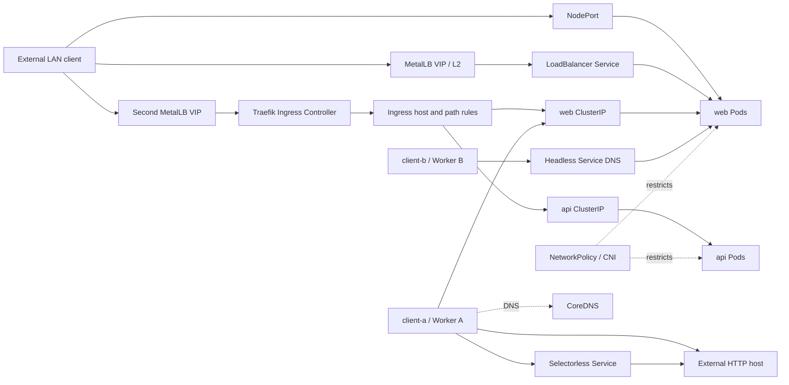

<h1 dir="rtl" align="right">‏پروژه جامع ⁦Kubernetes Networking⁩ | ⁦Enterprise Lab⁩‏</h1>

<p dir="rtl" align="right">‏سطح: ⁦Beginner⁩ تا ⁦Advanced⁩ — محیط: ⁦kubeadm⁩ با یک ⁦Control Plane⁩ و دو ⁦Worker⁩ — سناریو: تیم ⁦Platform⁩ فروشگاه آنلاین باید ارتباط داخلی، دسترسی خارجی، ⁦Service Discovery⁩، ⁦HTTP Routing⁩ و جداسازی ترافیک را پیاده‌سازی کند.‏</p>

<p dir="rtl" align="right">‏این فایل ۲۶ مرحله دارد. بخش اول فقط خواسته‌ها و معیار پذیرش است؛ بخش دوم شامل پاسخ‌های بسته، ⁦Manifest⁩ کامل، ⁦Command⁩، نکته فنی، ⁦Troubleshooting⁩ و ⁦Interview Q⁩&amp;⁦A⁩ است. فایل را در ⁦GitHub⁩ باز کن؛ ⁦Font⁩ و ⁦CSS⁩ تحت کنترل ⁦Renderer⁩ هستند.‏</p>

<h2 dir="rtl" align="right">‏فهرست مطالب‏</h2>

<div dir="rtl" align="right">

- [‏بخش اول — سناریو و چالش‌ها‏](#part-1)
- [‏بخش دوم — پاسخ‌نامه و نکات فنی‏](#part-2)
- [‏اعتبارسنجی و ⁦Cleanup⁩‏](#final-validation)
- [‏مرحله ⁦01⁩ — ⁦Cluster Preparation⁩ & ⁦Network Inventory⁩‏](#phase-01)
- [‏مرحله ⁦02⁩ — ⁦Pod-to-Pod Communication⁩ & ⁦Cross-node⁩‏](#phase-02)
- [‏مرحله ⁦03⁩ — ⁦ClusterIP⁩, ⁦Named Port⁩ & ⁦Service Discovery⁩‏](#phase-03)
- [‏مرحله ⁦04⁩ — ⁦EndpointSlice⁩, ⁦Selector⁩ & ⁦Readiness⁩‏](#phase-04)
- [‏مرحله ⁦05⁩ — ⁦Headless Service⁩ & ⁦DNS Records⁩‏](#phase-05)
- [‏مرحله ⁦06⁩ — ⁦NodePort⁩ & ⁦External-to-Pod⁩‏](#phase-06)
- [‏مرحله ⁦07⁩ — ⁦Port Forwarding⁩ & ⁦Debug Access⁩‏](#phase-07)
- [‏مرحله ⁦08⁩ — ⁦Pod-to-External Communication⁩ & ⁦Egress⁩‏](#phase-08)
- [‏مرحله ⁦09⁩ — ⁦ExternalName⁩ & ⁦DNS Alias⁩‏](#phase-09)
- [‏مرحله ⁦10⁩ — ⁦Selectorless Service⁩ & ⁦External Backend⁩‏](#phase-10)
- [‏مرحله ⁦11⁩ — ⁦ExternalIPs Service⁩ — ⁦Legacy⁩ & ⁦Deprecation⁩‏](#phase-11)
- [‏مرحله ⁦12⁩ — ⁦LoadBalancer⁩ & ⁦MetalLB Installation⁩‏](#phase-12)
- [‏مرحله ⁦13⁩ — ⁦MetalLB Layer 2⁩ & ⁦IPAddressPool⁩‏](#phase-13)
- [‏مرحله ⁦14⁩ — ⁦MetalLB Troubleshooting⁩ & ⁦Traffic Policies⁩‏](#phase-14)
- [‏مرحله ⁦15⁩ — ⁦Service Advanced Settings⁩‏](#phase-15)
- [‏مرحله ⁦16⁩ — ⁦Ingress Controller⁩ & ⁦IngressClass⁩‏](#phase-16)
- [‏مرحله ⁦17⁩ — ⁦Ingress Host⁩ & ⁦Path Routing⁩‏](#phase-17)
- [‏مرحله ⁦18⁩ — ⁦Ingress TLS⁩ & ⁦HTTPS⁩‏](#phase-18)
- [‏مرحله ⁦19⁩ — ⁦Ingress Troubleshooting⁩ & ⁦Exact Path⁩‏](#phase-19)
- [‏مرحله ⁦20⁩ — ⁦NetworkPolicy Baseline⁩ & ⁦Default Deny Ingress⁩‏](#phase-20)
- [‏مرحله ⁦21⁩ — ⁦Ingress Allow Rules⁩ & ⁦Pod Selector⁩‏](#phase-21)
- [‏مرحله ⁦22⁩ — ⁦NamespaceSelector⁩, ⁦AND/OR⁩ & ⁦Ingress Controller Access⁩‏](#phase-22)
- [‏مرحله ⁦23⁩ — ⁦Default Deny Egress⁩ & ⁦DNS Allow⁩‏](#phase-23)
- [‏مرحله ⁦24⁩ — ⁦Egress Pod Allow⁩ & ⁦ipBlock⁩ / ⁦except⁩‏](#phase-24)
- [‏مرحله ⁦25⁩ — ⁦NetworkPolicy Advanced Semantics⁩ & ⁦Validation Matrix⁩‏](#phase-25)
- [‏مرحله ⁦26⁩ — ⁦Multi-port Service⁩ & ⁦Protocols⁩‏](#phase-26)

</div>

<h2 dir="rtl" align="right">‏معماری پروژه‏</h2>

<div dir="ltr" align="left">



</div>

<p dir="rtl" align="right">‏معماری منطقی است؛ توزیع دقیق ⁦Pod⁩ها به ⁦Scheduler⁩ و ظرفیت ⁦Worker⁩ها وابسته است. در مراحل امنیتی مسیرهای اولیه عمداً محدود می‌شوند.‏</p>

<h2 dir="rtl" align="right">‏پیش‌نیازها و محدودیت‌ها‏</h2>

<div dir="rtl" align="right">

- [ ] ‏⁦Cluster⁩ آزمایشی و غیر ⁦Production⁩؛ دسترسی ⁦kubectl⁩ و مجوز نصب ⁦Add-on⁩ فقط در صورت نیاز.‏
- [ ] ‏دو ⁦Worker⁩ قابل استفاده با ⁦CNI⁩ سالم؛ برای مرحله ⁦NetworkPolicy⁩ پشتیبانی واقعی ⁦CNI⁩ الزامی است.‏
- [ ] ‏یک ⁦Client⁩ خارج از ⁦Cluster⁩ روی ⁦LAN⁩ قابل ⁦Route⁩؛ برای ⁦MetalLB⁩ حالت ⁦L2⁩، دسترسی ⁦Layer 2⁩ مناسب و دو ⁦IP⁩ آزاد رزروشده خارج از ⁦DHCP.⁩‏
- [ ] ‏دسترسی ⁦Registry⁩، ⁦Bash⁩، ⁦curl⁩، ⁦Python 3⁩ روی سیستم خارجی، ⁦Helm⁩ برای نصب ⁦Traefik⁩ و ⁦OpenSSL⁩ برای ⁦TLS.⁩‏
- [ ] ‏هیچ ⁦IP⁩ نمونه‌ای را بدون جایگزینی با مقادیر واقعی اعمال نکن. به ⁦IP⁩های عمومی، ⁦Pod CIDR⁩ یا ⁦Service CIDR⁩ به‌عنوان ⁦Pool⁩ دست نزن.‏
- [ ] ‏اگر ⁦Cluster⁩ اشتراکی یا ⁦Policy⁩ نصب ⁦Add-on⁩ محدود است، مراحل مربوط را با مجوز یا به‌صورت مفهومی دنبال کن؛ تنظیمات سراسری شبکه را تغییر نده.‏

</div>

> [!IMPORTANT]
> ‏فقط در ⁦Cluster⁩ آزمایشی و ⁦LAN⁩ مجاز اجرا کن. ⁦NodePort⁩ و ⁦LoadBalancer⁩ ممکن است سرویس را در دسترس دیگران قرار دهند؛ از انتشار عمومی خودداری کن.‏

<p dir="rtl" align="right">‏عبارت ⁦External User Service⁩ را به دو مفهوم کاربردی ⁦ExternalName⁩ و ⁦Selectorless Service⁩ برای ⁦Backend⁩ خارج از ⁦Cluster⁩ تفسیر کرده‌ام؛ ارتباط کاربر خارجی با ⁦Pod⁩ نیز به‌صورت جداگانه پوشش داده شده است. ⁦externalIPs⁩ یک نوع ⁦Service⁩ مستقل نیست.‏</p>

<a name="part-1"></a>

<h2 dir="rtl" align="right">‏بخش اول — سناریو و چالش‌ها‏</h2>

<p dir="rtl" align="right">‏هر مرحله مکمل مرحله قبلی است. همه ⁦Resource⁩ها را تا زمان مشخص‌شده نگه دار. معیارهای پذیرش را با مشاهده وضعیت و رفتار واقعی بررسی کن؛ پاسخ‌ها را فقط پس از تلاش خودت باز کن.‏</p>

<a name="phase-01"></a>

<h3 dir="rtl" align="right">‏مرحله ⁦01⁩ — ⁦Cluster Preparation⁩ &amp; ⁦Network Inventory⁩‏</h3>

<p dir="rtl" align="right">‏هدف: شناسایی مسیرهای واقعی شبکه و ایجاد محیط ایزوله.‏</p>

<h4 dir="rtl" align="right">‏وظایف و تنظیمات موردنیاز‏</h4>

<div dir="rtl" align="right">

- [ ] ‏یک ⁦Control Plane⁩ و دو ⁦Worker⁩ سالم را شناسایی کن؛ نام ⁦Node⁩، ⁦Hostname Label⁩، ⁦Node IP⁩، ⁦Pod CIDR⁩ و ⁦Service CIDR⁩ را ثبت کن.‏
- [ ] ‏دو ⁦Namespace⁩ با نام‌های ⁦`net-lab`⁩ و ⁦`net-other`⁩ بساز؛ اگر از قبل وجود دارند ادامه نده.‏
- [ ] ‏نوع ⁦CNI⁩، حالت ⁦Service Proxy⁩، ⁦CoreDNS⁩، قابلیت ⁦NetworkPolicy⁩، شبکه ⁦LAN⁩ و مسیر دسترسی ⁦Client⁩ خارجی را مشخص کن.‏
- [ ] ‏برای ⁦MetalLB⁩ حداقل دو ⁦IP⁩ آزاد و رزروشده خارج از ⁦DHCP⁩ در ⁦LAN⁩ انتخاب کن؛ ⁦IP⁩ واقعی را از مدیر شبکه بگیر. یک سیستم خارجی قابل دسترسی برای ⁦HTTP⁩ آزمایشی در نظر بگیر.‏

</div>

<p dir="rtl" align="right">‏معیار پذیرش: هر سه ⁦Node⁩ سالم، ⁦Namespace⁩ها تازه و اطلاعات شبکه ثبت شده باشند.‏</p>

---

<a name="phase-02"></a>

<h3 dir="rtl" align="right">‏مرحله ⁦02⁩ — ⁦Pod-to-Pod Communication⁩ &amp; ⁦Cross-node⁩‏</h3>

<p dir="rtl" align="right">‏هدف: آزمون ارتباط مستقیم بدون ⁦Service.⁩‏</p>

<h4 dir="rtl" align="right">‏وظایف و تنظیمات موردنیاز‏</h4>

<div dir="rtl" align="right">

- [ ] ‏دو ⁦Deployment⁩ به نام‌های ⁦`web`⁩ و ⁦`api`⁩ در ⁦net-lab⁩ بساز؛ هرکدام دو ⁦Replica⁩، ⁦Nginx⁩ نسخه ⁦1.28.0-alpine⁩ و ⁦TCP/80⁩ داشته باشند؛ پاسخ ⁦HTTP⁩ نام برنامه و ⁦Pod⁩ را نمایش دهد.‏
- [ ] ‏سه ⁦Pod⁩ آزمایشی با نام‌های ⁦`client-a`⁩، ⁦`client-b`⁩ و ⁦`outsider`⁩ با ⁦Image⁩ برابر ⁦busybox:1.36.1⁩ ایجاد کن؛ دو ⁦Client⁩ روی دو ⁦Worker⁩ متفاوت و ⁦outsider⁩ در ⁦net-other⁩ باشد.‏
- [ ] ‏ارتباط مستقیم ⁦HTTP⁩ با ⁦Pod IP⁩ روی همان ⁦Node⁩ و ⁦Node⁩ دیگر را بررسی کن. یک ⁦Pod⁩ وب را حذف کن و تغییر هویت/⁦IP⁩ احتمالی را ثبت کن.‏
- [ ] ‏مسیر ارتباط ⁦Container⁩های داخل یک ⁦Pod⁩ و بین ⁦Pod⁩ها را از نظر ⁦Network Namespace⁩ توضیح بده.‏

</div>

<p dir="rtl" align="right">‏معیار پذیرش: ⁦HTTP⁩ مستقیم از هر دو ⁦Worker⁩ برقرار باشد؛ حذف ⁦Pod⁩ توسط ⁦Deployment⁩ جبران شود.‏</p>

---

<a name="phase-03"></a>

<h3 dir="rtl" align="right">‏مرحله ⁦03⁩ — ⁦ClusterIP⁩, ⁦Named Port⁩ &amp; ⁦Service Discovery⁩‏</h3>

<p dir="rtl" align="right">‏هدف: ایجاد نقطه دسترسی پایدار داخلی.‏</p>

<h4 dir="rtl" align="right">‏وظایف و تنظیمات موردنیاز‏</h4>

<div dir="rtl" align="right">

- [ ] ‏دو ⁦Service⁩ با نام‌های ⁦`web`⁩ و ⁦`api`⁩ از نوع ⁦ClusterIP⁩ ایجاد کن؛ ⁦Service Port⁩ برابر ⁦8080⁩ و ⁦Target Port⁩ با نام ⁦http⁩ باشد.‏
- [ ] ‏دسترسی از هر دو ⁦Client⁩ با ⁦IP⁩ سرویس، نام کوتاه و ⁦DNS⁩ کامل را بررسی کن؛ دسترسی ⁦outsider⁩ با نام دارای ⁦Namespace⁩ را نیز بررسی کن.‏
- [ ] ‏چند اتصال مستقل برقرار کن و ⁦Backend⁩ها را مشاهده کن؛ یک ⁦Pod⁩ وب را جایگزین کن و ثابت ماندن ⁦ClusterIP⁩ را تأیید کن.‏

</div>

<p dir="rtl" align="right">‏معیار پذیرش: ⁦DNS⁩ و ⁦HTTP⁩ داخلی کار کنند و ⁦ClusterIP⁩ پس از ⁦Replacement⁩ ثابت باشد.‏</p>

---

<a name="phase-04"></a>

<h3 dir="rtl" align="right">‏مرحله ⁦04⁩ — ⁦EndpointSlice⁩, ⁦Selector⁩ &amp; ⁦Readiness⁩‏</h3>

<p dir="rtl" align="right">‏هدف: شناخت ارتباط ⁦Service⁩ و ⁦Backend⁩ و رفع خطا.‏</p>

<h4 dir="rtl" align="right">‏وظایف و تنظیمات موردنیاز‏</h4>

<div dir="rtl" align="right">

- [ ] ‏⁦EndpointSlice⁩ مربوط به ⁦web⁩ را بررسی کن و ⁦IP⁩، ⁦Port⁩ و ⁦Conditions⁩ را ثبت کن.‏
- [ ] ‏⁦Selector⁩ سرویس ⁦web⁩ را عمداً نامعتبر کن؛ ⁦DNS⁩ باید باقی بماند اما ⁦HTTP⁩ شکست بخورد. سپس بازیابی کن.‏
- [ ] ‏روی یک ⁦Pod⁩ وب فایل ⁦index⁩ را موقتاً از دسترس خارج کن تا ⁦Readiness⁩ شکست بخورد. حذف آن از مجموعه ⁦Backend⁩های ⁦Ready⁩ را مشاهده و وضعیت را بازیابی کن.‏

</div>

<p dir="rtl" align="right">‏معیار پذیرش: پس از بازیابی دو ⁦Endpoint⁩ آماده وجود داشته باشد و ⁦HTTP⁩ کار کند.‏</p>

---

<a name="phase-05"></a>

<h3 dir="rtl" align="right">‏مرحله ⁦05⁩ — ⁦Headless Service⁩ &amp; ⁦DNS Records⁩‏</h3>

<p dir="rtl" align="right">‏هدف: دسترسی مستقیم به ⁦Backend⁩ها از طریق ⁦DNS.⁩‏</p>

<h4 dir="rtl" align="right">‏وظایف و تنظیمات موردنیاز‏</h4>

<div dir="rtl" align="right">

- [ ] ‏یک ⁦Headless Service⁩ با نام ⁦`web-headless`⁩، بدون ⁦ClusterIP⁩ و با ⁦Selector web⁩ و ⁦Port⁩ نام‌دار ⁦http⁩ روی ⁦80⁩ بساز.‏
- [ ] ‏⁦A Record⁩های ⁦web⁩ و ⁦web-headless⁩ و ⁦SRV Record⁩ پورت نام‌دار را مقایسه کن.‏
- [ ] ‏پاسخ ⁦HTTP⁩ و تغییر رکوردها پس از ⁦Replacement⁩ یک ⁦Pod⁩ را بررسی کن. تفاوت ⁦DNS⁩ پایدار سرویس و هویت پایدار ⁦Pod⁩ در ⁦StatefulSet⁩ را توضیح بده.‏

</div>

<p dir="rtl" align="right">‏معیار پذیرش: ⁦Headless DNS⁩ آدرس ⁦Backend⁩های ⁦Ready⁩ را برگرداند و ⁦Service IP⁩ نداشته باشد.‏</p>

---

<a name="phase-06"></a>

<h3 dir="rtl" align="right">‏مرحله ⁦06⁩ — ⁦NodePort⁩ &amp; ⁦External-to-Pod⁩‏</h3>

<p dir="rtl" align="right">‏هدف: دسترسی از ⁦Client⁩ خارجی از طریق ⁦Node IP.⁩‏</p>

<h4 dir="rtl" align="right">‏وظایف و تنظیمات موردنیاز‏</h4>

<div dir="rtl" align="right">

- [ ] ‏یک ⁦Service⁩ به نام ⁦`web-nodeport`⁩ ایجاد کن؛ ⁦Port=8080⁩، ⁦Target Port=http⁩ و ⁦NodePort=30080⁩؛ فقط در صورت آزاد بودن ⁦Port.⁩‏
- [ ] ‏از سیستم خارج از ⁦Cluster⁩ به ⁦IP⁩ هر ⁦Worker⁩ و ⁦Port 30080⁩ درخواست ⁦HTTP⁩ بفرست.‏
- [ ] ‏رفتار در ⁦Node⁩ بدون ⁦Backend⁩ محلی را با ⁦externalTrafficPolicy⁩ از نوع ⁦Cluster⁩ و ⁦Local⁩ مقایسه کن؛ برای آزمایش قطعی موقتاً ⁦web⁩ را تک ⁦Replica⁩ کن و بعد به دو برگردان.‏

</div>

<p dir="rtl" align="right">‏معیار پذیرش: با ⁦Cluster⁩ از هر ⁦Worker⁩ قابل دسترسی باشد و با ⁦Local⁩ فقط ⁦Node⁩ دارای ⁦Backend⁩ محلی پاسخ دهد (در صورت مسیر و ⁦Firewall⁩ مناسب).‏</p>

---

<a name="phase-07"></a>

<h3 dir="rtl" align="right">‏مرحله ⁦07⁩ — ⁦Port Forwarding⁩ &amp; ⁦Debug Access⁩‏</h3>

<p dir="rtl" align="right">‏هدف: آزمون دسترسی موقت از مسیر ⁦API Server.⁩‏</p>

<h4 dir="rtl" align="right">‏وظایف و تنظیمات موردنیاز‏</h4>

<div dir="rtl" align="right">

- [ ] ‏برای یک ⁦Pod⁩ وب و ⁦Service web⁩ به ترتیب ⁦Local Port⁩های ⁦18080⁩ و ⁦18082⁩ باز کن؛ فقط ⁦Loopback.⁩‏
- [ ] ‏از سیستم اجراکننده ⁦kubectl⁩ درخواست ⁦HTTP⁩ بفرست. ⁦Pod⁩ هدف را حذف و قطع شدن ⁦Session⁩ را مشاهده کن؛ دوباره ارتباط بگیر.‏
- [ ] ‏تفاوت این روش با ⁦NodePort⁩ از نظر مسیر، عمر ⁦Session⁩ و ⁦Load Balancing⁩ را ثبت کن.‏

</div>

<p dir="rtl" align="right">‏معیار پذیرش: هر دو ⁦Forward⁩ پاسخ بدهند و پس از قطع ⁦Session⁩ دسترسی بسته شود.‏</p>

---

<a name="phase-08"></a>

<h3 dir="rtl" align="right">‏مرحله ⁦08⁩ — ⁦Pod-to-External Communication⁩ &amp; ⁦Egress⁩‏</h3>

<p dir="rtl" align="right">‏هدف: آزمون خروج از ⁦Cluster⁩ و بررسی ⁦SNAT.⁩‏</p>

<h4 dir="rtl" align="right">‏وظایف و تنظیمات موردنیاز‏</h4>

<div dir="rtl" align="right">

- [ ] ‏روی سیستم ⁦Linux⁩ جدا از ⁦Node⁩ها، با ⁦IP⁩ رزروشده و قابل ⁦Route⁩ یک ⁦HTTP Server⁩ موقت روی ⁦TCP/18090⁩ راه‌اندازی کن؛ پاسخ ⁦lab-external⁩ باشد.‏
- [ ] ‏از ⁦client-a⁩ و ⁦client-b⁩ به ⁦IP⁩ خارجی وصل شو؛ ⁦Source IP⁩ مشاهده‌شده در ⁦Log⁩ سرور را ثبت کن.‏
- [ ] ‏دسترسی ⁦DNS⁩ و ⁦HTTPS⁩ اینترنت را در صورت وجود اینترنت خروجی و مجاز بودن آن بررسی کن؛ تفاوت اتصال آغازشده از ⁦Pod⁩ و از ⁦Client⁩ خارجی را شرح بده.‏

</div>

<p dir="rtl" align="right">‏معیار پذیرش: هر دو ⁦Pod⁩ به ⁦HTTP Server⁩ خارجی برسند؛ ⁦Source IP⁩ واقعی ثبت شود.‏</p>

---

<a name="phase-09"></a>

<h3 dir="rtl" align="right">‏مرحله ⁦09⁩ — ⁦ExternalName⁩ &amp; ⁦DNS Alias⁩‏</h3>

<p dir="rtl" align="right">‏هدف: معرفی سرویس خارجی با ⁦DNS Alias.⁩‏</p>

<h4 dir="rtl" align="right">‏وظایف و تنظیمات موردنیاز‏</h4>

<div dir="rtl" align="right">

- [ ] ‏یک ⁦Service⁩ از نوع ⁦ExternalName⁩ به نام ⁦`public-alias`⁩ با مقصد ⁦example.com⁩ بساز.‏
- [ ] ‏⁦CNAME⁩ و ⁦Resolution⁩ را بررسی کن؛ اتصال ⁦HTTPS⁩ با نام واقعی مقصد را با ⁦Alias⁩ مقایسه کن.‏
- [ ] ‏بررسی کن این ⁦Service⁩ فاقد ⁦Selector⁩، ⁦ClusterIP⁩ و ⁦EndpointSlice⁩ مدیریت‌شده است.‏

</div>

<p dir="rtl" align="right">‏معیار پذیرش: ⁦DNS Alias⁩ به مقصد درست ⁦Resolve⁩ شود؛ موفقیت ⁦HTTP/TLS⁩ وابسته به مقصد و ⁦Hostname⁩ است.‏</p>

---

<a name="phase-10"></a>

<h3 dir="rtl" align="right">‏مرحله ⁦10⁩ — ⁦Selectorless Service⁩ &amp; ⁦External Backend⁩‏</h3>

<p dir="rtl" align="right">‏هدف: اتصال داخلی به ⁦Backend⁩ خارج از ⁦Cluster⁩ با ⁦EndpointSlice⁩ دستی.‏</p>

<h4 dir="rtl" align="right">‏وظایف و تنظیمات موردنیاز‏</h4>

<div dir="rtl" align="right">

- [ ] ‏یک ⁦ClusterIP Service⁩ بدون ⁦Selector⁩ به نام ⁦`legacy-http`⁩ روی ⁦8080⁩ بساز؛ ⁦EndpointSlice⁩ دستی به ⁦IP⁩ سیستم خارجی و ⁦Port 18090⁩ اشاره کند.‏
- [ ] ‏ارتباط از هر دو ⁦Client⁩ را بررسی کن؛ تغییر ⁦Backend Port⁩ به مقدار نامعتبر و بازیابی آن را آزمایش کن.‏
- [ ] ‏مالکیت و مسئولیت نگهداری ⁦EndpointSlice⁩ و تفاوت آن با ⁦ExternalName⁩ را شرح بده.‏

</div>

<p dir="rtl" align="right">‏معیار پذیرش: درخواست داخلی از ⁦legacy-http⁩ به سرور خارجی برسد و پس از رفع خطای ⁦Port⁩ بازیابی شود.‏</p>

---

<a name="phase-11"></a>

<h3 dir="rtl" align="right">‏مرحله ⁦11⁩ — ⁦ExternalIPs Service⁩ — ⁦Legacy⁩ &amp; ⁦Deprecation⁩‏</h3>

<p dir="rtl" align="right">‏هدف: آشنایی با قابلیت قدیمی به صورت مشروط و ایزوله.‏</p>

<h4 dir="rtl" align="right">‏وظایف و تنظیمات موردنیاز‏</h4>

<div dir="rtl" align="right">

- [ ] ‏تفاوت ستون ⁦EXTERNAL-IP⁩ با فیلد ⁦externalIPs⁩ را مشخص کن. برای آزمایش فقط در ⁦Cluster⁩ کاملاً آزمایشی و با مجوز، یک ⁦IP⁩ اختصاصی رزروشده و از قبل ⁦Route⁩ شده به ⁦Node⁩ انتخاب کن؛ این ⁦IP⁩ نباید متعلق به سرویس دیگر باشد.‏
- [ ] ‏⁦Service⁩ به نام ⁦`legacy-external-ip`⁩ با ⁦Port=18081⁩ و ⁦Target Port=http⁩ تعریف کن. در نسخه فاقد پشتیبانی یا در صورت منع ⁦Admission⁩ صرفاً نتیجه بررسی را ثبت کن؛ تنظیم امنیتی را تغییر نده.‏
- [ ] ‏پس از آزمایش بلافاصله ⁦Resource⁩ را حذف کن.‏

</div>

<p dir="rtl" align="right">‏معیار پذیرش: مفهوم ⁦Routing⁩ از قبل موجود و عدم تخصیص ⁦IP⁩ توسط ⁦Kubernetes⁩ درک شود؛ اجرای مشروط یا رد ایمن ثبت شود.‏</p>

---

<a name="phase-12"></a>

<h3 dir="rtl" align="right">‏مرحله ⁦12⁩ — ⁦LoadBalancer⁩ &amp; ⁦MetalLB Installation⁩‏</h3>

<p dir="rtl" align="right">‏هدف: بررسی تخصیص ⁦IP⁩ در ⁦Bare Metal⁩ و آماده‌سازی ⁦Add-on.⁩‏</p>

<h4 dir="rtl" align="right">‏وظایف و تنظیمات موردنیاز‏</h4>

<div dir="rtl" align="right">

- [ ] ‏بررسی کن آیا ⁦LoadBalancer Controller⁩ یا ⁦MetalLB⁩ از قبل نصب است. اگر نصب نیست، یک ⁦Service⁩ به نام ⁦`web-lb`⁩ از نوع ⁦LoadBalancer⁩، ⁦Port=80⁩ و ⁦Target Port=http⁩ بساز و وضعیت ⁦IP⁩ را قبل از نصب مشاهده کن.‏
- [ ] ‏در ⁦Cluster⁩ آزمایشی و با مجوز، نسخه سازگار ⁦MetalLB⁩ را در حالت ⁦Native⁩ نصب کن؛ اگر ⁦Controller⁩ دیگری فعال است نصب موازی انجام نده.‏
- [ ] ‏⁦Controller⁩، ⁦Speaker⁩، ⁦CRD⁩ها و ⁦Events⁩ را بررسی کن. در این مرحله هنوز ⁦Pool⁩ ایجاد نکن.‏

</div>

<p dir="rtl" align="right">‏معیار پذیرش: ⁦MetalLB⁩ سالم باشد و علت ⁦Pending⁩ بودن ⁦Service⁩ قبل از تخصیص ⁦Pool⁩ مشخص شود.‏</p>

---

<a name="phase-13"></a>

<h3 dir="rtl" align="right">‏مرحله ⁦13⁩ — ⁦MetalLB Layer 2⁩ &amp; ⁦IPAddressPool⁩‏</h3>

<p dir="rtl" align="right">‏هدف: تخصیص و اعلان ⁦IP⁩های آزمایشی روی ⁦LAN.⁩‏</p>

<h4 dir="rtl" align="right">‏وظایف و تنظیمات موردنیاز‏</h4>

<div dir="rtl" align="right">

- [ ] ‏یک ⁦IPAddressPool⁩ با نام ⁦`net-lab-pool`⁩ و دو ⁦IP⁩ آزاد رزروشده ایجاد کن؛ تخصیص خودکار برای ⁦Service⁩های دیگر فعال نباشد.‏
- [ ] ‏یک ⁦L2Advertisement⁩ به نام ⁦`net-lab-l2`⁩ بساز که فقط همین ⁦Pool⁩ را اعلان کند.‏
- [ ] ‏⁦IP Service web-lb⁩ را بررسی کن و از ⁦Client⁩ خارجی روی همان ⁦LAN⁩ به آن ⁦HTTP⁩ بفرست؛ ⁦MAC⁩ اعلان‌کننده را از جدول ⁦Neighbor/ARP⁩ بررسی کن.‏
- [ ] ‏تفاوت ⁦ARP/NDP⁩، ⁦Leader⁩ در ⁦L2⁩ و توزیع واقعی اتصال توسط ⁦Service Proxy⁩ را ثبت کن.‏

</div>

<p dir="rtl" align="right">‏معیار پذیرش: ⁦web-lb⁩ یکی از دو ⁦IP⁩ مجاز را دریافت کند و از ⁦LAN⁩ قابل دسترسی باشد.‏</p>

---

<a name="phase-14"></a>

<h3 dir="rtl" align="right">‏مرحله ⁦14⁩ — ⁦MetalLB Troubleshooting⁩ &amp; ⁦Traffic Policies⁩‏</h3>

<p dir="rtl" align="right">‏هدف: رفع خطاهای تخصیص و اعلان و مقایسه مسیرها.‏</p>

<h4 dir="rtl" align="right">‏وظایف و تنظیمات موردنیاز‏</h4>

<div dir="rtl" align="right">

- [ ] ‏یک ⁦LoadBalancer Service⁩ با نام ⁦`lb-broken`⁩ بساز که ⁦Pool⁩ ناموجود درخواست کند؛ علت ⁦Pending⁩ را از ⁦Events⁩ مشخص کن و سپس ⁦Resource⁩ را حذف کن.‏
- [ ] ‏با ⁦web-lb⁩ و یک ⁦Replica⁩ وب، حالت ⁦Cluster⁩ و ⁦Local⁩ را مقایسه کن؛ ⁦Node⁩ اعلان‌کننده و ⁦Source IP⁩ ثبت‌شده در ⁦Nginx⁩ را مشاهده کن.‏
- [ ] ‏در صورت امکان و با مجوز، جابه‌جایی ⁦Leader⁩ را فقط با مشاهده تغییرات طبیعی یا حذف ⁦Pod⁩ وب آزمایش کن؛ ⁦Node⁩ یا ⁦Speaker⁩ را از کار نینداز. در پایان دو ⁦Replica⁩ و حالت ⁦Cluster⁩ را برگردان.‏

</div>

<p dir="rtl" align="right">‏معیار پذیرش: خطای ⁦Pool⁩ ثبت شود، ⁦web-lb⁩ سالم بماند و تفاوت ⁦Local⁩ و ⁦Cluster⁩ توضیح داده شود.‏</p>

---

<a name="phase-15"></a>

<h3 dir="rtl" align="right">‏مرحله ⁦15⁩ — ⁦Service Advanced Settings⁩‏</h3>

<p dir="rtl" align="right">‏هدف: شناخت تنظیمات توزیع اتصال و محدودیت‌های ⁦Proxy.⁩‏</p>

<h4 dir="rtl" align="right">‏وظایف و تنظیمات موردنیاز‏</h4>

<div dir="rtl" align="right">

- [ ] ‏روی ⁦ClusterIP web⁩، ⁦sessionAffinity⁩ از نوع ⁦ClientIP⁩ با ⁦timeout=60⁩ تنظیم کن و چند اتصال از ⁦Client⁩ ثابت مشاهده کن؛ سپس به ⁦None⁩ برگردان.‏
- [ ] ‏⁦internalTrafficPolicy=Local⁩ را با یک ⁦Replica⁩ وب و دو ⁦Client⁩ روی ⁦Worker⁩های متفاوت آزمایش کن؛ سپس به ⁦Cluster⁩ و دو ⁦Replica⁩ برگردان.‏
- [ ] ‏مفهوم ⁦ipFamilyPolicy⁩، ⁦ipFamilies⁩، ⁦allocateLoadBalancerNodePorts⁩، ⁦loadBalancerClass⁩، ⁦loadBalancerSourceRanges⁩، ⁦healthCheckNodePort⁩ و ⁦trafficDistribution⁩ را بررسی کن؛ فقط قابلیت‌هایی را اجرا کن که ⁦Cluster⁩ پشتیبانی می‌کند و نیاز به تغییر شبکه ندارد.‏

</div>

<p dir="rtl" align="right">‏معیار پذیرش: ⁦Affinity⁩ و مسیر محلی مشاهده و وضعیت اولیه بازگردانده شود.‏</p>

---

<a name="phase-16"></a>

<h3 dir="rtl" align="right">‏مرحله ⁦16⁩ — ⁦Ingress Controller⁩ &amp; ⁦IngressClass⁩‏</h3>

<p dir="rtl" align="right">‏هدف: استقرار ⁦Controller⁩ فعال برای ⁦HTTP Routing.⁩‏</p>

<h4 dir="rtl" align="right">‏وظایف و تنظیمات موردنیاز‏</h4>

<div dir="rtl" align="right">

- [ ] ‏وجود ⁦Ingress Controller⁩ و ⁦IngressClass⁩ قبلی را بررسی کن؛ در ⁦Cluster⁩ آزمایشی یک ⁦Traefik⁩ مستقل با ⁦Release⁩ ⁦`netlab-traefik`⁩ در ⁦Namespace⁩ ⁦`net-ingress`⁩ و ⁦IngressClass⁩ همنام غیرپیش‌فرض ایجاد کن.‏
- [ ] ‏⁦Service⁩ کنترلر از نوع ⁦LoadBalancer⁩ و از ⁦Pool⁩ آزمایشی باشد؛ در صورت نبود ⁦L2⁩ از ⁦Port Forward⁩ محلی برای ادامه ⁦Ingress⁩ استفاده کن.‏
- [ ] ‏وضعیت ⁦Controller⁩، ⁦RBAC⁩، ⁦IngressClass⁩ و ⁦IP⁩ را بررسی کن. نصب موازی فقط با ⁦Class⁩ مستقل و مجوز مدیر مجاز است.‏

</div>

<p dir="rtl" align="right">‏معیار پذیرش: ⁦Controller⁩ آماده و ⁦Class⁩ مشخص باشد؛ ⁦IP⁩ دوم ⁦Pool⁩ یا مسیر ⁦Port Forward⁩ برای تست فراهم شود.‏</p>

---

<a name="phase-17"></a>

<h3 dir="rtl" align="right">‏مرحله ⁦17⁩ — ⁦Ingress Host⁩ &amp; ⁦Path Routing⁩‏</h3>

<p dir="rtl" align="right">‏هدف: ورود چند برنامه از یک ⁦IP⁩ و ⁦L7 Routing.⁩‏</p>

<h4 dir="rtl" align="right">‏وظایف و تنظیمات موردنیاز‏</h4>

<div dir="rtl" align="right">

- [ ] ‏⁦Ingress⁩ با نام ⁦`store-ingress`⁩ در ⁦net-lab⁩ و ⁦Class⁩ برابر ⁦netlab-traefik⁩ ایجاد کن؛ ⁦Host shop.lab.test⁩ با ⁦Prefix⁩ / به ⁦web:8080⁩ و ⁦Prefix⁩ /⁦api⁩ به ⁦api:8080⁩؛ ⁦Host api.lab.test⁩ با / به ⁦api:8080.⁩‏
- [ ] ‏از ⁦Client⁩ خارجی با ⁦Host Header⁩ یا ⁦DNS⁩ آزمایشی هر سه مسیر را بررسی کن. ⁦Host⁩ نامعتبر را هم آزمایش کن.‏
- [ ] ‏رفتار ⁦Prefix⁩، ⁦Exact⁩، ⁦ImplementationSpecific⁩، ⁦Wildcard Host⁩ و ⁦Default Backend⁩ را بررسی کن؛ از ⁦Rewrite⁩ وابسته به ⁦Controller⁩ استفاده نکن.‏

</div>

<p dir="rtl" align="right">‏معیار پذیرش: هر ⁦Host⁩ و ⁦Path⁩ به ⁦Backend⁩ موردنظر برسد و ⁦Host⁩ ناشناس ⁦Route⁩ مشخص نداشته باشد.‏</p>

---

<a name="phase-18"></a>

<h3 dir="rtl" align="right">‏مرحله ⁦18⁩ — ⁦Ingress TLS⁩ &amp; ⁦HTTPS⁩‏</h3>

<p dir="rtl" align="right">‏هدف: آزمون ⁦TLS Termination⁩ و اعتبارسنجی ⁦Certificate.⁩‏</p>

<h4 dir="rtl" align="right">‏وظایف و تنظیمات موردنیاز‏</h4>

<div dir="rtl" align="right">

- [ ] ‏یک ⁦Certificate⁩ آزمایشی با ⁦SAN⁩ برای ⁦shop.lab.test⁩ و ⁦api.lab.test⁩ ایجاد کن و ⁦Secret⁩ از نوع ⁦TLS⁩ به نام ⁦`store-tls`⁩ در ⁦net-lab⁩ بساز.‏
- [ ] ‏⁦Ingress⁩ را برای ⁦HTTPS⁩ و ⁦TLS Termination⁩ روی ⁦Controller⁩ تنظیم کن؛ ⁦Client⁩ باید ⁦Certificate⁩ آزمایشی را صراحتاً ⁦Trust⁩ کند.‏
- [ ] ‏تفاوت ⁦TLS Termination⁩، ⁦Passthrough⁩، ⁦Re-encryption⁩ و ⁦Redirect⁩ را شرح بده؛ در پایان ⁦HTTP⁩ اولیه را برای مراحل بعد بازیابی کن.‏

</div>

<p dir="rtl" align="right">‏معیار پذیرش: هر دو ⁦Host⁩ از ⁦HTTPS⁩ با ⁦Certificate⁩ معتبر برای ⁦Lab⁩ پاسخ دهند؛ ⁦HTTP⁩ اولیه بازیابی شود.‏</p>

---

<a name="phase-19"></a>

<h3 dir="rtl" align="right">‏مرحله ⁦19⁩ — ⁦Ingress Troubleshooting⁩ &amp; ⁦Exact Path⁩‏</h3>

<p dir="rtl" align="right">‏هدف: تشخیص خطا در لایه ⁦HTTP⁩ و ⁦Backend.⁩‏</p>

<h4 dir="rtl" align="right">‏وظایف و تنظیمات موردنیاز‏</h4>

<div dir="rtl" align="right">

- [ ] ‏یک ⁦Ingress⁩ موقت با نام ⁦`exact-demo`⁩ و ⁦Host exact.lab.test⁩ بساز که فقط مسیر /⁦api/⁩ از نوع ⁦Exact⁩ را به ⁦api⁩ هدایت کند؛ /⁦api/⁩ و /⁦api/test⁩ را مقایسه کن.‏
- [ ] ‏در ⁦Ingress⁩ اصلی ⁦Service Port⁩ مربوط به ⁦Backend api⁩ را به ⁦9999⁩ تغییر بده؛ علت خطا را شناسایی و بازیابی کن.‏
- [ ] ‏⁦Class⁩ ناموجود را روی ⁦Ingress⁩ موقت امتحان کن، اثر آن را مشاهده و ⁦Resource⁩ موقت را حذف کن.‏

</div>

<p dir="rtl" align="right">‏معیار پذیرش: مسیر ⁦Exact⁩ درست عمل کند و ⁦Ingress⁩ اصلی پس از خطا سالم شود.‏</p>

---

<a name="phase-20"></a>

<h3 dir="rtl" align="right">‏مرحله ⁦20⁩ — ⁦NetworkPolicy Baseline⁩ &amp; ⁦Default Deny Ingress⁩‏</h3>

<p dir="rtl" align="right">‏هدف: اثبات اجرای ⁦Policy⁩ توسط ⁦CNI.⁩‏</p>

<h4 dir="rtl" align="right">‏وظایف و تنظیمات موردنیاز‏</h4>

<div dir="rtl" align="right">

- [ ] ‏قبل از محدودسازی، دسترسی ⁦client-a⁩، ⁦client-b⁩ و ⁦outsider⁩ به ⁦web⁩ و ⁦api⁩ را ثبت کن.‏
- [ ] ‏یک ⁦NetworkPolicy⁩ به نام ⁦`deny-ingress`⁩ بساز که تمام ⁦Pod⁩های ⁦net-lab⁩ را در جهت ⁦Ingress⁩ ایزوله کند؛ هیچ ⁦Rule⁩ مجاز نداشته باشد.‏
- [ ] ‏ارتباط مستقیم به ⁦Pod IP⁩ و ارتباط از طریق ⁦ClusterIP⁩ را با ⁦Timeout⁩ محدود آزمایش کن؛ ⁦egress⁩ به سرور خارجی همچنان مجاز باشد.‏
- [ ] ‏⁦Policy⁩ را نگه دار و فقط اگر ⁦CNI⁩ آن را واقعاً اجرا می‌کند ادامه بده.‏

</div>

<p dir="rtl" align="right">‏معیار پذیرش: دسترسی ورودی به ⁦Backend⁩ از ⁦Client⁩های آزمایشی مسدود و خروج خارجی همچنان برقرار باشد.‏</p>

---

<a name="phase-21"></a>

<h3 dir="rtl" align="right">‏مرحله ⁦21⁩ — ⁦Ingress Allow Rules⁩ &amp; ⁦Pod Selector⁩‏</h3>

<p dir="rtl" align="right">‏هدف: محدودسازی دسترسی داخلی بر اساس هویت ⁦Pod.⁩‏</p>

<h4 dir="rtl" align="right">‏وظایف و تنظیمات موردنیاز‏</h4>

<div dir="rtl" align="right">

- [ ] ‏یک ⁦Policy⁩ به نام ⁦`allow-trusted-web`⁩ برای ⁦Pod⁩های ⁦app=web⁩ ایجاد کن که فقط ⁦Pod⁩های ⁦role=trusted⁩ در همان ⁦Namespace⁩ را روی ⁦TCP/80⁩ مجاز کند.‏
- [ ] ‏⁦client-a⁩ باید به ⁦web⁩ دسترسی داشته باشد؛ ⁦client-b⁩ و ⁦outsider⁩ نباید دسترسی داشته باشند. ⁦API⁩ همچنان بسته بماند.‏
- [ ] ‏تفاوت ⁦Port⁩ سرویس ⁦8080⁩ و ⁦Port⁩ واقعی ⁦Backend 80⁩ را در آزمون ثبت کن.‏

</div>

<p dir="rtl" align="right">‏معیار پذیرش: فقط ⁦Client⁩ مجاز بتواند به ⁦web⁩ روی ⁦Port⁩ واقعی ⁦Backend⁩ دسترسی پیدا کند.‏</p>

---

<a name="phase-22"></a>

<h3 dir="rtl" align="right">‏مرحله ⁦22⁩ — ⁦NamespaceSelector⁩, ⁦AND/OR⁩ &amp; ⁦Ingress Controller Access⁩‏</h3>

<p dir="rtl" align="right">‏هدف: پیاده‌سازی مسیرهای مجاز بین ⁦Namespace⁩ها.‏</p>

<h4 dir="rtl" align="right">‏وظایف و تنظیمات موردنیاز‏</h4>

<div dir="rtl" align="right">

- [ ] ‏یک ⁦Policy⁩ به نام ⁦`allow-ingress-controller`⁩ برای ⁦web⁩ و ⁦api⁩ بساز که فقط ⁦Pod⁩های ⁦Traefik⁩ در ⁦net-ingress⁩ را روی ⁦TCP/80⁩ مجاز کند.‏
- [ ] ‏یک ⁦Policy⁩ به نام ⁦`allow-other-web`⁩ بساز که فقط ⁦outsider⁩ در ⁦net-other⁩ با ⁦role=untrusted⁩ را برای ⁦web⁩ مجاز کند؛ از شرط هم‌زمان ⁦Namespace⁩ و ⁦Pod⁩ استفاده کن.‏
- [ ] ‏دسترسی ⁦Ingress⁩ خارجی و ⁦outsider⁩ به ⁦web⁩ را بررسی کن؛ ⁦client-b⁩ همچنان بسته و ⁦outsider⁩ به ⁦api⁩ ممنوع باشد. سپس ⁦Policy⁩ موقت ⁦allow-other-web⁩ را حذف کن.‏

</div>

<p dir="rtl" align="right">‏معیار پذیرش: ⁦Ingress⁩ خارجی بازیابی و دسترسی بین ⁦Namespace⁩ طبق شرایط محدود شود.‏</p>

---

<a name="phase-23"></a>

<h3 dir="rtl" align="right">‏مرحله ⁦23⁩ — ⁦Default Deny Egress⁩ &amp; ⁦DNS Allow⁩‏</h3>

<p dir="rtl" align="right">‏هدف: کنترل خروج از ⁦Pod⁩ها و بازگرداندن ⁦DNS.⁩‏</p>

<h4 dir="rtl" align="right">‏وظایف و تنظیمات موردنیاز‏</h4>

<div dir="rtl" align="right">

- [ ] ‏یک ⁦Policy⁩ به نام ⁦`deny-egress`⁩ برای تمام ⁦Pod⁩های ⁦net-lab⁩ ایجاد کن. ⁦DNS⁩ و ارتباط ⁦client-a⁩ با ⁦web⁩ باید شکست بخورند؛ اتصال از ⁦Ingress Controller⁩ به ⁦Backend⁩ باید همچنان برقرار باشد.‏
- [ ] ‏یک ⁦Policy⁩ به نام ⁦`allow-dns`⁩ برای همه ⁦Pod⁩ها ایجاد کن که فقط ⁦UDP⁩ و ⁦TCP⁩ پورت ⁦53⁩ به ⁦CoreDNS⁩ در ⁦kube-system⁩ اجازه دهد؛ ⁦Label⁩ واقعی ⁦CoreDNS⁩ را بررسی کن.‏
- [ ] ‏پس از بازیابی ⁦DNS⁩، ⁦HTTP⁩ هنوز باید مسدود باشد. در صورت وجود ⁦NodeLocal DNSCache⁩، مسیر ⁦DNS⁩ واقعی را بررسی و نتیجه را مطابق ⁦CNI⁩ ثبت کن.‏

</div>

<p dir="rtl" align="right">‏معیار پذیرش: ⁦DNS⁩ با ⁦Rule⁩ محدود بازیابی شود؛ خروج ⁦HTTP⁩ هنوز بسته باشد.‏</p>

---

<a name="phase-24"></a>

<h3 dir="rtl" align="right">‏مرحله ⁦24⁩ — ⁦Egress Pod Allow⁩ &amp; ⁦ipBlock⁩ / ⁦except⁩‏</h3>

<p dir="rtl" align="right">‏هدف: محدودسازی خروج به ⁦Backend⁩ مجاز و مقصد خارجی مشخص.‏</p>

<h4 dir="rtl" align="right">‏وظایف و تنظیمات موردنیاز‏</h4>

<div dir="rtl" align="right">

- [ ] ‏یک ⁦Policy⁩ به نام ⁦`allow-trusted-egress-web`⁩ برای ⁦role=trusted⁩ بساز که فقط خروج به ⁦app=web⁩ روی ⁦TCP/80⁩ را مجاز کند. ⁦client-a⁩ باید به ⁦web⁩ برسد و ⁦api⁩ و ⁦client-b⁩ همچنان بسته بمانند.‏
- [ ] ‏یک ⁦Policy⁩ به نام ⁦`allow-external-http`⁩ فقط برای ⁦role=trusted⁩ ایجاد کن که تنها ⁦IP⁩ سیستم خارجی روی ⁦TCP/18090⁩ را مجاز کند؛ ⁦Client⁩ دیگر نباید دسترسی داشته باشد.‏
- [ ] ‏مفهوم ⁦CIDR⁩ و ⁦except⁩ را با یک مثال مستقل بررسی کن؛ از مجاز کردن گسترده اینترنت در ⁦Cluster⁩ واقعی خودداری کن.‏

</div>

<p dir="rtl" align="right">‏معیار پذیرش: ⁦client-a⁩ به ⁦web⁩ و ⁦HTTP⁩ خارجی اختصاصی دسترسی داشته باشد؛ سایر مسیرهای غیرمجاز بسته بمانند.‏</p>

---

<a name="phase-25"></a>

<h3 dir="rtl" align="right">‏مرحله ⁦25⁩ — ⁦NetworkPolicy Advanced Semantics⁩ &amp; ⁦Validation Matrix⁩‏</h3>

<p dir="rtl" align="right">‏هدف: اثبات تفاوت ⁦Rule⁩ها و جلوگیری از بازشدن ناخواسته شبکه.‏</p>

<h4 dir="rtl" align="right">‏وظایف و تنظیمات موردنیاز‏</h4>

<div dir="rtl" align="right">

- [ ] ‏ماتریس دسترسی نهایی را برای ⁦client-a⁩، ⁦client-b⁩، ⁦outsider⁩ و ⁦Ingress Controller⁩ به ⁦web⁩، ⁦api⁩ و ⁦HTTP⁩ خارجی ثبت کن.‏
- [ ] ‏روی ⁦web⁩ یک ⁦Policy⁩ موقت با ⁦ingress⁩ شامل یک ⁦Rule⁩ بدون محدودیت ایجاد کن و نشان بده که ⁦Allow⁩ گسترده، ⁦Default Deny⁩ را خنثی نمی‌کند بلکه به ⁦Allow⁩ها اضافه می‌شود؛ فقط از ⁦outsider⁩ آزمایش کن و فوراً ⁦Policy⁩ را حذف کن.‏
- [ ] ‏تفاوت ⁦ingress⁩ خالی، ⁦ingress⁩ دارای ⁦Rule⁩ خالی، ⁦podSelector⁩ خالی، ⁦namespaceSelector⁩ خالی، ⁦port⁩ نام‌دار، ⁦endPort⁩ و ⁦protocol⁩ را بررسی کن؛ محدودیت ⁦ICMP⁩، ⁦HostNetwork⁩ و ⁦L7⁩ را توضیح بده.‏

</div>

<p dir="rtl" align="right">‏معیار پذیرش: ماتریس مورد انتظار برقرار باشد و هیچ ⁦Rule⁩ گسترده‌ای باقی نماند.‏</p>

---

<a name="phase-26"></a>

<h3 dir="rtl" align="right">‏مرحله ⁦26⁩ — ⁦Multi-port Service⁩ &amp; ⁦Protocols⁩‏</h3>

<p dir="rtl" align="right">‏هدف: درک ⁦Port Mapping⁩ چندگانه و تفاوت ⁦Protocol⁩ها با یک آزمایش مستقل.‏</p>

<h4 dir="rtl" align="right">‏وظایف و تنظیمات موردنیاز‏</h4>

<div dir="rtl" align="right">

- [ ] ‏در ⁦net-other⁩ یک ⁦Deployment⁩ با نام ⁦multi-web⁩ و یک ⁦Replica⁩ از همان ⁦Nginx⁩ بساز.‏
- [ ] ‏یک ⁦ClusterIP Service⁩ همنام با دو ⁦Port⁩ نام‌دار ⁦8080⁩ و ⁦8081⁩ ایجاد کن که هر دو به ⁦TCP/80⁩ هدایت شوند. برای اولی ⁦appProtocol⁩ برابر ⁦http⁩ باشد.‏
- [ ] ‏از ⁦outsider⁩ هر دو ⁦Port⁩ را آزمایش کن. ⁦TCP⁩، ⁦UDP⁩ و ⁦SCTP⁩، نام ⁦Port⁩، ⁦appProtocol⁩ و محدودیت‌های ⁦Mixed Protocol LoadBalancer⁩ را بررسی کن.‏
- [ ] ‏پس از آزمایش ⁦Resource⁩های ⁦multi-web⁩ را حذف کن و وضعیت محدودیت‌های ⁦net-lab⁩ را دست‌نخورده نگه دار.‏

</div>

<p dir="rtl" align="right">‏معیار پذیرش: هر دو ⁦Port⁩ به همان ⁦Backend⁩ برسند؛ ⁦Resource⁩های موقت پاک شوند.‏</p>

---

<h3 dir="rtl" align="right">‏چک‌لیست نهایی پروژه‏</h3>

<div dir="rtl" align="right">

- [ ] ‏ارتباط ⁦Pod⁩ روی هر دو ⁦Worker⁩ و ⁦DNS⁩ داخلی را بررسی کرده‌ام.‏
- [ ] ‏تفاوت ⁦ClusterIP⁩، ⁦Headless⁩، ⁦NodePort⁩، ⁦LoadBalancer⁩، ⁦ExternalName⁩ و ⁦externalIPs⁩ را آزمایش یا طبق محدودیت نسخه بررسی کرده‌ام.‏
- [ ] ‏اتصال خارج به داخل و داخل به خارج و مسیر ⁦NAT⁩ را مشاهده کرده‌ام.‏
- [ ] ‏⁦MetalLB⁩ و ⁦Ingress⁩ را با ⁦IP⁩های مجاز اجرا کرده‌ام یا محدودیت محیط را ثبت کرده‌ام.‏
- [ ] ‏⁦Host⁩، ⁦Path⁩ و ⁦TLS⁩ را بررسی کرده‌ام.‏
- [ ] ‏ماتریس ⁦NetworkPolicy⁩ را با آزمون مثبت و منفی ثبت کرده‌ام.‏
- [ ] ‏خطاهای عمدی را رفع و ⁦Resource⁩های موقت را پاک کرده‌ام.‏

</div>

<a name="part-2"></a>

<h2 dir="rtl" align="right">‏بخش دوم — پاسخ‌نامه و نکات فنی‏</h2>

<p dir="rtl" align="right">‏هر فایل ⁦YAML⁩ را با نام مشخص‌شده در مسیر کاری خصوصی ذخیره کن. ⁦Command⁩ها در ⁦Bash⁩ هستند. همه فایل‌های ⁦template⁩ ابتدا باید با مقدارهای واقعی جایگزین شوند. از یک ⁦Terminal⁩ مدیریتی ثابت برای متغیرهای ⁦Bash⁩ استفاده کن؛ متغیرهایی که در ⁦Terminal⁩ خارجی لازم‌اند را همان‌جا با مقدار واقعی تنظیم کن. ⁦Command⁩های دارای نتیجه منفی مورد انتظار را جداگانه اجرا کن؛ با ⁦set⁩ -⁦e⁩ کل سناریو را یک‌جا اجرا نکن. ⁦Watch⁩ یا ⁦Port Forward⁩ با ⁦Ctrl+C⁩ متوقف می‌شود. قبل از هر آزمایش صبر کن وضعیت به حالت پایدار برسد. ⁦FQDN⁩ با ⁦cluster.local⁩ فقط نمونه است؛ در صورت تفاوت از ⁦Cluster Domain⁩ واقعی استفاده کن. اگر تمرین بیش از ۲۴ ساعت طول کشید، ⁦Pod⁩های ⁦Client⁩ دارای ⁦sleep⁩ را مجدداً ایجاد کن تا ابزارها در دسترس باشند.‏</p>

<details>
<summary dir="rtl" align="right">‏مرحله ⁦01⁩ — ⁦Cluster Preparation⁩ &amp; ⁦Network Inventory⁩‏</summary>

<h4 dir="rtl" align="right">‏راه‌حل کامل و تنظیمات‏</h4>

<p dir="rtl" align="right">‏هدف عملی: شناسایی مسیرهای واقعی شبکه و ایجاد محیط ایزوله.‏</p>

<p dir="rtl" align="right">‏نام فایل: ⁦<code>01-namespaces.yaml</code>⁩‏</p>

<div dir="ltr" align="left">

```yaml
apiVersion: v1
kind: Namespace
metadata:
  name: net-lab
---
apiVersion: v1
kind: Namespace
metadata:
  name: net-other
```

</div>

<h4 dir="rtl" align="right">‏⁦Command⁩ها و ⁦Validation⁩‏</h4>

<div dir="ltr" align="left">

```bash
kubectl config current-context
kubectl version
kubectl get nodes -o wide --show-labels
kubectl get nodes -o custom-columns='NAME:.metadata.name,PODCIDR:.spec.podCIDR'
kubectl -n kube-system get ds,deploy,pods -o wide
kubectl -n kube-system get svc kube-dns
kubectl -n kube-system get cm kubeadm-config -o yaml
kubectl -n kube-system get cm kube-proxy -o yaml
kubectl get ns net-lab net-other --ignore-not-found
# STOP if either namespace already exists.
kubectl apply --dry-run=server -f 01-namespaces.yaml
kubectl apply -f 01-namespaces.yaml
kubectl get ns net-lab net-other
# On each Linux node: inspect, do not change networking
ip -br address
ip route
sudo ls /etc/cni/net.d
```

</div>

<h4 dir="rtl" align="right">‏توضیحات ⁦Configuration⁩ و ⁦Best Practices⁩‏</h4>

<p dir="rtl" align="right">‏⁦CNI⁩ شبکه ⁦Pod⁩ را می‌سازد؛ ⁦Service Proxy⁩ می‌تواند ⁦kube-proxy⁩ یا پیاده‌سازی جایگزین مانند ⁦eBPF⁩ باشد. ⁦CIDR⁩ واقعی ممکن است از ⁦kubeadm-config⁩ متفاوت باشد؛ ⁦CNI⁩ و تنظیمات ⁦API⁩ را نیز بررسی کن. ⁦IP⁩ رزروشده را از ⁦DHCP⁩ جدا کن؛ ⁦Ping⁩ به تنهایی آزاد بودن ⁦IP⁩ را ثابت نمی‌کند.‏</p>

<h4 dir="rtl" align="right">‏خروجی مورد انتظار‏</h4>

<p dir="rtl" align="right">‏هر سه ⁦Node⁩ سالم، ⁦Namespace⁩ها تازه و اطلاعات شبکه ثبت شده باشند.‏</p>

<h4 dir="rtl" align="right">‏⁦Troubleshooting⁩ و ⁦Root Cause Analysis⁩‏</h4>

<p dir="rtl" align="right">‏اگر ⁦Node⁩ آماده نیست یا ⁦CNI⁩ سالم نیست ابتدا ⁦Cluster⁩ را تعمیر کن. اگر ⁦kube-proxy⁩ وجود ندارد، حالت جایگزین را از مستندات ⁦CNI⁩ بررسی کن. هیچ ⁦CNI⁩ جدیدی روی ⁦Cluster⁩ موجود نصب نکن.‏</p>

<h4 dir="rtl" align="right">‏⁦Interview Q⁩&amp;⁦A⁩‏</h4>

<p dir="rtl" align="right">‏آیا ⁦kubeadm⁩ خودش شبکه ⁦Pod⁩ را فراهم می‌کند؟ خیر، ⁦CNI⁩ باید نصب و سالم باشد.‏</p>

</details>

---

<details>
<summary dir="rtl" align="right">‏مرحله ⁦02⁩ — ⁦Pod-to-Pod Communication⁩ &amp; ⁦Cross-node⁩‏</summary>

<h4 dir="rtl" align="right">‏راه‌حل کامل و تنظیمات‏</h4>

<p dir="rtl" align="right">‏هدف عملی: آزمون ارتباط مستقیم بدون ⁦Service.⁩‏</p>

<p dir="rtl" align="right">‏نام فایل: ⁦<code>02-workloads.yaml</code>⁩‏</p>

<div dir="ltr" align="left">

```yaml
apiVersion: apps/v1
kind: Deployment
metadata:
  name: web
  namespace: net-lab
spec:
  replicas: 2
  selector:
    matchLabels: &id001
      app: web
  template:
    metadata:
      labels: *id001
    spec:
      topologySpreadConstraints:
      - maxSkew: 1
        topologyKey: kubernetes.io/hostname
        whenUnsatisfiable: ScheduleAnyway
        labelSelector:
          matchLabels: *id001
      containers:
      - name: http
        image: nginx:1.28.0-alpine
        command:
        - sh
        - -c
        - mkdir -p /usr/share/nginx/html/shop /usr/share/nginx/html/api; for p in index.html shop/index.html api/index.html;
          do echo "web $(hostname)" > /usr/share/nginx/html/$p; done; exec nginx -g "daemon off;"
        ports:
        - name: http
          containerPort: 80
        readinessProbe:
          httpGet:
            path: /
            port: http
          periodSeconds: 3
        resources:
          requests:
            cpu: 20m
            memory: 16Mi
          limits:
            cpu: 200m
            memory: 64Mi
---
apiVersion: apps/v1
kind: Deployment
metadata:
  name: api
  namespace: net-lab
spec:
  replicas: 2
  selector:
    matchLabels: &id001
      app: api
  template:
    metadata:
      labels: *id001
    spec:
      topologySpreadConstraints:
      - maxSkew: 1
        topologyKey: kubernetes.io/hostname
        whenUnsatisfiable: ScheduleAnyway
        labelSelector:
          matchLabels: *id001
      containers:
      - name: http
        image: nginx:1.28.0-alpine
        command:
        - sh
        - -c
        - mkdir -p /usr/share/nginx/html/shop /usr/share/nginx/html/api; for p in index.html shop/index.html api/index.html;
          do echo "api $(hostname)" > /usr/share/nginx/html/$p; done; exec nginx -g "daemon off;"
        ports:
        - name: http
          containerPort: 80
        readinessProbe:
          httpGet:
            path: /
            port: http
          periodSeconds: 3
        resources:
          requests:
            cpu: 20m
            memory: 16Mi
          limits:
            cpu: 200m
            memory: 64Mi
---
apiVersion: v1
kind: Pod
metadata:
  name: outsider
  namespace: net-other
  labels:
    app: client
    role: untrusted
spec:
  containers:
  - name: tools
    image: busybox:1.36.1
    command:
    - sh
    - -c
    - sleep 86400
    resources:
      requests:
        cpu: 10m
        memory: 8Mi
      limits:
        cpu: 100m
        memory: 32Mi
```

</div>

<p dir="rtl" align="right">‏نام فایل: ⁦<code>02-clients.template.yaml</code>⁩‏</p>

<div dir="ltr" align="left">

```yaml
apiVersion: v1
kind: Pod
metadata:
  name: client-a
  namespace: net-lab
  labels:
    app: client
    role: trusted
spec:
  containers:
  - name: tools
    image: busybox:1.36.1
    command:
    - sh
    - -c
    - sleep 86400
    resources:
      requests:
        cpu: 10m
        memory: 8Mi
      limits:
        cpu: 100m
        memory: 32Mi
  nodeSelector:
    kubernetes.io/hostname: __WORKER_A__
---
apiVersion: v1
kind: Pod
metadata:
  name: client-b
  namespace: net-lab
  labels:
    app: client
    role: untrusted
spec:
  containers:
  - name: tools
    image: busybox:1.36.1
    command:
    - sh
    - -c
    - sleep 86400
    resources:
      requests:
        cpu: 10m
        memory: 8Mi
      limits:
        cpu: 100m
        memory: 32Mi
  nodeSelector:
    kubernetes.io/hostname: __WORKER_B__
```

</div>

<h4 dir="rtl" align="right">‏⁦Command⁩ها و ⁦Validation⁩‏</h4>

<div dir="ltr" align="left">

```bash
# Set to the actual kubernetes.io/hostname label values (not guessed names).
read -r -p 'Worker A hostname label: ' WORKER_A
read -r -p 'Worker B hostname label: ' WORKER_B
kubectl get nodes -l "kubernetes.io/hostname=$WORKER_A"
kubectl get nodes -l "kubernetes.io/hostname=$WORKER_B"
# Confirm the two are distinct and both are workers before continuing.
sed -e "s/__WORKER_A__/$WORKER_A/g" -e "s/__WORKER_B__/$WORKER_B/g" 02-clients.template.yaml > 02-clients.yaml
kubectl apply --dry-run=server -f 02-workloads.yaml
kubectl apply -f 02-workloads.yaml
kubectl apply --dry-run=server -f 02-clients.yaml
kubectl apply -f 02-clients.yaml
kubectl -n net-lab rollout status deploy/web --timeout=180s
kubectl -n net-lab rollout status deploy/api --timeout=180s
kubectl -n net-lab wait --for=condition=Ready pod/client-a pod/client-b --timeout=120s
kubectl -n net-other wait --for=condition=Ready pod/outsider --timeout=120s
kubectl -n net-lab get pods -o wide
WEB_POD=$(kubectl -n net-lab get pods -l app=web -o jsonpath='{.items[0].metadata.name}')
WEB_IP=$(kubectl -n net-lab get pod "$WEB_POD" -o jsonpath='{.status.podIP}')
kubectl -n net-lab exec client-a -- wget -T 4 -qO- "http://$WEB_IP"
kubectl -n net-lab exec client-b -- wget -T 4 -qO- "http://$WEB_IP"
kubectl -n net-lab delete pod "$WEB_POD"
kubectl -n net-lab rollout status deploy/web --timeout=180s
kubectl -n net-lab get pods -o wide
```

</div>

<h4 dir="rtl" align="right">‏توضیحات ⁦Configuration⁩ و ⁦Best Practices⁩‏</h4>

<p dir="rtl" align="right">‏⁦Pod⁩ها ⁦IP⁩ مستقل دارند و ⁦Container⁩های یک ⁦Pod⁩ از ⁦Network Namespace⁩ مشترک و ⁦localhost⁩ استفاده می‌کنند. ارتباط ⁦Pod⁩ به ⁦Pod⁩ در مدل ⁦Kubernetes⁩ نیازمند ⁦NAT⁩ بین ⁦Pod⁩ها نیست؛ پیاده‌سازی ⁦CNI⁩ ممکن است ⁦Overlay⁩ یا ⁦Routing⁩ بومی باشد. ⁦topologySpreadConstraints⁩ در اینجا ترجیح نرم است نه تضمین. دو ⁦Client⁩ روی ⁦Worker⁩ متفاوت تضمین می‌کنند برای یک ⁦Backend⁩ حداقل یکی از مسیرها ⁦cross-node⁩ است.‏</p>

<h4 dir="rtl" align="right">‏خروجی مورد انتظار‏</h4>

<p dir="rtl" align="right">‏⁦HTTP⁩ مستقیم از هر دو ⁦Worker⁩ برقرار باشد؛ حذف ⁦Pod⁩ توسط ⁦Deployment⁩ جبران شود.‏</p>

<h4 dir="rtl" align="right">‏⁦Troubleshooting⁩ و ⁦Root Cause Analysis⁩‏</h4>

<p dir="rtl" align="right">‏اگر فقط ارتباط بین ⁦Node⁩ها شکست می‌خورد، ⁦Route⁩، ⁦Tunnel⁩، ⁦MTU⁩، ⁦Firewall⁩ و ⁦CNI⁩ را بررسی کن. ⁦ICMP⁩ به تنهایی اعتبارسنجی ⁦HTTP⁩ نیست.‏</p>

<h4 dir="rtl" align="right">‏⁦Interview Q⁩&amp;⁦A⁩‏</h4>

<p dir="rtl" align="right">‏آیا ⁦Pod IP⁩ پایدار است؟ خیر؛ در ⁦Replacement⁩ ممکن است تغییر کند.‏</p>

</details>

---

<details>
<summary dir="rtl" align="right">‏مرحله ⁦03⁩ — ⁦ClusterIP⁩, ⁦Named Port⁩ &amp; ⁦Service Discovery⁩‏</summary>

<h4 dir="rtl" align="right">‏راه‌حل کامل و تنظیمات‏</h4>

<p dir="rtl" align="right">‏هدف عملی: ایجاد نقطه دسترسی پایدار داخلی.‏</p>

<p dir="rtl" align="right">‏نام فایل: ⁦<code>03-services.yaml</code>⁩‏</p>

<div dir="ltr" align="left">

```yaml
apiVersion: v1
kind: Service
metadata:
  name: web
  namespace: net-lab
spec:
  type: ClusterIP
  selector:
    app: web
  ports:
  - name: http
    port: 8080
    targetPort: http
    protocol: TCP
---
apiVersion: v1
kind: Service
metadata:
  name: api
  namespace: net-lab
spec:
  type: ClusterIP
  selector:
    app: api
  ports:
  - name: http
    port: 8080
    targetPort: http
    protocol: TCP
```

</div>

<h4 dir="rtl" align="right">‏⁦Command⁩ها و ⁦Validation⁩‏</h4>

<div dir="ltr" align="left">

```bash
kubectl apply --dry-run=server -f 03-services.yaml
kubectl apply -f 03-services.yaml
kubectl -n net-lab get svc web api -o wide
kubectl -n net-lab get endpointslice -l kubernetes.io/service-name=web -o wide
kubectl -n net-lab exec client-a -- cat /etc/resolv.conf
kubectl -n net-lab exec client-a -- nslookup web
kubectl -n net-lab exec client-a -- nslookup web.net-lab.svc.cluster.local
kubectl -n net-lab exec client-a -- wget -T 4 -qO- "http://web:8080/"
kubectl -n net-lab exec client-b -- wget -T 4 -qO- "http://web:8080/"
kubectl -n net-other exec outsider -- wget -T 4 -qO- "http://web.net-lab:8080/"
SVC_IP=$(kubectl -n net-lab get svc web -o jsonpath='{.spec.clusterIP}')
kubectl -n net-lab exec client-a -- wget -T 4 -qO- "http://$SVC_IP:8080/"
for i in {1..8}; do kubectl -n net-lab exec client-a -- wget -T 4 -qO- http://web:8080/; done
P=$(kubectl -n net-lab get pods -l app=web -o jsonpath='{.items[0].metadata.name}')
kubectl -n net-lab delete pod "$P"
kubectl -n net-lab rollout status deploy/web --timeout=180s
kubectl -n net-lab get svc web
kubectl -n net-lab exec client-a -- wget -T 4 -qO- "http://web:8080/"
```

</div>

<h4 dir="rtl" align="right">‏توضیحات ⁦Configuration⁩ و ⁦Best Practices⁩‏</h4>

<p dir="rtl" align="right">‏⁦Service Port⁩ با ⁦Container Port⁩ یکی نیست. ⁦targetPort⁩ نام‌دار به ⁦Port⁩ اعلام‌شده در ⁦Pod⁩ اشاره می‌کند؛ ⁦DNS⁩ کامل به ⁦Cluster Domain⁩ وابسته است و ⁦cluster.local⁩ فقط مقدار رایج است. ⁦Service⁩ یک ⁦Virtual IP⁩ دارد و توزیع اتصال الزاماً ⁦Round Robin⁩ دقیق نیست.‏</p>

<h4 dir="rtl" align="right">‏خروجی مورد انتظار‏</h4>

<p dir="rtl" align="right">‏⁦DNS⁩ و ⁦HTTP⁩ داخلی کار کنند و ⁦ClusterIP⁩ پس از ⁦Replacement⁩ ثابت باشد.‏</p>

<h4 dir="rtl" align="right">‏⁦Troubleshooting⁩ و ⁦Root Cause Analysis⁩‏</h4>

<p dir="rtl" align="right">‏اگر ⁦FQDN⁩ جواب نمی‌دهد، ⁦search domain⁩ و ⁦CoreDNS⁩ را بررسی کن؛ اگر ⁦DNS⁩ جواب می‌دهد اما ⁦HTTP⁩ نه، ⁦EndpointSlice⁩، ⁦Port⁩ و ⁦Readiness⁩ را بررسی کن.‏</p>

<h4 dir="rtl" align="right">‏⁦Interview Q⁩&amp;⁦A⁩‏</h4>

<p dir="rtl" align="right">‏آیا ⁦ClusterIP⁩ روی ⁦Interface⁩ یک ⁦Pod⁩ قرار می‌گیرد؟ لزوماً خیر؛ ⁦Service Proxy⁩ مسیر ⁦Virtual IP⁩ را پیاده می‌کند.‏</p>

</details>

---

<details>
<summary dir="rtl" align="right">‏مرحله ⁦04⁩ — ⁦EndpointSlice⁩, ⁦Selector⁩ &amp; ⁦Readiness⁩‏</summary>

<h4 dir="rtl" align="right">‏راه‌حل کامل و تنظیمات‏</h4>

<p dir="rtl" align="right">‏هدف عملی: شناخت ارتباط ⁦Service⁩ و ⁦Backend⁩ و رفع خطا.‏</p>

<h4 dir="rtl" align="right">‏⁦Command⁩ها و ⁦Validation⁩‏</h4>

<div dir="ltr" align="left">

```bash
kubectl -n net-lab get endpointslice -l kubernetes.io/service-name=web -o yaml
kubectl -n net-lab patch svc web --type=merge -p '{"spec":{"selector":{"app":"missing"}}}'
kubectl -n net-lab exec client-a -- nslookup web
kubectl -n net-lab exec client-a -- wget -T 4 -qO- "http://web:8080/" # expected failure
kubectl -n net-lab get endpointslice -l kubernetes.io/service-name=web -o yaml
kubectl -n net-lab patch svc web --type=merge -p '{"spec":{"selector":{"app":"web"}}}'
P=$(kubectl -n net-lab get pods -l app=web -o jsonpath='{.items[0].metadata.name}')
kubectl -n net-lab exec "$P" -- mv /usr/share/nginx/html/index.html /tmp/lab-index.html
# Nginx returns 403 for the directory without an index.
kubectl -n net-lab wait --for=condition=Ready=false pod/"$P" --timeout=60s
kubectl -n net-lab get endpointslice -l kubernetes.io/service-name=web -o yaml
kubectl -n net-lab describe pod "$P"
kubectl -n net-lab exec "$P" -- mv /tmp/lab-index.html /usr/share/nginx/html/index.html
kubectl -n net-lab wait --for=condition=Ready pod/"$P" --timeout=60s
kubectl -n net-lab exec client-a -- wget -T 4 -qO- "http://web:8080/"
```

</div>

<h4 dir="rtl" align="right">‏توضیحات ⁦Configuration⁩ و ⁦Best Practices⁩‏</h4>

<p dir="rtl" align="right">‏⁦EndpointSlice⁩ جایگزین مدرن ⁦Endpoints⁩ است. ⁦Conditions⁩ شامل ⁦ready⁩، ⁦serving⁩ و ⁦terminating⁩ هستند؛ ⁦Endpoint⁩ ناموفق ممکن است هنوز در ⁦Slice⁩ باشد اما برای ترافیک عادی انتخاب نشود. ⁦DNS⁩ سرویس مستقل از سلامت ⁦Backend⁩ است.‏</p>

<h4 dir="rtl" align="right">‏خروجی مورد انتظار‏</h4>

<p dir="rtl" align="right">‏پس از بازیابی دو ⁦Endpoint⁩ آماده وجود داشته باشد و ⁦HTTP⁩ کار کند.‏</p>

<h4 dir="rtl" align="right">‏⁦Troubleshooting⁩ و ⁦Root Cause Analysis⁩‏</h4>

<p dir="rtl" align="right">‏در صورت عدم تغییر فوری، زمان همگرایی ⁦Controller⁩ و ⁦Service Proxy⁩ را لحاظ کن. اگر ⁦Pod⁩ از بین رفت، ⁦Deployment⁩ آن را جایگزین می‌کند و فایل موقت از بین می‌رود.‏</p>

<h4 dir="rtl" align="right">‏⁦Interview Q⁩&amp;⁦A⁩‏</h4>

<p dir="rtl" align="right">‏چرا ⁦DNS⁩ درست است ولی ⁦Service⁩ پاسخ نمی‌دهد؟ ⁦DNS⁩ وجود ⁦Service⁩ را نشان می‌دهد نه وجود ⁦Backend⁩ آماده.‏</p>

</details>

---

<details>
<summary dir="rtl" align="right">‏مرحله ⁦05⁩ — ⁦Headless Service⁩ &amp; ⁦DNS Records⁩‏</summary>

<h4 dir="rtl" align="right">‏راه‌حل کامل و تنظیمات‏</h4>

<p dir="rtl" align="right">‏هدف عملی: دسترسی مستقیم به ⁦Backend⁩ها از طریق ⁦DNS.⁩‏</p>

<p dir="rtl" align="right">‏نام فایل: ⁦<code>05-headless.yaml</code>⁩‏</p>

<div dir="ltr" align="left">

```yaml
apiVersion: v1
kind: Service
metadata:
  name: web-headless
  namespace: net-lab
spec:
  type: ClusterIP
  selector:
    app: web
  ports:
  - name: http
    port: 80
    targetPort: http
    protocol: TCP
  clusterIP: None
```

</div>

<h4 dir="rtl" align="right">‏⁦Command⁩ها و ⁦Validation⁩‏</h4>

<div dir="ltr" align="left">

```bash
kubectl apply --dry-run=server -f 05-headless.yaml
kubectl apply -f 05-headless.yaml
kubectl -n net-lab get svc web web-headless
kubectl -n net-lab exec client-a -- nslookup web
kubectl -n net-lab exec client-a -- nslookup web-headless
kubectl -n net-lab exec client-a -- nslookup -type=SRV _http._tcp.web-headless.net-lab.svc.cluster.local
kubectl -n net-lab exec client-a -- wget -T 4 -qO- "http://web-headless/"
kubectl -n net-lab get endpointslice -l kubernetes.io/service-name=web-headless -o yaml
P=$(kubectl -n net-lab get pods -l app=web -o jsonpath='{.items[0].metadata.name}')
kubectl -n net-lab delete pod "$P"
kubectl -n net-lab rollout status deploy/web --timeout=180s
kubectl -n net-lab exec client-a -- nslookup web-headless
```

</div>

<h4 dir="rtl" align="right">‏توضیحات ⁦Configuration⁩ و ⁦Best Practices⁩‏</h4>

<p dir="rtl" align="right">‏⁦clusterIP: None⁩ موجب حذف ⁦Virtual IP⁩ و ⁦Service Proxy⁩ معمول می‌شود؛ ⁦Client⁩ با ⁦DNS⁩ به ⁦Backend⁩ها می‌رسد. ⁦SRV⁩ برای پورت نام‌دار است؛ ⁦Headless⁩ به تنهایی نام ثابت تک‌تک ⁦Pod⁩های ⁦Deployment⁩ را تضمین نمی‌کند. ⁦publishNotReadyAddresses⁩ برای ⁦Bootstrap⁩ کاربرد دارد ولی در این آزمایش فعال نیست.‏</p>

<h4 dir="rtl" align="right">‏خروجی مورد انتظار‏</h4>

<p dir="rtl" align="right">‏⁦Headless DNS⁩ آدرس ⁦Backend⁩های ⁦Ready⁩ را برگرداند و ⁦Service IP⁩ نداشته باشد.‏</p>

<h4 dir="rtl" align="right">‏⁦Troubleshooting⁩ و ⁦Root Cause Analysis⁩‏</h4>

<p dir="rtl" align="right">‏اگر ⁦nslookup⁩ در ⁦Image⁩ مورد استفاده از ⁦SRV⁩ پشتیبانی نکرد، از ابزار ⁦dig⁩ روی یک ⁦Client⁩ مجاز استفاده کن. ⁦Cache DNS⁩ ممکن است تغییر ⁦IP⁩ را با تأخیر نشان دهد.‏</p>

<h4 dir="rtl" align="right">‏⁦Interview Q⁩&amp;⁦A⁩‏</h4>

<p dir="rtl" align="right">‏آیا ⁦Headless Service⁩ به جای ⁦Client⁩ توزیع ترافیک می‌کند؟ خیر، انتخاب آدرس با ⁦Client⁩ است.‏</p>

</details>

---

<details>
<summary dir="rtl" align="right">‏مرحله ⁦06⁩ — ⁦NodePort⁩ &amp; ⁦External-to-Pod⁩‏</summary>

<h4 dir="rtl" align="right">‏راه‌حل کامل و تنظیمات‏</h4>

<p dir="rtl" align="right">‏هدف عملی: دسترسی از ⁦Client⁩ خارجی از طریق ⁦Node IP.⁩‏</p>

<p dir="rtl" align="right">‏نام فایل: ⁦<code>06-nodeport.yaml</code>⁩‏</p>

<div dir="ltr" align="left">

```yaml
apiVersion: v1
kind: Service
metadata:
  name: web-nodeport
  namespace: net-lab
spec:
  type: NodePort
  selector:
    app: web
  ports:
  - name: http
    port: 8080
    targetPort: http
    protocol: TCP
    nodePort: 30080
  externalTrafficPolicy: Cluster
```

</div>

<h4 dir="rtl" align="right">‏⁦Command⁩ها و ⁦Validation⁩‏</h4>

<div dir="ltr" align="left">

```bash
kubectl get svc -A -o wide
# Confirm 30080 is free and allowed by the nodePort range.
# 06-nodeport.yaml contains one port; use the explicit nodePort shown in the file.
kubectl apply --dry-run=server -f 06-nodeport.yaml
kubectl apply -f 06-nodeport.yaml
kubectl get nodes -o wide
kubectl -n net-lab get svc web-nodeport
# On the external client, set these to reachable node IPs:
read -r -p 'Worker A IP: ' NODE_A_IP
read -r -p 'Worker B IP: ' NODE_B_IP
curl --connect-timeout 3 --max-time 6 "http://$NODE_A_IP:30080/"
curl --connect-timeout 3 --max-time 6 "http://$NODE_B_IP:30080/"
# On the admin terminal:
kubectl -n net-lab scale deploy/web --replicas=1
kubectl -n net-lab rollout status deploy/web --timeout=120s
kubectl -n net-lab get pod -l app=web -o wide
kubectl -n net-lab patch svc web-nodeport --type=merge -p '{"spec":{"externalTrafficPolicy":"Local"}}'
# Repeat both curl requests on the external client; one should fail.
kubectl -n net-lab patch svc web-nodeport --type=merge -p '{"spec":{"externalTrafficPolicy":"Cluster"}}'
kubectl -n net-lab scale deploy/web --replicas=2
kubectl -n net-lab rollout status deploy/web --timeout=120s
```

</div>

<h4 dir="rtl" align="right">‏توضیحات ⁦Configuration⁩ و ⁦Best Practices⁩‏</h4>

<p dir="rtl" align="right">‏⁦NodePort⁩ پیش‌فرض در محدوده ⁦30000⁩ تا ⁦32767⁩ است اما قابل تغییر است. ⁦externalTrafficPolicy=Local⁩ مسیر ⁦Cross-node⁩ را برای ترافیک خارجی حذف و معمولاً ⁦Source IP⁩ را حفظ می‌کند؛ ⁦Cluster⁩ امکان استفاده از ⁦Endpoint⁩های سراسری را فراهم می‌کند و ممکن است ⁦SNAT⁩ شود. ⁦NodePort⁩ روی ⁦Loopback⁩ یا همه ⁦Interface⁩ها در همه ⁦Proxy Mode⁩ها تضمین نیست.‏</p>

<h4 dir="rtl" align="right">‏خروجی مورد انتظار‏</h4>

<p dir="rtl" align="right">‏با ⁦Cluster⁩ از هر ⁦Worker⁩ قابل دسترسی باشد و با ⁦Local⁩ فقط ⁦Node⁩ دارای ⁦Backend⁩ محلی پاسخ دهد (در صورت مسیر و ⁦Firewall⁩ مناسب).‏</p>

<h4 dir="rtl" align="right">‏⁦Troubleshooting⁩ و ⁦Root Cause Analysis⁩‏</h4>

<p dir="rtl" align="right">‏اگر ⁦Client⁩ خارجی ⁦Node⁩ را ⁦Route⁩ نمی‌کند، از یک ⁦VM⁩ همان ⁦LAN⁩ استفاده کن. ⁦Firewall⁩ را گسترده باز نکن؛ فقط ⁦Port⁩ آزمایش با مجوز. ⁦ss⁩ الزاماً ⁦Socket⁩ مربوط به ⁦NodePort⁩ را نشان نمی‌دهد.‏</p>

<h4 dir="rtl" align="right">‏⁦Interview Q⁩&amp;⁦A⁩‏</h4>

<p dir="rtl" align="right">‏آیا ⁦NodePort⁩ فقط روی ⁦Node⁩ دارای ⁦Pod⁩ کار می‌کند؟ در حالت ⁦Cluster⁩ معمولاً خیر؛ ⁦Local⁩ متفاوت است.‏</p>

</details>

---

<details>
<summary dir="rtl" align="right">‏مرحله ⁦07⁩ — ⁦Port Forwarding⁩ &amp; ⁦Debug Access⁩‏</summary>

<h4 dir="rtl" align="right">‏راه‌حل کامل و تنظیمات‏</h4>

<p dir="rtl" align="right">‏هدف عملی: آزمون دسترسی موقت از مسیر ⁦API Server.⁩‏</p>

<h4 dir="rtl" align="right">‏⁦Command⁩ها و ⁦Validation⁩‏</h4>

<div dir="ltr" align="left">

```bash
kubectl -n net-lab get pods -l app=web
P=$(kubectl -n net-lab get pods -l app=web -o jsonpath='{.items[0].metadata.name}')
kubectl -n net-lab port-forward --address 127.0.0.1 pod/"$P" 18080:80
# In another terminal on the same host:
curl --max-time 5 http://127.0.0.1:18080/
# Stop forwarding with Ctrl+C before continuing.
kubectl -n net-lab port-forward --address 127.0.0.1 svc/web 18082:8080
# In another terminal:
curl --max-time 5 http://127.0.0.1:18082/
# Inspect the selected pod if desired; Ctrl+C stops the session.
# To observe interruption, run pod forwarding again and delete its exact pod
# from a second admin terminal using the name printed by get pods.
```

</div>

<h4 dir="rtl" align="right">‏توضیحات ⁦Configuration⁩ و ⁦Best Practices⁩‏</h4>

<p dir="rtl" align="right">‏⁦Port Forward⁩ از ⁦API Server⁩ و مسیر ⁦kubelet⁩ به یک ⁦Pod⁩ منتخب می‌رسد، حتی وقتی ⁦Service⁩ را ⁦Target⁩ می‌کنی؛ ⁦Load Balancer⁩ دائمی نیست. ⁦Local Port⁩ متعلق به میزبان ⁦kubectl⁩ است نه لزوماً لپ‌تاپ کاربر. برای ⁦UDP⁩ مناسب نیست.‏</p>

<h4 dir="rtl" align="right">‏خروجی مورد انتظار‏</h4>

<p dir="rtl" align="right">‏هر دو ⁦Forward⁩ پاسخ بدهند و پس از قطع ⁦Session⁩ دسترسی بسته شود.‏</p>

<h4 dir="rtl" align="right">‏⁦Troubleshooting⁩ و ⁦Root Cause Analysis⁩‏</h4>

<p dir="rtl" align="right">‏اگر ⁦Bind⁩ شکست می‌خورد، ⁦Local Port⁩ را بررسی کن. اگر مجوز رد شد، ⁦RBAC pods/portforward⁩ را بررسی کن. ⁦NetworkPolicy⁩ را با ⁦Port Forward⁩ اعتبارسنجی نکن.‏</p>

<h4 dir="rtl" align="right">‏⁦Interview Q⁩&amp;⁦A⁩‏</h4>

<p dir="rtl" align="right">‏آیا ⁦Port Forward⁩ برای ⁦Production Exposure⁩ مناسب است؟ خیر؛ عمدتاً ⁦Debug⁩ موقت است.‏</p>

</details>

---

<details>
<summary dir="rtl" align="right">‏مرحله ⁦08⁩ — ⁦Pod-to-External Communication⁩ &amp; ⁦Egress⁩‏</summary>

<h4 dir="rtl" align="right">‏راه‌حل کامل و تنظیمات‏</h4>

<p dir="rtl" align="right">‏هدف عملی: آزمون خروج از ⁦Cluster⁩ و بررسی ⁦SNAT.⁩‏</p>

<h4 dir="rtl" align="right">‏⁦Command⁩ها و ⁦Validation⁩‏</h4>

<div dir="ltr" align="left">

```bash
# On the external Linux host (not a cluster node), use its actual LAN IP:
read -r -p 'External host LAN IP: ' EXT_IP
mkdir -p "$HOME/net-lab-http"
printf 'lab-external\n' > "$HOME/net-lab-http/index.html"
python3 -m http.server 18090 --bind "$EXT_IP" --directory "$HOME/net-lab-http"
# Keep running in this terminal until cleanup.
# On the kubectl admin host, set the SAME actual external IP:
read -r -p 'External host LAN IP: ' EXT_IP
kubectl -n net-lab exec client-a -- wget -T 4 -qO- "http://$EXT_IP:18090/"
kubectl -n net-lab exec client-b -- wget -T 4 -qO- "http://$EXT_IP:18090/"
kubectl -n net-lab exec client-a -- nslookup example.com
# Optional if outbound internet is allowed; busybox TLS support may vary:
kubectl -n net-lab exec client-a -- wget -T 8 -O /dev/null https://example.com
```

</div>

<h4 dir="rtl" align="right">‏توضیحات ⁦Configuration⁩ و ⁦Best Practices⁩‏</h4>

<p dir="rtl" align="right">‏خروج ⁦Pod⁩ ممکن است بسته به ⁦CNI⁩ و مسیر مقصد با ⁦Pod IP⁩ یا ⁦IP Node/NAT⁩ انجام شود. برای اینترنت، ⁦DNS⁩ و ⁦Route⁩ و ⁦SNAT⁩ و ⁦Firewall⁩ مستقل‌اند. سرور ⁦Python⁩ فقط برای ⁦Lab⁩ است و نباید اینترنت عمومی آن را ببیند.‏</p>

<h4 dir="rtl" align="right">‏خروجی مورد انتظار‏</h4>

<p dir="rtl" align="right">‏هر دو ⁦Pod⁩ به ⁦HTTP Server⁩ خارجی برسند؛ ⁦Source IP⁩ واقعی ثبت شود.‏</p>

<h4 dir="rtl" align="right">‏⁦Troubleshooting⁩ و ⁦Root Cause Analysis⁩‏</h4>

<p dir="rtl" align="right">‏اگر ⁦DNS⁩ موفق است ولی ⁦HTTP⁩ نیست، ⁦Route⁩ و ⁦SNAT⁩ و ⁦Firewall⁩ مقصد را بررسی کن. برای نتیجه ⁦HTTPS⁩ معتبر از ⁦Client⁩ دارای ⁦CA⁩ معتبر استفاده کن؛ ⁦TLS validation⁩ را غیرفعال نکن.‏</p>

<h4 dir="rtl" align="right">‏⁦Interview Q⁩&amp;⁦A⁩‏</h4>

<p dir="rtl" align="right">‏آیا برای خروج ⁦Pod⁩ به اینترنت ⁦Service⁩ لازم است؟ خیر؛ ⁦Service⁩ معمولاً مقصد پایدار فراهم می‌کند.‏</p>

</details>

---

<details>
<summary dir="rtl" align="right">‏مرحله ⁦09⁩ — ⁦ExternalName⁩ &amp; ⁦DNS Alias⁩‏</summary>

<h4 dir="rtl" align="right">‏راه‌حل کامل و تنظیمات‏</h4>

<p dir="rtl" align="right">‏هدف عملی: معرفی سرویس خارجی با ⁦DNS Alias.⁩‏</p>

<p dir="rtl" align="right">‏نام فایل: ⁦<code>09-externalname.yaml</code>⁩‏</p>

<div dir="ltr" align="left">

```yaml
apiVersion: v1
kind: Service
metadata:
  name: public-alias
  namespace: net-lab
spec:
  type: ExternalName
  externalName: example.com
```

</div>

<h4 dir="rtl" align="right">‏⁦Command⁩ها و ⁦Validation⁩‏</h4>

<div dir="ltr" align="left">

```bash
kubectl apply --dry-run=server -f 09-externalname.yaml
kubectl apply -f 09-externalname.yaml
kubectl -n net-lab get svc public-alias -o yaml
kubectl -n net-lab get endpointslice -l kubernetes.io/service-name=public-alias
kubectl -n net-lab exec client-a -- nslookup public-alias
kubectl -n net-lab exec client-a -- nslookup example.com
# Optional, internet required; alias TLS may fail as expected:
kubectl -n net-lab exec client-a -- wget -T 8 -O /dev/null https://example.com
kubectl -n net-lab exec client-a -- wget -T 8 -O /dev/null https://public-alias
```

</div>

<h4 dir="rtl" align="right">‏توضیحات ⁦Configuration⁩ و ⁦Best Practices⁩‏</h4>

<p dir="rtl" align="right">‏⁦ExternalName⁩ فقط ⁦DNS CNAME⁩ ارائه می‌دهد؛ ⁦Proxy⁩ و ⁦NAT⁩ یا ⁦Port Mapping⁩ ایجاد نمی‌کند. مقصد باید ⁦DNS Name⁩ باشد نه ⁦IP⁩ عددی. ⁦HTTP Host Header⁩ و ⁦TLS SNI⁩ همچنان نامی هستند که ⁦Client⁩ استفاده می‌کند و ممکن است مقصد آن را نپذیرد.‏</p>

<h4 dir="rtl" align="right">‏خروجی مورد انتظار‏</h4>

<p dir="rtl" align="right">‏⁦DNS Alias⁩ به مقصد درست ⁦Resolve⁩ شود؛ موفقیت ⁦HTTP/TLS⁩ وابسته به مقصد و ⁦Hostname⁩ است.‏</p>

<h4 dir="rtl" align="right">‏⁦Troubleshooting⁩ و ⁦Root Cause Analysis⁩‏</h4>

<p dir="rtl" align="right">‏اگر ⁦DNS⁩ خارجی بسته است ⁦Alias⁩ همچنان ممکن است تعریف شده باشد اما ⁦Resolve⁩ نهایی شکست بخورد. از تغییر ⁦TLS⁩ یا جعل ⁦Host⁩ برای مقصد عمومی خودداری کن.‏</p>

<h4 dir="rtl" align="right">‏⁦Interview Q⁩&amp;⁦A⁩‏</h4>

<p dir="rtl" align="right">‏آیا ⁦ExternalName⁩ همان ⁦externalIPs⁩ است؟ خیر؛ ⁦ExternalName Alias⁩ خروجی است و ⁦externalIPs⁩ برای دسترسی ورودی به ⁦Service⁩ بوده است.‏</p>

</details>

---

<details>
<summary dir="rtl" align="right">‏مرحله ⁦10⁩ — ⁦Selectorless Service⁩ &amp; ⁦External Backend⁩‏</summary>

<h4 dir="rtl" align="right">‏راه‌حل کامل و تنظیمات‏</h4>

<p dir="rtl" align="right">‏هدف عملی: اتصال داخلی به ⁦Backend⁩ خارج از ⁦Cluster⁩ با ⁦EndpointSlice⁩ دستی.‏</p>

<p dir="rtl" align="right">‏نام فایل: ⁦<code>10-legacy.template.yaml</code>⁩‏</p>

<div dir="ltr" align="left">

```yaml
apiVersion: v1
kind: Service
metadata:
  name: legacy-http
  namespace: net-lab
spec:
  ports:
  - name: http
    port: 8080
    targetPort: 18090
---
apiVersion: discovery.k8s.io/v1
kind: EndpointSlice
metadata:
  name: legacy-http-manual
  namespace: net-lab
  labels:
    kubernetes.io/service-name: legacy-http
    endpointslice.kubernetes.io/managed-by: net-lab-manual
addressType: IPv4
ports:
- name: http
  protocol: TCP
  port: 18090
endpoints:
- addresses:
  - __EXT_IP__
  conditions:
    ready: true
```

</div>

<h4 dir="rtl" align="right">‏⁦Command⁩ها و ⁦Validation⁩‏</h4>

<div dir="ltr" align="left">

```bash
# EXT_IP is the real external host IPv4 from phase 08.
: "${EXT_IP:?Set EXT_IP first}"
sed "s/__EXT_IP__/$EXT_IP/g" 10-legacy.template.yaml > 10-legacy.yaml
kubectl apply --dry-run=server -f 10-legacy.yaml
kubectl apply -f 10-legacy.yaml
kubectl -n net-lab exec client-a -- wget -T 4 -qO- "http://legacy-http:8080/"
kubectl -n net-lab exec client-b -- wget -T 4 -qO- "http://legacy-http:8080/"
kubectl -n net-lab patch endpointslice legacy-http-manual --type=json -p '[{"op":"replace","path":"/ports/0/port","value":18091}]'
kubectl -n net-lab exec client-a -- wget -T 4 -qO- "http://legacy-http:8080/" # expected failure if 18091 unused
kubectl -n net-lab patch endpointslice legacy-http-manual --type=json -p '[{"op":"replace","path":"/ports/0/port","value":18090}]'
kubectl -n net-lab exec client-a -- wget -T 4 -qO- "http://legacy-http:8080/"
```

</div>

<h4 dir="rtl" align="right">‏توضیحات ⁦Configuration⁩ و ⁦Best Practices⁩‏</h4>

<p dir="rtl" align="right">‏⁦Service⁩ بدون ⁦Selector⁩، ⁦EndpointSlice⁩ خودکار ندارد. ⁦Label⁩ مربوط به ⁦Service⁩ و نام ⁦Port⁩ باید مطابق باشند. ⁦EndpointSlice⁩ دستی باید با تغییر ⁦Backend⁩ به‌روزرسانی شود؛ از ⁦Loopback⁩، ⁦Link-local⁩ و ⁦ClusterIP⁩ دیگر به‌عنوان ⁦Endpoint⁩ استفاده نکن.‏</p>

<h4 dir="rtl" align="right">‏خروجی مورد انتظار‏</h4>

<p dir="rtl" align="right">‏درخواست داخلی از ⁦legacy-http⁩ به سرور خارجی برسد و پس از رفع خطای ⁦Port⁩ بازیابی شود.‏</p>

<h4 dir="rtl" align="right">‏⁦Troubleshooting⁩ و ⁦Root Cause Analysis⁩‏</h4>

<p dir="rtl" align="right">‏⁦EndpointSlice⁩ صحیح و ⁦Route⁩ مستقیم به ⁦EXT_IP⁩ را بررسی کن. بعضی محیط‌ها مسیر ⁦Service⁩ به ⁦Backend⁩ خارجی را به دلیل ⁦NAT⁩ یا ⁦Policy⁩ محدود می‌کنند. ⁦API Server⁩ اجازه ⁦Port Forward⁩ به ⁦Endpoint⁩ غیر ⁦Pod⁩ را نمی‌دهد.‏</p>

<h4 dir="rtl" align="right">‏⁦Interview Q⁩&amp;⁦A⁩‏</h4>

<p dir="rtl" align="right">‏چه زمانی ⁦Selectorless⁩ مفید است؟ برای ⁦Backend⁩های خارج از ⁦Kubernetes⁩ یا ⁦Migration⁩ کنترل‌شده.‏</p>

</details>

---

<details>
<summary dir="rtl" align="right">‏مرحله ⁦11⁩ — ⁦ExternalIPs Service⁩ — ⁦Legacy⁩ &amp; ⁦Deprecation⁩‏</summary>

<h4 dir="rtl" align="right">‏راه‌حل کامل و تنظیمات‏</h4>

<p dir="rtl" align="right">‏هدف عملی: آشنایی با قابلیت قدیمی به صورت مشروط و ایزوله.‏</p>

<p dir="rtl" align="right">‏نام فایل: ⁦<code>11-externalip.template.yaml</code>⁩‏</p>

<div dir="ltr" align="left">

```yaml
apiVersion: v1
kind: Service
metadata:
  name: legacy-external-ip
  namespace: net-lab
spec:
  type: ClusterIP
  selector:
    app: web
  ports:
  - name: http
    port: 18081
    targetPort: http
    protocol: TCP
  externalIPs:
  - __RESERVED_ROUTED_IP__
```

</div>

<h4 dir="rtl" align="right">‏⁦Command⁩ها و ⁦Validation⁩‏</h4>

<div dir="ltr" align="left">

```bash
# OPTIONAL legacy demonstration, not a production recommendation.
# Stop if prohibited by policy or if no dedicated pre-routed IP is available.
kubectl version
kubectl explain service.spec.externalIPs
read -r -p 'Dedicated, pre-routed, admin-approved lab IP: ' LEGACY_IP
sed "s/__RESERVED_ROUTED_IP__/$LEGACY_IP/g" 11-externalip.template.yaml > 11-externalip.yaml
kubectl apply --dry-run=server -f 11-externalip.yaml
# Only after approval and a successful dry-run:
kubectl apply -f 11-externalip.yaml
# External client with the same LEGACY_IP variable:
curl --max-time 5 "http://$LEGACY_IP:18081/"
# Admin terminal, immediately after experiment:
kubectl -n net-lab delete svc legacy-external-ip --ignore-not-found
```

</div>

<h4 dir="rtl" align="right">‏توضیحات ⁦Configuration⁩ و ⁦Best Practices⁩‏</h4>

<p dir="rtl" align="right">‏⁦externalIPs⁩ یک ⁦Service Type⁩ نیست؛ ⁦IP⁩ را تخصیص نمی‌دهد و ⁦ARP/BGP⁩ اعلان نمی‌کند. در ⁦Kubernetes 1.36⁩ منسوخ شده و پشتیبانی آینده حذف می‌شود. ستون ⁦EXTERNAL-IP⁩ برای ⁦LoadBalancer⁩ مستقل از این فیلد است. به‌دلیل خطر ⁦Hijack⁩ از ⁦IP⁩ دیگران، ⁦Node IP⁩ مشترک یا ⁦IP⁩ عمومی استفاده نکن.‏</p>

<h4 dir="rtl" align="right">‏خروجی مورد انتظار‏</h4>

<p dir="rtl" align="right">‏مفهوم ⁦Routing⁩ از قبل موجود و عدم تخصیص ⁦IP⁩ توسط ⁦Kubernetes⁩ درک شود؛ اجرای مشروط یا رد ایمن ثبت شود.‏</p>

<h4 dir="rtl" align="right">‏⁦Troubleshooting⁩ و ⁦Root Cause Analysis⁩‏</h4>

<p dir="rtl" align="right">‏اگر ⁦Admission⁩ رد کرد یا ⁦Proxy⁩ این قابلیت را ندارد، مرحله را رد کن؛ ⁦DenyServiceExternalIPs⁩ یا کنترل‌های امنیتی را غیرفعال نکن. جایگزین مناسب ⁦LoadBalancer⁩ است.‏</p>

<h4 dir="rtl" align="right">‏⁦Interview Q⁩&amp;⁦A⁩‏</h4>

<p dir="rtl" align="right">‏آیا ⁦externalIPs⁩ خودش ⁦IP⁩ را ⁦Route⁩ می‌کند؟ خیر.‏</p>

</details>

---

<details>
<summary dir="rtl" align="right">‏مرحله ⁦12⁩ — ⁦LoadBalancer⁩ &amp; ⁦MetalLB Installation⁩‏</summary>

<h4 dir="rtl" align="right">‏راه‌حل کامل و تنظیمات‏</h4>

<p dir="rtl" align="right">‏هدف عملی: بررسی تخصیص ⁦IP⁩ در ⁦Bare Metal⁩ و آماده‌سازی ⁦Add-on.⁩‏</p>

<p dir="rtl" align="right">‏نام فایل: ⁦<code>12-lb.yaml</code>⁩‏</p>

<div dir="ltr" align="left">

```yaml
apiVersion: v1
kind: Service
metadata:
  name: web-lb
  namespace: net-lab
  annotations:
    metallb.io/address-pool: net-lab-pool
spec:
  type: LoadBalancer
  selector:
    app: web
  ports:
  - name: http
    port: 80
    targetPort: http
    protocol: TCP
  externalTrafficPolicy: Cluster
```

</div>

<h4 dir="rtl" align="right">‏⁦Command⁩ها و ⁦Validation⁩‏</h4>

<div dir="ltr" align="left">

```bash
kubectl get svc -A
kubectl get deploy,ds -A
kubectl get crd | grep metallb || true
kubectl -n kube-system get cm kube-proxy -o yaml
kubectl apply --dry-run=server -f 12-lb.yaml
kubectl apply -f 12-lb.yaml
kubectl -n net-lab get svc web-lb
# Only if MetalLB is absent, no conflicting LB controller exists, and approved:
# Verify compatibility on the official installation page before applying.
kubectl apply -f https://raw.githubusercontent.com/metallb/metallb/v0.16.2/config/manifests/metallb-native.yaml
kubectl -n metallb-system rollout status deploy/controller --timeout=240s
kubectl -n metallb-system rollout status ds/speaker --timeout=240s
kubectl get crd ipaddresspools.metallb.io l2advertisements.metallb.io
kubectl -n net-lab describe svc web-lb
```

</div>

<h4 dir="rtl" align="right">‏توضیحات ⁦Configuration⁩ و ⁦Best Practices⁩‏</h4>

<p dir="rtl" align="right">‏⁦LoadBalancer⁩ نوع ⁦Service⁩ است؛ ⁦MetalLB⁩ پیاده‌سازی ⁦Bare Metal⁩ برای تخصیص و اعلان ⁦IP⁩ است. ⁦Controller⁩ تخصیص ⁦IP⁩ و ⁦Speaker⁩ اعلان شبکه را مدیریت می‌کند. ⁦Native⁩ برای ⁦L2⁩ مناسب است؛ ⁦BGP⁩ با ⁦Router⁩های دارای ⁦BGP⁩ طراحی متفاوتی دارد. نسخه ⁦0.16.2⁩ از مستند نصب رسمی انتخاب شده؛ سازگاری ⁦Cluster⁩ را پیش از نصب بررسی کن. در ⁦IPVS⁩ باید ⁦strictARP⁩ فعال باشد؛ تغییر آن خارج از آزمایش ⁦Namespace⁩ و نیازمند مجوز مدیر است.‏</p>

<h4 dir="rtl" align="right">‏خروجی مورد انتظار‏</h4>

<p dir="rtl" align="right">‏⁦MetalLB⁩ سالم باشد و علت ⁦Pending⁩ بودن ⁦Service⁩ قبل از تخصیص ⁦Pool⁩ مشخص شود.‏</p>

<h4 dir="rtl" align="right">‏⁦Troubleshooting⁩ و ⁦Root Cause Analysis⁩‏</h4>

<p dir="rtl" align="right">‏اگر ⁦Pod Security⁩ یا ⁦Firewall⁩ مانع ⁦Speaker⁩ است، با مدیر ⁦Cluster⁩ بررسی کن؛ ⁦Policy⁩ سراسری را غیرفعال نکن. اگر ⁦MetalLB⁩ موجود است، از نصب مجدد صرف‌نظر و فقط با مدیر ⁦Pool⁩ آزمایشی را ایجاد کن.‏</p>

<h4 dir="rtl" align="right">‏⁦Interview Q⁩&amp;⁦A⁩‏</h4>

<p dir="rtl" align="right">‏آیا ساخت ⁦Service⁩ نوع ⁦LoadBalancer⁩ همیشه ⁦IP⁩ خارجی می‌دهد؟ خیر؛ ⁦Controller⁩ مناسب لازم است.‏</p>

</details>

---

<details>
<summary dir="rtl" align="right">‏مرحله ⁦13⁩ — ⁦MetalLB Layer 2⁩ &amp; ⁦IPAddressPool⁩‏</summary>

<h4 dir="rtl" align="right">‏راه‌حل کامل و تنظیمات‏</h4>

<p dir="rtl" align="right">‏هدف عملی: تخصیص و اعلان ⁦IP⁩های آزمایشی روی ⁦LAN.⁩‏</p>

<p dir="rtl" align="right">‏نام فایل: ⁦<code>13-metallb.template.yaml</code>⁩‏</p>

<div dir="ltr" align="left">

```yaml
apiVersion: metallb.io/v1beta1
kind: IPAddressPool
metadata:
  name: net-lab-pool
  namespace: metallb-system
spec:
  addresses:
  - __LB_IP_1__/32
  - __LB_IP_2__/32
  autoAssign: false
---
apiVersion: metallb.io/v1beta1
kind: L2Advertisement
metadata:
  name: net-lab-l2
  namespace: metallb-system
spec:
  ipAddressPools:
  - net-lab-pool
```

</div>

<h4 dir="rtl" align="right">‏⁦Command⁩ها و ⁦Validation⁩‏</h4>

<div dir="ltr" align="left">

```bash
read -r -p 'First reserved LAN IPv4: ' LB_IP_1
read -r -p 'Second reserved LAN IPv4: ' LB_IP_2
# Confirm both distinct, outside DHCP, unused, in reachable L2, and not in another pool.
sed -e "s/__LB_IP_1__/$LB_IP_1/g" -e "s/__LB_IP_2__/$LB_IP_2/g" 13-metallb.template.yaml > 13-metallb.yaml
kubectl -n metallb-system get ipaddresspool,l2advertisement
# Stop if the pool/advertisement name exists or addresses overlap.
kubectl apply --dry-run=server -f 13-metallb.yaml
kubectl apply -f 13-metallb.yaml
kubectl -n net-lab get svc web-lb -w
# Ctrl+C after an IP is assigned.
kubectl -n net-lab describe svc web-lb
kubectl -n metallb-system logs deploy/controller --tail=80
kubectl -n metallb-system get pods -o wide
LB_IP=$(kubectl -n net-lab get svc web-lb -o jsonpath='{.status.loadBalancer.ingress[0].ip}')
printf 'LoadBalancer IP: %s\n' "$LB_IP"
# On external LAN client, set LB_IP to the displayed IP:
curl --connect-timeout 3 --max-time 6 "http://$LB_IP/"
# Linux client on the same L2, after HTTP attempt:
ip neigh show "$LB_IP"
```

</div>

<h4 dir="rtl" align="right">‏توضیحات ⁦Configuration⁩ و ⁦Best Practices⁩‏</h4>

<p dir="rtl" align="right">‏در ⁦L2⁩ یک ⁦Node⁩ برای هر ⁦VIP⁩ ترافیک ورودی را جذب می‌کند؛ این توزیع در سطح ⁦Node⁩ نیست. ⁦IPv4⁩ از ⁦ARP⁩ و ⁦IPv6⁩ از ⁦NDP⁩ استفاده می‌کند. ⁦autoAssign=false⁩ تخصیص عادی خودکار را متوقف می‌کند؛ ⁦Annotation⁩ سرویس درخواست صریح ⁦Pool⁩ است. محدوده /⁦32⁩ برای دو ⁦IP⁩ مستقل است؛ هیچ ⁦IP⁩ فرضی را روی ⁦LAN⁩ اعمال نکن.‏</p>

<h4 dir="rtl" align="right">‏خروجی مورد انتظار‏</h4>

<p dir="rtl" align="right">‏⁦web-lb⁩ یکی از دو ⁦IP⁩ مجاز را دریافت کند و از ⁦LAN⁩ قابل دسترسی باشد.‏</p>

<h4 dir="rtl" align="right">‏⁦Troubleshooting⁩ و ⁦Root Cause Analysis⁩‏</h4>

<p dir="rtl" align="right">‏⁦IP⁩ تخصیص‌یافته اما غیرقابل دسترسی: ⁦L2Advertisement⁩، ⁦Interface/VLAN⁩، ⁦Speaker⁩، ⁦Firewall⁩، ⁦ARP⁩ و مسیر را بررسی کن. در ⁦VM⁩ ممکن است ⁦Hypervisor⁩ اجازه ⁦MAC/IP⁩ اضافی ندهد. اگر فقط ⁦Route⁩ وجود دارد اما ⁦L2⁩ مشترک نیست، این روش کافی نیست.‏</p>

<h4 dir="rtl" align="right">‏⁦Interview Q⁩&amp;⁦A⁩‏</h4>

<p dir="rtl" align="right">‏آیا ⁦MetalLB⁩ در ⁦L2⁩ یک ⁦Reverse Proxy HTTP⁩ است؟ خیر؛ وظیفه اعلان ⁦IP⁩ است.‏</p>

</details>

---

<details>
<summary dir="rtl" align="right">‏مرحله ⁦14⁩ — ⁦MetalLB Troubleshooting⁩ &amp; ⁦Traffic Policies⁩‏</summary>

<h4 dir="rtl" align="right">‏راه‌حل کامل و تنظیمات‏</h4>

<p dir="rtl" align="right">‏هدف عملی: رفع خطاهای تخصیص و اعلان و مقایسه مسیرها.‏</p>

<p dir="rtl" align="right">‏نام فایل: ⁦<code>14-broken.yaml</code>⁩‏</p>

<div dir="ltr" align="left">

```yaml
apiVersion: v1
kind: Service
metadata:
  name: lb-broken
  namespace: net-lab
  annotations:
    metallb.io/address-pool: net-lab-missing-pool
spec:
  type: LoadBalancer
  selector:
    app: web
  ports:
  - name: http
    port: 80
    targetPort: http
    protocol: TCP
```

</div>

<h4 dir="rtl" align="right">‏⁦Command⁩ها و ⁦Validation⁩‏</h4>

<div dir="ltr" align="left">

```bash
kubectl apply --dry-run=server -f 14-broken.yaml
kubectl apply -f 14-broken.yaml
kubectl -n net-lab describe svc lb-broken
kubectl -n metallb-system logs deploy/controller --tail=80
kubectl -n net-lab delete svc lb-broken
kubectl -n net-lab scale deploy/web --replicas=1
kubectl -n net-lab rollout status deploy/web --timeout=120s
kubectl -n net-lab get pod -l app=web -o wide
# External LAN client: curl web-lb IP; then inspect nginx logs.
kubectl -n net-lab logs -l app=web --tail=10
kubectl -n net-lab patch svc web-lb --type=merge -p '{"spec":{"externalTrafficPolicy":"Local"}}'
kubectl -n net-lab describe svc web-lb
# Repeat external curl and inspect source IP; allow time for ARP convergence.
kubectl -n net-lab logs -l app=web --tail=10
kubectl -n net-lab patch svc web-lb --type=merge -p '{"spec":{"externalTrafficPolicy":"Cluster"}}'
kubectl -n net-lab scale deploy/web --replicas=2
kubectl -n net-lab rollout status deploy/web --timeout=120s
```

</div>

<h4 dir="rtl" align="right">‏توضیحات ⁦Configuration⁩ و ⁦Best Practices⁩‏</h4>

<p dir="rtl" align="right">‏در حالت ⁦Local⁩ فقط ⁦Node⁩ دارای ⁦Endpoint⁩ آماده می‌تواند برای ⁦Service⁩ مناسب باشد؛ حفظ ⁦Source IP⁩ به مسیر و ⁦Proxy⁩ وابسته است. در ⁦L2⁩ تغییر ⁦Leader⁩ موجب اعلان مجدد ⁦ARP/NDP⁩ می‌شود و ⁦Cache Client⁩ ممکن است تأخیر ایجاد کند. در ⁦BGP⁩، ⁦Router⁩ و مسیرهای ⁦ECMP⁩ دخیل‌اند؛ بدون ⁦Router⁩ واقعی آن را فعال نکن.‏</p>

<h4 dir="rtl" align="right">‏خروجی مورد انتظار‏</h4>

<p dir="rtl" align="right">‏خطای ⁦Pool⁩ ثبت شود، ⁦web-lb⁩ سالم بماند و تفاوت ⁦Local⁩ و ⁦Cluster⁩ توضیح داده شود.‏</p>

<h4 dir="rtl" align="right">‏⁦Troubleshooting⁩ و ⁦Root Cause Analysis⁩‏</h4>

<p dir="rtl" align="right">‏اگر ⁦VIP⁩ پس از تغییر ⁦Policy⁩ موقتاً پاسخ نمی‌دهد، ⁦Endpoint⁩ محلی، ⁦Speaker Events⁩ و جدول ⁦Neighbor⁩ را بررسی کن. ⁦Pool⁩ اشتباه با مشکل ⁦ARP⁩ متفاوت است: اولی معمولاً ⁦IP⁩ تخصیص نمی‌دهد.‏</p>

<h4 dir="rtl" align="right">‏⁦Interview Q⁩&amp;⁦A⁩‏</h4>

<p dir="rtl" align="right">‏آیا ⁦Failover⁩ در ⁦MetalLB⁩ بدون قطعی تضمین می‌شود؟ خیر؛ زمان همگرایی شبکه و ⁦Cache⁩ مهم‌اند.‏</p>

</details>

---

<details>
<summary dir="rtl" align="right">‏مرحله ⁦15⁩ — ⁦Service Advanced Settings⁩‏</summary>

<h4 dir="rtl" align="right">‏راه‌حل کامل و تنظیمات‏</h4>

<p dir="rtl" align="right">‏هدف عملی: شناخت تنظیمات توزیع اتصال و محدودیت‌های ⁦Proxy.⁩‏</p>

<h4 dir="rtl" align="right">‏⁦Command⁩ها و ⁦Validation⁩‏</h4>

<div dir="ltr" align="left">

```bash
kubectl -n net-lab patch svc web --type=merge -p '{"spec":{"sessionAffinity":"ClientIP","sessionAffinityConfig":{"clientIP":{"timeoutSeconds":60}}}}'
for i in {1..5}; do kubectl -n net-lab exec client-a -- wget -T 4 -qO- http://web:8080/; done
kubectl -n net-lab patch svc web --type=merge -p '{"spec":{"sessionAffinity":"None","sessionAffinityConfig":null}}'
kubectl -n net-lab scale deploy/web --replicas=1
kubectl -n net-lab rollout status deploy/web --timeout=120s
kubectl -n net-lab patch svc web --type=merge -p '{"spec":{"internalTrafficPolicy":"Local"}}'
kubectl -n net-lab get pod -l app=web -o wide
kubectl -n net-lab exec client-a -- wget -T 4 -qO- "http://web:8080/"
kubectl -n net-lab exec client-b -- wget -T 4 -qO- "http://web:8080/" # one client is expected to fail
kubectl -n net-lab patch svc web --type=merge -p '{"spec":{"internalTrafficPolicy":"Cluster"}}'
kubectl -n net-lab scale deploy/web --replicas=2
kubectl -n net-lab rollout status deploy/web --timeout=120s
kubectl explain service.spec.ipFamilyPolicy
kubectl explain service.spec.allocateLoadBalancerNodePorts
kubectl explain service.spec.loadBalancerClass
kubectl explain service.spec.loadBalancerSourceRanges
kubectl explain service.spec.healthCheckNodePort
kubectl explain service.spec.trafficDistribution
```

</div>

<h4 dir="rtl" align="right">‏توضیحات ⁦Configuration⁩ و ⁦Best Practices⁩‏</h4>

<p dir="rtl" align="right">‏⁦ClientIP Affinity⁩ به ⁦IP⁩ مشاهده‌شده وابسته است، نه ⁦Cookie. internalTrafficPolicy=Local⁩ برای اتصال داخلی فقط ⁦Endpoint⁩ محلی را انتخاب می‌کند. ⁦ipFamilyPolicy⁩ برای ⁦SingleStack/PreferDualStack/RequireDualStack⁩ است و به ⁦CIDR⁩ واقعی نیاز دارد. ⁦loadBalancerClass⁩ انتخاب ⁦Controller⁩ است؛ پس از تنظیم قابل تغییر نیست. ⁦allocateLoadBalancerNodePorts=false⁩ فقط با ⁦LB⁩ سازگار استفاده می‌شود و ⁦NodePort⁩ قبلی را خودکار حذف نمی‌کند. ⁦loadBalancerSourceRanges⁩ به پشتیبانی ⁦LB⁩ وابسته است؛ جایگزین ⁦NetworkPolicy⁩ نیست. ⁦healthCheckNodePort⁩ برای ⁦LB⁩ با ⁦externalTrafficPolicy=Local⁩ کاربرد دارد. ⁦trafficDistribution⁩ ترجیح توپولوژی است، نسخه و ⁦Proxy⁩ مهم‌اند.‏</p>

<h4 dir="rtl" align="right">‏خروجی مورد انتظار‏</h4>

<p dir="rtl" align="right">‏⁦Affinity⁩ و مسیر محلی مشاهده و وضعیت اولیه بازگردانده شود.‏</p>

<h4 dir="rtl" align="right">‏⁦Troubleshooting⁩ و ⁦Root Cause Analysis⁩‏</h4>

<p dir="rtl" align="right">‏در نسخه قدیمی ممکن است ⁦explain⁩ برخی فیلدها شکست بخورد؛ ⁦Feature Gate⁩ را تغییر نده. اگر هر دو ⁦Client⁩ شکست می‌خورند ⁦Node⁩ واقعی ⁦Backend⁩ و وضعیت ⁦Ready⁩ را چک کن.‏</p>

<h4 dir="rtl" align="right">‏⁦Interview Q⁩&amp;⁦A⁩‏</h4>

<p dir="rtl" align="right">‏تفاوت ⁦internalTrafficPolicy⁩ و ⁦trafficDistribution⁩ چیست؟ اولی ⁦Local⁩ سخت‌گیرانه است؛ دومی ترجیح توزیع است.‏</p>

</details>

---

<details>
<summary dir="rtl" align="right">‏مرحله ⁦16⁩ — ⁦Ingress Controller⁩ &amp; ⁦IngressClass⁩‏</summary>

<h4 dir="rtl" align="right">‏راه‌حل کامل و تنظیمات‏</h4>

<p dir="rtl" align="right">‏هدف عملی: استقرار ⁦Controller⁩ فعال برای ⁦HTTP Routing.⁩‏</p>

<p dir="rtl" align="right">‏نام فایل: ⁦<code>16-class.yaml</code>⁩‏</p>

<div dir="ltr" align="left">

```yaml
apiVersion: v1
kind: Namespace
metadata:
  name: net-ingress
---
apiVersion: networking.k8s.io/v1
kind: IngressClass
metadata:
  name: netlab-traefik
spec:
  controller: traefik.io/ingress-controller
```

</div>

<p dir="rtl" align="right">‏نام فایل: ⁦<code>16-traefik-values.yaml</code>⁩‏</p>

<div dir="ltr" align="left">

```yaml
ingressClass:
  enabled: false
providers:
  kubernetesCRD:
    enabled: false
  kubernetesIngress:
    enabled: true
    ingressClass: netlab-traefik
    publishedService:
      enabled: true
  kubernetesGateway:
    enabled: false
service:
  type: LoadBalancer
  annotations:
    metallb.io/address-pool: net-lab-pool
logs:
  access:
    enabled: true
```

</div>

<h4 dir="rtl" align="right">‏⁦Command⁩ها و ⁦Validation⁩‏</h4>

<div dir="ltr" align="left">

```bash
kubectl get ingressclass
kubectl get deploy,svc -A
kubectl get ns net-ingress --ignore-not-found
kubectl get ingressclass netlab-traefik --ignore-not-found
# STOP if either name already exists; do not take ownership of existing resources.
helm version
helm repo add traefik https://traefik.github.io/charts
helm repo update
helm search repo traefik/traefik --versions | head -15
read -r -p 'Compatible stable Traefik chart version: ' TRAEFIK_CHART
helm show chart traefik/traefik --version "$TRAEFIK_CHART"
helm show values traefik/traefik --version "$TRAEFIK_CHART" > traefik-upstream-values.yaml
# Compare keys with 16-traefik-values.yaml before install.
kubectl apply --dry-run=server -f 16-class.yaml
kubectl apply -f 16-class.yaml
# If no MetalLB VIP can be allocated, edit 16-traefik-values.yaml: service.type: ClusterIP, remove pool annotation.
helm template netlab-traefik traefik/traefik -n net-ingress --version "$TRAEFIK_CHART" -f 16-traefik-values.yaml > 16-rendered.yaml
helm install netlab-traefik traefik/traefik -n net-ingress --version "$TRAEFIK_CHART" -f 16-traefik-values.yaml --wait --timeout 5m
kubectl -n net-ingress get deploy,svc,pods -o wide --show-labels
kubectl get ingressclass netlab-traefik -o yaml
kubectl -n net-ingress get svc -l app.kubernetes.io/name=traefik
# Determine service name from output (usually netlab-traefik):
ING_SVC=$(kubectl -n net-ingress get svc -l app.kubernetes.io/name=traefik -o jsonpath='{.items[0].metadata.name}')
ING_IP=$(kubectl -n net-ingress get svc "$ING_SVC" -o jsonpath='{.status.loadBalancer.ingress[0].ip}')
printf 'Ingress IP: %s\n' "$ING_IP"
# Alternative if VIP is unavailable: in a separate terminal
kubectl -n net-ingress port-forward --address 127.0.0.1 svc/"$ING_SVC" 18088:80 18443:443
```

</div>

<h4 dir="rtl" align="right">‏توضیحات ⁦Configuration⁩ و ⁦Best Practices⁩‏</h4>

<p dir="rtl" align="right">‏⁦Ingress⁩ فقط ⁦Rule⁩ تعریف می‌کند؛ ⁦Controller⁩ باید آن را اجرا کند. از ⁦Traefik⁩ با ⁦Chart⁩ سازگار و نسخه ثابت انتخاب‌شده استفاده می‌کنیم؛ ⁦ingress-nginx⁩ جامعه در مارس ⁦2026⁩ بازنشسته شد. این ⁦Chart⁩ برای ⁦Provider⁩ استاندارد ⁦Ingress⁩ پیکربندی می‌شود و ⁦Class⁩ جدا مانع انتخاب ناخواسته ⁦Rule⁩ها می‌شود. ⁦Service Controller⁩ به ⁦Pool⁩ دوم نیاز دارد. اگر فقط ⁦Port Forward⁩ داری، برای ⁦Helm wait⁩ ممکن است ⁦Service LoadBalancer⁩ بدون ⁦IP Timeout⁩ شود؛ در آن حالت قبل از نصب مقدار ⁦service.type⁩ را به ⁦ClusterIP⁩ تغییر بده و ⁦Annotation Pool⁩ را حذف کن. ⁦Ingress API⁩ پایدار ولی توسعه جدید آن متوقف است؛ ⁦Gateway API⁩ جایگزین توسعه‌یافته است و خارج از محدوده عملی این پروژه است.‏</p>

<h4 dir="rtl" align="right">‏خروجی مورد انتظار‏</h4>

<p dir="rtl" align="right">‏⁦Controller⁩ آماده و ⁦Class⁩ مشخص باشد؛ ⁦IP⁩ دوم ⁦Pool⁩ یا مسیر ⁦Port Forward⁩ برای تست فراهم شود.‏</p>

<h4 dir="rtl" align="right">‏⁦Troubleshooting⁩ و ⁦Root Cause Analysis⁩‏</h4>

<p dir="rtl" align="right">‏اگر ⁦Helm⁩ شکست خورد، ⁦helm status⁩ و ⁦Pod Events⁩ را بررسی کن؛ ⁦Release⁩ موجود را تصادفی ⁦overwrite⁩ نکن. اگر ⁦Provider Rule⁩ را نمی‌خواند ⁦Class⁩ و ⁦controller string⁩ را بررسی کن. ⁦Dashboard⁩ عمومی فعال نکن.‏</p>

<h4 dir="rtl" align="right">‏⁦Interview Q⁩&amp;⁦A⁩‏</h4>

<p dir="rtl" align="right">‏آیا ⁦Nginx Backend⁩ همان ⁦Ingress Controller⁩ است؟ خیر؛ ⁦Backend⁩ برنامه است و ⁦Controller⁩ مسیر ⁦HTTP⁩ را تعیین می‌کند.‏</p>

</details>

---

<details>
<summary dir="rtl" align="right">‏مرحله ⁦17⁩ — ⁦Ingress Host⁩ &amp; ⁦Path Routing⁩‏</summary>

<h4 dir="rtl" align="right">‏راه‌حل کامل و تنظیمات‏</h4>

<p dir="rtl" align="right">‏هدف عملی: ورود چند برنامه از یک ⁦IP⁩ و ⁦L7 Routing.⁩‏</p>

<p dir="rtl" align="right">‏نام فایل: ⁦<code>17-ingress.yaml</code>⁩‏</p>

<div dir="ltr" align="left">

```yaml
apiVersion: networking.k8s.io/v1
kind: Ingress
metadata:
  name: store-ingress
  namespace: net-lab
spec:
  ingressClassName: netlab-traefik
  rules:
  - host: shop.lab.test
    http:
      paths:
      - path: /
        pathType: Prefix
        backend:
          service:
            name: web
            port:
              number: 8080
      - path: /api
        pathType: Prefix
        backend:
          service:
            name: api
            port:
              number: 8080
  - host: api.lab.test
    http:
      paths:
      - path: /
        pathType: Prefix
        backend:
          service:
            name: api
            port:
              number: 8080
```

</div>

<h4 dir="rtl" align="right">‏⁦Command⁩ها و ⁦Validation⁩‏</h4>

<div dir="ltr" align="left">

```bash
kubectl apply --dry-run=server -f 17-ingress.yaml
kubectl apply -f 17-ingress.yaml
kubectl -n net-lab get ingress store-ingress
kubectl -n net-lab describe ingress store-ingress
# External LAN client: set ING_IP from phase 16
curl --max-time 5 --resolve "shop.lab.test:80:$ING_IP" http://shop.lab.test/
curl --max-time 5 --resolve "shop.lab.test:80:$ING_IP" http://shop.lab.test/api/
curl --max-time 5 --resolve "api.lab.test:80:$ING_IP" http://api.lab.test/
curl --max-time 5 -i -H 'Host: unknown.lab.test' "http://$ING_IP/"
# Port-forward alternative, on host running kubectl:
curl --max-time 5 -H 'Host: shop.lab.test' http://127.0.0.1:18088/api/
```

</div>

<h4 dir="rtl" align="right">‏توضیحات ⁦Configuration⁩ و ⁦Best Practices⁩‏</h4>

<p dir="rtl" align="right">‏⁦Ingress⁩ بر اساس ⁦HTTP Host⁩ و ⁦Path⁩ تصمیم می‌گیرد و ⁦Backend⁩ را با ⁦Service Port⁩ انتخاب می‌کند، نه ⁦Container Port. Prefix⁩ بر اساس بخش‌های مسیر است؛ ⁦Exact⁩ تطابق کامل؛ ⁦ImplementationSpecific⁩ رفتار ⁦Controller⁩ است. ⁦Wildcard⁩ فقط یک ⁦DNS Label⁩ را پوشش می‌دهد. ⁦Default Backend⁩ در نبود ⁦Rule⁩ منطبق می‌تواند پاسخ دهد؛ بدون آن پاسخ ⁦404⁩ معمول است. ⁦Path Rewrite⁩ خودکار استاندارد نیست؛ ⁦Backend⁩ ما مسیر /⁦api/⁩ را دارد.‏</p>

<h4 dir="rtl" align="right">‏خروجی مورد انتظار‏</h4>

<p dir="rtl" align="right">‏هر ⁦Host⁩ و ⁦Path⁩ به ⁦Backend⁩ موردنظر برسد و ⁦Host⁩ ناشناس ⁦Route⁩ مشخص نداشته باشد.‏</p>

<h4 dir="rtl" align="right">‏⁦Troubleshooting⁩ و ⁦Root Cause Analysis⁩‏</h4>

<p dir="rtl" align="right">‏اگر ⁦404⁩ است ⁦Host/Path/Class⁩ را چک کن؛ اگر ⁦502/503⁩ یا ⁦Timeout⁩ است ⁦Backend Service⁩، ⁦EndpointSlice⁩ و ⁦Policy⁩ را چک کن. از ⁦curl⁩ --⁦resolve⁩ برای اجتناب از تغییر ⁦DNS⁩ یا ⁦hosts⁩ استفاده کن.‏</p>

<h4 dir="rtl" align="right">‏⁦Interview Q⁩&amp;⁦A⁩‏</h4>

<p dir="rtl" align="right">‏تفاوت ⁦Ingress⁩ و ⁦LoadBalancer⁩ چیست؟ اولی ⁦Routing⁩ در سطح ⁦HTTP⁩ و دومی معمولاً ورودی شبکه برای ⁦Service⁩ فراهم می‌کند.‏</p>

</details>

---

<details>
<summary dir="rtl" align="right">‏مرحله ⁦18⁩ — ⁦Ingress TLS⁩ &amp; ⁦HTTPS⁩‏</summary>

<h4 dir="rtl" align="right">‏راه‌حل کامل و تنظیمات‏</h4>

<p dir="rtl" align="right">‏هدف عملی: آزمون ⁦TLS Termination⁩ و اعتبارسنجی ⁦Certificate.⁩‏</p>

<p dir="rtl" align="right">‏نام فایل: ⁦<code>18-ingress-tls.yaml</code>⁩‏</p>

<div dir="ltr" align="left">

```yaml
apiVersion: networking.k8s.io/v1
kind: Ingress
metadata:
  name: store-ingress
  namespace: net-lab
  annotations:
    traefik.ingress.kubernetes.io/router.entrypoints: websecure
    traefik.ingress.kubernetes.io/router.tls: 'true'
spec:
  ingressClassName: netlab-traefik
  rules:
  - host: shop.lab.test
    http:
      paths:
      - path: /
        pathType: Prefix
        backend:
          service:
            name: web
            port:
              number: 8080
      - path: /api
        pathType: Prefix
        backend:
          service:
            name: api
            port:
              number: 8080
  - host: api.lab.test
    http:
      paths:
      - path: /
        pathType: Prefix
        backend:
          service:
            name: api
            port:
              number: 8080
  tls:
  - hosts:
    - shop.lab.test
    - api.lab.test
    secretName: store-tls
```

</div>

<h4 dir="rtl" align="right">‏⁦Command⁩ها و ⁦Validation⁩‏</h4>

<div dir="ltr" align="left">

```bash
# Admin host, private working directory; OpenSSL with -addext support.
umask 077
openssl req -x509 -newkey rsa:2048 -nodes -days 7 \
  -keyout store-lab.key -out store-lab.crt -subj '/CN=shop.lab.test' \
  -addext 'subjectAltName=DNS:shop.lab.test,DNS:api.lab.test'
kubectl -n net-lab create secret tls store-tls --cert=store-lab.crt --key=store-lab.key --dry-run=client -o yaml | kubectl apply -f -
kubectl apply --dry-run=server -f 18-ingress-tls.yaml
kubectl apply -f 18-ingress-tls.yaml
# On external client, copy only store-lab.crt via trusted channel, not the key.
curl --max-time 5 --cacert store-lab.crt --resolve "shop.lab.test:443:$ING_IP" https://shop.lab.test/
curl --max-time 5 --cacert store-lab.crt --resolve "api.lab.test:443:$ING_IP" https://api.lab.test/
# Port-forward alternative (SNI and host preserved):
curl --max-time 5 --cacert store-lab.crt --resolve shop.lab.test:18443:127.0.0.1 https://shop.lab.test:18443/
# Restore plain HTTP for the rest of the lab:
kubectl apply -f 17-ingress.yaml
kubectl -n net-lab annotate ingress store-ingress traefik.ingress.kubernetes.io/router.entrypoints- traefik.ingress.kubernetes.io/router.tls- --overwrite || true
kubectl -n net-lab get ingress store-ingress -o yaml
```

</div>

<h4 dir="rtl" align="right">‏توضیحات ⁦Configuration⁩ و ⁦Best Practices⁩‏</h4>

<p dir="rtl" align="right">‏⁦Certificate⁩ خودامضا فقط ⁦Lab⁩ است؛ ⁦curl⁩ با --⁦cacert⁩ اعتماد را محدود به همین فایل می‌کند. ⁦TLS⁩ در ⁦Controller⁩ پایان می‌یابد و ارتباط ⁦Backend⁩ در این سناریو ⁦HTTP⁩ است. ⁦Passthrough⁩ یعنی ⁦TLS⁩ تا ⁦Backend⁩ برقرار است و از قابلیت استاندارد ⁦HTTP Ingress⁩ خارج می‌شود؛ ⁦Re-encryption⁩ یعنی ⁦TLS⁩ مجدد تا ⁦Backend. Redirect⁩ وابسته به ⁦Controller⁩ است. کلید خصوصی را در ⁦GitHub⁩ نگذار.‏</p>

<h4 dir="rtl" align="right">‏خروجی مورد انتظار‏</h4>

<p dir="rtl" align="right">‏هر دو ⁦Host⁩ از ⁦HTTPS⁩ با ⁦Certificate⁩ معتبر برای ⁦Lab⁩ پاسخ دهند؛ ⁦HTTP⁩ اولیه بازیابی شود.‏</p>

<h4 dir="rtl" align="right">‏⁦Troubleshooting⁩ و ⁦Root Cause Analysis⁩‏</h4>

<p dir="rtl" align="right">‏اگر ⁦Certificate⁩ پیش‌فرض یا خطای ⁦SAN⁩ می‌بینی، ⁦Secret⁩، ⁦SNI⁩، ⁦Host⁩، ⁦IngressClass⁩ و ⁦Log⁩ کنترلر را بررسی کن. اگر ⁦HTTP⁩ پس از ⁦Restore⁩ پاسخ نمی‌دهد، ⁦Annotation TLS⁩ و ⁦spec.tls⁩ را بررسی کن. از -⁦k⁩ برای اثبات سلامت ⁦TLS⁩ استفاده نکن.‏</p>

<h4 dir="rtl" align="right">‏⁦Interview Q⁩&amp;⁦A⁩‏</h4>

<p dir="rtl" align="right">‏آیا ⁦TLS⁩ بین ⁦Client⁩ و ⁦Ingress⁩ به معنای رمزنگاری تا ⁦Pod⁩ است؟ خیر؛ باید ⁦Backend TLS⁩ جداگانه تنظیم شود.‏</p>

</details>

---

<details>
<summary dir="rtl" align="right">‏مرحله ⁦19⁩ — ⁦Ingress Troubleshooting⁩ &amp; ⁦Exact Path⁩‏</summary>

<h4 dir="rtl" align="right">‏راه‌حل کامل و تنظیمات‏</h4>

<p dir="rtl" align="right">‏هدف عملی: تشخیص خطا در لایه ⁦HTTP⁩ و ⁦Backend.⁩‏</p>

<p dir="rtl" align="right">‏نام فایل: ⁦<code>19-exact.yaml</code>⁩‏</p>

<div dir="ltr" align="left">

```yaml
apiVersion: networking.k8s.io/v1
kind: Ingress
metadata:
  name: exact-demo
  namespace: net-lab
spec:
  ingressClassName: netlab-traefik
  rules:
  - host: exact.lab.test
    http:
      paths:
      - path: /api/
        pathType: Exact
        backend:
          service:
            name: api
            port:
              number: 8080
```

</div>

<h4 dir="rtl" align="right">‏⁦Command⁩ها و ⁦Validation⁩‏</h4>

<div dir="ltr" align="left">

```bash
kubectl apply --dry-run=server -f 19-exact.yaml
kubectl apply -f 19-exact.yaml
# External client:
curl --max-time 5 -i --resolve "exact.lab.test:80:$ING_IP" http://exact.lab.test/api/
curl --max-time 5 -i --resolve "exact.lab.test:80:$ING_IP" http://exact.lab.test/api/test
# Admin terminal:
kubectl -n net-lab patch ingress store-ingress --type=json -p '[{"op":"replace","path":"/spec/rules/0/http/paths/1/backend/service/port/number","value":9999}]'
kubectl -n net-lab describe ingress store-ingress
kubectl -n net-ingress logs -l app.kubernetes.io/name=traefik --tail=80
# External client: curl shop.lab.test/api/ again; expect routing/backend error.
kubectl apply -f 17-ingress.yaml
kubectl -n net-lab patch ingress exact-demo --type=merge -p '{"spec":{"ingressClassName":"missing-class"}}'
# Retry exact.lab.test after reconciliation; expect no matching route.
kubectl -n net-lab delete ingress exact-demo
```

</div>

<h4 dir="rtl" align="right">‏توضیحات ⁦Configuration⁩ و ⁦Best Practices⁩‏</h4>

<p dir="rtl" align="right">‏⁦API⁩ ممکن است ⁦Rule⁩ با ⁦Service Port⁩ ناموجود را بپذیرد، زیرا ⁦Runtime Controller⁩ باید آن را حل کند. ⁦Status⁩ و ⁦Log⁩ را کنار هم بررسی کن. ⁦Exact⁩ با ⁦Prefix⁩ فرق دارد؛ ⁦404⁩ برای مسیر نامنطبق طبیعی است.‏</p>

<h4 dir="rtl" align="right">‏خروجی مورد انتظار‏</h4>

<p dir="rtl" align="right">‏مسیر ⁦Exact⁩ درست عمل کند و ⁦Ingress⁩ اصلی پس از خطا سالم شود.‏</p>

<h4 dir="rtl" align="right">‏⁦Troubleshooting⁩ و ⁦Root Cause Analysis⁩‏</h4>

<p dir="rtl" align="right">‏اگر تغییر فوری اعمال نشد، زمان ⁦Watch Controller⁩ را در نظر بگیر. وضعیت ⁦Ingress Address⁩ به تنهایی سلامت ⁦Backend⁩ را اثبات نمی‌کند. برای ⁦Port Forward⁩ همان ⁦Host Header⁩ و ⁦Port⁩ محلی مرحله ⁦16⁩ را استفاده کن.‏</p>

<h4 dir="rtl" align="right">‏⁦Interview Q⁩&amp;⁦A⁩‏</h4>

<p dir="rtl" align="right">‏چرا ⁦dry-run⁩ خطای همه ⁦Backend⁩ها را نمی‌گیرد؟ چون فقط اعتبار درخواست و ⁦Admission⁩ را بررسی می‌کند، نه عملکرد ⁦Runtime.⁩‏</p>

</details>

---

<details>
<summary dir="rtl" align="right">‏مرحله ⁦20⁩ — ⁦NetworkPolicy Baseline⁩ &amp; ⁦Default Deny Ingress⁩‏</summary>

<h4 dir="rtl" align="right">‏راه‌حل کامل و تنظیمات‏</h4>

<p dir="rtl" align="right">‏هدف عملی: اثبات اجرای ⁦Policy⁩ توسط ⁦CNI.⁩‏</p>

<p dir="rtl" align="right">‏نام فایل: ⁦<code>20-deny-ingress.yaml</code>⁩‏</p>

<div dir="ltr" align="left">

```yaml
apiVersion: networking.k8s.io/v1
kind: NetworkPolicy
metadata:
  name: deny-ingress
  namespace: net-lab
spec:
  podSelector: {}
  policyTypes:
  - Ingress
  ingress: []
```

</div>

<h4 dir="rtl" align="right">‏⁦Command⁩ها و ⁦Validation⁩‏</h4>

<div dir="ltr" align="left">

```bash
kubectl -n net-lab exec client-a -- wget -T 4 -qO- "http://web:8080/"
kubectl -n net-lab exec client-b -- wget -T 4 -qO- "http://api:8080/"
kubectl -n net-other exec outsider -- wget -T 4 -qO- "http://web.net-lab:8080/"
kubectl apply --dry-run=server -f 20-deny-ingress.yaml
kubectl apply -f 20-deny-ingress.yaml
kubectl -n net-lab get netpol
WEB_IP=$(kubectl -n net-lab get pod -l app=web -o jsonpath='{.items[0].status.podIP}')
kubectl -n net-lab exec client-a -- wget -T 4 -qO- "http://$WEB_IP/"
kubectl -n net-lab exec client-a -- wget -T 4 -qO- "http://web:8080/"
kubectl -n net-other exec outsider -- wget -T 4 -qO- "http://web.net-lab:8080/" # expect blocked
kubectl -n net-lab exec client-a -- wget -T 4 -qO- "http://$EXT_IP:18090/"
```

</div>

<h4 dir="rtl" align="right">‏توضیحات ⁦Configuration⁩ و ⁦Best Practices⁩‏</h4>

<p dir="rtl" align="right">‏⁦NetworkPolicy⁩ استاندارد ⁦Allow-list⁩ است؛ وجود ⁦Resource⁩ بدون ⁦CNI⁩ دارای ⁦Enforcement⁩ اثر ندارد. ⁦podSelector⁩ خالی تمام ⁦Pod⁩های ⁦Namespace⁩ را انتخاب می‌کند؛ ⁦ingress⁩ خالی و ⁦policyTypes=Ingress⁩ هیچ جریان ورودی جدیدی را مجاز نمی‌کند. پاسخ اتصال مجاز به‌صورت ⁦stateful⁩ اجازه دارد. ترافیک ⁦Node⁩ محلی استثناهایی دارد؛ ⁦Port Forward⁩ آزمون ⁦Policy⁩ نیست.‏</p>

<h4 dir="rtl" align="right">‏خروجی مورد انتظار‏</h4>

<p dir="rtl" align="right">‏دسترسی ورودی به ⁦Backend⁩ از ⁦Client⁩های آزمایشی مسدود و خروج خارجی همچنان برقرار باشد.‏</p>

<h4 dir="rtl" align="right">‏⁦Troubleshooting⁩ و ⁦Root Cause Analysis⁩‏</h4>

<p dir="rtl" align="right">‏اگر هنوز همه درخواست‌ها موفق هستند، از اتصال جدید و ⁦Pod IP⁩ مستقیم استفاده و کمی صبر کن؛ ⁦CNI⁩ و قابلیت ⁦NetworkPolicy⁩ را بررسی کن. روی ⁦Cluster⁩ زنده ⁦CNI⁩ را عوض نکن. اگر ⁦Enforcement⁩ وجود ندارد، مراحل امنیتی را صرفاً مطالعه کن.‏</p>

<h4 dir="rtl" align="right">‏⁦Interview Q⁩&amp;⁦A⁩‏</h4>

<p dir="rtl" align="right">‏آیا ⁦NetworkPolicy⁩ یک ⁦Firewall⁩ با ⁦Rule⁩های ترتیبی است؟ خیر؛ ⁦Allow⁩های ⁦Policy⁩های مرتبط به‌صورت جمعی عمل می‌کنند.‏</p>

</details>

---

<details>
<summary dir="rtl" align="right">‏مرحله ⁦21⁩ — ⁦Ingress Allow Rules⁩ &amp; ⁦Pod Selector⁩‏</summary>

<h4 dir="rtl" align="right">‏راه‌حل کامل و تنظیمات‏</h4>

<p dir="rtl" align="right">‏هدف عملی: محدودسازی دسترسی داخلی بر اساس هویت ⁦Pod.⁩‏</p>

<p dir="rtl" align="right">‏نام فایل: ⁦<code>21-trusted.yaml</code>⁩‏</p>

<div dir="ltr" align="left">

```yaml
apiVersion: networking.k8s.io/v1
kind: NetworkPolicy
metadata:
  name: allow-trusted-web
  namespace: net-lab
spec:
  podSelector:
    matchLabels:
      app: web
  policyTypes:
  - Ingress
  ingress:
  - from:
    - podSelector:
        matchLabels:
          role: trusted
    ports:
    - protocol: TCP
      port: 80
```

</div>

<h4 dir="rtl" align="right">‏⁦Command⁩ها و ⁦Validation⁩‏</h4>

<div dir="ltr" align="left">

```bash
kubectl apply --dry-run=server -f 21-trusted.yaml
kubectl apply -f 21-trusted.yaml
kubectl -n net-lab exec client-a -- wget -T 4 -qO- "http://web:8080/"
kubectl -n net-lab exec client-b -- wget -T 4 -qO- "http://web:8080/"
kubectl -n net-other exec outsider -- wget -T 4 -qO- "http://web.net-lab:8080/"
kubectl -n net-lab exec client-a -- wget -T 4 -qO- "http://api:8080/" # last three expected blocked
WEB_IP=$(kubectl -n net-lab get pod -l app=web -o jsonpath='{.items[0].status.podIP}')
kubectl -n net-lab exec client-a -- wget -T 4 -qO- "http://$WEB_IP/"
kubectl -n net-lab describe netpol allow-trusted-web
```

</div>

<h4 dir="rtl" align="right">‏توضیحات ⁦Configuration⁩ و ⁦Best Practices⁩‏</h4>

<p dir="rtl" align="right">‏⁦podSelector⁩ در ⁦from⁩ بدون ⁦namespaceSelector⁩ فقط همان ⁦Namespace⁩ را انتخاب می‌کند. ⁦Port Policy⁩ معمولاً ⁦Port⁩ واقعی مقصد ⁦Pod⁩ است نه ⁦Service Port⁩؛ رفتار ⁦Service NAT⁩ با ⁦CNI⁩ متفاوت است، بنابراین ⁦Pod IP⁩ مستقیم را مرجع قطعی تست قرار بده. ⁦Policy⁩ جدید ⁦deny-ingress⁩ را حذف نمی‌کند؛ ⁦Allow⁩ها جمع می‌شوند.‏</p>

<h4 dir="rtl" align="right">‏خروجی مورد انتظار‏</h4>

<p dir="rtl" align="right">‏فقط ⁦Client⁩ مجاز بتواند به ⁦web⁩ روی ⁦Port⁩ واقعی ⁦Backend⁩ دسترسی پیدا کند.‏</p>

<h4 dir="rtl" align="right">‏⁦Troubleshooting⁩ و ⁦Root Cause Analysis⁩‏</h4>

<p dir="rtl" align="right">‏اگر اتصال مجاز شکست خورد، ⁦Label⁩ واقعی ⁦Client⁩ و ⁦Backend⁩، ⁦Port 80⁩ و ⁦CNI⁩ را بررسی کن. برای هر آزمایش اتصال جدید ایجاد کن.‏</p>

<h4 dir="rtl" align="right">‏⁦Interview Q⁩&amp;⁦A⁩‏</h4>

<p dir="rtl" align="right">‏آیا یک ⁦Policy deny-all⁩ می‌تواند ⁦Allow Policy⁩ دیگر را خنثی کند؟ خیر؛ ⁦Allow⁩های استاندارد جمع می‌شوند.‏</p>

</details>

---

<details>
<summary dir="rtl" align="right">‏مرحله ⁦22⁩ — ⁦NamespaceSelector⁩, ⁦AND/OR⁩ &amp; ⁦Ingress Controller Access⁩‏</summary>

<h4 dir="rtl" align="right">‏راه‌حل کامل و تنظیمات‏</h4>

<p dir="rtl" align="right">‏هدف عملی: پیاده‌سازی مسیرهای مجاز بین ⁦Namespace⁩ها.‏</p>

<p dir="rtl" align="right">‏نام فایل: ⁦<code>22-cross-ns.yaml</code>⁩‏</p>

<div dir="ltr" align="left">

```yaml
apiVersion: networking.k8s.io/v1
kind: NetworkPolicy
metadata:
  name: allow-ingress-controller
  namespace: net-lab
spec:
  podSelector:
    matchExpressions:
    - key: app
      operator: In
      values:
      - web
      - api
  policyTypes:
  - Ingress
  ingress:
  - from:
    - namespaceSelector:
        matchLabels:
          kubernetes.io/metadata.name: net-ingress
      podSelector:
        matchLabels:
          app.kubernetes.io/name: traefik
    ports:
    - protocol: TCP
      port: 80
---
apiVersion: networking.k8s.io/v1
kind: NetworkPolicy
metadata:
  name: allow-other-web
  namespace: net-lab
spec:
  podSelector:
    matchLabels:
      app: web
  policyTypes:
  - Ingress
  ingress:
  - from:
    - podSelector:
        matchLabels:
          role: untrusted
      namespaceSelector:
        matchLabels:
          kubernetes.io/metadata.name: net-other
    ports:
    - protocol: TCP
      port: 80
```

</div>

<h4 dir="rtl" align="right">‏⁦Command⁩ها و ⁦Validation⁩‏</h4>

<div dir="ltr" align="left">

```bash
kubectl -n net-ingress get pods --show-labels
kubectl get ns net-ingress net-other --show-labels
# Confirm the actual Traefik label; adapt manifest if chart differs.
kubectl apply --dry-run=server -f 22-cross-ns.yaml
kubectl apply -f 22-cross-ns.yaml
kubectl -n net-other exec outsider -- wget -T 4 -qO- "http://web.net-lab:8080/"
kubectl -n net-other exec outsider -- wget -T 4 -qO- "http://api.net-lab:8080/"
kubectl -n net-lab exec client-b -- wget -T 4 -qO- "http://web:8080/"
# External client: test both routes via Ingress again.
curl --max-time 5 --resolve "shop.lab.test:80:$ING_IP" http://shop.lab.test/api/
# Admin terminal:
kubectl -n net-lab delete netpol allow-other-web
kubectl -n net-other exec outsider -- wget -T 4 -qO- "http://web.net-lab:8080/" # expected blocked
```

</div>

<h4 dir="rtl" align="right">‏توضیحات ⁦Configuration⁩ و ⁦Best Practices⁩‏</h4>

<p dir="rtl" align="right">‏⁦namespaceSelector⁩ و ⁦podSelector⁩ در یک عضو ⁦from⁩ به معنی ⁦AND⁩ است؛ اگر در دو عضو مستقل باشند ⁦OR⁩ می‌شوند. ⁦Label⁩ استاندارد ⁦kubernetes.io/metadata.name⁩ نام ⁦Namespace⁩ را مشخص می‌کند. ⁦Controller⁩ یک اتصال جدید به ⁦Backend⁩ باز می‌کند و ⁦Policy⁩ منبع ⁦Controller⁩ را می‌بیند، نه لزوماً ⁦IP⁩ کاربر خارجی. کنترل ⁦HTTP Host⁩ یا ⁦User Identity⁩ وظیفه ⁦NetworkPolicy⁩ نیست.‏</p>

<h4 dir="rtl" align="right">‏خروجی مورد انتظار‏</h4>

<p dir="rtl" align="right">‏⁦Ingress⁩ خارجی بازیابی و دسترسی بین ⁦Namespace⁩ طبق شرایط محدود شود.‏</p>

<h4 dir="rtl" align="right">‏⁦Troubleshooting⁩ و ⁦Root Cause Analysis⁩‏</h4>

<p dir="rtl" align="right">‏اگر ⁦Ingress⁩ شکست خورد، ⁦Label Chart⁩ و ⁦Network Namespace⁩ کنترلر را بررسی کن. ⁦hostNetwork⁩ و ⁦SNAT⁩ می‌توانند تشخیص منبع را متفاوت کنند؛ در ⁦Lab⁩ از ⁦Controller⁩ عادی ⁦Pod Network⁩ استفاده می‌شود.‏</p>

<h4 dir="rtl" align="right">‏⁦Interview Q⁩&amp;⁦A⁩‏</h4>

<p dir="rtl" align="right">‏چرا نمی‌توان با ⁦NetworkPolicy⁩ استاندارد مسیر /⁦api⁩ را مسدود کرد؟ چون در سطح ⁦L3/L4⁩ عمل می‌کند.‏</p>

</details>

---

<details>
<summary dir="rtl" align="right">‏مرحله ⁦23⁩ — ⁦Default Deny Egress⁩ &amp; ⁦DNS Allow⁩‏</summary>

<h4 dir="rtl" align="right">‏راه‌حل کامل و تنظیمات‏</h4>

<p dir="rtl" align="right">‏هدف عملی: کنترل خروج از ⁦Pod⁩ها و بازگرداندن ⁦DNS.⁩‏</p>

<p dir="rtl" align="right">‏نام فایل: ⁦<code>23-egress.yaml</code>⁩‏</p>

<div dir="ltr" align="left">

```yaml
apiVersion: networking.k8s.io/v1
kind: NetworkPolicy
metadata:
  name: deny-egress
  namespace: net-lab
spec:
  podSelector: {}
  policyTypes:
  - Egress
  egress: []
```

</div>

<p dir="rtl" align="right">‏نام فایل: ⁦<code>23-dns.yaml</code>⁩‏</p>

<div dir="ltr" align="left">

```yaml
apiVersion: networking.k8s.io/v1
kind: NetworkPolicy
metadata:
  name: allow-dns
  namespace: net-lab
spec:
  podSelector: {}
  policyTypes:
  - Egress
  egress:
  - to:
    - namespaceSelector:
        matchLabels:
          kubernetes.io/metadata.name: kube-system
      podSelector:
        matchLabels:
          k8s-app: kube-dns
    ports:
    - protocol: UDP
      port: 53
    - protocol: TCP
      port: 53
```

</div>

<h4 dir="rtl" align="right">‏⁦Command⁩ها و ⁦Validation⁩‏</h4>

<div dir="ltr" align="left">

```bash
kubectl apply --dry-run=server -f 23-egress.yaml
kubectl apply -f 23-egress.yaml
kubectl -n net-lab exec client-a -- timeout 6 nslookup web
WEB_IP=$(kubectl -n net-lab get pod -l app=web -o jsonpath='{.items[0].status.podIP}')
kubectl -n net-lab exec client-a -- wget -T 4 -qO- "http://$WEB_IP/"
kubectl -n kube-system get pods -l k8s-app=kube-dns --show-labels
kubectl -n net-lab exec client-a -- cat /etc/resolv.conf
kubectl apply --dry-run=server -f 23-dns.yaml
kubectl apply -f 23-dns.yaml
kubectl -n net-lab exec client-a -- timeout 6 nslookup web
kubectl -n net-lab exec client-a -- wget -T 4 -qO- "http://web:8080/" # DNS works but HTTP is still blocked
# External client: verify Ingress still works; replies to allowed inbound connections are permitted.
```

</div>

<h4 dir="rtl" align="right">‏توضیحات ⁦Configuration⁩ و ⁦Best Practices⁩‏</h4>

<p dir="rtl" align="right">‏⁦DNS⁩ به ⁦UDP⁩ و در مواردی ⁦TCP⁩ نیاز دارد. ⁦Egress⁩ و ⁦Ingress⁩ مستقل هستند و برای ارتباط ⁦Pod-to-Pod⁩ هر دو جهت ⁦Policy⁩ باید اجازه دهند. ⁦NodeLocal DNSCache⁩ ممکن است با ⁦IP Node⁩ یا مسیر ⁦link-local⁩ کار کند و ⁦Rule⁩ مبتنی بر ⁦CoreDNS Pod⁩ کافی نباشد. در این صورت راهکار محدود متناسب با ⁦CNI⁩ و ⁦IP⁩ واقعی ⁦DNS⁩ را با مدیر بررسی کن، نه ⁦Allow-all.⁩‏</p>

<h4 dir="rtl" align="right">‏خروجی مورد انتظار‏</h4>

<p dir="rtl" align="right">‏⁦DNS⁩ با ⁦Rule⁩ محدود بازیابی شود؛ خروج ⁦HTTP⁩ هنوز بسته باشد.‏</p>

<h4 dir="rtl" align="right">‏⁦Troubleshooting⁩ و ⁦Root Cause Analysis⁩‏</h4>

<p dir="rtl" align="right">‏اگر ⁦DNS⁩ قبل از ⁦Allow⁩ هنوز موفق است، ⁦NodeLocal⁩ یا استثناهای ⁦Node/CNI⁩ را بررسی کن؛ اگر پس از ⁦Allow⁩ همچنان شکست می‌خورد، ⁦Resolver⁩ واقعی، ⁦Endpoint⁩ و ⁦Label⁩ را بررسی کن. ⁦Timeout⁩ از ⁦BusyBox⁩ مانع انتظار طولانی است.‏</p>

<h4 dir="rtl" align="right">‏⁦Interview Q⁩&amp;⁦A⁩‏</h4>

<p dir="rtl" align="right">‏آیا ⁦Allow DNS⁩ باعث مجاز شدن ⁦HTTP⁩ می‌شود؟ خیر؛ ⁦DNS⁩ و اتصال مقصد دو جریان مستقل‌اند.‏</p>

</details>

---

<details>
<summary dir="rtl" align="right">‏مرحله ⁦24⁩ — ⁦Egress Pod Allow⁩ &amp; ⁦ipBlock⁩ / ⁦except⁩‏</summary>

<h4 dir="rtl" align="right">‏راه‌حل کامل و تنظیمات‏</h4>

<p dir="rtl" align="right">‏هدف عملی: محدودسازی خروج به ⁦Backend⁩ مجاز و مقصد خارجی مشخص.‏</p>

<p dir="rtl" align="right">‏نام فایل: ⁦<code>24-web-egress.yaml</code>⁩‏</p>

<div dir="ltr" align="left">

```yaml
apiVersion: networking.k8s.io/v1
kind: NetworkPolicy
metadata:
  name: allow-trusted-egress-web
  namespace: net-lab
spec:
  podSelector:
    matchLabels:
      role: trusted
  policyTypes:
  - Egress
  egress:
  - to:
    - podSelector:
        matchLabels:
          app: web
    ports:
    - protocol: TCP
      port: 80
```

</div>

<p dir="rtl" align="right">‏نام فایل: ⁦<code>24-external.template.yaml</code>⁩‏</p>

<div dir="ltr" align="left">

```yaml
apiVersion: networking.k8s.io/v1
kind: NetworkPolicy
metadata:
  name: allow-external-http
  namespace: net-lab
spec:
  podSelector:
    matchLabels:
      role: trusted
  policyTypes:
  - Egress
  egress:
  - to:
    - ipBlock:
        cidr: __EXT_IP__/32
    ports:
    - protocol: TCP
      port: 18090
```

</div>

<h4 dir="rtl" align="right">‏⁦Command⁩ها و ⁦Validation⁩‏</h4>

<div dir="ltr" align="left">

```bash
kubectl apply --dry-run=server -f 24-web-egress.yaml
kubectl apply -f 24-web-egress.yaml
: "${EXT_IP:?Set external host IP from phase 08}"
sed "s/__EXT_IP__/$EXT_IP/g" 24-external.template.yaml > 24-external.yaml
kubectl apply --dry-run=server -f 24-external.yaml
kubectl apply -f 24-external.yaml
kubectl -n net-lab exec client-a -- wget -T 4 -qO- "http://web:8080/"
kubectl -n net-lab exec client-a -- wget -T 4 -qO- "http://api:8080/"
kubectl -n net-lab exec client-b -- wget -T 4 -qO- "http://web:8080/"
kubectl -n net-lab exec client-a -- wget -T 4 -qO- "http://$EXT_IP:18090/"
kubectl -n net-lab exec client-b -- wget -T 4 -qO- "http://$EXT_IP:18090/"
# Verify direct pod IP if service DNAT behavior differs:
WEB_IP=$(kubectl -n net-lab get pod -l app=web -o jsonpath='{.items[0].status.podIP}')
kubectl -n net-lab exec client-a -- wget -T 4 -qO- "http://$WEB_IP/"
```

</div>

<h4 dir="rtl" align="right">‏توضیحات ⁦Configuration⁩ و ⁦Best Practices⁩‏</h4>

<p dir="rtl" align="right">‏⁦ipBlock⁩ برای ⁦IP⁩ خارجی مناسب است؛ ⁦except⁩ زیرمجموعه ⁦CIDR⁩ را حذف می‌کند. نمونه مفهومی: ⁦CIDR⁩ برابر ⁦192.0.2.0/24⁩ و ⁦except⁩ برابر ⁦192.0.2.128/25⁩؛ این محدوده مستندسازی است و در ⁦Lab⁩ اعمال نمی‌شود. ترتیب ⁦NAT⁩ و ⁦Enforcement⁩ بین ⁦CNI⁩ها متفاوت است؛ دسترسی ⁦legacy-http⁩ از طریق ⁦Service⁩ به ⁦Backend⁩ خارجی ممکن است رفتار متفاوت داشته باشد. ⁦FQDN Policy⁩ جزو ⁦NetworkPolicy⁩ استاندارد نیست.‏</p>

<h4 dir="rtl" align="right">‏خروجی مورد انتظار‏</h4>

<p dir="rtl" align="right">‏⁦client-a⁩ به ⁦web⁩ و ⁦HTTP⁩ خارجی اختصاصی دسترسی داشته باشد؛ سایر مسیرهای غیرمجاز بسته بمانند.‏</p>

<h4 dir="rtl" align="right">‏⁦Troubleshooting⁩ و ⁦Root Cause Analysis⁩‏</h4>

<p dir="rtl" align="right">‏اگر اتصال مستقیم خارجی مجاز نشد، ⁦IP⁩ واقعی، ⁦Port⁩، ⁦Route⁩ و ⁦CNI⁩ را بررسی کن. اگر فقط ⁦Service IP⁩ شکست می‌خورد، ⁦DNAT⁩ و ⁦Policy⁩ پیاده‌سازی را بررسی کن؛ دامنه مجوز را بی‌دلیل باز نکن.‏</p>

<h4 dir="rtl" align="right">‏⁦Interview Q⁩&amp;⁦A⁩‏</h4>

<p dir="rtl" align="right">‏آیا ⁦Allow Egress⁩ کافی است تا یک ⁦Pod⁩ ایزوله مقصد قابل دسترسی شود؟ خیر؛ ⁦Ingress⁩ مقصد نیز باید اجازه بدهد.‏</p>

</details>

---

<details>
<summary dir="rtl" align="right">‏مرحله ⁦25⁩ — ⁦NetworkPolicy Advanced Semantics⁩ &amp; ⁦Validation Matrix⁩‏</summary>

<h4 dir="rtl" align="right">‏راه‌حل کامل و تنظیمات‏</h4>

<p dir="rtl" align="right">‏هدف عملی: اثبات تفاوت ⁦Rule⁩ها و جلوگیری از بازشدن ناخواسته شبکه.‏</p>

<p dir="rtl" align="right">‏نام فایل: ⁦<code>25-temporary.yaml</code>⁩‏</p>

<div dir="ltr" align="left">

```yaml
apiVersion: networking.k8s.io/v1
kind: NetworkPolicy
metadata:
  name: temporary-allow-web
  namespace: net-lab
spec:
  podSelector:
    matchLabels:
      app: web
  policyTypes:
  - Ingress
  ingress:
  - {}
```

</div>

<h4 dir="rtl" align="right">‏⁦Command⁩ها و ⁦Validation⁩‏</h4>

<div dir="ltr" align="left">

```bash
# Baseline expected: a->web allowed, a->api denied, b->web denied, outsider->web denied.
kubectl -n net-lab exec client-a -- wget -T 4 -qO- "http://web:8080/"
kubectl -n net-lab exec client-a -- wget -T 4 -qO- "http://api:8080/"
kubectl -n net-lab exec client-b -- wget -T 4 -qO- "http://web:8080/"
kubectl -n net-other exec outsider -- wget -T 4 -qO- "http://web.net-lab:8080/"
# OPTIONAL only in isolated lab; remove immediately after test.
kubectl apply --dry-run=server -f 25-temporary.yaml
kubectl apply -f 25-temporary.yaml
kubectl -n net-other exec outsider -- wget -T 4 -qO- "http://web.net-lab:8080/"
kubectl -n net-lab delete netpol temporary-allow-web
kubectl -n net-other exec outsider -- wget -T 4 -qO- "http://web.net-lab:8080/"
kubectl -n net-lab get netpol -o yaml
kubectl explain networkpolicy.spec.ingress.ports.endPort
```

</div>

<h4 dir="rtl" align="right">‏توضیحات ⁦Configuration⁩ و ⁦Best Practices⁩‏</h4>

<p dir="rtl" align="right">‏⁦ingress:⁩ [] هیچ ⁦Rule⁩ ندارد؛ ⁦ingress:⁩ [{}] همه منابع و پورت‌ها را برای ⁦Pod⁩ انتخاب‌شده مجاز می‌کند. ⁦namespaceSelector⁩ خالی تمام ⁦Namespace⁩ها و ⁦podSelector⁩ خالی همه ⁦Pod⁩های محدوده را انتخاب می‌کند. ⁦endPort⁩ بازه عددی شامل دو انتهاست و پشتیبانی ⁦CNI⁩ لازم است. ⁦TCP/UDP/SCTP⁩ با توجه به ⁦CNI⁩ پشتیبانی می‌شوند؛ ⁦ICMP⁩ تضمین استاندارد ندارد. ⁦Policy⁩ به ترتیب ارزیابی نمی‌شود و ⁦Explicit Deny⁩ استاندارد ندارد.‏</p>

<h4 dir="rtl" align="right">‏خروجی مورد انتظار‏</h4>

<p dir="rtl" align="right">‏ماتریس مورد انتظار برقرار باشد و هیچ ⁦Rule⁩ گسترده‌ای باقی نماند.‏</p>

<h4 dir="rtl" align="right">‏⁦Troubleshooting⁩ و ⁦Root Cause Analysis⁩‏</h4>

<p dir="rtl" align="right">‏اگر ⁦outsider⁩ بعد از حذف ⁦Policy⁩ همچنان دسترسی دارد، ⁦Allow⁩های دیگر و اتصال جدید را بررسی کن. از ⁦Port Forward⁩ برای سنجش ⁦Enforcement⁩ استفاده نکن. ⁦Policy⁩های ⁦Vendor-specific⁩ ممکن است قواعد دیگری داشته باشند.‏</p>

<h4 dir="rtl" align="right">‏⁦Interview Q⁩&amp;⁦A⁩‏</h4>

<p dir="rtl" align="right">‏فرق ⁦Rule⁩ خالی و لیست ⁦Rule⁩ خالی چیست؟ ⁦Rule⁩ خالی ⁦Allow-all⁩ است؛ لیست خالی هیچ اجازه‌ای نمی‌دهد.‏</p>

</details>

---

<details>
<summary dir="rtl" align="right">‏مرحله ⁦26⁩ — ⁦Multi-port Service⁩ &amp; ⁦Protocols⁩‏</summary>

<h4 dir="rtl" align="right">‏راه‌حل کامل و تنظیمات‏</h4>

<p dir="rtl" align="right">‏هدف عملی: درک ⁦Port Mapping⁩ چندگانه و تفاوت ⁦Protocol⁩ها با یک آزمایش مستقل.‏</p>

<p dir="rtl" align="right">‏نام فایل: ⁦<code>26-multiport.yaml</code>⁩‏</p>

<div dir="ltr" align="left">

```yaml
apiVersion: apps/v1
kind: Deployment
metadata:
  name: multi-web
  namespace: net-other
spec:
  replicas: 1
  selector:
    matchLabels: &id001
      app: multi-web
  template:
    metadata:
      labels: *id001
    spec:
      topologySpreadConstraints:
      - maxSkew: 1
        topologyKey: kubernetes.io/hostname
        whenUnsatisfiable: ScheduleAnyway
        labelSelector:
          matchLabels: *id001
      containers:
      - name: http
        image: nginx:1.28.0-alpine
        command:
        - sh
        - -c
        - mkdir -p /usr/share/nginx/html/shop /usr/share/nginx/html/api; for p in index.html shop/index.html api/index.html;
          do echo "multi-web $(hostname)" > /usr/share/nginx/html/$p; done; exec nginx -g "daemon off;"
        ports:
        - name: http
          containerPort: 80
        readinessProbe:
          httpGet:
            path: /
            port: http
          periodSeconds: 3
        resources:
          requests:
            cpu: 20m
            memory: 16Mi
          limits:
            cpu: 200m
            memory: 64Mi
---
apiVersion: v1
kind: Service
metadata:
  name: multi-web
  namespace: net-other
spec:
  selector:
    app: multi-web
  ports:
  - name: public-http
    port: 8080
    targetPort: http
    protocol: TCP
    appProtocol: http
  - name: alt-http
    port: 8081
    targetPort: 80
    protocol: TCP
```

</div>

<h4 dir="rtl" align="right">‏⁦Command⁩ها و ⁦Validation⁩‏</h4>

<div dir="ltr" align="left">

```bash
kubectl apply --dry-run=server -f 26-multiport.yaml
kubectl apply -f 26-multiport.yaml
kubectl -n net-other rollout status deploy/multi-web --timeout=120s
kubectl -n net-other get svc multi-web -o yaml
kubectl -n net-other get endpointslice -l kubernetes.io/service-name=multi-web -o yaml
kubectl -n net-other exec outsider -- wget -T 4 -qO- "http://multi-web:8080/"
kubectl -n net-other exec outsider -- wget -T 4 -qO- "http://multi-web:8081/"
kubectl -n kube-system get svc kube-dns -o yaml
kubectl -n net-other delete -f 26-multiport.yaml
```

</div>

<h4 dir="rtl" align="right">‏توضیحات ⁦Configuration⁩ و ⁦Best Practices⁩‏</h4>

<p dir="rtl" align="right">‏در ⁦Service⁩ چندپورتی هر ⁦Port⁩ باید نام یکتا داشته باشد. ⁦appProtocol⁩ راهنمای ⁦Protocol⁩ کاربردی است و به تنهایی ⁦TLS⁩ یا ⁦HTTP Proxy⁩ ایجاد نمی‌کند. ⁦TCP⁩ و ⁦UDP⁩ و ⁦SCTP⁩ در ⁦Service⁩ قابل تعریف‌اند؛ پیاده‌سازی ⁦CNI/LB⁩ باید پشتیبانی کند. ⁦CoreDNS⁩ نمونه واقعی ⁦Service⁩ دارای ⁦TCP⁩ و ⁦UDP⁩ است. ⁦MixedProtocolLBService⁩ در ⁦API⁩ پایدار است اما ارائه‌دهنده ⁦LoadBalancer⁩ ممکن است از ترکیب ⁦Protocol⁩ها پشتیبانی نکند.‏</p>

<h4 dir="rtl" align="right">‏خروجی مورد انتظار‏</h4>

<p dir="rtl" align="right">‏هر دو ⁦Port⁩ به همان ⁦Backend⁩ برسند؛ ⁦Resource⁩های موقت پاک شوند.‏</p>

<h4 dir="rtl" align="right">‏⁦Troubleshooting⁩ و ⁦Root Cause Analysis⁩‏</h4>

<p dir="rtl" align="right">‏اگر فقط یک ⁦Port⁩ کار می‌کند نام ⁦targetPort⁩ و ⁦Port⁩ واقعی ⁦Application⁩ را بررسی کن. تعیین ⁦UDP⁩ روی ⁦Backend TCP⁩ باعث ارائه ⁦UDP⁩ توسط برنامه نمی‌شود.‏</p>

<h4 dir="rtl" align="right">‏⁦Interview Q⁩&amp;⁦A⁩‏</h4>

<p dir="rtl" align="right">‏آیا دو ⁦Service Port⁩ می‌توانند به یک ⁦Container Port⁩ برسند؟ بله.‏</p>

</details>

---

<a name="final-validation"></a>

<h2 dir="rtl" align="right">‏اعتبارسنجی نهایی و ⁦Cleanup⁩‏</h2>

<p dir="rtl" align="right">‏قبل از حذف، وضعیت نهایی را ثبت کن. اگر ⁦CNI⁩ پشتیبانی ⁦NetworkPolicy⁩ ندارد یا ⁦MetalLB⁩ به ⁦LAN⁩ دسترسی ندارد، آن را به عنوان محدودیت محیط ثبت کن؛ موفقیت فرضی اعلام نکن.‏</p>

<details>
<summary dir="rtl" align="right">‏⁦Final Validation⁩ — ماتریس دسترسی و ⁦Command⁩ها‏</summary>

<div dir="rtl" align="right">

- [ ] ‏⁦client-a⁩ → ⁦web:⁩ مجاز؛ ⁦client-a⁩ → ⁦api:⁩ مسدود.‏
- [ ] ‏⁦client-b⁩ → ⁦web⁩ و ⁦HTTP⁩ خارجی: مسدود.‏
- [ ] ‏⁦outsider⁩ → ⁦web⁩ و ⁦api:⁩ مسدود.‏
- [ ] ‏⁦client-a⁩ → ⁦HTTP⁩ خارجی اختصاصی: مجاز (با ⁦CNI⁩ و ⁦Route⁩ مناسب).‏
- [ ] ‏⁦Ingress⁩ خارجی → ⁦web⁩ و ⁦api:⁩ مجاز از طریق ⁦Controller.⁩‏
- [ ] ‏⁦DNS⁩ داخلی برای ⁦Client⁩های ⁦net-lab:⁩ مجاز.‏
- [ ] ‏⁦Pod IP⁩ مستقیم برای آزمون دقیق ⁦Policy⁩ و ⁦Service DNS⁩ برای آزمون ⁦End-to-End⁩ بررسی شده است.‏

</div>

<div dir="ltr" align="left">

```bash
kubectl -n net-lab get deploy,pods,svc,ingress,netpol -o wide
kubectl -n net-lab get endpointslice -o wide
kubectl -n net-lab get events --sort-by=.metadata.creationTimestamp
kubectl -n net-lab exec client-a -- wget -T 4 -qO- http://web:8080/
kubectl -n net-lab exec client-a -- wget -T 4 -qO- http://api:8080/
kubectl -n net-lab exec client-b -- wget -T 4 -qO- http://web:8080/
kubectl -n net-other exec outsider -- wget -T 4 -qO- http://web.net-lab:8080/
kubectl -n net-lab exec client-a -- wget -T 4 -qO- "http://$EXT_IP:18090/"
kubectl -n net-lab exec client-b -- wget -T 4 -qO- "http://$EXT_IP:18090/"
kubectl -n net-lab exec client-a -- timeout 6 nslookup web
# From external client (if VIP is available):
curl --max-time 5 --resolve "shop.lab.test:80:$ING_IP" http://shop.lab.test/
curl --max-time 5 --resolve "shop.lab.test:80:$ING_IP" http://shop.lab.test/api/
# If using only port-forward, use the controller service and the Host header instead.
```

</div>

<p dir="rtl" align="right">‏بعضی ⁦Service⁩های مستقیم خارجی ممکن است پس از محدودسازی ⁦Ingress⁩ دیگر پاسخ ندهند؛ این رفتار مورد انتظار است. نوع ⁦NAT⁩ و ⁦Enforcement⁩ در ⁦CNI⁩ ممکن است آزمون ⁦Service IP⁩ را متفاوت کند؛ از ⁦Pod IP⁩ و مسیر واقعی برای تشخیص استفاده کن.‏</p>

</details>

<details>
<summary dir="rtl" align="right">‏⁦Cleanup⁩ — حذف ⁦Resource⁩های مختص پروژه‏</summary>

<p dir="rtl" align="right">‏قبل از حذف مطمئن شو که ⁦Namespace⁩ها، ⁦Release⁩ و ⁦Pool⁩ در همین تمرین ایجاد شده‌اند و هیچ ⁦Workload⁩ دیگری از آن‌ها استفاده نمی‌کند. اگر نصب ⁦Add-on⁩ پیش از تمرین موجود بود، آن را حذف نکن. ابتدا همه ⁦Port Forward⁩ها و سرور ⁦HTTP⁩ آزمایشی را با ⁦Ctrl+C⁩ متوقف کن.‏</p>

<div dir="ltr" align="left">

```bash
# Admin terminal — only if these resources were created by this lab:
kubectl delete ns net-lab net-other --ignore-not-found
# Only if this lab installed the Traefik release:
helm uninstall netlab-traefik -n net-ingress
kubectl delete ingressclass netlab-traefik --ignore-not-found
kubectl delete ns net-ingress --ignore-not-found
# Only if the two MetalLB objects belong exclusively to this lab:
kubectl -n metallb-system delete l2advertisement net-lab-l2 --ignore-not-found
kubectl -n metallb-system delete ipaddresspool net-lab-pool --ignore-not-found
kubectl get svc -A
kubectl get ingressclass
kubectl get ns net-lab net-other net-ingress --ignore-not-found
# On the external host: after stopping the Python server, remove the single lab file.
rm -f "$HOME/net-lab-http/index.html"
rmdir "$HOME/net-lab-http" 2>/dev/null || true
# On the certificate-generating host, remove ONLY the lab key and certificate:
rm -f store-lab.key store-lab.crt
```

</div>

<p dir="rtl" align="right">‏⁦MetalLB⁩ را به‌صورت پیش‌فرض حذف نکن؛ ممکن است سایر ⁦Service⁩ها از آن استفاده کنند. حذف ⁦CRD⁩های مشترک یا تنظیمات ⁦CNI⁩، ⁦kube-proxy⁩ و ⁦Control Plane⁩ خارج از محدوده است. اگر گواهی آزمایشی را روی ⁦Client⁩ کپی کرده‌ای، نسخه کپی را نیز حذف کن. هیچ کلید خصوصی یا ⁦IP⁩ حساس واقعی در ⁦GitHub⁩ منتشر نکن.‏</p>

</details>

<h2 dir="rtl" align="right">‏مهارت‌های کسب‌شده‏</h2>

<p dir="rtl" align="right">‏⁦Pod Networking⁩، ⁦Service Discovery⁩، ⁦EndpointSlice⁩، ⁦DNS⁩، ⁦Service Proxy⁩، ⁦Inbound/Outbound Connectivity⁩، ⁦SNAT⁩، ⁦MetalLB L2⁩، ⁦Ingress⁩ و ⁦TLS⁩، ⁦NetworkPolicy⁩، روش‌های تشخیص خطا و اعتبارسنجی ارتباطات مجاز و غیرمجاز.‏</p>

<h2 dir="rtl" align="right">‏منابع رسمی و وضعیت بررسی‏</h2>

<div dir="rtl" align="right">

- [‏⁦Kubernetes Networking⁩‏](https://kubernetes.io/docs/concepts/services-networking/)
- [‏⁦Service⁩‏](https://kubernetes.io/docs/concepts/services-networking/service/)
- [‏⁦DNS for Services and Pods⁩‏](https://kubernetes.io/docs/concepts/services-networking/dns-pod-service/)
- [‏⁦Service API⁩‏](https://kubernetes.io/docs/reference/kubernetes-api/core/service-v1/)
- [‏⁦ExternalIPs deprecation⁩ — ⁦Kubernetes 1.36⁩‏](https://kubernetes.io/blog/2026/05/14/kubernetes-v1-36-deprecation-and-removal-of-service-externalips/)
- [‏⁦MetalLB Installation⁩‏](https://metallb.io/installation/)
- [‏⁦MetalLB Configuration⁩‏](https://metallb.io/configuration/)
- [‏⁦MetalLB Usage⁩‏](https://metallb.io/usage/)
- [‏⁦Ingress⁩‏](https://kubernetes.io/docs/concepts/services-networking/ingress/)
- [‏⁦Traefik Kubernetes Ingress Provider⁩‏](https://doc.traefik.io/traefik/reference/install-configuration/providers/kubernetes/kubernetes-ingress/)
- [‏⁦Traefik Helm Chart⁩‏](https://github.com/traefik/traefik-helm-chart)
- [‏⁦NetworkPolicy⁩‏](https://kubernetes.io/docs/concepts/services-networking/network-policies/)

</div>

<p dir="rtl" align="right">‏وضعیت بررسی: ساختار ⁦YAML⁩ و ⁦Syntax⁩ دستورات ⁦Bash⁩ بررسی شده‌اند. نسخه و ⁦CNI Cluster⁩ کاربر مشخص نیست؛ بنابراین قابلیت‌های وابسته به نسخه، ⁦Provisioner⁩ و ⁦LAN⁩ به‌صورت مشروط هستند. دستورات روی ⁦Cluster⁩ واقعی اجرا نشده و نمایش نهایی در ⁦GitHub⁩ مستقیماً آزمایش نشده است. قالب از ⁦HTML Direction⁩ و ⁦Unicode Isolates⁩ برای متن استفاده می‌کند و ⁦Code Block⁩ها مستقل و ⁦LTR⁩ هستند.‏</p>

