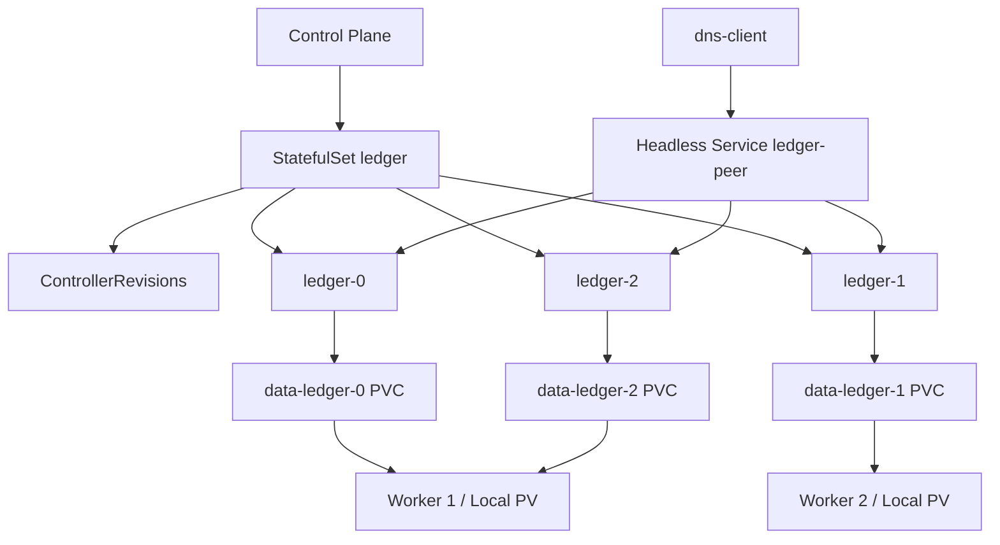

<div dir="rtl" align="right">

# ‏پروژه عملی ‎Kubernetes‎ | ‎StatefulSet‎ در محیط ‎Enterprise‎

**‏سطح:** ‎Beginner‎ → ‎Advanced‎  
**‏محیط:** ‎kubeadm‎ — یک ‎Control Plane‎ و دو ‎Worker‎  
**‏داستان:** تیم ‎Platform‎ یک سامانه ‎Ledger‎ با سه عضو مستقل را مدیریت می‌کند. هر عضو باید هویت شبکه و داده خود را حفظ کند، انتشار نسخه کنترل‌شده باشد و خطاها بدون از دست دادن داده آزمایشی بازیابی شوند.

**‏محدوده:** ‎StatefulSet‎ و مفاهیم وابسته مستقیم؛ ‎Nginx‎ صرفاً شبیه‌ساز رفتار ‎Stateful‎ است و ‎Database‎، ‎Replication‎ و ‎Consensus‎ واقعی پیاده‌سازی نمی‌شوند.

‏[بخش اول — سناریو](#part-1) · [بخش دوم — پاسخ‌نامه](#part-2) · [اعتبارسنجی نهایی](#final-validation)

**‏پیش‌نیاز:** ‎Cluster‎ آزمایشی سالم، ‎kubectl‎، ‎Bash‎، دسترسی ‎Registry‎ و مجوز ساخت ‎Namespace‎؛ برای ‎Storage‎ محلی دسترسی مدیریتی به Workerها لازم است. هیچ ‎Workload‎ موجود یا ‎Feature Gate‎ را تغییر نده.

</div>

<div dir="ltr" align="left">



</div>

<a name="part-1"></a>
<div dir="rtl" align="right">

## ‏بخش اول — سناریو و مراحل تمرین

> [!IMPORTANT]
> ‏مراحل را به‌ترتیب اجرا کن. پاسخ‌ها در بخش دوم مخفی هستند. آزمایش‌های وابسته به نسخه یا ‎Storage‎ را فقط در صورت فراهم بودن پیش‌نیاز اجرا کن.

</div>

<a name="challenge-01"></a>
<div dir="rtl" align="right">

### ‏‎Phase‎ 01 — آماده‌سازی ‎Cluster‎ و ‎Namespace‎

**‏وظایف**

- [ ] ‏سلامت یک ‎Control Plane‎ و دو ‎Worker‎ را بررسی کن؛ هر سه ‎Node‎ باید ‎Ready‎ باشند.
- [ ] ‏‎Namespace‎ با نام `sts-lab` و ‎Label‎ برابر `team=platform` بساز؛ اگر از قبل وجود دارد ادامه نده.
- [ ] ‏نسخه ‎Server‎، ‎DNS‎، دسترسی ‎Registry‎ و StorageClassهای موجود را بررسی کن.

**‏معیار پذیرش:** ‎Namespace‎ جدید فعال و Workerها آماده باشند.

</div>

---

<a name="challenge-02"></a>
<div dir="rtl" align="right">

### ‏‎Phase‎ 02 — ‎Headless Service‎ و ‎StatefulSet‎ اولیه

**‏وظایف**

- [ ] ‏یک ‎Headless Service‎ با نام `ledger-peer`، ‎Selector‎ برابر `app=ledger` و ‎Named Port‎ برابر `http:80` ایجاد کن.
- [ ] ‏‎StatefulSet‎ با نام `ledger`، سه ‎Replica‎، ‎Container‎ با نام `web`، ‎Image‎ برابر `nginx:1.27.5-alpine` و ‎Label‎ برابر `app=ledger` بساز.
- [ ] ‏از `serviceName` برابر `ledger-peer`، سیاست ‎OrderedReady‎، ‎RollingUpdate‎، ‎minReadySeconds‎ برابر 5 و ‎revisionHistoryLimit‎ برابر 10 استفاده کن.
- [ ] ‏برای این مرحله هنوز ‎PVC‎ تعریف نکن؛ این ‎StatefulSet‎ موقت را بعداً جایگزین خواهی کرد.

**‏معیار پذیرش:** سه ‎Pod‎ با نام‌های ‎ledger-0‎ تا ‎ledger-2‎ و ‎ControllerRevision‎ ایجاد شوند.

</div>

---

<a name="challenge-03"></a>
<div dir="rtl" align="right">

### ‏‎Phase‎ 03 — ‎Stable Network Identity‎ و ‎DNS‎

**‏وظایف**

- [ ] ‏‎Pod‎ کمکی `dns-client` با ‎Image‎ برابر `busybox:1.36.1` بساز.
- [ ] ‏‎Hostname‎، ‎Pod IP‎، ‎UID‎ و Labelهای هویتی هر ‎Pod‎ را ثبت کن.
- [ ] ‏‎DNS‎ مربوط به ‎Headless Service‎ و نام اختصاصی هر ‎Pod‎ را از داخل ‎Cluster‎ بررسی کن.
- [ ] ‏‎Service‎ جداگانه `ledger-zero` برای ارسال درخواست فقط به ‎ledger-0‎ بساز.

**‏معیار پذیرش:** نام اختصاصی هر ‎Pod resolve‎ شود و ‎ledger-zero‎ فقط به ‎ledger-0‎ اشاره کند.

</div>

---

<a name="challenge-04"></a>
<div dir="rtl" align="right">

### ‏‎Phase‎ 04 — ‎OrderedReady‎ و ‎Parallel Pod Management‎

**‏وظایف**

- [ ] ‏‎ledger‎ را به صفر و سپس سه ‎Replica‎ برسان؛ ترتیب ایجاد و حذف را مشاهده کن.
- [ ] ‏‎StatefulSet‎ جداگانه `parallel-demo` با سه ‎Replica‎ و سیاست ‎Parallel‎ بساز؛ Podها با تأخیر 15 ثانیه ‎Ready‎ شوند.
- [ ] ‏ترتیب ‎Scaling‎ را مقایسه کن و تلاش برای تغییر ‎podManagementPolicy‎ موجود را در ‎Dry Run‎ بررسی کن.

**‏معیار پذیرش:** ‎OrderedReady‎ به‌ترتیب و ‎Parallel‎ بدون انتظار ‎Ready‎ شدن هر ‎Pod‎ عمل کند.

</div>

---

<a name="challenge-05"></a>
<div dir="rtl" align="right">

### ‏‎Phase‎ 05 — آماده‌سازی ‎Persistent Storage‎

**‏وظایف**

- [ ] ‏اگر ‎StorageClass‎ دارای ‎Dynamic Provisioner‎ سالم داری، برای چهار ‎PVC‎ مستقل با ظرفیت 1Gi از آن استفاده کن.
- [ ] ‏در غیر این صورت ‎StorageClass‎ آزمایشی `sts-lab-local` و چهار ‎Local PV‎ با نام ‎sts-lab-pv-0‎ تا ‎sts-lab-pv-3‎ بساز؛ دو ‎PV‎ روی هر ‎Worker.‎
- [ ] ‏‎Reclaim Policy‎ برابر ‎Retain‎، ‎Access Mode‎ برابر ‎ReadWriteOnce‎ و ‎Node Affinity‎ متناسب با ‎Worker‎ واقعی باشد.

**‏معیار پذیرش:** ‎Storage‎ برای چهار ‎ordinal‎ قابل تخصیص باشد؛ مسیر ‎Local‎ PVها اختصاصی آزمایش باشد.

</div>

---

<a name="challenge-06"></a>
<div dir="rtl" align="right">

### ‏‎Phase‎ 06 — ‎VolumeClaimTemplates‎ و ‎StatefulSet‎ پایدار

**‏وظایف**

- [ ] ‏‎ledger‎ موقت را پس از ‎Scale‎ به صفر حذف کن؛ Serviceها را نگه دار.
- [ ] ‏‎ledger‎ را با همان نام و سه ‎Replica‎ بازسازی کن؛ ‎VolumeClaimTemplate‎ با نام `data`، ظرفیت 1Gi و ‎Mount Path‎ برابر `/data` داشته باشد.
- [ ] ‏هر ‎Pod‎ هنگام اولین اجرا فایل `/data/identity.txt` شامل ‎Hostname‎ خودش بسازد و در شروع‌های بعدی فایل موجود را حفظ کند.
- [ ] ‏سه ‎Probe‎ و ‎minReadySeconds‎ برابر 5 تنظیم کن؛ ‎PVC‎ و PVهای هر ‎Pod‎ را بررسی کن.

**‏معیار پذیرش:** سه ‎PVC‎ مستقل ‎Bound‎ و سه ‎Pod Ready‎؛ هر فایل هویت مخصوص همان ‎ordinal.‎

</div>

---

<a name="challenge-07"></a>
<div dir="rtl" align="right">

### ‏‎Phase‎ 07 — ‎Restart‎، ‎Replacement‎ و پایداری داده

**‏وظایف**

- [ ] ‏روی ‎ledger-1‎ فایل `marker.txt` با محتوای `persistent-1` در /‎data‎ بساز.
- [ ] ‏با خطای ‎Liveness‎ یک ‎Container Restart‎ ایجاد کن؛ ‎UID‎ و ‎Restart Count‎ را بررسی کن.
- [ ] ‏سپس ‎ledger-1‎ را به‌صورت عادی حذف کن و ‎UID‎، ‎IP‎، نام، ‎PVC UID‎ و محتوا را قبل و بعد مقایسه کن.

**‏معیار پذیرش:** در ‎Restart‎ همان ‎Pod‎ و در ‎Replacement‎ یک ‎UID‎ جدید با همان نام و داده قبلی مشاهده شود.

</div>

---

<a name="challenge-08"></a>
<div dir="rtl" align="right">

### ‏‎Phase‎ 08 — ‎Scaling‎ و حفظ ‎PVC‎ پس از ‎Scale-down‎

**‏وظایف**

- [ ] ‏‎ledger‎ را از سه به چهار ‎Replica‎ افزایش بده؛ برای ‎ledger-3‎ یک فایل اختصاصی ثبت کن.
- [ ] ‏‎ledger‎ را به دو ‎Replica‎ کاهش بده و بررسی کن PVCهای ordinalهای حذف‌شده باقی بمانند.
- [ ] ‏به چهار ‎Replica‎ بازگرد و داده قبلی ‎ledger-3‎ را بررسی کن؛ سپس به سه ‎Replica‎ برگرد.

**‏معیار پذیرش:** PVCهای ‎data-ledger-2‎ و ‎data-ledger-3‎ حفظ و داده ‎ledger-3‎ بازیابی شوند.

</div>

---

<a name="challenge-09"></a>
<div dir="rtl" align="right">

### ‏‎Phase‎ 09 — ‎RollingUpdate‎، ‎ControllerRevision‎ و ‎Rollback‎

**‏وظایف**

- [ ] ‏‎Image‎ را به `nginx:1.28.0-alpine` تغییر بده و ترتیب جایگزینی را ثبت کن.
- [ ] ‏‎currentRevision‎ و ‎updateRevision‎، ‎Label‎ مربوط به ‎controller-revision-hash‎ و تاریخچه را بررسی کن.
- [ ] ‏به ‎Revision‎ قبل بازگرد، سپس دوباره نسخه 1.28.0 را منتشر کن.

**‏معیار پذیرش:** ‎Update‎ از ‎ledger-2‎ به ‎ledger-0‎ پیش برود؛ در پایان نسخه جدید و داده ‎ledger-1‎ حفظ شوند.

</div>

---

<a name="challenge-10"></a>
<div dir="rtl" align="right">

### ‏‎Phase‎ 10 — ‎Partitioned RollingUpdate‎ و ‎Canary‎

**‏وظایف**

- [ ] ‏‎Partition‎ را روی 2 قرار بده و ‎Image‎ را به 1.27.5 برگردان؛ فقط ‎ledger-2‎ به‌روز شود.
- [ ] ‏‎ledger-0‎ را حذف کن و بررسی کن نسخه قدیمی خودش بازگردد.
- [ ] ‏‎Partition‎ را به 1 و سپس صفر کاهش بده و در هر مرحله نسخه هر ‎Pod‎ را بررسی کن.
- [ ] ‏در پایان هر سه ‎Pod‎ نسخه 1.27.5 داشته باشند.

**‏معیار پذیرش:** انتشار مرحله‌ای فقط ordinalهای برابر یا بزرگ‌تر از ‎Partition‎ را تغییر دهد.

</div>

---

<a name="challenge-11"></a>
<div dir="rtl" align="right">

### ‏‎Phase‎ 11 — ‎OnDelete‎ و ‎Update‎ دستی

**‏وظایف**

- [ ] ‏استراتژی ‎ledger‎ را به ‎OnDelete‎ تغییر بده؛ ‎Image‎ را به 1.28.0 تغییر بده.
- [ ] ‏بررسی کن Podهای موجود خودکار جایگزین نشوند؛ فقط ‎ledger-1‎ را حذف کن و سپس سایر اعضا را یکی‌یکی به‌روز کن.
- [ ] ‏پس از ‎Ready‎ شدن تمام اعضا، ‎RollingUpdate‎ با ‎partition‎ صفر را بازگردان.

**‏معیار پذیرش:** تغییر ‎Image‎ در ‎OnDelete‎ فقط پس از حذف دستی Podهای موجود اعمال شود.

</div>

---

<a name="challenge-12"></a>
<div dir="rtl" align="right">

### ‏‎Phase‎ 12 — ‎Start Ordinal‎ و ‎Pod Index Label‎

**‏وظایف**

- [ ] ‏در صورت پشتیبانی ‎API‎، نمونه `ordinal-demo` با دو ‎Replica‎ و ‎Start Ordinal‎ برابر 5 بساز.
- [ ] ‏نام‌ها، ‎Hostname‎ و ‎Label‎ مربوط به ‎pod-index‎ را بررسی کن و ‎Replica‎ را به سه افزایش بده.
- [ ] ‏نمونه فرعی را پس از بررسی حذف کن.

**‏معیار پذیرش:** در نسخه سازگار نام‌های ‎ordinal-demo-5‎ تا ‎ordinal-demo-7‎ مشاهده شوند.

</div>

---

<a name="challenge-13"></a>
<div dir="rtl" align="right">

### ‏‎Phase‎ 13 — ‎Readiness Failure‎ و ‎Forced Rollback‎

**‏وظایف**

- [ ] ‏‎Readiness Path‎ را عمداً روی `/missing` قرار بده و توقف ‎RollingUpdate‎ روی بالاترین ‎ordinal‎ را مشاهده کن.
- [ ] ‏قالب سالم را برگردان؛ در صورت باقی ماندن ‎Pod‎ خراب، آن را به‌صورت عادی جایگزین کن.
- [ ] ‏داده و وضعیت هر سه ‎Pod‎ را دوباره بررسی کن.

**‏معیار پذیرش:** هر سه ‎Pod‎ سالم و ‎marker‎ قبلی حفظ شده باشد.

</div>

---

<a name="challenge-14"></a>
<div dir="rtl" align="right">

### ‏‎Phase‎ 14 — ‎DNS‎ قبل از ‎Readiness‎ و ‎Bootstrap‎

**‏وظایف**

- [ ] ‏مسیر ‎Readiness‎ یکی از Podهای ‎ledger‎ را موقتاً از دسترس خارج کن.
- [ ] ‏‎EndpointSlice‎ و ‎DNS‎ اختصاصی آن را بررسی کن؛ سپس ‎publishNotReadyAddresses‎ را روی ‎Headless Service‎ فعال کن.
- [ ] ‏تفاوت ‎DNS‎ و ‎Readiness‎ را مشاهده و تنظیمات سالم را بازگردان.

**‏معیار پذیرش:** ‎DNS‎ عضو ‎NotReady‎ در حالت ‎publishNotReadyAddresses‎ قابل انتشار باشد و در پایان هر سه ‎Pod Ready‎ شوند.

</div>

---

<a name="challenge-15"></a>
<div dir="rtl" align="right">

### ‏‎Phase‎ 15 — ‎PVC Retention Policy‎ و چرخه حذف

**‏وظایف**

- [ ] ‏روی یک نمونه جداگانه `retention-demo` با دو ‎Replica‎ و ‎PVC‎ مستقل، سیاست ‎whenScaled=Delete‎ و ‎whenDeleted=Retain‎ را بررسی کن.
- [ ] ‏به یک ‎Replica‎ کاهش بده؛ حذف ‎PVC‎ عضو دوم و حفظ ‎PVC‎ عضو اول را بررسی کن.
- [ ] ‏‎StatefulSet‎ را حذف کن و حفظ ‎PVC‎ باقی‌مانده را بررسی کن؛ فقط داده آزمایشی استفاده شود.
- [ ] ‏تفاوت چهار ترکیب ‎Retain‎ و ‎Delete‎ و ‎Reclaim Policy‎ را توضیح بده.

**‏معیار پذیرش:** در نسخه و ‎Storage‎ سازگار ‎PVC‎ عضو ‎Scale-down‎ حذف و ‎PVC‎ عضو باقی‌مانده حفظ شود.

</div>

---

<a name="challenge-16"></a>
<div dir="rtl" align="right">

### ‏‎Phase‎ 16 — ‎Scheduling‎ و ‎Local Volume Failure‎

**‏وظایف**

- [ ] ‏ارتباط ‎Pod‎، ‎PVC‎، ‎PV‎ و ‎Worker‎ را ثبت کن.
- [ ] ‏در محیط آزمایش، قالب ‎ledger‎ را با ‎nodeSelector‎ ناموجود منتشر کن و ‎Pending‎ شدن عضو جدید را بررسی کن؛ ‎Node‎ واقعی را خاموش یا ‎Drain‎ نکن.
- [ ] ‏قالب را اصلاح و ‎Pod‎ خراب را در صورت نیاز به‌صورت عادی حذف کن.
- [ ] ‏تفاوت ‎Local PV‎ و ‎Storage‎ قابل انتقال به ‎Worker‎ دیگر را تحلیل کن.

**‏معیار پذیرش:** ‎FailedScheduling‎ شناسایی و هر سه عضو با داده قبلی بازیابی شوند.

</div>

---

<a name="challenge-17"></a>
<div dir="rtl" align="right">

### ‏‎Phase‎ 17 — ‎PVC Pending‎، ‎Immutable Fields‎ و ‎Volume Expansion‎

**‏وظایف**

- [ ] ‏در ‎Dry Run‎ تلاش کن ‎serviceName‎، ‎selector‎ و ظرفیت ‎volumeClaimTemplates‎ در ‎ledger‎ موجود را تغییر بدهی.
- [ ] ‏یک ‎PVC‎ مستقل با ‎StorageClass‎ ناموجود بساز، ‎Pending‎ و ‎Events‎ آن را بررسی و حذف کن.
- [ ] ‏در صورت پشتیبانی ‎StorageClass‎ از ‎Expansion‎، روش افزایش حجم ‎PVC‎ موجود را بررسی کن؛ برای این پروژه تغییر واقعی حجم ‎ledger‎ الزامی نیست.

**‏معیار پذیرش:** خطای ‎API‎ و علت ‎Pending‎ تشخیص داده شود و ‎ledger‎ دست‌نخورده بماند.

</div>

---

<a name="challenge-18"></a>
<div dir="rtl" align="right">

### ‏‎Phase‎ 18 — ‎Advanced Update Concurrency‎ و قابلیت‌های وابسته به نسخه

**‏وظایف**

- [ ] ‏روی ‎parallel-demo‎ موجود سه ‎Replica‎ را بازگردان و قابلیت ‎maxUnavailable‎ را در ‎API‎ بررسی کن.
- [ ] ‏در صورت فعال بودن ‎Feature Gate‎، ‎maxUnavailable=2‎ و ‎RollingUpdate‎ را اعمال کن و ترتیب ‎Update‎ را مشاهده کن.
- [ ] ‏در صورت پشتیبانی نسخه و فعال بودن ‎Feature Gate‎ مربوط به ‎Recreate‎، آن را فقط روی همین نمونه بدون داده آزمایش کن؛ در غیر این صورت مرحله را رد کن.
- [ ] ‏در پایان ‎parallel-demo‎ را به صفر ‎Replica‎ برسان.

**‏معیار پذیرش:** در نسخه سازگار رفتار ‎Update‎ مشاهده و نمونه فرعی متوقف شود؛ در نسخه ناسازگار هیچ تنظیم ‎Cluster‎ تغییر نکند.

</div>

---

<a name="challenge-19"></a>
<div dir="rtl" align="right">

### ‏‎Phase‎ 19 — ‎Orphan Deletion‎، ‎Adoption‎ و بازیابی ‎Controller‎

**‏وظایف**

- [ ] ‏‎UID‎ سه ‎Pod‎ و ‎PVC‎ اصلی را ثبت کن.
- [ ] ‏‎StatefulSet‎ را با حفظ Podها حذف کن و مالکیت آنها را بررسی کن.
- [ ] ‏قالب فعلی ‎StatefulSet‎ را قبل از حذف ذخیره کن و سپس ‎Controller‎ را با همان نام و ‎Selector‎ بازسازی کن؛ از ‎Manifest‎ قدیمی استفاده نکن.
- [ ] ‏بررسی کن Podها در صورت ‎Adoption‎ سالم باقی بمانند و PVCها تغییر نکنند.

**‏معیار پذیرش:** ‎Controller‎ بازیابی، سه ‎Pod Ready‎ و داده قبلی برقرار باشند.

</div>

---

<div dir="rtl" align="right">

### Final Acceptance Criteria

- [ ] ‏سه ‎Pod‎ اصلی ‎Ready‎ و ‎Available‎ هستند و ‎UID‎ و هویت ثابت منطقی بررسی شده‌اند.
- [ ] ‏‎DNS‎ اختصاصی و ‎PVC‎ هر ‎ordinal‎ بررسی شده‌اند.
- [ ] ‏داده بعد از ‎Restart‎، ‎Replacement‎، ‎Scaling‎ و ‎Rollback‎ حفظ شده است.
- [ ] ‏‎OrderedReady‎، ‎Parallel‎، ‎RollingUpdate‎، ‎Partition‎ و ‎OnDelete‎ بررسی شده‌اند.
- [ ] ‏خطاهای عمدی رفع شده‌اند؛ مراحل وابسته به نسخه یا ‎Storage‎ ثبت یا با دلیل رد شده‌اند.
- [ ] ‏هیچ داده یا ‎Resource‎ خارج از آزمایش تغییر نکرده است.

**‏‎Skills Acquired:‎** ‎Stateful identity‎، ‎Persistent Storage‎، ‎DNS discovery‎، ‎ControllerRevision‎، ‎Update strategies‎، ‎Scheduling‎، ‎PVC lifecycle‎ و ‎Troubleshooting.‎

</div>

<a name="part-2"></a>
<div dir="rtl" align="right">

## ‏بخش دوم — پاسخ‌نامه و نکات فنی

‏پاسخ هر ‎Phase‎ را در صورت نیاز باز کن. خروجی‌های توصیف‌شده معیار مورد انتظار هستند؛ نام ‎Node‎، ‎UID‎ و ‎IP‎ واقعی متفاوت‌اند. ‎Watch‎ را با ‎Ctrl‎+‎C‎ متوقف کن. Commandهای خطادار عمدی را جدا اجرا کن و پس از مشاهده خطا ادامه بده. قبل از اجرای هر ‎Phase‎ از موفقیت ‎Phase‎ قبلی مطمئن شو.

</div>

<details>
<summary dir="rtl" align="right">‏Phase 01 — آماده‌سازی Cluster و Namespace</summary>

<div dir="rtl" align="right">

#### ‏راه‌حل کامل

‏تنظیمات زیر را طبق ترتیب اجرا کن. Manifestها را با نام ذکرشده در ‎Command‎ ذخیره کن.

</div>
<div dir="ltr" align="left">

```yaml
apiVersion: v1
kind: Namespace
metadata:
  name: sts-lab
  labels:
    team: platform
```

</div>
<div dir="ltr" align="left">

```bash
kubectl config current-context
kubectl version
kubectl get nodes -o wide
kubectl get sc
kubectl get namespace sts-lab --ignore-not-found
# Only if the namespace does not exist; save YAML as namespace.yaml
kubectl apply -f namespace.yaml
kubectl get ns sts-lab --show-labels
kubectl -n kube-system get pods
```

</div>
<div dir="rtl" align="right">

#### ‏توضیحات فنی، ‎Best Practices‎ و ‎Troubleshooting‎

‏‎Namespace‎ مرز نام‌گذاری و حذف منابع آزمایشی است؛ ‎PV‎ و ‎StorageClass‎ در سطح ‎Cluster‎ هستند. هیچ ‎Taint‎ یا تنظیمات ‎Control Plane‎ را تغییر نده. اگر ‎DNS‎ یا ‎Node‎ ناسالم است ابتدا همان مشکل را رفع کن.

**‏خروجی مورد انتظار:** ‎Namespace‎ جدید فعال و Workerها آماده باشند.

#### Interview Q&A

‏آیا ‎kubeadm‎ به‌صورت پیش‌فرض ‎Dynamic Provisioner‎ نصب می‌کند؟ خیر؛ وجود ‎StorageClass‎ قابل استفاده را جداگانه بررسی کن.

</div>

</details>

---

<details>
<summary dir="rtl" align="right">‏Phase 02 — Headless Service و StatefulSet اولیه</summary>

<div dir="rtl" align="right">

#### ‏راه‌حل کامل

‏تنظیمات زیر را طبق ترتیب اجرا کن. Manifestها را با نام ذکرشده در ‎Command‎ ذخیره کن.

</div>
<div dir="ltr" align="left">

```yaml
apiVersion: v1
kind: Service
metadata:
  name: ledger-peer
  namespace: sts-lab
spec:
  clusterIP: None
  selector:
    app: ledger
  ports:
    - name: http
      port: 80
      targetPort: http
---
apiVersion: apps/v1
kind: StatefulSet
metadata:
  name: ledger
  namespace: sts-lab
spec:
  serviceName: ledger-peer
  replicas: 3
  selector:
    matchLabels:
      app: ledger
  podManagementPolicy: OrderedReady
  minReadySeconds: 5
  revisionHistoryLimit: 10
  updateStrategy:
    type: RollingUpdate
    rollingUpdate:
      partition: 0
  template:
    metadata:
      labels:
        app: ledger
    spec:
      terminationGracePeriodSeconds: 30
      containers:
        - name: web
          image: nginx:1.27.5-alpine
          ports:
            - name: http
              containerPort: 80
          resources:
            requests:
              cpu: 50m
              memory: 32Mi
            limits:
              cpu: 250m
              memory: 128Mi
          readinessProbe:
            httpGet:
              path: /
              port: http
            periodSeconds: 3
```

</div>
<div dir="ltr" align="left">

```bash
# Save as ledger-initial.yaml
kubectl apply --dry-run=server -f ledger-initial.yaml
kubectl apply -f ledger-initial.yaml
kubectl -n sts-lab get pods -w
# Ctrl+C after all three are Ready
kubectl -n sts-lab rollout status sts/ledger --timeout=240s
kubectl -n sts-lab get sts,svc,controllerrevision,pod -o wide
```

</div>
<div dir="rtl" align="right">

#### ‏توضیحات فنی، ‎Best Practices‎ و ‎Troubleshooting‎

‏‎Headless Service‎ دارای ‎ClusterIP‎ مجازی نیست. ‎serviceName‎ هویت ‎DNS‎ را به ‎Service‎ متصل می‌کند. ‎selector‎ باید با ‎Label‎ قالب هماهنگ باشد. ‎StatefulSet‎ برخلاف ‎Deployment‎ مستقیماً ‎Pod‎ را مدیریت می‌کند؛ ‎ReplicaSet‎ نمی‌سازد. ‎minReadySeconds‎ برای شمارش ‎Available‎ و پیشروی ‎Update‎ اهمیت دارد.

**‏خروجی مورد انتظار:** سه ‎Pod‎ با نام‌های ‎ledger-0‎ تا ‎ledger-2‎ و ‎ControllerRevision‎ ایجاد شوند.

#### Interview Q&A

‏آیا ‎StatefulSet‎ بدون ‎PVC‎ معتبر است؟ بله؛ اما داده روی لایه نوشتنی ‎Container‎ پایدار نیست.

</div>

</details>

---

<details>
<summary dir="rtl" align="right">‏Phase 03 — Stable Network Identity و DNS</summary>

<div dir="rtl" align="right">

#### ‏راه‌حل کامل

‏تنظیمات زیر را طبق ترتیب اجرا کن. Manifestها را با نام ذکرشده در ‎Command‎ ذخیره کن.

</div>
<div dir="ltr" align="left">

```bash
kubectl -n sts-lab run dns-client --image=busybox:1.36.1 --restart=Never --command -- sleep 86400
kubectl -n sts-lab wait --for=condition=Ready pod/dns-client --timeout=120s
kubectl -n sts-lab get pods -l app=ledger -o wide --show-labels
kubectl -n sts-lab get pods -l app=ledger -o custom-columns=NAME:.metadata.name,UID:.metadata.uid,IP:.status.podIP
kubectl -n sts-lab exec ledger-0 -- hostname
kubectl -n sts-lab exec dns-client -- nslookup ledger-peer.sts-lab.svc
kubectl -n sts-lab exec dns-client -- nslookup ledger-0.ledger-peer.sts-lab.svc
kubectl -n sts-lab exec dns-client -- cat /etc/resolv.conf
for i in 0 1 2; do
  kubectl -n sts-lab exec dns-client -- wget -qO- http://ledger-$i.ledger-peer.sts-lab.svc
 done
```

</div>
<div dir="ltr" align="left">

```yaml
apiVersion: v1
kind: Service
metadata:
  name: ledger-zero
  namespace: sts-lab
spec:
  selector:
    statefulset.kubernetes.io/pod-name: ledger-0
  ports:
    - port: 80
      targetPort: http
```

</div>
<div dir="ltr" align="left">

```bash
# Save as ledger-zero.yaml
kubectl apply -f ledger-zero.yaml
kubectl -n sts-lab get endpointslice -l kubernetes.io/service-name=ledger-zero -o yaml
kubectl -n sts-lab exec dns-client -- wget -qO- http://ledger-zero
```

</div>
<div dir="rtl" align="right">

#### ‏توضیحات فنی، ‎Best Practices‎ و ‎Troubleshooting‎

‏نام کامل معمولاً ‎ledger-0.ledger-peer.sts-lab.svc.cluster.local‎ است؛ دامنه ‎Cluster‎ ممکن است متفاوت باشد. ‎DNS Cache‎ منفی ممکن است باعث تأخیر شود. ‎Label‎ مربوط به ‎pod-index‎ در نسخه‌های جدید وجود دارد؛ نبود آن در نسخه قدیمی خطا نیست.

**‏خروجی مورد انتظار:** نام اختصاصی هر ‎Pod resolve‎ شود و ‎ledger-zero‎ فقط به ‎ledger-0‎ اشاره کند.

#### Interview Q&A

‏آیا ‎Pod IP‎ ثابت می‌ماند؟ تضمین نمی‌شود؛ نام و هویت منطقی ثابت هستند.

</div>

</details>

---

<details>
<summary dir="rtl" align="right">‏Phase 04 — OrderedReady و Parallel Pod Management</summary>

<div dir="rtl" align="right">

#### ‏راه‌حل کامل

‏تنظیمات زیر را طبق ترتیب اجرا کن. Manifestها را با نام ذکرشده در ‎Command‎ ذخیره کن.

</div>
<div dir="ltr" align="left">

```bash
# Run watch in a second terminal
kubectl -n sts-lab get pods -l app=ledger -w
# In the first terminal:
kubectl -n sts-lab scale sts/ledger --replicas=0
kubectl -n sts-lab wait --for=delete pod -l app=ledger --timeout=180s
kubectl -n sts-lab scale sts/ledger --replicas=3
kubectl -n sts-lab rollout status sts/ledger --timeout=240s
```

</div>
<div dir="ltr" align="left">

```yaml
apiVersion: v1
kind: Service
metadata:
  name: parallel-peer
  namespace: sts-lab
spec:
  clusterIP: None
  selector:
    app: parallel-demo
  ports:
    - port: 80
---
apiVersion: apps/v1
kind: StatefulSet
metadata:
  name: parallel-demo
  namespace: sts-lab
spec:
  serviceName: parallel-peer
  replicas: 3
  podManagementPolicy: Parallel
  selector:
    matchLabels:
      app: parallel-demo
  template:
    metadata:
      labels:
        app: parallel-demo
    spec:
      containers:
        - name: web
          image: nginx:1.27.5-alpine
          readinessProbe:
            httpGet:
              path: /
              port: 80
            initialDelaySeconds: 15
            periodSeconds: 3
```

</div>
<div dir="ltr" align="left">

```bash
# Save as parallel.yaml
kubectl apply -f parallel.yaml
kubectl -n sts-lab get pods -l app=parallel-demo -w
# Ctrl+C after Ready
kubectl -n sts-lab rollout status sts/parallel-demo --timeout=180s
kubectl -n sts-lab patch sts ledger --dry-run=server --type=merge -p '{"spec":{"podManagementPolicy":"Parallel"}}'
# Expected rejection
kubectl -n sts-lab scale sts/parallel-demo --replicas=0
kubectl -n sts-lab wait --for=delete pod -l app=parallel-demo --timeout=180s
```

</div>
<div dir="rtl" align="right">

#### ‏توضیحات فنی، ‎Best Practices‎ و ‎Troubleshooting‎

‏‎OrderedReady‎ در ‎Scaling‎ از ‎ordinal‎ کوچک به بزرگ ایجاد و برعکس حذف می‌کند. ‎Parallel‎ ترتیب و انتظار را برای ‎Scaling‎ حذف می‌کند؛ به‌تنهایی به معنی ‎RollingUpdate‎ موازی نیست. تغییر ‎podManagementPolicy‎ معمولاً نیازمند بازسازی ‎Controller‎ است.

**‏خروجی مورد انتظار:** ‎OrderedReady‎ به‌ترتیب و ‎Parallel‎ بدون انتظار ‎Ready‎ شدن هر ‎Pod‎ عمل کند.

#### Interview Q&A

‏اگر ‎ledger-0 Ready‎ نشود چه می‌شود؟ در ‎OrderedReady‎ ایجاد ordinalهای بعدی ممکن است متوقف شود.

</div>

</details>

---

<details>
<summary dir="rtl" align="right">‏Phase 05 — آماده‌سازی Persistent Storage</summary>

<div dir="rtl" align="right">

#### ‏راه‌حل کامل

‏تنظیمات زیر را طبق ترتیب اجرا کن. Manifestها را با نام ذکرشده در ‎Command‎ ذخیره کن.

</div>
<div dir="rtl" align="right">

**‏مسیر ‎A‎ — ‎Dynamic Provisioning:‎** نام ‎StorageClass‎ سالم را انتخاب کن. در ‎Phase‎ 06 مقدار ‎storageClassName‎ را با همان نام جایگزین کن. اگر ‎Provisioner‎ نداری، فقط مسیر ‎B‎ را اجرا کن.

</div>
<div dir="ltr" align="left">

```bash
kubectl get sc -o wide
kubectl get csidrivers
kubectl get pv
```

</div>
<div dir="rtl" align="right">

**‏مسیر ‎B‎ — ‎Local PV:‎** ابتدا روی ‎Worker‎ اول و دوم مسیرهای اختصاصی زیر را ایجاد کن. اگر مسیر از قبل دارای داده است ادامه نده. دستورات هر ‎Worker‎ باید روی همان ماشین اجرا شوند.

</div>
<div dir="ltr" align="left">

```bash
# Worker 1
sudo install -d -m 0755 /var/lib/sts-lab/ledger-0 /var/lib/sts-lab/ledger-2
# Worker 2
sudo install -d -m 0755 /var/lib/sts-lab/ledger-1 /var/lib/sts-lab/ledger-3
```

</div>
<div dir="ltr" align="left">

```yaml
apiVersion: storage.k8s.io/v1
kind: StorageClass
metadata:
  name: sts-lab-local
provisioner: kubernetes.io/no-provisioner
volumeBindingMode: WaitForFirstConsumer
reclaimPolicy: Retain
```

</div>
<div dir="ltr" align="left">

```bash
# Save as local-sc.yaml
kubectl get sc sts-lab-local --ignore-not-found
kubectl get pv -l lab=sts-lab
# Proceed only if names are unused
kubectl apply -f local-sc.yaml
kubectl get nodes -L kubernetes.io/hostname
# Replace these with the actual hostname LABEL values, not assumed node names
W1='REPLACE_WORKER_1_HOSTNAME_LABEL'
W2='REPLACE_WORKER_2_HOSTNAME_LABEL'
for i in 0 1 2 3; do
  if (( i % 2 == 0 )); then NODE="$W1"; else NODE="$W2"; fi
  cat <<EOF
apiVersion: v1
kind: PersistentVolume
metadata:
  name: sts-lab-pv-$i
  labels:
    lab: sts-lab
spec:
  capacity:
    storage: 1Gi
  volumeMode: Filesystem
  accessModes:
    - ReadWriteOnce
  persistentVolumeReclaimPolicy: Retain
  storageClassName: sts-lab-local
  claimRef:
    namespace: sts-lab
    name: data-ledger-$i
  local:
    path: /var/lib/sts-lab/ledger-$i
  nodeAffinity:
    required:
      nodeSelectorTerms:
        - matchExpressions:
            - key: kubernetes.io/hostname
              operator: In
              values:
                - "$NODE"
---
EOF
done > local-pvs.yaml
kubectl apply --dry-run=server -f local-pvs.yaml
kubectl apply -f local-pvs.yaml
kubectl get pv -l lab=sts-lab
```

</div>
<div dir="rtl" align="right">

#### ‏توضیحات فنی، ‎Best Practices‎ و ‎Troubleshooting‎

‏‎Local PV‎ به ‎Worker‎ مشخص وابسته است؛ جایگزینی ‎Pod‎ روی ‎Worker‎ دیگر بدون انتقال داده ممکن نیست. ظرفیت 1Gi در ‎PV‎ مبتنی بر ‎Directory‎ لزوماً ‎Quota‎ واقعی نیست. ‎claimRef‎ از مصرف اشتباه ‎PV‎ جلوگیری می‌کند. برای محیط ‎Production‎ از ‎Storage‎ مناسب و ‎Backup‎ استفاده کن. ‎ReadWriteOnce‎ یعنی یک ‎Node‎، نه الزاماً یک ‎Pod‎؛ ‎ReadWriteOncePod‎ به ‎CSI‎ سازگار نیاز دارد.

**‏خروجی مورد انتظار:** ‎Storage‎ برای چهار ‎ordinal‎ قابل تخصیص باشد؛ مسیر ‎Local‎ PVها اختصاصی آزمایش باشد.

#### Interview Q&A

‏آیا ‎Retain‎ در ‎PV‎ همان ‎PVC Retention Policy‎ است؟ خیر؛ یکی رفتار ‎PV‎ پس از حذف ‎PVC‎ و دیگری حذف یا حفظ خود ‎PVC‎ را کنترل می‌کند.

</div>

</details>

---

<details>
<summary dir="rtl" align="right">‏Phase 06 — VolumeClaimTemplates و StatefulSet پایدار</summary>

<div dir="rtl" align="right">

#### ‏راه‌حل کامل

‏تنظیمات زیر را طبق ترتیب اجرا کن. Manifestها را با نام ذکرشده در ‎Command‎ ذخیره کن.

</div>
<div dir="ltr" align="left">

```bash
kubectl -n sts-lab scale sts/ledger --replicas=0
kubectl -n sts-lab wait --for=delete pod -l app=ledger --timeout=180s
kubectl -n sts-lab delete sts ledger
```

</div>
<div dir="ltr" align="left">

```yaml
apiVersion: apps/v1
kind: StatefulSet
metadata:
  name: ledger
  namespace: sts-lab
spec:
  serviceName: ledger-peer
  replicas: 3
  selector:
    matchLabels:
      app: ledger
  podManagementPolicy: OrderedReady
  minReadySeconds: 5
  revisionHistoryLimit: 10
  updateStrategy:
    type: RollingUpdate
    rollingUpdate:
      partition: 0
  template:
    metadata:
      labels:
        app: ledger
    spec:
      terminationGracePeriodSeconds: 30
      containers:
        - name: web
          image: nginx:1.27.5-alpine
          command: ["/bin/sh", "-ec"]
          args:
            - |
              if [ ! -f /data/identity.txt ]; then
                hostname > /data/identity.txt
              fi
              echo ready > /usr/share/nginx/html/ready
              echo live > /usr/share/nginx/html/live
              exec nginx -g 'daemon off;'
          ports:
            - name: http
              containerPort: 80
          volumeMounts:
            - name: data
              mountPath: /data
          resources:
            requests:
              cpu: 50m
              memory: 32Mi
            limits:
              cpu: 250m
              memory: 128Mi
          startupProbe:
            httpGet:
              path: /live
              port: http
            periodSeconds: 5
            failureThreshold: 12
          readinessProbe:
            httpGet:
              path: /ready
              port: http
            periodSeconds: 3
            failureThreshold: 2
          livenessProbe:
            httpGet:
              path: /live
              port: http
            periodSeconds: 5
            failureThreshold: 3
  volumeClaimTemplates:
    - metadata:
        name: data
      spec:
        accessModes: ["ReadWriteOnce"]
        storageClassName: sts-lab-local
        resources:
          requests:
            storage: 1Gi
```

</div>
<div dir="ltr" align="left">

```bash
# Save as ledger.yaml; for path A replace storageClassName first
kubectl apply --dry-run=server -f ledger.yaml
kubectl apply -f ledger.yaml
kubectl -n sts-lab rollout status sts/ledger --timeout=300s
kubectl -n sts-lab get sts,pod,pvc -o wide
for i in 0 1 2; do
  kubectl -n sts-lab exec ledger-$i -- cat /data/identity.txt
done
```

</div>
<div dir="rtl" align="right">

#### ‏توضیحات فنی، ‎Best Practices‎ و ‎Troubleshooting‎

‏نام ‎PVC‎ از الگوی ‎template-statefulset-ordinal‎ پیروی می‌کند؛ ‎data-ledger-0‎ نمونه آن است. ‎Mount‎ باید با نام ‎Template‎ همخوان باشد. در این تمرین ‎Nginx‎ نماینده یک سرویس ‎Stateful‎ است، نه ‎Database‎ واقعی؛ هیچ ‎Replication‎ یا ‎Leader Election‎ انجام نمی‌دهد. ‎Startup‎ اجازه راه‌اندازی می‌دهد؛ ‎Readiness‎ آمادگی و ‎Liveness‎ سلامت اجرای ‎Container‎ را می‌سنجد.

**‏خروجی مورد انتظار:** سه ‎PVC‎ مستقل ‎Bound‎ و سه ‎Pod Ready‎؛ هر فایل هویت مخصوص همان ‎ordinal.‎

#### Interview Q&A

‏چرا نمی‌توان ‎VolumeClaimTemplates‎ را ساده روی ‎StatefulSet‎ موجود اضافه کرد؟ فیلدهای ساختاری آن معمولاً ‎immutable‎ هستند؛ به همین دلیل نمونه موقت بازسازی شد.

</div>

</details>

---

<details>
<summary dir="rtl" align="right">‏Phase 07 — Restart، Replacement و پایداری داده</summary>

<div dir="rtl" align="right">

#### ‏راه‌حل کامل

‏تنظیمات زیر را طبق ترتیب اجرا کن. Manifestها را با نام ذکرشده در ‎Command‎ ذخیره کن.

</div>
<div dir="ltr" align="left">

```bash
kubectl -n sts-lab exec ledger-1 -- sh -c 'echo persistent-1 > /data/marker.txt'
kubectl -n sts-lab get pod ledger-1 -o custom-columns=NAME:.metadata.name,UID:.metadata.uid,IP:.status.podIP,RESTARTS:.status.containerStatuses[0].restartCount
kubectl -n sts-lab get pvc data-ledger-1 -o custom-columns=UID:.metadata.uid,PV:.spec.volumeName
kubectl -n sts-lab exec ledger-1 -- rm /usr/share/nginx/html/live
kubectl -n sts-lab get pod ledger-1 -w
# Ctrl+C after restart and Ready recovery
kubectl -n sts-lab describe pod ledger-1
kubectl -n sts-lab logs ledger-1 --previous
kubectl -n sts-lab get pod ledger-1 -o custom-columns=UID:.metadata.uid,RESTARTS:.status.containerStatuses[0].restartCount
kubectl -n sts-lab delete pod ledger-1
kubectl -n sts-lab rollout status sts/ledger --timeout=240s
kubectl -n sts-lab get pod ledger-1 -o custom-columns=NAME:.metadata.name,UID:.metadata.uid,IP:.status.podIP,RESTARTS:.status.containerStatuses[0].restartCount
kubectl -n sts-lab get pvc data-ledger-1 -o custom-columns=UID:.metadata.uid,PV:.spec.volumeName
kubectl -n sts-lab exec ledger-1 -- cat /data/marker.txt
```

</div>
<div dir="rtl" align="right">

#### ‏توضیحات فنی، ‎Best Practices‎ و ‎Troubleshooting‎

‏‎Kubelet Container‎ را ‎Restart‎ می‌کند؛ ‎StatefulSet Controller‎ در حذف ‎Pod‎ جایگزین با همان نام می‌سازد. ‎UID‎ جدید است، ‎PVC‎ قبلی معمولاً همان است. از ‎force delete‎ استفاده نکن؛ خطر اجرای دو نمونه با یک هویت در وضعیت نامطمئن ‎Node‎ وجود دارد.

**‏خروجی مورد انتظار:** در ‎Restart‎ همان ‎Pod‎ و در ‎Replacement‎ یک ‎UID‎ جدید با همان نام و داده قبلی مشاهده شود.

#### Interview Q&A

‏آیا نام ثابت به معنی همان ‎Pod Object‎ است؟ خیر، ‎UID‎ معیار هویت ‎Object‎ است.

</div>

</details>

---

<details>
<summary dir="rtl" align="right">‏Phase 08 — Scaling و حفظ PVC پس از Scale-down</summary>

<div dir="rtl" align="right">

#### ‏راه‌حل کامل

‏تنظیمات زیر را طبق ترتیب اجرا کن. Manifestها را با نام ذکرشده در ‎Command‎ ذخیره کن.

</div>
<div dir="ltr" align="left">

```bash
kubectl -n sts-lab scale sts/ledger --replicas=4
kubectl -n sts-lab rollout status sts/ledger --timeout=300s
kubectl -n sts-lab exec ledger-3 -- sh -c 'echo scale-test > /data/marker.txt'
kubectl -n sts-lab scale sts/ledger --replicas=2
kubectl -n sts-lab wait --for=delete pod/ledger-3 pod/ledger-2 --timeout=180s
kubectl -n sts-lab get pvc
kubectl -n sts-lab scale sts/ledger --replicas=4
kubectl -n sts-lab rollout status sts/ledger --timeout=300s
kubectl -n sts-lab exec ledger-3 -- cat /data/marker.txt
kubectl -n sts-lab scale sts/ledger --replicas=3
kubectl -n sts-lab wait --for=delete pod/ledger-3 --timeout=180s
kubectl -n sts-lab rollout status sts/ledger --timeout=240s
```

</div>
<div dir="rtl" align="right">

#### ‏توضیحات فنی، ‎Best Practices‎ و ‎Troubleshooting‎

‏رفتار پیش‌فرض حفظ ‎PVC‎ است. ‎Scale-down‎ از بزرگ‌ترین ‎ordinal‎ شروع می‌شود. ‎Scale‎ به صفر داده ‎PVC‎ را در حالت ‎Retain‎ حذف نمی‌کند. افزایش ‎replicas‎ به‌تنهایی ‎Revision‎ جدید نمی‌سازد.

**‏خروجی مورد انتظار:** PVCهای ‎data-ledger-2‎ و ‎data-ledger-3‎ حفظ و داده ‎ledger-3‎ بازیابی شوند.

#### Interview Q&A

‏آیا ‎HPA‎ برای ‎StatefulSet‎ ممکن است؟ بله، ولی ایمن بودن اضافه و حذف عضو به منطق ‎Application‎ بستگی دارد؛ ‎HPA‎ در این پروژه محور اصلی نیست.

</div>

</details>

---

<details>
<summary dir="rtl" align="right">‏Phase 09 — RollingUpdate، ControllerRevision و Rollback</summary>

<div dir="rtl" align="right">

#### ‏راه‌حل کامل

‏تنظیمات زیر را طبق ترتیب اجرا کن. Manifestها را با نام ذکرشده در ‎Command‎ ذخیره کن.

</div>
<div dir="ltr" align="left">

```bash
kubectl -n sts-lab rollout history sts/ledger
kubectl -n sts-lab set image sts/ledger web=nginx:1.28.0-alpine
kubectl -n sts-lab get pods -l app=ledger -w
# Ctrl+C after update
kubectl -n sts-lab rollout status sts/ledger --timeout=300s
kubectl -n sts-lab get controllerrevision
kubectl -n sts-lab get sts ledger -o jsonpath='{.status.currentRevision}{"\n"}{.status.updateRevision}{"\n"}'
kubectl -n sts-lab get pods -l app=ledger -L controller-revision-hash
kubectl -n sts-lab rollout history sts/ledger
kubectl -n sts-lab rollout undo sts/ledger
kubectl -n sts-lab rollout status sts/ledger --timeout=300s
kubectl -n sts-lab set image sts/ledger web=nginx:1.28.0-alpine
kubectl -n sts-lab rollout status sts/ledger --timeout=300s
kubectl -n sts-lab exec ledger-1 -- cat /data/marker.txt
```

</div>
<div dir="rtl" align="right">

#### ‏توضیحات فنی، ‎Best Practices‎ و ‎Troubleshooting‎

‏‎ControllerRevision‎ قالب تاریخی را نگه می‌دارد؛ ‎revisionHistoryLimit‎ سقف تاریخچه قدیمی است. در ‎OrderedReady‎ جایگزینی از ‎ordinal‎ بزرگ به کوچک انجام می‌شود و ‎minReadySeconds‎ پیشروی را کند می‌کند. ‎Rollback‎ داده ‎PVC‎ یا نسخه ‎Schema‎ پایگاه داده را برنمی‌گرداند.

**‏خروجی مورد انتظار:** ‎Update‎ از ‎ledger-2‎ به ‎ledger-0‎ پیش برود؛ در پایان نسخه جدید و داده ‎ledger-1‎ حفظ شوند.

#### Interview Q&A

‏آیا ‎StatefulSet‎ دارای ‎maxSurge‎ است؟ خیر؛ جایگزینی معمول هویت یکسان را حفظ می‌کند و ‎Pod‎ اضافی با همان هویت ایجاد نمی‌کند.

</div>

</details>

---

<details>
<summary dir="rtl" align="right">‏Phase 10 — Partitioned RollingUpdate و Canary</summary>

<div dir="rtl" align="right">

#### ‏راه‌حل کامل

‏تنظیمات زیر را طبق ترتیب اجرا کن. Manifestها را با نام ذکرشده در ‎Command‎ ذخیره کن.

</div>
<div dir="ltr" align="left">

```bash
kubectl -n sts-lab patch sts ledger --type=merge -p '{"spec":{"updateStrategy":{"rollingUpdate":{"partition":2}}}}'
kubectl -n sts-lab set image sts/ledger web=nginx:1.27.5-alpine
kubectl -n sts-lab rollout status sts/ledger --timeout=240s
kubectl -n sts-lab get pods -l app=ledger -o custom-columns=NAME:.metadata.name,IMAGE:.spec.containers[0].image,REV:.metadata.labels.controller-revision-hash
kubectl -n sts-lab delete pod ledger-0
kubectl -n sts-lab wait --for=condition=Ready pod/ledger-0 --timeout=180s
kubectl -n sts-lab get pod ledger-0 -o jsonpath='{.spec.containers[0].image}{"\n"}'
kubectl -n sts-lab patch sts ledger --type=merge -p '{"spec":{"updateStrategy":{"rollingUpdate":{"partition":1}}}}'
kubectl -n sts-lab rollout status sts/ledger --timeout=240s
kubectl -n sts-lab patch sts ledger --type=merge -p '{"spec":{"updateStrategy":{"rollingUpdate":{"partition":0}}}}'
kubectl -n sts-lab rollout status sts/ledger --timeout=300s
```

</div>
<div dir="rtl" align="right">

#### ‏توضیحات فنی، ‎Best Practices‎ و ‎Troubleshooting‎

‏‎Partition‎ بر اساس ‎ordinal‎ است، نه تعداد دلخواه ‎Pod.‎ در مثال ‎ordinal‎ صفر تا دو، مقدار 2 فقط آخرین عضو را تغییر می‌دهد. مقدار 3 انتشار قالب جدید روی اعضای فعلی را متوقف می‌کند؛ با ‎Scale‎ ممکن است عضو جدید مشمول شود. ‎Partition‎ جایگزین کامل ‎pause‎ نیست.

**‏خروجی مورد انتظار:** انتشار مرحله‌ای فقط ordinalهای برابر یا بزرگ‌تر از ‎Partition‎ را تغییر دهد.

#### Interview Q&A

‏آیا حذف ‎Pod‎ پایین‌تر از ‎Partition‎ باعث دریافت نسخه جدید می‌شود؟ در ‎RollingUpdate partitioned‎ خیر؛ نسخه قبلی همان عضو حفظ می‌شود.

</div>

</details>

---

<details>
<summary dir="rtl" align="right">‏Phase 11 — OnDelete و Update دستی</summary>

<div dir="rtl" align="right">

#### ‏راه‌حل کامل

‏تنظیمات زیر را طبق ترتیب اجرا کن. Manifestها را با نام ذکرشده در ‎Command‎ ذخیره کن.

</div>
<div dir="ltr" align="left">

```bash
kubectl -n sts-lab patch sts ledger --type=merge -p '{"spec":{"updateStrategy":{"type":"OnDelete","rollingUpdate":null}}}'
kubectl -n sts-lab set image sts/ledger web=nginx:1.28.0-alpine
kubectl -n sts-lab get pods -l app=ledger -o custom-columns=NAME:.metadata.name,IMAGE:.spec.containers[0].image
for i in 1 2 0; do
  kubectl -n sts-lab delete pod ledger-$i
  # Wait until replacement exists, then wait for readiness
  until kubectl -n sts-lab get pod ledger-$i >/dev/null 2>&1; do sleep 2; done
  kubectl -n sts-lab wait --for=condition=Ready pod/ledger-$i --timeout=180s || break
  kubectl -n sts-lab get pod ledger-$i -o jsonpath='{.spec.containers[0].image}{"\n"}'
done
kubectl -n sts-lab patch sts ledger --type=merge -p '{"spec":{"updateStrategy":{"type":"RollingUpdate","rollingUpdate":{"partition":0}}}}'
kubectl -n sts-lab rollout status sts/ledger --timeout=300s
```

</div>
<div dir="rtl" align="right">

#### ‏توضیحات فنی، ‎Best Practices‎ و ‎Troubleshooting‎

‏در ‎OnDelete‎ انتخاب زمان جایگزینی با ‎Operator‎ است. ‎Pod‎ جدید در ‎Scale-up‎ می‌تواند نسخه جدید را بگیرد. وضعیت ‎Rollout‎ در ‎OnDelete‎ مانند ‎RollingUpdate‎ معیار مناسب تکمیل نیست؛ نسخه و ‎Ready‎ هر ‎Pod‎ را مستقیم بررسی کن.

**‏خروجی مورد انتظار:** تغییر ‎Image‎ در ‎OnDelete‎ فقط پس از حذف دستی Podهای موجود اعمال شود.

#### Interview Q&A

‏آیا ‎OnDelete‎ شبیه ‎Pause Deployment‎ است؟ خیر؛ Podهای حذف‌شده با قالب جدید ساخته می‌شوند و ‎Scale‎ نیز ممکن است نسخه جدید ایجاد کند.

</div>

</details>

---

<details>
<summary dir="rtl" align="right">‏Phase 12 — Start Ordinal و Pod Index Label</summary>

<div dir="rtl" align="right">

#### ‏راه‌حل کامل

‏تنظیمات زیر را طبق ترتیب اجرا کن. Manifestها را با نام ذکرشده در ‎Command‎ ذخیره کن.

</div>
<div dir="ltr" align="left">

```yaml
apiVersion: v1
kind: Service
metadata:
  name: ordinal-peer
  namespace: sts-lab
spec:
  clusterIP: None
  selector:
    app: ordinal-demo
  ports:
    - port: 80
---
apiVersion: apps/v1
kind: StatefulSet
metadata:
  name: ordinal-demo
  namespace: sts-lab
spec:
  serviceName: ordinal-peer
  replicas: 2
  ordinals:
    start: 5
  selector:
    matchLabels:
      app: ordinal-demo
  template:
    metadata:
      labels:
        app: ordinal-demo
    spec:
      containers:
        - name: web
          image: nginx:1.27.5-alpine
```

</div>
<div dir="ltr" align="left">

```bash
kubectl explain sts.spec.ordinals
# Save as ordinal.yaml; only proceed if server supports it
kubectl apply --dry-run=server -f ordinal.yaml
kubectl apply -f ordinal.yaml
kubectl -n sts-lab rollout status sts/ordinal-demo --timeout=180s
kubectl -n sts-lab scale sts/ordinal-demo --replicas=3
kubectl -n sts-lab rollout status sts/ordinal-demo --timeout=180s
kubectl -n sts-lab get pods -l app=ordinal-demo -L apps.kubernetes.io/pod-index
kubectl -n sts-lab delete -f ordinal.yaml
```

</div>
<div dir="rtl" align="right">

#### ‏توضیحات فنی، ‎Best Practices‎ و ‎Troubleshooting‎

‏‎Start Ordinal‎ از ‎Kubernetes‎ 1.31 پایدار و ‎Pod Index Label‎ از 1.32 پایدار است. در نسخه قدیمی مرحله را اختیاری محسوب کن. جابه‌جایی ‎ordinal‎ در ‎StatefulSet‎ دارای داده ممکن است PVCهای جدید بسازد؛ روی ‎ledger‎ اصلی تغییر نده.

**‏خروجی مورد انتظار:** در نسخه سازگار نام‌های ‎ordinal-demo-5‎ تا ‎ordinal-demo-7‎ مشاهده شوند.

#### Interview Q&A

‏آیا ‎ordinals.start‎ فقط ظاهر نام را عوض می‌کند؟ خیر؛ هویت، ‎DNS‎ و نام ‎PVC‎ نیز وابسته به ‎ordinal‎ هستند.

</div>

</details>

---

<details>
<summary dir="rtl" align="right">‏Phase 13 — Readiness Failure و Forced Rollback</summary>

<div dir="rtl" align="right">

#### ‏راه‌حل کامل

‏تنظیمات زیر را طبق ترتیب اجرا کن. Manifestها را با نام ذکرشده در ‎Command‎ ذخیره کن.

</div>
<div dir="ltr" align="left">

```bash
kubectl -n sts-lab patch sts ledger --type=strategic -p '{"spec":{"template":{"spec":{"containers":[{"name":"web","readinessProbe":{"httpGet":{"path":"/missing"}}}]}}}}'
kubectl -n sts-lab rollout status sts/ledger --timeout=90s
# Expected timeout; continue
kubectl -n sts-lab get pods -l app=ledger -L controller-revision-hash
kubectl -n sts-lab describe pod ledger-2
kubectl -n sts-lab get events --sort-by=.metadata.creationTimestamp
kubectl -n sts-lab patch sts ledger --type=strategic -p '{"spec":{"template":{"spec":{"containers":[{"name":"web","readinessProbe":{"httpGet":{"path":"/ready"}}}]}}}}'
kubectl -n sts-lab get pod ledger-2 -o jsonpath='{.spec.containers[0].readinessProbe.httpGet.path}{"\n"}'
# If still /missing, delete normally after reverting the template:
kubectl -n sts-lab delete pod ledger-2
kubectl -n sts-lab rollout status sts/ledger --timeout=300s
kubectl -n sts-lab exec ledger-1 -- cat /data/marker.txt
```

</div>
<div dir="rtl" align="right">

#### ‏توضیحات فنی، ‎Best Practices‎ و ‎Troubleshooting‎

‏خطای ‎HTTP‎ 404 باعث ‎NotReady‎ می‌شود، نه ‎Restart.‎ در ‎OrderedReady‎ بازگرداندن ‎Template‎ ممکن است برای خروج از ‎Rollout‎ خراب کافی نباشد؛ پس از اصلاح ‎Template‎، ‎Pod‎ خراب را عادی حذف کن. ‎StatefulSet‎ دارای ‎progressDeadlineSeconds‎ نیست؛ ‎timeout‎ صرفاً محدودیت انتظار ‎kubectl‎ است.

**‏خروجی مورد انتظار:** هر سه ‎Pod‎ سالم و ‎marker‎ قبلی حفظ شده باشد.

#### Interview Q&A

‏چرا ‎Rollback‎ ممکن است گیر کند؟ ‎Controller‎ منتظر ‎Ready‎ شدن ‎Pod‎ خراب است و نیاز به حذف دستی آن پس از اصلاح قالب دارد.

</div>

</details>

---

<details>
<summary dir="rtl" align="right">‏Phase 14 — DNS قبل از Readiness و Bootstrap</summary>

<div dir="rtl" align="right">

#### ‏راه‌حل کامل

‏تنظیمات زیر را طبق ترتیب اجرا کن. Manifestها را با نام ذکرشده در ‎Command‎ ذخیره کن.

</div>
<div dir="ltr" align="left">

```bash
kubectl -n sts-lab exec ledger-1 -- rm /usr/share/nginx/html/ready
kubectl -n sts-lab wait --for=condition=Ready=false pod/ledger-1 --timeout=60s
kubectl -n sts-lab get endpointslice -l kubernetes.io/service-name=ledger-peer -o yaml
kubectl -n sts-lab exec dns-client -- nslookup ledger-1.ledger-peer.sts-lab.svc
# Negative lookup may return nonzero; continue
kubectl -n sts-lab patch svc ledger-peer --type=merge -p '{"spec":{"publishNotReadyAddresses":true}}'
kubectl -n sts-lab get endpointslice -l kubernetes.io/service-name=ledger-peer -o yaml
# Retry after DNS cache expiration if necessary
kubectl -n sts-lab exec dns-client -- nslookup ledger-1.ledger-peer.sts-lab.svc
kubectl -n sts-lab exec ledger-1 -- sh -c 'echo ready > /usr/share/nginx/html/ready'
kubectl -n sts-lab patch svc ledger-peer --type=merge -p '{"spec":{"publishNotReadyAddresses":false}}'
kubectl -n sts-lab rollout status sts/ledger --timeout=240s
```

</div>
<div dir="rtl" align="right">

#### ‏توضیحات فنی، ‎Best Practices‎ و ‎Troubleshooting‎

‏بعضی برنامه‌های ‎Stateful‎ برای ‎Bootstrap‎ قبل از ‎Ready‎ شدن به ‎DNS‎ همتایان نیاز دارند. ‎publishNotReadyAddresses‎ روی ‎Service‎ کشف همتا را ممکن می‌کند، اما سلامت برنامه را تضمین نمی‌کند؛ برای ترافیک ‎Client‎ از ‎Service‎ جدا با ‎Readiness‎ عادی استفاده کن. ‎DNS Cache‎ را در تحلیل لحاظ کن.

**‏خروجی مورد انتظار:** ‎DNS‎ عضو ‎NotReady‎ در حالت ‎publishNotReadyAddresses‎ قابل انتشار باشد و در پایان هر سه ‎Pod Ready‎ شوند.

#### Interview Q&A

‏آیا ‎publishNotReadyAddresses‎ باعث ‎Ready‎ شدن ‎Pod‎ می‌شود؟ خیر؛ فقط رفتار انتشار ‎Endpoint‎ را تغییر می‌دهد.

</div>

</details>

---

<details>
<summary dir="rtl" align="right">‏Phase 15 — PVC Retention Policy و چرخه حذف</summary>

<div dir="rtl" align="right">

#### ‏راه‌حل کامل

‏تنظیمات زیر را طبق ترتیب اجرا کن. Manifestها را با نام ذکرشده در ‎Command‎ ذخیره کن.

</div>
<div dir="rtl" align="right">

‏این مرحله نیازمند ‎Dynamic StorageClass‎ سازگار است. اگر فقط ‎Local PV‎ داری، دو ‎PV‎ اختصاصی دیگر با همان الگوی ‎Phase‎ 05 و claimRefهای ‎data-retention-demo-0‎ و ‎data-retention-demo-1‎، نام و مسیر کاملاً جدید بساز؛ PVهای ‎ledger‎ را استفاده نکن. بدون ‎Storage‎ کافی مرحله اختیاری است.

</div>
<div dir="ltr" align="left">

```yaml
apiVersion: v1
kind: Service
metadata:
  name: retention-peer
  namespace: sts-lab
spec:
  clusterIP: None
  selector:
    app: retention-demo
  ports:
    - port: 80
---
apiVersion: apps/v1
kind: StatefulSet
metadata:
  name: retention-demo
  namespace: sts-lab
spec:
  serviceName: retention-peer
  replicas: 2
  persistentVolumeClaimRetentionPolicy:
    whenScaled: Delete
    whenDeleted: Retain
  selector:
    matchLabels:
      app: retention-demo
  template:
    metadata:
      labels:
        app: retention-demo
    spec:
      containers:
        - name: web
          image: nginx:1.27.5-alpine
          volumeMounts:
            - name: data
              mountPath: /data
  volumeClaimTemplates:
    - metadata:
        name: data
      spec:
        storageClassName: REPLACE_WITH_LAB_STORAGECLASS
        accessModes: ["ReadWriteOnce"]
        resources:
          requests:
            storage: 1Gi
```

</div>
<div dir="ltr" align="left">

```bash
kubectl explain sts.spec.persistentVolumeClaimRetentionPolicy
# Replace storageClassName; save as retention.yaml
kubectl apply --dry-run=server -f retention.yaml
kubectl apply -f retention.yaml
kubectl -n sts-lab rollout status sts/retention-demo --timeout=300s
kubectl -n sts-lab get pvc
kubectl -n sts-lab scale sts/retention-demo --replicas=1
kubectl -n sts-lab wait --for=delete pvc/data-retention-demo-1 --timeout=180s
kubectl -n sts-lab get pvc data-retention-demo-0
kubectl -n sts-lab delete sts retention-demo
kubectl -n sts-lab get pvc data-retention-demo-0
kubectl -n sts-lab delete svc retention-peer
# Keep the remaining test claim until final cleanup.
```

</div>
<div dir="rtl" align="right">

#### ‏توضیحات فنی، ‎Best Practices‎ و ‎Troubleshooting‎

‏این فیلد از نسخه 1.32 پایدار است. ‎Retain/Retain‎ هر دو رویداد را حفظ می‌کند؛ ‎Retain/Delete‎ (‎whenScaled/whenDeleted‎) فقط حذف ‎Set‎ را پاک می‌کند؛ ‎Delete/Retain‎ فقط ‎Scale-down‎ را پاک می‌کند؛ ‎Delete/Delete‎ هر دو را پاک می‌کند. حذف ‎PVC‎ لزوماً حذف داده نیست: ‎Reclaim Policy‎ و ‎Provisioner‎ تعیین‌کننده هستند. با ‎Local PV‎ دارای ‎Retain‎، ‎PV‎ پس از حذف ‎PVC‎ معمولاً ‎Released‎ می‌شود و خودکار برای ‎Claim‎ تازه قابل استفاده نیست. حذف عادی یک ‎Pod‎ به‌تنهایی ‎PVC‎ را پاک نمی‌کند.

**‏خروجی مورد انتظار:** در نسخه و ‎Storage‎ سازگار ‎PVC‎ عضو ‎Scale-down‎ حذف و ‎PVC‎ عضو باقی‌مانده حفظ شود.

#### Interview Q&A

‏آیا ‎whenDeleted=Delete‎ برای داده ‎Production‎ بی‌خطر است؟ خیر؛ ممکن است با ‎Reclaim Policy‎ نوع ‎Delete‎ داده نیز پاک شود.

</div>

</details>

---

<details>
<summary dir="rtl" align="right">‏Phase 16 — Scheduling و Local Volume Failure</summary>

<div dir="rtl" align="right">

#### ‏راه‌حل کامل

‏تنظیمات زیر را طبق ترتیب اجرا کن. Manifestها را با نام ذکرشده در ‎Command‎ ذخیره کن.

</div>
<div dir="ltr" align="left">

```bash
kubectl -n sts-lab get pods -l app=ledger -o wide
kubectl -n sts-lab get pvc -o wide
PV=$(kubectl -n sts-lab get pvc data-ledger-2 -o jsonpath='{.spec.volumeName}')
kubectl describe pv "$PV"
kubectl -n sts-lab patch sts ledger --type=merge -p '{"spec":{"template":{"spec":{"nodeSelector":{"sts-lab.example/never":"true"}}}}}'
kubectl -n sts-lab rollout status sts/ledger --timeout=90s
kubectl -n sts-lab describe pod ledger-2
kubectl -n sts-lab get events --sort-by=.metadata.creationTimestamp
kubectl -n sts-lab patch sts ledger --type=merge -p '{"spec":{"template":{"spec":{"nodeSelector":null}}}}'
# If the broken pod remains Pending after reverting:
kubectl -n sts-lab delete pod ledger-2
kubectl -n sts-lab rollout status sts/ledger --timeout=300s
```

</div>
<div dir="rtl" align="right">

#### ‏توضیحات فنی، ‎Best Practices‎ و ‎Troubleshooting‎

‏در ‎Local PV‎، ‎Node Affinity‎ محدودیت فیزیکی داده را بیان می‌کند. ‎Pod‎ جدید با همان ‎PVC‎ نمی‌تواند روی ‎Node‎ ناسازگار اجرا شود. ‎Storage‎ شبکه‌ای یا ‎CSI‎ ممکن است جابه‌جایی را پشتیبانی کند، اما محدودیت ‎Zone‎، ‎Attach‎ و ‎Access Mode‎ همچنان برقرار است. ‎Force delete‎ روی ‎Node‎ قطع ارتباط کرده ممکن است باعث ‎Split Brain‎ شود.

**‏خروجی مورد انتظار:** ‎FailedScheduling‎ شناسایی و هر سه عضو با داده قبلی بازیابی شوند.

#### Interview Q&A

‏آیا ‎StatefulSet‎ خودش داده را بین دو ‎Worker Replicate‎ می‌کند؟ خیر.

</div>

</details>

---

<details>
<summary dir="rtl" align="right">‏Phase 17 — PVC Pending، Immutable Fields و Volume Expansion</summary>

<div dir="rtl" align="right">

#### ‏راه‌حل کامل

‏تنظیمات زیر را طبق ترتیب اجرا کن. Manifestها را با نام ذکرشده در ‎Command‎ ذخیره کن.

</div>
<div dir="ltr" align="left">

```bash
kubectl -n sts-lab patch sts ledger --dry-run=server --type=merge -p '{"spec":{"serviceName":"another-peer"}}'
kubectl -n sts-lab patch sts ledger --dry-run=server --type=merge -p '{"spec":{"selector":{"matchLabels":{"app":"changed"}},"template":{"metadata":{"labels":{"app":"changed"}}}}}'
kubectl -n sts-lab patch sts ledger --dry-run=server --type=json -p '[{"op":"replace","path":"/spec/volumeClaimTemplates/0/spec/resources/requests/storage","value":"2Gi"}]' 
```

</div>
<div dir="ltr" align="left">

```yaml
apiVersion: v1
kind: PersistentVolumeClaim
metadata:
  name: pending-demo
  namespace: sts-lab
spec:
  storageClassName: sts-lab-nonexistent-class
  accessModes: ["ReadWriteOnce"]
  resources:
    requests:
      storage: 1Gi
```

</div>
<div dir="ltr" align="left">

```bash
# Save as pending.yaml
kubectl apply -f pending.yaml
kubectl -n sts-lab get pvc pending-demo
kubectl -n sts-lab describe pvc pending-demo
kubectl -n sts-lab delete pvc pending-demo
kubectl get sc -o custom-columns=NAME:.metadata.name,EXPAND:.allowVolumeExpansion
# Example validation only; do not expand the main lab PVC:
kubectl -n sts-lab patch pvc data-ledger-0 --dry-run=server --type=merge -p '{"spec":{"resources":{"requests":{"storage":"2Gi"}}}}' 
```

</div>
<div dir="rtl" align="right">

#### ‏توضیحات فنی، ‎Best Practices‎ و ‎Troubleshooting‎

‏در ‎Dynamic Provisioning‎ وضعیت ‎Pending‎ ممکن است از نبود ‎Provisioner‎ یا ‎StorageClass‎ باشد؛ در ‎WaitForFirstConsumer‎ قبل از ‎Scheduling‎ الزاماً خطا نیست. ‎Expansion‎ به ‎StorageClass‎ و ‎Driver‎ سازگار نیاز دارد؛ ‎PVC‎ موجود را بزرگ می‌کند، ولی ‎Template‎ قدیمی برای ‎ordinal‎ جدید تغییر نمی‌کند. ‎Shrink‎ معمولاً پشتیبانی نمی‌شود. تغییر ‎Template‎ به برنامه مهاجرت جدا نیاز دارد.

**‏خروجی مورد انتظار:** خطای ‎API‎ و علت ‎Pending‎ تشخیص داده شود و ‎ledger‎ دست‌نخورده بماند.

#### Interview Q&A

‏آیا ‎dry-run‎ موفق یعنی ‎Volume‎ واقعاً بزرگ شده است؟ خیر؛ ‎Controller‎ و ‎Storage Backend‎ اجرا نشده‌اند.

</div>

</details>

---

<details>
<summary dir="rtl" align="right">‏Phase 18 — Advanced Update Concurrency و قابلیت‌های وابسته به نسخه</summary>

<div dir="rtl" align="right">

#### ‏راه‌حل کامل

‏تنظیمات زیر را طبق ترتیب اجرا کن. Manifestها را با نام ذکرشده در ‎Command‎ ذخیره کن.

</div>
<div dir="ltr" align="left">

```bash
kubectl -n sts-lab scale sts/parallel-demo --replicas=3
kubectl -n sts-lab rollout status sts/parallel-demo --timeout=240s
kubectl explain sts.spec.updateStrategy.rollingUpdate.maxUnavailable
kubectl -n sts-lab patch sts parallel-demo --dry-run=server --type=merge -p '{"spec":{"updateStrategy":{"type":"RollingUpdate","rollingUpdate":{"maxUnavailable":2}}}}' -o yaml
# Only if the field is supported, retained in output AND gate enabled:
kubectl -n sts-lab patch sts parallel-demo --type=merge -p '{"spec":{"updateStrategy":{"type":"RollingUpdate","rollingUpdate":{"maxUnavailable":2}}}}'
kubectl -n sts-lab set image sts/parallel-demo web=nginx:1.28.0-alpine
kubectl -n sts-lab get pods -l app=parallel-demo -w
# Ctrl+C after update
kubectl -n sts-lab rollout status sts/parallel-demo --timeout=240s
# Optional Recreate validation (only if gate already enabled):
kubectl -n sts-lab patch sts parallel-demo --dry-run=server --type=merge -p '{"spec":{"updateStrategy":{"type":"Recreate","rollingUpdate":null}}}'
# If supported and enabled, apply the same patch without dry-run:
kubectl -n sts-lab patch sts parallel-demo --type=merge -p '{"spec":{"updateStrategy":{"type":"Recreate","rollingUpdate":null}}}'
kubectl -n sts-lab set image sts/parallel-demo web=nginx:1.27.5-alpine
kubectl -n sts-lab get pods -l app=parallel-demo -w
# Ctrl+C after recovery; verify all images and readiness directly
kubectl -n sts-lab get pods -l app=parallel-demo -o wide
kubectl -n sts-lab scale sts/parallel-demo --replicas=0
```

</div>
<div dir="rtl" align="right">

#### ‏توضیحات فنی، ‎Best Practices‎ و ‎Troubleshooting‎

‏‎maxUnavailable‎ در نسخه 1.35 به ‎Beta‎ رسید؛ وضعیت پیش‌فرض ‎Gate‎ در نسخه‌ها و ‎Patch‎ Releaseها متفاوت است. مقدار صفر معتبر نیست. با ‎Parallel‎ امکان ‎Update‎ هم‌زمان بیشتر است. ‎Recreate‎ در 1.37 قابلیت ‎Alpha‎ و پیش‌فرض غیرفعال است؛ حذف همه Podها پیش از ایجاد نسل جدید باعث ‎Downtime‎ می‌شود. در نسخه‌های رایج ‎RollingUpdate‎ و ‎OnDelete‎ دو گزینه اصلی هستند. ‎Gate‎ را برای این تمرین تغییر نده.

**‏خروجی مورد انتظار:** در نسخه سازگار رفتار ‎Update‎ مشاهده و نمونه فرعی متوقف شود؛ در نسخه ناسازگار هیچ تنظیم ‎Cluster‎ تغییر نکند.

#### Interview Q&A

‏آیا ‎StatefulSet‎ دارای ‎pause/resume‎ مشابه ‎Deployment‎ است؟ خیر؛ برای کنترل انتشار از ‎partition‎ یا ‎OnDelete‎ استفاده کن.

</div>

</details>

---

<details>
<summary dir="rtl" align="right">‏Phase 19 — Orphan Deletion، Adoption و بازیابی Controller</summary>

<div dir="rtl" align="right">

#### ‏راه‌حل کامل

‏تنظیمات زیر را طبق ترتیب اجرا کن. Manifestها را با نام ذکرشده در ‎Command‎ ذخیره کن.

</div>
<div dir="ltr" align="left">

```bash
kubectl -n sts-lab get pods -l app=ledger -o custom-columns=NAME:.metadata.name,UID:.metadata.uid
kubectl -n sts-lab get pvc -o custom-columns=NAME:.metadata.name,UID:.metadata.uid
# Save clean desired spec; python3 is required on admin machine
kubectl -n sts-lab get sts ledger -o json | python3 -c 'import json,sys; o=json.load(sys.stdin); print(json.dumps({"apiVersion":o["apiVersion"],"kind":o["kind"],"metadata":{"name":o["metadata"]["name"],"namespace":o["metadata"]["namespace"]},"spec":o["spec"]},indent=2))' > ledger-recovery.json
kubectl apply --dry-run=server -f ledger-recovery.json
kubectl -n sts-lab delete sts ledger --cascade=orphan
kubectl -n sts-lab get pods -l app=ledger -o custom-columns=NAME:.metadata.name,OWNER:.metadata.ownerReferences[0].name
kubectl apply -f ledger-recovery.json
kubectl -n sts-lab rollout status sts/ledger --timeout=300s
kubectl -n sts-lab get pods -l app=ledger -o custom-columns=NAME:.metadata.name,UID:.metadata.uid,OWNER:.metadata.ownerReferences[0].name
kubectl -n sts-lab exec ledger-1 -- cat /data/marker.txt
```

</div>
<div dir="rtl" align="right">

#### ‏توضیحات فنی، ‎Best Practices‎ و ‎Troubleshooting‎

‏‎Orphan deletion‎ با حذف عادی متفاوت است؛ Podها باقی می‌مانند و ‎Controller‎ جدید می‌تواند Podهای منطبق و بدون ‎Controller‎ را ‎Adopt‎ کند. بسته به ‎Revision‎ و تفاوت قالب ممکن است ‎Replacement‎ انجام شود؛ ‎UID‎ ثابت معیار تضمینی نیست. برای حذف برنامه با ترتیب قابل پیش‌بینی ابتدا ‎Scale‎ به صفر کن. هرگز دو ‎Controller‎ با ‎Selector‎ هم‌پوشان ایجاد نکن.

**‏خروجی مورد انتظار:** ‎Controller‎ بازیابی، سه ‎Pod Ready‎ و داده قبلی برقرار باشند.

#### Interview Q&A

‏آیا حذف ‎StatefulSet‎ همیشه Podها را به ترتیب معکوس حذف می‌کند؟ خیر؛ برای ‎Shutdown‎ مرتب ابتدا ‎Scale-down‎ انجام بده.

</div>

</details>

---

<a name="final-validation"></a>
<div dir="rtl" align="right">

## ‏اعتبارسنجی نهایی و ‎Cleanup‎

</div>
<details>
<summary>Final Validation &amp; Cleanup Commands</summary>

<div dir="ltr" align="left">

```bash
kubectl -n sts-lab get sts,pod,pvc,svc,controllerrevision -o wide
kubectl -n sts-lab rollout status sts/ledger --timeout=300s
kubectl -n sts-lab get sts ledger -o yaml
kubectl -n sts-lab get events --sort-by=.metadata.creationTimestamp
for i in 0 1 2; do kubectl -n sts-lab exec ledger-$i -- cat /data/identity.txt; done
kubectl -n sts-lab exec ledger-1 -- cat /data/marker.txt
# Destructive: only after saving lab data and results
kubectl -n sts-lab scale sts/ledger --replicas=0
kubectl -n sts-lab wait --for=delete pod -l app=ledger --timeout=180s
kubectl delete namespace sts-lab
# Only for path B, after confirming PVs belong exclusively to this lab:
kubectl get pv -l lab=sts-lab
# Delete only the explicitly created PVs, if present:
kubectl delete pv sts-lab-pv-0 sts-lab-pv-1 sts-lab-pv-2 sts-lab-pv-3 --ignore-not-found
kubectl delete sc sts-lab-local --ignore-not-found
```

</div>
<div dir="rtl" align="right">

**‏هشدار:** حذف ‎Namespace‎ تمام PVCهای آن را حذف می‌کند؛ اگر ‎Reclaim Policy‎ برابر ‎Delete‎ باشد داده نیز ممکن است حذف شود. مسیرهای ‎Local‎ روی Workerها عمداً پاک نمی‌شوند؛ پس از ‎Backup‎ و تأیید دستی مالکیت، مدیر می‌تواند آنها را جداگانه پاک کند. PVهای اضافی ‎retention-demo‎ را فقط در صورت ساخت توسط خودت و پس از بررسی حذف کن. ‎StorageClass‎ مشترک ‎Cluster‎ را حذف نکن.

</div>

</details>
<div dir="rtl" align="right">

### ‏منابع رسمی

- [StatefulSets](https://kubernetes.io/docs/concepts/workloads/controllers/statefulset/)
- [StatefulSet API](https://kubernetes.io/docs/reference/kubernetes-api/apps/stateful-set-v1/)
- [StatefulSet Basics](https://kubernetes.io/docs/tutorials/stateful-application/basic-stateful-set/)
- [Persistent Volumes](https://kubernetes.io/docs/concepts/storage/persistent-volumes/)
- [Storage Classes](https://kubernetes.io/docs/concepts/storage/storage-classes/)
- [Feature Gates](https://kubernetes.io/docs/reference/command-line-tools-reference/feature-gates/)

**‏وضعیت بررسی:** YAMLها از نظر ‎Syntax‎ بررسی شده‌اند؛ Commandها روی ‎Cluster‎ واقعی اجرا نشده‌اند. جهت متن فارسی با ‎HTML‎ و ‎Unicode Directional Marks‎ و کدها با بلوک مستقل ‎LTR‎ مشخص شده‌اند. ‎Font‎ و نمایش نهایی تابع ‎GitHub Renderer‎ است.

</div>
