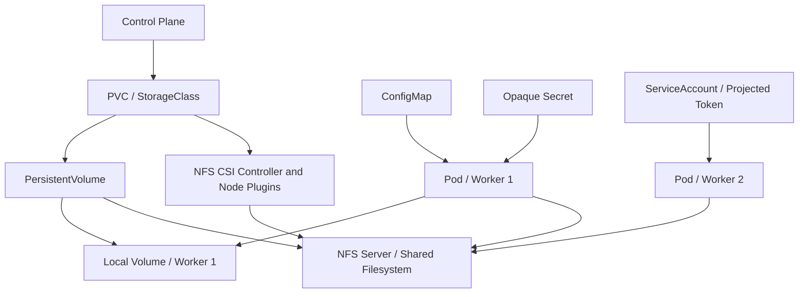

<div dir="rtl" align="right">

# ‏پروژه عملی ⁦Kubernetes Storage⁩ & ⁦Configuration⁩

‏**سطح:** ⁦Beginner⁩ → ⁦Intermediate⁩ — تمرین‌های کوتاه و پیوسته، بدون سناریوهای سنگین.

‏**محیط:** ⁦kubeadm⁩؛ یک ⁦Control Plane⁩ و دو ⁦Worker.⁩ پیشنهاد: ⁦Kubernetes⁩ ⁦1.29⁩ یا جدیدتر برای مرحله ⁦ReadWriteOncePod.⁩ برای ⁦NFS⁩، ⁦Ubuntu⁩ یا ⁦Debian⁩ روی ⁦Node⁩ها فرض شده است.

‏**داستان پروژه:** تیم ⁦Platform⁩ یک سرویس گزارش‌گیری دارد. گزارش‌های محلی و مشترک را نگه می‌دارد و تنظیمات و هویت ⁦Application⁩ را جدا از ⁦Image⁩ مدیریت می‌کند. برای جلوگیری از پیچیدگی، از ⁦Pod⁩های کوچک ⁦BusyBox⁩ استفاده می‌کنیم، نه ⁦Database⁩ یا ⁦StatefulSet.⁩

‏**پیش‌نیازها:** دسترسی مجاز مدیریتی به ⁦Cluster⁩ و ⁦SSH⁩ به ⁦Node⁩های آزمایشی، فضای آزاد، شبکه داخلی قابل اعتماد، دسترسی به ⁦Registry⁩ و ⁦Bash.⁩ اگر ⁦NFS⁩ یا ⁦CSI⁩ آماده نیست، بخش نصب اختیاری است؛ مرحله‌های وابسته بعد از آماده شدن ⁦Backend⁩ قابل اجرا هستند.

> [!WARNING]
> ‏این پروژه فقط برای ⁦Cluster⁩ آزمایشی است. مسیرهای اختصاصی جدید ایجاد کن و هیچ دیسک واقعی، داده موجود، ⁦StorageClass⁩ پیش‌فرض یا تنظیمات ⁦Control Plane⁩ را تغییر نده. اگر ⁦Pod Security Policy/Admission⁩ مانع ⁦hostPath⁩ یا ⁦CSI⁩ شد، سیاست سراسری را تضعیف نکن و آن مرحله را در محیط مجاز اجرا کن. ⁦Secret⁩ و ⁦Token⁩ واقعی را در ⁦GitHub⁩ قرار نده.

‏**هدف:** شناخت ⁦Storage⁩ محلی، ⁦Storage⁩ شبکه، چرخه ⁦PV/PVC⁩، چهار ⁦Access Mode⁩، دو ⁦VolumeMode⁩، ⁦CSI⁩ و تنظیمات و هویت ⁦Pod.⁩

</div>

<div dir="rtl" align="right">

## ‏فهرست مطالب

- ‏[بخش اول — سناریو و تمرین](#part-1)
- ‏[بخش دوم — پاسخ‌نامه](#part-2)
- ‏[اعتبارسنجی و Cleanup](#final)
- ‏[منابع رسمی](#references)

</div>

<div dir="rtl" align="right">

## ‏معماری پروژه

</div>



<a name="part-1"></a>

<div dir="rtl" align="right">

## ‏بخش اول — سناریو و چالش‌ها

‏تمام مراحل را به ترتیب انجام بده. نام‌ها و نتیجه مورد انتظار مشخص شده‌اند؛ پاسخ‌ها را فقط در صورت نیاز باز کن. در مراحل اختیاری، اگر ⁦Backend⁩ یا مجوز مناسب نداری، مطالعه و مقایسه مفهومی کافی است.

</div>

<a name="phase-01"></a>

<div dir="rtl" align="right">

### ‏مرحله ⁦01⁩ — آماده‌سازی ⁦Cluster⁩ و ⁦Namespace⁩

‏**هدف:** ایجاد محیط ایزوله و شناسایی ⁦Storage⁩ موجود.

‏**وظایف و ⁦Checklist⁩**

- [ ] ‏سلامت یک ⁦Control Plane⁩ و دو ⁦Worker⁩ و ⁦Context⁩ فعلی را بررسی کن.
- [ ] ‏یک ⁦Namespace⁩ با نام ⁦`storage-lab`⁩ بساز؛ اگر از قبل وجود دارد ادامه نده.
- [ ] ‏نام و ⁦Hostname Label⁩ و ⁦Internal IP⁩ هر ⁦Node⁩ و ⁦StorageClass⁩ و ⁦CSIDriver⁩ موجود را ثبت کن. هیچ ⁦StorageClass⁩ پیش‌فرضی را تغییر نده.

‏**معیار پذیرش:** هر سه ⁦Node⁩ سالم و ⁦Namespace⁩ فعال باشد؛ نام دو ⁦Worker⁩ و ⁦IP⁩های واقعی را بدانی.

</div>

---

<a name="phase-02"></a>

<div dir="rtl" align="right">

### ‏مرحله ⁦02⁩ — ⁦hostPath⁩ و چرخه عمر ⁦Pod⁩

‏**هدف:** دیدن تفاوت ⁦Storage⁩ محلی با ⁦Storage⁩ وابسته به ⁦Pod.⁩

‏**وظایف و ⁦Checklist⁩**

- [ ] ‏روی ⁦Worker⁩ اول یک ⁦Pod⁩ با نام ⁦`host-a`⁩ و ⁦Image⁩ برابر ⁦`busybox:1.36.1`⁩ بساز؛ مسیر اختصاصی ⁦`/var/lib/k8s-storage-lab/host`⁩ از نوع ⁦DirectoryOrCreate⁩ در ⁦`/data`⁩ قرار بگیرد.
- [ ] ‏فایل ⁦`note.txt`⁩ با محتوای ⁦`worker-one`⁩ بساز؛ ⁦Pod⁩ را حذف و با همان تنظیمات روی ⁦Worker⁩ اول بازسازی کن.
- [ ] ‏⁦Pod⁩ دیگری با نام ⁦`host-b`⁩ روی ⁦Worker⁩ دوم و همان مسیر بساز؛ وجود فایل را مقایسه کن. فقط مسیر اختصاصی آزمایش را استفاده کن.

‏**معیار پذیرش:** فایل روی همان ⁦Worker⁩ باقی بماند، ولی ⁦Worker⁩ دوم فایل ⁦Worker⁩ اول را نداشته باشد.

</div>

---

<a name="phase-03"></a>

<div dir="rtl" align="right">

### ‏مرحله ⁦03⁩ — ⁦PersistentVolume⁩ و ⁦PersistentVolumeClaim⁩ — ⁦Static⁩

‏**هدف:** جدا کردن درخواست ⁦Storage⁩ از تعریف ⁦Backend⁩ و بررسی ⁦ReadWriteOnce.⁩

‏**وظایف و ⁦Checklist⁩**

- [ ] ‏روی ⁦Worker⁩ اول یک مسیر جدید ⁦`/var/lib/k8s-storage-lab/local`⁩ ایجاد کن.
- [ ] ‏یک ⁦PV⁩ با نام ⁦`storage-lab-local-pv`⁩، ظرفیت ⁦1Gi⁩، حالت ⁦Filesystem⁩، ⁦Access Mode⁩ برابر ⁦ReadWriteOnce⁩، ⁦Reclaim Policy⁩ برابر ⁦Retain⁩ و بدون ⁦StorageClass⁩ بساز. نوع ⁦Backend⁩ برابر ⁦local⁩ و محدود به ⁦Worker⁩ اول باشد.
- [ ] ‏یک ⁦PVC⁩ به نام ⁦`local-claim`⁩ با درخواست ⁦512Mi⁩ و مشخصات سازگار بساز؛ به همان ⁦PV⁩ متصل شود.
- [ ] ‏دو ⁦Pod⁩ به نام ⁦`local-a`⁩ و ⁦`local-b`⁩ با یک ⁦PVC⁩ مشترک بساز؛ فایل ⁦`report.txt`⁩ را در یکی بنویس و در دیگری بخوان.

‏**معیار پذیرش:** ⁦PVC⁩ و ⁦PV⁩ در وضعیت ⁦Bound⁩ و هر دو ⁦Pod⁩ روی ⁦Worker⁩ اول باشند؛ فایل مشترک قابل خواندن باشد.

</div>

---

<a name="phase-04"></a>

<div dir="rtl" align="right">

### ‏مرحله ⁦04⁩ — ⁦Storage Life Cycle⁩ و ⁦Retain⁩

‏**هدف:** آشنایی با ⁦Available⁩، ⁦Bound⁩، ⁦Released⁩ و حفاظت از داده.

‏**وظایف و ⁦Checklist⁩**

- [ ] ‏با وجود ⁦Pod⁩های مصرف‌کننده، حذف ⁦`local-claim`⁩ را درخواست کن و وضعیت حفاظت ⁦PVC⁩ را بررسی کن؛ ⁦Finalizer⁩ را دستی حذف نکن.
- [ ] ‏هر دو ⁦Pod⁩ را حذف کن؛ وضعیت ⁦PV⁩ و فایل ذخیره شده را بررسی کن.
- [ ] ‏همان ⁦Storage⁩ را با ⁦PV⁩ جدید و ⁦PVC⁩ به نام ⁦`local-recovered`⁩ دوباره در اختیار ⁦Pod⁩ به نام ⁦`local-recovered-pod`⁩ قرار بده؛ داده قبلی حذف نشود.
- [ ] ‏تفاوت ⁦Retain⁩، ⁦Delete⁩ و ⁦Recycle⁩ را یادداشت کن؛ ⁦Recycle⁩ را روی داده واقعی اجرا نکن.

‏**معیار پذیرش:** ⁦PV⁩ قبلی ⁦Released⁩ شده باشد و بعد از بازیابی، محتوای ⁦report.txt⁩ همچنان قابل خواندن باشد.

</div>

---

<a name="phase-05"></a>

<div dir="rtl" align="right">

### ‏مرحله ⁦05⁩ — ⁦NFS Storage Engine⁩ و ⁦Static NFS PV⁩ — ⁦ReadWriteMany⁩

‏**هدف:** اشتراک داده بین دو ⁦Worker⁩ با ⁦NFS.⁩

‏**وظایف و ⁦Checklist⁩**

- [ ] ‏روی ⁦Worker⁩ اول یا یک ⁦VM⁩ اختصاصی ⁦Ubuntu⁩ یک ⁦NFS Server⁩ آزمایشی با مسیر ⁦`/srv/k8s-storage-lab`⁩ آماده کن؛ دسترسی فقط برای ⁦IP⁩های ⁦Node⁩های ⁦Cluster⁩، بدون غیرفعال کردن ⁦root_squash⁩ باشد.
- [ ] ‏سه زیرمسیر ⁦`static`⁩، ⁦`readonly`⁩ و ⁦`dynamic`⁩ آماده کن. روی ⁦Node⁩ها قابلیت ⁦NFS Client⁩ را بررسی کن.
- [ ] ‏یک ⁦PV⁩ به نام ⁦`storage-lab-nfs-pv`⁩ از نوع ⁦NFS⁩ با مسیر ⁦static⁩، ظرفیت ⁦1Gi⁩، ⁦ReadWriteMany⁩ و ⁦Retain⁩ بساز؛ ⁦PVC⁩ به نام ⁦`nfs-shared`⁩ با ⁦512Mi⁩ ایجاد کن.
- [ ] ‏دو ⁦Pod⁩ با نام‌های ⁦`nfs-a`⁩ و ⁦`nfs-b`⁩ روی دو ⁦Worker⁩ متفاوت و مسیر ⁦`/data`⁩ بساز؛ از هر دو سمت فایل مشترک را بخوان و بنویس.

‏**معیار پذیرش:** دو ⁦Pod⁩ روی ⁦Worker⁩های متفاوت از یک فایل مشترک استفاده کنند.

</div>

---

<a name="phase-06"></a>

<div dir="rtl" align="right">

### ‏مرحله ⁦06⁩ — ⁦ReadOnlyMany⁩ و ⁦Mount Read-only⁩

‏**هدف:** بررسی دسترسی خواندنی از دو ⁦Node.⁩

‏**وظایف و ⁦Checklist⁩**

- [ ] ‏در زیرمسیر ⁦readonly⁩ روی ⁦NFS Server⁩ یک فایل ⁦`reference.txt`⁩ با مقدار ⁦`read-only reference`⁩ قرار بده.
- [ ] ‏یک ⁦PV⁩ به نام ⁦`storage-lab-ro-pv`⁩ با ⁦ReadOnlyMany⁩ و ⁦Retain⁩ و ⁦PVC⁩ به نام ⁦`nfs-readonly`⁩ بساز؛ به زیرمسیر ⁦readonly⁩ متصل شود.
- [ ] ‏دو ⁦Pod⁩ به نام‌های ⁦`ro-a`⁩ و ⁦`ro-b`⁩ روی دو ⁦Worker⁩ با ⁦Mount⁩ فقط خواندنی ایجاد کن؛ خواندن و نوشتن آزمایشی را مقایسه کن.

‏**معیار پذیرش:** خواندن فایل از دو ⁦Worker⁩ ممکن و نوشتن از هر دو ناموفق باشد.

</div>

---

<a name="phase-07"></a>

<div dir="rtl" align="right">

### ‏مرحله ⁦07⁩ — ⁦CSI⁩ و ⁦StorageClass⁩ — ⁦Dynamic Provisioning⁩

‏**هدف:** ایجاد خودکار ⁦PV⁩ به کمک ⁦NFS CSI Driver.⁩

‏**وظایف و ⁦Checklist⁩**

- [ ] ‏در صورت نبود ⁦NFS CSI Driver⁩، نسخه سازگار آن را نصب کن؛ اگر نصب است از همان استفاده کن و آن را تغییر نده.
- [ ] ‏یک ⁦StorageClass⁩ به نام ⁦`storage-lab-nfs`⁩ با ⁦Provisioner⁩ برابر ⁦`nfs.csi.k8s.io`⁩، مسیر ⁦dynamic⁩، ⁦Reclaim Policy⁩ برابر ⁦Delete⁩، و ⁦VolumeBindingMode⁩ برابر ⁦Immediate⁩ بساز. پیش‌فرض ⁦Cluster⁩ نباشد.
- [ ] ‏یک ⁦PVC⁩ با نام ⁦`dynamic-claim`⁩ با ⁦512Mi⁩ و ⁦ReadWriteMany⁩ بساز؛ ⁦PV⁩ را دستی ایجاد نکن.
- [ ] ‏یک ⁦Pod⁩ با نام ⁦`dynamic-app`⁩ بساز؛ یک فایل آزمایشی ایجاد کن و اتصال خودکار ⁦PV⁩ و زیرمسیر جدید ⁦NFS⁩ را بررسی کن.

‏**معیار پذیرش:** ⁦PVC⁩ به صورت خودکار ⁦Bound⁩ و فایل در ⁦Storage⁩ جدید ذخیره شود.

</div>

---

<a name="phase-08"></a>

<div dir="rtl" align="right">

### ‏مرحله ⁦08⁩ — ⁦Delete Reclaim Policy⁩ و ⁦StorageClass Troubleshooting⁩

‏**هدف:** آشنایی با حذف ⁦Backend⁩ و دلیل ⁦Pending⁩ شدن ⁦PVC.⁩

‏**وظایف و ⁦Checklist⁩**

- [ ] ‏یک ⁦PVC⁩ آزمایشی به نام ⁦`bad-claim`⁩ با ⁦StorageClass⁩ ناموجود ⁦`storage-lab-missing`⁩ ایجاد کن؛ علت ⁦Pending⁩ را پیدا کن و ⁦PVC⁩ معیوب را حذف کن.
- [ ] ‏نام ⁦PV⁩ و مسیر ⁦Storage⁩ مربوط به ⁦dynamic-claim⁩ را ثبت کن؛ ⁦Pod⁩ مصرف‌کننده را حذف و سپس ⁦PVC⁩ را حذف کن.
- [ ] ‏حذف ⁦PV⁩ و زیرمسیر اختصاصی آن را بررسی کن؛ فایل‌های ⁦Static⁩ و دیگر ⁦PVC⁩ها نباید حذف شوند.
- [ ] ‏در مورد ⁦WaitForFirstConsumer⁩ و تفاوت آن با ⁦Immediate⁩ و کاربرد ⁦Recycle⁩ تحقیق کن؛ ⁦Recycle⁩ را اجرا نکن.

‏**معیار پذیرش:** ⁦PVC⁩ نامعتبر پاک شود و ⁦PV⁩ دینامیک و داده آزمایشی مربوط به آن طبق ⁦Delete⁩ حذف شوند.

</div>

---

<a name="phase-09"></a>

<div dir="rtl" align="right">

### ‏مرحله ⁦09⁩ — ⁦ReadWriteOncePod⁩ — اختیاری وابسته به ⁦CSI⁩

‏**هدف:** مقایسه محدودیت یک ⁦Pod⁩ با محدودیت یک ⁦Node.⁩

‏**وظایف و ⁦Checklist⁩**

- [ ] ‏روی ⁦Kubernetes⁩ نسخه ⁦1.29⁩ یا جدیدتر و ⁦CSI⁩ سازگار با ⁦ReadWriteOncePod⁩ یک ⁦PVC⁩ به نام ⁦`single-pod-claim`⁩ با ⁦512Mi⁩ و حالت ⁦Filesystem⁩ بساز.
- [ ] ‏دو ⁦Pod⁩ به نام‌های ⁦`single-a`⁩ و ⁦`single-b`⁩ با همین ⁦PVC⁩ و روی ⁦Worker⁩ اول ایجاد کن؛ ابتدا ⁦single-a⁩ باید آماده شود.
- [ ] ‏وضعیت ⁦Pod⁩ دوم را بررسی کن؛ پس از حذف ⁦single-a⁩ بررسی کن آیا ⁦single-b⁩ آماده می‌شود. اگر ⁦Driver⁩ پشتیبانی نمی‌کند مرحله عملی را رد و تفاوت را توضیح بده.

‏**معیار پذیرش:** در صورت پشتیبانی ⁦Driver⁩، هم‌زمان تنها یک ⁦Pod⁩ قادر به استفاده از ⁦PVC⁩ باشد.

</div>

---

<a name="phase-10"></a>

<div dir="rtl" align="right">

### ‏مرحله ⁦10⁩ — ⁦VolumeMode⁩ — ⁦Filesystem⁩ و ⁦Block⁩ (اختیاری)

‏**هدف:** درک تفاوت ⁦Mount⁩ فایل‌سیستم با ارائه دستگاه خام.

‏**وظایف و ⁦Checklist⁩**

- [ ] ‏یک ⁦PVC⁩ از مراحل قبلی را به‌عنوان ⁦Filesystem⁩ بررسی کن.
- [ ] ‏اگر ابزار و مجوز داری، روی ⁦Worker⁩ اول یک ⁦Loop Device⁩ از فایل جدید ⁦64MiB⁩ و اختصاصی بساز؛ هرگز از دیسک اصلی یا پارتیشن واقعی استفاده نکن.
- [ ] ‏یک ⁦local PV⁩ با نام ⁦`storage-lab-block-pv`⁩ و ⁦PVC⁩ به نام ⁦`block-claim`⁩ با ظرفیت ⁦64Mi⁩، ⁦ReadWriteOnce⁩، ⁦Retain⁩ و ⁦VolumeMode⁩ برابر ⁦Block⁩ ایجاد کن.
- [ ] ‏در ⁦Pod⁩ به نام ⁦`block-app`⁩ دستگاه را در ⁦`/dev/lab-block`⁩ ارائه کن؛ صرفاً وجود و خواندن چند بایت را بررسی کن؛ فرمت یا نوشتن لازم نیست.

‏**معیار پذیرش:** در صورت امکان آزمایش، دستگاه ⁦Block⁩ در ⁦Pod⁩ قابل مشاهده باشد و تفاوت ⁦volumeDevices⁩ و ⁦volumeMounts⁩ مشخص شود.

</div>

---

<a name="phase-11"></a>

<div dir="rtl" align="right">

### ‏مرحله ⁦11⁩ — ⁦ConfigMap⁩ — ⁦Environment Variable⁩ و ⁦Volume⁩

‏**هدف:** جدا کردن ⁦Configuration⁩ از ⁦Image.⁩

‏**وظایف و ⁦Checklist⁩**

- [ ] ‏یک ⁦ConfigMap⁩ به نام ⁦`app-config`⁩ با ⁦APP_MODE⁩ برابر ⁦development⁩، ⁦LOG_LEVEL⁩ برابر ⁦info⁩ و کلید ⁦app.conf⁩ با محتوای ⁦`port=8080`⁩ بساز.
- [ ] ‏یک ⁦Pod⁩ با نام ⁦`config-app`⁩ ایجاد کن؛ متغیرها از ⁦ConfigMap⁩ و فایل‌ها از مسیر ⁦`/etc/app`⁩ در دسترس باشند. ⁦app.conf⁩ را جداگانه نیز با ⁦subPath⁩ در ⁦`/tmp/app.conf`⁩ قرار بده.
- [ ] ‏مقدار ⁦LOG_LEVEL⁩ را به ⁦debug⁩ و ⁦app.conf⁩ را به ⁦`port=9090`⁩ تغییر بده؛ تغییر ⁦Environment Variable⁩، ⁦Volume⁩ عادی و ⁦subPath⁩ را مقایسه کن؛ ⁦Pod⁩ را بازسازی کن.

‏**معیار پذیرش:** ⁦Volume⁩ عادی با تأخیر به‌روز شود، ⁦Environment Variable⁩ و ⁦subPath⁩ پس از بازسازی مقدار جدید را نشان دهند.

</div>

---

<a name="phase-12"></a>

<div dir="rtl" align="right">

### ‏مرحله ⁦12⁩ — ⁦Secret⁩ — ⁦Opaque⁩ و ⁦ServiceAccount⁩

‏**هدف:** مدیریت داده حساس آموزشی و هویت ⁦Pod.⁩

‏**وظایف و ⁦Checklist⁩**

- [ ] ‏یک ⁦Secret⁩ نوع ⁦Opaque⁩ به نام ⁦`app-secret`⁩ با ⁦username⁩ برابر ⁦lab-user⁩ و ⁦password⁩ نمونه و غیرواقعی ایجاد کن.
- [ ] ‏یک ⁦ServiceAccount⁩ با نام ⁦`storage-app`⁩ بساز؛ ⁦Mount⁩ خودکار ⁦Token⁩ غیرفعال باشد.
- [ ] ‏یک ⁦Pod⁩ به نام ⁦`secure-app`⁩ با ⁦ServiceAccount⁩ اختصاصی بساز؛ ⁦username⁩ از ⁦Secret⁩ به ⁦Environment Variable⁩ و ⁦Secret⁩ به صورت ⁦Volume⁩ فقط خواندنی در ⁦`/etc/secret`⁩ در دسترس باشد؛ ⁦password⁩ را چاپ نکن.
- [ ] ‏یک ⁦Pod⁩ به نام ⁦`token-app`⁩ با همان ⁦ServiceAccount⁩ و ⁦Token⁩ از نوع ⁦Projected⁩ در مسیر ⁦`/var/run/lab-token`⁩ با اعتبار درخواستی ⁦3600⁩ ثانیه بساز؛ فقط وجود فایل را بررسی کن و ⁦Token⁩ را چاپ نکن.

‏**معیار پذیرش:** ⁦Secret⁩ و ⁦ConfigMap⁩ جدا باشند، ⁦secure-app Token⁩ پیش‌فرض نداشته باشد و ⁦token-app⁩ فایل ⁦Token⁩ کوتاه‌مدت داشته باشد؛ مجوز ⁦RBAC⁩ اضافی ایجاد نشود.

</div>

---

<div dir="rtl" align="right">

### ‏معیار پذیرش نهایی و ⁦Skills Acquired⁩

- [ ] ‏تفاوت ⁦hostPath⁩ و ⁦PV⁩ و ⁦PVC⁩ و پایداری داده را با آزمایش مشاهده کرده‌ام.
- [ ] ‏چرخه ⁦Provisioning⁩، ⁦Binding⁩، ⁦Using⁩، ⁦Releasing⁩ و ⁦Reclaiming⁩ را درک کرده‌ام.
- [ ] ‏⁦ReadWriteOnce⁩، ⁦ReadOnlyMany⁩، ⁦ReadWriteMany⁩ و ⁦ReadWriteOncePod⁩ را از هم تشخیص می‌دهم.
- [ ] ‏تفاوت ⁦Filesystem⁩ و ⁦Block⁩ و نقش ⁦CSI⁩ و ⁦StorageClass⁩ را می‌دانم.
- [ ] ‏⁦ConfigMap⁩، ⁦Secret⁩ نوع ⁦Opaque⁩ و ⁦ServiceAccount⁩ را در ⁦Pod⁩ استفاده کرده‌ام.
- [ ] ‏منابع آزمایشی و داده‌هایی که دیگر لازم نیستند با روش ایمن پاک شده‌اند.

</div>

<a name="part-2"></a>

<div dir="rtl" align="right">

## ‏بخش دوم — پاسخ‌نامه و نکات فنی

‏پاسخ هر مرحله بسته است. فایل‌های ⁦YAML⁩ را با نام مشخص در یک پوشه کاری روی سیستم مدیریتی ذخیره کن. ⁦Command⁩ها را مرحله‌به‌مرحله اجرا کن، نه به شکل یک ⁦Script⁩ واحد. خطاهای عمدی را جداگانه اجرا کن. خروجی‌های ذکرشده نمونه هستند. تمام ⁦Placeholder⁩های نوشته‌شده با حروف بزرگ در ⁦Manifest⁩ها را با مقدار واقعی جایگزین کن؛ مقادیر ⁦`WORKER1_HOSTNAME`⁩ و ⁦`WORKER2_HOSTNAME`⁩ باید مقدار ⁦Label⁩ مربوط به ⁦kubernetes.io/hostname⁩ باشند، نه لزوماً نام ⁦Node.⁩ ⁦`NFS_SERVER_IP`⁩ باید ⁦IP⁩ واقعی ⁦Server⁩ باشد. ⁦`LOOP_DEVICE_PATH`⁩ فقط برای مرحله اختیاری ⁦Block⁩ است.

‏برای تمام مراحل ⁦Namespace⁩ در ⁦Manifest⁩ یا ⁦Command⁩ مشخص است. در دستورهای ⁦SSH⁩ و ⁦sudo⁩، محل اجرا جداگانه ذکر شده است.

</div>

<details>
<summary dir="rtl" align="right">‏مرحله 01 — آماده‌سازی ⁦Cluster⁩ و ⁦Namespace⁩</summary>


<div dir="rtl" align="right">

#### ‏راه‌حل و مراحل اجرا

</div>

<div dir="rtl" align="right">

‏**فایل:** ⁦`namespace.yaml`⁩

</div>

```yaml
apiVersion: v1
kind: Namespace
metadata:
  name: storage-lab
```

```bash
kubectl config current-context
kubectl version
kubectl get nodes -o wide -L kubernetes.io/hostname
kubectl get storageclass
kubectl get csidrivers
kubectl get pv
kubectl get namespace storage-lab --ignore-not-found
# Only if namespace does not already exist:
kubectl apply -f namespace.yaml
kubectl get ns storage-lab
```

<div dir="rtl" align="right">

#### ‏توضیحات فنی و ⁦Troubleshooting⁩

‏⁦PV⁩ و ⁦StorageClass⁩ و ⁦CSIDriver⁩ در سطح ⁦Cluster⁩ هستند؛ ⁦PVC⁩ و ⁦Pod⁩ در ⁦Namespace⁩ هستند. اگر نام‌های ⁦PV⁩ یا ⁦StorageClass⁩ این پروژه از قبل وجود دارند، نام‌های پروژه را عوض کن یا در ⁦Cluster⁩ آزمایشی دیگری اجرا کن. اگر ⁦Worker⁩ها ⁦Ready⁩ نیستند ابتدا مشکل ⁦Cluster⁩ را رفع کن.

#### ‏⁦Interview Q⁩&⁦A⁩

‏**سؤال:** آیا ⁦kubeadm⁩ به طور پیش‌فرض ⁦Dynamic Provisioner⁩ دارد؟ معمولاً خیر؛ ⁦Storage Backend⁩ و ⁦Provisioner⁩ جداگانه آماده می‌شوند.

</div>

</details>

---

<details>
<summary dir="rtl" align="right">‏مرحله 02 — ⁦hostPath⁩ و چرخه عمر ⁦Pod⁩</summary>


<div dir="rtl" align="right">

#### ‏راه‌حل و مراحل اجرا

</div>

<div dir="rtl" align="right">

‏**فایل:** ⁦`host-a.yaml`⁩

</div>

```yaml
apiVersion: v1
kind: Pod
metadata:
  name: host-a
  namespace: storage-lab
spec:
  automountServiceAccountToken: false
  containers:
  - name: app
    image: busybox:1.36.1
    command:
    - sh
    - -c
    - sleep 36000
    resources:
      requests:
        cpu: 10m
        memory: 8Mi
      limits:
        cpu: 100m
        memory: 32Mi
    volumeMounts:
    - name: data
      mountPath: /data
  nodeSelector:
    kubernetes.io/hostname: WORKER1_HOSTNAME
  volumes:
  - name: data
    hostPath:
      path: /var/lib/k8s-storage-lab/host
      type: DirectoryOrCreate
```

<div dir="rtl" align="right">

‏**فایل:** ⁦`host-b.yaml`⁩

</div>

```yaml
apiVersion: v1
kind: Pod
metadata:
  name: host-b
  namespace: storage-lab
spec:
  automountServiceAccountToken: false
  containers:
  - name: app
    image: busybox:1.36.1
    command:
    - sh
    - -c
    - sleep 36000
    resources:
      requests:
        cpu: 10m
        memory: 8Mi
      limits:
        cpu: 100m
        memory: 32Mi
    volumeMounts:
    - name: data
      mountPath: /data
  nodeSelector:
    kubernetes.io/hostname: WORKER2_HOSTNAME
  volumes:
  - name: data
    hostPath:
      path: /var/lib/k8s-storage-lab/host
      type: DirectoryOrCreate
```

```bash
kubectl apply -f host-a.yaml
kubectl -n storage-lab wait --for=condition=Ready pod/host-a --timeout=120s
kubectl -n storage-lab exec host-a -- sh -c 'echo worker-one > /data/note.txt'
kubectl -n storage-lab delete pod host-a
kubectl apply -f host-a.yaml
kubectl -n storage-lab wait --for=condition=Ready pod/host-a --timeout=120s
kubectl -n storage-lab exec host-a -- cat /data/note.txt
kubectl apply -f host-b.yaml
kubectl -n storage-lab wait --for=condition=Ready pod/host-b --timeout=120s
kubectl -n storage-lab get pods -o wide
kubectl -n storage-lab exec host-b -- sh -c 'test ! -e /data/note.txt && echo isolated'
kubectl -n storage-lab delete pod host-a host-b
```

<div dir="rtl" align="right">

#### ‏توضیحات فنی و ⁦Troubleshooting⁩

‏خروجی مورد انتظار ⁦worker-one⁩ روی ⁦Worker⁩ اول و ⁦isolated⁩ روی ⁦Worker⁩ دوم است. ⁦DirectoryOrCreate⁩ در صورت نبود مسیر دایرکتوری می‌سازد؛ ⁦Node Selector⁩ مکان اجرا را مشخص می‌کند. ⁦hostPath⁩ به ⁦Pod⁩ اجازه دسترسی مستقیم به فایل‌های ⁦Host⁩ می‌دهد؛ از مسیرهای حساس مانند /⁦etc⁩ یا ⁦socket⁩های ⁦Container Runtime⁩ استفاده نکن. اگر مسیر ساخته نمی‌شود ⁦Events⁩ و مجوزها را بررسی کن. ⁦emptyDir⁩ با حذف ⁦Pod⁩ از بین می‌رود؛ ⁦hostPath⁩ روی همان ⁦Node⁩ باقی می‌ماند.

#### ‏⁦Interview Q⁩&⁦A⁩

‏**سؤال:** آیا ⁦hostPath⁩ برای انتقال داده به ⁦Worker⁩ دیگر مناسب است؟ خیر، هر ⁦Node⁩ فایل‌سیستم مستقل دارد.

</div>

</details>

---

<details>
<summary dir="rtl" align="right">‏مرحله 03 — ⁦PersistentVolume⁩ و ⁦PersistentVolumeClaim⁩ — ⁦Static⁩</summary>


<div dir="rtl" align="right">

#### ‏راه‌حل و مراحل اجرا

</div>

<div dir="rtl" align="right">

‏روی ⁦Worker⁩ اول از طریق ⁦SSH⁩ اجرا کن. مسیر باید جدید و مختص این آزمایش باشد.

</div>

```bash
sudo mkdir -p /var/lib/k8s-storage-lab/local
sudo ls -ld /var/lib/k8s-storage-lab/local
```

<div dir="rtl" align="right">

‏**فایل:** ⁦`local-storage.yaml`⁩

</div>

```yaml
apiVersion: v1
kind: PersistentVolume
metadata:
  name: storage-lab-local-pv
spec:
  capacity:
    storage: 1Gi
  volumeMode: Filesystem
  accessModes:
  - ReadWriteOnce
  persistentVolumeReclaimPolicy: Retain
  storageClassName: ''
  claimRef:
    namespace: storage-lab
    name: local-claim
  local:
    path: /var/lib/k8s-storage-lab/local
  nodeAffinity:
    required:
      nodeSelectorTerms:
      - matchExpressions:
        - key: kubernetes.io/hostname
          operator: In
          values:
          - WORKER1_HOSTNAME
---
apiVersion: v1
kind: PersistentVolumeClaim
metadata:
  name: local-claim
  namespace: storage-lab
spec:
  accessModes:
  - ReadWriteOnce
  volumeMode: Filesystem
  storageClassName: ''
  resources:
    requests:
      storage: 512Mi
  volumeName: storage-lab-local-pv
```

<div dir="rtl" align="right">

‏**فایل:** ⁦`local-pods.yaml`⁩

</div>

```yaml
apiVersion: v1
kind: Pod
metadata:
  name: local-a
  namespace: storage-lab
spec:
  automountServiceAccountToken: false
  containers:
  - name: app
    image: busybox:1.36.1
    command:
    - sh
    - -c
    - sleep 36000
    resources:
      requests:
        cpu: 10m
        memory: 8Mi
      limits:
        cpu: 100m
        memory: 32Mi
    volumeMounts:
    - name: data
      mountPath: /data
  volumes:
  - name: data
    persistentVolumeClaim:
      claimName: local-claim
---
apiVersion: v1
kind: Pod
metadata:
  name: local-b
  namespace: storage-lab
spec:
  automountServiceAccountToken: false
  containers:
  - name: app
    image: busybox:1.36.1
    command:
    - sh
    - -c
    - sleep 36000
    resources:
      requests:
        cpu: 10m
        memory: 8Mi
      limits:
        cpu: 100m
        memory: 32Mi
    volumeMounts:
    - name: data
      mountPath: /data
  volumes:
  - name: data
    persistentVolumeClaim:
      claimName: local-claim
```

```bash
kubectl apply -f local-storage.yaml
kubectl -n storage-lab get pvc
kubectl get pv storage-lab-local-pv
kubectl apply -f local-pods.yaml
kubectl -n storage-lab wait --for=condition=Ready pod/local-a pod/local-b --timeout=120s
kubectl -n storage-lab get pods -o wide
kubectl -n storage-lab exec local-a -- sh -c 'echo report-v1 > /data/report.txt'
kubectl -n storage-lab exec local-b -- cat /data/report.txt
```

<div dir="rtl" align="right">

#### ‏توضیحات فنی و ⁦Troubleshooting⁩

‏خروجی ⁦report-v1⁩ است. ⁦capacity⁩ ظرفیت اعلامی ⁦PV⁩ و ⁦requests.storage⁩ حداقل درخواست ⁦PVC⁩ است. این اعداد برای یک دایرکتوری محلی سهمیه واقعی ایجاد نمی‌کنند. ⁦storageClassName⁩ خالی صریحاً ⁦Dynamic Provisioning⁩ پیش‌فرض را کنار می‌گذارد. ⁦claimRef⁩ رزرو ⁦PV⁩ برای ⁦PVC⁩ مشخص است؛ ⁦volumeName⁩ درخواست اتصال به همان ⁦PV⁩ است. ⁦nodeAffinity⁩ باعث می‌شود ⁦Pod⁩ به ⁦Node⁩ دارای ⁦Storage⁩ هدایت شود. اگر ⁦Pending⁩ است، اندازه، ⁦mode⁩، ⁦class⁩، ⁦claimRef⁩ و ⁦Events⁩ را بررسی کن.

#### ‏⁦Interview Q⁩&⁦A⁩

‏**سؤال:** آیا ⁦RWO⁩ یعنی فقط یک ⁦Pod⁩؟ خیر؛ چند ⁦Pod⁩ روی یک ⁦Node⁩ می‌توانند از همان ⁦Volume⁩ استفاده کنند. محدودیت ⁦Access Mode⁩ به تنهایی تضمین قفل نوشتن نیست.

</div>

</details>

---

<details>
<summary dir="rtl" align="right">‏مرحله 04 — ⁦Storage Life Cycle⁩ و ⁦Retain⁩</summary>


<div dir="rtl" align="right">

#### ‏راه‌حل و مراحل اجرا

</div>

```bash
kubectl -n storage-lab delete pvc local-claim --wait=false
kubectl -n storage-lab get pvc local-claim
kubectl -n storage-lab describe pvc local-claim
kubectl -n storage-lab delete pod local-a local-b
kubectl -n storage-lab wait --for=delete pvc/local-claim --timeout=120s
kubectl get pv storage-lab-local-pv
# Confirm Released and no remaining consumers before continuing.
kubectl delete pv storage-lab-local-pv
```

<div dir="rtl" align="right">

‏در ⁦Worker⁩ اول فایل قبلی را بررسی کن؛ نباید پاک شده باشد.

</div>

```bash
sudo cat /var/lib/k8s-storage-lab/local/report.txt
```

<div dir="rtl" align="right">

‏**فایل:** ⁦`local-recovery.yaml`⁩

</div>

```yaml
apiVersion: v1
kind: PersistentVolume
metadata:
  name: storage-lab-recovered-pv
spec:
  capacity:
    storage: 1Gi
  volumeMode: Filesystem
  accessModes:
  - ReadWriteOnce
  persistentVolumeReclaimPolicy: Retain
  storageClassName: ''
  claimRef:
    namespace: storage-lab
    name: local-recovered
  local:
    path: /var/lib/k8s-storage-lab/local
  nodeAffinity:
    required:
      nodeSelectorTerms:
      - matchExpressions:
        - key: kubernetes.io/hostname
          operator: In
          values:
          - WORKER1_HOSTNAME
---
apiVersion: v1
kind: PersistentVolumeClaim
metadata:
  name: local-recovered
  namespace: storage-lab
spec:
  accessModes:
  - ReadWriteOnce
  volumeMode: Filesystem
  storageClassName: ''
  resources:
    requests:
      storage: 512Mi
  volumeName: storage-lab-recovered-pv
---
apiVersion: v1
kind: Pod
metadata:
  name: local-recovered-pod
  namespace: storage-lab
spec:
  automountServiceAccountToken: false
  containers:
  - name: app
    image: busybox:1.36.1
    command:
    - sh
    - -c
    - sleep 36000
    resources:
      requests:
        cpu: 10m
        memory: 8Mi
      limits:
        cpu: 100m
        memory: 32Mi
    volumeMounts:
    - name: data
      mountPath: /data
  volumes:
  - name: data
    persistentVolumeClaim:
      claimName: local-recovered
```

```bash
kubectl apply -f local-recovery.yaml
kubectl -n storage-lab wait --for=condition=Ready pod/local-recovered-pod --timeout=120s
kubectl -n storage-lab exec local-recovered-pod -- cat /data/report.txt
kubectl get pv storage-lab-recovered-pv
```

<div dir="rtl" align="right">

#### ‏توضیحات فنی و ⁦Troubleshooting⁩

‏⁦PVC⁩ هنگام استفاده ممکن است ⁦Terminating⁩ باشد؛ ⁦pvc-protection⁩ از حذف زودهنگام جلوگیری می‌کند. ⁦Retain⁩ بعد از حذف ⁦Claim⁩، ⁦PV⁩ را ⁦Released⁩ می‌کند و داده باقی می‌ماند. ⁦PV⁩ آزادشده به صورت خودکار به ⁦Claim⁩ جدید متصل نمی‌شود. روش ساده این تمرین حذف شیء ⁦PV⁩ و ساخت ⁦PV⁩ جدید روی همان ⁦Backend⁩ است؛ این کار فقط پس از اطمینان از ⁦Retain⁩ و قطع مصرف انجام شود. ⁦Delete⁩ در ⁦Driver⁩ سازگار می‌تواند هم شیء ⁦PV⁩ و هم ⁦Storage⁩ مربوطه را حذف کند. ⁦Recycle⁩ قدیمی و منسوخ است: در ⁦Plugin⁩ سازگار داده‌ها را پاک و ⁦Volume⁩ را برای ⁦Claim⁩ بعدی آماده می‌کند؛ روی داده واقعی اجرا نکن.

#### ‏⁦Interview Q⁩&⁦A⁩

‏**سؤال:** آیا حذف ⁦Pod⁩ یعنی حذف ⁦PVC⁩ یا داده؟ خیر؛ چرخه عمر ⁦PVC/PV⁩ از ⁦Pod⁩ جداست. **سؤال:** آیا ⁦Released⁩ همان ⁦Available⁩ است؟ خیر؛ ⁦Released⁩ هنوز نیازمند بازیابی مدیریتی است.

</div>

</details>

---

<details>
<summary dir="rtl" align="right">‏مرحله 05 — ⁦NFS Storage Engine⁩ و ⁦Static NFS PV⁩ — ⁦ReadWriteMany⁩</summary>


<div dir="rtl" align="right">

#### ‏راه‌حل و مراحل اجرا

</div>

<div dir="rtl" align="right">

‏روی ⁦NFS Server⁩ آزمایشی (⁦Worker⁩ اول یا یک ⁦VM⁩ جداگانه با ⁦Ubuntu⁩) اجرا کن. سه ⁦IP⁩ واقعی و ثابت ⁦Node⁩ها را هنگام درخواست وارد کن. قبل از ادامه مطمئن شو مسیر و فایل ⁦Export⁩ مختص پروژه هستند و از قبل داده ندارند. در ⁦Firewall⁩ فقط دسترسی شبکه داخلی موردنیاز ⁦NFSv4⁩ روی ⁦TCP⁩ ⁦2049⁩ را از ⁦Node⁩های مجاز فراهم کن؛ ⁦Firewall⁩ را غیرفعال نکن.

</div>

```bash
sudo apt-get update
sudo apt-get install -y nfs-kernel-server
sudo mkdir -p /srv/k8s-storage-lab/{static,readonly,dynamic}
sudo chown nobody:nogroup /srv/k8s-storage-lab/{static,readonly,dynamic}
sudo chmod 0770 /srv/k8s-storage-lab/{static,readonly,dynamic}
read -r -p 'Control plane Internal IP: ' CP_IP
read -r -p 'Worker 1 Internal IP: ' W1_IP
read -r -p 'Worker 2 Internal IP: ' W2_IP
printf '/srv/k8s-storage-lab %s(rw,sync,no_subtree_check,root_squash) %s(rw,sync,no_subtree_check,root_squash) %s(rw,sync,no_subtree_check,root_squash)\n' "$CP_IP" "$W1_IP" "$W2_IP" | sudo tee /etc/exports.d/k8s-storage-lab.exports
sudo systemctl enable --now nfs-kernel-server
sudo exportfs -ra
sudo exportfs -v
```

<div dir="rtl" align="right">

‏روی هر سه ⁦Node⁩، از جمله ⁦Control Plane⁩ که ممکن است ⁦CSI Controller⁩ روی آن اجرا شود، ابزار ⁦Client⁩ را نصب کن. از ⁦IP⁩ واقعی ⁦NFS Server⁩ استفاده کن. تست ⁦Mount⁩ زیر فقط یک بار روی هر ⁦Node⁩ انجام شود؛ در پایان ⁦Unmount⁩ کن.

</div>

```bash
sudo apt-get update
sudo apt-get install -y nfs-common
read -r -p 'NFS server IP: ' NFS_IP
sudo mkdir -p /mnt/k8s-storage-lab-test
sudo mount -t nfs -o nfsvers=4.1 "$NFS_IP:/srv/k8s-storage-lab/static" /mnt/k8s-storage-lab-test
sudo ls -la /mnt/k8s-storage-lab-test
sudo umount /mnt/k8s-storage-lab-test
```

<div dir="rtl" align="right">

‏به سیستم مدیریتی برگرد. در ⁦Manifest⁩ زیر ⁦NFS_SERVER_IP⁩ را با ⁦IP⁩ واقعی و ⁦Hostname⁩ها را مطابق ⁦Phase⁩ ⁦01⁩ جایگزین کن.

</div>

<div dir="rtl" align="right">

‏**فایل:** ⁦`nfs-static.yaml`⁩

</div>

```yaml
apiVersion: v1
kind: PersistentVolume
metadata:
  name: storage-lab-nfs-pv
spec:
  capacity:
    storage: 1Gi
  volumeMode: Filesystem
  accessModes:
  - ReadWriteMany
  persistentVolumeReclaimPolicy: Retain
  storageClassName: ''
  claimRef:
    namespace: storage-lab
    name: nfs-shared
  nfs:
    server: NFS_SERVER_IP
    path: /srv/k8s-storage-lab/static
  mountOptions:
  - nfsvers=4.1
---
apiVersion: v1
kind: PersistentVolumeClaim
metadata:
  name: nfs-shared
  namespace: storage-lab
spec:
  accessModes:
  - ReadWriteMany
  volumeMode: Filesystem
  storageClassName: ''
  resources:
    requests:
      storage: 512Mi
  volumeName: storage-lab-nfs-pv
---
apiVersion: v1
kind: Pod
metadata:
  name: nfs-a
  namespace: storage-lab
spec:
  automountServiceAccountToken: false
  containers:
  - name: app
    image: busybox:1.36.1
    command:
    - sh
    - -c
    - sleep 36000
    resources:
      requests:
        cpu: 10m
        memory: 8Mi
      limits:
        cpu: 100m
        memory: 32Mi
    volumeMounts:
    - name: data
      mountPath: /data
  nodeSelector:
    kubernetes.io/hostname: WORKER1_HOSTNAME
  volumes:
  - name: data
    persistentVolumeClaim:
      claimName: nfs-shared
---
apiVersion: v1
kind: Pod
metadata:
  name: nfs-b
  namespace: storage-lab
spec:
  automountServiceAccountToken: false
  containers:
  - name: app
    image: busybox:1.36.1
    command:
    - sh
    - -c
    - sleep 36000
    resources:
      requests:
        cpu: 10m
        memory: 8Mi
      limits:
        cpu: 100m
        memory: 32Mi
    volumeMounts:
    - name: data
      mountPath: /data
  nodeSelector:
    kubernetes.io/hostname: WORKER2_HOSTNAME
  volumes:
  - name: data
    persistentVolumeClaim:
      claimName: nfs-shared
```

```bash
kubectl apply -f nfs-static.yaml
kubectl -n storage-lab wait --for=condition=Ready pod/nfs-a pod/nfs-b --timeout=180s
kubectl -n storage-lab get pods -o wide
kubectl -n storage-lab exec nfs-a -- sh -c 'echo from-worker-one > /data/shared.txt'
kubectl -n storage-lab exec nfs-b -- cat /data/shared.txt
kubectl -n storage-lab exec nfs-b -- sh -c 'echo from-worker-two >> /data/shared.txt'
kubectl -n storage-lab exec nfs-a -- cat /data/shared.txt
```

<div dir="rtl" align="right">

#### ‏توضیحات فنی و ⁦Troubleshooting⁩

‏خروجی نهایی دو خط ⁦from-worker-one⁩ و ⁦from-worker-two⁩ است. ⁦NFS⁩ یک ⁦File Storage⁩ شبکه‌ای است؛ ⁦kubelet⁩ فایل‌سیستم را از ⁦Server Mount⁩ می‌کند. ⁦root_squash⁩ دسترسی ⁦root⁩ سمت ⁦Client⁩ را به کاربر بی‌امتیاز نگاشت می‌کند؛ مسیر آزمایشی برای همان کاربر قابل نوشتن است. این تنظیم برای آزمایش است؛ در ⁦Production⁩ مجوز ⁦UID/GID⁩ و ⁦ACL⁩ متناسب با ⁦Workload⁩ تنظیم کن. اگر ⁦Mount⁩ شکست خورد، دسترسی ⁦TCP⁩ ⁦2049⁩، ⁦IP⁩ مجاز در ⁦Export⁩، مسیر و ⁦nfs-common⁩ را بررسی کن. اگر ⁦Permission denied⁩ مشاهده شد، مالکیت و مجوز زیرمسیر را بررسی کن؛ از ⁦no_root_squash⁩ یا ⁦chmod⁩ گسترده استفاده نکن. ⁦NFS⁩ روی یک ⁦Worker⁩ نقطه شکست واحد است و ⁦HA⁩ نیست.

#### ‏⁦Interview Q⁩&⁦A⁩

‏**سؤال:** آیا ⁦NFS⁩ برای ⁦RWX⁩ مناسب است؟ بله، چند ⁦Node⁩ می‌توانند به فایل‌سیستم مشترک دسترسی داشته باشند. ⁦Application⁩ هنوز مسئول هماهنگی نوشتن هم‌زمان است.

</div>

</details>

---

<details>
<summary dir="rtl" align="right">‏مرحله 06 — ⁦ReadOnlyMany⁩ و ⁦Mount Read-only⁩</summary>


<div dir="rtl" align="right">

#### ‏راه‌حل و مراحل اجرا

</div>

<div dir="rtl" align="right">

‏روی ⁦NFS Server⁩ فایل نمونه را آماده کن.

</div>

```bash
printf 'read-only reference\n' | sudo tee /srv/k8s-storage-lab/readonly/reference.txt
sudo chmod 0644 /srv/k8s-storage-lab/readonly/reference.txt
```

<div dir="rtl" align="right">

‏**فایل:** ⁦`nfs-readonly.yaml`⁩

</div>

```yaml
apiVersion: v1
kind: PersistentVolume
metadata:
  name: storage-lab-ro-pv
spec:
  capacity:
    storage: 1Gi
  volumeMode: Filesystem
  accessModes:
  - ReadOnlyMany
  persistentVolumeReclaimPolicy: Retain
  storageClassName: ''
  claimRef:
    namespace: storage-lab
    name: nfs-readonly
  nfs:
    server: NFS_SERVER_IP
    path: /srv/k8s-storage-lab/readonly
    readOnly: true
  mountOptions:
  - nfsvers=4.1
---
apiVersion: v1
kind: PersistentVolumeClaim
metadata:
  name: nfs-readonly
  namespace: storage-lab
spec:
  accessModes:
  - ReadOnlyMany
  volumeMode: Filesystem
  storageClassName: ''
  resources:
    requests:
      storage: 512Mi
  volumeName: storage-lab-ro-pv
---
apiVersion: v1
kind: Pod
metadata:
  name: ro-a
  namespace: storage-lab
spec:
  automountServiceAccountToken: false
  containers:
  - name: app
    image: busybox:1.36.1
    command:
    - sh
    - -c
    - sleep 36000
    resources:
      requests:
        cpu: 10m
        memory: 8Mi
      limits:
        cpu: 100m
        memory: 32Mi
    volumeMounts:
    - name: data
      mountPath: /data
      readOnly: true
  nodeSelector:
    kubernetes.io/hostname: WORKER1_HOSTNAME
  volumes:
  - name: data
    persistentVolumeClaim:
      claimName: nfs-readonly
      readOnly: true
---
apiVersion: v1
kind: Pod
metadata:
  name: ro-b
  namespace: storage-lab
spec:
  automountServiceAccountToken: false
  containers:
  - name: app
    image: busybox:1.36.1
    command:
    - sh
    - -c
    - sleep 36000
    resources:
      requests:
        cpu: 10m
        memory: 8Mi
      limits:
        cpu: 100m
        memory: 32Mi
    volumeMounts:
    - name: data
      mountPath: /data
      readOnly: true
  nodeSelector:
    kubernetes.io/hostname: WORKER2_HOSTNAME
  volumes:
  - name: data
    persistentVolumeClaim:
      claimName: nfs-readonly
      readOnly: true
```

```bash
kubectl apply -f nfs-readonly.yaml
kubectl -n storage-lab wait --for=condition=Ready pod/ro-a pod/ro-b --timeout=180s
kubectl -n storage-lab exec ro-a -- cat /data/reference.txt
kubectl -n storage-lab exec ro-b -- cat /data/reference.txt
# Both write tests must fail:
kubectl -n storage-lab exec ro-a -- touch /data/test-a
kubectl -n storage-lab exec ro-b -- touch /data/test-b
```

<div dir="rtl" align="right">

#### ‏توضیحات فنی و ⁦Troubleshooting⁩

‏انتظار می‌رود ⁦Read-only file system⁩ گزارش شود. ⁦ReadOnlyMany⁩ به معنی قابلیت ⁦Mount⁩ خواندنی چند ⁦Node⁩ است؛ ⁦Access Mode⁩ به تنهایی مکانیسم امنیت فایل نیست. ⁦readOnly⁩ در ⁦PV⁩ و ⁦PVC Volume Source⁩ و ⁦VolumeMount⁩ برای این آزمایش صریح است. اگر لازم است ⁦Server⁩ نیز نوشتن را رد کند، ⁦Export⁩ اختصاصی ⁦read-only⁩ با سیاست مستقل ⁦Server⁩ تنظیم می‌شود؛ اینجا ⁦Export⁩ مشترک ⁦rw⁩ است اما ⁦Mount⁩ این دو ⁦Pod read-only⁩ است.

#### ‏⁦Interview Q⁩&⁦A⁩

‏**سؤال:** تفاوت ⁦ROX⁩ و ⁦RWX⁩ چیست؟ ⁦ROX⁩ برای خواندن از چند ⁦Node⁩، ⁦RWX⁩ برای خواندن و نوشتن از چند ⁦Node⁩ است.

</div>

</details>

---

<details>
<summary dir="rtl" align="right">‏مرحله 07 — ⁦CSI⁩ و ⁦StorageClass⁩ — ⁦Dynamic Provisioning⁩</summary>


<div dir="rtl" align="right">

#### ‏راه‌حل و مراحل اجرا

</div>

<div dir="rtl" align="right">

‏ابتدا بررسی کن ⁦Driver⁩ نصب است یا نه. نصب ⁦CSI⁩ یک عملیات سطح ⁦Cluster⁩ است و به مجوز مدیر نیاز دارد. نسخه ⁦v4.13.2⁩ صرفاً نسخه ثابت نمونه است؛ سازگاری نسخه ⁦Kubernetes⁩ و معماری ⁦Node⁩ها را با مستندات رسمی بررسی کن. اگر ⁦Driver⁩ موجود است، مرحله نصب را رد کن. از ⁦TLS Verification⁩ غیرفعال استفاده نکن. در نصب تازه، فایل ⁦Script⁩ رسمی را دانلود و پیش از اجرا مرور کن.

</div>

```bash
kubectl get csidriver nfs.csi.k8s.io --ignore-not-found
# Only when absent, compatible, and approved:
curl -fL https://raw.githubusercontent.com/kubernetes-csi/csi-driver-nfs/v4.13.2/deploy/install-driver.sh -o install-nfs-csi.sh
less install-nfs-csi.sh
bash install-nfs-csi.sh v4.13.2
kubectl -n kube-system rollout status deployment/csi-nfs-controller --timeout=300s
kubectl -n kube-system rollout status daemonset/csi-nfs-node --timeout=300s
kubectl get csidriver nfs.csi.k8s.io
kubectl get csinodes
```

<div dir="rtl" align="right">

‏**فایل:** ⁦`nfs-class.yaml`⁩

</div>

```yaml
apiVersion: storage.k8s.io/v1
kind: StorageClass
metadata:
  name: storage-lab-nfs
provisioner: nfs.csi.k8s.io
parameters:
  server: NFS_SERVER_IP
  share: /srv/k8s-storage-lab/dynamic
  onDelete: delete
reclaimPolicy: Delete
volumeBindingMode: Immediate
mountOptions:
- nfsvers=4.1
allowVolumeExpansion: true
```

<div dir="rtl" align="right">

‏**فایل:** ⁦`dynamic.yaml`⁩

</div>

```yaml
apiVersion: v1
kind: PersistentVolumeClaim
metadata:
  name: dynamic-claim
  namespace: storage-lab
spec:
  accessModes:
  - ReadWriteMany
  volumeMode: Filesystem
  storageClassName: storage-lab-nfs
  resources:
    requests:
      storage: 512Mi
---
apiVersion: v1
kind: Pod
metadata:
  name: dynamic-app
  namespace: storage-lab
spec:
  automountServiceAccountToken: false
  containers:
  - name: app
    image: busybox:1.36.1
    command:
    - sh
    - -c
    - sleep 36000
    resources:
      requests:
        cpu: 10m
        memory: 8Mi
      limits:
        cpu: 100m
        memory: 32Mi
    volumeMounts:
    - name: data
      mountPath: /data
  volumes:
  - name: data
    persistentVolumeClaim:
      claimName: dynamic-claim
```

```bash
kubectl apply -f nfs-class.yaml
kubectl apply -f dynamic.yaml
kubectl -n storage-lab wait --for=condition=Ready pod/dynamic-app --timeout=180s
kubectl -n storage-lab get pvc dynamic-claim
PV=$(kubectl -n storage-lab get pvc dynamic-claim -o jsonpath='{.spec.volumeName}')
kubectl get pv "$PV" -o yaml
kubectl -n storage-lab exec dynamic-app -- sh -c 'echo dynamic-report > /data/dynamic.txt'
kubectl -n storage-lab exec dynamic-app -- cat /data/dynamic.txt
```

<div dir="rtl" align="right">

‏روی ⁦NFS Server⁩ زیرمسیرهای جدید و فایل آزمایشی را بررسی کن.

</div>

```bash
sudo find /srv/k8s-storage-lab/dynamic -maxdepth 2 -type f -name dynamic.txt -print
```

<div dir="rtl" align="right">

#### ‏توضیحات فنی و ⁦Troubleshooting⁩

‏⁦CSI⁩ یک ⁦Interface⁩ استاندارد است؛ ⁦Driver⁩ سمت ⁦Controller⁩ برای ⁦Provision/Delete⁩ و سمت ⁦Node⁩ برای ⁦Mount⁩ به ⁦kubelet⁩ کمک می‌کند. ⁦NFS CSI⁩ برای هر ⁦PVC⁩ یک زیرمسیر روی ⁦Share⁩ آماده می‌سازد. ⁦StorageClass⁩ پارامترهای ⁦Backend⁩ و ⁦Policy⁩ را تعریف می‌کند؛ ⁦Immediate⁩ بدون انتظار برای ⁦Pod⁩ اقدام به ⁦Provisioning⁩ می‌کند. ⁦allowVolumeExpansion⁩ فقط در صورت پشتیبانی ⁦Driver⁩ امکان افزایش درخواست را فراهم می‌کند و این ⁦NFS Driver⁩ به‌خودی‌خود برای اندازه ⁦PVC⁩ سهمیه واقعی تعریف نمی‌کند. اگر ⁦PVC Pending⁩ است، ⁦Events⁩ و ⁦Log⁩های ⁦CSI Controller⁩ و دسترسی ⁦NFS⁩ را بررسی کن.

#### ‏⁦Interview Q⁩&⁦A⁩

‏**سؤال:** آیا خود ⁦StorageClass⁩ یک ⁦Storage⁩ واقعی است؟ خیر؛ تعریف روش ⁦Provisioning⁩ است. ⁦PV⁩ منبع واقعی یا نماینده ⁦Backend⁩ و ⁦PVC⁩ درخواست مصرف‌کننده است.

</div>

</details>

---

<details>
<summary dir="rtl" align="right">‏مرحله 08 — ⁦Delete Reclaim Policy⁩ و ⁦StorageClass Troubleshooting⁩</summary>


<div dir="rtl" align="right">

#### ‏راه‌حل و مراحل اجرا

</div>

<div dir="rtl" align="right">

‏**فایل:** ⁦`bad-claim.yaml`⁩

</div>

```yaml
apiVersion: v1
kind: PersistentVolumeClaim
metadata:
  name: bad-claim
  namespace: storage-lab
spec:
  accessModes:
  - ReadWriteMany
  volumeMode: Filesystem
  storageClassName: storage-lab-missing
  resources:
    requests:
      storage: 512Mi
```

```bash
kubectl apply -f bad-claim.yaml
kubectl -n storage-lab get pvc bad-claim
kubectl -n storage-lab describe pvc bad-claim
kubectl -n storage-lab delete pvc bad-claim
PV=$(kubectl -n storage-lab get pvc dynamic-claim -o jsonpath='{.spec.volumeName}')
kubectl get pv "$PV" -o yaml
# Record volumeHandle / volumeAttributes and verify reclaimPolicy=Delete.
kubectl -n storage-lab delete pod dynamic-app
kubectl -n storage-lab delete pvc dynamic-claim
kubectl wait --for=delete pv/"$PV" --timeout=180s
kubectl get pv storage-lab-nfs-pv storage-lab-ro-pv
```

<div dir="rtl" align="right">

‏روی ⁦NFS Server⁩ بررسی کن فقط زیرمسیر مرتبط با ⁦PVC⁩ حذف شده و فایل‌های قبلی موجود هستند. اگر ⁦CSI policy⁩ یا ⁦Driver⁩ متفاوت است، نتیجه را با ⁦Log⁩ها بررسی کن.

</div>

```bash
sudo ls -la /srv/k8s-storage-lab/dynamic
sudo cat /srv/k8s-storage-lab/static/shared.txt
sudo cat /srv/k8s-storage-lab/readonly/reference.txt
```

<div dir="rtl" align="right">

#### ‏توضیحات فنی و ⁦Troubleshooting⁩

‏⁦PVC⁩ معیوب معمولاً ⁦Pending⁩ باقی می‌ماند و ⁦Events⁩ نبود ⁦StorageClass⁩ را نشان می‌دهند. ⁦StorageClass⁩ مربوط به ⁦dynamic-claim⁩ دارای ⁦Delete⁩ و پارامتر ⁦onDelete⁩ برابر ⁦delete⁩ است؛ ⁦CSI⁩ باید زیرمسیر اختصاصی آن را حذف کند. اگر ⁦PV⁩ در ⁦Terminating⁩ باقی ماند، وضعیت مصرف و ⁦Log⁩های ⁦Driver⁩ را بررسی کن، نه اینکه ⁦Finalizer⁩ را به زور حذف کنی. ⁦WaitForFirstConsumer⁩ اتصال یا ⁦Provision⁩ را تا مشخص شدن محل ⁦Pod⁩ به تأخیر می‌اندازد و برای ⁦Storage⁩ وابسته به ⁦Node⁩ مناسب است؛ در ⁦local StorageClass⁩ معمولاً ⁦provisioner⁩ برابر ⁦kubernetes.io/no-provisioner⁩ است. ⁦Recycle⁩ منسوخ است و فقط در ⁦Plugin⁩های محدود ممکن است کار کند؛ نمونه تاریخی آن پاک کردن فایل‌ها و بازگشت ⁦PV⁩ به ⁦Available⁩ است.

#### ‏⁦Interview Q⁩&⁦A⁩

‏**سؤال:** اگر ⁦PVC⁩ را حذف کنیم همیشه داده حذف می‌شود؟ خیر، به ⁦Reclaim Policy⁩ و رفتار ⁦Backend⁩ بستگی دارد.

</div>

</details>

---

<details>
<summary dir="rtl" align="right">‏مرحله 09 — ⁦ReadWriteOncePod⁩ — اختیاری وابسته به ⁦CSI⁩</summary>


<div dir="rtl" align="right">

#### ‏راه‌حل و مراحل اجرا

</div>

<div dir="rtl" align="right">

‏این مرحله را فقط روی ⁦Kubernetes⁩ ⁦1.29⁩ یا جدیدتر با ⁦CSI⁩ سازگار و ⁦Sidecar⁩های مناسب اجرا کن. ⁦StorageClass⁩ نمونه همان ⁦NFS CSI⁩ است، اما پشتیبانی ⁦ReadWriteOncePod⁩ باید در نسخه نصب‌شده و ⁦Backend⁩ تأیید شود؛ اگر ⁦Provisioning⁩ ناموفق است از همان ⁦Driver⁩ برای ⁦RWX⁩ استفاده کن و این مرحله را مفهومی در نظر بگیر. در صورت داشتن ⁦CSI⁩ دیگری با پشتیبانی ⁦Filesystem⁩ و ⁦RWOP⁩، نام ⁦StorageClass⁩ را تغییر بده. هیچ ⁦Driver⁩ دیگری فقط برای این مرحله نصب نکن.

</div>

<div dir="rtl" align="right">

‏**فایل:** ⁦`single-pvc.yaml`⁩

</div>

```yaml
apiVersion: v1
kind: PersistentVolumeClaim
metadata:
  name: single-pod-claim
  namespace: storage-lab
spec:
  accessModes:
  - ReadWriteOncePod
  volumeMode: Filesystem
  storageClassName: storage-lab-nfs
  resources:
    requests:
      storage: 512Mi
```

<div dir="rtl" align="right">

‏**فایل:** ⁦`single-a.yaml`⁩

</div>

```yaml
apiVersion: v1
kind: Pod
metadata:
  name: single-a
  namespace: storage-lab
spec:
  automountServiceAccountToken: false
  containers:
  - name: app
    image: busybox:1.36.1
    command:
    - sh
    - -c
    - sleep 36000
    resources:
      requests:
        cpu: 10m
        memory: 8Mi
      limits:
        cpu: 100m
        memory: 32Mi
    volumeMounts:
    - name: data
      mountPath: /data
  nodeSelector:
    kubernetes.io/hostname: WORKER1_HOSTNAME
  volumes:
  - name: data
    persistentVolumeClaim:
      claimName: single-pod-claim
```

<div dir="rtl" align="right">

‏**فایل:** ⁦`single-b.yaml`⁩

</div>

```yaml
apiVersion: v1
kind: Pod
metadata:
  name: single-b
  namespace: storage-lab
spec:
  automountServiceAccountToken: false
  containers:
  - name: app
    image: busybox:1.36.1
    command:
    - sh
    - -c
    - sleep 36000
    resources:
      requests:
        cpu: 10m
        memory: 8Mi
      limits:
        cpu: 100m
        memory: 32Mi
    volumeMounts:
    - name: data
      mountPath: /data
  nodeSelector:
    kubernetes.io/hostname: WORKER1_HOSTNAME
  volumes:
  - name: data
    persistentVolumeClaim:
      claimName: single-pod-claim
```

```bash
kubectl apply -f single-pvc.yaml
kubectl apply -f single-a.yaml
kubectl -n storage-lab wait --for=condition=Ready pod/single-a --timeout=180s
# Continue only if single-a is Ready:
kubectl apply -f single-b.yaml
kubectl -n storage-lab get pod single-a single-b -o wide
kubectl -n storage-lab describe pod single-b
kubectl -n storage-lab delete pod single-a
kubectl -n storage-lab wait --for=condition=Ready pod/single-b --timeout=180s
kubectl -n storage-lab delete pod single-b
kubectl -n storage-lab delete pvc single-pod-claim
```

<div dir="rtl" align="right">

#### ‏توضیحات فنی و ⁦Troubleshooting⁩

‏انتظار می‌رود ⁦single-b⁩ تا زمان آزاد شدن ⁦PVC⁩ نتواند از آن استفاده کند؛ برخلاف ⁦RWO⁩، محدودیت ⁦RWOP⁩ به یک ⁦Pod⁩ در کل ⁦Cluster⁩ است. اگر ⁦single-a⁩ آماده نشد، ⁦Events⁩ و پشتیبانی ⁦Driver⁩ را بررسی و ⁦Pod⁩ و ⁦PVC⁩ آزمایشی را پاک کن. برای ⁦RWOP⁩ حداقل ⁦Sidecar⁩های موردنیاز در مستندات رسمی آمده‌اند؛ در نسخه‌های قدیمی‌تر قابلیت ممکن است ⁦Feature Gate⁩ داشته باشد.

#### ‏⁦Interview Q⁩&⁦A⁩

‏**سؤال:** اگر دو ⁦Pod⁩ روی یک ⁦Node⁩ باشند ⁦RWOP⁩ اجازه استفاده هم‌زمان می‌دهد؟ خیر، برخلاف ⁦RWO.⁩

</div>

</details>

---

<details>
<summary dir="rtl" align="right">‏مرحله 10 — ⁦VolumeMode⁩ — ⁦Filesystem⁩ و ⁦Block⁩ (اختیاری)</summary>


<div dir="rtl" align="right">

#### ‏راه‌حل و مراحل اجرا

</div>

<div dir="rtl" align="right">

‏اختیاری: روی ⁦Worker⁩ اول از طریق ⁦SSH⁩ اجرا کن. اگر ⁦Loop Device⁩ در ⁦VM⁩ یا سیاست امنیتی قابل استفاده نیست، مرحله را رد کن. فقط فایل جدید و مستقل ایجاد کن؛ اگر فایل از قبل وجود دارد ادامه نده. هیچ ⁦mkfs⁩، ⁦fdisk⁩ یا دستور نوشتن روی دیسک اجرا نکن. ⁦Loop Device⁩ فقط تا زمان اتصال آن معتبر است؛ در طول آزمایش ⁦Worker⁩ را ⁦Restart⁩ نکن.

</div>

```bash
sudo mkdir -p /var/lib/k8s-storage-lab/block
# Stop if the file already exists.
sudo test ! -e /var/lib/k8s-storage-lab/block/disk.img
# Only after the preceding test succeeds:
sudo truncate -s 64M /var/lib/k8s-storage-lab/block/disk.img
sudo losetup --find --show /var/lib/k8s-storage-lab/block/disk.img
sudo losetup -j /var/lib/k8s-storage-lab/block/disk.img
```

<div dir="rtl" align="right">

‏مسیر خروجی مانند /⁦dev/loop7⁩ را ثبت کن و فقط همان را جایگزین ⁦LOOP_DEVICE_PATH⁩ کن. در سیستم مدیریتی ⁦Manifest⁩ها را اعمال کن.

</div>

<div dir="rtl" align="right">

‏**فایل:** ⁦`block.yaml`⁩

</div>

```yaml
apiVersion: v1
kind: PersistentVolume
metadata:
  name: storage-lab-block-pv
spec:
  capacity:
    storage: 64Mi
  volumeMode: Block
  accessModes:
  - ReadWriteOnce
  persistentVolumeReclaimPolicy: Retain
  storageClassName: ''
  claimRef:
    namespace: storage-lab
    name: block-claim
  local:
    path: LOOP_DEVICE_PATH
  nodeAffinity:
    required:
      nodeSelectorTerms:
      - matchExpressions:
        - key: kubernetes.io/hostname
          operator: In
          values:
          - WORKER1_HOSTNAME
---
apiVersion: v1
kind: PersistentVolumeClaim
metadata:
  name: block-claim
  namespace: storage-lab
spec:
  accessModes:
  - ReadWriteOnce
  volumeMode: Block
  storageClassName: ''
  resources:
    requests:
      storage: 64Mi
  volumeName: storage-lab-block-pv
---
apiVersion: v1
kind: Pod
metadata:
  name: block-app
  namespace: storage-lab
spec:
  automountServiceAccountToken: false
  containers:
  - name: app
    image: busybox:1.36.1
    command:
    - sh
    - -c
    - sleep 36000
    resources:
      requests:
        cpu: 10m
        memory: 8Mi
      limits:
        cpu: 100m
        memory: 32Mi
    volumeDevices:
    - name: data
      devicePath: /dev/lab-block
  volumes:
  - name: data
    persistentVolumeClaim:
      claimName: block-claim
```

```bash
kubectl apply -f block.yaml
kubectl -n storage-lab wait --for=condition=Ready pod/block-app --timeout=120s
kubectl get pv storage-lab-block-pv
kubectl -n storage-lab exec block-app -- ls -l /dev/lab-block
kubectl -n storage-lab exec block-app -- sh -c 'test -b /dev/lab-block && od -An -tx1 -N16 /dev/lab-block'
kubectl -n storage-lab delete pod block-app
kubectl -n storage-lab delete pvc block-claim
kubectl delete pv storage-lab-block-pv
```

<div dir="rtl" align="right">

‏پس از حذف موفق ⁦Pod⁩ و ⁦PVC⁩ و ⁦PV⁩، روی ⁦Worker⁩ اول فقط ⁦Loop Device⁩ متعلق به همین فایل را جدا کن. اگر مسیر فایل یا ⁦Device⁩ مطابقت ندارد ادامه نده. حذف فایل فقط پس از جدا شدن موفق ⁦Device⁩ مجاز است.

</div>

```bash
sudo losetup -j /var/lib/k8s-storage-lab/block/disk.img
# Replace /dev/loopX with the exact device shown above:
sudo losetup -d /dev/loopX
sudo losetup -j /var/lib/k8s-storage-lab/block/disk.img
# Only if no device is attached:
sudo rm -- /var/lib/k8s-storage-lab/block/disk.img
```

<div dir="rtl" align="right">

#### ‏توضیحات فنی و ⁦Troubleshooting⁩

‏⁦Filesystem⁩ به صورت دایرکتوری با ⁦volumeMounts⁩ ارائه می‌شود؛ ⁦Block⁩ بدون فایل‌سیستم و با ⁦volumeDevices⁩ به صورت ⁦Device⁩ در دسترس ⁦Application⁩ است. خروجی نمونه ⁦od⁩ شامل بایت‌های صفر است. ⁦NFS⁩ ذاتاً ⁦File Storage⁩ است و این آزمایش ⁦Block⁩ با آن قابل اجرا نیست. اگر ⁦Pod⁩ آماده نشد، قابلیت ⁦raw block⁩ در ⁦Runtime⁩ و ⁦local Volume⁩ را بررسی کن؛ از ⁦privileged Pod⁩ برای دور زدن خطا استفاده نکن.

#### ‏⁦Interview Q⁩&⁦A⁩

‏**سؤال:** آیا برای ⁦Block⁩ باید همیشه فایل‌سیستم بسازیم؟ خیر؛ ⁦Application⁩ ممکن است مستقیماً با ⁦Device⁩ خام کار کند.

</div>

</details>

---

<details>
<summary dir="rtl" align="right">‏مرحله 11 — ⁦ConfigMap⁩ — ⁦Environment Variable⁩ و ⁦Volume⁩</summary>


<div dir="rtl" align="right">

#### ‏راه‌حل و مراحل اجرا

</div>

<div dir="rtl" align="right">

‏**فایل:** ⁦`app-config.yaml`⁩

</div>

```yaml
apiVersion: v1
kind: ConfigMap
metadata:
  name: app-config
  namespace: storage-lab
data:
  APP_MODE: development
  LOG_LEVEL: info
  app.conf: port=8080
```

<div dir="rtl" align="right">

‏**فایل:** ⁦`config-app.yaml`⁩

</div>

```yaml
apiVersion: v1
kind: Pod
metadata:
  name: config-app
  namespace: storage-lab
spec:
  automountServiceAccountToken: false
  containers:
  - name: app
    image: busybox:1.36.1
    command:
    - sh
    - -c
    - sleep 36000
    resources:
      requests:
        cpu: 10m
        memory: 8Mi
      limits:
        cpu: 100m
        memory: 32Mi
    env:
    - name: APP_MODE
      valueFrom:
        configMapKeyRef:
          name: app-config
          key: APP_MODE
    - name: LOG_LEVEL
      valueFrom:
        configMapKeyRef:
          name: app-config
          key: LOG_LEVEL
    volumeMounts:
    - name: config
      mountPath: /etc/app
      readOnly: true
    - name: config
      mountPath: /tmp/app.conf
      subPath: app.conf
      readOnly: true
  volumes:
  - name: config
    configMap:
      name: app-config
```

```bash
kubectl apply -f app-config.yaml -f config-app.yaml
kubectl -n storage-lab wait --for=condition=Ready pod/config-app --timeout=120s
kubectl -n storage-lab exec config-app -- sh -c 'echo "$APP_MODE $LOG_LEVEL"; cat /etc/app/app.conf /tmp/app.conf'
kubectl -n storage-lab patch configmap app-config --type=merge -p '{"data":{"LOG_LEVEL":"debug","app.conf":"port=9090"}}'
# Repeat this command after a few minutes until the regular mount updates:
kubectl -n storage-lab exec config-app -- sh -c 'echo "$LOG_LEVEL"; cat /etc/app/app.conf /tmp/app.conf'
kubectl -n storage-lab delete pod config-app
kubectl apply -f config-app.yaml
kubectl -n storage-lab wait --for=condition=Ready pod/config-app --timeout=120s
kubectl -n storage-lab exec config-app -- sh -c 'echo "$LOG_LEVEL"; cat /etc/app/app.conf /tmp/app.conf' 
```

<div dir="rtl" align="right">

#### ‏توضیحات فنی و ⁦Troubleshooting⁩

‏قبل از تغییر خروجی ⁦info⁩ و ⁦port⁩=⁦8080⁩ است. پس از ⁦Patch⁩، ⁦Volume⁩ معمولی با تأخیر ⁦port⁩=⁦9090⁩ را نمایش می‌دهد؛ متغیر محیطی و ⁦subPath⁩ هنوز مقدار قبلی دارند. پس از بازسازی هر سه مقدار جدید دارند. برای بارگذاری تغییر در برنامه واقعی، ⁦Application⁩ باید فایل را دوباره بخواند یا ⁦Reload⁩ شود. ⁦envFrom⁩ برای وارد کردن چند کلید سازگار به شکل متغیر محیطی کاربرد دارد؛ در این تمرین ⁦configMapKeyRef⁩ برای انتخاب صریح دو کلید استفاده شده است. ⁦ConfigMap⁩ مناسب داده غیرحساس است و محدودیت اندازه تقریباً ⁦1MiB⁩ دارد. اگر ⁦ConfigMap⁩ یا ⁦Key⁩ اجباری وجود ندارد، ⁦Events⁩ و وضعیت ⁦CreateContainerConfigError⁩ یا ⁦FailedMount⁩ را بررسی کن.

#### ‏⁦Interview Q⁩&⁦A⁩

‏**سؤال:** آیا تغییر ⁦ConfigMap⁩ باعث ⁦Restart⁩ خودکار ⁦Pod⁩ می‌شود؟ خیر؛ رفتار ⁦Application⁩ و روش مصرف تنظیمات تعیین‌کننده است.

</div>

</details>

---

<details>
<summary dir="rtl" align="right">‏مرحله 12 — ⁦Secret⁩ — ⁦Opaque⁩ و ⁦ServiceAccount⁩</summary>


<div dir="rtl" align="right">

#### ‏راه‌حل و مراحل اجرا

</div>

<div dir="rtl" align="right">

‏**فایل:** ⁦`identity.yaml`⁩

</div>

```yaml
apiVersion: v1
kind: ServiceAccount
metadata:
  name: storage-app
  namespace: storage-lab
automountServiceAccountToken: false
---
apiVersion: v1
kind: Secret
metadata:
  name: app-secret
  namespace: storage-lab
type: Opaque
stringData:
  username: lab-user
  password: example-only-not-a-real-password
```

<div dir="rtl" align="right">

‏**فایل:** ⁦`secure-app.yaml`⁩

</div>

```yaml
apiVersion: v1
kind: Pod
metadata:
  name: secure-app
  namespace: storage-lab
spec:
  automountServiceAccountToken: false
  containers:
  - name: app
    image: busybox:1.36.1
    command:
    - sh
    - -c
    - sleep 36000
    resources:
      requests:
        cpu: 10m
        memory: 8Mi
      limits:
        cpu: 100m
        memory: 32Mi
    env:
    - name: APP_USER
      valueFrom:
        secretKeyRef:
          name: app-secret
          key: username
    volumeMounts:
    - name: secret
      mountPath: /etc/secret
      readOnly: true
  serviceAccountName: storage-app
  volumes:
  - name: secret
    secret:
      secretName: app-secret
      defaultMode: 256
---
apiVersion: v1
kind: Pod
metadata:
  name: token-app
  namespace: storage-lab
spec:
  automountServiceAccountToken: false
  containers:
  - name: app
    image: busybox:1.36.1
    command:
    - sh
    - -c
    - sleep 36000
    resources:
      requests:
        cpu: 10m
        memory: 8Mi
      limits:
        cpu: 100m
        memory: 32Mi
    volumeMounts:
    - name: token
      mountPath: /var/run/lab-token
      readOnly: true
  serviceAccountName: storage-app
  volumes:
  - name: token
    projected:
      sources:
      - serviceAccountToken:
          path: token
          expirationSeconds: 3600
```

```bash
kubectl apply -f identity.yaml
kubectl apply -f secure-app.yaml
kubectl -n storage-lab wait --for=condition=Ready pod/secure-app pod/token-app --timeout=120s
kubectl -n storage-lab get secret app-secret
kubectl -n storage-lab get serviceaccount storage-app
kubectl -n storage-lab exec secure-app -- sh -c 'echo "$APP_USER"; ls -l /etc/secret; test -s /etc/secret/password && echo secret-file-present'
kubectl -n storage-lab exec secure-app -- sh -c 'test ! -e /var/run/secrets/kubernetes.io/serviceaccount/token && echo no-default-token'
kubectl -n storage-lab exec token-app -- sh -c 'test -s /var/run/lab-token/token && echo projected-token-present'
kubectl -n storage-lab get pod token-app -o jsonpath='{.spec.serviceAccountName}' 
```

<div dir="rtl" align="right">

#### ‏توضیحات فنی و ⁦Troubleshooting⁩

‏خروجی ⁦lab-user⁩ و ⁦secret-file-present⁩ و ⁦no-default-token⁩ و ⁦projected-token-present⁩ است. ⁦Opaque⁩ نوع عمومی ⁦Secret⁩ برای کلید/مقدار است؛ ⁦stringData⁩ هنگام ذخیره به ⁦data⁩ تبدیل می‌شود. ⁦Base64⁩ رمزنگاری نیست؛ ⁦Encryption at Rest⁩ و ⁦RBAC⁩ مناسب و عدم ثبت داده در ⁦Git⁩ ضروری است. ⁦Secret Volume⁩ معمولاً به‌صورت ⁦read-only⁩ و با ⁦tmpfs⁩ روی ⁦Linux⁩ ارائه می‌شود؛ ⁦defaultMode⁩ برابر ⁦0400⁩ (در ⁦YAML⁩ تولیدشده به‌صورت عدد ده‌دهی ⁦256⁩) برای فایل است و ⁦Container⁩ نمونه با ⁦root⁩ اجرا می‌شود. تغییر ⁦Secret Volume⁩ معمولی با تأخیر اعمال می‌شود و ⁦env⁩ نیاز به بازسازی دارد. ⁦ServiceAccount⁩ هویت ⁦Pod⁩ است، ⁦Storage Backend⁩ نیست. ⁦Token Projection⁩ با ⁦TokenRequest⁩ توکن محدود به زمان تولید می‌کند و ⁦kubelet⁩ آن را می‌چرخاند؛ مقدار واقعی اعتبار می‌تواند طبق سیاست ⁦API⁩ تغییر کند. ⁦automountServiceAccountToken⁩ غیرفعال است ولی ⁦Volume⁩ صریح همچنان قابل استفاده است. بدون ⁦RoleBinding⁩ اضافی، مجوز اختصاصی داده نشده است. هرگز ⁦Token⁩ یا ⁦password⁩ را با ⁦cat⁩ یا ⁦kubectl get secret⁩ -⁦o yaml⁩ در خروجی مشترک چاپ نکن.

#### ‏⁦Interview Q⁩&⁦A⁩

‏**سؤال:** تفاوت ⁦Secret⁩ و ⁦ConfigMap⁩ چیست؟ ⁦Secret⁩ برای داده حساس طراحی شده ولی به‌تنهایی رمزنگاری در ⁦etcd⁩ را تضمین نمی‌کند. **سؤال:** آیا ⁦ServiceAccount⁩ به‌تنهایی دسترسی کامل ⁦API⁩ می‌دهد؟ خیر، مجوزها از ⁦Authorization⁩ می‌آیند.

</div>

</details>

---

<a name="final"></a>

<div dir="rtl" align="right">

## ‏اعتبارسنجی نهایی و ⁦Cleanup⁩

</div>

<details>
<summary dir="rtl" align="right">‏نمایش دستورات اعتبارسنجی و پاک‌سازی</summary>


<div dir="rtl" align="right">

#### ‏⁦Final Validation⁩

‏وضعیت نهایی را پیش از ⁦Cleanup⁩ ثبت کن. ⁦PVC⁩های آزمایش ⁦Delete⁩ و ⁦RWOP⁩ و ⁦Block⁩ در مراحل مربوطه پاک شده‌اند. اگر مرحله اختیاری را نیمه‌کاره گذاشتی ابتدا ⁦Pod⁩های مربوطه را پاک کن و مطابق ⁦Policy⁩، ⁦Storage⁩ را بررسی کن.

</div>

```bash
kubectl -n storage-lab get pods,pvc -o wide
kubectl get pv storage-lab-recovered-pv storage-lab-nfs-pv storage-lab-ro-pv
kubectl get sc storage-lab-nfs
kubectl -n storage-lab get configmap app-config
kubectl -n storage-lab get secret app-secret
kubectl -n storage-lab get serviceaccount storage-app
kubectl -n storage-lab get events --sort-by=.metadata.creationTimestamp
```

<div dir="rtl" align="right">

#### ‏⁦Cleanup⁩

‏فقط بعد از اطمینان از عدم نیاز به داده‌های آزمایشی اجرا کن. ابتدا ⁦Pod⁩ها، سپس ⁦PVC⁩ها و بعد ⁦PV⁩های ⁦Retain⁩ متعلق به پروژه را حذف کن. ⁦Driver⁩ و ⁦NFS Server⁩ را به‌صورت پیش‌فرض حذف نکن؛ ممکن است سایر ⁦Workload⁩ها از آن استفاده کنند.

</div>

```bash
kubectl -n storage-lab delete pods --all
kubectl -n storage-lab delete pvc --all
kubectl delete pv storage-lab-recovered-pv storage-lab-nfs-pv storage-lab-ro-pv --ignore-not-found
kubectl delete namespace storage-lab
kubectl delete sc storage-lab-nfs --ignore-not-found
kubectl get pv
kubectl get ns storage-lab --ignore-not-found
```

<div dir="rtl" align="right">

‏روی ⁦Worker⁩ها تنها فایل‌های شناخته‌شده را پس از بررسی پاک کن. ⁦Retain⁩ به معنی پاک شدن فایل‌ها با حذف ⁦PV⁩ نیست. برای حذف ⁦Export⁩ اختصاصی ⁦NFS⁩ فقط در صورتی اقدام کن که هیچ مصرف‌کننده‌ای باقی نمانده و آن را خودت برای این تمرین ایجاد کرده‌ای. مسیرهای دیگری را پاک نکن.

</div>

```bash
# Worker 1 only, after checking lab data is disposable:
sudo rm -f -- /var/lib/k8s-storage-lab/host/note.txt /var/lib/k8s-storage-lab/local/report.txt
sudo rmdir /var/lib/k8s-storage-lab/host /var/lib/k8s-storage-lab/local
# Worker 2 only:
sudo rmdir /var/lib/k8s-storage-lab/host
# NFS server only, after confirming no consumers and no needed data:
sudo rm -f -- /etc/exports.d/k8s-storage-lab.exports
sudo exportfs -ra
sudo rm -f -- /srv/k8s-storage-lab/static/shared.txt /srv/k8s-storage-lab/readonly/reference.txt
sudo rmdir /srv/k8s-storage-lab/static /srv/k8s-storage-lab/readonly /srv/k8s-storage-lab/dynamic
sudo rmdir /srv/k8s-storage-lab
```

<div dir="rtl" align="right">

‏اگر ⁦rmdir⁩ خطا داد، دایرکتوری خالی نیست؛ محتوا را بررسی کن، از ⁦rm⁩ -⁦rf⁩ استفاده نکن. اگر ⁦Block⁩ را نیمه‌کاره رها کرده‌ای، فقط بعد از حذف ⁦Pod⁩ و ⁦PVC⁩ و ⁦PV⁩، مراحل جدا کردن ⁦Loop Device⁩ را طبق ⁦Phase⁩ ⁦10⁩ انجام بده. اگر ⁦CSI⁩ تازه نصب شده، حذف آن فقط با بررسی همه ⁦PV⁩ها و مجوز مدیر و طبق مستندات همان نسخه انجام شود.

</div>

</details>

<a name="references"></a>

<div dir="rtl" align="right">

## ‏منابع رسمی

- ‏[Persistent Volumes و Access Modes](https://kubernetes.io/docs/concepts/storage/persistent-volumes/)
- ‏[Volumes](https://kubernetes.io/docs/concepts/storage/volumes/)
- ‏[Storage Classes](https://kubernetes.io/docs/concepts/storage/storage-classes/)
- ‏[NFS CSI Driver و سازگاری نسخه‌ها](https://github.com/kubernetes-csi/csi-driver-nfs)
- ‏[NFS CSI Installation v4.13.2](https://github.com/kubernetes-csi/csi-driver-nfs/blob/master/docs/install-csi-driver-v4.13.2.md)
- ‏[NFS CSI Driver Parameters](https://github.com/kubernetes-csi/csi-driver-nfs/blob/master/docs/driver-parameters.md)
- ‏[ConfigMaps](https://kubernetes.io/docs/concepts/configuration/configmap/)
- ‏[Secrets](https://kubernetes.io/docs/concepts/configuration/secret/)
- ‏[Service Accounts](https://kubernetes.io/docs/concepts/security/service-accounts/)
- ‏[Projected Volumes](https://kubernetes.io/docs/concepts/storage/projected-volumes/)

‏**وضعیت بررسی:** ساختار ⁦YAML⁩ و ⁦Syntax⁩ دستورات ⁦Bash⁩ و جدایی بلوک‌های ⁦RTL⁩ و ⁦LTR⁩ به صورت محلی بررسی شده‌اند. دستورات در ⁦Cluster⁩ واقعی اجرا نشده‌اند و نمایش مستقیم ⁦GitHub⁩ آزمایش نشده است. فونت نمایش تابع ⁦Renderer⁩ است.

</div>

