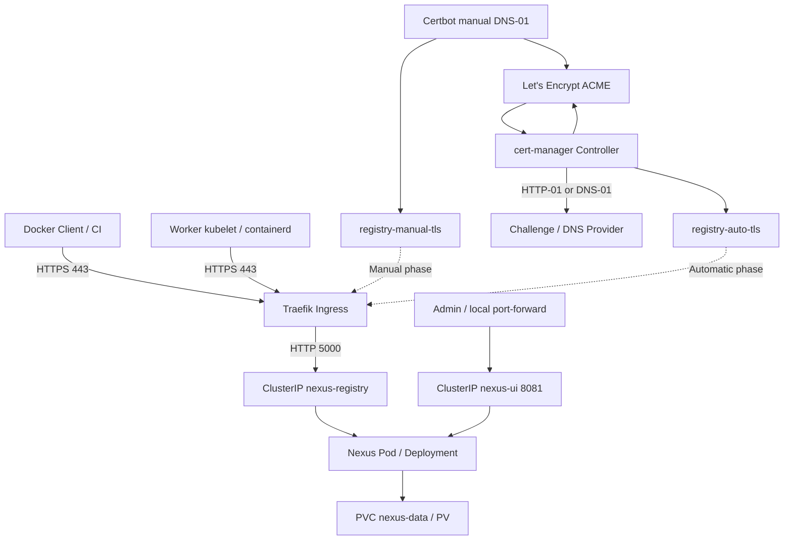

<div dir="rtl" align="right">

# ‏پروژه عملی | ⁦Nexus Private Image Registry⁩ & ⁦Let's Encrypt⁩

</div>

<div dir="rtl" align="right">

‏**سطح:** ⁦Beginner⁩ → ⁦Advanced⁩ · **محیط:** ⁦kubeadm⁩ با یک ⁦Control Plane⁩ و دو ⁦Worker⁩

‏**هدف:** تیم ⁦Platform⁩ یک شرکت می‌خواهد ⁦Registry⁩ خصوصی برای ⁦Image⁩های ⁦CI/CD⁩ و ⁦Kubernetes⁩ راه‌اندازی کند. ابتدا ⁦Certificate⁩ معتبر ⁦Let's Encrypt⁩ را به صورت دستی دریافت و روی ⁦Registry⁩ اعمال می‌کنی؛ سپس همان ⁦Registry⁩ را به مدیریت خودکار ⁦Certificate⁩ با ⁦cert-manager⁩ منتقل می‌کنی. در پایان، ⁦Push⁩، ⁦Pull⁩، دسترسی حداقلی، پایداری داده و ⁦Reissuance⁩ بدون ⁦Restart⁩ را بررسی می‌کنی.

‏**پیش‌نیاز مهم:** مالکیت یک دامنه واقعی و دسترسی به ⁦DNS⁩ آن لازم است. برای ⁦HTTP-01⁩ دسترسی عمومی ⁦TCP/80⁩ و برای استفاده از ⁦Registry⁩ دسترسی ⁦Client⁩ به ⁦TCP/443⁩ لازم است. اگر ⁦Cluster⁩ پشت ⁦NAT⁩ یا ⁦CGNAT⁩ است، ⁦DNS-01⁩ با ⁦DNS Provider⁩ دارای ⁦API⁩ مسیر مناسب‌تری برای ⁦Renewal⁩ خودکار است. نام‌های ⁦example.com⁩ و ⁦IP⁩های نمونه قابل استفاده واقعی نیستند. اگر دامنه نداری، مراحل ⁦Nexus⁩ را اجرا کن ولی صدور ⁦Certificate⁩ عمومی و ⁦Validation⁩ آن بخش قابل تکمیل نیست.

‏**محدوده:** ⁦Nexus Repository⁩، ⁦Docker Hosted Registry⁩، ⁦PVC⁩، ⁦Service⁩، ⁦Ingress⁩، ⁦TLS⁩، ⁦ACME⁩، ⁦Certbot⁩، ⁦cert-manager⁩، ⁦Kubernetes ImagePullSecrets⁩ و ⁦Troubleshooting.⁩ نصب ⁦Ingress Controller⁩ فقط اگر موجود نباشد؛ نصب ⁦MetalLB⁩ فرض نشده و در صورت نبود آن مسیر ⁦NodePort/NAT⁩ قابل انتخاب است. پروژه ⁦HA⁩ نیست و قابلیت ⁦Backup/Restore⁩ تولیدی را به‌صورت طراحی و نکات عملی پوشش می‌دهد.

> [!IMPORTANT]
> ‏تمام تغییرات در ⁦Namespace⁩های آزمایشی انجام شوند؛ نصب ⁦Controller⁩ و ایجاد ⁦Local PV⁩ تغییر سطح ⁦Cluster⁩ است و باید با مجوز انجام شود. هیچ ⁦Private Key⁩، ⁦Password⁩، ⁦Token⁩ یا خروجی ⁦Secret⁩ را در ⁦GitHub⁩ قرار نده. از ⁦insecure-registry⁩ یا غیرفعال کردن ⁦TLS Verification⁩ استفاده نکن.

</div>

<div dir="rtl" align="right">

## ‏فهرست مطالب

</div>

<div dir="rtl" align="right">

- ‏[بخش اول — سناریو و چالش‌ها](#part-1)
- ‏[بخش دوم — پاسخ‌نامه و نکات فنی](#part-2)
- ‏[اعتبارسنجی نهایی و Cleanup](#final-validation)
- ‏[منابع رسمی](#references)

</div>

<div dir="rtl" align="right">

## ‏معماری پروژه

</div>



<div dir="rtl" align="right">

‏**معماری ⁦TLS:⁩** ارتباط خارجی با ⁦Registry⁩ از طریق ⁦HTTPS⁩ است؛ ⁦Traefik Certificate⁩ را از ⁦Secret⁩ می‌خواند و ارتباط داخلی به ⁦Nexus⁩ روی ⁦HTTP/5000⁩ است. ⁦Secret⁩ دستی و ⁦Secret⁩ خودکار هم‌زمان ساخته می‌شوند، اما ⁦Ingress⁩ اصلی در هر مرحله فقط به یکی اشاره می‌کند. مسیر ⁦Management⁩ از طریق ⁦Port-forward⁩ محدود به ⁦Localhost⁩ است.

‏**جدول نام‌ها و ⁦Resource⁩ها**

</div>

| Resource | Name / value |
|---|---|
| Namespace | `registry-lab` |
| Consumer namespace | `registry-consumers` |
| Deployment | `nexus` |
| PVC | `nexus-data` |
| Services | `nexus-ui:8081`, `nexus-registry:5000` |
| Docker hosted repo | `docker-hosted` |
| Registry ingress | `nexus-registry` |
| Manual TLS secret | `registry-manual-tls` |
| Automated TLS secret | `registry-auto-tls` |
| Issuers | `letsencrypt-staging`, `letsencrypt-prod` |
| Production certificate | `registry-prod` |
| Staging certificates | `registry-staging`, `registry-renew-test` |
| Image pull secret | `nexus-pull-secret` |
| Consumer Deployment | `registry-client` |

---

<a name="part-1"></a>

<div dir="rtl" align="right">

## ‏بخش اول — سناریو و چالش‌ها

</div>

<div dir="rtl" align="right">

‏تمام ⁦Phase⁩ها را به ترتیب اجرا کن. این بخش فقط وظایف و معیار پذیرش دارد. پاسخ‌ها در بخش دوم بسته‌اند.

</div>

<a name="phase-01"></a>

<div dir="rtl" align="right">

### ‏⁦Phase 01⁩ — ⁦Cluster Preparation⁩ & ⁦DNS Design⁩

</div>

<div dir="rtl" align="right">

‏**هدف:** آماده‌سازی زیرساخت و تعیین مسیر دسترسی ⁦Registry.⁩

‏**وظایف و ⁦Checklist⁩**

- [ ] ‏سلامت یک ⁦Control Plane⁩ و دو ⁦Worker⁩ را بررسی کن؛ ⁦Namespace⁩های ⁦`registry-lab`⁩ و ⁦`registry-consumers`⁩ اختصاصی و جدید باشند.
- [ ] ‏یک ⁦FQDN⁩ واقعی متعلق به خودت برای ⁦Registry⁩ و یک ⁦FQDN⁩ جدا برای آزمایش ⁦Renewal⁩ تعیین کن. در این پروژه از نام‌های نمونه ⁦`registry.example.com`⁩ و ⁦`registry-renew-test.example.com`⁩ استفاده می‌شود؛ این نام‌ها را با دامنه واقعی جایگزین کن.
- [ ] ‏نسخه ⁦Kubernetes⁩، معماری ⁦CPU⁩ هر ⁦Worker⁩، ظرفیت ⁦RAM⁩ و ⁦Disk⁩، ⁦StorageClass⁩، ⁦IngressClass⁩ و ⁦LoadBalancer⁩ موجود را مشخص کن.
- [ ] ‏مشخص کن از یک شبکه عمومی قابل دسترسی روی ⁦TCP/80⁩ و ⁦TCP/443⁩ استفاده می‌کنی یا از شبکه خصوصی با ⁦DNS-01.⁩ نام دامنه باید از سمت کلاینت و هر دو ⁦Worker⁩ به ⁦IP⁩ درست ⁦Resolve⁩ شود.
- [ ] ‏از یک ⁦Linux Admin Host⁩ دارای ⁦Docker CLI⁩، ⁦kubectl⁩، ⁦OpenSSL⁩، ⁦dig⁩ و ⁦Certbot⁩ استفاده کن؛ برای نصب ⁦Ingress Controller⁩ در صورت نیاز ⁦Helm⁩ نیز آماده باشد.

‏**معیار پذیرش:** ⁦Cluster⁩ سالم، مسیر دسترسی مشخص، نام‌های واقعی ثبت‌شده و دو ⁦Namespace⁩ خالی آماده باشند.

‏[پاسخ این Phase](#solution-01)

</div>

---

<a name="phase-02"></a>

<div dir="rtl" align="right">

### ‏⁦Phase 02⁩ — ⁦Persistent Storage⁩ & ⁦PVC⁩

</div>

<div dir="rtl" align="right">

‏**هدف:** نگهداری ⁦Image⁩ها و تنظیمات ⁦Nexus⁩ پس از حذف ⁦Pod.⁩

‏**وظایف و ⁦Checklist⁩**

- [ ] ‏یک ⁦PVC⁩ با نام ⁦`nexus-data`⁩، ظرفیت ⁦20Gi⁩ و ⁦AccessMode⁩ برابر ⁦ReadWriteOnce⁩ در ⁦Namespace⁩ اصلی بساز.
- [ ] ‏اگر ⁦StorageClass⁩ مناسب داری، از آن استفاده کن؛ در غیر این صورت یک ⁦Local PV⁩ با نام ⁦`nexus-lab-pv`⁩، ⁦StorageClass⁩ اختصاصی ⁦`nexus-local`⁩ و ⁦ReclaimPolicy⁩ برابر ⁦Retain⁩ روی یک ⁦Worker⁩ آماده کن.
- [ ] ‏مسیر داده ⁦Local PV⁩ فقط برای همین ⁦Lab⁩ باشد و ⁦UID⁩ مربوط به ⁦Nexus⁩ بتواند در آن بنویسد.
- [ ] ‏تفاوت ⁦Pending⁩ در ⁦WaitForFirstConsumer⁩ و خطای واقعی ⁦Storage⁩ را تشخیص بده.

‏**معیار پذیرش:** ⁦PVC⁩ به ⁦Storage⁩ صحیح متصل شود؛ در حالت ⁦WaitForFirstConsumer⁩ پس از ایجاد ⁦Workload⁩ باید ⁦Bound⁩ شود.

‏[پاسخ این Phase](#solution-02)

</div>

---

<a name="phase-03"></a>

<div dir="rtl" align="right">

### ‏⁦Phase 03⁩ — ⁦Nexus Repository Deployment⁩ & ⁦Services⁩

</div>

<div dir="rtl" align="right">

‏**هدف:** نصب ⁦Nexus⁩ به صورت تک ⁦Replica⁩ با داده پایدار و ⁦Service⁩های داخلی.

‏**وظایف و ⁦Checklist⁩**

- [ ] ‏یک ⁦Deployment⁩ با نام ⁦`nexus`⁩ و یک ⁦Replica⁩ بساز؛ ⁦Image⁩ برابر ⁦`sonatype/nexus3:3.95.6-ubi`⁩ یا ⁦Patch⁩ سازگار و تأییدشده باشد.
- [ ] ‏داده را در ⁦`/nexus-data`⁩ روی ⁦PVC⁩ مرحله قبل نگه دار. ⁦Strategy⁩ از نوع ⁦Recreate⁩ و ⁦UID/GID⁩ برابر ⁦200⁩ باشد.
- [ ] ‏پورت ⁦Management⁩ برابر ⁦8081⁩ و پورت ⁦Docker Connector⁩ برابر ⁦5000⁩ باشد. ⁦Startup⁩، ⁦Readiness⁩ و ⁦Liveness Probe⁩ مناسب تعریف کن؛ برای شروع ⁦JVM⁩ زمان کافی بده.
- [ ] ‏دو ⁦ClusterIP Service⁩ با نام ⁦`nexus-ui`⁩ و ⁦`nexus-registry`⁩ بساز. ⁦Management UI⁩ از اینترنت منتشر نشود.
- [ ] ‏از طریق دسترسی موقت و محدود به ⁦Localhost⁩ وارد ⁦UI⁩ شو و سلامت ⁦Pod⁩، ⁦PVC⁩، ⁦Service⁩ و ⁦EndpointSlice⁩ را بررسی کن.

‏**معیار پذیرش:** ⁦Nexus Ready⁩ است، ⁦PVC Bound⁩ شده و ⁦UI⁩ از طریق مسیر مدیریتی محلی باز می‌شود.

‏[پاسخ این Phase](#solution-03)

</div>

---

<a name="phase-04"></a>

<div dir="rtl" align="right">

### ‏⁦Phase 04⁩ — ⁦Docker Hosted Repository⁩ & ⁦Authentication⁩

</div>

<div dir="rtl" align="right">

‏**هدف:** ساخت ⁦Registry⁩ خصوصی و جداسازی دسترسی ⁦Push⁩ و ⁦Pull.⁩

‏**وظایف و ⁦Checklist⁩**

- [ ] ‏در ⁦Nexus⁩ یک ⁦Docker Hosted Repository⁩ با نام ⁦`docker-hosted`⁩ بساز. ⁦HTTP Connector⁩ برابر ⁦5000⁩، ⁦Anonymous Pull⁩ غیرفعال و ⁦Blob Store⁩ برابر ⁦default⁩ باشد.
- [ ] ‏⁦Docker Bearer Token Realm⁩ را فعال کن. کاربر ⁦admin⁩ فقط برای ⁦Management⁩ استفاده شود.
- [ ] ‏دو ⁦Role⁩ با نام‌های ⁦`registry-publisher`⁩ و ⁦`registry-reader`⁩ ایجاد کن و دو کاربر ⁦`ci-publisher`⁩ و ⁦`k8s-reader`⁩ با دسترسی متناسب بساز.
- [ ] ‏کاربر ⁦publisher⁩ مجاز به ⁦Push⁩ و ⁦Pull⁩ باشد، اما ⁦reader⁩ فقط مجاز به ⁦Pull⁩ باشد؛ هیچ‌کدام حق حذف ⁦Image⁩ یا مدیریت ⁦Nexus⁩ نداشته باشند.
- [ ] ‏از طریق مسیر مدیریتی محدود، پاسخ ⁦Registry API⁩ را پیش از ⁦TLS⁩ بررسی کن؛ هیچ ⁦Password⁩ را در ⁦HTTP⁩ عمومی ارسال نکن.

‏**معیار پذیرش:** ⁦Registry API⁩ فعال است و سطح دسترسی دو کاربر از ⁦admin⁩ جدا شده است.

‏[پاسخ این Phase](#solution-04)

</div>

---

<a name="phase-05"></a>

<div dir="rtl" align="right">

### ‏⁦Phase 05⁩ — ⁦Ingress Controller⁩, ⁦DNS⁩ & ⁦Network Reachability⁩

</div>

<div dir="rtl" align="right">

‏**هدف:** آماده‌سازی یک ⁦Endpoint⁩ ثابت برای ⁦TLS Termination.⁩

‏**وظایف و ⁦Checklist⁩**

- [ ] ‏⁦Ingress Controller⁩ از نوع ⁦Traefik⁩ و ⁦IngressClass⁩ قابل استفاده تعیین کن؛ در صورت وجود نمونه سالم، آن را مجدداً نصب نکن.
- [ ] ‏برای دسترسی ⁦Client⁩ها روی ⁦TCP/443⁩ از ⁦LoadBalancer⁩ موجود مانند ⁦MetalLB⁩ یا از مسیر کنترل‌شده ⁦NodePort⁩ و ⁦NAT⁩ استفاده کن. برای ⁦HTTP-01⁩ مسیر عمومی ⁦TCP/80⁩ نیز لازم خواهد بود.
- [ ] ‏رکورد ⁦DNS⁩ دامنه ⁦Registry⁩ و دامنه تست ⁦Renewal⁩ را ایجاد کن. برای شبکه خصوصی در صورت نیاز ⁦Split DNS⁩ فراهم کن و ⁦DNS⁩ عمومی ⁦TXT⁩ را قابل تغییر نگه دار.
- [ ] ‏⁦Management Service⁩ و ⁦Docker Connector⁩ داخلی نباید به شکل مستقیم ⁦NodePort⁩ یا ⁦LoadBalancer⁩ مستقل عمومی داشته باشند.
- [ ] ‏ترافیک دامنه را از ⁦Admin Host⁩ و هر دو ⁦Worker⁩ تا ⁦Ingress⁩ بررسی کن؛ در این مرحله صدور ⁦Certificate⁩ هنوز انجام نشده است.

‏**معیار پذیرش:** ⁦Ingress Controller⁩ آماده و مسیر ⁦IP/DNS⁩ برای دو ⁦Host⁩ مشخص باشد؛ فقط ⁦Edge⁩ موردنیاز در دسترس باشد.

‏[پاسخ این Phase](#solution-05)

</div>

---

<a name="phase-06"></a>

<div dir="rtl" align="right">

### ‏⁦Phase 06⁩ — ⁦Manual Certificate⁩ — ⁦Certbot⁩ & ⁦Let⁩’⁦s Encrypt⁩

</div>

<div dir="rtl" align="right">

‏**هدف:** دریافت ⁦Certificate⁩ معتبر با فرایند دستی و شناخت ⁦ACME Challenge.⁩

‏**وظایف و ⁦Checklist⁩**

- [ ] ‏با ⁦Certbot⁩ و ⁦DNS-01⁩ برای ⁦FQDN⁩ اصلی ابتدا از محیط ⁦Staging⁩ و بعد از ⁦Production⁩ یک ⁦Certificate⁩ دریافت کن.
- [ ] ‏⁦TXT Record⁩های ⁦Challenge⁩ را به‌صورت دستی در ⁦DNS⁩ عمومی ثبت کن و ⁦Propagation⁩ آن‌ها را بررسی کن.
- [ ] ‏⁦Certificate⁩، ⁦Certificate Chain⁩، ⁦Private Key⁩، ⁦SAN⁩، ⁦Issuer⁩، ⁦Serial Number⁩ و ⁦NotAfter⁩ را مشخص کن.
- [ ] ‏⁦Certificate⁩ مربوط به ⁦Staging⁩ را به ⁦Registry⁩ فعال اعمال نکن. ⁦Private Key⁩ نباید در ⁦GitHub⁩ یا ⁦Chat⁩ قرار گیرد.
- [ ] ‏تفاوت ⁦DNS-01⁩ و ⁦HTTP-01⁩ و علت نداشتن ⁦Renewal⁩ خودکار در روش ⁦Manual⁩ را توضیح بده.

‏**معیار پذیرش:** ⁦Certificate Production⁩ برای ⁦FQDN⁩ صحیح صادر شده و فایل ⁦Full Chain⁩ و ⁦Private Key⁩ آماده استفاده هستند.

‏[پاسخ این Phase](#solution-06)

</div>

---

<a name="phase-07"></a>

<div dir="rtl" align="right">

### ‏⁦Phase 07⁩ — ⁦Manual TLS Secret⁩ & ⁦Ingress⁩

</div>

<div dir="rtl" align="right">

‏**هدف:** اعمال دستی ⁦Certificate⁩ روی ⁦Registry⁩ و بررسی ⁦TLS⁩ واقعی.

‏**وظایف و ⁦Checklist⁩**

- [ ] ‏یک ⁦TLS Secret⁩ با نام ⁦`registry-manual-tls`⁩ در ⁦Namespace⁩ ⁦`registry-lab`⁩ از ⁦Certificate Production⁩ بساز.
- [ ] ‏یک ⁦Ingress⁩ با نام ⁦`nexus-registry`⁩ و ⁦Class⁩ مربوط به ⁦Traefik⁩ بساز؛ ⁦Host⁩ همان ⁦FQDN⁩ اصلی، ⁦Path⁩ برابر / و ⁦Backend⁩ برابر ⁦Service⁩ پورت ⁦5000⁩ باشد.
- [ ] ‏⁦TLS Termination⁩ در ⁦Ingress Controller⁩ انجام شود؛ ⁦Management UI⁩ و ⁦Backend HTTP⁩ مستقیماً عمومی نشوند.
- [ ] ‏از سمت ⁦Client⁩، ⁦SAN⁩، ⁦Chain⁩، تاریخ اعتبار و پاسخ ⁦Registry API⁩ را بدون غیرفعال کردن ⁦Verification⁩ بررسی کن.
- [ ] ‏روش ⁦Renewal⁩ دستی و اعمال مجدد ⁦Secret⁩ را به صورت ⁦Runbook⁩ آماده کن؛ در این مرحله ⁦Certificate⁩ را عمداً مکرر صادر نکن.

‏**معیار پذیرش:** ⁦HTTPS⁩ با ⁦Certificate⁩ معتبر و ⁦Host⁩ صحیح برقرار است؛ درخواست ناشناس به /⁦v2/⁩ معمولاً ⁦401⁩ دریافت می‌کند.

‏[پاسخ این Phase](#solution-07)

</div>

---

<a name="phase-08"></a>

<div dir="rtl" align="right">

### ‏⁦Phase 08⁩ — ⁦Docker Login⁩, ⁦Push⁩, ⁦Pull⁩ & ⁦Least Privilege⁩

</div>

<div dir="rtl" align="right">

‏**هدف:** اعتبارسنجی ⁦Registry⁩ با ⁦Docker Client⁩ و کنترل دسترسی.

‏**وظایف و ⁦Checklist⁩**

- [ ] ‏با کاربر ⁦`ci-publisher`⁩ به ⁦Registry⁩ امن ⁦Login⁩ کن؛ ⁦Image⁩ آزمایشی ⁦BusyBox⁩ با نسخه ⁦1.36.1⁩ متناسب با معماری ⁦Worker⁩ها انتخاب کن.
- [ ] ‏⁦Image⁩ را با نام ⁦Registry⁩ و ⁦Tag⁩ اختصاصی ⁦`lab/busybox:1.36.1-lab1`⁩ منتشر کن؛ ⁦Digest⁩ را ثبت کن.
- [ ] ‏با کاربر ⁦`k8s-reader`⁩ همان ⁦Image⁩ را ⁦Pull⁩ کن و تلاش ⁦Push⁩ با ⁦Tag⁩ جدا را انجام بده؛ ⁦Push⁩ باید رد شود.
- [ ] ‏دسترسی ⁦Anonymous⁩ را با ⁦Client⁩ بدون ⁦Credential⁩ بررسی کن.
- [ ] ‏وجود ⁦Image⁩ و ⁦Asset⁩ در ⁦Nexus UI⁩ را تأیید کن؛ هیچ ⁦Password⁩ در ⁦Command History⁩ و فایل ⁦README⁩ ثبت نشود.

‏**معیار پذیرش:** ⁦Push⁩ توسط ⁦Publisher⁩، ⁦Pull⁩ توسط ⁦Reader⁩ و رد ⁦Push⁩ توسط ⁦Reader/Anonymous⁩ مشاهده شود.

‏[پاسخ این Phase](#solution-08)

</div>

---

<a name="phase-09"></a>

<div dir="rtl" align="right">

### ‏⁦Phase 09⁩ — ⁦Kubernetes ImagePullSecrets⁩ & ⁦Persistence⁩

</div>

<div dir="rtl" align="right">

‏**هدف:** مصرف ⁦Registry⁩ از ⁦Kubernetes⁩ و اثبات پایداری داده.

‏**وظایف و ⁦Checklist⁩**

- [ ] ‏یک ⁦Secret⁩ از نوع ⁦`kubernetes.io/dockerconfigjson`⁩ با نام ⁦`nexus-pull-secret`⁩ در ⁦Namespace⁩ ⁦`registry-consumers`⁩ برای کاربر ⁦`k8s-reader`⁩ بساز.
- [ ] ‏یک ⁦Deployment⁩ دو ⁦Replica⁩ با نام ⁦`registry-client`⁩ از ⁦Image⁩ مرحله قبل ایجاد کن؛ ⁦ImagePullPolicy⁩ برابر ⁦Always⁩ و توزیع ⁦Pod⁩ها روی دو ⁦Worker⁩ در صورت امکان باشد.
- [ ] ‏یک ⁦Pod⁩ آزمایشی ⁦`registry-denied`⁩ بدون ⁦Secret⁩ ایجاد کن و خطای ⁦Authentication⁩ را مشاهده کن. اگر ⁦Node⁩ دارای ⁦Credential⁩ سراسری است، این تفاوت را ثبت کن.
- [ ] ‏⁦Pod⁩ مربوط به ⁦Nexus⁩ را در پنجره ⁦Maintenance⁩ جایگزین کن و بعد از ⁦Ready⁩ شدن، وجود ⁦Image⁩ و ⁦Repository⁩ و امکان ⁦Pull⁩ را دوباره بررسی کن.
- [ ] ‏خرابی ⁦Node⁩ دارای ⁦Local PV⁩ را با حذف ⁦Pod⁩ اشتباه نگیر؛ داده را عمداً حذف نکن.

‏**معیار پذیرش:** ⁦Pod⁩های مصرف‌کننده از ⁦Registry⁩ امن ⁦Pull⁩ می‌کنند؛ ⁦Image⁩ و تنظیمات بعد از ⁦Replacement⁩ باقی مانده‌اند.

‏[پاسخ این Phase](#solution-09)

</div>

---

<a name="phase-10"></a>

<div dir="rtl" align="right">

### ‏⁦Phase 10⁩ — ⁦cert-manager Installation⁩ & ⁦ACME Issuers⁩

</div>

<div dir="rtl" align="right">

‏**هدف:** آماده‌سازی ⁦Controller⁩ صدور و تمدید خودکار ⁦Certificate.⁩

‏**وظایف و ⁦Checklist⁩**

- [ ] ‏نسخه ⁦cert-manager⁩ سازگار با ⁦Kubernetes⁩ را انتخاب کن. در صورت نصب قبلی از همان ⁦Controller⁩ استفاده کن و ⁦CRD⁩های موجود را حذف نکن.
- [ ] ‏برای ⁦Namespace⁩ اصلی دو ⁦Issuer⁩ با نام ⁦`letsencrypt-staging`⁩ و ⁦`letsencrypt-prod`⁩ ایجاد کن؛ ⁦ACME Account Key⁩ هرکدام در ⁦Secret⁩ جدا ذخیره شود.
- [ ] ‏یکی از دو روش ⁦HTTP-01⁩ (برای مسیر عمومی پورت ⁦80⁩) یا ⁦DNS-01⁩ (برای ⁦DNS Provider⁩ دارای ⁦API⁩) را انتخاب کن؛ در مسیر خصوصی از ⁦DNS-01⁩ استفاده کن.
- [ ] ‏اگر ⁦Cloudflare⁩ استفاده می‌کنی، ⁦API Token⁩ محدود به ⁦Zone⁩ موردنیاز با حداقل ⁦Permission⁩ بساز. ⁦Token⁩ در فایل ⁦YAML⁩ یا ⁦GitHub⁩ قرار نگیرد.
- [ ] ‏آماده بودن ⁦Controller⁩ها، ⁦Webhook⁩ و ⁦Issuer⁩ها را بررسی کن.

‏**معیار پذیرش:** هر دو ⁦Issuer⁩ آماده باشند و ⁦Solver⁩ مناسب محیط انتخاب شده باشد؛ هنوز ⁦Ingress Production⁩ تغییر نکرده است.

‏[پاسخ این Phase](#solution-10)

</div>

---

<a name="phase-11"></a>

<div dir="rtl" align="right">

### ‏⁦Phase 11⁩ — ⁦Automatic Issuance⁩ — ⁦Staging⁩ & ⁦ACME Lifecycle⁩

</div>

<div dir="rtl" align="right">

‏**هدف:** مشاهده چرخه صدور خودکار بدون ریسک ⁦Certificate Production.⁩

‏**وظایف و ⁦Checklist⁩**

- [ ] ‏یک ⁦Certificate⁩ با نام ⁦`registry-staging`⁩ برای ⁦FQDN⁩ اصلی بساز؛ ⁦Issuer⁩ برابر ⁦`letsencrypt-staging`⁩ و ⁦Secret⁩ مقصد برابر ⁦`registry-auto-staging-tls`⁩ باشد.
- [ ] ‏⁦Key Rotation⁩ را روی ⁦Always⁩ تنظیم کن و زمان ⁦Renewal⁩ را از وضعیت ⁦Certificate⁩ بخوان؛ طول اعتبار را از ⁦Certificate⁩ واقعی استخراج کن.
- [ ] ‏⁦CertificateRequest⁩، ⁦Order⁩، ⁦Challenge⁩ و ⁦Resource⁩های موقت ⁦HTTP-01⁩ یا ⁦TXT Record⁩ مربوط به ⁦DNS-01⁩ را مشاهده کن.
- [ ] ‏برای مشاهده و آزمایش خودکار ⁦Renewal⁩ یک ⁦Certificate⁩ جدا با نام ⁦`registry-renew-test`⁩ برای ⁦FQDN⁩ تست و ⁦Secret⁩ برابر ⁦`registry-renew-test-tls`⁩ ایجاد کن.
- [ ] ‏هیچ‌کدام از ⁦Certificate⁩های ⁦Staging⁩ را به ⁦Ingress⁩ اصلی متصل نکن.

‏**معیار پذیرش:** هر دو ⁦Certificate⁩ آزمایشی ⁦Ready⁩ هستند و ⁦Secret⁩ مربوط به آن‌ها ایجاد شده است؛ ⁦Registry⁩ اصلی همچنان ⁦Certificate⁩ دستی معتبر را ارائه می‌دهد.

‏[پاسخ این Phase](#solution-11)

</div>

---

<a name="phase-12"></a>

<div dir="rtl" align="right">

### ‏⁦Phase 12⁩ — ⁦Production Certificate⁩ & ⁦Safe TLS Migration⁩

</div>

<div dir="rtl" align="right">

‏**هدف:** انتقال ⁦Registry⁩ فعال به ⁦Certificate⁩ تحت مدیریت ⁦cert-manager.⁩

‏**وظایف و ⁦Checklist⁩**

- [ ] ‏یک ⁦Certificate⁩ با نام ⁦`registry-prod`⁩ و ⁦Issuer⁩ برابر ⁦`letsencrypt-prod`⁩ ایجاد کن؛ ⁦Secret⁩ مقصد برابر ⁦`registry-auto-tls`⁩ باشد.
- [ ] ‏قبل از تغییر ⁦Ingress⁩ از ⁦Ready⁩ بودن ⁦Certificate⁩ و صحت ⁦SAN⁩ و ⁦Chain⁩ اطمینان حاصل کن.
- [ ] ‏⁦Ingress⁩ اصلی را از ⁦Secret⁩ دستی به ⁦Secret⁩ خودکار منتقل کن. ⁦Secret⁩ قبلی را تا پایان اعتبارسنجی نگه دار.
- [ ] ‏بدون ⁦Restart⁩ کردن ⁦Nexus⁩، ⁦Fingerprint⁩ و ⁦Serial Certificate⁩ ارائه‌شده را با ⁦Secret⁩ جدید مقایسه کن و ⁦Docker Pull⁩ را تکرار کن.
- [ ] ‏فرایند ⁦Rollback⁩ به ⁦Secret⁩ دستی را در صورت نیاز آماده نگه دار؛ مالکیت ⁦Secret⁩ خودکار فقط متعلق به ⁦cert-manager⁩ باشد.

‏**معیار پذیرش:** ⁦Ingress⁩ اصلی از ⁦registry-auto-tls⁩ استفاده می‌کند و ⁦Docker/Kubernetes⁩ همچنان با ⁦TLS⁩ معتبر کار می‌کنند.

‏[پاسخ این Phase](#solution-12)

</div>

---

<a name="phase-13"></a>

<div dir="rtl" align="right">

### ‏⁦Phase 13⁩ — ⁦Automatic Renewal⁩, ⁦Key Rotation⁩ & ⁦Live Reload⁩

</div>

<div dir="rtl" align="right">

‏**هدف:** اثبات مکانیزم ⁦Renewal⁩ و ⁦Reload⁩ بدون انتظار تا انقضا یا تغییر ⁦Registry⁩ تولید.

‏**وظایف و ⁦Checklist⁩**

- [ ] ‏زمان ⁦Renewal⁩، ⁦NotAfter⁩ و ⁦Revision⁩ مربوط به ⁦Certificate⁩ اصلی را ثبت کن و تفاوت آن‌ها را توضیح بده.
- [ ] ‏یک ⁦Ingress⁩ آزمایشی با نام ⁦`registry-renew-test`⁩ روی ⁦FQDN⁩ جدا و ⁦Secret Staging⁩ مربوط به آن ایجاد کن؛ هیچ ⁦Credential⁩ یا ⁦Image Push⁩ به این ⁦Host⁩ ارسال نشود.
- [ ] ‏⁦Fingerprint⁩، ⁦Serial⁩ و ⁦Revision⁩ فعلی ⁦Certificate⁩ تست را ثبت کن؛ سپس یک ⁦Reissuance⁩ کنترل‌شده فقط در ⁦Staging⁩ درخواست کن.
- [ ] ‏تغییر ⁦Revision⁩ و ⁦Fingerprint⁩ مربوط به ⁦Secret⁩ و ⁦Certificate⁩ ارائه‌شده توسط ⁦Ingress⁩ را مقایسه کن؛ ⁦Reload⁩ نباید نیازمند ⁦Restart Nexus⁩ باشد.
- [ ] ‏برای ⁦Production⁩ هیچ ⁦Force Renewal⁩ مکرر انجام نده. مکانیزم ⁦Renewal⁩ زمان‌بندی‌شده و ⁦Monitoring⁩ آن را توضیح بده.

‏**معیار پذیرش:** ⁦Certificate⁩ تست پس از ⁦Reissuance⁩ تغییر کرده و ⁦Ingress⁩ همان ⁦Certificate⁩ جدید را ارائه می‌دهد؛ زمان ⁦Renewal⁩ خودکار ⁦Production⁩ ثبت شده است.

‏[پاسخ این Phase](#solution-13)

</div>

---

<a name="phase-14"></a>

<div dir="rtl" align="right">

### ‏⁦Phase 14⁩ — ⁦Troubleshooting⁩ & ⁦Operational Hardening⁩

</div>

<div dir="rtl" align="right">

‏**هدف:** تمرین تشخیص خطاهای ⁦Registry⁩، ⁦TLS⁩ و ⁦ACME⁩ بدون آسیب به مسیر تولید.

‏**وظایف و ⁦Checklist⁩**

- [ ] ‏یک ⁦Pod⁩ تست بدون ⁦ImagePullSecret⁩ را بررسی کن و تفاوت خطای ⁦Authentication⁩ با خطای ⁦TLS⁩ و ⁦DNS⁩ را توضیح بده.
- [ ] ‏یک ⁦Ingress⁩ خراب با ⁦Host⁩ آزمایشی و ⁦Secret⁩ ناموجود طراحی کن؛ فقط روی نام دامنه تست و نه ⁦Host⁩ اصلی آن را آزمایش و حذف کن.
- [ ] ‏سناریوی شکست ⁦ACME⁩ را روی ⁦Staging⁩ تحلیل کن: در ⁦HTTP-01⁩ مسیر عمومی/⁦IngressClass⁩ و در ⁦DNS-01 Permission⁩، ⁦Propagation⁩ و ⁦TXT⁩ را بررسی کن. عمداً ⁦Token⁩ یا ⁦DNS⁩ تولید را تغییر نده.
- [ ] ‏یک روش ⁦Monitoring⁩ برای ⁦Certificate Expiry⁩، ⁦Ready Condition⁩، خطاهای ⁦Renewal⁩ و ظرفیت ⁦Nexus⁩ ارائه کن. ⁦Backup⁩ منسجم داده و محدودیت‌های ⁦Local PV⁩ را مشخص کن.
- [ ] ‏نحوه جلوگیری از انتشار ⁦Secret⁩، ⁦Token⁩ و ⁦Password⁩ در ⁦Repository GitHub⁩ و دسترسی اضافی کاربران را بررسی کن.

‏**معیار پذیرش:** مسیر اصلی سالم مانده، ⁦Resource⁩ خراب حذف شده و ⁦Runbook⁩ تشخیص خطا و پایش آماده است.

‏[پاسخ این Phase](#solution-14)

</div>

---

<div dir="rtl" align="right">

### ‏⁦Final Acceptance Criteria⁩ & ⁦Completion Checklist⁩

</div>

<div dir="rtl" align="right">

- [ ] ‏⁦Nexus⁩ با ⁦Storage⁩ پایدار نصب و جایگزینی ⁦Pod⁩ آزمایش شده است.
- [ ] ‏⁦Registry⁩ خصوصی و ⁦Role⁩های جدا برای ⁦Push⁩ و ⁦Pull⁩ فعال هستند.
- [ ] ‏⁦Certificate⁩ دستی معتبر از ⁦Let's Encrypt⁩ صادر و روی ⁦Ingress⁩ اعمال شده است.
- [ ] ‏⁦Docker Push/Pull⁩ و رد دسترسی غیرمجاز مشاهده شده‌اند.
- [ ] ‏⁦Deployment⁩ مصرف‌کننده از ⁦ImagePullSecrets⁩ استفاده می‌کند.
- [ ] ‏⁦cert-manager⁩ و ⁦Issuer⁩ مناسب فعال‌اند و ⁦Certificate Production⁩ خودکار صادر شده است.
- [ ] ‏⁦Ingress⁩ از ⁦Secret⁩ خودکار استفاده می‌کند و ⁦Fingerprint⁩ واقعی ⁦Endpoint⁩ تأیید شده است.
- [ ] ‏⁦Reissuance⁩ آزمایشی در ⁦Staging⁩ و ⁦Reload⁩ مربوط به آن بررسی شده‌اند؛ ⁦Renewal⁩ طبیعی ⁦Production⁩ فقط در زمان واقعی آن قابل اثبات است.
- [ ] ‏خطاهای کنترل‌شده رفع و ⁦Resource⁩های تست حذف شده‌اند.
- [ ] ‏برنامه ⁦Monitoring⁩، ⁦Backup⁩ و ⁦Cleanup⁩ مشخص است.

‏**⁦Skills Acquired:⁩** ⁦Private Image Registry⁩، ⁦Nexus Administration⁩، ⁦Persistent Storage⁩، ⁦Docker Authentication⁩، ⁦TLS Termination⁩، ⁦ACME⁩، ⁦DNS-01⁩، ⁦HTTP-01⁩، ⁦cert-manager⁩، ⁦Certificate Lifecycle⁩، ⁦Key Rotation⁩، ⁦ImagePullSecrets⁩ و ⁦Troubleshooting.⁩

</div>

---

<a name="part-2"></a>

<div dir="rtl" align="right">

## ‏بخش دوم — پاسخ‌نامه و نکات فنی

</div>

<div dir="rtl" align="right">

‏هر پاسخ به صورت ⁦Collapsible⁩ است. فایل‌های ⁦YAML⁩ که در پاسخ‌ها نام‌گذاری شده‌اند را خودت در محیط تمرین بساز؛ هیچ فایل جانبی برای دانلود لازم نیست. ⁦Command⁩های متوالی وابسته به متغیرهای ⁦Phase 01⁩ هستند. در ⁦Watch⁩ها با ⁦Ctrl+C⁩ خارج شو. خروجی‌ها مورد انتظار هستند، نه گزارش اجرای واقعی.

</div>

<a name="solution-01"></a>

<details>
<summary><span dir="rtl">‏⁦Phase 01⁩ — ⁦Cluster Preparation⁩ & ⁦DNS Design⁩</span></summary>

<div dir="rtl" align="right">

### ‏راه‌حل

</div>

<div dir="rtl" align="right">

‏ابتدا از یک ⁦Shell⁩ سازگار با ⁦Bash⁩ استفاده کن. همه مقدارهای نمونه را با مقادیر واقعی خودت جایگزین کن. متغیرها را در همین ⁦Shell⁩ نگه دار یا در ⁦Shell⁩های بعدی دوباره تعریف کن؛ هیچ ⁦Password⁩ یا ⁦Token⁩ در این فایل ذخیره نکن.

</div>

```bash
kubectl config current-context
kubectl version
kubectl get nodes -o wide
kubectl get nodes -L kubernetes.io/arch,kubernetes.io/hostname
kubectl get storageclass
kubectl get ingressclass
kubectl get svc -A
kubectl describe nodes

export REGISTRY='registry.example.com'
export RENEW_HOST='registry-renew-test.example.com'
export ACME_EMAIL='admin@example.com'
export INGRESS_CLASS='traefik'
export NEXUS_IMAGE='sonatype/nexus3:3.95.6-ubi'
# Set these using the actual cluster/network information:
export WORKER='worker-1'
export TARGET_PLATFORM='linux/amd64'
export EDGE_IP='192.168.1.240'

# Inspect first; do not reuse existing namespaces in this lab.
kubectl get ns registry-lab registry-consumers --ignore-not-found
# Run only if both names are unused:
kubectl create namespace registry-lab
kubectl create namespace registry-consumers
```

```bash
# Run on the Linux administration host (Ubuntu example):
command -v kubectl docker openssl dig helm
sudo apt-get update
sudo apt-get install -y certbot dnsutils openssl ca-certificates
# DNS tests after records are created:
dig +short "$REGISTRY" A
dig +short "$REGISTRY" AAAA
```

<div dir="rtl" align="right">

‏نام ⁦Worker⁩ از خروجی ⁦Cluster⁩ گرفته می‌شود؛ مقدار ⁦EDGE_IP⁩ باید ⁦IP⁩ واقعی ⁦Ingress⁩ یا ⁦IP⁩ قابل دسترسی ⁦Router⁩ باشد، نه یک ⁦IP⁩ تصادفی. اگر هر دو ⁦Worker⁩ معماری یکسان ندارند، برای تمرین ⁦Pull⁩ از ⁦Image⁩ مناسب هر معماری یا ⁦Multi-architecture Image⁩ استفاده کن. ظرفیت کافی برای ⁦Nexus⁩ در یک ⁦Worker⁩ لازم است؛ برای این ⁦Lab⁩ حدود ۸ ⁦GiB⁩ ظرفیت قابل تخصیص برای ⁦Container⁩ و فضای ⁦Disk⁩ کافی در نظر بگیر. اگر ظرفیت نداری، از ⁦Worker⁩ قوی‌تر یا ⁦VM⁩ جداگانه استفاده کن؛ منابع سیستم‌های دیگر را قربانی نکن. ⁦Tag⁩ نمونه ⁦Nexus⁩ در ⁦Docker Hub⁩ وجود دارد؛ پیش از اجرا ⁦Security Advisories⁩، سازگاری معماری و نسخه ⁦Patch⁩ مورد استفاده را بررسی کن.

‏**نکته فنی:** ⁦DNS-01⁩ به ⁦Public DNS TXT Record⁩ متکی است و نیاز به ⁦Public IP⁩ برای خود ⁦Registry⁩ ندارد. ⁦HTTP-01⁩ به دسترسی عمومی ⁦TCP/80⁩ نیاز دارد. در هر دو حالت ⁦Client⁩ باید بتواند ⁦HTTPS Registry⁩ را ⁦Reach⁩ کند. وجود ⁦NAT Loopback⁩ یا ⁦Split DNS⁩ برای ⁦Worker⁩ها را بررسی کن.

‏**⁦Troubleshooting:⁩** اگر ⁦DNS⁩ خارجی درست است ولی ⁦Worker⁩ها به ⁦Registry⁩ نمی‌رسند، مسیر داخلی، ⁦Firewall⁩ و ⁦NAT Loopback⁩ را بررسی کن. رکورد ⁦AAAA⁩ نامعتبر را منتشر نکن.

‏**مصاحبه:** آیا برای داشتن ⁦Certificate⁩ معتبر حتماً ⁦Public IP⁩ لازم است؟ خیر؛ در ⁦DNS-01⁩ اثبات کنترل دامنه از طریق ⁦TXT Record⁩ انجام می‌شود.

</div>

</details>

---

<a name="solution-02"></a>

<details>
<summary><span dir="rtl">‏⁦Phase 02⁩ — ⁦Persistent Storage⁩ & ⁦PVC⁩</span></summary>

<div dir="rtl" align="right">

### ‏روش ⁦A⁩ — ⁦StorageClass⁩ موجود

</div>

<div dir="rtl" align="right">

‏در صورت وجود ⁦Dynamic Provisioner⁩ مناسب، فقط این روش را انجام بده. مقدار ⁦StorageClass⁩ را از ⁦Cluster⁩ انتخاب کن. ⁦Storage⁩ باید برای ⁦Database⁩ و ⁦File Blob Store⁩ مورد استفاده ⁦Nexus⁩ مناسب باشد؛ از ⁦NFS⁩ یا ⁦Storage⁩ ناسازگار برای ⁦Database⁩ صرفاً به دلیل داشتن ⁦PVC⁩ استفاده نکن.

</div>

```bash
read -rp 'Existing compatible StorageClass: ' STORAGE_CLASS
cat > nexus-pvc.yaml <<EOF
apiVersion: v1
kind: PersistentVolumeClaim
metadata:
  name: nexus-data
  namespace: registry-lab
spec:
  accessModes:
    - ReadWriteOnce
  storageClassName: ${STORAGE_CLASS}
  resources:
    requests:
      storage: 20Gi
EOF
kubectl apply -f nexus-pvc.yaml
kubectl -n registry-lab get pvc
```

<div dir="rtl" align="right">

### ‏روش ⁦B⁩ — ⁦Local PersistentVolume⁩

</div>

<div dir="rtl" align="right">

‏فقط اگر روش ⁦A⁩ را استفاده نکردی. ⁦Command⁩ زیر را روی ⁦Worker⁩ انتخاب‌شده اجرا کن، نه روی ⁦Control Plane⁩ یا ⁦Mac.⁩ از مسیر خالی و اختصاصی استفاده کن. ابتدا ظرفیت ⁦Disk⁩ را بررسی کن.

</div>

```bash
# On the selected Worker only:
df -h /var/lib
sudo install -d -m 0750 -o 200 -g 200 /var/lib/nexus-registry-lab
sudo ls -ld /var/lib/nexus-registry-lab
```

<div dir="rtl" align="right">

‏روی ⁦Admin Host⁩، مقدار ⁦Node label⁩ را به‌صورت واقعی استخراج کن و ⁦Manifest⁩ را بساز.

</div>

```bash
export WORKER_HOSTNAME=$(kubectl get node "$WORKER" -o jsonpath='{.metadata.labels.kubernetes\.io/hostname}')
test -n "$WORKER_HOSTNAME"
cat > nexus-local-storage.yaml <<EOF
apiVersion: storage.k8s.io/v1
kind: StorageClass
metadata:
  name: nexus-local
provisioner: kubernetes.io/no-provisioner
volumeBindingMode: WaitForFirstConsumer
---
apiVersion: v1
kind: PersistentVolume
metadata:
  name: nexus-lab-pv
spec:
  capacity:
    storage: 20Gi
  volumeMode: Filesystem
  accessModes:
    - ReadWriteOnce
  persistentVolumeReclaimPolicy: Retain
  storageClassName: nexus-local
  claimRef:
    namespace: registry-lab
    name: nexus-data
  local:
    path: /var/lib/nexus-registry-lab
  nodeAffinity:
    required:
      nodeSelectorTerms:
        - matchExpressions:
            - key: kubernetes.io/hostname
              operator: In
              values:
                - ${WORKER_HOSTNAME}
---
apiVersion: v1
kind: PersistentVolumeClaim
metadata:
  name: nexus-data
  namespace: registry-lab
spec:
  storageClassName: nexus-local
  volumeName: nexus-lab-pv
  accessModes:
    - ReadWriteOnce
  resources:
    requests:
      storage: 20Gi
EOF
kubectl apply --dry-run=server -f nexus-local-storage.yaml
kubectl apply -f nexus-local-storage.yaml
kubectl get pv nexus-lab-pv
kubectl -n registry-lab describe pvc nexus-data
```

<div dir="rtl" align="right">

‏**نکات فنی:** ⁦Local PV⁩ به ⁦Node⁩ وابسته است؛ در خرابی ⁦Worker⁩، ⁦Pod⁩ نمی‌تواند داده را به ⁦Worker⁩ دیگر منتقل کند. ⁦Retain⁩ از حذف خودکار داده هنگام حذف ⁦PVC⁩ جلوگیری می‌کند، ولی ⁦Backup⁩ نیست. ظرفیت اعلام‌شده برای ⁦Local PV⁩ لزوماً ⁦Quota⁩ واقعی ⁦Filesystem⁩ ایجاد نمی‌کند. یک مسیر خالی بدون ⁦Disk⁩ کافی انتخاب نکن.

‏**⁦Troubleshooting:⁩** ⁦PVC Pending⁩ را با ⁦Events⁩ بررسی کن. ⁦StorageClass⁩ نامعتبر، ظرفیت ناکافی، ⁦AccessMode⁩ ناسازگار و انتظار برای ⁦Scheduling⁩ از علل متفاوت هستند. اگر ⁦StorageClass⁩ موجود ⁦ReclaimPolicy⁩ برابر ⁦Delete⁩ دارد، حذف ⁦PVC⁩ ممکن است داده را حذف کند؛ قبل از ⁦Cleanup⁩ آن را بررسی کن.

‏**مصاحبه:** ⁦RWO⁩ به معنی یک ⁦Pod⁩ است؟ خیر؛ ⁦ReadWriteOnce⁩ به معنی امکان ⁦Mount⁩ خواندن و نوشتن توسط یک ⁦Node⁩ است، نه الزاماً یک ⁦Pod.⁩

</div>

</details>

---

<a name="solution-03"></a>

<details>
<summary><span dir="rtl">‏⁦Phase 03⁩ — ⁦Nexus Repository Deployment⁩ & ⁦Services⁩</span></summary>

<div dir="rtl" align="right">

### ‏⁦Manifest⁩ نصب

</div>

<div dir="rtl" align="right">

‏فایل زیر ⁦Deployment⁩ و دو ⁦Service⁩ مستقل را ایجاد می‌کند. ⁦Image⁩ را در صورت نیاز به نسخه تأییدشده تغییر بده. متغیر ⁦NEXUS_IMAGE⁩ از ⁦Phase 01⁩ استفاده می‌شود.

</div>

```bash
cat > nexus.yaml <<EOF
apiVersion: apps/v1
kind: Deployment
metadata:
  name: nexus
  namespace: registry-lab
spec:
  replicas: 1
  strategy:
    type: Recreate
  selector:
    matchLabels:
      app: nexus
  template:
    metadata:
      labels:
        app: nexus
    spec:
      automountServiceAccountToken: false
      securityContext:
        runAsUser: 200
        runAsGroup: 200
        fsGroup: 200
        runAsNonRoot: true
        seccompProfile:
          type: RuntimeDefault
      terminationGracePeriodSeconds: 120
      containers:
        - name: nexus
          image: ${NEXUS_IMAGE}
          ports:
            - name: ui
              containerPort: 8081
            - name: registry
              containerPort: 5000
          env:
            - name: INSTALL4J_ADD_VM_PARAMS
              value: '-Xms2703m -Xmx2703m -XX:MaxDirectMemorySize=2703m -Djava.util.prefs.userRoot=/nexus-data/javaprefs'
          resources:
            requests:
              cpu: '1'
              memory: 6Gi
            limits:
              cpu: '2'
              memory: 8Gi
          startupProbe:
            httpGet:
              path: /service/rest/v1/status
              port: ui
            periodSeconds: 10
            timeoutSeconds: 5
            failureThreshold: 60
          readinessProbe:
            httpGet:
              path: /service/rest/v1/status
              port: ui
            periodSeconds: 10
            timeoutSeconds: 5
            failureThreshold: 3
          livenessProbe:
            tcpSocket:
              port: ui
            periodSeconds: 20
            timeoutSeconds: 5
            failureThreshold: 5
          securityContext:
            allowPrivilegeEscalation: false
            capabilities:
              drop: ['ALL']
          volumeMounts:
            - name: data
              mountPath: /nexus-data
      volumes:
        - name: data
          persistentVolumeClaim:
            claimName: nexus-data
---
apiVersion: v1
kind: Service
metadata:
  name: nexus-ui
  namespace: registry-lab
spec:
  type: ClusterIP
  selector:
    app: nexus
  ports:
    - name: ui
      port: 8081
      targetPort: ui
---
apiVersion: v1
kind: Service
metadata:
  name: nexus-registry
  namespace: registry-lab
spec:
  type: ClusterIP
  selector:
    app: nexus
  ports:
    - name: registry
      port: 5000
      targetPort: registry
EOF
kubectl apply --dry-run=server -f nexus.yaml
kubectl apply -f nexus.yaml
kubectl -n registry-lab rollout status deployment/nexus --timeout=15m
kubectl -n registry-lab get deploy,pods,pvc,svc,endpointslice -o wide
```

```bash
# Inspect locally; do not share or capture this one-time password.
kubectl -n registry-lab exec deploy/nexus -- cat /nexus-data/admin.password
# Keep this terminal open, access http://127.0.0.1:8081 in your browser.
kubectl -n registry-lab port-forward --address 127.0.0.1 svc/nexus-ui 8081:8081
```

<div dir="rtl" align="right">

‏اگر ⁦kubectl⁩ روی یک ⁦VM⁩ است و مرورگر روی ⁦Mac⁩، از ⁦SSH Tunnel⁩ به همان ⁦VM⁩ استفاده کن. ⁦Port-forward⁩ را روی ⁦0.0.0.0⁩ منتشر نکن. با کاربر ⁦admin⁩ و ⁦Password⁩ اولیه وارد شو و ⁦Password⁩ را بلافاصله تغییر بده. در ⁦Wizard⁩ دسترسی ⁦Anonymous⁩ را غیرفعال کن.

‏**نکات فنی:** ⁦Recreate⁩ برای یک ⁦Instance⁩ دارای داده مشترک انتخاب شده است، نه برای ⁦HA⁩؛ هنگام ⁦Update⁩ ممکن است وقفه ایجاد شود. ⁦Startup Probe⁩ به ⁦JVM⁩ زمان می‌دهد. ⁦Readiness⁩ سلامت سرویس و ⁦Liveness⁩ در این ⁦Lab⁩ دسترسی ⁦TCP⁩ را بررسی می‌کند؛ این ⁦Liveness⁩ ساده، همه خطاهای منطقی ⁦Application⁩ را تشخیص نمی‌دهد. تعریف ⁦containerPort⁩ به تنهایی باعث ⁦Listen⁩ کردن ⁦Nexus⁩ نمی‌شود؛ پورت ⁦5000⁩ در ⁦Phase⁩ بعد فعال خواهد شد. منابع ⁦JVM⁩ از نمونه مستندات ⁦Sonatype⁩ گرفته شده‌اند؛ متناسب با ظرفیت واقعی تنظیم کن.

‏**⁦Validation:⁩** در خروجی ⁦Deployment⁩ مقدار ⁦1/1⁩ و ⁦PVC⁩ برابر ⁦Bound⁩ باشد. ⁦UI⁩ با ⁦Port-forward⁩ قابل دسترسی است. اگر ⁦CPU/Memory⁩ کم است یا ⁦Pod Pending/OOMKilled⁩ شده، ⁦Nodes⁩ و ⁦Events⁩ و ⁦Logs⁩ را بررسی کن؛ زمان‌بندی را به اجبار روی ⁦Control Plane⁩ منتقل نکن.

</div>

```bash
kubectl -n registry-lab describe pod -l app=nexus
kubectl -n registry-lab logs deploy/nexus --tail=100
kubectl -n registry-lab get events --sort-by=.metadata.creationTimestamp
```

<div dir="rtl" align="right">

‏**مصاحبه:** چرا سه ⁦Replica⁩ برای ⁦Nexus⁩ با یک ⁦PVC⁩ ساده نمی‌سازیم؟ چون چند ⁦Instance⁩ با ⁦Database⁩ و داده مشترک نیازمند معماری ⁦HA⁩ پشتیبانی‌شده است؛ ⁦Replica⁩ بیشتر به تنهایی ⁦HA⁩ ایجاد نمی‌کند.

</div>

</details>

---

<a name="solution-04"></a>

<details>
<summary><span dir="rtl">‏⁦Phase 04⁩ — ⁦Docker Hosted Repository⁩ & ⁦Authentication⁩</span></summary>

<div dir="rtl" align="right">

### ‏راه‌حل از طریق ⁦Nexus UI⁩

</div>

<div dir="rtl" align="right">

‏در ⁦UI⁩ (مسیرها بسته به ⁦Classic UI⁩ یا ⁦Nexus One⁩ کمی متفاوت‌اند) به ⁦Settings⁩ و بخش ⁦Repositories⁩ برو. گزینه ⁦Create Repository⁩ و سپس ⁦docker⁩ (⁦hosted⁩) را انتخاب کن.

</div>

| Field | Value |
|---|---|
| Name | `docker-hosted` |
| Online | Enabled |
| Blob store | `default` |
| Repository connector | HTTP / `5000` |
| HTTPS connector | Not configured |
| Anonymous Docker pulls | Disabled |
| Force basic authentication (if present) | Enabled |
| Deployment policy | Disable redeploy (immutable tags for lab) |

<div dir="rtl" align="right">

‏از قسمت ⁦Security⁩ و ⁦Realms⁩، مورد ⁦Docker Bearer Token Realm⁩ را به ⁦Active⁩ اضافه و ⁦Save⁩ کن. سایر ⁦Realm⁩های پیش‌فرض لازم را حذف نکن. از قسمت ⁦Anonymous Access⁩ اطمینان پیدا کن ⁦Anonymous⁩ غیرفعال است. ⁦TLS⁩ قرار است در ⁦Traefik Terminate⁩ شود؛ بنابراین ⁦HTTP Connector⁩ داخل ⁦Cluster⁩ کافی است و پورت آن مستقیماً به بیرون منتشر نمی‌شود.

‏در ⁦Settings⁩ → ⁦Security⁩ → ⁦Roles⁩ دو ⁦Nexus Role⁩ بساز. برای هر ⁦Role⁩ فقط ⁦Privilege⁩های مشخص‌شده را اضافه کن؛ ⁦Wildcard⁩ یا ⁦nx-admin⁩ نده.

</div>

```text
registry-reader:
  nx-repository-view-docker-docker-hosted-browse
  nx-repository-view-docker-docker-hosted-read

registry-publisher:
  nx-repository-view-docker-docker-hosted-browse
  nx-repository-view-docker-docker-hosted-read
  nx-repository-view-docker-docker-hosted-add
  nx-repository-view-docker-docker-hosted-edit
```

<div dir="rtl" align="right">

‏در قسمت ⁦Users⁩، دو ⁦Local User⁩ فعال بساز: ⁦ci-publisher⁩ با ⁦Role⁩ اولِ مربوط به ⁦Publisher⁩ و ⁦k8s-reader⁩ با ⁦Role⁩ مربوط به ⁦Reader.⁩ برای هرکدام ⁦Password⁩ قوی و مستقل در ⁦Password Manager⁩ نگه دار. در ⁦UI⁩ ممکن است نام ⁦Privilege⁩ها با نسخه تغییر جزئی داشته باشد؛ ⁦Privilege⁩های دقیق ⁦Repository⁩ را انتخاب کن و با تست ⁦Phase 08⁩ بررسی کن. با ⁦Disable redeploy⁩ برای هر ⁦Push⁩ جدید از ⁦Tag⁩ جدید استفاده کن.

</div>

```bash
# Terminal 1: temporary local diagnostic endpoint only.
kubectl -n registry-lab port-forward --address 127.0.0.1 svc/nexus-registry 5000:5000
# Terminal 2: no credentials over this HTTP test.
curl -sS -D - -o /dev/null http://127.0.0.1:5000/v2/
```

<div dir="rtl" align="right">

‏خروجی مورد انتظار برای ⁦Registry⁩ خصوصی معمولاً ⁦HTTP 401⁩ و هدر ⁦WWW-Authenticate⁩ است. این نشان می‌دهد ⁦Connector⁩ پاسخ می‌دهد؛ هنوز ⁦TLS⁩ یا صحت ⁦Login⁩ اثبات نشده است. بعد از تست ⁦Port-forward⁩ را ببند.

‏**نکات فنی:** ⁦Hosted⁩ برای ⁦Push/Pull Image⁩های خود سازمان است؛ ⁦Proxy⁩ برای ⁦Cache⁩ کردن ⁦Registry⁩ بالادستی و ⁦Group⁩ برای ترکیب ⁦Repository⁩هاست. در این تمرین ⁦Hosted⁩ را پیاده می‌کنیم. برای ⁦Proxy/Group⁩ در صورت توسعه پروژه از ⁦Connector⁩ یا ⁦Host⁩ جدا استفاده کن و ⁦Push⁩ را به ⁦Hosted⁩ بفرست؛ ⁦Group⁩ را مقصد ⁦Push⁩ فرض نکن.

‏**⁦Troubleshooting:⁩** اگر ⁦Connection refused⁩ می‌گیری، ⁦Connector⁩، پورت ⁦Service⁩، ⁦Ready⁩ بودن ⁦Pod⁩ و ⁦Logs Nexus⁩ را بررسی کن. پاسخ ⁦HTML⁩ از ⁦UI⁩ به جای ⁦Registry API⁩ معمولاً نشان‌دهنده ⁦Backend⁩ اشتباه است.

‏**مصاحبه:** چرا ⁦Docker Bearer Token Realm⁩ لازم است؟ برای فرایند ⁦Authentication⁩ سازگار با ⁦Docker Registry Client⁩؛ فعال بودن ⁦Realm⁩ به معنی مجاز بودن ⁦Anonymous⁩ نیست.

</div>

</details>

---

<a name="solution-05"></a>

<details>
<summary><span dir="rtl">‏⁦Phase 05⁩ — ⁦Ingress Controller⁩, ⁦DNS⁩ & ⁦Network Reachability⁩</span></summary>

<div dir="rtl" align="right">

### ‏بررسی ⁦Ingress Controller⁩ موجود

</div>

```bash
kubectl get ingressclass
kubectl get pods,svc -A | grep -i traefik
kubectl get ingressclass "$INGRESS_CLASS" -o yaml
kubectl get svc -A --field-selector spec.type=LoadBalancer
```

<div dir="rtl" align="right">

‏اگر ⁦Traefik⁩ از تمرین ⁦Networking⁩ موجود و سالم است، همان را استفاده کن. اگر ⁦Controller⁩ دیگری داری، این ⁦Lab⁩ را با ⁦Traefik⁩ انجام بده یا ⁦Annotation⁩ها و ⁦Solver⁩ را مطابق مستندات ⁦Controller⁩ خودت تطبیق بده؛ نصب ⁦Controller⁩ دوم روی همان پورت‌ها بدون طراحی مناسب مجاز نیست.

</div>

<div dir="rtl" align="right">

### ‏نصب اختیاری ⁦Traefik⁩ (فقط در صورت نبودن ⁦Controller⁩)

</div>

<div dir="rtl" align="right">

‏نسخه ⁦Chart⁩ پشتیبانی‌شده را متناسب با ⁦Kubernetes⁩ انتخاب کن. ⁦Helm⁩ نصب نشده را مطابق مستندات رسمی ⁦Helm⁩ نصب کن. ⁦Chart⁩ را قبل از اعمال بررسی کن.

</div>

```bash
helm repo add traefik https://traefik.github.io/charts
helm repo update
helm search repo traefik/traefik --versions | head -15
read -rp 'Compatible Traefik chart version: ' TRAEFIK_CHART
helm show chart traefik/traefik --version "$TRAEFIK_CHART"
```

<div dir="rtl" align="right">

‏اگر ⁦MetalLB⁩ یا ⁦LoadBalancer⁩ دیگری از قبل فراهم است:

</div>

```bash
helm upgrade --install traefik traefik/traefik \
  --namespace traefik --create-namespace \
  --version "$TRAEFIK_CHART" \
  --set ingressClass.enabled=true \
  --set ingressClass.isDefaultClass=false \
  --set service.type=LoadBalancer
kubectl -n traefik rollout status deployment/traefik --timeout=300s
kubectl -n traefik get svc traefik -o wide
kubectl get ingressclass
```

<div dir="rtl" align="right">

‏اگر ⁦LoadBalancer⁩ نداری، به جای دستور نصب بالا از گزینه زیر استفاده کن، سپس روی ⁦Router⁩ مجاز و ⁦Firewall⁩، پورت ⁦TCP/443⁩ را به ⁦30443⁩ و برای ⁦HTTP-01⁩ پورت ⁦TCP/80⁩ را به ⁦30080⁩ روی ⁦Node⁩ قابل دسترسی ⁦Forward⁩ کن. از ⁦Port⁩های آزاد استفاده کن. این ⁦Port Forward⁩ در ⁦Router⁩ است و با ⁦kubectl port-forward⁩ فرق دارد.

</div>

```bash
helm upgrade --install traefik traefik/traefik \
  --namespace traefik --create-namespace \
  --version "$TRAEFIK_CHART" \
  --set ingressClass.enabled=true \
  --set ingressClass.isDefaultClass=false \
  --set service.type=NodePort \
  --set ports.web.nodePort=30080 \
  --set ports.websecure.nodePort=30443
kubectl -n traefik rollout status deployment/traefik --timeout=300s
kubectl -n traefik get svc traefik -o wide
```

<div dir="rtl" align="right">

‏اگر ⁦Kubernetes IngressClass⁩ تولیدشده نام دیگری دارد، متغیر ⁦INGRESS_CLASS⁩ را اصلاح کن. ⁦EntryPoint⁩های این راه‌حل ⁦web⁩ و ⁦websecure⁩ هستند؛ آن‌ها را در ⁦Controller⁩ موجود تأیید کن. اگر ⁦EXTERNAL-IP⁩ در حالت ⁦Pending⁩ است، این نشانه نبود تخصیص ⁦IP⁩ یا خطای ⁦LoadBalancer⁩ است. نصب ⁦MetalLB⁩ فقط در صورت نیاز و با ⁦Pool⁩ معتبرِ خارج از ⁦DHCP⁩ و مجوز مدیر شبکه انجام می‌شود؛ این ⁦Lab Pool⁩ فرضی روی شبکه واقعی ایجاد نمی‌کند.

</div>

<div dir="rtl" align="right">

### ‏⁦DNS⁩ و مسیر

</div>

<div dir="rtl" align="right">

‏در ⁦DNS Provider⁩ خودت ⁦A Record⁩ دامنه ⁦Registry⁩ و دامنه آزمایش را به ⁦IP⁩ مناسب متصل کن. برای ⁦HTTP-01⁩ این ⁦IP⁩ باید از اینترنت قابل دسترسی باشد؛ در ⁦DNS-01⁩ می‌توان ⁦A Record⁩ را فقط در ⁦DNS⁩ داخلی داشت. در ⁦Cloudflare⁩ برای مسیر مستقیم این ⁦Lab⁩ رکورد را ⁦DNS only⁩ نگه دار تا ⁦TLS⁩ روی ⁦Traefik⁩ خاتمه پیدا کند و محدودیت ⁦Proxy⁩ در ⁦Upload Image⁩ اعمال نشود. رکورد ⁦AAAA⁩ را فقط اگر ⁦IPv6⁩ واقعاً قابل دسترسی است ایجاد کن.

</div>

```bash
# On the administration host and separately on each Worker:
getent hosts "$REGISTRY"
getent hosts "$RENEW_HOST"
dig +short "$REGISTRY" A
dig +short "$REGISTRY" AAAA
# Connectivity only, not certificate validation yet:
# A default response / certificate can be expected at this stage.
nc -vz "$REGISTRY" 443
# For the HTTP-01 route only, also test from an external network:
nc -vz "$REGISTRY" 80
```

<div dir="rtl" align="right">

‏روی ⁦Worker⁩هایی که متغیرها تعریف نشده‌اند، نام واقعی را وارد کن. ابزار ⁦nc⁩ ممکن است نیازمند نصب ⁦netcat-openbsd⁩ روی ⁦Ubuntu⁩ باشد. در مسیر خصوصی پشت ⁦CGNAT⁩، ⁦HTTP-01⁩ را انتخاب نکن؛ به ⁦DNS-01⁩ برو. در مسیر عمومی، دسترسی ⁦Management⁩ را محدود نگه دار و تا تکمیل ⁦TLS⁩ و ⁦Authentication⁩ از ⁦Registry⁩ استفاده عملی نکن.

‏**مصاحبه:** چرا ⁦Registry⁩ را روی ⁦443⁩ منتشر می‌کنیم؟ ⁦Docker⁩ به صورت پیش‌فرض ⁦HTTPS⁩ را انتظار دارد و با نام دامنه معتبر بدون اضافه کردن ⁦insecure-registry⁩ کار می‌کند.

</div>

</details>

---

<a name="solution-06"></a>

<details>
<summary><span dir="rtl">‏⁦Phase 06⁩ — ⁦Manual Certificate⁩ — ⁦Certbot⁩ & ⁦Let⁩’⁦s Encrypt⁩</span></summary>

<div dir="rtl" align="right">

### ‏مرحله اول — ⁦Staging⁩

</div>

<div dir="rtl" align="right">

‏روی ⁦Linux Admin Host⁩ که ⁦Certbot⁩ و دسترسی به ⁦DNS Provider⁩ دارد اجرا کن. از نام ⁦Certificate⁩ جدا برای ⁦Staging⁩ و ⁦Production⁩ استفاده می‌کنیم. نام‌های نمونه ⁦example.com⁩ باید از ⁦Phase 01⁩ عوض شده باشند.

</div>

```bash
sudo certbot certonly --manual --preferred-challenges dns \
  --staging --cert-name nexus-registry-staging \
  --agree-tos --email "$ACME_EMAIL" -d "$REGISTRY"
```

<div dir="rtl" align="right">

‏⁦Certbot⁩ مقدار ⁦TXT⁩ را نمایش می‌دهد و منتظر تأیید می‌ماند. در ⁦DNS Provider⁩ برای نام کامل زیر ⁦TXT Record⁩ با همان مقدار نمایش‌داده‌شده ایجاد کن. اگر ⁦Panel⁩ فقط بخش نسبی نام را می‌خواهد، آن را مطابق ⁦Zone⁩ وارد کن تا دامنه دوبار تکرار نشود.

</div>

```bash
# In another terminal, with REGISTRY defined:
dig +short TXT "_acme-challenge.$REGISTRY" @1.1.1.1
dig +short TXT "_acme-challenge.$REGISTRY" @8.8.8.8
```

<div dir="rtl" align="right">

‏پس از مشاهده مقدار درست از ⁦DNS⁩ عمومی، به ⁦Terminal⁩ اول برگرد و ادامه بده. فقط ⁦TXT⁩ مربوط به همین ⁦Challenge⁩ را بعد از اتمام حذف کن؛ ⁦Record⁩های سایر سامانه‌ها را پاک نکن. اگر ⁦Staging⁩ ناموفق است، ⁦Production⁩ را هنوز شروع نکن.

</div>

```bash
sudo certbot certificates
sudo openssl x509 \
  -in /etc/letsencrypt/live/nexus-registry-staging/cert.pem \
  -noout -subject -issuer -serial -dates -ext subjectAltName
```

<div dir="rtl" align="right">

### ‏مرحله دوم — ⁦Production⁩

</div>

```bash
sudo certbot certonly --manual --preferred-challenges dns \
  --cert-name nexus-registry-manual \
  --agree-tos --email "$ACME_EMAIL" -d "$REGISTRY"
```

<div dir="rtl" align="right">

‏فرایند ⁦TXT⁩ را دوباره با مقدار جدید انجام بده؛ از مقدار ⁦Staging⁩ استفاده مجدد نکن.

</div>

```bash
sudo openssl x509 \
  -in /etc/letsencrypt/live/nexus-registry-manual/cert.pem \
  -noout -subject -issuer -serial -dates -ext subjectAltName
sudo openssl x509 \
  -in /etc/letsencrypt/live/nexus-registry-manual/cert.pem \
  -noout -fingerprint -sha256
sudo certbot certificates
```

```text
/etc/letsencrypt/live/nexus-registry-manual/
  cert.pem       # leaf certificate
  chain.pem      # intermediate certificate(s)
  fullchain.pem  # leaf + intermediate chain
  privkey.pem    # private key: never disclose
```

<div dir="rtl" align="right">

‏**نکات فنی:** ⁦ACME⁩ پروتکل صدور خودکار است؛ در ⁦Certbot Manual⁩، بخشی از اثبات مالکیت به اپراتور واگذار می‌شود. ⁦DNS-01⁩ با ⁦TXT⁩ کار می‌کند و برای ⁦Wildcard⁩ نیز روش مورد استفاده است. ⁦HTTP-01⁩ با پاسخ ⁦HTTP⁩ روی پورت ⁦80⁩ کار می‌کند و ⁦Wildcard⁩ نمی‌دهد. ⁦Staging⁩ برای آزمون است و ⁦Certificate⁩ آن در ⁦Trust Store⁩ عمومی معتبر نیست. اعتبار واقعی ⁦Certificate⁩ را از ⁦dates⁩ بخوان؛ طول اعتبار همه پروفایل‌ها و نسخه‌های آینده را ثابت فرض نکن. ⁦Certificate⁩ و ⁦Private Key⁩ با یکدیگر متناظر هستند، اما ⁦Private Key⁩ باید محرمانه بماند.

‏**⁦Troubleshooting:⁩** ⁦NXDOMAIN⁩، ⁦Propagation⁩ ناقص، ⁦CAA⁩ محدودکننده، ⁦TXT⁩ غلط یا ⁦Zone⁩ اشتباه می‌تواند صدور را ناموفق کند. ⁦Rate Limit⁩ را با درخواست ⁦Production⁩ مکرر تشدید نکن. ⁦Certbot Manual⁩ بدون ⁦Authentication Hook⁩ نمی‌تواند به‌صورت بدون دخالت انسان ⁦TXT⁩ جدید بسازد؛ ⁦Timer⁩ به تنهایی این مشکل را حل نمی‌کند.

‏**مصاحبه:** چرا ⁦Full Chain⁩ در ⁦TLS Server⁩ استفاده می‌شود؟ تا ⁦Client⁩ علاوه بر ⁦Leaf Certificate⁩، ⁦Intermediate⁩های لازم برای ساخت ⁦Trust Chain⁩ را دریافت کند.

</div>

</details>

---

<a name="solution-07"></a>

<details>
<summary><span dir="rtl">‏⁦Phase 07⁩ — ⁦Manual TLS Secret⁩ & ⁦Ingress⁩</span></summary>

<div dir="rtl" align="right">

### ‏ایجاد ⁦Secret⁩ بدون قرار دادن ⁦Private Key⁩ در ⁦Git⁩

</div>

<div dir="rtl" align="right">

‏در ⁦Linux Admin Host⁩ اجرا کن. فایل‌های موقت فقط برای همین عملیات ساخته و پاک می‌شوند. ⁦Kubernetes Secret⁩ داده را به صورت ⁦Base64⁩ نمایش می‌دهد؛ ⁦Base64⁩ رمزنگاری نیست. دسترسی ⁦RBAC⁩ و ⁦Encryption at rest⁩ را در محیط واقعی مدیریت کن.

</div>

```bash
sudo -v
(
  set -e
  umask 077
  TMP_TLS=$(mktemp -d)
  trap 'rm -rf "$TMP_TLS"' EXIT
  sudo install -m 0600 -o "$(id -u)" -g "$(id -g)" \
    /etc/letsencrypt/live/nexus-registry-manual/fullchain.pem "$TMP_TLS/tls.crt"
  sudo install -m 0600 -o "$(id -u)" -g "$(id -g)" \
    /etc/letsencrypt/live/nexus-registry-manual/privkey.pem "$TMP_TLS/tls.key"
  kubectl -n registry-lab create secret tls registry-manual-tls \
    --cert="$TMP_TLS/tls.crt" --key="$TMP_TLS/tls.key" \
    --dry-run=client -o yaml | kubectl apply --server-side \
      --field-manager=manual-tls -f -
)
kubectl -n registry-lab get secret registry-manual-tls
```

<div dir="rtl" align="right">

### ‏⁦Manifest⁩ مربوط به ⁦Registry Ingress⁩

</div>

```bash
cat > registry-ingress.yaml <<EOF
apiVersion: networking.k8s.io/v1
kind: Ingress
metadata:
  name: nexus-registry
  namespace: registry-lab
  annotations:
    traefik.ingress.kubernetes.io/router.entrypoints: websecure
    traefik.ingress.kubernetes.io/router.tls: 'true'
spec:
  ingressClassName: ${INGRESS_CLASS}
  tls:
    - hosts:
        - ${REGISTRY}
      secretName: registry-manual-tls
  rules:
    - host: ${REGISTRY}
      http:
        paths:
          - path: /
            pathType: Prefix
            backend:
              service:
                name: nexus-registry
                port:
                  number: 5000
EOF
kubectl apply --dry-run=server -f registry-ingress.yaml
kubectl apply -f registry-ingress.yaml
kubectl -n registry-lab describe ingress nexus-registry
```

```bash
# Verify certificate, SNI, hostname and CA chain:
openssl s_client -connect "$REGISTRY:443" -servername "$REGISTRY" \
  -verify_hostname "$REGISTRY" -verify_return_error </dev/null
# Show the actually served certificate's identity:
openssl s_client -connect "$REGISTRY:443" -servername "$REGISTRY" </dev/null 2>/dev/null \
  | openssl x509 -noout -subject -issuer -serial -dates -fingerprint -sha256
curl -sS -D - -o /dev/null "https://$REGISTRY/v2/"
# Optional: bypass DNS for diagnosis without bypassing certificate verification.
curl --resolve "$REGISTRY:443:$EDGE_IP" -sS -D - -o /dev/null "https://$REGISTRY/v2/"
```

<div dir="rtl" align="right">

‏خروجی مورد انتظار: ⁦Verify return code: 0⁩ (⁦ok⁩)، ⁦SAN⁩ صحیح، ⁦Fingerprint⁩ مطابق ⁦Certificate Production⁩ مرحله قبل و پاسخ ⁦HTTP 401⁩ برای ⁦Client⁩ بدون ⁦Authentication.⁩ در خطای ⁦OpenSSL⁩ ابتدا مطمئن شو از نسخه ⁦Linux⁩ با ⁦CA Store⁩ به‌روز استفاده می‌کنی. هدر ⁦Authentication⁩ یا ⁦Token Realm⁩ در صورت وجود باید به ⁦Host/HTTPS⁩ قابل دسترسی اشاره کند، نه به ⁦HTTP⁩ داخلی یا پورت ⁦8081.⁩ از اضافه کردن ⁦insecure-registries⁩ یا گزینه ⁦curl⁩ -⁦k⁩ برای حل مشکل ⁦Production⁩ خودداری کن.

‏**توضیح تنظیمات:** ⁦Client⁩ روی ⁦443⁩ به ⁦Traefik⁩ وصل می‌شود و ⁦Traefik TLS⁩ را با ⁦Secret Terminate⁩ می‌کند. ⁦Service⁩ مقصد به ⁦HTTP Connector⁩ روی ⁦5000⁩ متصل است؛ ⁦Named Port⁩ فقط ⁦Mapping⁩ است. ⁦TLS⁩ بین ⁦Client⁩ و ⁦Traefik⁩ برقرار است، نه به‌صورت ⁦End-to-end⁩ تا ⁦Nexus⁩؛ در ⁦Production⁩ در صورت نیاز به رمزنگاری شبکه داخلی باید ⁦Backend TLS⁩ جدا طراحی شود. ⁦Ingress⁩ روی ⁦Prefix⁩ / تمام مسیرهای ⁦Registry⁩ از جمله مسیر ⁦Token⁩ را عبور می‌دهد، بدون ⁦Prefix Rewrite. Traefik⁩ باید ⁦Header⁩های ⁦Host⁩ و ⁦X-Forwarded-Proto⁩ مناسب را حفظ/تولید کند.

</div>

<div dir="rtl" align="right">

### ‏⁦Runbook⁩ تمدید دستی

</div>

<div dir="rtl" align="right">

‏وقتی ⁦Certificate⁩ به بازه تمدید رسید، همان دستور ⁦Certbot Production⁩ مرحله قبل را اجرا کن و ⁦TXT⁩ جدید را ثبت کن. پس از صدور موفق، بلوک ساخت ⁦TLS Secret⁩ همین مرحله را دوباره اجرا کن. سپس ⁦Fingerprint⁩ و ⁦NotAfter⁩ را از اتصال ⁦TLS⁩ مقایسه کن. ⁦Certificate⁩ قدیمی را قبل از آماده شدن ⁦Certificate⁩ جدید حذف نکن. این ⁦Runbook⁩ نیاز به دخالت انسان دارد؛ آن را با ⁦Renewal⁩ خودکار اشتباه نگیر.

‏**مصاحبه:** آیا جایگزینی ⁦Secret⁩ باعث ⁦Restart⁩ شدن ⁦Nexus⁩ می‌شود؟ خیر؛ در این معماری ⁦Ingress Controller Secret⁩ را مشاهده و ⁦Certificate⁩ را ⁦Reload⁩ می‌کند. ⁦Backend Nexus⁩ لازم نیست ⁦Restart⁩ شود.

</div>

</details>

---

<a name="solution-08"></a>

<details>
<summary><span dir="rtl">‏⁦Phase 08⁩ — ⁦Docker Login⁩, ⁦Push⁩, ⁦Pull⁩ & ⁦Least Privilege⁩</span></summary>

<div dir="rtl" align="right">

### ‏⁦Push⁩ و ⁦Pull⁩

</div>

<div dir="rtl" align="right">

‏از ⁦Docker CLI⁩ روی ⁦Admin Host⁩ استفاده کن. اگر ⁦Mac⁩ با ⁦CPU⁩ متفاوت داری، ⁦TARGET_PLATFORM⁩ را بر اساس ⁦Worker⁩های واقعی تعیین کن. در این ⁦Lab⁩ فرض می‌کنیم هر دو ⁦Worker⁩ معماری یکسان دارند. برای ⁦Tag⁩ موجود از ⁦Tag⁩ جدید استفاده کن، زیرا ⁦Redeploy⁩ غیرفعال است.

</div>

```bash
export LAB_IMAGE="$REGISTRY/lab/busybox:1.36.1-lab1"
docker pull --platform "$TARGET_PLATFORM" busybox:1.36.1
docker tag busybox:1.36.1 "$LAB_IMAGE"
docker login "$REGISTRY" --username ci-publisher
# Enter the publisher password when prompted.
docker push "$LAB_IMAGE"
docker image inspect "$LAB_IMAGE" --format '{{.Os}}/{{.Architecture}} {{json .RepoDigests}}'
docker logout "$REGISTRY"

docker login "$REGISTRY" --username k8s-reader
docker pull --platform "$TARGET_PLATFORM" "$LAB_IMAGE"
# The following new tag must be denied for the reader:
docker tag "$LAB_IMAGE" "$REGISTRY/lab/busybox:reader-must-not-push"
docker push "$REGISTRY/lab/busybox:reader-must-not-push"
# Expected: denied / unauthorized; do not stop at this expected error.
docker logout "$REGISTRY"
docker pull "$LAB_IMAGE"
# Expected: authentication required / denied.
```

<div dir="rtl" align="right">

‏در ⁦Nexus UI⁩ به ⁦Browse⁩ و ⁦docker-hosted⁩ برو و ⁦Component⁩ مربوط به ⁦lab/busybox⁩ را مشاهده کن. ⁦Digest⁩ ثبت‌شده در خروجی ⁦Push⁩ یا ⁦Pull⁩ برای ⁦Pin⁩ کردن ⁦Image⁩ مفید است. اگر ⁦Tag⁩ ⁦`reader-must-not-push`⁩ واقعاً ساخته شد، ⁦Role⁩ها یا ⁦Anonymous Access⁩ اشتباه تنظیم شده‌اند؛ دسترسی اضافی را اصلاح کن و با ⁦Tag⁩ تازه آزمایش کن. از حذف ⁦Asset⁩های دیگر خودداری کن.

‏**نکات فنی:** ⁦Tag⁩ یک نام قابل تغییر است (در این ⁦Lab⁩ با ⁦Disable redeploy⁩ محدود شده)؛ ⁦Digest⁩ شناسه محتوای ⁦Manifest⁩ است. ⁦Docker Login⁩ به ⁦Host⁩ و ⁦Port Registry⁩ انجام می‌شود، نه ⁦URL⁩ شامل مسیر /⁦repository/docker-hosted.⁩ در صورت ⁦Multi-architecture⁩ بودن ⁦Worker⁩ها از ⁦Multi-platform Manifest⁩ واقعی یا ⁦Tag⁩های مجزای معماری استفاده کن.

‏**⁦Troubleshooting:⁩** ⁦HTTP 413/Timeout⁩ در ⁦Push⁩ ممکن است از ⁦Reverse Proxy⁩، محدودیت ⁦Upload⁩، ⁦Disk⁩ یا شبکه باشد. ⁦TLS⁩ موفق به معنی داشتن ⁦Privilege⁩ صحیح نیست؛ ⁦401⁩ و ⁦403⁩ را با نقش و ⁦Realm⁩ بررسی کن. ⁦Credential Store⁩ مربوط به ⁦Docker Desktop⁩ را هم در ⁦Logout/Test⁩ لحاظ کن.

‏**مصاحبه:** فرق ⁦Authentication⁩ و ⁦Authorization⁩ چیست؟ اولی هویت را اثبات می‌کند؛ دومی تعیین می‌کند همان هویت اجازه چه عملیاتی دارد.

</div>

</details>

---

<a name="solution-09"></a>

<details>
<summary><span dir="rtl">‏⁦Phase 09⁩ — ⁦Kubernetes ImagePullSecrets⁩ & ⁦Persistence⁩</span></summary>

<div dir="rtl" align="right">

### ‏⁦Secret⁩ با ورود تعاملی ⁦Password⁩

</div>

<div dir="rtl" align="right">

‏این روش ⁦Password⁩ را در ⁦Shell History⁩، ⁦Argument⁩های ⁦Command⁩ یا فایل ⁦YAML⁩ ذخیره نمی‌کند. خروجی ⁦Python⁩ مستقیماً به ⁦kubectl Pipe⁩ می‌شود. در محیط دارای ⁦Session Recording⁩ یا ⁦Audit⁩ حساس، سیاست ⁦Secret Handling⁩ سازمان را رعایت کن.

</div>

```bash
python3 - "$REGISTRY" <<'PYCODE' | kubectl apply --server-side --field-manager=registry-credentials -f -
import base64, getpass, json, sys
host = sys.argv[1]
user = 'k8s-reader'
password = getpass.getpass('Nexus reader password: ')
if not password:
    raise SystemExit('Empty password')
auth = base64.b64encode(f'{user}:{password}'.encode()).decode()
docker_cfg = {'auths': {host: {'auth': auth}}}
secret = {
    'apiVersion': 'v1', 'kind': 'Secret',
    'metadata': {'name': 'nexus-pull-secret', 'namespace': 'registry-consumers'},
    'type': 'kubernetes.io/dockerconfigjson',
    'data': {'.dockerconfigjson': base64.b64encode(json.dumps(docker_cfg).encode()).decode()}
}
print(json.dumps(secret))
PYCODE
kubectl -n registry-consumers get secret nexus-pull-secret
```

<div dir="rtl" align="right">

### ‏⁦Deployment⁩ مصرف‌کننده

</div>

```bash
cat > registry-client.yaml <<EOF
apiVersion: apps/v1
kind: Deployment
metadata:
  name: registry-client
  namespace: registry-consumers
spec:
  replicas: 2
  selector:
    matchLabels:
      app: registry-client
  template:
    metadata:
      labels:
        app: registry-client
    spec:
      automountServiceAccountToken: false
      imagePullSecrets:
        - name: nexus-pull-secret
      topologySpreadConstraints:
        - maxSkew: 1
          topologyKey: kubernetes.io/hostname
          whenUnsatisfiable: ScheduleAnyway
          labelSelector:
            matchLabels:
              app: registry-client
      containers:
        - name: client
          image: ${LAB_IMAGE}
          imagePullPolicy: Always
          command: ['sh', '-c', 'echo registry-pull-ok; sleep 3600']
          resources:
            requests:
              cpu: 10m
              memory: 16Mi
            limits:
              cpu: 100m
              memory: 64Mi
EOF
kubectl apply --dry-run=server -f registry-client.yaml
kubectl apply -f registry-client.yaml
kubectl -n registry-consumers rollout status deploy/registry-client --timeout=300s
kubectl -n registry-consumers get pods -o wide
kubectl -n registry-consumers logs deployment/registry-client
```

```bash
# Negative test; no pull Secret is specified.
kubectl -n registry-consumers run registry-denied --image="$LAB_IMAGE" \
  --image-pull-policy=Always --restart=Never --command -- sleep 300
kubectl -n registry-consumers get pod registry-denied -w
# Ctrl+C after ErrImagePull / ImagePullBackOff is observed.
kubectl -n registry-consumers describe pod registry-denied
kubectl -n registry-consumers delete pod registry-denied --ignore-not-found
```

<div dir="rtl" align="right">

‏اگر ⁦Negative Test⁩ موفق به ⁦Pull⁩ شد، ⁦Anonymous Access⁩، ⁦Default ServiceAccount⁩ و ⁦Credential Provider⁩ روی ⁦Node⁩ را بررسی کن. ⁦Always⁩ باعث بررسی ⁦Registry⁩ برای شروع ⁦Container⁩ می‌شود اما لزوماً همه ⁦Layer⁩ها را مجدداً دانلود نمی‌کند. از پاک کردن ⁦Cache⁩ یا تغییر تنظیمات سراسری ⁦Runtime⁩ برای اجبار تست خودداری کن. اگر ⁦Worker⁩های مختلف ⁦IP⁩ متفاوت به دست می‌آورند، ⁦DNS⁩ و ⁦Trust Store⁩ را روی هر ⁦Node⁩ جداگانه بررسی کن. ⁦Secret⁩ باید در ⁦Namespace⁩ همان ⁦Pod⁩ باشد.

</div>

<div dir="rtl" align="right">

### ‏⁦Replacement⁩ و ⁦Data Persistence⁩

</div>

<div dir="rtl" align="right">

‏این تست وقفه موقت دارد و فقط برای ⁦Lab⁩ انجام شود. قبل از انجام، ⁦Digest Image⁩ را ثبت کرده و عملیات ⁦Push⁩ را متوقف کن.

</div>

```bash
kubectl -n registry-lab get pod -l app=nexus -o wide
kubectl -n registry-lab get pvc nexus-data
kubectl -n registry-lab delete pod -l app=nexus
kubectl -n registry-lab rollout status deploy/nexus --timeout=15m
kubectl -n registry-lab get pod -l app=nexus -o wide
kubectl -n registry-lab get pvc nexus-data
curl -sS -D - -o /dev/null "https://$REGISTRY/v2/"
kubectl -n registry-consumers rollout restart deploy/registry-client
kubectl -n registry-consumers rollout status deploy/registry-client --timeout=300s
```

<div dir="rtl" align="right">

‏⁦Repository⁩ و ⁦Image⁩ قبلی باید همچنان قابل دسترسی باشند. در ⁦Local PV⁩، ⁦Pod⁩ جدید روی همان ⁦Node⁩ دارای ⁦Volume⁩ زمان‌بندی می‌شود. برای بازیابی در خرابی ⁦Node⁩، ⁦Backup⁩ مستقل و ⁦Restore⁩ آزمایش‌شده لازم است؛ این تمرین تک ⁦Replica⁩ و غیر ⁦HA⁩ است.

‏**مصاحبه:** چرا با وجود ⁦Certificate⁩ معتبر، ⁦ImagePullBackOff⁩ ممکن است رخ دهد؟ زیرا ⁦Authentication⁩، ⁦Authorization⁩، ⁦DNS⁩، ⁦Routing⁩، معماری ⁦Image⁩ یا وجود ⁦Tag⁩ نیز باید درست باشند.

</div>

</details>

---

<a name="solution-10"></a>

<details>
<summary><span dir="rtl">‏⁦Phase 10⁩ — ⁦cert-manager Installation⁩ & ⁦ACME Issuers⁩</span></summary>

<div dir="rtl" align="right">

### ‏نصب ⁦cert-manager⁩

</div>

<div dir="rtl" align="right">

‏نسخه ⁦Kubernetes⁩ را بررسی کن. نمونه ⁦v1.21.3⁩ برای شاخه ⁦1.21⁩ با ⁦Kubernetes 1.33⁩ تا ⁦1.36⁩ است. اگر نسخه دیگری داری، از جدول ⁦Supported Releases⁩ نسخه ⁦Patch⁩ سازگار و پشتیبانی‌شده انتخاب کن؛ این مثال را کورکورانه نصب نکن. نصب ⁦CRD⁩ و ⁦Controller⁩ تغییر سطح ⁦Cluster⁩ است. اگر قبلاً نصب شده، آن را بدون بررسی ⁦Upgrade⁩ نکن.

</div>

```bash
kubectl version
kubectl get namespace cert-manager --ignore-not-found
kubectl get crd certificates.cert-manager.io --ignore-not-found
# Only for a new installation, after selecting a compatible release:
export CM_VERSION='v1.21.3'
kubectl apply -f "https://github.com/cert-manager/cert-manager/releases/download/$CM_VERSION/cert-manager.yaml"
kubectl -n cert-manager rollout status deploy/cert-manager --timeout=300s
kubectl -n cert-manager rollout status deploy/cert-manager-webhook --timeout=300s
kubectl -n cert-manager rollout status deploy/cert-manager-cainjector --timeout=300s
kubectl get crd certificates.cert-manager.io issuers.cert-manager.io
kubectl -n cert-manager get pods
```

<div dir="rtl" align="right">

‏در صورت داشتن ⁦cmctl⁩ سازگار، ⁦Command⁩ زیر نیز ⁦API⁩ و ⁦Webhook⁩ را بررسی می‌کند. ⁦cmctl⁩ ابزار ⁦CLI⁩ جداگانه است و همراه ⁦kubectl⁩ نصب نمی‌شود؛ از مستندات رسمی نصب آن استفاده کن.

</div>

```bash
cmctl check api --wait=2m
```

<div dir="rtl" align="right">

### ‏روش ⁦A⁩ — ⁦HTTP-01⁩

</div>

<div dir="rtl" align="right">

‏فقط در صورتی انتخاب کن که ⁦Let⁩’⁦s Encrypt⁩ از اینترنت بتواند ⁦TCP/80⁩ دامنه را ⁦Reach⁩ کند. در ⁦Traefik⁩ این ⁦Lab⁩، ⁦Solver⁩ روی ⁦EntryPoint web⁩ کار می‌کند و ⁦Registry⁩ اصلی فقط روی ⁦websecure⁩ است. از فعال کردن ⁦Redirect⁩ یا ⁦Authentication⁩ سراسری‌ای که مسیر ⁦Challenge⁩ را مسدود می‌کند اجتناب کن. ⁦Service⁩ موقت ⁦Solver⁩ از نوع ⁦ClusterIP⁩ است.

</div>

```bash
cat > issuers.yaml <<EOF
apiVersion: cert-manager.io/v1
kind: Issuer
metadata:
  name: letsencrypt-staging
  namespace: registry-lab
spec:
  acme:
    email: ${ACME_EMAIL}
    server: https://acme-staging-v02.api.letsencrypt.org/directory
    privateKeySecretRef:
      name: le-staging-account-key
    solvers:
      - http01:
          ingress:
            ingressClassName: ${INGRESS_CLASS}
            serviceType: ClusterIP
            ingressTemplate:
              metadata:
                annotations:
                  traefik.ingress.kubernetes.io/router.entrypoints: web
---
apiVersion: cert-manager.io/v1
kind: Issuer
metadata:
  name: letsencrypt-prod
  namespace: registry-lab
spec:
  acme:
    email: ${ACME_EMAIL}
    server: https://acme-v02.api.letsencrypt.org/directory
    privateKeySecretRef:
      name: le-prod-account-key
    solvers:
      - http01:
          ingress:
            ingressClassName: ${INGRESS_CLASS}
            serviceType: ClusterIP
            ingressTemplate:
              metadata:
                annotations:
                  traefik.ingress.kubernetes.io/router.entrypoints: web
EOF
```

<div dir="rtl" align="right">

### ‏روش ⁦B⁩ — ⁦DNS-01⁩ با ⁦Cloudflare⁩

</div>

<div dir="rtl" align="right">

‏اگر مسیر عمومی ⁦HTTP⁩ نداری، این روش مناسب است، مشروط به اینکه ⁦DNS Zone⁩ در ⁦Cloudflare⁩ مدیریت شود. برای ⁦Route53⁩ یا ⁦DNS Provider⁩ دیگر باید ⁦Solver⁩ و روش ⁦Authentication⁩ همان ⁦Provider⁩ را جایگزین کنی؛ ⁦Credential Cloudflare⁩ روی ⁦DNS Provider⁩ دیگر کار نمی‌کند. ⁦Token⁩ با ⁦Zone DNS Edit⁩ و ⁦Zone Read⁩، محدود به ⁦Zone⁩ موردنیاز ایجاد کن. از ⁦Global API Key⁩ استفاده نکن.

</div>

```bash
(
  set -e
  umask 077
  TMP_TOKEN=$(mktemp)
  trap 'rm -f "$TMP_TOKEN"' EXIT
  read -rsp 'Cloudflare limited API token: ' CF_TOKEN
  printf '\n'
  printf '%s' "$CF_TOKEN" > "$TMP_TOKEN"
  unset CF_TOKEN
  kubectl -n registry-lab create secret generic cloudflare-api-token \
    --from-file=api-token="$TMP_TOKEN" --dry-run=client -o yaml \
    | kubectl apply --server-side --field-manager=dns-credentials -f -
)
cat > issuers.yaml <<EOF
apiVersion: cert-manager.io/v1
kind: Issuer
metadata:
  name: letsencrypt-staging
  namespace: registry-lab
spec:
  acme:
    email: ${ACME_EMAIL}
    server: https://acme-staging-v02.api.letsencrypt.org/directory
    privateKeySecretRef:
      name: le-staging-account-key
    solvers:
      - dns01:
          cloudflare:
            apiTokenSecretRef:
              name: cloudflare-api-token
              key: api-token
---
apiVersion: cert-manager.io/v1
kind: Issuer
metadata:
  name: letsencrypt-prod
  namespace: registry-lab
spec:
  acme:
    email: ${ACME_EMAIL}
    server: https://acme-v02.api.letsencrypt.org/directory
    privateKeySecretRef:
      name: le-prod-account-key
    solvers:
      - dns01:
          cloudflare:
            apiTokenSecretRef:
              name: cloudflare-api-token
              key: api-token
EOF
```

<div dir="rtl" align="right">

### ‏اعمال یکی از روش‌ها

</div>

```bash
kubectl apply --dry-run=server -f issuers.yaml
kubectl apply -f issuers.yaml
kubectl -n registry-lab wait --for=condition=Ready issuer/letsencrypt-staging --timeout=180s
kubectl -n registry-lab wait --for=condition=Ready issuer/letsencrypt-prod --timeout=180s
kubectl -n registry-lab get issuer
```

<div dir="rtl" align="right">

‏**نکات فنی:** ⁦Issuer⁩ به ⁦Namespace⁩ محدود است؛ ⁦Secret⁩ مربوط به ⁦Account⁩ و ⁦DNS Credential⁩ نیز در همان ⁦Namespace⁩ است. ⁦ClusterIssuer⁩ در صورت نیاز چند ⁦Namespace⁩ استفاده می‌شود و ⁦Secret⁩های آن تابع ⁦Cluster Resource Namespace⁩ (پیش‌فرض ⁦cert-manager⁩) هستند. ⁦Account Key⁩ همان ⁦TLS Private Key⁩ نیست. ⁦Ready⁩ بودن ⁦Issuer⁩ فقط آماده بودن ⁦Account⁩ را نشان می‌دهد، نه موفقیت ⁦Challenge⁩ دامنه.

‏**⁦Troubleshooting:⁩** در خطای ⁦Webhook⁩، ⁦Pod⁩ها، ⁦Service⁩، ⁦Endpoint⁩ و اتصال ⁦API Server⁩ را بررسی کن. در ⁦DNS-01⁩، ⁦Controller⁩ به ⁦DNS⁩ عمومی و ⁦API Provider⁩ روی ⁦HTTPS⁩ نیاز دارد. ⁦NetworkPolicy⁩ باید اجازه ترافیک ضروری را بدهد. در صورت نبود ⁦DNS API⁩ و نبود مسیر ⁦HTTP⁩ عمومی، تمدید بدون دخالت انسان فعلاً ممکن نیست؛ ⁦DNS Provider⁩ سازگار یا زیرساخت مناسب لازم است.

‏**مصاحبه:** فرق ⁦cert-manager⁩ با ⁦Let⁩’⁦s Encrypt⁩ چیست؟ ⁦cert-manager⁩ مدیریت چرخه درخواست و تمدید در ⁦Kubernetes⁩ را انجام می‌دهد؛ ⁦Let⁩’⁦s Encrypt⁩ مرجع صدور ⁦Certificate⁩ است.

</div>

</details>

---

<a name="solution-11"></a>

<details>
<summary><span dir="rtl">‏⁦Phase 11⁩ — ⁦Automatic Issuance⁩ — ⁦Staging⁩ & ⁦ACME Lifecycle⁩</span></summary>

<div dir="rtl" align="right">

### ‏⁦Certificate⁩های ⁦Staging⁩

</div>

```bash
cat > certificates-staging.yaml <<EOF
apiVersion: cert-manager.io/v1
kind: Certificate
metadata:
  name: registry-staging
  namespace: registry-lab
spec:
  secretName: registry-auto-staging-tls
  dnsNames:
    - ${REGISTRY}
  issuerRef:
    name: letsencrypt-staging
    kind: Issuer
    group: cert-manager.io
  privateKey:
    algorithm: RSA
    size: 2048
    rotationPolicy: Always
---
apiVersion: cert-manager.io/v1
kind: Certificate
metadata:
  name: registry-renew-test
  namespace: registry-lab
spec:
  secretName: registry-renew-test-tls
  dnsNames:
    - ${RENEW_HOST}
  issuerRef:
    name: letsencrypt-staging
    kind: Issuer
    group: cert-manager.io
  privateKey:
    algorithm: RSA
    size: 2048
    rotationPolicy: Always
EOF
kubectl apply -f certificates-staging.yaml
# In another terminal, watch during validation:
kubectl -n registry-lab get certificate,certificaterequest,order,challenge -w
# Ctrl+C after successful issuance.
kubectl -n registry-lab wait --for=condition=Ready certificate/registry-staging --timeout=10m
kubectl -n registry-lab wait --for=condition=Ready certificate/registry-renew-test --timeout=10m
kubectl -n registry-lab get certificate,certificaterequest,order,challenge
kubectl -n registry-lab get secret registry-auto-staging-tls registry-renew-test-tls
kubectl -n registry-lab describe certificate registry-staging
kubectl -n registry-lab get certificate registry-staging -o jsonpath='{.status.renewalTime}{"\n"}'
kubectl -n registry-lab get secret registry-auto-staging-tls -o jsonpath='{.data.tls\.crt}' \
  | base64 -d | openssl x509 -noout -subject -issuer -serial -dates
```

<div dir="rtl" align="right">

‏در ⁦HTTP-01⁩ ممکن است در زمان ⁦Challenge⁩، ⁦Pod⁩ و ⁦Service⁩ و ⁦Ingress⁩ موقت ایجاد شود و بعد از پایان حذف شود. در ⁦DNS-01⁩، ⁦Controller⁩ رکورد ⁦TXT⁩ را از طریق ⁦API Provider⁩ می‌سازد و بعد از اعتبارسنجی پاک می‌کند. حذف ⁦Resource⁩های موقت پس از موفقیت عادی است.

</div>

```bash
# During the challenge (if HTTP-01):
kubectl -n registry-lab get pods,svc,ingress | grep cm-acme-http-solver
# During the challenge (if DNS-01):
dig +short TXT "_acme-challenge.$REGISTRY"
dig +short TXT "_acme-challenge.$RENEW_HOST"
```

<div dir="rtl" align="right">

‏**نکات فنی:** ⁦Certificate⁩ بیان ⁦Desired State⁩ است؛ ⁦CertificateRequest⁩ درخواست امضا، ⁦Order⁩ سفارش ⁦ACME⁩، ⁦Challenge⁩ اثبات مالکیت و ⁦Secret⁩ محل تحویل نتیجه است. ⁦rotationPolicy: Always⁩ در ⁦Reissuance⁩ کلید جدید تولید می‌کند. عمداً ⁦renewBefore⁩ را ثابت نکرده‌ایم تا ⁦cert-manager⁩ زمان تمدید را با اعتبار واقعی ⁦Certificate⁩ و قابلیت‌های نسخه محاسبه کند. اگر نیاز سازمانی به ⁦renewBefore⁩ یا ⁦renewBeforePercentage⁩ داری، با نسخه و مدت واقعی بررسی کن؛ نزدیک بودن بیش از حد به ⁦Duration⁩ می‌تواند ⁦Renewal Loop⁩ ایجاد کند.

‏**⁦Validation:⁩** وضعیت ⁦Ready=True⁩ و مقادیر ⁦notAfter⁩ و ⁦renewalTime⁩ باید قابل مشاهده باشند. ⁦Certificate Staging⁩ نباید در ⁦Trust Store⁩ تولید استفاده شود. برای ⁦Host⁩ تست اگر امکان ⁦DNS⁩ جدا نداری، فقط ⁦Certificate⁩ اصلی ⁦Staging⁩ را ایجاد کن و تست ⁦Reload⁩ آنلاین ⁦Phase⁩ بعد را مشروط به ساخت ⁦Host⁩ جدا انجام بده.

‏**مصاحبه:** چرا ⁦Staging⁩ جدا از ⁦Production⁩ است؟ برای تمرین و عیب‌یابی بدون مصرف غیرضروری ⁦Rate Limit⁩ تولید؛ ⁦CA⁩ آزمایشی قابل اعتماد عمومی نیست.

</div>

</details>

---

<a name="solution-12"></a>

<details>
<summary><span dir="rtl">‏⁦Phase 12⁩ — ⁦Production Certificate⁩ & ⁦Safe TLS Migration⁩</span></summary>

<div dir="rtl" align="right">

### ‏⁦Manifest Production⁩

</div>

<div dir="rtl" align="right">

‏بعد از موفقیت ⁦Staging⁩، فقط یک بار ⁦Certificate Production⁩ را ایجاد کن. اگر به ⁦Rate Limit⁩ رسیده‌ای منتظر رفع آن بمان و روی ⁦Staging⁩ عیب‌یابی کن.

</div>

```bash
cat > certificate-prod.yaml <<EOF
apiVersion: cert-manager.io/v1
kind: Certificate
metadata:
  name: registry-prod
  namespace: registry-lab
spec:
  secretName: registry-auto-tls
  dnsNames:
    - ${REGISTRY}
  issuerRef:
    name: letsencrypt-prod
    kind: Issuer
    group: cert-manager.io
  privateKey:
    algorithm: RSA
    size: 2048
    rotationPolicy: Always
EOF
kubectl apply --dry-run=server -f certificate-prod.yaml
kubectl apply -f certificate-prod.yaml
kubectl -n registry-lab wait --for=condition=Ready certificate/registry-prod --timeout=10m
kubectl -n registry-lab describe certificate registry-prod
kubectl -n registry-lab get secret registry-auto-tls -o jsonpath='{.data.tls\.crt}' \
  | base64 -d | openssl x509 -noout -subject -issuer -serial -dates -ext subjectAltName -fingerprint -sha256
```

<div dir="rtl" align="right">

‏قبل از تغییر مسیر، خروجی ⁦SAN⁩ و ⁦Issuer⁩ را بررسی کن. اگر ⁦Certificate⁩ آماده نیست، ⁦Secret⁩ فعال را عوض نکن. ⁦cert-manager Certificate⁩ جدا دارد؛ از ⁦Annotation⁩ مربوط به ⁦ingress-shim⁩ روی همین ⁦Ingress⁩ استفاده نمی‌کنیم تا ⁦Certificate⁩ دیگری برای همان ⁦Secret⁩ نسازد.

</div>

<div dir="rtl" align="right">

### ‏تغییر ⁦Declarative Ingress⁩

</div>

```bash
# Save a new desired-state manifest while preserving the manual manifest for rollback.
sed 's/secretName: registry-manual-tls/secretName: registry-auto-tls/' \
  registry-ingress.yaml > registry-ingress-auto.yaml
kubectl apply --dry-run=server -f registry-ingress-auto.yaml
kubectl apply -f registry-ingress-auto.yaml
kubectl -n registry-lab get ingress nexus-registry -o jsonpath='{.spec.tls[0].secretName}{"\n"}'
```

```bash
# Inspect after the controller has reloaded its configuration:
openssl s_client -connect "$REGISTRY:443" -servername "$REGISTRY" \
  -verify_hostname "$REGISTRY" -verify_return_error </dev/null
openssl s_client -connect "$REGISTRY:443" -servername "$REGISTRY" </dev/null 2>/dev/null \
  | openssl x509 -noout -serial -dates -fingerprint -sha256
curl -sS -D - -o /dev/null "https://$REGISTRY/v2/"
docker login "$REGISTRY" --username k8s-reader
docker pull "$LAB_IMAGE"
docker logout "$REGISTRY"
kubectl -n registry-consumers rollout restart deploy/registry-client
kubectl -n registry-consumers rollout status deploy/registry-client --timeout=300s
```

<div dir="rtl" align="right">

‏⁦Fingerprint⁩ سرویس باید پس از ⁦Reload⁩ با ⁦Fingerprint Certificate⁩ موجود در ⁦Secret registry-auto-tls⁩ برابر باشد. ⁦TLS Termination⁩ همچنان روی ⁦Traefik⁩ انجام می‌شود و ⁦Nexus⁩ نیازی به ⁦Restart⁩ ندارد. اگر ⁦Ingress Controller⁩ چند ⁦Replica⁩ دارد، پس از انتشار تنظیمات، همه ⁦Replica⁩ها باید ⁦Certificate⁩ جدید را ارائه دهند؛ یک اتصال فقط مسیر انتخاب‌شده را اثبات می‌کند.

</div>

<div dir="rtl" align="right">

### ‏⁦Rollback⁩ (فقط در صورت نیاز)

</div>

```bash
# Only if the manual certificate is still valid and you need recovery:
kubectl apply -f registry-ingress.yaml
kubectl -n registry-lab describe ingress nexus-registry
```

<div dir="rtl" align="right">

‏پس از حل مشکل، ⁦registry-ingress-auto.yaml⁩ را مجدداً اعمال کن. فایل قدیمی در ⁦GitOps⁩ نباید به عنوان ⁦Desired State⁩ فعال بماند. ⁦Certificate⁩ دستی و خودکار در دو ⁦Secret⁩ جدا هستند؛ ⁦cert-manager⁩ را وادار به مدیریت ⁦Secret⁩ دستی نکرده‌ایم. زمانی که انتقال کاملاً تأیید شد، برنامه نگهداری یا حذف ⁦Secret⁩ دستی را طبق سیاست امنیتی مشخص کن.

‏**مصاحبه:** آیا ⁦TLS Secret⁩ خودکار را باید با ⁦CronJob⁩ دوباره ⁦Apply⁩ کرد؟ خیر؛ ⁦cert-manager⁩ خود ⁦Secret⁩ را پس از صدور یا ⁦Renewal⁩ به‌روز می‌کند و ⁦Ingress Controller⁩ آن را مشاهده می‌کند.

</div>

</details>

---

<a name="solution-13"></a>

<details>
<summary><span dir="rtl">‏⁦Phase 13⁩ — ⁦Automatic Renewal⁩, ⁦Key Rotation⁩ & ⁦Live Reload⁩</span></summary>

<div dir="rtl" align="right">

### ‏وضعیت ⁦Renewal⁩ اصلی

</div>

```bash
kubectl -n registry-lab get certificate registry-prod -o jsonpath='NotAfter={.status.notAfter}{"\n"}RenewalTime={.status.renewalTime}{"\n"}Revision={.status.revision}{"\n"}'
kubectl -n registry-lab describe certificate registry-prod
```

<div dir="rtl" align="right">

‏⁦cert-manager⁩ به صورت پیوسته ⁦Desired State⁩ و تاریخ ⁦Renewal⁩ را بررسی می‌کند. به ⁦CronJob⁩، ⁦Certbot Timer⁩ یا اجرای دستی دوره‌ای برای این مسیر نیازی نیست. زمان دقیق ⁦Renewal⁩ می‌تواند به اعتبار واقعی، تنظیمات ⁦Certificate⁩ و قابلیت ⁦ACME⁩ نسخه مورد استفاده بستگی داشته باشد. اگر ⁦Renewal⁩ ناموفق باشد، ⁦Certificate⁩ معتبر قبلی تا جای ممکن باقی می‌ماند؛ در صورت ادامه خطا ممکن است منقضی شود، پس ⁦Monitoring⁩ ضروری است.

</div>

<div dir="rtl" align="right">

### ‏⁦Ingress⁩ آزمایشی مستقل

</div>

<div dir="rtl" align="right">

‏این ⁦Host⁩ فقط برای مشاهده ⁦Certificate⁩ آزمایشی استفاده می‌شود. به دلیل ⁦CA⁩ آزمایشی، ⁦Docker Login⁩ یا ارسال ⁦Credential⁩ روی آن انجام نده. نام دامنه تست باید با ⁦SAN Certificate⁩ تست مطابقت داشته باشد.

</div>

```bash
cat > renewal-test-ingress.yaml <<EOF
apiVersion: networking.k8s.io/v1
kind: Ingress
metadata:
  name: registry-renew-test
  namespace: registry-lab
  annotations:
    traefik.ingress.kubernetes.io/router.entrypoints: websecure
    traefik.ingress.kubernetes.io/router.tls: 'true'
spec:
  ingressClassName: ${INGRESS_CLASS}
  tls:
    - hosts:
        - ${RENEW_HOST}
      secretName: registry-renew-test-tls
  rules:
    - host: ${RENEW_HOST}
      http:
        paths:
          - path: /
            pathType: Prefix
            backend:
              service:
                name: nexus-registry
                port:
                  number: 5000
EOF
kubectl apply -f renewal-test-ingress.yaml
```

<div dir="rtl" align="right">

### ‏ثبت وضعیت و درخواست ⁦Reissuance⁩

</div>

<div dir="rtl" align="right">

‏در ⁦Bash⁩ توابع زیر را تعریف کن. تابع دوم فقط برای مشاهده ⁦Fingerprint⁩ در محیط ⁦Staging⁩ است و ⁦Trust⁩ عمومی را اثبات نمی‌کند؛ به ⁦Host⁩ تست هیچ داده حساسی ارسال نمی‌شود. قبل از ⁦Reissuance⁩، مطمئن شو ⁦Fingerprint⁩ ارائه‌شده برابر ⁦Secret⁩ اولیه است.

</div>

```bash
secret_fp() {
  kubectl -n registry-lab get secret registry-renew-test-tls -o jsonpath='{.data.tls\.crt}' \
    | base64 -d | openssl x509 -noout -fingerprint -sha256
}
served_fp() {
  openssl s_client -connect "$RENEW_HOST:443" -servername "$RENEW_HOST" </dev/null 2>/dev/null \
    | openssl x509 -noout -fingerprint -sha256
}
OLD_REV=$(kubectl -n registry-lab get certificate registry-renew-test -o jsonpath='{.status.revision}')
OLD_FP=$(secret_fp)
OLD_SERVED=$(served_fp)
printf 'Old revision: %s\nSecret: %s\nServed: %s\n' "$OLD_REV" "$OLD_FP" "$OLD_SERVED"
# Only proceed if OLD_FP and OLD_SERVED match and are nonempty.
# In a separate terminal: kubectl -n registry-lab get certificate,certificaterequest,order,challenge -w
cmctl renew registry-renew-test -n registry-lab
```

<div dir="rtl" align="right">

‏به جای تکیه بر ⁦wait Ready⁩ بلافاصله بعد از ⁦renew⁩ (ممکن است ⁦Ready⁩ هنوز ⁦True⁩ باشد)، تغییر ⁦Revision⁩ و ⁦Fingerprint⁩ را بررسی کن. این ⁦Loop⁩ محدود به حدود ۱۰ دقیقه است.

</div>

```bash
for i in $(seq 1 60); do
  NEW_REV=$(kubectl -n registry-lab get certificate registry-renew-test -o jsonpath='{.status.revision}')
  NEW_FP=$(secret_fp)
  NEW_SERVED=$(served_fp)
  if [ -n "$NEW_FP" ] && [ "$NEW_REV" != "$OLD_REV" ] \
    && [ "$NEW_FP" != "$OLD_FP" ] && [ "$NEW_FP" = "$NEW_SERVED" ]; then
    printf 'Renewal and reload verified: revision=%s\n%s\n' "$NEW_REV" "$NEW_FP"
    break
  fi
  sleep 10
done
printf 'Current revision: %s\nSecret: %s\nServed: %s\n' "$NEW_REV" "$NEW_FP" "$NEW_SERVED"
kubectl -n registry-lab describe certificate registry-renew-test
kubectl -n registry-lab get certificate,certificaterequest,order,challenge
kubectl -n registry-lab get pods -l app=nexus
```

<div dir="rtl" align="right">

‏اگر پیام موفقیت دیده نشد، تست را موفق فرض نکن. اگر ⁦Revision⁩ جدید و ⁦Fingerprint⁩ تغییر کرده اما ⁦Fingerprint⁩ ارائه‌شده برابر نیست، ⁦Secret Reference⁩، ⁦Host/SNI⁩، ⁦Controller Logs⁩ و چند ⁦Replica⁩ احتمالی ⁦Ingress⁩ را بررسی کن. پس از تست، ⁦Ingress⁩ و ⁦Certificate⁩ تست را حذف کن تا به صورت دوره‌ای ⁦Certificate⁩ غیرضروری صادر نشود (⁦Secret⁩ها را پس از قطع وابستگی حذف کن).

</div>

```bash
kubectl -n registry-lab delete ingress registry-renew-test --ignore-not-found
kubectl -n registry-lab delete certificate registry-renew-test registry-staging --ignore-not-found
kubectl -n registry-lab delete secret registry-renew-test-tls registry-auto-staging-tls --ignore-not-found
```

<div dir="rtl" align="right">

‏**نکات فنی:** ⁦cmctl renew⁩ یک ⁦Reissuance⁩ دستیِ کنترل‌شده برای آزمایش ⁦Pipeline⁩ خودکار است؛ اثبات وقوع ⁦Renewal⁩ طبیعی زمان‌بندی‌شده نیست. برای اثبات ⁦Renewal⁩ طبیعی، در زمان ⁦status.renewalTime⁩ بعدی، ⁦Revision⁩ و ⁦NotAfter⁩ و ⁦Fingerprint Secret⁩ و ⁦TLS⁩ خارجی را دوباره بررسی کن. روی ⁦Certificate⁩ اصلی، ⁦Controller⁩ بدون اجرای ⁦cmctl⁩ و بدون ⁦Restart Nexus⁩ باید این کار را انجام دهد. حذف ⁦Secret⁩ فعال برای اجبار ⁦Renewal⁩ روش توصیه‌شده نیست.

‏**مصاحبه:** فرق ⁦Certificate Rotation⁩ و ⁦Private Key Rotation⁩ چیست؟ اولی صدور ⁦Certificate⁩ جدید است؛ دومی جایگزینی کلید خصوصی. ⁦rotationPolicy: Always⁩ در ⁦Reissuance⁩ کلید جدید تولید می‌کند.

</div>

</details>

---

<a name="solution-14"></a>

<details>
<summary><span dir="rtl">‏⁦Phase 14⁩ — ⁦Troubleshooting⁩ & ⁦Operational Hardening⁩</span></summary>

<div dir="rtl" align="right">

### ‏سناریوی کنترل‌شده — ⁦Secret⁩ ناموجود

</div>

<div dir="rtl" align="right">

‏فقط برای ⁦Host⁩ تست که ⁦Ingress⁩ قبلی آن حذف شده است. اگر ⁦Host⁩ تست در سامانه دیگری استفاده می‌شود این آزمایش را انجام نده. در صورت استفاده از ⁦DNS-01⁩، این تست به صدور ⁦Certificate⁩ تازه نیاز ندارد.

</div>

```bash
cat > broken-test-ingress.yaml <<EOF
apiVersion: networking.k8s.io/v1
kind: Ingress
metadata:
  name: registry-broken-test
  namespace: registry-lab
  annotations:
    traefik.ingress.kubernetes.io/router.entrypoints: websecure
    traefik.ingress.kubernetes.io/router.tls: 'true'
spec:
  ingressClassName: ${INGRESS_CLASS}
  tls:
    - hosts:
        - ${RENEW_HOST}
      secretName: deliberately-missing-tls
  rules:
    - host: ${RENEW_HOST}
      http:
        paths:
          - path: /
            pathType: Prefix
            backend:
              service:
                name: nexus-registry
                port:
                  number: 5000
EOF
kubectl apply -f broken-test-ingress.yaml
kubectl -n registry-lab describe ingress registry-broken-test
kubectl -n registry-lab get secret deliberately-missing-tls --ignore-not-found
# Expected: invalid/default certificate, route failure or controller-specific behavior.
openssl s_client -connect "$RENEW_HOST:443" -servername "$RENEW_HOST" \
  -verify_hostname "$RENEW_HOST" -verify_return_error </dev/null
# Continue after the expected error.
kubectl -n registry-lab delete ingress registry-broken-test
```

<div dir="rtl" align="right">

‏⁦Root Cause: Secret Reference⁩ نامعتبر است. ⁦Controller⁩ ممکن است ⁦Default Certificate⁩ ارائه کند یا ⁦Router⁩ را فعال نکند. ⁦Kubernetes API⁩ لزوماً نبود ⁦Secret⁩ را هنگام ایجاد ⁦Ingress⁩ رد نمی‌کند. راه‌حل در مسیر واقعی، ایجاد ⁦Secret⁩ صحیح یا اصلاح ⁦secretName⁩ پس از تأیید ⁦Certificate⁩ است؛ نه حذف ⁦TLS Verification.⁩

</div>

<div dir="rtl" align="right">

### ‏⁦Runbook⁩ تشخیص خطا

</div>

| Symptom | Inspect | Root cause to investigate |
|---|---|---|
| `Pending` / PVC Pending | Pod/PVC Events | Storage, resource capacity, node affinity |
| `OOMKilled` | Container lastState, logs | JVM memory, container limit |
| `401 Unauthorized` | `/v2/`, auth challenge, Realm | Missing/invalid credentials |
| `403` / `denied` | Nexus privileges | Repository authorization |
| `x509: unknown authority` | Served issuer/chain | Staging, missing chain, trust store |
| `certificate is valid for ...` | SAN, SNI, DNS | Wrong FQDN/Secret/default certificate |
| `502` / `503` | Service, EndpointSlice, connector | Backend not ready or wrong port |
| `ImagePullBackOff` | Pod Events, node DNS and TLS | Registry reachability, auth, architecture, tag |
| `Challenge pending` | Challenge and Order | DNS propagation, HTTP route, NAT, firewall |
| `PresentError` | Challenge, DNS API | Invalid token, wrong zone or permission |
| `Rate limited` | Order status, ACME message | Repeated production issuance |

```bash
kubectl -n registry-lab get pods,pvc,svc,endpointslice,ingress
kubectl -n registry-lab logs deploy/nexus --tail=100
kubectl -n registry-lab get events --sort-by=.metadata.creationTimestamp
kubectl -n registry-lab get certificate,certificaterequest,order,challenge
kubectl -n registry-lab describe certificate registry-prod
# If a challenge/order exists, inspect its actual name:
kubectl -n registry-lab describe challenge
kubectl -n registry-lab describe order
kubectl -n cert-manager logs deploy/cert-manager --tail=100
# Adjust namespace/name if your existing Traefik is installed elsewhere:
kubectl -n traefik logs deploy/traefik --tail=100
kubectl -n registry-consumers get pods
kubectl -n registry-consumers describe pod -l app=registry-client
```

<div dir="rtl" align="right">

‏در ⁦HTTP-01⁩ هنگام فعال بودن ⁦Challenge⁩، ⁦URL⁩ دقیق را از ⁦Challenge Resource⁩ بردار و از خارج شبکه روی ⁦HTTP/80⁩ بررسی کن؛ باید پاسخ ⁦ACME Solver⁩ صحیح باشد. در ⁦DNS-01⁩ رکورد ⁦TXT⁩ را از ⁦Public Resolver⁩ و ⁦Authoritative DNS⁩ بررسی کن. به‌صورت کورکورانه ⁦Secret Account Key⁩، ⁦Order⁩ یا ⁦Certificate Production⁩ را حذف نکن؛ قبل از تکرار صدور علت را برطرف کن. بعد از رفع خطا وضعیت اصلی و ⁦Docker Pull⁩ را مجدداً اعتبارسنجی کن.

</div>

<div dir="rtl" align="right">

### ‏پایش و ⁦Backup⁩

</div>

```bash
# Non-secret status suitable for a monitoring check:
kubectl -n registry-lab get cert registry-prod -o jsonpath='{.status.conditions}{"\n"}{.status.notAfter}{"\n"}{.status.renewalTime}{"\n"}'
# Nonzero if the leaf certificate expires within 14 days (example alert threshold).
# Run with pipefail to catch connection errors too.
(
  set -o pipefail
  openssl s_client -connect "$REGISTRY:443" -servername "$REGISTRY" \
    -verify_hostname "$REGISTRY" -verify_return_error </dev/null 2>/dev/null \
    | openssl x509 -noout -checkend 1209600
)
kubectl -n registry-lab get pvc nexus-data
kubectl -n registry-lab exec deploy/nexus -- df -h /nexus-data
```

<div dir="rtl" align="right">

‏برای ⁦Production⁩ از ⁦Monitoring⁩ مستقل و ⁦Alert⁩ برای ⁦Expiry⁩، عدم موفقیت ⁦Renewal⁩، ⁦Disk⁩، ⁦Database⁩ و سلامت ⁦Registry⁩ استفاده کن. ⁦cert-manager Metrics⁩ و ⁦Blackbox HTTPS Check⁩ می‌توانند منابع پایش باشند. در صورت استفاده از ⁦Backup Storage⁩، از روش پشتیبانی‌شده ⁦Sonatype⁩ برای ⁦Database⁩ و ⁦Blob Store⁩ به‌صورت هماهنگ استفاده کن؛ ⁦Copy⁩ کردن فایل‌های ⁦Database⁩ زنده لزوماً ⁦Backup⁩ معتبر ایجاد نمی‌کند. ⁦Backup⁩ را خارج از همان ⁦Worker⁩ نگه دار و ⁦Restore⁩ را در محیط جدا تست کن.

‏**⁦Best Practices:⁩** محدودسازی ⁦RBAC⁩ روی ⁦Secret⁩ها، فعال کردن ⁦Encryption at rest⁩ طبق سیاست ⁦Cluster⁩، عدم انتشار ⁦UI⁩، جداسازی حساب ⁦CI⁩ و ⁦Pull⁩، استفاده از ⁦Tag⁩ ثابت یا ⁦Digest⁩، کنترل ⁦Cleanup Policy⁩ و ظرفیت ⁦Blob Store⁩، ⁦Backup⁩ و به‌روزرسانی امنیتی ⁦Nexus⁩ و ⁦Ingress Controller.⁩ اگر نیاز به ⁦NetworkPolicy⁩ داری، ابتدا جریان‌های واقعی ⁦Ingress Controller⁩، ⁦DNS⁩ و ⁦ACME Solver⁩ را ثبت کن؛ ⁦Default Deny⁩ کورکورانه ممکن است تمدید یا دسترسی ⁦Registry⁩ را قطع کند.

‏**مصاحبه:** آیا ⁦Certificate⁩ آماده در ⁦Kubernetes⁩ به معنی موفقیت ⁦TLS⁩ خارجی است؟ خیر؛ باید ⁦Host⁩، ⁦Ingress⁩، ⁦Secret Reference⁩، ⁦Chain⁩ و ⁦Certificate⁩ واقعاً ارائه‌شده را از ⁦Client⁩ بررسی کرد.

</div>

</details>

---

<a name="final-validation"></a>

<div dir="rtl" align="right">

## ‏اعتبارسنجی نهایی و ⁦Cleanup⁩

</div>

<div dir="rtl" align="right">

‏پاسخ‌ها را پس از انجام تمرین باز کن. قبل از ⁦Cleanup⁩، نتایج آزمایش را ثبت کن. ⁦Cleanup⁩ برای حذف کامل ⁦Lab⁩ است، نه مرحله الزامی برای استفاده مداوم از ⁦Registry.⁩

</div>

<details>
<summary><span dir="rtl">‏⁦Final Validation⁩ & ⁦Cleanup⁩ — نمایش دستورات</span></summary>

<div dir="rtl" align="right">

### ‏⁦Final Project Validation⁩

</div>

```bash
kubectl -n registry-lab get deploy,pods,pvc,svc,ingress,issuer,certificate -o wide
kubectl -n registry-consumers get deploy,pods,secret
kubectl -n registry-lab rollout status deploy/nexus --timeout=15m
kubectl -n registry-consumers rollout status deploy/registry-client --timeout=300s
kubectl -n registry-lab get ingress nexus-registry -o jsonpath='{.spec.tls[0].secretName}{"\n"}'
kubectl -n registry-lab get certificate registry-prod -o jsonpath='Ready={.status.conditions[?(@.type=="Ready")].status}{"\n"}Renewal={.status.renewalTime}{"\n"}NotAfter={.status.notAfter}{"\n"}'
# Compare these two fingerprints (after controller reload):
kubectl -n registry-lab get secret registry-auto-tls -o jsonpath='{.data.tls\.crt}' \
  | base64 -d | openssl x509 -noout -fingerprint -sha256
openssl s_client -connect "$REGISTRY:443" -servername "$REGISTRY" </dev/null 2>/dev/null \
  | openssl x509 -noout -fingerprint -sha256 -dates
curl -sS -D - -o /dev/null "https://$REGISTRY/v2/"
docker login "$REGISTRY" --username k8s-reader
docker pull "$LAB_IMAGE"
docker logout "$REGISTRY"
```

<div dir="rtl" align="right">

‏معیار نهایی: ⁦Nexus Ready⁩، ⁦PVC Bound⁩، ⁦Registry⁩ خصوصی با ⁦TLS⁩ معتبر، ⁦Ingress⁩ متصل به ⁦registry-auto-tls⁩، ⁦Certificate Ready⁩ با ⁦RenewalTime⁩ مشخص و مصرف‌کننده‌های ⁦Kubernetes⁩ سالم. ⁦Fingerprint Secret⁩ و ⁦Endpoint⁩ باید برابر باشند. اگر دسترسی عمومی یا ⁦DNS API⁩ فراهم نبوده، بخش‌های ⁦ACME⁩ مربوطه را تکمیل‌شده علامت نزن.

</div>

<div dir="rtl" align="right">

### ‏⁦Cleanup⁩ — فقط در صورت تصمیم به حذف ⁦Lab⁩

</div>

<div dir="rtl" align="right">

> [!WARNING]
> ‏حذف ⁦Namespace⁩ باعث حذف ⁦Deployment⁩، ⁦Secret⁩ و ⁦PVC⁩ می‌شود. در ⁦Storage⁩ دارای ⁦ReclaimPolicy⁩ برابر ⁦Delete⁩ ممکن است داده ⁦Nexus⁩ برای همیشه حذف شود. قبل از ادامه ⁦Backup⁩ قابل بازیابی و تصمیم درباره حفظ داده الزامی است.

</div>

```bash
# Inspect storage/reclaim policy before deleting anything.
kubectl -n registry-lab get pvc nexus-data -o wide
kubectl get pv
kubectl -n registry-lab get ingress,certificate,issuer
# Remove consumers first if the entire lab is being decommissioned.
kubectl delete namespace registry-consumers
# Remove the public registry route before shutting down the backend.
kubectl -n registry-lab delete ingress nexus-registry --ignore-not-found
kubectl -n registry-lab delete ingress registry-renew-test registry-broken-test --ignore-not-found
# Only after verified backup and approval to remove the PVC/data:
kubectl delete namespace registry-lab
# If and only if you created the dedicated local PV and want to remove its API objects:
kubectl get pv nexus-lab-pv --ignore-not-found
# kubectl delete pv nexus-lab-pv
# kubectl delete storageclass nexus-local
```

<div dir="rtl" align="right">

‏در ⁦Local PV⁩ با ⁦Retain⁩، مسیر داده روی ⁦Worker⁩ باقی می‌ماند. دستور حذف فیزیکی داده عمداً ارائه نشده است؛ قبل از پاک کردن مسیر، هویت ⁦Node⁩، ⁦Backup⁩ و نیاز به حفظ داده را تأیید کن. ⁦Secret⁩های ⁦TLS⁩ و ⁦Credential⁩ها را برای سامانه‌های دیگر استفاده نکن. ⁦API Token⁩ اختصاصی ⁦Cloudflare⁩ را در صورت پایان پروژه ⁦Revoke⁩ کن و رکوردهای ⁦DNS⁩ اختصاصی ⁦Lab⁩ را پس از تأیید حذف کن. ⁦Certbot Manual⁩ و ⁦Staging Lineage⁩های اختصاصی را در صورت عدم نیاز با ابزار ⁦Certbot⁩ و پس از بررسی مصرف‌کنندگان حذف کن؛ ⁦Certificate⁩های سایر پروژه‌ها را حذف نکن.

</div>

```bash
# Optional: only after confirming these exact lineages are no longer needed.
sudo certbot certificates
# sudo certbot delete --cert-name nexus-registry-manual
# sudo certbot delete --cert-name nexus-registry-staging
```

<div dir="rtl" align="right">

‏⁦cert-manager⁩، ⁦Traefik⁩ و ⁦MetalLB⁩ را به صورت پیش‌فرض حذف نکن؛ ممکن است سایر ⁦Workload⁩ها از آن‌ها استفاده کنند. حذف ⁦CRD⁩های ⁦cert-manager⁩ می‌تواند تمام ⁦Certificate Resource⁩های ⁦Cluster⁩ را تحت تأثیر قرار دهد.

</div>

</details>

<a name="references"></a>

<div dir="rtl" align="right">

## ‏منابع رسمی

</div>

<div dir="rtl" align="right">

- ‏⁦[Sonatype — Nexus Docker image & persistent data](https://github.com/sonatype/docker-nexus3)⁩
- ‏⁦[Sonatype — System requirements](https://help.sonatype.com/en/sonatype-nexus-repository-system-requirements.html)⁩
- ‏⁦[Sonatype — Docker registry](https://help.sonatype.com/en/docker-registry.html)⁩
- ‏⁦[Sonatype — Docker authentication](https://help.sonatype.com/en/docker-authentication.html)⁩
- ‏⁦[Sonatype — Docker connector and reverse proxy](https://support.sonatype.com/hc/en-us/articles/115013153887-Docker-Repository-Configuration-and-Client-Connection)⁩
- ‏⁦[Docker Hub — Nexus image tags](https://hub.docker.com/r/sonatype/nexus3/tags)⁩
- ‏⁦[Let's Encrypt — Challenge types](https://letsencrypt.org/docs/challenge-types/)⁩
- ‏⁦[Let's Encrypt — Rate limits](https://letsencrypt.org/docs/rate-limits/)⁩
- ‏⁦[Certbot — User guide](https://eff-certbot.readthedocs.io/en/stable/using.html)⁩
- ‏⁦[cert-manager — Supported releases](https://cert-manager.io/docs/releases/)⁩
- ‏⁦[cert-manager — Installation](https://cert-manager.io/docs/installation/kubectl/)⁩
- ‏⁦[cert-manager — HTTP01](https://cert-manager.io/docs/configuration/acme/http01/)⁩
- ‏⁦[cert-manager — DNS01 Cloudflare](https://cert-manager.io/docs/configuration/acme/dns01/cloudflare/)⁩
- ‏⁦[cert-manager — Certificate renewal](https://cert-manager.io/docs/usage/certificate/)⁩
- ‏⁦[cert-manager — cmctl](https://cert-manager.io/docs/reference/cmctl/)⁩
- ‏⁦[Traefik — Kubernetes installation](https://doc.traefik.io/traefik/setup/kubernetes/)⁩
- ‏⁦[Traefik — Kubernetes Ingress](https://doc.traefik.io/traefik/reference/routing-configuration/kubernetes/ingress/)⁩
- ‏⁦[Kubernetes — Pull from a private registry](https://kubernetes.io/docs/tasks/configure-pod-container/pull-image-private-registry/)⁩

‏**وضعیت بررسی:** مثال‌ها بر اساس مستندات رسمی و محیط ⁦kubeadm⁩ طراحی شده‌اند. نسخه ⁦Kubernetes⁩، دامنه واقعی، ⁦DNS Provider⁩، ظرفیت ⁦Node⁩ها و وجود ⁦Ingress Controller⁩ کاربر مشخص نیست؛ گزینه‌های مشروط و مقادیر قابل جایگزینی برای آن‌ها ارائه شده‌اند. ⁦Command⁩ها و ⁦Manifest⁩ها روی ⁦Cluster⁩ واقعی اجرا نشده‌اند. قالب راست‌به‌چپ به صورت ساختاری بررسی شده، اما نحوه نمایش نهایی در ⁦GitHub⁩ مستقیماً آزمایش نشده است؛ ⁦Font⁩ تابع ⁦Markdown Renderer⁩ است.

</div>
